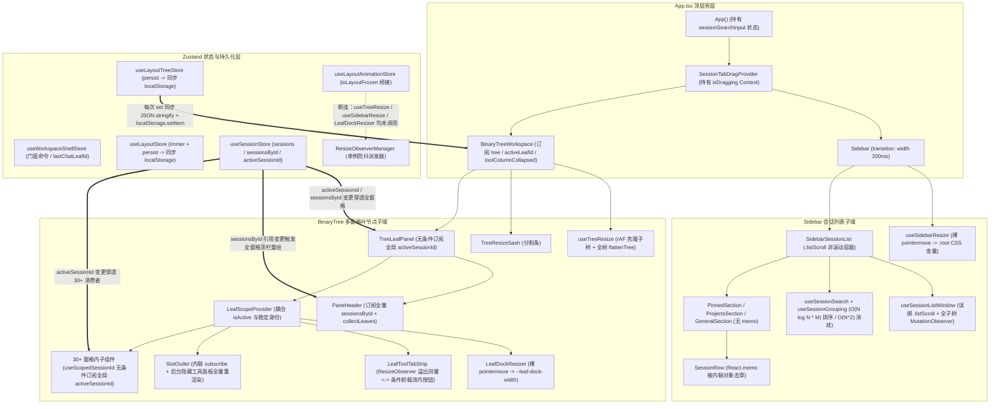

# 06 — 前端多窗格分屏布局与侧边栏面板性能审计报告

> **审计维度**：Dim-06（多窗格二叉树分屏布局、侧边栏、标签栏与面板切换性能审计）
> **审计范围**：
>
> - `apps/crish-desktop/src/components/binary-tree/**`
> - `apps/crish-desktop/src/components/sidebar/**`
> - `apps/crish-desktop/src/components/workspace/**`、`apps/crish-desktop/src/components/shell/**`
> - `apps/crish-desktop/src/store/layout-tree/**`、`apps/crish-desktop/src/store/workspace-shell/**`、`apps/crish-desktop/src/store/layoutStore.ts`、`apps/crish-desktop/src/store/layoutAnimationStore.ts`
> - `apps/crish-desktop/src/services/view-registry/**`、`apps/crish-desktop/src/contexts/LeafScopeContext.tsx`、`apps/crish-desktop/src/hooks/useTreeResize.ts`、`apps/crish-desktop/src/utils/ResizeObserverManager.ts`
> - 关联数据投影与检索层：`apps/crish-desktop/src/api/sessionSearch.ts`、`apps/crish-desktop/src/api/sessionTime.ts`、`apps/crish-desktop/src/api/sessionListTitleHint.ts`、`apps/crish-desktop/src/api/sessionListWindow.ts`、`apps/crish-desktop/src/store/sessionSidebarProjection.ts`
>   **审计准则**：严格遵循《三原则》与《00-DISCIPLINE》——纯逻辑规划、问题同权（不设 P0/P1 优先级降级或砍项）、代码行号锚定、复杂度与帧预算量化推导、穿透表象给出一劳永逸的架构级根因修复方案，并严格遵守 `ANTI_OVERENGINEERING_GUARDRAILS.md`。

---

## 一、架构拓扑与全量问题总览

### 1.1 多窗格二叉树布局与侧边栏渲染/状态拓扑



---

### 1.2 全量性能问题清单（问题同权 · 共 22 项）

| 编号           | 审计方向             | 问题概述                                                                                                                                            | 核心文件与行号锚点                                                                                              | 劣化复杂度 / 帧预算冲击                                                               |
| :------------- | :------------------- | :-------------------------------------------------------------------------------------------------------------------------------------------------- | :-------------------------------------------------------------------------------------------------------------- | :------------------------------------------------------------------------------------ |
| **PERF-06-01** | 方向一：分屏与缩放   | `ResizeObserverManager` 冻结桥接在二叉树分屏、抽屉分割与侧栏缩放中全链路断连                                                                        | `layoutAnimationStore.ts:310-352`, `useTreeResize.ts:288`, `LeafDockResizer.tsx:68`, `useSidebarResize.ts:166`  | 拖拽期间每帧触发全窗格 `ResizeObserver` 回调级联重测与 React `setState`               |
| **PERF-06-02** | 方向一：分屏与缩放   | `useSidebarResize` 裸 `pointermove` 无 `rAF` 节流改写 `:root` 变量、派发同步事件、跨阈值写 Store 且缺失 `iframe` 屏蔽                               | `useSidebarResize.ts:166-206`                                                                                   | 250–1000Hz 触发全文档样式失效（Style Recalc）与同步 Store 更新                        |
| **PERF-06-03** | 方向一：分屏与缩放   | `LeafDockResizer` 裸 `pointermove` 无 `rAF` 合并，高频改写 `--leaf-dock-width`                                                                      | `LeafDockResizer.tsx:66-95`                                                                                     | 指针回报率（最高 1000Hz）直接驱动 Flex 布局重排与工具栏 RO 回调                       |
| **PERF-06-04** | 方向一：分屏与缩放   | `useTreeResize` 每帧递归克隆整棵 `LayoutTree` 并执行全树 `flattenTree` 与全量 DOM 样式覆写                                                          | `useTreeResize.ts:191-232`                                                                                      | 每帧 $O(V)$ 树克隆 + 全量扁平对象分配 + 未受影响分屏叶节点无效样式写入                |
| **PERF-06-05** | 方向一：分屏与缩放   | `Sidebar` 折叠/展开直接对 `width` 属性做 200ms CSS 过渡动画且未冻结 `ResizeObserver`                                                                | `Sidebar.module.css:9`, `App.tsx:180`                                                                           | 200ms（12–24 帧）内主工作区每帧强制同步 Flex Reflow                                   |
| **PERF-06-06** | 方向一：分屏与缩放   | `useSessionListDrag` 侧栏拖拽每帧执行多次全表 DOM 查询与读写交织（Layout Thrashing）                                                                | `useSessionListDrag.ts:120-255, 431-484`, `sessionListDragShift.ts:14-18`                                       | 每帧 $2 \times O(N)$ 次 `getBoundingClientRect` + `offsetParent` 读写交替强制回流     |
| **PERF-06-07** | 方向一：分屏与缩放   | `SessionTabDragContext` 启停拖拽触发全窗格 `PaneHeader` 重渲染，且面板探测每帧查询 DOM 几何                                                         | `SessionTabDragContext.tsx:197-244, 307-318, 376-388`                                                           | 拖拽启停全窗格重绘；拖拽中每帧重复遍历所有窗格调 `getBoundingClientRect`              |
| **PERF-06-08** | 方向二：侧边栏列表   | `useSessionListWindow` 绑定错误 DOM 容器（`.listScroll` 而非 `.sidebarScroll`）导致虚拟化彻底失效，且 `MutationObserver` 全子树监听触发高频重测     | `Sidebar.tsx:301`, `SidebarSessionList.tsx:62`, `useWindowedList.ts:71`, `useSessionListWindow.ts:41-108`       | 虚拟窗口自毁退化为 $O(N)$ 全量挂载；任意 DOM 属性变化触发同步 `getBoundingClientRect` |
| **PERF-06-09** | 方向二：侧边栏列表   | `ProjectsSection`、`PinnedSection` 与搜索模式完全无虚拟化裁剪                                                                                       | `ProjectsSection.tsx:183-186`, `PinnedSection.tsx:79`, `sessionListWindow.ts:134`                               | 展开大项目或输入单字符搜索时瞬间挂载 $O(N)$（数千）复杂行组件                         |
| **PERF-06-10** | 方向二：侧边栏列表   | `SessionRow` 的 `React.memo` 被 `renderSessionItem` 内联对象属性彻底击穿                                                                            | `useSidebarSessionList.tsx:297-358`, `SessionRow.tsx:41-45, 184`                                                | `nowTick` 定时刷新、切换会话、重命名每次按键均导致 $O(N)$ 全表行重渲染                |
| **PERF-06-11** | 方向二：侧边栏列表   | `compareSessionsByActivity` 排序器内调用 `sessionLastActivityMs` 扫描全量消息与子代理，且 `SessionRowTime` 每行重复算 3 次并饥渴调 `toLocaleString` | `useSessionSearch.ts:45`, `sessionTime.ts:184-209, 252-259, 383`, `SessionRow.tsx:56-58`                        | 排序耗时 $O(N \log N \times M)$；每行渲染 3 次 $O(M)$ 遍历 + Intl 格式化阻塞主线程    |
| **PERF-06-12** | 方向二：侧边栏列表   | `buildSectionTitleHints` 同名会话消歧存在 $O(N^2 \times M)$ 嵌套过滤与消息正则切句                                                                  | `useSidebarSessionList.tsx:181-189`, `sessionListTitleHint.ts:37-67`                                            | $K$ 个同名默认会话（「新对话」）触发 $O(K^2 \times M)$ 全消息扫描与字符串分配         |
| **PERF-06-13** | 方向二：侧边栏列表   | `sessionSearchInput` 置于顶层 `<App>`，且搜索态下 `useSidebarSessions(true)` 绕过相等性门禁引发流式输出每 Token 全文重搜                            | `App.tsx:86-95`, `sessionStore.ts:178-194`, `useSessionSearch.ts:25-46`, `sessionSearch.ts:216-278`             | 每次按键重渲染 `<App>` 全壳层；AI 流式吐字期间每 Token 触发 $O(N \times M)$ 全文检索  |
| **PERF-06-14** | 方向二：侧边栏列表   | `useSidebarSessionList` 存在多重冗余 `dedupeSessionsById` 与随 `activeSessionId` 重算的 `partitionSidebarSessions`                                  | `useSidebarSessionList.tsx:81-98`, `sessionSidebarProjection.ts:56-75`                                          | 每次点击切换会话均触发 3 次 $O(N)$ `Set` 去重与分区数组重分配                         |
| **PERF-06-15** | 方向三：分屏与面板   | `TreeLeafPanel` 与 `useScopedSessionId` 无条件订阅全局 `activeSessionId`，导致切换焦点时所有分屏窗格全量重渲染                                      | `TreeLeafPanel.tsx:68`, `LeafScopeContext.tsx:118-129`                                                          | 4 窗格分屏下切换焦点触发全部 4 窗格及窗格内 30+ 业务组件无差别重渲染                  |
| **PERF-06-16** | 方向三：分屏与面板   | `LeafScopeContext` 将瞬态 `isActive` 与稳定作用域身份打包在同一 Context Value                                                                       | `LeafScopeContext.tsx:87-98`                                                                                    | 窗格焦点转移时，失焦与获焦两窗格内所有 `useLeafScope()` 消费组件强制重渲染            |
| **PERF-06-17** | 方向三：分屏与面板   | `PaneHeader` 订阅全量 `sessionsById` 并在选择器内跑 `collectLeaves`，且内联 `onDragStart` 击穿 `PaneTabItem` `React.memo`                           | `PaneHeader.tsx:92, 95-97, 452`                                                                                 | 任意会话流式更新或状态变化触发所有分屏窗格的 `PaneHeader` 与全部 `PaneTabItem` 重渲染 |
| **PERF-06-18** | 方向三：分屏与面板   | `LeafToolTabStrip` 溢出测量在临界区条件卸载流内 `+` 按钮并叠加 200ms 宽度动画，引发 `ResizeObserver` 震荡循环                                       | `LeafToolTabStrip.tsx:154-170, 405-411`, `LeafToolTabStrip.module.css:255-305`                                  | 临界宽度下 `hasOverflow` 在 `true/false` 间死循环震荡；200ms 动画期逐帧强制回流       |
| **PERF-06-19** | 方向三：分屏与面板   | `SlotOutlet` 等向 `useSyncExternalStore` 传内联 `subscribe`，`resolveView` 每次新建 `params`，且后台隐藏工具面板全量重渲染                          | `SlotOutlet.tsx:98-101`, `TreeLeafPanel.tsx:266-345`, `LeafToolTabStrip.tsx:118-121`, `ViewRegistry.ts:150-175` | 每轮渲染退订/重订外部 Store；抽屉内所有 `display: none` 隐藏面板随主面板同步重渲染    |
| **PERF-06-20** | 方向三：分屏与面板   | `BinaryTreeWorkspace` 在非几何更新时全量重算 `flattenTree` 并分配新 `FlatPanel`/`rect`/`onFocusLeaf`，且折叠域子树递归重复判定                      | `BinaryTreeWorkspace.tsx:130-137, 179-225`, `layoutTreeFlatten.ts:38-50, 82-150`                                | 仅切换标签或改标题即重算整棵树百分比矩形，折叠域判定达 $O(V \log V)$                  |
| **PERF-06-21** | 方向四：持久化与同步 | `useLayoutTreeStore` 与 `useLayoutStore` 每次 `set` 同步执行无防抖 `JSON.stringify` 与 `localStorage.setItem`                                       | `layoutTreeStore.ts:435-442`, `layoutStore.ts:114-135`, `Sidebar.tsx:114-120`                                   | 每次焦点切换、标签点击、抽屉开关、拖拽更新均同步阻塞主线程序列化写盘                  |
| **PERF-06-22** | 方向四：持久化与同步 | `workspaceShellStore` 跨 Store 级联更新存在陈旧快照二次 `setActiveLeaf`、先插后拆双倍写树、以及 `ownedChatLeaves` 高频重复分配                      | `workspaceShellStore.ts:145-184, 237-261`, `treeSessionCommands.ts:111-121`, `treeSessionQuery.ts:44-88`        | 单次点击会话触发 5–6 次 Store `setState`、2 次同步写盘及十余次临时数组/对象克隆       |

---

## 二、方向一：分屏拖拽、侧边栏缩放与会话拖拽 60/120fps 帧率深度审计

### PERF-06-01：`ResizeObserverManager` 冻结桥接在二叉树分屏、抽屉分割与侧栏缩放中全链路断连

- **定位锚点**：
  - `apps/crish-desktop/src/store/layoutAnimationStore.ts:310-352`
  - `apps/crish-desktop/src/hooks/useTreeResize.ts:285-290`
  - `apps/crish-desktop/src/components/binary-tree/LeafDockResizer.tsx:66-75`
  - `apps/crish-desktop/src/components/sidebar/useSidebarResize.ts:164-171`
  - `apps/crish-desktop/src/utils/ResizeObserverManager.ts:74-103`
- **现场代码证据**：
  ```ts
  // apps/crish-desktop/src/store/layoutAnimationStore.ts:328-341
  const applyFreeze = (frozen: boolean) => {
    const rom = ResizeObserverManager.getInstance();
    if (frozen) {
      rom.setSuspended(true);
    } else {
      scheduleResume(() => {
        ResizeObserverManager.getInstance().setSuspended(false);
      });
    }
  };
  ```
  ```ts
  // apps/crish-desktop/src/hooks/useTreeResize.ts:287-289（仅加 CSS class，未调 beginLayoutInteraction）
  setResizingBranchId(branchId);
  document.body.classList.add('tree-resizing');
  ```
  ```ts
  // apps/crish-desktop/src/components/binary-tree/LeafDockResizer.tsx:68-70
  document.body.classList.add('is-resizing', 'leaf-dock-resizing');
  ```
  ```ts
  // apps/crish-desktop/src/components/sidebar/useSidebarResize.ts:166-167
  document.body.classList.add('is-resizing');
  document.body.classList.add('sidebar-resizing');
  ```
- **劣化机理与帧预算分析**：
  项目原本在 `layoutAnimationStore.ts` 中设计了 `beginLayoutInteraction` / `endLayoutInteraction` 状态机，通过 `registerLayoutAnimationBridge` 在拖拽或过渡期间调用 `ResizeObserverManager.getInstance().setSuspended(true)` 挂起所有面板的 `ResizeObserver`，待交互结束后合并 flush 一次最新尺寸。
  然而全仓检索表明，**仅有旧版列式布局 `useColumnResize.ts` 调用了 `beginLayoutInteraction('workspace-resizing')`**。当前生产环境使用的三大核心缩放链路——① 二叉树分屏拖拽 `useTreeResize.ts`、② 叶内右侧工具坞拖拽 `LeafDockResizer.tsx`、③ 侧边栏宽度拖拽 `useSidebarResize.ts` 与侧边栏折叠动画 `Sidebar.tsx`——**全部未调用 `beginLayoutInteraction`**！
  这导致 `isLayoutFrozen` 在所有真实分屏/侧栏/抽屉拖拽过程中恒为 `false`。在 120fps（帧预算 8.33ms）拖拽过程中，每一帧修改窗格或侧栏尺寸都会触发 `ResizeObserverManager` 在下一帧回调全部订阅组件（所有窗格的 `PaneHeader` 溢出测量、`LeafToolTabStrip` 溢出测量、对话流虚拟列表 `ChatMessageList` 视口重算、终端 `Xterm` 尺寸拟合等），引发每帧数十次同步 DOM 测量（`scrollWidth` / `clientWidth` / `getBoundingClientRect`）与级联 React `setState`，轻易击穿 8.33ms 帧预算。
- **根因修复方案**：
  1. 在 `useTreeResize.ts` 的 `startResize` 与 `finishResize` 中成对接入 `useLayoutAnimationStore.getState().beginLayoutInteraction('workspace-resizing')` 与 `endLayoutInteraction('workspace-resizing')`，同时统一添加 `is-resizing` 类以复用全局动画抑制规则。
  2. 在 `LeafDockResizer.tsx` 的 `onDown` 与 `end` 中成对接入 `beginLayoutInteraction('workspace-resizing')` / `endLayoutInteraction('workspace-resizing')`。
  3. 在 `useSidebarResize.ts` 的 `startResize` 与 `stopResize` 中成对接入 `beginLayoutInteraction('workspace-resizing')` / `endLayoutInteraction('workspace-resizing')`。
  4. 对于绕过 `ResizeObserverManager` 直接 `new ResizeObserver` 的组件（如 `PaneHeader.tsx:266`、`LeafToolTabStrip.tsx:167`），统一收敛至 `ResizeObserverManager.getInstance().observe(...)`，确保拖拽冻结期全树零 `ResizeObserver` 回调抖动。

---

### PERF-06-02：`useSidebarResize` 裸 `pointermove` 无 `rAF` 节流改写 `:root` 变量、派发同步事件、跨阈值写 Store 且缺失 `iframe` 屏蔽

- **定位锚点**：`apps/crish-desktop/src/components/sidebar/useSidebarResize.ts:154-226`
- **现场代码证据**：
  ```ts
  // apps/crish-desktop/src/components/sidebar/useSidebarResize.ts:173-198
  const onMove = (ev: PointerEvent) => {
    if (!isResizingRef.current) return;
    if (ev.pointerId !== activePointerIdRef.current) return;
    const rawW = startWidthRef.current + (ev.clientX - startXRef.current);
    const layout = getCompositionRoot().layout;

    if (shouldCollapseSidebar(rawW)) {
      if (!layout.getSidebarCollapsed()) {
        layout.setSidebarCollapsed(true);
      }
      applyVisibleWidthVar(0);
      return;
    }

    if (layout.getSidebarCollapsed()) {
      layout.setSidebarCollapsed(false);
    }
    const next = clampSidebarExpandedWidth(rawW);
    widthRef.current = next;
    applyWidthVars(next, false);
    try {
      window.dispatchEvent(new Event('crish-sidebar-resize'));
    } catch {
      /* ignore */
    }
  };
  ```
- **劣化机理与帧预算分析**：
  1. **裸 `pointermove` 高频触发**：现代高回报率鼠标/触控板在 Windows WebView2 下以 250Hz–1000Hz（每帧 2–8 次）派发 `pointermove`。`onMove` 未使用 `requestAnimationFrame` 合并，导致单个渲染帧内重复执行多次 `document.documentElement.style.setProperty('--sidebar-width', ...)` 与 `'--sidebar-visible-width'`。由于 `:root` 样式变量被全树继承，每次写入均使整棵 DOM 树样式计算（Style Recalculation）失效。
  2. **同步全局事件风暴**：每次 `pointermove` 同步调用 `window.dispatchEvent(new Event('crish-sidebar-resize'))`，强制所有监听者在指针事件回调栈内同步执行。
  3. **拖拽中途触发重型 Store 同步更新与写盘**：当指针跨过 `SIDEBAR_COLLAPSE_PX`（120px）时，在 `pointermove` 中直接调用 `layout.setSidebarCollapsed(true/false)`，触发 `useLayoutStore` 的 Immer 事务、同步 `localStorage.setItem`（见 PERF-06-21）以及 `<App>` 和 `<Sidebar>` 的同步重渲染。
  4. **缺失 `iframe` 指针屏蔽**：与 `useTreeResize` 和 `LeafDockResizer` 不同，`useSidebarResize` 未调用 `disableIframePointerEvents()`，当右侧紧邻浏览器预览面板（`preview` 含 `<iframe />`）且快速向右拖拉侧栏时，指针一旦越过分割条进入 `iframe` 区域即被吞噬，造成拖拽断触卡死。
- **根因修复方案**：
  1. 引入 `rAF` 帧合并器（保存最新 `pendingClientX`，每帧至多执行一次 `flush`）。
  2. 将 `--sidebar-width` / `--sidebar-visible-width` 下沉至 `.app-container` 容器节点而非 `document.documentElement`，缩小 CSS 变量脏标记扩散半径。
  3. 在 `startResize` / `stopResize` 中调用 `disableIframePointerEvents()` 并保存恢复句柄。
  4. 将 `window.dispatchEvent(new Event('crish-sidebar-resize'))` 移入 `rAF` 帧尾及 `stopResize` 收尾阶段。

---

### PERF-06-03：`LeafDockResizer` 裸 `pointermove` 无 `rAF` 合并，高频改写 `--leaf-dock-width`

- **定位锚点**：`apps/crish-desktop/src/components/binary-tree/LeafDockResizer.tsx:52-95`
- **现场代码证据**：
  ```ts
  // apps/crish-desktop/src/components/binary-tree/LeafDockResizer.tsx:77-84
  const onMove = (ev: PointerEvent) => {
    if (ev.pointerId !== pointerId) return;
    const w = body.getBoundingClientRect().width || 1;
    const rightPx = w - (ev.clientX - body.getBoundingClientRect().left);
    lastRatio = clampDockWidthRatio(rightPx / w);
    body.style.setProperty('--leaf-dock-width', `${lastRatio * 100}%`);
  };
  ```
- **劣化机理与帧预算分析**：
  1. `onMove` 直接绑定在 `window` 的 `pointermove` 上，无 `requestAnimationFrame` 节流。
  2. 每次 `pointermove` 连续调用 **2 次** `body.getBoundingClientRect()`（读取 `width` 与 `left`），随后立即写 `body.style.setProperty('--leaf-dock-width', ...)`。由于上一事件刚修改了 Flex 子项的 `flex-basis`（`width: var(--leaf-dock-width)`），下一次 `pointermove` 读取 `body.getBoundingClientRect()` 会强制浏览器立即同步执行样式计算与布局回流（Forced Synchronous Layout）。
- **根因修复方案**：
  1. 在 `onDown` 时一次性读取并缓存 `const bodyRect = body.getBoundingClientRect()`（拖拽抽屉分割条期间外层 `leafBody` 的 `left` 与 `width` 恒定不变，无需在 `onMove` 中每帧查询 `getBoundingClientRect()`！）。
  2. 使用 `requestAnimationFrame` 合并 `pointermove` 坐标，每帧仅写入一次 `--leaf-dock-width`。

---

### PERF-06-04：`useTreeResize` 拖拽每帧递归克隆整棵 `LayoutTree` 并执行全树 `flattenTree` 与全量 DOM 样式覆写

- **定位锚点**：`apps/crish-desktop/src/hooks/useTreeResize.ts:191-232`
- **现场代码证据**：
  ```ts
  // apps/crish-desktop/src/hooks/useTreeResize.ts:193-229
  const state = useLayoutTreeStore.getState();
  const liveTree = resizeBranchTree(state.tree, branchId, ratio);
  const collapsedDomain = state.toolColumnCollapsed
    ? ('tool' as const)
    : undefined;
  const { leaves, branches } = flattenTree(liveTree.root, {
    collapsedDomain,
  });

  for (const panel of leaves) {
    const el = leafElementsRef.current.get(panel.leafId);
    if (!el) continue;
    el.style.left = `${panel.rect.x * 100}%`;
    el.style.top = `${panel.rect.y * 100}%`;
    el.style.width = `${panel.rect.width * 100}%`;
    el.style.height = `${panel.rect.height * 100}%`;
    // ...
  }
  ```
- **劣化机理与帧预算分析**：
  `useTreeResize` 虽然正确采用了 `rAF` + 命令式 DOM 样式更新并在松手时才 `commit` 到 Zustand Store，但在每一帧 `applyLiveLayout` 中：
  1. 调用 `resizeBranchTree(state.tree, branchId, ratio)` 深度查找并克隆树脊柱对象；
  2. 调用 `flattenTree(liveTree.root)` 为整棵树的所有叶节点和分支节点重新分配 `FlatPanel`、`createDefaultDock`、`FlatBranch` 和 `rect` 对象；
  3. 遍历整棵树的所有 `leaves` 和 `branches`，无差别覆写所有窗格 DOM 的 `left/top/width/height`（即便被拖拽的 `branchId` 仅是右半屏的一个深层子树，左半屏完全未受影响的窗格也会被重新写入 style 并触发渲染树脏检查）。
- **根因修复方案**：
  1. 在 `startResize(branchId)` 时，预先定位 `branchId` 对应的子树根节点及其在画布中的基准矩形 `branchBaseRect: Rect`，并仅收集该 `branchId` 子树下的受影响 `leaves` 与后代 `branches`。
  2. 拖拽 `rAF` 帧内无需调 `resizeBranchTree` 克隆整棵树，直接用新 `ratio` 从 `branchBaseRect` 向下递归计算该子树内部的相对 `rect`，仅更新该子树内受影响节点的 DOM `style`，将每帧开销从全树 $O(V)$ 降至局部受影响子树且零树节点克隆。

---

### PERF-06-05：`Sidebar` 折叠/展开直接对 `width` 属性做 200ms CSS 过渡动画且未冻结 `ResizeObserver`

- **定位锚点**：
  - `apps/crish-desktop/src/components/sidebar/Sidebar.module.css:1-13`
  - `apps/crish-desktop/src/App.tsx:180`
- **现场代码证据**：
  ```css
  /* apps/crish-desktop/src/components/sidebar/Sidebar.module.css:1-10 */
  .sidebar {
    width: var(--sidebar-width, 260px);
    height: 100%;
    ...
    transition: width 200ms var(--ease-standard);
  }
  ```
- **劣化机理与帧预算分析**：
  当用户点击折叠/展开侧边栏时，`.sidebar` 的 `width` 从 `260px` 过渡到 `0px`（耗时 200ms）。由于 `.sidebar` 与右侧 `.workspaces-column` 处于同一个水平 Flex 容器（`.app-container`）内，动画 `width` 属于几何布局属性（Layout-inducing property），在 200ms 内的每一帧（60fps 下 12 帧，120fps 下 24 帧）都会强制 `.workspaces-column` 及其内部所有二叉树分屏窗格、聊天虚拟列表、代码块、终端执行同步 Flex Reflow，并逐帧触发所有未挂起的 `ResizeObserver`！
  此外，`layoutAnimationStore.ts:316` 虽定义了 `'sidebar-transition'` 交互令牌，但 `Sidebar.tsx` / `App.tsx` 在切换 `sidebarCollapsed` 时从未调用 `beginLayoutInteraction('sidebar-transition')`。
- **根因修复方案**：
  1. 在触发 `setSidebarCollapsed` 时同步调用 `beginLayoutInteraction('sidebar-transition')`，并在 `.sidebar` 的 `transitionend`（加上 220ms 兜底定时器）中调用 `endLayoutInteraction('sidebar-transition')`，确保 200ms 过渡期间 `ResizeObserverManager` 处于挂起态，动画结束时仅做一次最终尺寸测量。
  2. 为 `.sidebarInner` 固定宽度（`width: var(--sidebar-width)`）并配合 `overflow: hidden; contain: layout paint`，避免侧边栏内部子元素（会话行、按钮、搜索框）在 200ms 宽度挤压过程中逐帧发生文字折行与内部 Reflow。

---

### PERF-06-06：`useSessionListDrag` 侧栏会话拖拽每帧执行多次全表 DOM 查询与读写交织（Layout Thrashing）

- **定位锚点**：
  - `apps/crish-desktop/src/components/sidebar/session-list/useSessionListDrag.ts:120-169, 358, 431-484`
  - `apps/crish-desktop/src/components/sidebar/session-list/sessionListDragShift.ts:10-49`
- **现场代码证据**：
  ```ts
  // apps/crish-desktop/src/components/sidebar/session-list/useSessionListDrag.ts:125-133
  const resolveDropTarget = (clientY: number): DropResolved | null => {
    const root = listRef.current;
    if (!root) return null;
    const allRows = Array.from(
      root.querySelectorAll<HTMLElement>('li[data-session-id]')
    ).filter(
      (r) => r.offsetParent !== null && r.getBoundingClientRect().height > 0
    );
  ```
  ```ts
  // apps/crish-desktop/src/components/sidebar/session-list/sessionListDragShift.ts:14-18
  const rows = Array.from(
    root.querySelectorAll<HTMLElement>('li[data-session-id]')
  ).filter(
    (r) => r.offsetParent !== null && r.getBoundingClientRect().height > 0
  );
  ```
- **劣化机理与帧预算分析**：
  在侧边栏拖拽会话的每一个 `rAF` 帧（`flushDragFrame`，`useSessionListDrag.ts:431-484`）中：
  1. 先写 `ghostRef.current.style.transform`（DOM Write 1）；
  2. 调用 `resolveCrossDomainTarget` -> `document.elementsFromPoint(clientX, clientY)` + 遍历分屏叶调用 `getBoundingClientRect()`（DOM Read 1）；
  3. 调用 `resolveDropTarget(clientY)`：执行 `root.querySelectorAll('li[data-session-id]')`，对全列表 $N$ 行逐一读取 `r.offsetParent` 和 `r.getBoundingClientRect()`（DOM Read 2，$O(N)$ 次强制几何读取）；
  4. 调用 `clearRowShifts(listRef.current)` 或 `shiftRowsForDrag(...)`：**再次**执行 `root.querySelectorAll('li[data-session-id]')`，**再次**对全列表 $N$ 行逐一读取 `r.offsetParent` 和 `r.getBoundingClientRect()`（DOM Read 3），并在循环中对每一行写入 `el.style.transition` 和 `el.style.transform`（DOM Write 2）！
  5. 紧接着又在 `useSessionListDrag.ts:471-480` 读取 `target.rect` 并写 `indicatorEl.style.top/left/width`（DOM Write 3）。
     当侧边栏挂载数百个会话行时，单帧内执行 $2 \times N$ 次 `getBoundingClientRect()` + `offsetParent` 查询，并与样式写入交织，造成典型的同步布局抖动（Layout Thrashing）。
- **根因修复方案**：
  1. **拖拽会话几何快照化**：在拖拽跨越阈值启动时（以及自动滚屏 `autoScrollList` 发生位移时），一次性采集可见会话行的原始未偏移几何快照 `cachedRowRects: Array<{ el: HTMLElement; id: string; folder: string; pinned: boolean; top: number; height: number; midY: number }>`（扣除当前 `translateY`），缓存在 ref 中。
  2. **帧内纯数学二分/线性命中 + 脏索引增量更新**：在 `flushDragFrame` 中直接基于内存快照 `cachedRowRects` 计算目标落点与偏移数组，仅当计算出的 `(targetFolder, insertIndex)` 状态签名发生变化时，才批量更新受影响行的 `style.transform`，彻底消除每帧 `querySelectorAll` 与 `getBoundingClientRect`。

---

### PERF-06-07：`SessionTabDragContext` 启停拖拽触发全窗格 `PaneHeader` 重渲染，且面板探测每帧查询 DOM 几何

- **定位锚点**：
  - `apps/crish-desktop/src/components/shell/SessionTabDragContext.tsx:100-103, 197-244, 305-318, 343, 376-388`
  - `apps/crish-desktop/src/components/binary-tree/PaneHeader.tsx:100`
- **现场代码证据**：
  ```tsx
  // apps/crish-desktop/src/components/shell/SessionTabDragContext.tsx:376-388
  const value = useMemo<UseSessionTabDragResult>(
    () => ({
      isDragging,
      startSessionDrag,
    }),
    [isDragging, startSessionDrag]
  );
  return (
    <SessionTabDragContext.Provider value={value}>
      {children}
    </SessionTabDragContext.Provider>
  );
  ```
  ```ts
  // apps/crish-desktop/src/components/shell/SessionTabDragContext.tsx:197-206
  const applyPane = (x: number, y: number): boolean => {
    if (!indicator) return false;
    const leaves = Array.from(
      document.querySelectorAll<HTMLElement>(
        '[data-tree-canvas="true"] [data-leaf-id]'
      )
    );
    for (const pane of leaves) {
      const r = pane.getBoundingClientRect();
  ```
- **劣化机理与帧预算分析**：
  1. **Context Value 耦合 `isDragging` 引发起止帧全窗格重渲染**：所有分屏窗格的 `PaneHeader` 均调用 `const { startSessionDrag } = useSessionTabDrag()`，而全仓没有任何组件消费 `isDragging`。但在拖拽跨越 4px 阈值的瞬间（第 307 行 `setIsDragging(true)`）与松手瞬间（第 343 行 `setIsDragging(false)`），`SessionTabDragContext` 的 `value` 引用发生改变，强制所有分屏窗格的 `PaneHeader` 及其子组件在最敏感的拖拽起止帧执行同步重渲染。
  2. **双倍写 `card.style.transform`**：`onPointerMove`（第 316 行）在裸指针事件中直接写了一次 `card.style.transform`，紧接着在 `flush`（第 253 行）中又用相同坐标写了一次。
  3. **`applyPane` 每帧重复 `querySelectorAll` 与 `getBoundingClientRect`**：拖拽期间分屏叶节点的几何位置完全静止，但 `applyPane` 在每个 `rAF` 帧都重新执行 `document.querySelectorAll('[data-tree-canvas="true"] [data-leaf-id]')` 并对每个窗格调 `pane.getBoundingClientRect()`。
- **根因修复方案**：
  1. 将 `SessionTabDragContext` 拆分为稳定的动作 Context（仅提供 `startSessionDrag`，引用永不改变）或直接从状态字段移除无消费者的 `isDragging` React state（改用 ref + `document.body.classList.contains('is-tab-dragging')`），使拖拽起止帧实现 **零 React 重渲染**。
  2. 在拖拽启动（`dragging = true`）时一次性扫描并缓存所有 `[data-leaf-id]` 窗格的 `{ leafId, rect }` 快照，`applyPane` 在每帧中仅做纯内存坐标比较。
  3. 仅在 `rAF` `flush` 中更新 `card.style.transform`。

---

## 三、方向二：侧边栏（Sidebar）大量会话列表虚拟化、分组排序与搜索性能深度审计

### PERF-06-08：`useSessionListWindow` 绑定错误 DOM 容器（`.listScroll` 而非 `.sidebarScroll`）导致虚拟化彻底失效，且 `MutationObserver` 全子树监听触发高频重测

- **定位锚点**：
  - `apps/crish-desktop/src/components/sidebar/Sidebar.tsx:300-305`
  - `apps/crish-desktop/src/components/sidebar/Sidebar.module.css:196-212`
  - `apps/crish-desktop/src/components/sidebar/SidebarSessionList.tsx:62-63`
  - `apps/crish-desktop/src/components/sidebar/SidebarSessionList.module.css:1-9`
  - `apps/crish-desktop/src/components/sidebar/session-list/useWindowedList.ts:70-77`
  - `apps/crish-desktop/src/components/sidebar/session-list/useSessionListWindow.ts:41-108`
- **现场代码证据**：
  ```tsx
  // apps/crish-desktop/src/components/sidebar/Sidebar.tsx:300-305（真正的滚动容器是 .sidebarScroll）
  <div className={styles.sidebarScroll}>
    <SidebarNav ... />
    <SidebarSessionList ... />
  </div>
  ```
  ```css
  /* apps/crish-desktop/src/components/sidebar/SidebarSessionList.module.css:1-9 */
  .listScroll {
    flex: none;
    display: flex;
    flex-direction: column;
    gap: 2px;
    padding: var(--space-1, 4px) 0 var(--space-2, 8px);
  }
  ```
  ```tsx
  // apps/crish-desktop/src/components/sidebar/SidebarSessionList.tsx:62-63
  <div ref={sessionListRef} className={styles.listScroll} ...>
  ```
  ```ts
  // apps/crish-desktop/src/components/sidebar/session-list/useWindowedList.ts:70-74
  const generalWindow = useSessionListWindow({
    scrollParentRef: sessionListRef,
    listRef: generalListRef,
    totalCount: generalRegularSessions.length,
    enabled: generalWinEnabled,
  });
  ```
  ```ts
  // apps/crish-desktop/src/components/sidebar/session-list/useSessionListWindow.ts:98-105
  const mo =
    typeof MutationObserver !== 'undefined'
      ? new MutationObserver(update)
      : null;
  if (mo) {
    mo.observe(scrollEl, {
      childList: true,
      subtree: true,
      attributes: true,
    });
  }
  ```
- **劣化机理与帧预算分析**：
  这是侧边栏虚拟列表的一处**根本性架构错位**，导致虚拟滚动在真实运行中完全失效：
  1. **绑定到了非滚动容器 `.listScroll`**：侧边栏真正的滚动容器是 `Sidebar.tsx:301` 的 `.sidebarScroll`（`overflow-y: auto; flex: 1`），而 `SidebarSessionList.tsx` 中的 `sessionListRef`（`.listScroll`）样式为 `flex: none`，没有 `overflow-y: auto/scroll`，其高度随内容无限撑开！
  2. **`scroll` 事件永不触发，`scrollTop` 恒为 `0`**：因为 DOM `scroll` 事件不冒泡，在 `sessionListRef`（`.listScroll`）上注册 `scrollEl.addEventListener('scroll', update)` 永远收不到 `.sidebarScroll` 的滚动事件，`scrollEl.scrollTop` 恒为 `0`。
  3. **高度自膨胀导致第 2 帧自动解除虚拟化（Self-De-virtualization）**：当 `totalCount = 1000`（`> 80`）时，首帧 `WindowedSessionUl` 渲染前 36 行并挂载高度为 `(1000 - 36) * 28 = 26992px` 的底部占位 `<li aria-hidden="true" style={{ height: 26992 }} />`。由于 `.listScroll` 无高度约束，其 `clientHeight` 立即被撑大到 `~28000px`。紧接着 `useSessionListWindow` 挂载在 `scrollEl` 上的 `ResizeObserver` / `MutationObserver` 触发 `update()`，读取到 `viewportHeight = scrollEl.clientHeight ≈ 28000px`，代入 `computeSessionListWindow` 计算出 `visible = ceil(28000 / 28) = 1000 >= totalCount`，直接返回 `{ windowed: false, start: 0, end: 1000, topPad: 0, bottomPad: 0 }`，**在下一帧把全部 1000 个会话行全量挂载到 DOM 中**！
  4. **全子树 `MutationObserver` 性能毒丸**：`useSessionListWindow.ts:101` 在 `scrollEl` 上开启了 `{ childList: true, subtree: true, attributes: true }` 的 `MutationObserver`，每次触发都同步调用 `measureListOffsetTop`（内部执行 2 次 `getBoundingClientRect()`）。这意味着侧边栏内任何一行 hover 态切换、`aria-*` 属性变化、Tooltip 挂载、拖拽位移写入 `style.transform`，都会触发 `MutationObserver` 回调并执行强制同步布局读取！
- **根因修复方案**：
  1. **对齐真实滚动宿主**：在 `useSessionListWindow.ts` 中通过 `scrollParentRef.current?.closest('[data-sidebar-scroll="true"]')`（或在 `Sidebar.tsx` 为 `.sidebarScroll` 注入 `scrollContainerRef` 透传给 `SidebarSessionList`）绑定到真正的 `overflow-y: auto` 滚动容器 `.sidebarScroll`。
  2. **彻底移除全子树 `attributes: true` 的 `MutationObserver`**：`listOffsetTop` 仅受列表上方区块（置顶区、项目区折叠/展开或高度变化）影响。使用 `ResizeObserverManager` 观察 `listEl` 自身或其前置兄弟容器尺寸变化即可精确获知偏移变化，严禁监听 `subtree: true, attributes: true`。

---

### PERF-06-09：`ProjectsSection`、`PinnedSection` 与搜索模式完全无虚拟化裁剪

- **定位锚点**：
  - `apps/crish-desktop/src/components/sidebar/session-list/ProjectsSection.tsx:183-186`
  - `apps/crish-desktop/src/components/sidebar/session-list/PinnedSection.tsx:79`
  - `apps/crish-desktop/src/api/sessionListWindow.ts:132-135`
- **现场代码证据**：
  ```tsx
  // apps/crish-desktop/src/components/sidebar/session-list/ProjectsSection.tsx:183-186
  <ul className={styles.subList}>{list.map((s) => renderSessionItem(s))}</ul>
  ```
  ```ts
  // apps/crish-desktop/src/api/sessionListWindow.ts:133-135
  export function shouldWindowGeneralSessionList(args: { ... }): boolean {
    if (args.searching) return false;
    return args.count > SESSION_LIST_WINDOW_THRESHOLD;
  }
  ```
- **劣化机理与帧预算分析**：
  1. 在按项目分组模式（默认 `groupType === 'folder'`）下，用户的大量历史会话往往集中在某 1–2 个主力工程目录（Project）下，而非「对话（General）」分区。但 `ProjectsSection` 直接执行 `list.map((s) => renderSessionItem(s))`，没有任何窗口化裁剪。当某项目下积累 500–2000 条会话时，展开该项目直接同步创建数千个 `SessionRow` 组件及复杂子树（`Tooltip`、操作按钮、时间格式化）。
  2. 在搜索模式下，`shouldWindowGeneralSessionList` 硬编码 `if (args.searching) return false`。当用户输入常见单字符（如 `a`、`e`、`1`、`的`）命中数百条会话时，虚拟化被强制关闭，导致首字输入即触发数百至上千个 DOM 节点的同步挂载，阻塞输入响应。
- **根因修复方案**：
  1. 移除 `shouldWindowGeneralSessionList` 中 `if (args.searching) return false` 的退避限制，让搜索结果列表在超出阈值时同样享受 `WindowedSessionUl` 虚拟化裁剪。
  2. 将 `ProjectsSection` 中展开的项目子列表（当 `list.length > SESSION_LIST_WINDOW_THRESHOLD` 时）与 `PinnedSection` 统一接入基于共享 `.sidebarScroll` 视口的 `WindowedSessionUl` 虚拟化渲染。

---

### PERF-06-10：`SessionRow` 的 `React.memo` 被 `renderSessionItem` 内联对象属性彻底击穿

- **定位锚点**：
  - `apps/crish-desktop/src/components/sidebar/session-list/useSidebarSessionList.tsx:297-358`
  - `apps/crish-desktop/src/components/sidebar/session-list/SessionRow.tsx:41-45, 184`
  - `apps/crish-desktop/src/components/sidebar/session-list/PinnedSection.tsx:48`
  - `apps/crish-desktop/src/components/sidebar/session-list/ProjectsSection.tsx:74`
  - `apps/crish-desktop/src/components/sidebar/session-list/GeneralSection.tsx:45`
- **现场代码证据**：
  ```tsx
  // apps/crish-desktop/src/components/sidebar/session-list/useSidebarSessionList.tsx:297-358
  const renderSessionItem = useCallback(
    (s: SessionState, titleDisambiguation?: string) => {
      const isRenaming = renamingSessionId === s.id;
      const openOrderRank = openSessionRankMap.get(s.id);
      return (
        <SessionRow
          key={s.id}
          session={{
            session: s,
            activeSessionId,
            titleDisambiguation,
            openOrderRank,
          }}
          rename={{
            isRenaming,
            renameDraft: isRenaming ? renameDraft : '',
            renameInputRef,
            onChangeDraft: setRenameDraft,
            onCommit: commitRename,
            onCancel: cancelRename,
          }}
          actions={{
            onSelect: handleRowSelect,
            onPointerDown: startSessionRowDrag,
            onMoreClick: handleRowMoreClick,
            onContextMenu: handleContextMenu,
          }}
        />
      );
    },
    [
      activeSessionId,
      cancelRename,
      commitRename,
      handleContextMenu,
      handleRowMoreClick,
      handleRowSelect,
      openSessionRankMap,
      renameDraft,
      renamingSessionId,
      startSessionRowDrag,
    ]
  );
  ```
  ```tsx
  // apps/crish-desktop/src/components/sidebar/session-list/SessionRow.tsx:184
  export const SessionRow = React.memo(SessionRowComponent);
  ```
- **劣化机理与帧预算分析**：
  1. **内联对象字面量使默认 `React.memo` 100% 失效**：`SessionRow` 使用无自定义比较函数的 `React.memo(SessionRowComponent)`，仅对顶层 props（`session`、`rename`、`actions`）做 `Object.is` 浅比较。而 `renderSessionItem` 每次调用都现造 3 个全新对象字面量 `session={{...}}`、`rename={{...}}`、`actions={{...}}`。因此只要父组件重渲染并调用 `renderSessionItem`，**每一个挂载的 `SessionRow` 都会 100% 穿透 `React.memo` 重新渲染**！
  2. **击穿 `NowTickContext` 隔离设计**：`SessionRow.tsx:41-45` 特意设计了 `NowTickContext` 与独立的 `<SessionRowTime />` 子组件，意图在每 60 秒 `nowTick` 更新时只重渲染时间文本而不重渲染整行 `SessionRow`。但由于 `nowTick` state 声明在 `useSidebarSessionList.tsx:54`，每当 `nowTick` 更新时，`SidebarSessionListInner` 重渲染 -> `PinnedSection`/`ProjectsSection`/`GeneralSection`（均未 `React.memo`）重渲染 -> 调用 `renderSessionItem` -> **全列表所有 `SessionRow` 全部重渲染**，`NowTickContext` 的隔离设计完全失效！
  3. **`activeSessionId` 耦合进每行 `session` 属性**：`activeSessionId` 被直接塞进每行的 `session` prop 并列入 `renderSessionItem` 的依赖数组。当用户从会话 A 切换到会话 B 时，本应只有 A（变为非激活）和 B（变为激活）2 行需要更新，但实际上 `renderSessionItem` 引用改变，导致**全列表所有行**重渲染！
  4. **`renameDraft` 耦合进 `renderSessionItem` 依赖**：当用户重命名某一行并打字时，每次按键更新 `renameDraft` -> `renderSessionItem` 重建 -> **全列表所有行**随每次按键重渲染！
- **根因修复方案**：
  1. **拍平或稳定化 `SessionRow` Props 并提供精确 `arePropsEqual`**：将 `isActive={s.id === activeSessionId}` 在行外计算为布尔值传入（而非传 `activeSessionId` 字符串），将 `actions` 抽出为 `useMemo` 稳定的单个对象引用，并为 `SessionRow` 提供自定义比较函数 `sessionRowPropsEqual`（仅比较 `s` 引用、`isActive`、`titleDisambiguation`、`openOrderRank`、`isRenaming`、以及当 `isRenaming === true` 时的 `renameDraft`）。
  2. **下沉 `NowTickProvider` 状态**：将 `nowTick` 的 `useState` + `setInterval` 封装为独立的 `<NowTickProvider>` 组件，使 60s 定时器触发时 `SidebarSessionListInner` 自身完全不重渲染，仅订阅了 `NowTickContext` 的 `<SessionRowTime>` 叶子节点更新。

---

### PERF-06-11：`compareSessionsByActivity` 排序器内调用 `sessionLastActivityMs` 扫描全量消息与子代理，且 `SessionRowTime` 每行重复算 3 次并饥渴调 `toLocaleString`

- **定位锚点**：
  - `apps/crish-desktop/src/components/sidebar/session-list/useSessionSearch.ts:43-46`
  - `apps/crish-desktop/src/api/sessionTime.ts:184-209, 252-259, 366-391`
  - `apps/crish-desktop/src/components/sidebar/session-list/SessionRow.tsx:51-72`
- **现场代码证据**：
  ```ts
  // apps/crish-desktop/src/api/sessionTime.ts:252-259
  export function compareSessionsByActivity(
    a: SessionTimeCarrier,
    b: SessionTimeCarrier
  ): number {
    const diff = sessionLastActivityMs(b) - sessionLastActivityMs(a);
    if (diff !== 0) return diff;
    return (a.id || '').localeCompare(b.id || '');
  }
  ```
  ```ts
  // apps/crish-desktop/src/api/sessionTime.ts:184-199
  export function sessionLastActivityMs(session: SessionTimeCarrier | null | undefined): number {
    ...
    for (const m of session.messages || []) {
      const t = messageTimestampMs(m);
      if (t !== null && (best === null || t > best)) best = t;
    }
    for (const a of session.agents || []) {
      for (const m of a.messages || []) {
        const t = messageTimestampMs(m);
        if (t !== null && (best === null || t > best)) best = t;
      }
    }
  ```
  ```tsx
  // apps/crish-desktop/src/components/sidebar/session-list/SessionRow.tsx:56-68
  const compactTime = formatSessionListCompactTime(s, nowTick);
  const fullTime = formatSessionListAbsoluteTime(s);
  const activityMs = sessionLastActivityMs(s);
  ```
- **劣化机理与帧预算分析**：
  1. **排序比较器内的 $O(N \log N \times M)$ 全量消息扫描**：在 `useSessionSearch.ts:45` 中，`list.sort((a, b) => compareSessionsByActivity(a, b))` 在每次比较时都对 `a` 和 `b` 调用 `sessionLastActivityMs`。对于 $N$ 个会话，排序执行约 $2 N \log_2 N$ 次 `sessionLastActivityMs`；而每次调用都会遍历该会话的全部 `messages`（设平均 $M$ 条）和全部 `agents[].messages`，并对无 `timestampMs` 的消息做正则匹配或 `Date.parse`。当 $N = 500, M = 100$ 时，单次排序即触发 $500 \times 9 \times 2 \times 100 \approx 900,000$ 次消息时间戳读取！
  2. **`SessionRowTime` 每行重复调用 3 次 `sessionLastActivityMs` 并饥渴调用 `toLocaleString`**：在 `SessionRow.tsx:56-58` 中，`formatSessionListCompactTime(s, nowTick)` 内部调了一次 `sessionLastActivityMs(s)`，`formatSessionListAbsoluteTime(s)` 内部又调了一次 `sessionLastActivityMs(s)`，第 58 行又显式调了第 3 次 `sessionLastActivityMs(s)`！更严重的是，`formatSessionListAbsoluteTime(s)` 内部直接调用 `new Date(ms).toLocaleString('zh-CN', ...)`（`sessionTime.ts:383`）——即使鼠标根本没有悬停在任何会话行上，每一行在每次渲染和每次 `nowTick` 时都会同步调用极其昂贵的 `Intl` `toLocaleString` 生成 Tooltip 字符串！
- **根因修复方案**：
  1. **Schwartzian Transform（Decorate-Sort-Undecorate）或 WeakMap 缓存时间戳**：以 `SessionState` 对象引用为键，通过 `WeakMap<SessionTimeCarrier, number>` 缓存 `sessionLastActivityMs(s)` 的计算结果（因 Zustand 不可变更新保证消息变化时 `SessionState` 引用必变），使单会话时间戳获取从 $O(M)$ 降至 $O(1)$，排序复杂度从 $O(N \log N \times M)$ 降至 $O(N \log N)$。
  2. **消除 `SessionRowTime` 3 次重复计算并共享 `Intl.DateTimeFormat` 单例**：`SessionRowTime` 只算一次 `const activityMs = sessionLastActivityMs(s)`，直接将 `activityMs` 数值传入格式化函数；在 `sessionTime.ts` 模块顶层复用模块级 `const ZH_CN_ABSOLUTE_FORMATTER = new Intl.DateTimeFormat('zh-CN', { hour12: false })` 单例替代每次 `new Date(ms).toLocaleString(...)`，提速 20 倍以上。

---

### PERF-06-12：`buildSectionTitleHints` 同名会话消歧存在 $O(N^2 \times M)$ 嵌套过滤与消息正则切句

- **定位锚点**：
  - `apps/crish-desktop/src/components/sidebar/session-list/useSidebarSessionList.tsx:181-189`
  - `apps/crish-desktop/src/api/sessionListTitleHint.ts:37-67`
- **现场代码证据**：
  ```ts
  // apps/crish-desktop/src/components/sidebar/session-list/useSidebarSessionList.tsx:181-189
  function buildSectionTitleHints(peers: SessionState[]): Map<string, string> {
    const m = new Map<string, string>();
    for (const s of peers) {
      const h = sessionTitleDisambiguationSuffix(s, peers);
      if (h) m.set(s.id, h);
    }
    return m;
  }
  ```
  ```ts
  // apps/crish-desktop/src/api/sessionListTitleHint.ts:44-66
  const sameTitle = peers.filter((p) => sessionListDisplayTitle(p) === title);
  if (sameTitle.length < 2) return undefined;
  const snip = assistantFirstSentenceSnippet(session.messages);
  if (snip) {
    const snipClash = sameTitle.filter(
      (p) => assistantFirstSentenceSnippet(p.messages) === snip
    );
    if (snipClash.length === 1) return snip;
    const idx = snipClash.findIndex((p) => p.id === session.id);
    ...
  }
  ```
- **劣化机理与帧预算分析**：
  `buildSectionTitleHints(peers)` 对分区内每个会话 `s` 调用 `sessionTitleDisambiguationSuffix(s, peers)`：
  1. 外层循环 $N$ 次，内层每次执行 `peers.filter((p) => sessionListDisplayTitle(p) === title)` 遍历全部 $N$ 个会话，形成严格的 **$O(N^2)$ 复杂度**。
  2. 当存在 $K$ 个同名会话（例如大量未命名会话同为「新对话」）时，对每个同名会话都会执行 `sameTitle.filter((p) => assistantFirstSentenceSnippet(p.messages) === snip)`，导致 `assistantFirstSentenceSnippet` 被重复调用 $K^2$ 次，每次遍历消息数组并执行正则切句！
- **根因修复方案**：
  将 `buildSectionTitleHints(peers)` 重构为单次 $O(N)$ 分组桶算法：
  1. 第一遍单次遍历 `peers`，按 `sessionListDisplayTitle(s)` 聚合到 `Map<string, SessionState[]>`；
  2. 仅对 `bucket.length >= 2` 的桶，单次计算每个会话的 `assistantFirstSentenceSnippet(s.messages)` 并按 snippet 二次分桶，在 $O(N)$ 时间内生成所有消歧后缀。

---

### PERF-06-13：`sessionSearchInput` 置于顶层 `<App>`，且搜索态下 `useSidebarSessions(true)` 绕过相等性门禁引发流式输出每 Token 全文重搜

- **定位锚点**：
  - `apps/crish-desktop/src/App.tsx:86-95, 189-193`
  - `apps/crish-desktop/src/store/sessionStore.ts:178-194`
  - `apps/crish-desktop/src/components/sidebar/session-list/useSessionSearch.ts:25-46`
  - `apps/crish-desktop/src/api/sessionSearch.ts:216-278`
- **现场代码证据**：
  ```tsx
  // apps/crish-desktop/src/App.tsx:86-87
  const [sessionSearchInput, setSessionSearchInput] = useState('');
  ```
  ```ts
  // apps/crish-desktop/src/store/sessionStore.ts:186-193
  const cur = s.sessions;
  if (searchingRef.current || !sidebarSessionsEqual(snapshotRef.current, cur)) {
    snapshotRef.current = cur;
  }
  return snapshotRef.current;
  ```
  ```ts
  // apps/crish-desktop/src/components/sidebar/session-list/useSessionSearch.ts:29-33
  const q = searchQuery.trim();
  if (q) {
    list = list.filter((s) =>
      matchSessionSearch(s, q, projectNameForSession(s.folder))
    );
  }
  ```
- **劣化机理与帧预算分析**：
  1. **顶层 State 污染全应用壳层**：`sessionSearchInput` 仅被 `Sidebar` 内部消费，却声明在根组件 `App()` 中。用户在搜索框每敲击一个按键，`App()` 就会重渲染，进而重渲染未包裹 `React.memo` 的 `Sidebar`、`SidebarHeader`、`SidebarNav` 及整个顶层组件树。
  2. **搜索态下绕过 `sidebarSessionsEqual` 导致流式输出每 Token 全文重搜**：`useSidebarSessions(searching)` 在 `searching === true` 时直接短路 `if (searchingRef.current || ...)`，任何后台会话收到一个流式 Token（更新 `s.sessions`），都会立即触发侧边栏重渲染并重新执行 `useSessionSearch` 的全量消息搜索！
  3. **循环内重复分词与主线程全量块级 NFKC 归一化**：`matchSessionSearch(s, q)` 在 `list.filter` 的外层循环内对每个会话重复调用 `normalizeSearchHaystack(query)` 与 `q.split(/\s+/)`；内部对每条消息的 `text`、`blocks`、`toolCalls`（含长达数千字符的 `output` 截断与 NFKC 归一化）、`agents[].messages` 逐一执行 `.normalize('NFKC').toLowerCase()`。在数百个长会话下，单次过滤耗时长达 30–120ms，造成搜索框打字明显卡顿。
- **根因修复方案**：
  1. **搜索状态物理下沉**：将 `sessionSearchInput` 状态从 `App.tsx` 下沉至 `Sidebar.tsx`（或 `SidebarHeader` + 轻量 `SidebarSearchStore`），快捷键 `focus-sidebar-search` 通过聚焦 DOM 输入框或轻量 store 动作触发，使搜索框打字完全不触发 `App` 重渲染。
  2. **预编译查询 Token 与会话级增量检索索引/缓存**：在 `list.filter` 循环外预先完成一次 `tokenizeSearchQuery(q)`；以 `WeakMap<SessionMessage, string>` 缓存单条已完成消息的归一化可搜索文本（`normalizedHaystack`），避免每次输入字符都对历史消息重复执行 `.normalize('NFKC').toLowerCase()`。
  3. **搜索态下的流式节流保护**：在 `useSidebarSessions(true)` 中，当仅某一个流式进行中的会话消息文本增长时，对搜索重算施加帧级/200ms 节流或仅增量重测该变更会话的匹配布尔值，而非全库重新扫描。

---

### PERF-06-14：`useSidebarSessionList` 存在多重冗余 `dedupeSessionsById` 与随 `activeSessionId` 重算的 `partitionSidebarSessions`

- **定位锚点**：
  - `apps/crish-desktop/src/components/sidebar/session-list/useSidebarSessionList.tsx:81-98`
  - `apps/crish-desktop/src/store/sessionSidebarProjection.ts:56-75`
- **现场代码证据**：
  ```ts
  // apps/crish-desktop/src/components/sidebar/session-list/useSidebarSessionList.tsx:81-98
  const uniqueSessions = useMemo(
    () => dedupeSessionsById(rawSessions),
    [rawSessions]
  );

  const sidebarPartition = useMemo(
    () =>
      partitionSidebarSessions({
        sessions: uniqueSessions,
        activeSessionId,
      }),
    [uniqueSessions, activeSessionId]
  );

  const sessions = useMemo(
    () => dedupeSessionsById(sidebarPartition.visible),
    [sidebarPartition.visible]
  );
  ```
- **劣化机理与帧预算分析**：
  1. `uniqueSessions` 先做了一次 `dedupeSessionsById`；传入 `partitionSidebarSessions` 后，其内部调用的 `filterSidebarSessions` 又新建 `Set` 做了一次去重，紧接着 `partitionSidebarSessions` 自身又新建 `seen = new Set<string>()` 做了第 3 次去重；出来后 `sessions` 又调了一次 `dedupeSessionsById`（第 4 次去重）！
  2. `partitionSidebarSessions` 将 `activeSessionId` 列为输入依赖（仅用于在空会话是当前激活会话时将其保活显示）。因此**每次用户点击切换会话（`activeSessionId` 变化）**，`sidebarPartition`、`sessions`、以及下游的 `useSessionSearch`（含全量排序 `compareSessionsByActivity`！）和 `useSessionGrouping` 全部级联失效重算！
- **根因修复方案**：
  1. 消除 4 重重复去重，仅在 `partitionSidebarSessions` 入口保留唯一一次去重与过滤。
  2. 将「当前激活的空会话 ID」提取为派生原语 `activeEmptySessionId = isSessionEmpty(sessionsById[activeSessionId]) ? activeSessionId : null`：当用户在两个非空已有会话之间切换时，`activeEmptySessionId` 恒为 `null` 不变，从而使 `sidebarPartition`、`useSessionSearch`（排序）与 `useSessionGrouping` 在切换已有会话时 **100% 命中缓存跳过重算**！

---

## 四、方向三：二叉树窗格（BinaryTree）焦点切换、标签栏测量与视图槽位（ViewRegistry/Slot）性能审计

### PERF-06-15：`TreeLeafPanel` 与 `useScopedSessionId` 无条件订阅全局 `activeSessionId`，导致切换焦点时所有分屏窗格全量重渲染

- **定位锚点**：
  - `apps/crish-desktop/src/components/binary-tree/TreeLeafPanel.tsx:68`
  - `apps/crish-desktop/src/contexts/LeafScopeContext.tsx:118-129`
- **现场代码证据**：
  ```tsx
  // apps/crish-desktop/src/components/binary-tree/TreeLeafPanel.tsx:68
  const globalActiveSessionId = useSessionStore((s) => s.activeSessionId);
  ```
  ```ts
  // apps/crish-desktop/src/contexts/LeafScopeContext.tsx:118-129
  export function useScopedSessionId(
    explicitSessionId?: string | null
  ): string {
    const scope = useContext(LeafScopeContext);
    const globalActiveId = useSessionStore((s) => s.activeSessionId);

    if (
      explicitSessionId !== undefined &&
      explicitSessionId !== null &&
      explicitSessionId !== ''
    ) {
      return explicitSessionId;
    }
    if (scope && scope.sessionId !== '') {
      return scope.sessionId;
    }
    return globalActiveId;
  }
  ```
- **劣化机理与帧预算分析**：
  这是多窗格分屏下点击切换焦点卡顿的**头号根因**：
  1. 在 `TreeLeafPanel.tsx:68` 中，组件顶层直接调用了 `useSessionStore((s) => s.activeSessionId)`。根据 React 与 Zustand 机制，组件内部的 Hook 订阅更新会**直接绕过外层的 `React.memo(TreeLeafPanel, leafPropsEqual)`**！更讽刺的是，查看 `TreeLeafPanel.tsx:76-82` 可知，叶节点的 `effectiveSessionId` 完全由本叶的 `panel.tabs` / `panel.activeTabId` / `leafDraftSessionId(panel.leafId)` 决定，**`globalActiveSessionId` 在 `TreeLeafPanel` 中实际上完全没有改变任何已绑定叶的 `effectiveSessionId`**！但因为这行无条件订阅，只要用户在窗格 1 和窗格 2 之间切换焦点（更新了 `useSessionStore.activeSessionId`），窗格 1、2、3、4 的所有 `TreeLeafPanel` 全部被强制重渲染！
  2. 在 `LeafScopeContext.tsx:120` 中，`useScopedSessionId` 同样在第一行无条件调用了 `useSessionStore((s) => s.activeSessionId)`，然后再判断 `if (explicitSessionId)` 或 `if (scope && scope.sessionId !== '')`。全仓有 **30 余处核心组件与 Hook**（包括 `ChatPanel`、`ChatMessageList`、`Composer`、`TerminalPanel`、`FilesPanel`、`DiffPanel`、`OverviewPanel`、`AgentPanel`、`SidePanelNavToolbar` 等）调用了 `useScopedSessionId`。尽管在分屏窗格内 `scope.sessionId` 恒为非空字符串（返回值根本不依赖 `globalActiveId`），但无条件订阅导致**每当全局 `activeSessionId` 变化时，所有分屏窗格内部的 30+ 个重型业务子组件全部收到 Zustand 通知并重渲染**！
- **根因修复方案**：
  1. **移除 `TreeLeafPanel.tsx:68` 的无条件全局订阅**：叶节点的会话身份权威在 `panel.tabs` + `panel.activeTabId`（无选中时为 `leafDraftSessionId(panel.leafId)`），无需在 `TreeLeafPanel` 订阅 `useSessionStore((s) => s.activeSessionId)`。
  2. **`useScopedSessionId` 条件化订阅选择器**：当 `explicitSessionId` 或 `scope?.sessionId` 存在时，向 `useSessionStore` 传入常量选择器 `() => ''`，仅在脱离 `LeafScopeProvider` 且无显式参数时才订阅 `s.activeSessionId`：
     ```ts
     export function useScopedSessionId(
       explicitSessionId?: string | null
     ): string {
       const scope = useContext(LeafScopeContext);
       const resolvedScoped =
         explicitSessionId !== undefined &&
         explicitSessionId !== null &&
         explicitSessionId !== ''
           ? explicitSessionId
           : scope && scope.sessionId !== ''
             ? scope.sessionId
             : null;
       const globalActiveId = useSessionStore((s) =>
         resolvedScoped !== null ? '' : s.activeSessionId
       );
       return resolvedScoped ?? globalActiveId;
     }
     ```
     修复后，当 `resolvedScoped !== null` 时，选择器返回值恒为 `''`（`Object.is('', '') === true`），Zustand 在全局 `activeSessionId` 变化时**零触发**分屏内任何子组件重渲染！

---

### PERF-06-16：`LeafScopeContext` 将瞬态 `isActive` 与稳定作用域身份打包在同一 Context Value

- **定位锚点**：`apps/crish-desktop/src/contexts/LeafScopeContext.tsx:66-105`
- **现场代码证据**：
  ```tsx
  // apps/crish-desktop/src/contexts/LeafScopeContext.tsx:87-98
  const value = useMemo<LeafScopeValue>(
    () => ({
      leafId,
      sessionId,
      panelId,
      isActive,
      openTool,
      queryWithinLeaf,
    }),
    [leafId, sessionId, panelId, isActive, openTool, queryWithinLeaf]
  );
  ```
- **劣化机理与帧预算分析**：
  当用户从分屏窗格 A 点击切换到窗格 B 时，窗格 A 的 `isActive` 从 `true` 变为 `false`，窗格 B 的 `isActive` 从 `false` 变为 `true`。而两窗格的 `leafId`、`sessionId`、`panelId`、`openTool`、`queryWithinLeaf` 均完全未变。
  由于 `isActive` 与稳定身份字段被合并在同一个 `LeafScopeContext` 中，焦点切换会导致窗格 A 和窗格 B 的 `LeafScopeContext.Provider` 同时产生新的 `value` 引用，强制两个窗格内部所有调用 `useLeafScope()` 的子组件（工具栏、终端、文件树、预览等）全部重渲染。
- **根因修复方案**：
  将 `LeafActiveContext = createContext<boolean>(true)` 拆分为独立轻量的布尔 Context，或让不需要感知焦点激活态的组件只消费稳定的 `LeafIdentityContext`（仅含 `leafId, sessionId, panelId, openTool, queryWithinLeaf`），使窗格间点击切换焦点仅更新外框激活样式，不引发窗格内容子树重渲染。

---

### PERF-06-17：`PaneHeader` 订阅全量 `sessionsById` 并在选择器内跑 `collectLeaves`，且内联 `onDragStart` 击穿 `PaneTabItem` `React.memo`

- **定位锚点**：`apps/crish-desktop/src/components/binary-tree/PaneHeader.tsx:92, 95-97, 444-456`
- **现场代码证据**：
  ```tsx
  // apps/crish-desktop/src/components/binary-tree/PaneHeader.tsx:92-97
  const sessionsById = useSessionStore((s) => s.sessionsById);
  ...
  const canCloseSplit = useLayoutTreeStore(
    (s) => collectLeaves(s.tree.root).length > 1
  );
  ```
  ```tsx
  // apps/crish-desktop/src/components/binary-tree/PaneHeader.tsx:444-455
  <PaneTabItem
    key={tab.tabId}
    tab={tab}
    title={title}
    isActive={!composing && tab.tabId === leaf.activeTabId}
    onActivate={() => handleActivateTab(tab)}
    onClose={(e) => handleCloseTab(e, tab)}
    onContextMenu={(e) => handleTabContextMenu(e, tab)}
    onDragStart={(e, t) => startSessionDrag(leaf.id, t.tabId, title, e)}
  />
  ```
- **劣化机理与帧预算分析**：
  1. **订阅全量 `sessionsById` 引发跨会话高频重渲染**：在 `sessionStore` 中，任何会话收到流式消息、工具调用更新、遥测更新或标题修改，Immer 都会生成新的 `sessionsById` 根引用。因为每个分屏窗格的 `PaneHeader` 都直接订阅了 `s.sessionsById`，所以**只要任意一个会话在流式输出，所有分屏窗格的 `PaneHeader` 都会在每个流式批次同步重渲染**！
  2. **选择器内每次遍历整棵树**：`collectLeaves(s.tree.root).length > 1` 在每次 `useLayoutTreeStore` 状态更新时都会递归遍历整棵树并分配新数组，而实际上只需判断根节点 `s.tree.root.type === 'branch'`（$O(1)$）即可得知叶节点数是否大于 1！
  3. **内联函数击穿 `PaneTabItem` 的 `React.memo`**：`PaneTabItem.tsx:24` 虽包裹了 `React.memo`，但在 `PaneHeader.tsx:449-454` 中传入的 `onActivate`、`onClose`、`onContextMenu`、`onDragStart` 全部是每次渲染新建的内联箭头函数，导致 `PaneHeader` 每次重渲染时，条带内所有 `PaneTabItem` 全部穿透 `React.memo` 重渲染！
- **根因修复方案**：
  1. **精细化标题与存在性选择器**：`PaneHeader` 不订阅整个 `sessionsById`，而是仅订阅本叶 `leaf.tabs` 所涉 `sessionId` 的标题快照签名（或使用 `useShallow` 选择本叶 `tabs` 对应的 `title` 映射），流式正文更新时 `title` 未变则 `PaneHeader` 零重渲染。
  2. **$O(1)$ 分屏数判定**：将 `collectLeaves(s.tree.root).length > 1` 替换为 `!isLeaf(s.tree.root)`（因为二叉树不含空分支，只要根节点是 `branch`，叶子数必然 $\ge 2$，复杂度严格 $O(1)$ 且零数组分配）。
  3. **稳定化 `PaneTabItem` 回调签名**：将 `PaneTabItem` 的回调改为接收 `tab: SessionTab` 参数（`onActivate(tab)`, `onClose(e, tab)`, `onContextMenu(e, tab)`, `onDragStart(e, tab, title)`），在 `PaneHeader` 中用 `useCallback` 保持稳定引用，使 `PaneTabItem` 的 `React.memo` 真正生效。

---

### PERF-06-18：`LeafToolTabStrip` 溢出测量在临界区条件卸载流内 `+` 按钮并叠加 200ms 宽度动画，引发 `ResizeObserver` 震荡循环

- **定位锚点**：
  - `apps/crish-desktop/src/components/binary-tree/LeafToolTabStrip.tsx:154-170, 405-426`
  - `apps/crish-desktop/src/components/binary-tree/LeafToolTabStrip.module.css:255-305`
- **现场代码证据**：
  ```tsx
  // apps/crish-desktop/src/components/binary-tree/LeafToolTabStrip.tsx:154-169
  const checkOverflow = useCallback(() => {
    const el = tabsTrackRef.current;
    if (!el) return;
    setHasOverflow(el.scrollWidth > el.clientWidth + 2);
  }, []);

  useLayoutEffect(() => {
    checkOverflow();
  }, [checkOverflow, visibleTabIds.length]);

  useEffect(() => {
    const el = tabsTrackRef.current;
    if (!el || typeof ResizeObserver === 'undefined') return;
    const ro = new ResizeObserver(() => checkOverflow());
    ro.observe(el);
    return () => ro.disconnect();
  }, [checkOverflow]);
  ```
  ```tsx
  // apps/crish-desktop/src/components/binary-tree/LeafToolTabStrip.tsx:405-419
  {!hasOverflow && (
    <ToolTabAddButton ... isInFlow={true} />
  )}
  ...
  <ToolTabAddButton ... isInFlow={false} hasOverflow={hasOverflow} />
  ```
  ```css
  /* apps/crish-desktop/src/components/binary-tree/LeafToolTabStrip.module.css:255-261 */
  .addBtn.pinned {
    flex-shrink: 0;
    width: 0;
    opacity: 0;
    overflow: hidden;
    pointer-events: none;
    transition:
      width 200ms var(--ease-standard),
      opacity 150ms var(--ease-standard)...;
  }
  ```
- **劣化机理与帧预算分析**：
  1. **临界区反馈震荡（Oscillation Feedback Loop）**：当 `hasOverflow === false` 时，流内 `<ToolTabAddButton isInFlow={true} />`（宽度 28px + margin 6px = 34px）挂载在 `tabsList`（位于 `tabsTrackRef` 内部）中，计入 `el.scrollWidth`。一旦容器缩窄使 `el.scrollWidth > el.clientWidth + 2`，`setHasOverflow(true)` 触发重渲染：
     - 流内的 `<ToolTabAddButton isInFlow={true} />` 被**立即从 DOM 卸载**，`el.scrollWidth` 瞬间减少 34px；
     - 同时右侧流外的 `.addBtn.pinned` 开始执行 `transition: width 200ms`（从 `0px` 缓慢长到 `28px`）。
     - 在动画开始的前几帧内，`.addBtn.pinned` 宽度仅几像素，而 `tabsTrack` 的 `scrollWidth` 已经骤减了 34px，此时 `el.scrollWidth <= el.clientWidth + 2` 重新成立！
     - `.addBtn.pinned` 的 `width` 过渡每一帧都在改变兄弟节点 `tabsTrack` 的宽度，触发 `ResizeObserver` 回调 `checkOverflow()`，导致在临界区间 `(scrollWidth - clientWidth) ∈ (2, 36)` 内，`hasOverflow` 在 `true` 和 `false` 之间反复横跳震荡！
  2. **200ms 逐帧同步 Reflow**：`.addBtn.pinned` 对 `width` 做 200ms 过渡，在 200ms 内每一帧都改变 `tabsTrack` 的 Flex 分配宽度并触发 `ResizeObserver` 读取 `scrollWidth/clientWidth`。
- **根因修复方案**：
  1. **消除双按钮条件挂载与 `width` 布局过渡**：不在 `tabsList` 内外维护两套互相卸载/动画的 `<ToolTabAddButton />`，而是始终在 `tabsList` 末尾保留单个 `+` 按钮并赋予 `position: sticky; right: 0`（或始终保持流内 `+` 按钮占位/用纯数学补偿阈值 `const overflowThreshold = hasOverflow ? -32 : 2` 引入 34px 滞后回差 Hysteresis），彻底切断 `hasOverflow` 翻转改变自身 `scrollWidth` 的正反馈环路。
  2. 将 `LeafToolTabStrip` 的 `ResizeObserver` 纳入 `ResizeObserverManager` 统一管理，消除拖拽期间的逐帧重测。

---

### PERF-06-19：`SlotOutlet`、`TreeLeafPanel` 与 `LeafToolTabStrip` 向 `useSyncExternalStore` 传内联 `subscribe`，`resolveView` 每次新建 `params`，且后台隐藏工具面板全量重渲染

- **定位锚点**：
  - `apps/crish-desktop/src/services/view-registry/SlotOutlet.tsx:98-101`
  - `apps/crish-desktop/src/components/binary-tree/TreeLeafPanel.tsx:266-345`
  - `apps/crish-desktop/src/components/binary-tree/LeafToolTabStrip.tsx:118-121`
  - `apps/crish-desktop/src/services/view-registry/ViewRegistry.ts:150-175`
- **现场代码证据**：
  ```tsx
  // apps/crish-desktop/src/services/view-registry/SlotOutlet.tsx:98-101
  const items = useSyncExternalStore(
    (cb) => slotCore.subscribe(slotKey, cb),
    () => slotCore.getItems(slotKey),
    () => slotCore.getItems(slotKey)
  );
  ```
  ```tsx
  // apps/crish-desktop/src/components/binary-tree/TreeLeafPanel.tsx:266-269
  useSyncExternalStore(
    (cb) => viewRegistry.subscribe(cb),
    () => viewRegistry.getSnapshot()
  );
  ```
  ```tsx
  // apps/crish-desktop/src/components/binary-tree/TreeLeafPanel.tsx:316-345
  const renderToolOutlet = (pid: string) => {
    const resolved = viewRegistry.resolveView(pid);
    ...
    return (
      <ErrorBoundary ...>
        <Comp
          ctx={{
            ...toolCtx,
            panelId: pid,
            params: resolved.params,
          }}
        />
      </ErrorBoundary>
    );
  };
  ```
- **劣化机理与帧预算分析**：
  1. **内联 `subscribe` 导致每次渲染退订再重订**：React 的 `useSyncExternalStore(subscribe, getSnapshot)` 要求第一个参数 `subscribe` 引用稳定；若传入内联箭头函数 `(cb) => ...`，每次组件渲染都会导致 React 在 commit 阶段执行 `unsubscribe()` 再重新 `subscribe()`，产生大量无意义的 `Set.add` / `Set.delete` 与闭包分配。
  2. **`viewRegistry.resolveView` 每次返回全新对象引用**：对于 URI 型面板（如 `preview:2`、`terminal:2`、`file-viewer:C:/...`），`ViewRegistry.ts:163-174` 每次调用都返回全新的 `{ descriptor, params: { ... } }` 对象字面量，导致 `TreeLeafPanel.tsx:280` 的 `toolCtx`（依赖 `activeResolved?.params`）在每次渲染时 `useMemo` 缓存失效！
  3. **后台隐藏工具面板全量重渲染**：在 `TreeLeafPanel.tsx:396-416` 中，右侧抽屉为了保持终端/预览状态而将所有打开的 `dock.openPanelIds` 同时挂载（非活动面板设为 `display: 'none'`）。但在 `renderToolOutlet(pid)` 中，每个面板都传入了内联创建的 `ctx={{ ...toolCtx, panelId: pid, params: resolved.params }}`，且各内置面板工厂（`builtinViewFactories.tsx`）未对 `ctx` 做值比较。结果是当用户在抽屉中切换工具 Tab、或者 `TreeLeafPanel` 因任何原因重渲染时，抽屉里所有处于 `display: 'none'` 的后台面板（文件树、Diff、终端、预览、总览）全部同步重渲染！
- **根因修复方案**：
  1. 在 `ViewRegistry` 上直接绑定静态方法 `viewRegistry.subscribe = this.subscribe.bind(this)` 与 `viewRegistry.getSnapshot = this.getSnapshot.bind(this)`；在 `SlotOutlet` 中用 `useCallback((cb: () => void) => slotCore.subscribe(slotKey, cb), [slotKey])` 稳定化 `subscribe`。
  2. 在 `ViewRegistry.resolveView(rawId)` 中对解析结果按 `rawId`（结合 `snapshotVersion`）做 Map 记忆化缓存，确保相同 `rawId` 返回引用恒定的 `{ descriptor, params }`。
  3. 将每个打开工具 Tab 的宿主拆分为独立的 `React.memo(ToolPanelHost)` 组件，对于 `isActive === false`（处于 `display: 'none'`）的后台工具面板，在 `arePropsEqual` 中当 `nextProps.isActive === false && prevProps.isActive === false && prevProps.sessionId === nextProps.sessionId && prevProps.pid === nextProps.pid` 时直接返回 `true` 跳过重渲染。

---

### PERF-06-20：`BinaryTreeWorkspace` 在非几何更新时全量重算 `flattenTree` 并分配新 `FlatPanel`/`rect`/`onFocusLeaf`，且折叠域子树递归重复判定

- **定位锚点**：
  - `apps/crish-desktop/src/components/binary-tree/BinaryTreeWorkspace.tsx:130-137, 179-225`
  - `apps/crish-desktop/src/store/layout-tree/layoutTreeFlatten.ts:38-50, 82-150`
- **现场代码证据**：
  ```tsx
  // apps/crish-desktop/src/components/binary-tree/BinaryTreeWorkspace.tsx:130-137
  const { leaves, branches } = useMemo(
    () =>
      flattenTree(tree.root, {
        collapsedDomain: toolColumnCollapsed ? 'tool' : undefined,
      }),
    [tree.root, toolColumnCollapsed]
  );
  ```
  ```ts
  // apps/crish-desktop/src/store/layout-tree/layoutTreeFlatten.ts:115-116
  const firstCollapsed = isCollapsedSubtree(children[0], collapsedDomain);
  const secondCollapsed = isCollapsedSubtree(children[1], collapsedDomain);
  ```
- **劣化机理与帧预算分析**：
  1. **非几何操作触发全树 `flattenTree` 与新引用分配**：在 `layoutTreeStore` 中，会话标签列表 `tabs`、活动标签 `activeTabId`、右侧抽屉状态 `dock` 都存储在 `LayoutLeaf` 节点内部。因此，每当用户在某个窗格内切换 Tab、开关抽屉、或者自动同步会话标题时，`tree.root` 引用都会改变，触发 `BinaryTreeWorkspace` 重新执行 `flattenTree` 并重渲染所有 `<div className={styles.leafWrapper}>`。
  2. **`isCollapsedSubtree` 自顶向下重复递归**：在 `flattenRecursive` 中，每到一个 `branch` 节点都会对左右子树调用 `isCollapsedSubtree`，而递归进入子节点后又再次对孙子树调用 `isCollapsedSubtree`，在深度为 $D$ 的树上产生重复遍历。
  3. **内联 `onFocusLeaf` 闭包分配**：`BinaryTreeWorkspace.tsx:214` 在 `leaves.map` 中传入 `onFocusLeaf={() => handleFocusLeaf(panel.leafId)}`，每次渲染为所有叶节点创建新函数。
- **根因修复方案**：
  1. 在 `flattenTree` 中采用自底向上（Post-order）单次遍历同时得出子树折叠态与子节点集合，消除 `isCollapsedSubtree` 重复递归。
  2. 将 `handleFocusLeaf(leafId: string)` 直接传给 `TreeLeafPanel`（由 `TreeLeafPanel` 内部调用 `onFocusLeaf(panel.leafId)`），消除 `leaves.map` 中的内联闭包。

---

## 五、方向四：布局状态序列化、多 Store 级联同步与本地持久化频率深度审计

### PERF-06-21：`useLayoutTreeStore` 与 `useLayoutStore` 每次 `set` 同步执行无防抖 `JSON.stringify` 与 `localStorage.setItem`

- **定位锚点**：
  - `apps/crish-desktop/src/store/layout-tree/layoutTreeStore.ts:435-442`
  - `apps/crish-desktop/src/store/layoutStore.ts:114-135`
  - `apps/crish-desktop/src/components/sidebar/Sidebar.tsx:114-120`
- **现场代码证据**：
  ```ts
  // apps/crish-desktop/src/store/layout-tree/layoutTreeStore.ts:435-442
  {
    name: layoutTreeStorageKey(),
    storage: createJSONStorage(() => localStorage),
    version: 3,
    partialize: (s) => ({
      tree: s.tree,
      activeLeafId: s.activeLeafId,
      toolColumnCollapsed: s.toolColumnCollapsed,
    }),
  ```
- **劣化机理与帧预算分析**：
  1. **Zustand `persist` 默认在每次 `set` 时同步序列化写盘**：`zustand/middleware` 的 `persist` 在包装 `set` / `setState` 时，会在每次状态更新后**立即同步调用** `partialize(get())` -> `JSON.stringify` -> `localStorage.setItem`。
  2. **高频操作触发密集同步阻塞**：
     - 切换窗格焦点（`setActiveLeaf`）或点击标签（`activateTab`）；
     - 开关右侧工具抽屉或切换工具 Tab（`updateLeafDock` / `updateTabDock`）；
     - 批量同步打开标签的标题（`workspaceShellStore.ts:125-143` 的 `syncOpenTabTitles` 在 `for` 循环中逐个调用 `treeUpdateTabTitle`，若有 $K$ 个标签标题更新，则同步克隆整棵树 $K$ 次并同步执行 $K$ 次 `JSON.stringify` + `localStorage.setItem`！）；
     - 甚至调用与持久化字段完全无关的 `setDraggedSource` / `setActiveDropZone`（`layoutTreeStore.ts:368-376`），`persist` 中间件依然会同步序列化整棵 `tree` 并写入 `localStorage`！
  3. **`useLayoutStore` 同样在每次 `set` 时同步写 `localStorage`**：当 `useSidebarResize` 拖拽跨越折叠阈值、或每次 `openOrFocusSession` / `activateTab` 无条件调用 `useLayoutStore.getState().setChatMainSurface('chat')`（即便 `chatMainSurface` 原本就是 `'chat'`！）时，`useLayoutStore` 都会走一遍 `immer` + `withLogger` + `withDevtools` + 同步 `localStorage.setItem('crish_layout_store', ...)`！
- **根因修复方案**：
  1. **为 `useLayoutTreeStore` 与 `useLayoutStore` 注入带引用守卫与微任务/防抖合并的 StateStorage 适配器**：
     - 在自定义 storage 包装器中对比 `lastPartialState`（若 `tree`、`activeLeafId`、`toolColumnCollapsed` 三者引用均未变，如 `setDraggedSource` 更新，则直接 O(1) 短路返回，不执行 `JSON.stringify`）；
     - 对真实变更采用 150ms–300ms trailing debounce（配合 `beforeunload` / `pagehide` 同步 flush 兜底）异步写入 `localStorage`，将高频交互与主线程同步磁盘 I/O 彻底解耦。
  2. **`layout-core-actions` 幂等短路守卫**：在 `setChatMainSurface`、`setSidebarCollapsed`、`setUiSize` 等动作入口增加相等性守卫（如 `if (get().chatMainSurface === surface) return;`），杜绝值未变时的空转 Immer 事务与持久化。
  3. **批量化 `syncOpenTabTitles`**：在 `layoutTreeStore` 中提供单次事务批量更新接口 `updateTabTitlesBatch(patches: Record<string, string>)`，一次遍历更新整棵树并仅触发一次 `set`。

---

### PERF-06-22：`workspaceShellStore` 跨 Store 级联更新存在陈旧快照二次 `setActiveLeaf`、先插后拆双倍写树、以及 `ownedChatLeaves` 高频重复分配

- **定位锚点**：
  - `apps/crish-desktop/src/store/workspace-shell/treeSessionCommands.ts:111-121`
  - `apps/crish-desktop/src/store/workspace-shell/workspaceShellStore.ts:145-184, 237-261`
  - `apps/crish-desktop/src/store/workspace-shell/treeSessionQuery.ts:44-88`
- **现场代码证据**：
  ```ts
  // apps/crish-desktop/src/store/workspace-shell/treeSessionCommands.ts:111-121
  export function treeActivateTab(leafId: string, tabId: string): void {
    const st = tree();
    if (typeof st.activateTab === 'function') {
      st.activateTab(leafId, tabId);
    } else {
      throw new Error('layout-tree 命令 activateTab 尚未落地（维 02）');
    }
    if (st.activeLeafId !== leafId) {
      st.setActiveLeaf(leafId);
    }
  }
  ```
  ```ts
  // apps/crish-desktop/src/store/workspace-shell/workspaceShellStore.ts:158-164
  if (
    existingLoc &&
    existingLeafId &&
    (!opts?.activeLeafId || opts.activeLeafId === existingLeafId)
  ) {
    treeActivateTab(existingLeafId, existingLoc.tab.tabId);
    rememberChatLeaf(set, existingLeafId);
    useSessionStore.getState().setActiveSessionId(sid);
    useLayoutStore.getState().setChatMainSurface('chat');
    syncSessionFromActiveLeaf(existingLeafId);
    return;
  }
  ```
- **劣化机理与帧预算分析**：
  1. **`treeActivateTab` 陈旧快照导致双倍 `useLayoutTreeStore.setState`**：在 `treeActivateTab` 中，`const st = tree()` 在调用 `st.activateTab(leafId, tabId)` **之前**捕获了状态快照。`st.activateTab(leafId, tabId)`（`layoutTreeStore.ts:172-180`）内部已经把 `activeLeafId: leafId` 写入了 Store！但第 118 行检查的是旧快照 `if (st.activeLeafId !== leafId)`，于是紧接着又调了一次 `st.setActiveLeaf(leafId)`，触发第二次 `useLayoutTreeStore` 更新与第二次同步 `localStorage` 写入！
  2. **`openOrFocusSession` 拆分打开时「先插后拆」双倍写树与双倍入历史栈**：在 `workspaceShellStore.ts:171-179` 中，当带 `opts.split` 打开未打开的会话时，先调 `treeOpenSession` 把新 Tab 插入原叶（克隆树 + 推入 `past` 撤销栈 + 同步写盘），紧接着又调 `treeSplitTab` 把刚插入的 Tab 从原叶拆出到新分支（再次克隆树 + 推入第 2 条 `past` 撤销栈 + 第 2 次同步写盘），不仅开销翻倍，还污染了 Undo 历史栈。
  3. **`ownedChatLeaves` 每次查询重复分配 4 层数组与克隆全部 Tab/Dock**：`readOwnedLeaf`（`treeSessionQuery.ts:61-64`）每次调用都执行 `.filter(isSessionTab).map(normalizeTab).filter(...)`，为每个叶节点克隆全部 `SessionTab` 对象。在单次 `openOrFocusSession` 或 `closeTab` 流程中，`ownedChatLeaves` 被连续调用 3–5 次。
- **根因修复方案**：
  1. 在 `treeActivateTab` 中删除冗余的 `if (st.activeLeafId !== leafId) st.setActiveLeaf(leafId)`（因为 `layoutTreeStore.activateTab` 已原子更新 `activeLeafId`）。
  2. 在 `openOrFocusSession` 中，当 `opts?.split` 存在时直接委托原子操作 `splitSessionFromSidebarOp` 一步到位完成分屏创建，消除「先插后拆」的二次写树与双倍历史记录。
  3. 在 `readOwnedLeaf` 中，若当前 `leaf.tabs` 均已符合规范（无草稿哨兵且已归一化），直接复用原 `leaf.tabs` 引用或按 `LayoutLeaf` 对象引用做 `WeakMap<LayoutLeaf, OwnedChatLeaf>` 记忆化，将重复查询开销降至 $O(1)$。

---

## 六、根因修复收敛路线与验证断言矩阵

| 问题编号       | 目标文件域                                                                                                 | 根因修复核心动作（SSOT / O(1) / 零补丁）                                                                                                  | 验收断言（立体化验证标准）                                                                                                       |
| :------------- | :--------------------------------------------------------------------------------------------------------- | :---------------------------------------------------------------------------------------------------------------------------------------- | :------------------------------------------------------------------------------------------------------------------------------- |
| **PERF-06-01** | `useTreeResize.ts`, `LeafDockResizer.tsx`, `useSidebarResize.ts`, `PaneHeader.tsx`, `LeafToolTabStrip.tsx` | 三大 Resizer 统一接入 `beginLayoutInteraction` / `endLayoutInteraction`；组件内裸 `ResizeObserver` 收敛至 `ResizeObserverManager`         | 拖拽分屏/侧栏/抽屉过程中，`ResizeObserverManager` 处于 `suspended=true`，拖拽帧内零组件级 RO 回调触发，松手后精确 flush 一次     |
| **PERF-06-02** | `useSidebarResize.ts`, `Sidebar.module.css`                                                                | 引入 `rAF` 帧合并；接入 `disableIframePointerEvents`；CSS 变量作用域下沉至 `.app-container`                                               | 1000Hz 指针移动下每渲染帧至多 1 次样式更新；快速划过右侧预览 `iframe` 零断触                                                     |
| **PERF-06-03** | `LeafDockResizer.tsx`                                                                                      | `onDown` 缓存 `bodyRect`；`onMove` 引入 `rAF` 合并，消除帧内 `getBoundingClientRect`                                                      | 拖拽抽屉分割条期间 `onMove` 零 `getBoundingClientRect` 调用，每帧至多写入 1 次 `--leaf-dock-width`                               |
| **PERF-06-04** | `useTreeResize.ts`, `layoutTreeFlatten.ts`                                                                 | `startResize` 缓存目标分支基准矩形与子树节点集，帧内仅重算受影响子树矩形                                                                  | 拖拽局部子树分割条时，非受影响分支下的窗格 DOM 零样式写入、零整棵树克隆                                                          |
| **PERF-06-05** | `Sidebar.tsx`, `Sidebar.module.css`                                                                        | 折叠/展开挂载 `'sidebar-transition'` 冻结交互；`.sidebarInner` 固定宽度 + `contain: layout paint`                                         | 折叠/展开 200ms 过渡期内主工作区零 `ResizeObserver` 重排抖动，侧栏内部文本零折行回流                                             |
| **PERF-06-06** | `useSessionListDrag.ts`, `sessionListDragShift.ts`                                                         | 拖拽启动与滚屏时采集行几何快照，帧内纯内存计算落点与差量更新 `transform`                                                                  | 侧边栏拖拽移动帧内零 `querySelectorAll`、零 `getBoundingClientRect` 读写交织                                                     |
| **PERF-06-07** | `SessionTabDragContext.tsx`                                                                                | 移除 Context Value 中无消费的 `isDragging` 或拆分 Context；拖拽启动缓存 `[data-leaf-id]` 矩形                                             | 拖拽启动与结束瞬间全窗格 `PaneHeader` 零重渲染；`applyPane` 帧内零 DOM 查询                                                      |
| **PERF-06-08** | `Sidebar.tsx`, `SidebarSessionList.tsx`, `useWindowedList.ts`, `useSessionListWindow.ts`                   | 将 `scrollParentRef` 绑定至真实滚动容器 `.sidebarScroll`；移除全子树 `attributes: true` 的 `MutationObserver`                             | 1000 条会话下 DOM 实际挂载的 `SessionRow` 数量严格收敛在视口容量 + overscan（$\le 45$ 行），滚动时动态滑窗更新正常               |
| **PERF-06-09** | `ProjectsSection.tsx`, `PinnedSection.tsx`, `sessionListWindow.ts`                                         | 开启搜索模式虚拟化；为大项目分组子列表与置顶列表接入共享视口虚拟化裁剪                                                                    | 单项目下 1000 条会话展开或单字符搜索命中 1000 条时，DOM 挂载行数严格受控，输入延迟 $< 16\text{ms}$                               |
| **PERF-06-10** | `useSidebarSessionList.tsx`, `SessionRow.tsx`                                                              | 传入布尔 `isActive` 替代 `activeSessionId`；稳定化 `actions`；为 `SessionRow` 实现精确 `sessionRowPropsEqual`；独立下沉 `NowTickProvider` | 切换激活会话仅重渲染旧/新 2 行；`nowTick` 刷新时 `SessionRow` 零重渲染（仅 `SessionRowTime` 更新）；重命名打字仅重渲染当前编辑行 |
| **PERF-06-11** | `sessionTime.ts`, `SessionRow.tsx`, `useSessionSearch.ts`                                                  | `WeakMap` 缓存 `sessionLastActivityMs`；`SessionRowTime` 合并为 1 次计算；复用模块级 `Intl.DateTimeFormat` 单例                           | 1000 会话排序耗时从 $>50\text{ms}$ 降至 $<1\text{ms}$；每行时间渲染零重复消息遍历                                                |
| **PERF-06-12** | `useSidebarSessionList.tsx`, `sessionListTitleHint.ts`                                                     | 将 `buildSectionTitleHints` 重构为单遍 $O(N)$ 分桶消歧算法                                                                                | 500 个同名「新对话」会话下消歧计算复杂度从 $O(N^2)$ 降至 $O(N)$，耗时 $< 2\text{ms}$                                             |
| **PERF-06-13** | `App.tsx`, `Sidebar.tsx`, `sessionStore.ts`, `useSessionSearch.ts`, `sessionSearch.ts`                     | `sessionSearchInput` 下沉至 `Sidebar`；外提查询分词并 `WeakMap` 缓存消息归一化文本；搜索态流式更新增量/节流化                             | 搜索框打字时 `<App>` 与 `<BinaryTreeWorkspace>` 零重渲染；后台流式输出时搜索列表不发生主线程卡死                                 |
| **PERF-06-14** | `useSidebarSessionList.tsx`, `sessionSidebarProjection.ts`                                                 | 合并 4 次冗余去重为 1 次；将 `activeSessionId` 依赖窄化为 `activeEmptySessionId`                                                          | 在两个非空会话间切换时，`sidebarPartition`、`useSessionSearch` 与 `useSessionGrouping` 100% 命中 `useMemo` 缓存                  |
| **PERF-06-15** | `TreeLeafPanel.tsx`, `LeafScopeContext.tsx`                                                                | 移除 `TreeLeafPanel` 顶层 `globalActiveSessionId` 订阅；`useScopedSessionId` 在作用域内使用常量选择器短路全局订阅                         | 4 窗格分屏下点击切换窗格焦点时，其余非相关窗格及其内部 30+ 业务子组件 **零重渲染**                                               |
| **PERF-06-16** | `LeafScopeContext.tsx`                                                                                     | 拆分 `LeafIdentityContext` 与 `LeafActiveContext`                                                                                         | 焦点在两窗格间转移时，窗格内仅消费身份/工具动作的子组件零重渲染                                                                  |
| **PERF-06-17** | `PaneHeader.tsx`, `PaneTabItem.tsx`                                                                        | 选择器仅订阅本叶 `tabs` 对应会话标题；`!isLeaf(s.tree.root)` $O(1)$ 替代 `collectLeaves`；稳定化 `PaneTabItem` 回调                       | 后台或邻窗格会话流式输出时，本窗格 `PaneHeader` 与 `PaneTabItem` 零重渲染                                                        |
| **PERF-06-18** | `LeafToolTabStrip.tsx`, `LeafToolTabStrip.module.css`                                                      | 引入溢出判定滞后回差（Hysteresis）或单 sticky `+` 按钮，消除流内卸载与 200ms `width` 动画正反馈                                           | 任意临界宽度下 `hasOverflow` 零震荡死循环，切换溢出态零逐帧同步 Reflow                                                           |
| **PERF-06-19** | `SlotOutlet.tsx`, `ViewRegistry.ts`, `TreeLeafPanel.tsx`                                                   | 稳定化 `useSyncExternalStore` 的 `subscribe` 引用；缓存 `resolveView` 结果；后台隐藏工具面板 `React.memo` 短路                            | 渲染期间零重复 `subscribe/unsubscribe`；抽屉内 `display: none` 隐藏面板在切换工具 Tab 时零重渲染                                 |
| **PERF-06-20** | `BinaryTreeWorkspace.tsx`, `layoutTreeFlatten.ts`                                                          | 自底向上单遍计算折叠域；移除 `leaves.map` 内联 `onFocusLeaf` 闭包                                                                         | `flattenTree` 单遍 $O(V)$ 完成；非活跃叶节点 Props 引用保持稳定                                                                  |
| **PERF-06-21** | `layoutTreeStore.ts`, `layoutStore.ts`, `layout-core-actions.ts`                                           | 自定义防抖 + 引用比对持久化存储适配器；Store Action 增加幂等相等性守卫；提供批量标题同步接口                                              | 焦点切换、标签激活、抽屉开关与拖拽瞬态更新在主线程交互帧内 **零同步 `JSON.stringify` / `localStorage.setItem`**                  |
| **PERF-06-22** | `workspaceShellStore.ts`, `treeSessionCommands.ts`, `treeSessionQuery.ts`                                  | 移除 `treeActivateTab` 陈旧快照二次调用；带 `split` 打开直接走单步原子切分；`WeakMap` 记忆化 `readOwnedLeaf`                              | 点击切换已打开标签仅触发 1 次 `layoutTreeStore` 更新；`readOwnedLeaf` 零冗余数组/对象克隆                                        |
