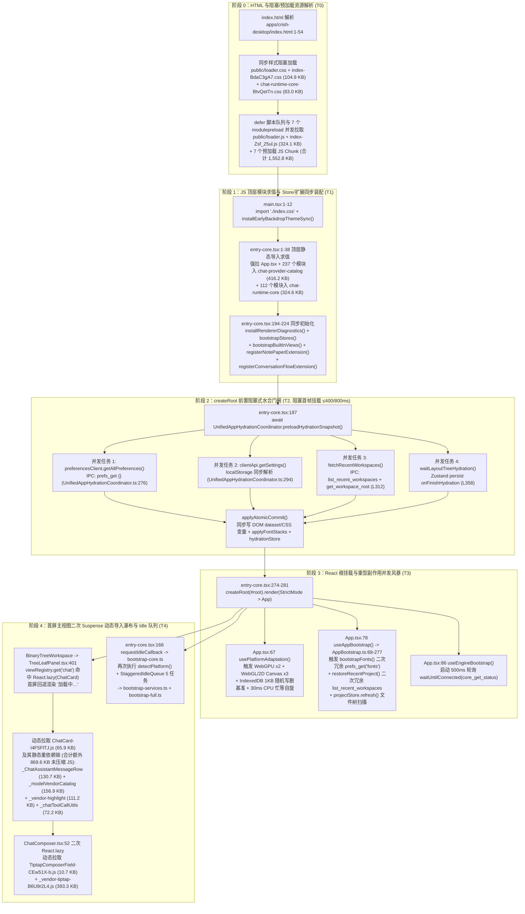

# 维度 10：前端冷启动链路、构建拆包与首屏水合性能审计报告

> **审计维度**：Dim-10（应用冷启动链路、Vite 构建拆包策略、首屏水合与跨端 IPC 瀑布流、静态资源与字体/图标打包）
> **审计范围**：`apps/crish-desktop/`（构建配置、入口启动管线、首屏组件挂载树、水合协调器、图标与字体目录）、`packages/shared-utils/`（启动期硬件探测与自适应）、`scripts/check-startup-budget.mjs`、`scripts/check-chunk-cycles.mjs`、`scripts/check-dist.mjs`
> **方法论与纪律**：严格遵循 `docs/agent-roles/general_task/三原则.md` 与 `docs/full-stack-performance-audit/00-DISCIPLINE.md`。全量问题同权列出（不设 P0/P1 优先级砍项、不谈工期与排期），每项均附精确 `文件路径:行号`、源码片段、字节/耗时/瀑布流定量推导及根因级架构治理方案。

---

## 一、冷启动关键路径拓扑与生产构建基线实测

### 1.1 冷启动端到端关键路径拓扑图（HTML 解析 → 水合门闸 → 首屏挂载 → 视图瀑布 → Idle 移交）



---

### 1.2 生产构建产物（`apps/crish-desktop/dist/`）首屏预加载与关键 Chunk 实测表

基于当前仓库生产构建产物（`apps/crish-desktop/dist/index.html` 与 `dist/.vite/manifest.json`）及门禁脚本（`scripts/check-startup-budget.mjs`、`scripts/check-chunk-cycles.mjs`）实测数据：

#### （1）`dist/index.html` 首屏同步加载与 `<link rel="modulepreload">` 静态图清单

| 序号     | 产物文件路径 (`dist/assets/*`)           | 加载方式                                     | 原始字节 (Bytes) |  KiB (1024 进制) |    Gzip 实测 | 包含核心模块与职责                                                                                                                                                      |
| :------- | :--------------------------------------- | :------------------------------------------- | ---------------: | ---------------: | -----------: | :---------------------------------------------------------------------------------------------------------------------------------------------------------------------- |
| 1        | `index-Zsf_25ul.js`                      | `<script type="module" crossorigin>`         |        324,060 B |       316.46 KiB |    ~96.8 KiB | `main.tsx`、`entry-core.tsx`、`App.tsx`、`UnifiedAppHydrationCoordinator`、`BinaryTreeWorkspace`、`Sidebar`、`AppTopBar`、`TelemetryDialog`、`PermissionBar`、`noteApi` |
| 2        | `vendor-react-d6p3f40A.js`               | `<link rel="modulepreload">`                 |        190,564 B |       186.10 KiB |    ~60.1 KiB | `react`、`react-dom`、`scheduler`、`zustand`                                                                                                                            |
| 3        | `vendor-hugeicons-CV-OkamA.js`           | `<link rel="modulepreload">`                 |        117,795 B |       115.03 KiB |    ~29.4 KiB | `@hugeicons/react` + `iconMap.ts` 静态导入的 **143 个图标定义**                                                                                                         |
| 4        | `vendor-shared-utils-C8jV1l8M.js`        | `<link rel="modulepreload">`                 |         95,454 B |        93.22 KiB |    ~28.2 KiB | `@crish/shared-utils`（含硬件检测、WebGL/IndexedDB/CPU 基准、日志、自适应引擎）                                                                                         |
| 5        | `chat-provider-catalog-Do8nljKF.js`      | `<link rel="modulepreload">`                 |        416,178 B |       406.42 KiB |   ~118.5 KiB | **名义为 Provider 目录**，实则因 Rollup 贪婪静态依赖吸收吞并了 **237 个业务源码模块**（全量 Zustand Store、`tauriTransport`、`commandMap`、`EventBus` 等）              |
| 6        | `chat-runtime-core-8xZhiFK3.js`          | `<link rel="modulepreload">`                 |        324,598 B |       316.99 KiB |    ~94.2 KiB | **名义为流式桥接内核**，实则因 `continuityHandlers -> useGoalMode -> Toast -> components/ui` 贪婪吸收了 **112 个模块**（含全部 18 套 UI 组件库与 `@radix-ui`）          |
| 7        | `vendor-markdown-math-DSac5t4N.js`       | `<link rel="modulepreload">`                 |         34,904 B |        34.09 KiB |    ~12.4 KiB | `dompurify` 等安全净化依赖（被 `chat-runtime-core` 静态引用连带拉入首屏）                                                                                               |
| 8        | `_vendor-virtual-grid-DrfcB8wS.js`       | `<link rel="modulepreload">`                 |         49,247 B |        48.09 KiB |    ~14.8 KiB | `@tanstack/react-virtual`（被 `Sidebar` 会话列表虚拟滚动静态引用）                                                                                                      |
| 9        | `index-BdaC3gA7.css`                     | `<link rel="stylesheet" crossorigin>`        |        104,888 B |       102.43 KiB |    ~18.9 KiB | `index.css`、`tokens.css`、全局主题与首屏组件样式                                                                                                                       |
| 10       | `chat-runtime-core-BtvQetTn.css`         | `<link rel="stylesheet" crossorigin>`        |         82,989 B |        81.04 KiB |    ~14.2 KiB | 被 `chat-runtime-core` 吞并的全量 `components/ui/*` CSS Modules 样式                                                                                                    |
| 11       | `public/loader.css` + `public/loader.js` | `<link rel="stylesheet">` + `<script defer>` |          3,875 B |         3.78 KiB |     ~1.5 KiB | 首屏 `#skel-app` 呼吸光环加载壳与首帧 `workbench_window_ready` IPC 探针                                                                                                 |
| **合计** | **首屏 HTML 同步/预加载静态图总计**      | **8 JS + 3 CSS/Loader**                      |  **1,744,552 B** | **1,703.66 KiB** | **~490 KiB** | **其中首屏静态图 JS 达 1,552,800 B (1,516.41 KiB)，CSS 达 190,157 B (185.70 KiB)**                                                                                      |

#### （2）首屏挂载后立即触发的默认主视图（Empty Chat 叶子面板）二次动态加载瀑布清单

当 `App.tsx` 完成首次渲染并挂载默认单叶子布局（`viewType: 'chat'`）时，立即触发两级 `React.lazy` 瀑布：

| 瀑布层级       | 触发源 (`文件路径:行号`)                                   | 动态入口 Chunk 及静态伴随 Chunk                                                                                                                                                                                                                                                                                                                                                                                                                                                                                      |                                                 原始字节 (Bytes) | 问题定性                                                                                                                                                                                                                                                              |
| :------------- | :--------------------------------------------------------- | :------------------------------------------------------------------------------------------------------------------------------------------------------------------------------------------------------------------------------------------------------------------------------------------------------------------------------------------------------------------------------------------------------------------------------------------------------------------------------------------------------------------- | ---------------------------------------------------------------: | :-------------------------------------------------------------------------------------------------------------------------------------------------------------------------------------------------------------------------------------------------------------------- |
| **第一级瀑布** | `TreeLeafPanel.tsx:401` → `builtinViewFactories.tsx:16-26` | `ChatCard-I4F5FlTJ.js` (65,863 B)<br/>+ `_ChatAssistantMessageRow-raHgJTUZ.js` (130,683 B)<br/>+ `_modelVendorCatalog-DjYwLrFe.js` (156,923 B)<br/>+ `_vendor-highlight-CTQSTdUc.js` (111,163 B)<br/>+ `_chatToolCallUtils-Deslfqcp.js` (72,213 B)<br/>+ `_streamStop-DAYccs4N.js` (49,233 B)<br/>+ `_index-Bc5U6Z-X.js` (`src/workers/index.ts`, 51,422 B)<br/>+ `_codeHighlight-v_8_w2ZR.js` (3,715 B)<br/>+ `_NotePaperPanel.module-aGaETlx4.js` (11,887 B)<br/>+ `ChatCard-Do7sH5x6.css` 等 4 个 CSS (216,527 B) | **JS: 653,102 B**<br/>**CSS: 216,527 B**<br/>**合计: 869,629 B** | **即使冷启动处于零消息草稿态（仅渲染 `ChatEmptyState` + `ChatComposer`）**，因 `ChatCard.tsx:3` 静态导入 `ChatMessageList` → `StreamingAssistantRow` → `ChatAssistantMessageRow`，强制拉取语法高亮 `highlight.js`、157KB 模型厂商全集图标目录、工具调用栈与 Worker 池 |
| **第二级瀑布** | `ChatComposer.tsx:52-54`                                   | `TiptapComposerField-CEw51X-b.js` (10,673 B)<br/>+ `_vendor-tiptap-B6U9r2L4.js` (393,261 B)<br/>+ `TiptapComposerField-D7n1c5p_.css` (2,702 B)                                                                                                                                                                                                                                                                                                                                                                       |   **JS: 403,934 B**<br/>**CSS: 2,702 B**<br/>**合计: 406,636 B** | 必须等第一级 `ChatCard` 下载并挂载 `ChatComposer` 后才开始发起 `_vendor-tiptap` 请求，构成串行两跳瀑布                                                                                                                                                                |

---

## 二、全量性能问题清册（问题同权 · 逐项深挖）

---

### PERF-DIM10-001：`vite.config.ts` 中 `manualChunks` 触发 Rollup `addStaticDependenciesToManualChunk` 贪婪吞并，导致 `chat-provider-catalog` (416.2 KB) 与 `chat-runtime-core` (324.6 KB JS + 83.0 KB CSS) 沦为巨型「静态依赖黑洞」

#### 1. 精确代码定位

- `apps/crish-desktop/vite.config.ts:806-877`（`manualChunks(id)` 规则定义）
- `apps/crish-desktop/src/api/provider-profiles/contextStatePending.ts:22,29`（`chat-provider-catalog` 种子文件反向静态导入 `storeAccess`）
- `apps/crish-desktop/src/api/modelCatalogIpc.ts:8,22,23` 与 `src/api/modelCatalogMeta.ts:26,27`（导入 `tauriInvoke`、`ErrorStore`、`modelsCatalogStore`、`uiEvents`）
- `apps/crish-desktop/src/api/chat-bridge/handlers/continuityHandlers.ts:15`（`chat-runtime-core` 种子文件反向静态导入 `useGoalMode`）
- `apps/crish-desktop/src/hooks/chat-stream/useGoalMode.ts:22,113`（静态导入 `compositionRoot` 与 `ToastContext` → `ToastCard` → `components/ui/index.ts`）

#### 2. 源码证据片段

```ts
// apps/crish-desktop/vite.config.ts:846-877
if (
  id.includes('/src/api/providerProfiles') ||
  id.includes('/src/api/provider-profiles/') ||
  id.includes('/src/api/modelCatalog') ||
  id.includes('/src/api/modelPresets') ||
  id.includes('/src/api/providerModel') ||
  id.includes('/src/api/modelsApi')
) {
  return 'chat-provider-catalog';
}
if (
  id.includes('/src/api/chatStreamBridge') ||
  id.includes('/src/api/chat-bridge/') ||
  id.includes('/src/api/sessionCommand')
) {
  return 'chat-runtime-core';
}
```

```ts
// apps/crish-desktop/src/api/provider-profiles/contextStatePending.ts:22-29
import { getSessionsMapSnapshot, getSessionState } from '../storeAccess';
// ...
import { isContextStateCarrierMessage } from '../../store/storeAccess';
```

```ts
// apps/crish-desktop/src/api/chat-bridge/handlers/continuityHandlers.ts:15
import { applyGoalRoundEventToGoalMode } from '../../../hooks/chat-stream/useGoalMode';

// apps/crish-desktop/src/hooks/chat-stream/useGoalMode.ts:22,113
import { getGoalLoopOrchestrator } from '../../app/compositionRoot';
// ...
import { toast } from '../../services/toast/ToastContext';
```

#### 3. 根因与定量影响推导

Rollup 在处理函数式 `manualChunks(id)` 时，内置执行 `addStaticDependenciesToManualChunk` 算法：**任何被显式分配进命名 manualChunk 的「种子模块」，其静态 import 可达图上所有未被分配 manualChunk 名称的普通源码模块，都会被 Rollup 贪婪吸入该 manualChunk 中**。

1. **`chat-provider-catalog` 膨胀 3.4 倍**：匹配 `vite.config.ts:846-855` 的种子文件仅 **16 个**（原始 TS 源码合计 **121.0 KB**）。但因 `contextStatePending.ts:22,29` 静态导入了 `src/store/storeAccess.ts`，而 `storeAccess.ts` 汇聚了全量 Zustand Store（`sessionStore`、`layoutStore`、`workspaceStore`、`settingsStore`、`permissionStore`、`terminalStore`、`workerStore`、`streamingStore`）及 `tauriTransport.ts`、`commandMap.ts`、`EventBus.ts`、`SlotOutlet.tsx` 等底层模块，导致 **`chat-provider-catalog` 贪婪吞并了 237 个未分配的业务源码模块（原始 TS 源码达 1,531.2 KB）**，编译后产物高达 **416,178 B (406.42 KiB)**。
2. **`chat-runtime-core` 吞并全量 UI 组件库与 83 KB CSS**：匹配 `vite.config.ts:862-868` 的种子文件仅 **39 个**（原始 TS 源码 **227.6 KB**）。但因 `continuityHandlers.ts:15` 静态导入 `useGoalMode.ts`，而 `useGoalMode.ts:113` 静态导入 `ToastContext.tsx` → `ToastContainer.tsx` → `ToastViewport.tsx` → `ToastCard.tsx:6`（`import { Button } from '../../components/ui'`），导致 **`chat-runtime-core` 贪婪吞并了 112 个业务与第三方模块（含整个 `src/components/ui/*` 全部 18 套组件家族及 `@radix-ui/react-popover` 等）**，不仅 JS 膨胀至 **324,598 B (316.99 KiB)**，还意外吐出了一个 **82,989 B (81.04 KiB)** 的 `chat-runtime-core-BtvQetTn.css` 阻塞首屏样式表！

#### 4. 根因级架构治理方案

1. **切断底层 API 向 Store/UI 桶的反向静态依赖**：
   - 将 `isContextStateCarrierMessage` 纯谓词函数从 `store/storeAccess` 下沉至零依赖纯契约模块 `src/api/contextStateContracts.ts`；`contextStatePending.ts` 通过窄接口或宿主注入读取会话快照，禁止直连 `storeAccess` 总桶。
   - 将 `applyGoalRoundEventToGoalMode` 纯状态归约逻辑从 `hooks/chat-stream/useGoalMode.ts` 剥离至 `src/api/chat-bridge/goalRoundReducer.ts`（纯函数，零 React / Toast / `compositionRoot` 依赖），彻底切断 `continuityHandlers.ts` → `useGoalMode.ts` → `ToastContext` → `components/ui` 的静态边。
2. **收敛 `manualChunks` 职责边界**：
   - 在 `vite.config.ts` 中禁止对耦合了全局 Store 的上层业务目录使用粗粒度 `id.includes` 手工强分包；仅对边界封闭的 `node_modules` 第三方库和纯静态数据字典（如 `modelPresets` / `modelVendorCatalog`）划分独立 chunk，其余业务模块交由 Rollup 基于真实动态导入边界自动生成最小公共 chunk。

---

### PERF-DIM10-002：`chat-provider-catalog` 与 `chat-runtime-core` 存在双向静态循环依赖，`check-chunk-cycles.mjs` 实测报错（Exit Code 1）且漏接 `check:desktop` 门禁

#### 1. 精确代码定位

- `scripts/check-chunk-cycles.mjs:1-77`
- `package.json:50`（`check:desktop` 脚本未挂载 `check:chunk-cycles`）
- 正向边（`chat-provider-catalog` → `chat-runtime-core`）：`src/store/sessionStore.ts:16` → `src/store/sessionActivateHydrate.ts:22` → `src/api/sessionEventHydrate.ts:17` → `src/api/sessionEventProjection.ts:17,19` & `src/api/sessionEventTimestamp.ts:16`
- 反向边（`chat-runtime-core` → `chat-provider-catalog`）：`src/api/chat-bridge/readiness.ts:12` → `src/api/providerProfiles.ts`（以及 `chat-runtime-core` 对被 `chat-provider-catalog` 吞并的 `storeAccess` / `tauriInvoke` 的静态导入）

#### 2. 源码与实测输出证据

运行 `node scripts/check-chunk-cycles.mjs` 实测输出：

```text
[check-chunk-cycles] FAIL: 1 static chunk cycle(s) detected:
  1. chat-provider-catalog-Do8nljKF.js -> chat-runtime-core-8xZhiFK3.js -> chat-provider-catalog-Do8nljKF.js
```

```ts
// apps/crish-desktop/src/api/sessionEventProjection.ts:17-19 (被吸入 chat-provider-catalog)
import { parseEventPayload } from './chat-bridge/handlers/eventParser';
import { extractToolDetails } from './chat-bridge/handlers/toolUtils';

// apps/crish-desktop/src/api/chat-bridge/readiness.ts:12 (属于 chat-runtime-core)
import { getActiveModelId, getActiveProfileId } from '../providerProfiles';
```

```json
// package.json:50
"check:desktop": "npm run check:line-counts && npm run check:tokens && npm run check:token- compliance && npm run check:ipc-commands && npm run check:command-map && npm run check:store-access && npm run check:tauri-capabilities && npm run typecheck --workspace=@crish/desktop && npm run lint"
```

#### 3. 根因与定量影响推导

1. **ES Module TDZ（暂时性死区）与求值顺序隐患**：`chat-provider-catalog-Do8nljKF.js` 与 `chat-runtime-core-8xZhiFK3.js` 互相持有顶层静态 `import`。浏览器加载这两个模块时必须将它们置于同一个强连通分量（SCC）中绑定求值；一旦任一模块在顶层初始化阶段访问对方导出的常量或函数，立即触发运行时 `ReferenceError: Cannot access '...' before initialization`。
2. **连带锁死首屏静态图**：由于二者形成静态死锁环，任何引用其中任意一个 chunk 的模块（如 `App.tsx` 引用 `layoutStore`）都会把两个大包（合计 **740.8 KB JS + 83.0 KB CSS**）同时拉入 `index.html` 的 `<link rel="modulepreload">`。
3. **门禁漏接**：根 `package.json:45` 虽然定义了 `"check:chunk-cycles": "node scripts/check-chunk-cycles.mjs"`，但未被纳入 `check:desktop`（`package.json:50`），导致该循环依赖长期存在于生产构建产物中未被拦截。

#### 4. 根因级架构治理方案

1. **将共享事件解析纯函数下沉至零依赖底层模块**：把 `parseEventPayload`、`extractToolDetails`、`unwrapEventEnvelope` 从 `src/api/chat-bridge/handlers/*` 提取到 `src/api/protocol/eventPayloadCodec.ts`，供 `sessionEventProjection.ts` 与 `chat-bridge` 单向依赖，消除 `sessionStore` → `chat-runtime-core` 的跨层逆向引用。
2. **解耦 `readiness.ts` 对 `providerProfiles.ts` 的静态依赖**：将活跃模型/Profile ID 的读取改为从轻量状态切片或窄契约模块获取，切断 `chat-runtime-core` → `chat-provider-catalog` 的反向边。
3. **刚性接入门禁**：在构建后校验流水线及 `FULL_CHECK_COMMANDS.md` 中强制执行 `npm run check:chunk-cycles`，确保零静态 chunk 环。

---

### PERF-DIM10-003：首屏同步入口静态导入图未完成解耦（`1,516.4 KiB JS + 185.7 KiB CSS` 同步预加载），且 `check-startup-budget.mjs` 仍停留在 `1800 KiB` 过渡豁免态与空黑名单

#### 1. 精确代码定位

- `apps/crish-desktop/src/App.tsx:14` → `apps/crish-desktop/src/components/firstRunWizardLib.ts:8`
- `apps/crish-desktop/src/App.tsx:20` → `apps/crish-desktop/src/app/AppGlobalDialogs.tsx:6`
- `apps/crish-desktop/src/App.tsx:2` → `apps/crish-desktop/src/store/layoutStore.ts:21` → `apps/crish-desktop/src/store/sessionStore.ts:16`
- `scripts/check-startup-budget.mjs:59-67`

#### 2. 源码证据片段

```ts
// apps/crish-desktop/src/App.tsx:14,20
import { shouldShowWizard } from './components/firstRunWizardLib';
// ...
import { AppGlobalDialogs } from './app/AppGlobalDialogs';

// apps/crish-desktop/src/components/firstRunWizardLib.ts:8
import { normalizeModelIds, anyProfileHasKey } from '../api/providerProfiles';

// apps/crish-desktop/src/app/AppGlobalDialogs.tsx:6
import { getActiveModelId, getActiveProfileId } from '../api/providerProfiles';
```

```js
// scripts/check-startup-budget.mjs:59-67
const DEFAULT_ENTRY_BUDGET_KB = 350;
// D9-A 实测: index.js (301 KB) 静态 import 图含 chat-provider-catalog (403 KB)
// + chat-runtime-core (313 KB) + vendor-react (186 KB) + vendor-hugeicons (115 KB)
// + vendor-shared-utils (93 KB) + vendor-virtual-grid (48 KB) + vendor-markdown-math (34 KB)
// 合计 ~1494 KB; D9-B 断边前先以 1800 KB 为过渡基线，断边后收紧至 980 KB
const DEFAULT_STATIC_GRAPH_BUDGET_KB = 1800;
const DEFAULT_STATIC_GRAPH_DENY = [];
```

#### 3. 根因与定量影响推导

- `App.tsx` 虽然将 `FirstRunWizard` 与 `SettingsPanel` 声明为 `React.lazy`（`App.tsx:41-50`），但在顶层同步导入了 `firstRunWizardLib.ts`（`App.tsx:14`）与 `AppGlobalDialogs.tsx`（`App.tsx:20`），而这两者均在顶层直接 `import ... from '../api/providerProfiles'`！
- 同时，`App.tsx:2` 顶层导入 `layoutStore.ts:21` → `sessionStore.ts:16` → `sessionActivateHydrate.ts:22` → `sessionEventHydrate.ts:17` → `sessionEventProjection.ts:17,19`，直接在首屏同步图中拉入了 `chat-runtime-core`。
- 结果：首屏 `<script type="module">` 在浏览器允许执行第一行 `main.tsx` 代码前，必须等待全部 8 个静态图 JS Chunk（**1,552,800 B / 1,516.41 KiB**）下载、解析与模块链接完成。
- 此外，`scripts/check-startup-budget.mjs:65-67` 注释明确记录「D9-B 断边后收紧至 980 KB」，但当前仍处于 `DEFAULT_STATIC_GRAPH_BUDGET_KB = 1800` 且 `DEFAULT_STATIC_GRAPH_DENY = []`（未封禁重型 chunk 进入首屏静态图），无法拦截首屏静态图退化。

#### 4. 根因级架构治理方案

1. **切断 `App.tsx` 到 `providerProfiles` 的两条同步静态边**：
   - `shouldShowWizard()`（仅在 `AppBootstrap.ts:172` 的异步 `setTimeout(..., 100)` 中调用）改为在 `AppBootstrap.ts` 内部通过 `await import('../components/firstRunWizardLib')` 动态按需加载，从 `App.tsx` 顶层移除 `firstRunWizardLib` 静态导入。
   - `AppGlobalDialogs.tsx` 仅在 `showFirstRun || showSettings || showTelemetry` 为 `true` 时才需要读取 `getActiveModelId / getActiveProfileId`，将其下沉至打开弹窗分支内部或通过 `settingsStore` 轻量状态获取。
2. **收紧 `check-startup-budget.mjs` 预算与黑名单**：
   - 完成上述断边与 `PERF-DIM10-001/002` 解耦后，将 `DEFAULT_STATIC_GRAPH_BUDGET_KB` 从 `1800` 收紧至目标值 `980`，并在 `DEFAULT_STATIC_GRAPH_DENY` 中加入 `['vendor-tiptap', 'vendor-highlight', 'vendor-codemirror', 'vendor-xterm', 'chat-runtime-core']`。

---

### PERF-DIM10-004：`entry-core.tsx` 同步激活 `note-paper` 与 `conversation-flow` 两个扩展，因桶文件重导出与无条件顶层静态导入，将 `noteApi` 全家桶与 `PermissionBar` + `components/ui` 强行拉入首屏主包

#### 1. 精确代码定位

- `apps/crish-desktop/src/entry-core.tsx:25-32,208-221`
- `apps/crish-desktop/src/extensions/note-paper/index.ts:1-21`
- `apps/crish-desktop/src/extensions/note-paper/productLeafBindings.ts:1-14`
- `apps/crish-desktop/src/extensions/conversation-flow/index.ts:1-16`
- `apps/crish-desktop/src/extensions/conversation-flow/activate.ts:1-60`

#### 2. 源码证据片段

```ts
// apps/crish-desktop/src/entry-core.tsx:25-32
import {
  NOTE_PAPER_EXTENSION_ID,
  registerNotePaperExtension,
} from './extensions/note-paper';
import {
  CONVERSATION_FLOW_EXTENSION_ID,
  registerConversationFlowExtension,
} from './extensions/conversation-flow';
```

```ts
// apps/crish-desktop/src/extensions/note-paper/index.ts:1-12
export {
  NOTE_PAPER_EXTENSION_ID,
  registerNotePaperExtension,
  unregisterNotePaperExtension,
} from './activate';
export {
  registerNoteWorkspaceView,
  renderNoteViewSlot,
} from './noteViewFactory';
export {
  openNoteDocumentInLeaf,
  saveNoteDocumentFromLeaf,
  type OpenNoteInLeafResult,
} from './productLeafBindings';

// apps/crish-desktop/src/extensions/note-paper/productLeafBindings.ts:8
import {
  openNoteDocument,
  saveNoteDocument,
  type NoteOpenResult,
  type NoteSaveResult,
} from '../../api/noteApi';
```

```ts
// apps/crish-desktop/src/extensions/conversation-flow/activate.ts:6-18,35-44
import { PermissionBar } from './PermissionBar';
// ...
export function shouldActivateOfficialConversationFlow(): boolean {
  return readViteFlag() === 'true';
}

export function registerConversationFlowExtension(): () => void {
  const disposers: Array<() => void> = [];
  for (const key of CONVERSATION_FLOW_DECLARED_SLOTS) {
    disposers.push(registerSlot(key));
  }
  if (!shouldActivateOfficialConversationFlow()) {
    return () => { ... };
  }
```

#### 3. 根因与定量影响推导

1. **`note-paper` 桶文件静态污染**：`noteViewFactory.tsx:21-25` 原本精心设计了 `React.lazy(() => import('../../components/note-paper/NotePaperPanel'))` 以实现便签面板懒加载。然而 `entry-core.tsx:25` 通过桶文件 `./extensions/note-paper/index.ts` 导入 `registerNotePaperExtension`，而 `index.ts:8-12` 顺手重导出了 `./productLeafBindings`，后者在顶层静态导入了 `../../api/noteApi`（460 行，含 `noteApiContracts.ts`、`noteApiWire.ts`、`noteApiMemory.ts`、`noteDocumentContracts.ts`）。这导致即便用户从未打开便签，整套便签 CRUD 与内存存储实现仍被同步打包进首屏 `index-Zsf_25ul.js`。
2. **`conversation-flow` 死分支静态求值**：`shouldActivateOfficialConversationFlow()` 在默认生产环境（`VITE_CONVERSATION_FLOW_OFFICIAL !== 'true'`）恒返回 `false`（`activate.ts:35-37`）。但因为 `activate.ts:6` 在文件顶层无条件静态导入了 `PermissionBar.tsx`，而 `PermissionBar.tsx:10-16` 静态导入了 `permissionBar.module.css`、`chatApprovalUi.ts` 以及 `components/ui` 桶文件，导致一个默认根本不会挂载的实验特性组件及其样式被无条件打入首屏同步包。

#### 4. 根因级架构治理方案

1. **直连 `activate.ts` 并拆分桶导出**：`entry-core.tsx` 直接从 `./extensions/note-paper/activate` 和 `./extensions/conversation-flow/activate` 导入注册函数；或者在 `productLeafBindings.ts` 中对 `noteApi` 采用函数内按需 `await import('../../api/noteApi')`。
2. **`PermissionBar` 按特性门控懒加载**：在 `extensions/conversation-flow/activate.ts` 中移除顶层 `import { PermissionBar } from './PermissionBar'`，当 `shouldActivateOfficialConversationFlow()` 为 `true` 时，使用 `React.lazy(() => import('./PermissionBar'))` 注入 Slot。

---

### PERF-DIM10-005：首屏常驻壳组件静态挂载未打开的弹窗与右键菜单（`TelemetryDialog`、`SidebarContextMenus`、`ConfirmDialog`），且 `components/ui/index.ts` 全量桶重导出放大模块求值树

#### 1. 精确代码定位

- `apps/crish-desktop/src/app/AppGlobalDialogs.tsx:3,98-105`（`TelemetryDialog` 顶层静态导入）
- `apps/crish-desktop/src/components/sidebar/Sidebar.tsx:13,30,363-395`（`ConfirmDialog` 与 `SidebarContextMenus` 静态导入并常驻渲染）
- `apps/crish-desktop/src/components/ui/index.ts:1-182`（18 套 UI 组件家族统一桶导出）

#### 2. 源码证据片段

```tsx
// apps/crish-desktop/src/app/AppGlobalDialogs.tsx:3,98-105
import { TelemetryDialog } from '../components/overlay/TelemetryDialog';
// ...
{
  showTelemetry && (
    <AppErrorBoundary fallbackLabel="遥测面板加载出错">
      <TelemetryDialog
        open={showTelemetry}
        onClose={() => setShowTelemetry(false)}
      />
    </AppErrorBoundary>
  );
}
```

```tsx
// apps/crish-desktop/src/components/sidebar/Sidebar.tsx:13,30,363-395
import { ConfirmDialog } from '../overlay/ConfirmDialog';
// ...
import { SidebarContextMenus } from './SidebarContextMenus';
// ...
      <SidebarContextMenus ... />
      <ConfirmDialog
        open={Boolean(deleteConfirmSessionId)}
        ...
      />
```

```ts
// apps/crish-desktop/src/components/ui/index.ts:1-182
// 统一重导出 Button, Input, Textarea, Select, Combobox, SmartExpandablePanel,
// Badge, Chip, Card, Dialog, Tooltip, PreviewCard, Menu, Tabs, Toast,
// ScrollArea, Separator, Skeleton, EmptyState, Spinner, Switch, Checkbox, Radio, Slider, Avatar, Kbd
```

#### 3. 根因与定量影响推导

1. `AppGlobalDialogs.tsx` 中 `FirstRunWizard` 与 `SettingsPanel` 均由 `App.tsx:41-50` 进行了 `React.lazy` 懒加载，唯独 `TelemetryDialog`（含 `TelemetryDialog.module.css` 及弹窗焦点陷阱逻辑）在 `AppGlobalDialogs.tsx:3` 被顶层静态导入，直接进入 `index-Zsf_25ul.js` 与 `index-BdaC3gA7.css`。
2. `Sidebar.tsx` 在首屏无条件挂载 `<SidebarContextMenus>` 与 `<ConfirmDialog open={false}>`。即使首屏未触发任何右键菜单或删除确认框，这两套组件及其依赖的菜单/对话框原语都在首屏同步求值并参与 React 首帧 reconcile。
3. `src/components/ui/index.ts` 将 18 套轻重悬殊的 UI 组件（包括重型的 `Select`、`Combobox`、`SmartExpandablePanel`、`PreviewCard`、`Dialog`、`Menu`、`Tabs`）合并在单一桶文件中导出，且每个子组件内部包含 `React.forwardRef`、`Object.assign` 复合组件装配与 CSS Modules 导入（Rollup 无法对含 CSS 副作用或复合赋值的模块完全消除未用导出），导致任何消费 `{ Button } from '../ui'` 的文件（如 `ToastCard.tsx:6`、`TreeLeafPanel.tsx:2`）都会把全部 18 套 UI 组件及其 CSS 拖入同一 Chunk。

#### 4. 根因级架构治理方案

1. 将 `TelemetryDialog` 改为 `React.lazy(() => import('../components/overlay/TelemetryDialog'))`，与 `FirstRunWizard`、`SettingsPanel` 对齐。
2. 在 `Sidebar.tsx` 中仅当 `contextMenu !== null || folderMenu !== null` 时按需挂载懒加载的 `SidebarContextMenus`；仅当 `deleteConfirmSessionId !== null` 时按需挂载 `ConfirmDialog`。
3. 为 `src/components/ui/` 建立子路径精确导入规范（如 `components/ui/Button`、`components/ui/Tooltip`），或在 `components/ui/index.ts` 对应 `package.json` / 构建层确保无副作用纯重导出，杜绝单点导入 `{ Button }` 拖入 `Select` / `Combobox` / `SmartExpandablePanel` 全家桶。

---

### PERF-DIM10-006：默认主视图 `ChatCard` 走 `React.lazy` 引发首屏挂载后二次 Suspense 瀑布，且在「零消息草稿冷启动」下静态连带拉取 `_ChatAssistantMessageRow`、`highlight.js`、157KB 模型厂商目录与 Worker 池（合计 869.6 KB）

#### 1. 精确代码定位

- `apps/crish-desktop/src/builtinViewFactories.tsx:16-26`（`'chat'` 视图工厂使用 `React.lazy`）
- `apps/crish-desktop/src/components/binary-tree/TreeLeafPanel.tsx:401-410`（首屏渲染命中 `<Suspense fallback="加载中…">`）
- `apps/crish-desktop/src/components/chat-card/ChatCard.tsx:3,28`（顶层静态导入 `ChatMessageList` 与 `NotePaperPanel.module.css` 相关引用）
- `apps/crish-desktop/src/components/chat-message-list/ChatMessageList.tsx:20` → `MessageVirtualizer.tsx:12-13` → `StreamingAssistantRow.tsx:16-18` → `ChatAssistantMessageRow.tsx:27` → `MessageContent.tsx` → `codeHighlight.ts` (`highlight.js`) & `modelVendorCatalog.ts`
- `apps/crish-desktop/src/components/chat-composer/ChatComposer.tsx:52-54`（`TiptapComposerFieldLazy` 二级 `React.lazy`）

#### 2. 源码证据片段

```tsx
// apps/crish-desktop/src/builtinViewFactories.tsx:16-26
const LazyChatCard = React.lazy(() =>
  import('./components/chat-card/ChatCard').then((m) => ({
    default: m.ChatCard,
  }))
);
```

```tsx
// apps/crish-desktop/src/components/chat-card/ChatCard.tsx:1-6
import React, { useMemo } from 'react';
import { AppErrorBoundary } from '../AppErrorBoundary';
import { ChatMessageList } from '../chat-message-list/ChatMessageList';
import { ChatEmptyState } from '../chat-empty-state/ChatEmptyState';
import { ChatComposer } from '../chat-composer/ChatComposer';
```

#### 3. 根因与定量影响推导

1. **首屏主视图必经串行瀑布**：`layoutTreeStore.ts:93-105` 默认冷启动树固定包含一个 `viewType: 'chat'` 的叶子节点。然而 `'chat'` 视图在 `builtinViewFactories.tsx:16` 被包裹为 `React.lazy`。这意味着：
   - **第 1 跳**：浏览器先下载并执行 1,516.4 KiB 的入口静态图，等待 `UnifiedAppHydrationCoordinator` 走完 IPC 门闸，再执行 `createRoot().render(<App />)`；
   - **第 2 跳**：`TreeLeafPanel.tsx:401` 首次渲染 `<LazyChatCard />` 时抛出 Promise，首屏主工作区回退显示 `<div className={styles.viewLoading}>加载中…</div>`（`TreeLeafPanel.tsx:403`），此时才开始发起 `ChatCard-I4F5FlTJ.js` 及其 12 个静态依赖 Chunk 的加载；
   - **第 3 跳**：等 `ChatCard` 及其 869.6 KB 依赖全部下载求值完毕、挂载 `<ChatComposer />` 后，`ChatComposer.tsx:52` 才开始触发 `<TiptapComposerFieldLazy />`，发起 `_vendor-tiptap-B6U9r2L4.js`（393.3 KB）的加载！
2. **空会话草稿态被强塞 600+ KB 非空态重型代码**：
   在默认冷启动（`restoreLastWorkspace = false` 或新建草稿会话，`messages.length === 0`）时，界面只需渲染 `<ChatEmptyState />` + `<ChatComposer />`，根本不渲染 `<ChatMessageList />`。但因 `ChatCard.tsx:3` 在顶层静态导入了 `ChatMessageList`，导致加载 `ChatCard` 时强制静态并行拉取：
   - `_ChatAssistantMessageRow-raHgJTUZ.js`：**130,683 B**
   - `_modelVendorCatalog-DjYwLrFe.js`（内联巨型 SVG 字符串模型厂商目录）：**156,923 B**
   - `_vendor-highlight-CTQSTdUc.js`（`highlight.js` 语法高亮引擎）：**111,163 B**
   - `_chatToolCallUtils-Deslfqcp.js`（工具调用卡片与 Diff 展示辅助）：**72,213 B**
   - `_index-Bc5U6Z-X.js`（`src/workers/index.ts` Worker 池管理）：**51,422 B**
   - `_streamStop-DAYccs4N.js`：**49,233 B**
   - `_NotePaperPanel.module-aGaETlx4.js`：**11,887 B**
     合计 **583.5 KB 未压缩 JS** 在零消息首屏被白白下载、解析与编译！

#### 4. 根因级架构治理方案

1. **拆分 `ChatCard` 的「空态壳层」与「非空消息时间线」**：
   - `ChatCard.tsx` 保持轻量壳层（仅同步导入 `ChatEmptyState` 与 `ChatComposer`）；
   - 将 `ChatMessageList` 改为按需懒加载（`const LazyChatMessageList = React.lazy(() => import('../chat-message-list/ChatMessageList'))`），当且仅当 `messages.length > 0 || isStreaming` 时挂载，并在首屏空闲期（或用户输入首个字符时）后台 `import('../chat-message-list/ChatMessageList')` 预热。
2. **消除三跳串行瀑布**：
   - 在 `entry-core.tsx` 启动 `preloadHydrationSnapshot()` 的同一微任务起点，并行触发默认主视图壳层与富文本编辑器的模块预热（`void import('./components/chat-card/ChatCard'); void import('./components/chat-composer/TiptapComposerField');`），使主视图模块下载与 IPC 水合等待完全重叠（Overlap），实现 `createRoot` 挂载即同步命中已就绪模块，彻底消除首屏 `"加载中…"` 闪烁与三跳瀑布。
3. **语法高亮与模型厂商大字典按需异步化**：
   - `_vendor-highlight`（`highlight.js`，111.2 KB）仅在消息包含代码块（` ``` `）时由 `codeHighlight.ts` 动态 `import('highlight.js/lib/core')` 加载，不绑死在 `ChatAssistantMessageRow` 静态导入链上。

---

### PERF-DIM10-007：`entry-core.tsx` 在 `createRoot().render()` 之前 `await preloadHydrationSnapshot()`，将跨进程 IPC 与 Zustand 异步水合串联在 React 首帧挂载之前，阻塞首屏可交互时间（TTI）

#### 1. 精确代码定位

- `apps/crish-desktop/src/entry-core.tsx:184-192,274-281`
- `apps/crish-desktop/src/app/UnifiedAppHydrationCoordinator.ts:53-62,99-192`
- `apps/crish-desktop/src/store/layout-tree/layoutTreeStore.ts:435-484`

#### 2. 源码证据片段

```ts
// apps/crish-desktop/src/entry-core.tsx:184-192
async function startApp(): Promise<void> {
  // Phase 2: 在 createRoot 挂载前，通过 UnifiedAppHydrationCoordinator 一次性拉齐核心偏好与工作区快照
  // 彻底消灭 React 挂载后再读异步 IPC 导致的首屏闪烁与二次重排
  await UnifiedAppHydrationCoordinator.preloadHydrationSnapshot();
  // ...
  const root = createRoot(rootElement);
  root.render( ... );
```

```ts
// apps/crish-desktop/src/app/UnifiedAppHydrationCoordinator.ts:55-61,111-125
const HYDRATION_GATE_TIMEOUT_MS = 400;
const TAURI_HYDRATION_GATE_TIMEOUT_MS = 800;
// ...
const [prefsResult, settingsResult, workspaceResult, layoutResult] =
  await Promise.all([
    this.loadPreferencesWithDeadline(deadlineMs),
    this.loadClientSettingsWithDeadline(deadlineMs),
    this.loadRecentWorkspacesWithDeadline(deadlineMs),
    this.waitForLayoutTreeWithDeadline(deadlineMs),
  ]);
```

#### 3. 根因与定量影响推导

1. **`createRoot` 被后置阻塞**：`entry-core.tsx:187` 在调用 `bootstrapStores()`、`bootstrapBuiltInViews()` 与 `createRoot(rootElement).render()` **之前**，强制 `await UnifiedAppHydrationCoordinator.preloadHydrationSnapshot()`（Tauri 环境下最长阻塞 **800ms**，Web 环境下最长 **400ms**）。在此期间，React 树完全未开始挂载，浏览器主线程处于空等 IPC 返回状态。
2. **顺序颠倒导致 `waitLayoutTreeHydration` 不必要的异步等待**：`UnifiedAppHydrationCoordinator.preloadHydrationSnapshot()`（`entry-core.tsx:187`）在 `bootstrapStores()`（`entry-core.tsx:204`）**之前**被调用；虽然 `layoutTreeStore` 使用同步 `localStorage`（`layoutTreeStore.ts:436`），但其模块求值触发时机依赖首次引用。
3. **早退超时任务仍在后台继续争抢 IPC 通道**：`withTaskDeadline`（`UnifiedAppHydrationCoordinator.ts:247-268`）使用 `Promise.race([taskFactory(), timeoutPromise])`。当任一 IPC 在慢启动时超过门闸阈值，虽然门闸放行，但未完成的 `prefs_get` / `list_recent_workspaces` 请求紧接着与 `AppBootstrap` 挂载后发起的二次请求（见 `PERF-DIM10-009`、`PERF-DIM10-010`）在 Tauri IPC 桥上并发碰撞。

#### 4. 根因级架构治理方案

1. **将同步初始化前移至 IPC 等待期间并行执行**：在 `startApp()` 发起 `const hydrationPromise = UnifiedAppHydrationCoordinator.preloadHydrationSnapshot()` **之后、await 之前**，立即在主线程同步执行 `installRendererDiagnostics()`、`bootstrapStores()`、`bootstrapBuiltInViews()` 以及主视图 chunk 预加载（`import('./components/chat-card/ChatCard')`），将原本串行在 IPC 返回之后的约 15–30ms CPU 同步装配工作完全隐藏在等待 Rust IPC 响应的 I/O 空隙中！
2. **首屏关键快照单次聚合 IPC（Bootstrap Bundle IPC）**：将 `prefs_get {}`、`list_recent_workspaces`、`get_workspace_root` 在 Rust 端或前端传输层合并为单次启动快照读取，避免首屏挂载前发起 3 次独立跨进程 invoke。

---

### PERF-DIM10-008：`public/loader.js` 在首帧 `requestAnimationFrame`（`#skel-app` 尚在显示、`entry-core.tsx` 尚未完成水合挂载）即过早发送 `workbench_window_ready` IPC

#### 1. 精确代码定位

- `apps/crish-desktop/public/loader.js:25-49`
- `apps/crish-desktop/src/entry-core.tsx:287-325`

#### 2. 源码证据片段

```js
// apps/crish-desktop/public/loader.js:25-49
function notifyReady() {
  try {
    var inv =
      window.__TAURI_INTERNALS__ &&
      typeof window.__TAURI_INTERNALS__.invoke === 'function'
        ? window.__TAURI_INTERNALS__.invoke
        : null;
    if (inv) {
      Promise.resolve(inv('workbench_window_ready')).catch(function () {});
    }
  } catch (_) {
    /* Web 预览无 Tauri IPC */
  }
}

function scheduleShow() {
  requestAnimationFrame(function () {
    notifyReady();
  });
}
```

#### 3. 根因与定量影响推导

1. **过早唤醒原生窗口暴露加载过渡帧**：`loader.js` 作为 `<script src="/loader.js" defer>` 在 HTML 解析完后立即执行，并在**第一个 `requestAnimationFrame`** 就调用 `window.__TAURI_INTERNALS__.invoke('workbench_window_ready')` 通知 Tauri 宿主显示窗口。此时 `index-Zsf_25ul.js` 刚刚开始求值，`UnifiedAppHydrationCoordinator` 还没拉回用户的真实主题/背景色/字体偏好，React `#root` 更是空白，用户肉眼首先看到的是 `#skel-app` 加载动画（默认亮色 `#FAF8F5` 或上次 localStorage 缓存），随后在水合提交与 `#skel-app` 220ms 淡出（`entry-core.tsx:311`）时经历一次视觉跳变。
2. **若用户未命中 localStorage 主题缓存（首次启动或缓存清理），必然出现闪屏**：因为 `loader.js` 在 `UnifiedAppHydrationCoordinator.preloadHydrationSnapshot()` 从 Rust `prefs_get` 拿到真实主题之前就已经让原生窗口可见。

#### 4. 根因级架构治理方案

- 将 `workbench_window_ready` 的主触发时机收口至 `UnifiedAppHydrationCoordinator.applyAtomicCommit()` 完成主题/字体同步写入且 React 首帧 commit 后的首个 `requestAnimationFrame`（即 `entry-core.tsx:303` 与移除 `#skel-app` 同步进行），仅在 `loader.js` 保留一个超时兜底（如 `setTimeout(notifyReady, 800)` 防死锁白屏），从而让 Tauri 原生窗口一经显示就是已完成水合的真实工作区界面，甚至在常规热缓存启动下可完全跳过 `#skel-app` 呼吸灯阶段。

---

### PERF-DIM10-009：字体水合双轨冲突——`UnifiedAppHydrationCoordinator` 已拉取并应用 `fonts` 偏好后，`AppBootstrap.ts` 再次调用 `bootstrapFonts()`，不仅先用默认值 `'auto'` 覆盖已生效的自定义字体，还冗余发起第二次 `prefs_get('fonts')` IPC

#### 1. 精确代码定位

- `apps/crish-desktop/src/app/UnifiedAppHydrationCoordinator.ts:276,393-395`
- `apps/crish-desktop/src/app/AppBootstrap.ts:159-165`
- `apps/crish-desktop/src/api/fontStore.ts:39,144-185`

#### 2. 源码证据片段

```ts
// apps/crish-desktop/src/app/UnifiedAppHydrationCoordinator.ts:393-395
// 3. 同步写入字体栈 CSS 变量
if (snapshot.fonts) {
  applyFontStacks(snapshot.fonts);
}
```

```ts
// apps/crish-desktop/src/app/AppBootstrap.ts:159-165
// Initialize font stacks from persisted preferences
void bootstrapFonts().catch((e) => {
  Logger.warn('App', 'Failed to bootstrap fonts from preferences', e);
});
```

```ts
// apps/crish-desktop/src/api/fontStore.ts:39,173-185
let cachedFonts: FontPreferences = { ...DEFAULT_FONT_PREFS };
// ...
export async function bootstrapFonts(): Promise<void> {
  if (typeof document === 'undefined') return;
  // 先同步应用默认或当前缓存栈，避免无变量闪烁
  applyFontStacks(cachedFonts);
  const stored = await loadStoredFonts();
  cachedFonts = stored;
  applyFontStacks(stored);
  await ensureEmbeddedFontAssetsLoaded(stored);
}
```

#### 3. 根因与定量影响推导

这是一处典型的**首屏双轨水合逆向覆盖与冗余 IPC 缺陷**：

1. **阶段 1（`createRoot` 前）**：`UnifiedAppHydrationCoordinator.preloadHydrationSnapshot()` 调用 `preferencesClient.getAllPreferences()`（发起第 1 次 IPC `prefs_get {}`），拿到用户的自定义字体配置 `snapshot.fonts`（例如用户配置了 `'jetbrains-mono'`），并在 `applyAtomicCommit()`（`UnifiedAppHydrationCoordinator.ts:394`）中直接调用 `applyFontStacks(snapshot.fonts)` 将 `--font-sans` / `--font-mono` 写入 `document.documentElement`；**但注意：`applyFontStacks` 并未更新 `fontStore.ts` 内部的模块级变量 `cachedFonts`（仍为 `{ uiFont: 'auto', codeFont: 'auto', chatFont: 'auto' }`），也未调用 `ensureEmbeddedFontAssetsLoaded`！**
2. **阶段 2（`App` 挂载后 `useEffect`）**：`AppBootstrap.ts:160` 调用 `bootstrapFonts()`。`bootstrapFonts()` 的第一行（`fontStore.ts:176`）立即执行 `applyFontStacks(cachedFonts)`——**直接用默认的 `'auto'` 覆盖掉了阶段 1 刚刚写入 `<html>` 的用户自定义字体栈！**
3. **阶段 3（二次冗余 IPC）**：紧接着 `bootstrapFonts()` 调用 `loadStoredFonts()` → `preferencesClient.getPreference('fonts')`（`fontStore.ts:146`），**再次向 Rust 后端发起第 2 次冗余的 `prefs_get { key: 'fonts' }` IPC**；等 IPC 返回后，才第二次把 `<html>` 字体改回用户的自定义字体并加载 `@fontsource` 资源，直接造成首屏文字字体回退再跳变（FOUT）与多余的 IPC 往返！

#### 4. 根因级架构治理方案

1. **在 `fontStore.ts` 中提供 `hydrateFontsFromSnapshot(fonts: FontPreferences)` 权威入口**：
   - 在 `UnifiedAppHydrationCoordinator.applyAtomicCommit()` 中调用 `hydrateFontsFromSnapshot(snapshot.fonts)`，同步更新 `cachedFonts = snapshot.fonts`、执行 `applyFontStacks(snapshot.fonts)` 并触发 `void ensureEmbeddedFontAssetsLoaded(snapshot.fonts)`。
2. **消除 `AppBootstrap.ts` 中的冗余 IPC**：
   - 当 `useHydrationStore.getState().preferencesLoaded` 为 `true` 时，`bootstrapFonts()` 直接复用已水合的 `cachedFonts` 确认字体资源加载，完全跳过 `loadStoredFonts()` 的二次 `prefs_get('fonts')` IPC，且绝不再用未初始化的默认值反向覆盖 DOM！

---

### PERF-DIM10-010：工作区列表与根目录在首屏启动期被重复拉取三次（`UnifiedAppHydrationCoordinator`、`AppBootstrap.restoreRecentProject`、`projectStore.refresh`），制造跨端 IPC 瀑布与文件树重复扫描

#### 1. 精确代码定位

- 第 1 次拉取：`apps/crish-desktop/src/app/UnifiedAppHydrationCoordinator.ts:312-343`（`list_recent_workspaces` + `get_workspace_root`）
- 第 2 次拉取：`apps/crish-desktop/src/app/AppBootstrap.ts:183-220`（`restoreRecentProject` 再次调用 `fetchRecentWorkspaces()` → `list_recent_workspaces` + `get_workspace_root`）
- 第 3 次拉取与文件树扫描：`apps/crish-desktop/src/app/AppBootstrap.ts:154-156,193,216`（在 L155 无条件调用 `useProjectStore.getState().refresh()`，随后在 `restoreRecentProject()` L193/L216 切换目录后再次触发 `refresh()`）

#### 2. 源码证据片段

```ts
// 1) UnifiedAppHydrationCoordinator.ts:312-316 (createRoot 前已拉取并存入 hydrationStore.recentWorkspaces)
const data = await fetchRecentWorkspaces();
return {
  workspaces: data.workspaces ?? [],
  currentRoot: data.currentRoot ?? null,
  loaded: true,
};
```

```ts
// 2) AppBootstrap.ts:154-156, 183-195 (App 挂载后立即执行)
      useProjectStore.getState().refresh().catch((e) => {
        Logger.warn('App', 'Failed to refresh project store', e);
      });
// ...
      const restoreRecentProject = async () => {
        try {
          const data = await fetchRecentWorkspaces();
          const workspaces = data.workspaces;
          if (!workspaces || workspaces.length === 0) return;

          if (data.currentRoot && workspaces.some((w) => w.path === data.currentRoot)) {
            useWorkspaceStore.getState().setWorkspaceRoot(data.currentRoot);
            await useProjectStore.getState().refresh();
            return;
          }
```

#### 3. 根因与定量影响推导

1. **`fetchRecentWorkspaces()` 双重调用**：`UnifiedAppHydrationCoordinator.ts:312` 在 `createRoot` 前刚刚调用过 `fetchRecentWorkspaces()`（包含 `list_recent_workspaces` 与 `get_workspace_root` 两个 IPC），并将结果写入了 `useHydrationStore`（`recentWorkspaces` 与 `currentWorkspaceRoot`）。然而几毫秒后 `AppBootstrap.ts:185` 的 `restoreRecentProject()` 完全无视 `useHydrationStore` 中已经就绪的快照，再次发起一模一样的 `fetchRecentWorkspaces()`（又是 2 次 IPC）！
2. **`useProjectStore.getState().refresh()` 双重文件树扫描**：`AppBootstrap.ts:155` 在调用 `restoreRecentProject()` **之前**，先无条件调用了一次 `useProjectStore.getState().refresh()`（在默认根目录下发起文件树扫描 IPC）；紧接着几十毫秒后 `restoreRecentProject()`（`AppBootstrap.ts:193` 或 `L216`）确定了恢复的工作区根目录，又调用第二次 `await useProjectStore.getState().refresh()`！两次文件树 I/O 扫描在冷启动首屏叠加执行。

#### 4. 根因级架构治理方案

1. **直接消费水合快照**：在 `AppBootstrap.ts` 的 `restoreRecentProject()` 中，若 `useHydrationStore.getState().workspacesLoaded` 为 `true`，直接读取 `useHydrationStore.getState().recentWorkspaces` 与 `currentWorkspaceRoot`，不再重复调用 `fetchRecentWorkspaces()`。
2. **串行收敛 `projectStore.refresh()` 为单次调用**：移除 `AppBootstrap.ts:155` 处抢跑的无条件 `useProjectStore.getState().refresh()`，统一在 `restoreRecentProject()` 决策出最终目标 `workspaceRoot` 之后（包括无最近工作区回退默认目录分支）**仅执行唯一一次 `projectStore.refresh()`**。

---

### PERF-DIM10-011：引擎连通性探针（`core_get_status` IPC）在启动期存在三路重复并发轮询（`useEngineBootstrap`、`connectionManager.connect`、`ensureEngineConnected`）

#### 1. 精确代码定位

- 第一路：`apps/crish-desktop/src/app/useEngineBootstrap.ts:18-71`（`App.tsx:86` 挂载即执行 `transport.waitUntilConnected(10_000)`，内部每 500ms 轮询 `core_get_status`）
- 第二路：`apps/crish-desktop/src/bootstrap-services.ts:135-146` → `apps/crish-desktop/src/services/ConnectionManager.ts:75-115,244-255`（Idle 任务 1 调用 `connectionManager.connect()`，再次调用 `transport.waitUntilConnected(5000)` + `probeEngine()` 发送 `core_get_status`）
- 第三路：`apps/crish-desktop/src/bootstrap-services.ts:192-214` → `apps/crish-desktop/src/bootstrap-full.ts:7-12`（Idle 任务 5 动态导入 `bootstrap-full.ts`，再次调用 `ensureEngineConnected()` → `transport.waitUntilConnected(10_000)`）

#### 2. 源码证据片段

```ts
// 1) apps/crish-desktop/src/app/useEngineBootstrap.ts:27-29
const connected = await transport.waitUntilConnected(10_000);

// 2) apps/crish-desktop/src/services/ConnectionManager.ts:196,247-249
const ok = await t.waitUntilConnected(5000);
// ...
await t.request('core_get_status', undefined, 3000);

// 3) apps/crish-desktop/src/bootstrap-full.ts:7-11
export async function ensureEngineConnected(): Promise<boolean> {
  const transport = getTransport();
  if (transport.isConnected()) return true;
  return transport.waitUntilConnected(10_000);
}
```

#### 3. 根因与定量影响推导

- 在冷启动阶段，`useEngineBootstrap`（React 挂载即跑）、`ConnectionManager.connect()`（Idle 队列第 1 步）与 `bootstrap-full.ts:ensureEngineConnected()`（Idle 队列第 5 步）各自独立调用 `transport.waitUntilConnected(...)` 与 `core_get_status` 探针。
- 若 `transport.waitUntilConnected` 未在传输层做 In-Flight Promise 单例合并，或 `ConnectionManager` 在 `waitUntilConnected` 刚成功返回（内部刚完成一次 `core_get_status`）后紧接着在 `ConnectionManager.ts:95` 又调一次 `await this.probeEngine()`（再次发送 `core_get_status`），会导致启动期产生 2–4 次重复的 `core_get_status` 跨进程调用。

#### 4. 根因级架构治理方案

1. **传输层 `waitUntilConnected` In-Flight Promise 合并与 TTL 缓存**：在 `tauriTransport.ts` 中对 `waitUntilConnected()` 维护单一飞行中 Promise（in-flight deduplication），并在探针成功后设置短周期连通性水位标记。
2. **统一由 `ConnectionManager` 作为唯一连通性状态源**：`useEngineBootstrap` 直接订阅 `connectionManager` 的状态转移，废除 `bootstrap-full.ts` 中重复的 `ensureEngineConnected()` 调用，并在 `ConnectionManager.connect()` 中当 `waitUntilConnected` 刚通过探针验证时直接采信结果，不再紧接调用第二次 `probeEngine()`。

---

### PERF-DIM10-012：首屏挂载期 `usePlatformAdaptation` 触发重型硬件基准测试（30ms 主线程同步 CPU 自旋忙等 + IndexedDB 随机写删库 + 3 个 Canvas/WebGL 上下文创建 + 2 次 WebGPU 适配器请求），且与 `bootstrap-core.ts` 重复执行平台检测

#### 1. 精确代码定位

- `apps/crish-desktop/src/App.tsx:67-70`（挂载即调用 `usePlatformAdaptation` 且未传 `skipStorageBench: true`）
- `packages/shared-utils/src/use-platform-adaptation.ts:101-107,130-174`
- `packages/shared-utils/src/hardware-profile.ts:62-146,183-231,250-285,292-353`
- `apps/crish-desktop/src/bootstrap-core.ts:26-30`（Idle 阶段再次调用 `detectPlatform()` + `applyLightweightConfig()`）

#### 2. 源码证据片段

```tsx
// apps/crish-desktop/src/App.tsx:67-70
const { level: perfLevel, adaptations: perfAdaptations } =
  usePlatformAdaptation({
    autoApplyRender: true,
    autoStartEngine: true,
  });
```

```ts
// packages/shared-utils/src/hardware-profile.ts:194-226 (IndexedDB 写删库基准测试)
const dbName = '__crish_storage_bench_' + Date.now();
const blob = new Blob([crypto.getRandomValues(new Uint8Array(1024))]);
// ... indexedDB.open(dbName, 1) -> createObjectStore('bench') -> put(blob) -> deleteDatabase(dbName)

// packages/shared-utils/src/hardware-profile.ts:254-270 (主线程 3x10ms 同步忙等自旋基准)
const samples = 3;
let totalOps = 0;
for (let s = 0; s < samples; s++) {
  const t0 = performance.now();
  let count = 0;
  while (performance.now() - t0 < 10) {
    let h = 0xdeadbeef ^ count;
    for (let i = 0; i < 64; i++) {
      h = ((h << 5) - h + i * 0x9e3779b9) | 0;
      h ^= h >>> 16;
    }
    count++;
  }
  totalOps += count;
}
```

#### 3. 根因与定量影响推导

当 `App.tsx` 首帧挂载时，`usePlatformAdaptation` 立即在 `useEffect` 中启动 `detectHardware({ skipStorageBench: false, timeout: 3000 })`，在冷启动最繁忙的首屏水合与 `ChatCard`/`Tiptap` 懒加载窗口（T+0 ~ 500ms）内制造了四重高昂开销：

1. **主线程 30ms 同步 CPU 死循环忙等（Long Task 制造机）**：`benchmarkCpuSpeed()`（`hardware-profile.ts:250-285`）通过 `requestIdleCallback(run, { timeout: 500 })` 在主线程执行 3 轮、每轮 `while (performance.now() - t0 < 10)` 的同步位运算忙等循环，**硬生生阻塞 UI 主线程至少 30ms**，直接抢占首屏用户点击、输入与懒加载模块解析的帧预算！
2. **每次冷启动创建并销毁临时 IndexedDB 数据库**：因为 `App.tsx:67` 未传入 `skipStorageBench: true`，`detectStorageType()`（`hardware-profile.ts:183-231`）在每次应用启动时都会调用 `indexedDB.open('__crish_storage_bench_' + Date.now(), 1)` 建表、写入 1KB 随机 Blob 再 `deleteDatabase`，触发浏览器 IndexedDB 后端线程的磁盘建库与目录刷盘 I/O！
3. **重复创建 3 个 Canvas/WebGL 上下文与 2 次 WebGPU 请求且未释放 WebGL 上下文**：
   - `detectCpuModel()`（`hardware-profile.ts:62-77`）调用一次 `navigator.gpu.requestAdapter()`；
   - `detectGpu()`（`hardware-profile.ts:79-146`）又调用第二次 `navigator.gpu.requestAdapter()`，并先后创建 3 个 `<canvas>`，分别调用 `getContext('2d')`、`getContext('webgl2')`、`getContext('webgl')`（读取 `WEBGL_debug_renderer_info`）。在 WebView2 中首次调用 `getContext('webgl2')` 会强制 GPU 进程初始化整套 ANGLE / D3D11 WebGL 上下文与着色器编译器（耗时 15–50ms），且代码完毕后未调用 `WEBGL_lose_context` 主动释放上下文！
4. **4 个未清理的 3000ms 定时器与重复平台检测**：`hardware-profile.ts:331-341` 为 4 个异步子任务各创建一个 `setTimeout(..., 3000)` 且未在任务完成时 `clearTimeout`；同时 `bootstrap-core.ts:26-30` 在 Idle 阶段又调用另一套 `detectPlatform()`，职责重叠。

#### 4. 根因级架构治理方案

1. **持久化缓存硬件画像（SSOT Hardware Profile Cache）**：机器的 CPU 核数、GPU 型号、SSD/HDD 类型在同一设备上不会随每次打开软件而改变。将 `HardwareProfile` 按设备指纹/版本号缓存于 `localStorage`（如 `crish:hardware-profile:v1`）；冷启动时若命中缓存，**0ms 同步返回**，彻底跳过 WebGL 上下文创建、IndexedDB 写删库与 30ms CPU 自旋！
2. **默认启用 `skipStorageBench: true` 并废除主线程 30ms 自旋**：即便在首次无缓存启动时，桌面端也应通过 `navigator.hardwareConcurrency` 与 `deviceMemory` / Tauri 系统信息直接推导性能分级，禁止在 UI 主线程跑 30ms `while` 死循环和创建临时 IndexedDB 数据库；若需检测 WebGL，检测后立即调用 `gl.getExtension('WEBGL_lose_context')?.loseContext()` 释放 GPU 上下文，并在 `Promise.race` 中清理 `setTimeout` 句柄。
3. **合并 `bootstrap-core.ts` 与 `usePlatformAdaptation`**：统一由单一硬件画像源驱动，消除 `bootstrap-core.ts:26-30` 的重复检测。

---

### PERF-DIM10-013：`iconMap.ts` 顶层静态导入 143 个 `@hugeicons/core-free-icons` 图标定义，形成 117.8 KB 的 `vendor-hugeicons` 首屏阻塞预加载包

#### 1. 精确代码定位

- `apps/crish-desktop/src/components/ui/icons/iconMap.ts:11-154`
- `apps/crish-desktop/src/components/ui/icons/AppIcon.tsx:10`
- `apps/crish-desktop/vite.config.ts:830-832`

#### 2. 源码证据片段

```ts
// apps/crish-desktop/src/components/ui/icons/iconMap.ts:11-154
import {
  Activity01Icon,
  Add01Icon,
  Alert02Icon,
  // ... 连续顶层静态导入 143 个图标对象 ...
  Wrench01Icon,
} from '@hugeicons/core-free-icons';
```

```ts
// apps/crish-desktop/vite.config.ts:830-832
if (id.includes('node_modules/@hugeicons')) {
  return 'vendor-hugeicons';
}
```

#### 3. 根因与定量影响推导

- `AppIcon.tsx:10` 静态导入 `iconMap.ts`，而 `iconMap.ts:11-154` 在顶层静态导入了全部 **143 个图标**并组装进单一 `ICON_MAP` 字典对象。
- 因为 `ICON_MAP` 是一个运行时按动态 `name: IconName` 索引的单体对象（`ICON_MAP[name]`），Rollup 无法对 `ICON_MAP` 内部未在首屏使用的图标做 Tree-shaking；加之 `vite.config.ts:830` 将所有 `node_modules/@hugeicons` 强制归入 `vendor-hugeicons` Chunk，生成了 **117,795 B (115.03 KiB)** 的 `vendor-hugeicons-CV-OkamA.js`，并作为 `<link rel="modulepreload">` 阻塞首屏启动。
- 实测首屏核心壳层（`AppTopBar` + `Sidebar` + `ChatEmptyState` + `ChatComposer`）仅使用约 **22–28 个核心图标**，其余超过 **115 个图标**仅用于设置弹窗、模型厂商配置、Diff 面板、便签、工具调用详情与终端等非首屏视图。

#### 4. 根因级架构治理方案

- **将 `iconMap.ts` 拆分为「首屏核心图标集 (`coreIconMap.ts`)」与「扩展图标集 (`extendedIconMap.ts`)」**：
  - `coreIconMap.ts` 仅包含首屏壳层（TopBar / Sidebar / Composer / EmptyState）必需的 ~28 个高频图标（体积可从 117.8 KB 降至 **~24 KB**，立省 **~93 KB** 首屏 JS）；
  - 非首屏图标归入按需加载或随二级视图 Chunk 拆分的扩展注册表，并在 `vite.config.ts` 中移除将全量 `@hugeicons` 捆死为单一 chunk 的规则，允许 Rollup 将非首屏图标分配到各自所属的懒加载视图 Chunk 中。

---

### PERF-DIM10-014：`fontStoreCatalog.ts` 与 `vite.config.ts` 将 4 套 `@fontsource` 字体家族合并进单一 `vendor-fonts` Chunk，且同时打包冗余的旧式 `.woff` 产物（8 个 `.woff` 文件无谓膨胀构建体积）

#### 1. 精确代码定位

- `apps/crish-desktop/src/api/fontStoreCatalog.ts:183-216`
- `apps/crish-desktop/vite.config.ts:826-828`

#### 2. 源码证据片段

```ts
// apps/crish-desktop/src/api/fontStoreCatalog.ts:183-208
const EMBEDDED_FONT_LOADERS: Record<string, () => Promise<void>> = {
  inter: async () => {
    await Promise.all([
      import('@fontsource/inter/latin-400.css'),
      import('@fontsource/inter/latin-500.css'),
    ]);
  },
  'ibm-plex-sans': async () => {
    await Promise.all([
      import('@fontsource/ibm-plex-sans/latin-400.css'),
      import('@fontsource/ibm-plex-sans/latin-500.css'),
    ]);
  },
  'jetbrains-mono': async () => {
    await Promise.all([
      import('@fontsource/jetbrains-mono/latin-400.css'),
      import('@fontsource/jetbrains-mono/latin-500.css'),
    ]);
  },
  'ibm-plex-mono': async () => {
    await Promise.all([
      import('@fontsource/ibm-plex-mono/latin-400.css'),
      import('@fontsource/ibm-plex-mono/latin-500.css'),
    ]);
  },
};
```

```ts
// apps/crish-desktop/vite.config.ts:826-828
if (id.includes('node_modules/@fontsource')) {
  return 'vendor-fonts';
}
```

#### 3. 根因与定量影响推导

1. **`vendor-fonts` 一刀切合并破坏按家族懒加载**：虽然 `fontStoreCatalog.ts:183-208` 为 `inter`、`ibm-plex-sans`、`jetbrains-mono`、`ibm-plex-mono` 分别编写了动态 `import(...)` 加载器，但 `vite.config.ts:826-828` 的 `if (id.includes('node_modules/@fontsource')) return 'vendor-fonts'` 将全部 4 个字体家族的所有 CSS 强制合并进了同一个 `vendor-fonts-BQIU4J19.css`（7,330 B）和 `vendor-fonts-l0sNRNKZ.js` 中。只要用户选择了其中任意 1 种内置字体，就会把全部 4 套字体的 `@font-face` 规则一并注入 DOM。
2. **冗余打包 8 个旧式 `.woff` 字体文件**：`@fontsource/*/latin-400.css` 默认同时声明 `url(...woff2) format('woff2'), url(...woff) format('woff')`。而 Tauri WebView2 / WebKit2GTK / WKWebView 100% 原生支持 `woff2`，永远不会回退请求 `.woff`。但 Vite 构建时仍会将全部 8 个 `.woff` 文件（如 `inter-latin-400-normal-Cy09u1ec.woff` 等，合计 **~176 KB**）复制进 `dist/assets/` 并打入 Tauri 安装包中。

#### 4. 根因级架构治理方案

1. **移除 `vite.config.ts:826-828` 的 `vendor-fonts` 强合并规则**：让 4 套 `@fontsource` 家族各自保持独立的动态 Chunk（`font-inter`、`font-ibm-plex-sans`、`font-jetbrains-mono`、`font-ibm-plex-mono`），选哪套加载哪套。
2. **仅使用 WOFF2 字体资源**：在自定义 `@font-face` 或 Vite 资源插件中过滤 `@fontsource` 的 `.woff` 降级源（仅保留 `.woff2`），消除 `dist/assets/` 中 8 个永远不会被现代 WebView 请求的 `.woff` 冗余产物。

---

### PERF-DIM10-015：`vite.config.ts` 的 `optimizeDeps.include` 包含未安装的 `@codemirror/*` 幽灵依赖，且 `build.modulePreload` 未配置重型边过滤钩子（`resolveDependencies`）

#### 1. 精确代码定位

- `apps/crish-desktop/vite.config.ts:766-787`（`optimizeDeps.include`）
- `apps/crish-desktop/vite.config.ts:788-884`（`build` 配置缺失 `modulePreload.resolveDependencies` 与 `assetsInlineLimit` 精细控制）
- `apps/crish-desktop/package.json:18-48`（`dependencies` 中无任何 `@codemirror/*` 包）

#### 2. 源码证据片段

```ts
// apps/crish-desktop/vite.config.ts:766-787
    optimizeDeps: {
      include: [
        'react',
        'react-dom',
        'react-dom/client',
        'zustand',
        '@hugeicons/react',
        '@hugeicons/core-free-icons',
        'marked',
        'dompurify',
        'highlight.js/lib/core',
        '@codemirror/state',
        '@codemirror/view',
        '@codemirror/commands',
        '@codemirror/lang-javascript',
        '@xterm/xterm',
        '@xterm/addon-fit',
        '@xterm/addon-search',
        '@xterm/addon-web-links',
      ],
    },
```

#### 3. 根因与定量影响推导

1. **`optimizeDeps.include` 含已废弃的 `@codemirror/*` 依赖**：`apps/crish-desktop/package.json` 早已移除 `@codemirror/*`（当前编辑器采用 `@tiptap/*` 与自研架构），但 `vite.config.ts:777-780` 仍残留 `@codemirror/state`、`@codemirror/view`、`@codemirror/commands`、`@codemirror/lang-javascript`，并在 `vite.config.ts:819` 残留 `vendor-codemirror` 分包分支。这导致开发态 `vite` 启动预构建扫描时尝试解析不存在的包。
2. **缺失 `build.modulePreload.resolveDependencies` 守卫**：Vite 默认会将入口 Chunk 静态可达图上的所有 Chunk 全部注入 `dist/index.html` 的 `<link rel="modulepreload">` 并将伴随 CSS 作为阻塞式 `<link rel="stylesheet">` 注入 `<head>`。由于未配置 `modulePreload.resolveDependencies` 过滤函数，一旦某条深层辅助边误触重型模块，就会自动污染首屏 HTML 预加载列表。

#### 4. 根因级架构治理方案

1. 清理 `vite.config.ts:777-780` 与 `L819` 中残留的 `@codemirror/*` 配置，替换为实际使用的核心依赖。
2. 在 `vite.config.ts` 的 `build.modulePreload` 中显式配置 `resolveDependencies(filename, deps)`，结合 `PERF-DIM10-001/002/003` 的静态断边，在构建期剛性拦截非首屏 Chunk 混入 `index.html` 的 `<link rel="modulepreload">`。

---

### PERF-DIM10-016：Idle 阶段双层套娃调度（`entry-core.tsx` 的 `requestIdleCallback` 套 `bootstrap-core.ts` 的 `StaggeredIdleQueue` 5 级 `requestIdleCallback`），人为拉长核心后台服务（`connectionManager` / `resizeBridge` / 快捷键）就绪延迟

#### 1. 精确代码定位

- `apps/crish-desktop/src/entry-core.tsx:161-177,284`
- `apps/crish-desktop/src/bootstrap-core.ts:15-40`
- `apps/crish-desktop/src/services/idle/StaggeredIdleQueue.ts:47-146`
- `apps/crish-desktop/src/bootstrap-services.ts:116-226`

#### 2. 源码证据片段

```ts
// apps/crish-desktop/src/entry-core.tsx:161-175
function scheduleIdleBootstrap(): void {
  const load = () => {
    import('./bootstrap-core').then(({ initCoreBootstrap }) => {
      initCoreBootstrap();
    }).catch(...);
  };
  if (typeof window !== 'undefined' && 'requestIdleCallback' in window) {
    window.requestIdleCallback(() => load(), { timeout: 2000 });
  } else {
    setTimeout(load, 200);
  }
}
```

```ts
// apps/crish-desktop/src/bootstrap-core.ts:15-37
export function initCoreBootstrap(): void {
  const idleQueue = new StaggeredIdleQueue();
  registerDeferredBootstrapTasks(idleQueue);
  idleQueue.start();
  // ...
}
```

#### 3. 根因与定量影响推导

- `entry-core.tsx:284` 在 `createRoot().render()` 之后调用 `scheduleIdleBootstrap()`，等待**第 1 次 `requestIdleCallback`** 触发后才开始动态 `import('./bootstrap-core')`。
- 等 `bootstrap-core` 与 `bootstrap-services` 加载完毕后，`initCoreBootstrap()` 创建 `StaggeredIdleQueue` 并启动，队列内部又依次等待**第 2、3、4、5、6 次独立的 `requestIdleCallback` 帧周期**（`StaggeredIdleQueue.ts:135-145`），顺序串行执行：
  1. `connection-manager`（`connectionManager.connect()`）
  2. `resize-bridge`（`windowResizeBridge.init()` 窗口尺寸同步）
  3. `keyboard-shortcuts`（全局快捷键与 `ui-command` 监听）
  4. `model-catalog`（`fetchAllProviderModels()` 拉取模型目录）
  5. `deferred-full-bootstrap`（动态导入 `bootstrap-full.ts`）
- 其中 `windowResizeBridge.init()` 与 `keyboard-shortcuts` 本属于极轻量（耗时 < 0.5ms）的监听器绑定，却被排在 `connectionManager.connect()` 异步等待（最长 5000ms）之后，因为 `StaggeredIdleQueue.runNext`（`StaggeredIdleQueue.ts:99`）使用 `await Promise.resolve(task.fn())` **阻塞等待前一个异步任务完成后才调度下一个任务**！如果 `connectionManager.connect()` 耗时数秒，用户的窗口缩放桥接（`resize-bridge`）、全局快捷键（`keyboard-shortcuts`）和模型目录（`model-catalog`）将被连带卡死数秒无法响应！

#### 4. 根因级架构治理方案

1. **禁止长耗时 I/O 任务阻塞 `StaggeredIdleQueue` 后续轻量任务**：在 `bootstrap-services.ts` 中，将 `connection-manager` 与 `model-catalog` 的跨进程 I/O 等待与轻量事件监听注册（`resize-bridge`、`keyboard-shortcuts`）解耦——轻量监听器置于队列最前（同步毫秒级完成），或让 `connectionManager.connect()` 以非阻塞方式启动连接，绝不让 5000ms 的网络/IPC 超时卡住后续的快捷键与窗口尺寸监听任务。
2. **消除外层冗余 `requestIdleCallback` 包装**：既然 `StaggeredIdleQueue` 自身已经具备完善的 `requestIdleCallback` 分帧调度能力，`entry-core.tsx` 在首帧绘制后可直接加载 `bootstrap-core` 并启动队列，省去外层多余的一跳 Idle + 动态导入延迟。

---

## 三、全量问题汇总矩阵与预期收益量化

| 问题编号           | 所属方向    | 核心病灶简述                                                                                                                  | 精确代码锚点                                                                                                           | 量化影响（字节 / 耗时 / 瀑布流）                                                                      | 根因治理动作                                                                                                                           |
| :----------------- | :---------- | :---------------------------------------------------------------------------------------------------------------------------- | :--------------------------------------------------------------------------------------------------------------------- | :---------------------------------------------------------------------------------------------------- | :------------------------------------------------------------------------------------------------------------------------------------- |
| **PERF-DIM10-001** | 方向二      | `manualChunks` 触发 Rollup 贪婪吸收：`chat-provider-catalog` 吞并 237 个模块，`chat-runtime-core` 吞并 112 个模块与全量 UI 库 | `vite.config.ts:846-877`<br/>`contextStatePending.ts:22,29`<br/>`continuityHandlers.ts:15`<br/>`useGoalMode.ts:22,113` | `chat-provider-catalog` 膨胀至 **416.2 KB**；`chat-runtime-core` 膨胀至 **324.6 KB JS + 83.0 KB CSS** | 下沉 `isContextStateCarrierMessage` 与 `goalRoundReducer` 纯函数，切断底层 API 到 `storeAccess` / `Toast` / `components/ui` 的反向边   |
| **PERF-DIM10-002** | 方向二      | `chat-provider-catalog ↔ chat-runtime-core` 双向静态循环依赖，`check-chunk-cycles.mjs` 报错且未接入 `check:desktop`           | `sessionEventProjection.ts:17-19`<br/>`readiness.ts:12`<br/>`package.json:50`                                          | 2 个巨型 Chunk（合计 **740.8 KB JS**）形成强连通死锁环并存在 TDZ 风险                                 | 提取 `eventPayloadCodec.ts` 纯模块，解耦 `readiness.ts` 对 `providerProfiles` 的静态引用，将 `check:chunk-cycles` 接入 `check:desktop` |
| **PERF-DIM10-003** | 方向一 / 二 | `App.tsx` 顶层静态边拉入两大 Chunk，首屏预加载达 `1,516.4 KiB JS + 185.7 KiB CSS`，门禁仍处 1800 KiB 过渡值                   | `App.tsx:2,14,20`<br/>`firstRunWizardLib.ts:8`<br/>`AppGlobalDialogs.tsx:6`<br/>`check-startup-budget.mjs:65`          | 首屏同步静态图 **1,552,800 B JS + 190,157 B CSS**                                                     | 动态化 `firstRunWizardLib` 导入，下沉 `AppGlobalDialogs` 的 `providerProfiles` 读取，将预算收紧至 **≤980 KiB** 并启用黑名单            |
| **PERF-DIM10-004** | 方向一      | `entry-core.tsx` 同步导入 `note-paper` 桶与 `conversation-flow`，连带把 `noteApi` 与未启用的 `PermissionBar` 拉入首屏         | `entry-core.tsx:25-32`<br/>`note-paper/index.ts:8-12`<br/>`conversation-flow/activate.ts:6`                            | 约 **35~45 KB** 便签 API 与未启用扩展 UI 被打入首屏同步主包                                           | `entry-core` 直连 `activate.ts`；`conversation-flow` 在门控通过后才懒加载 `PermissionBar`                                              |
| **PERF-DIM10-005** | 方向一      | `TelemetryDialog`、`SidebarContextMenus`、`ConfirmDialog` 首屏静态导入挂载；`components/ui/index.ts` 18 组件大桶耦合          | `AppGlobalDialogs.tsx:3`<br/>`Sidebar.tsx:13,30,363`<br/>`components/ui/index.ts:1-182`                                | 首屏无条件求值 18 套 UI 组件家族与未打开的弹窗/菜单组件                                               | `TelemetryDialog` 与 `SidebarContextMenus` 改为按需懒挂载；`components/ui` 推进精确子路径导入与无副作用拆分                            |
| **PERF-DIM10-006** | 方向一 / 二 | 主视图 `ChatCard` 二次 Suspense 瀑布；空会话草稿态静态拉取 `_ChatAssistantMessageRow`、`highlight.js`、157KB 模型厂商目录     | `builtinViewFactories.tsx:16`<br/>`ChatCard.tsx:3`<br/>`ChatComposer.tsx:52`                                           | 首屏出现 `"加载中…"` 三跳瀑布，空草稿态白白拉取 **583.5 KB** 非空消息渲染依赖                         | 拆分 `ChatCard` 空态壳层与懒加载 `ChatMessageList`；在 IPC 水合期并行预热 `ChatCard` 与 `Tiptap`；按需懒加载 `highlight.js`            |
| **PERF-DIM10-007** | 方向三      | `entry-core.tsx` 在 `createRoot` 前串行阻塞等待 `preloadHydrationSnapshot()`，CPU 同步初始化未与 IPC 等待重叠                 | `entry-core.tsx:187-281`<br/>`UnifiedAppHydrationCoordinator.ts:111`                                                   | `createRoot` 被后置阻塞最高达 **400~800ms**，且 `bootstrapStores` 等 15~30ms CPU 工作串行叠加         | 在发起 `preloadHydrationSnapshot()` 后立即并行执行 `bootstrapStores()` / `bootstrapBuiltInViews()` / 主视图预热，再 `await` 水合提交   |
| **PERF-DIM10-008** | 方向三      | `public/loader.js` 在首帧 `rAF` 过早调用 `workbench_window_ready`，在真实主题水合前即显示原生窗口                             | `public/loader.js:25-49`<br/>`entry-core.tsx:287-325`                                                                  | 窗口过早暴露 `#skel-app` 过渡帧，未命中缓存时出现亮/暗色主题跳变                                      | 将 `workbench_window_ready` 收口至 `applyAtomicCommit` 主题写入且 React 首帧渲染后的 `rAF`，`loader.js` 仅作超时兜底                   |
| **PERF-DIM10-009** | 方向三 / 四 | `bootstrapFonts()` 在协调器已应用字体后，先用默认 `'auto'` 覆盖 DOM 字体，再发起第二次冗余 `prefs_get('fonts')` IPC           | `UnifiedAppHydrationCoordinator.ts:394`<br/>`AppBootstrap.ts:160`<br/>`fontStore.ts:39,173-185`                        | 1 次冗余跨进程 IPC + 首屏自定义字体被重置回 `'auto'` 再跳回的 FOUT 闪烁                               | 新增 `hydrateFontsFromSnapshot()` 同步更新 `cachedFonts` 并加载字体资源；已水合时 `bootstrapFonts()` 零 IPC 返回                       |
| **PERF-DIM10-010** | 方向三      | `fetchRecentWorkspaces()` 与 `projectStore.refresh()` 在首屏被重复调用 2~3 次                                                 | `UnifiedAppHydrationCoordinator.ts:312`<br/>`AppBootstrap.ts:155,185,193,216`                                          | 2 次冗余 `list_recent_workspaces` / `get_workspace_root` IPC + 1 次冗余文件树全量扫描                 | `restoreRecentProject` 直接复用 `hydrationStore` 快照；移除 L155 抢跑的 `refresh()`，收敛为单次刷新                                    |
| **PERF-DIM10-011** | 方向三      | `useEngineBootstrap`、`connectionManager.connect`、`ensureEngineConnected` 三路重复轮询 `core_get_status`                     | `useEngineBootstrap.ts:27`<br/>`ConnectionManager.ts:75,196`<br/>`bootstrap-full.ts:10`                                | 启动期重复触发 2~4 次 `core_get_status` 跨进程探针                                                    | 传输层合并 `waitUntilConnected` In-Flight Promise，统一以 `ConnectionManager` 为唯一连通性状态源                                       |
| **PERF-DIM10-012** | 方向三      | `usePlatformAdaptation` 首屏挂载触发 30ms CPU 自旋忙等 + IndexedDB 建删库 + 3 个 Canvas/WebGL 上下文 + 2 次 WebGPU 请求       | `App.tsx:67-70`<br/>`hardware-profile.ts:62-353`<br/>`bootstrap-core.ts:26-30`                                         | **阻塞 UI 主线程 ≥30ms** + GPU 进程初始化 WebGL2 (15~50ms) + IndexedDB 磁盘建删库 I/O                 | 持久化缓存 `HardwareProfile`；默认 `skipStorageBench: true`；废除主线程 30ms 自旋并及时释放 WebGL 上下文；合并双套平台检测             |
| **PERF-DIM10-013** | 方向四      | `iconMap.ts` 顶层静态导入全部 143 个图标，打包为 117.8 KB 的 `vendor-hugeicons` 首屏预加载 Chunk                              | `iconMap.ts:11-154`<br/>`vite.config.ts:830-832`                                                                       | 首屏预加载 **117,795 B** 图标库，其中 >80% 图标首屏不用                                               | 拆分为首屏核心图标集（~28 个，~24 KB）与按需扩展图标集，首屏立省 **~93 KB** JS                                                         |
| **PERF-DIM10-014** | 方向四      | 4 套 `@fontsource` 家族被强制合并进单一 `vendor-fonts` Chunk，且打包了 8 个无用的 `.woff` 文件                                | `fontStoreCatalog.ts:183-208`<br/>`vite.config.ts:826-828`                                                             | 任选 1 种字体即下载全部 4 套字体 CSS；安装包多出 **~176 KB** 冗余 `.woff` 产物                        | 移除 `vendor-fonts` 强合并规则实现按家族独立分包；仅保留现代 WebView 原生支持的 `.woff2`                                               |
| **PERF-DIM10-015** | 方向二      | `optimizeDeps.include` 残留未安装的 `@codemirror/*` 依赖，且 `modulePreload` 缺 `resolveDependencies` 过滤                    | `vite.config.ts:766-787,819`                                                                                           | 开发态预构建解析无效包；生产态缺失 HTML `modulepreload` 编程式守门                                    | 清理 `@codemirror/*` 残留配置；配置 `build.modulePreload.resolveDependencies` 守卫                                                     |
| **PERF-DIM10-016** | 方向三      | 外层 `rAF/Idle` 套内层 `StaggeredIdleQueue`，且队列中 5000ms 异步连接任务阻塞后续轻量快捷键/窗口缩放注册                      | `entry-core.tsx:161-175`<br/>`StaggeredIdleQueue.ts:99`<br/>`bootstrap-services.ts:132-214`                            | 若引擎连接慢，`resize-bridge` 与 `keyboard-shortcuts` 被连带阻塞长达数秒                              | 将 `resize-bridge` 与 `keyboard-shortcuts` 提至队列最前同步完成，异步连接任务改为非阻塞触发                                            |

---

## 四、防回归门禁与立体验证断言设计

为确保上述 16 项冷启动与分包问题在治理后不发生回潮，需在自动化门禁层落实以下刚性断言：

1. **静态 Chunk 循环依赖零容忍门禁（`scripts/check-chunk-cycles.mjs`）**：
   - 将 `npm run check:chunk-cycles` 正式并入根 `package.json` 的 `check:desktop` 与 `FULL_CHECK_COMMANDS.md`，断言生产构建 `dist/assets/*.js` 的静态 `import` 图有向环数量严格为 `0`。
2. **首屏静态图预算收紧与重型包黑名单门禁（`scripts/check-startup-budget.mjs`）**：
   - 断边完成后，将 `scripts/check-startup-budget.mjs:65-67` 的 `DEFAULT_STATIC_GRAPH_BUDGET_KB` 从过渡值 `1800` 下调至 `980`；
   - 将 `DEFAULT_STATIC_GRAPH_DENY` 设置为 `['vendor-tiptap', 'vendor-highlight', 'vendor-xterm', 'chat-runtime-core']`，一旦任何代码改动通过静态 `import` 将流式运行时、富文本编辑器、代码高亮或终端拉入 `dist/index.html` 的入口同步图，CI 立即阻断。
3. **启动期跨端 IPC 调用次数契约测试**：
   - 在前端启动集成测试中对 `transport.request` 进行 spy 计数断言：冷启动完成首屏水合与 `AppBootstrap` 后，`prefs_get`、`list_recent_workspaces`、`get_workspace_root`、`core_get_status` 的调用次数各自严格 `<= 1`，杜绝二次冗余请求与三路并发探针回潮。
