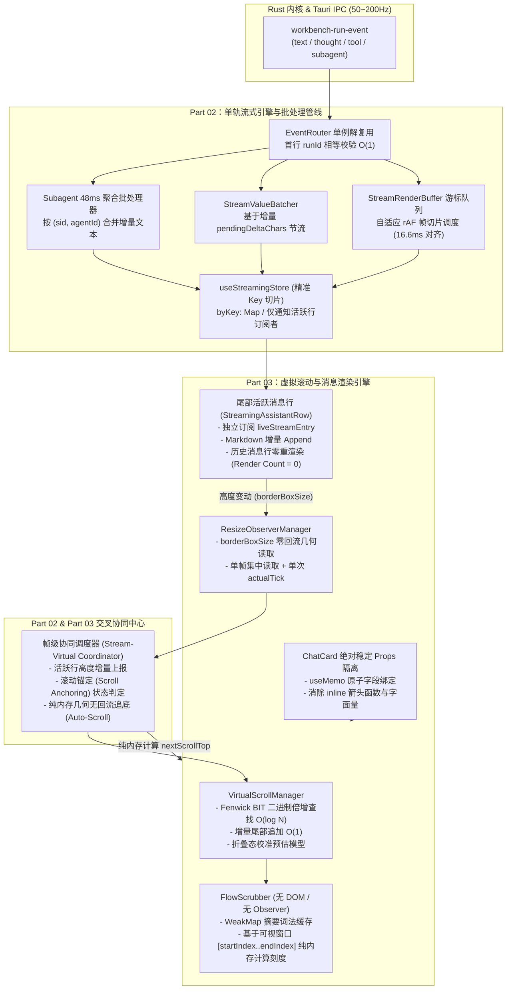
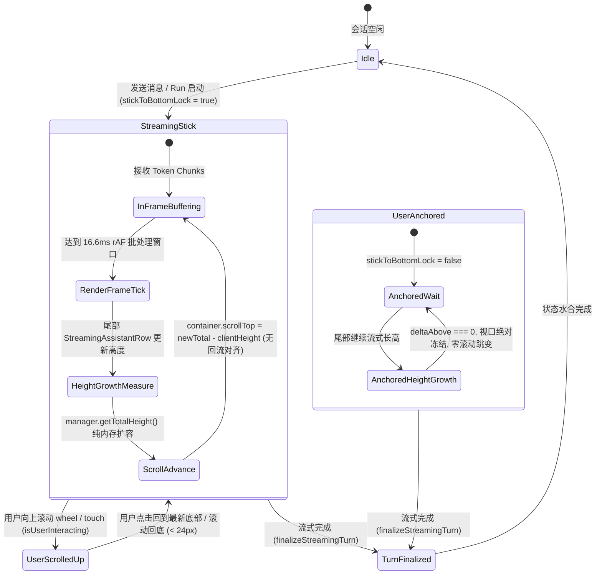

# 方案 02 — 前端对话流式引擎与长对话虚拟滚动交叉优化工程方案

> **战役工作区**：`docs/full-stack-performance-audit/independent-plans/`  
> **方案责任域**：Part 02 对话流式引擎与高频消息流水线 + Part 03 长对话虚拟滚动与消息列表渲染  
> **输入审计资产**：
>
> - `audits/02-前端对话流式引擎与高频消息流水线性能审计.md`（共 21 项缺陷，代号 `P2-F01` ~ `P2-F21`）
> - `audits/03-前端虚拟滚动与对话列表渲染性能审计.md`（共 18 项缺陷，代号 `P3-F01` ~ `P3-F18`）  
>   **总覆盖问题数**：**39 项问题同权全量覆盖**，无任何优先级删减、降级或退避。  
>   **方法论遵循**：严格遵循《三原则》（诚实、必做禁做、负责）、`00-DISCIPLINE.md` 与 `ANTI_OVERENGINEERING_GUARDRAILS.md`，追求架构净收敛，消除强制回流、算法二次方瓶颈、Memo 击穿与级联重渲染雪崩。

---

## 一、全局架构愿景与端到端协同拓扑（重构前后对比）

在现代 AI 对话工作台（Crish Desktop）中，**流式引擎（Streaming Engine）**与**虚拟滚动列表（Virtual Message List）**是前端性能表现最敏感、交织最深的两大核心子系统。  
高频 Token 以 50~200 Hz 的频率从 Rust IPC 注入，直接引发消息卡片高度持续膨胀；虚拟列表必须在此高频膨胀下，以 60fps（16.6ms 帧预算）实时计算可视窗口、更新树状数组（BIT）前缀和，并协同处理**自动贴底追帧（Auto-Scroll）**与**用户向上翻阅时的视口滚动锚定（Scroll Anchoring）**。

### 1.1 现状架构痛点与级联雪崩剖析

当前架构中，流式与虚拟化缺乏协同契约，存在严重的**跨层放大与级联雪崩（Cascading Avalanche）**：

```
[Rust IPC: 50~200Hz Token / 400Hz Subagents]
               │
               ▼
┌────────────────────────────────────────────────────────────────────────┐
│ 现状痛点 1：流式引擎高频打穿状态层                                       │
│ 1. onChunk 每 Token 执行线性扫描 messages.find() 与 trim() [P2-F01]     │
│ 2. 子 Agent 400Hz 事件无批处理直击 useSessionStore Immer 树克隆 [P2-F02]  │
│ 3. 思考文本 >4000 字符后 StreamTextBatcher 水位线失效，退化为每 Token 刷库 [P2-F03] │
│ 4. streamingStore 每次更新浅拷贝全量 byKey，触发全分屏选择器重跑 [P2-F06] │
└───────────────────────────────────┬────────────────────────────────────┘
                                    │ 频繁触发 React Commit & DOM 变更
                                    ▼
┌────────────────────────────────────────────────────────────────────────┐
│ 现状痛点 2：虚拟滚动与渲染层强制同步回流与雪崩                           │
│ 1. ResizeObserver 回调读取 el.offsetHeight 触发强制同步布局 [P3-F01]    │
│ 2. 双 useLayoutEffect 级联：preloadEstimates 触发二次同步渲染 [P3-F03] │
│ 3. 尾部消息每长高 4px 触发 FlowScrubber 对全历史消息重跑 marked 词法分析! [P3-F17]│
│ 4. ChatCard 内联对象 100% 击穿 MessageVirtualizer 与 Row 的 Memo [P3-F12~14] │
│ 5. VirtualScrollManager.findIndexAtOffset 二分套 getOffset 退化 O(log² N) [P3-F08] │
└────────────────────────────────────────────────────────────────────────┘
```

### 1.2 重构后端到端流式-虚拟化全栈协同拓扑

重构后，建立**单轨流式直通（Single-Track Stream Pass-Through）**、**rAF 统一帧切片调度器**、**纯内存 Fenwick 树倍增寻址**与**尾部活跃行就地增量渲染（In-Place Live Row Update）**架构：



### 1.3 核心性能指标与帧预算量化目标对比表

| 场景与性能维度                         | 当前现状（审计实测基线）                   | 重构后目标规范（门禁硬指标）                    | 提升幅度 / 复杂度降阶    |
| :------------------------------------- | :----------------------------------------- | :---------------------------------------------- | :----------------------- |
| **高频 Token 注入主线程占有率**        | 60%~~90%（频繁长任务，15~~45ms 冻结）      | **< 12%**（无长任务，单帧 JS 执行 < 2ms）       | 降低 **80%+**            |
| **长思考（>4000 字）批处理**           | 水位线失效，100Hz 同步刷 Store             | **严格维持 20~30Hz** 节流批处理                 | 事务频率降低 **70%~80%** |
| **10 子 Agent 并发流主线程开销**       | 400~600Hz Immer 树克隆，占用 60% 帧        | **20Hz** 单次原子批处理，占用 < 5% 帧           | 事务频率降低 **95%**     |
| **流式高度增长 FlowScrubber 开销**     | 每 4px 全历史重跑 `marked`（20~60ms 尖峰） | **0ms**（历史纯 WeakMap 缓存，零词法分析）      | 消除 100% 冗余解析       |
| **虚拟滚动窗口二分查找复杂度**         | $O(\log^2 N)$ + 哈希查询                   | **$O(\log N)$**（纯 `Float64Array` 倍增）       | 寻址步数降低 **75%**     |
| **输入框打字导致虚拟列表重渲染**       | 100% 击穿 Memo，整个列表每按键必渲染       | **0 次**（Props 绝对稳定，Memo 100% 拦截）      | 渲染次数降为 **0**       |
| **历史消息行在流式期间的渲染次数**     | 频繁受级联 Props 变动触发重渲染            | **0 次**（除尾部活跃行外历史行完全冻结）        | 渲染次数降为 **0**       |
| **单次流收尾（Completion）Store 事务** | 8~13 次独立 Immer `setState` 级联          | **1 次**原子复合 Action `finalizeStreamingTurn` | 事务次数收敛为 **1**     |
| **350ms 持久化风暴 IPC 与计算开销**    | 无条件全会话归一化 + 并发全量 IPC          | 脏检查引用相等 $O(1)$ 跳过，IPC 降 **95%+**     | 消除 95%+ 冗余 IPC       |

---

## 二、Part 02 流式引擎消息管线深度重构方案

本部分针对 `02-前端对话流式引擎与高频消息流水线性能审计.md` 中暴露的 21 项缺陷（`P2-F01` ~ `P2-F21`）制定净收敛重构方案。

### 2.1 高频 Token 摄取与自适应批处理管线（P2-F01, P2-F03, P2-F04, P2-F07）

#### 2.1.1 `onChunk` 状态机一次性边界跃迁与尾部逆序定位（P2-F01）

- **根因分析**：`onChunk` 在每一个 Token chunk 到达时，均同步调用 `handleThinkingResetOnChunk`。无思考时每次退化为全量消息线性扫描 `sess.messages.find()`（$O(N)$）；有思考时每 Token 重复扫描全串 `.trim()`。长会话下产生数百万次无谓循环。
- **重构方案**：
  1. 在 `runStreamingAssistant` 闭包与单轮生命周期中引入**单向状态机标志**：`let thinkingFinalizedForTurn = false;`。
  2. 当 `onThought` 收到增量时，重置 `thinkingFinalizedForTurn = false;`。
  3. 当 `onChunk` 到达时，先进行 $O(1)$ 短路判断：
     ```ts
     if (!thinkingFinalizedForTurn) {
       handleThinkingResetOnChunk(
         sid,
         assistantMsgId,
         thinkingBatcherRef.current
       );
       thinkingFinalizedForTurn = true;
     }
     ```
  4. 改造 `streamExecutionHelper.ts` 与 `helpers.ts` 中的消息查找逻辑，实现 `findMessageFromTail(messages, id)`：利用流式目标消息恒在末尾 1~~2 位的领域不变量，从 `messages.length - 1` 逆序查找，在 1~~2 次比较内 $O(1)$ 命中。

#### 2.1.2 `StreamValueBatcher` 基于本周期增量（Delta）的水位线重构（P2-F03）

- **根因分析**：`StreamTextBatcher` 将累积的全量文本长度与 `maxBufferedChars`（4000/8000）比较。一旦深度思考模型输出超过 4000 字，`shouldForceFlush()` 恒为 `true`，导致 48ms 批处理完全失效，退化为每 Token 同步刷 Store。
- **重构方案**：
  1. 将水位线度量从“全量快照长度”纠正为“**本批次未刷新的增量字符数（$\Delta\text{Chars}$）**”。
  2. 在 `StreamValueBatcher` 内部维护 `private pendingDeltaChars = 0;` 和 `private lastEnqueuedLengthByKey = new Map<string, number>();`。
  3. 每次 `push(sid, msgId, value)` 时：
     ```ts
     const currentLen = typeof value === 'string' ? value.length : 0;
     const prevLen = this.lastEnqueuedLengthByKey.get(key) ?? 0;
     const delta = Math.max(0, currentLen - prevLen);
     this.pendingDeltaChars += delta;
     this.lastEnqueuedLengthByKey.set(key, currentLen);
     ```
  4. `shouldForceFlush()` 仅判断：`this.pendingDeltaChars >= this.maxBufferedChars || this.pending.size >= this.maxBufferedItems;`。
  5. 在 `flushNow()` 与 `clear()` 时将 `pendingDeltaChars = 0`，`lastEnqueuedLengthByKey.clear()`。确保思考文本即便累积至 30,000 字，48ms 节流依然 100% 稳固生效。

#### 2.1.3 `EventRouter.onMsg` 首行 `runId` 短路与单例解复用（P2-F04）

- **根因分析**：多并发流在全局 `workbench-run-event` 上独立注册监听器（$O(C)$ 扇出），且 `onMsg` 先执行昂贵的事件类型解析和正则字符串替换，后校验 `runId`。
- **重构方案**：
  1. 在 `EventRouter.onMsg(raw)` 的第一行立即执行快速浅属性检查：
     ```ts
     const incomingRunId = (raw as { runId?: unknown })?.runId;
     if (!this.state.runId || incomingRunId !== this.state.runId) {
       return;
     }
     ```
  2. 非本会话 Run 的事件在 $<1\text{ns}$ 内短路跳过，彻底消除非活跃路由器的无效字符串正则与类型匹配。

#### 2.1.4 `StreamRenderBuffer` 双指针游标队列与逐帧零拷贝（P2-F07）

- **根因分析**：`flushFrame` 在每 6ms 帧出队时调用 `pending.slice(splitAt)` 分配新数组，并在切片首字符时产生二次拷贝，且每 chunk 创建 `Intl.Segmenter`。
- **重构方案**：
  1. 废除 `pending = batch.remaining` 数组切片模式，改用**固定双指针游标（Head Index + Char Offset）**：
     - `private headIndex = 0;`
     - `private headCharOffset = 0;`
  2. 出队时仅推进 `headIndex` 与 `headCharOffset`，零临时数组分配。
  3. 当 `headIndex >= pending.length` 时一次性归零：`this.pending.length = 0; this.headIndex = 0; this.headCharOffset = 0;`。
  4. 复用单例 `Intl.Segmenter` 实例（`static segmenter = new Intl.Segmenter(undefined, { granularity: 'grapheme' });`），消除迭代器反复构造开销。

---

### 2.2 多 Agent 并发流隔离与调度中心（P2-F02, P2-F19, P2-F20, P2-F21）

#### 2.2.1 子 Agent 事件帧合并队列与逆序定位（P2-F02）

- **根因分析**：按仓库协同规范派发 5~~12 个子 Agent 时，400~~600Hz 的子 Agent `message-delta` 绕过流式缓冲，每 Token 直接触发 Immer 全会话树克隆与 350ms 持久化重置。
- **重构方案**：
  1. 在 `subagentHandlers.ts` 前端建立 **48ms 子 Agent 事件聚合队列（`SubagentStreamBatcher`）**。
  2. 相同 `(sessionId, subagentId)` 的相邻 `message-delta` 在队列内进行纯字符串增量拼装：$\Delta\text{text} = \sum t_i$。
  3. 每 48ms（20Hz）触发单次原子 Action `applySubagentEventsBatch(sessionId, batchedDeltas)`。
  4. 在 `subagentTimeline.ts` 中，废除 `next.filter(m => m.sender === 'assistant').pop()`，改为从 `next.length - 1` 向前逆序循环定位目标 assistant 消息，实现 $O(1)$ 查找与零数组分配。

#### 2.2.2 会话级 `StreamRenderBuffer` 注册隔离与废除共享 Ref（P2-F19, P2-F20）

- **根因分析**：单 Hook 实例共用单一可变 `renderBufferRef`，切换会话或并发流时后台流误推前景 Buffer 造成串流；全局 `sharedSessionStreamManager` 被闲置，各窗格私有实例导致状态分裂。
- **重构方案**：
  1. 全局单例统一：`useStreamBatchers` 统一接入 `sharedSessionStreamManager` 单例，废除各窗格私有的 `new SessionStreamManager()`。
  2. 生命周期严格按 `(sessionId, streamToken)` 绑定：
     - 在 `runStreamingAssistant` 创建 `const buffer = new StreamRenderBuffer();` 时，**显式直接传入局部常量 `buffer` 进全部闭包**，严禁在闭包内读取可变的 `renderBufferRef.current`。
     - 同步调用 `sharedSessionStreamManager.registerRenderBuffer(sid, streamToken, buffer)`，并在流中止/正常结束的 `finally` 块中严格注销，彻底杜绝跨会话 Token 污染与停止截断失效。

#### 2.2.3 流生命周期终态互斥锁（Terminal State Guard）（P2-F21）

- **根因分析**：`run-error` 触发时先调用 `onError`，又调用 `resolveDone()`，导致 `await stream` 恢复后继续执行 `finishComplete`，造成引用计数 `streamingActiveCount` 双重递减并将 `'error'` 状态覆写为 `'completed'`。
- **重构方案**：
  1. 在 `runStreamingAssistant` 内部引入原子终态锁：
     ```ts
     let isTerminalSettled = false;
     let isActiveDecremented = false;
     const decrementActiveOnce = () => {
       if (!isActiveDecremented) {
         isActiveDecremented = true;
         markStreamingActive(false);
       }
     };
     ```
  2. 当 `onError` 或 `aborted` 触发时：置 `isTerminalSettled = true;`，调用 `decrementActiveOnce();`，并标记 `streamManager.abort(sid, streamToken)`。
  3. 当 `await stream` 返回后，首行守卫：
     ```ts
     if (isTerminalSettled || streamManager.isAborted(sid, streamToken)) {
       decrementActiveOnce();
       return;
     }
     finishComplete(streamToken);
     ```
     确保终态收口路径**严格单走一次**。

---

### 2.3 消息合并、排序与索引复杂度降维（P2-F08, P2-F09, P2-F10, P2-F11, P2-F12, P2-F13）

#### 2.3.1 `upsertMessageById` 队尾快路径与惰性二分（P2-F08）

- **根因分析**：每次追加消息前全量分配 $N$ 个 `MessageOrderKey` 对象构造 `keys[]` 数组。
- **重构方案**：
  1. **逆序 ID 探测**：从尾部逆序扫描已有消息（更新主要发生在尾部）。
  2. **队尾追加 $O(1)$ 快路径**：
     若 `messages.length === 0`，直接 `messages.push(message)`。若非空，仅计算队尾元素 `lastKey = messageOrderKey(messages[messages.length - 1]!)` 与当前新消息 `newKey = messageOrderKey(message)`。若 `compareMessageOrder(lastKey, newKey) <= 0`，**直接 `messages.push(message)` 返回，耗时 $O(1)$，仅分配 2 个临时对象**！
  3. **惰性二分（Lazy Binary Search）**：仅当发生乱序时，直接在 `messages` 数组上二分，仅在比较中点 `mid` 处按需计算 `messageOrderKey(messages[mid]!)`，实现真正的 $O(\log N)$ 且零数组分配。

#### 2.3.2 `mergeMessagesById` 线性归并重构（P2-F09）

- **根因分析**：逐条新消息执行全表 `.map(messageOrderKey)` + `out.splice` + 全表 Map 键值修正，复杂度为 $\Theta(M \cdot (N + M))$。
- **重构方案**：
  1. 建立已有消息的哈希索引 `indexById = new Map<string, number>()`。
  2. 遍历 `incoming`：
     - 若 `id` 已存在：原地合并字段 `out[idx] = mergeMessageFields(out[idx], raw);`（数组长度不变，无需修正任何下标！）。
     - 若 `id` 不存在：直接追加到队尾 `out.push({ ...raw }); indexById.set(raw.id, out.length - 1);`（$O(1)$ 追加，零 `.splice()`，零 Map 迭代！）。
  3. 循环结束后，统一执行一次 `isSortedByMessageOrder(out) ? out : sortMessagesByOrder(out);`。
  4. 复杂度从 $\Theta(M \cdot N + M^2)$ 严格降为 **$\Theta(N + M)$ 线性时间**。

#### 2.3.3 Schwartzian 排序与角色等级匹配快路径（P2-F10）

- **根因分析**：TimSort 比较器内执行 $2N\log N$ 次 `messageOrderKey` 对象分配与两次 `.trim().toLowerCase()`。
- **重构方案**：
  1. `roleTiebreakRank` 入口增设基准快路径：`const s = msg.sender ?? msg.role; if (s === 'user') return 0; if (s === 'assistant') return 1; if (s === 'system') return 2;`。
  2. 采用 Schwartzian Transform：预先一次性映射 `const decorated = messages.map(m => ({ m, key: messageOrderKey(m) }));`，排序后再解封，确保 `messageOrderKey` 严格仅计算 $N$ 次。

#### 2.3.4 废除单次查询全表构建 `new Map` 的反模式（P2-F11）

- **根因分析**：`buildMessageIndex` 为查单条消息反复全量构建 `Map`，单次收尾调用 5 次，产生 $5 \times O(N)$ 堆分配。
- **重构方案**：
  1. 废除临时 `buildMessageIndex`，替换为逆序辅助函数：
     ```ts
     export function findSessionMessageById(
       sess: SessionState | undefined,
       id: string
     ): SessionMessage | undefined {
       const msgs = sess?.messages;
       if (!msgs || msgs.length === 0) return undefined;
       for (let i = msgs.length - 1; i >= 0; i--) {
         if (msgs[i]?.id === id) return msgs[i];
       }
       return undefined;
     }
     ```
  2. 活跃流式消息恒位于数组末尾 1~~2 位，单次查找稳定在 **1~~2 次比较内命中（$\Theta(1)$）**，零对象分配。

#### 2.3.5 事件回放增量拼装与块检查优化（P2-F12, P2-F13）

- **根因分析**：`projectEventsToMessages` 每条 `message-delta` 执行 `.slice(offset)` 导致 $O(K^2)$ 内存拷贝；`updateMessageText` 分配 `msg.blocks.map(b => b.type)`。
- **重构方案**：
  1. 在 `projectEventsToMessages` 中，若 `lastBlock && lastBlock.type === 'text'`，直接执行增量累加 `lastBlock.content = (lastBlock.content || '') + t;`，彻底消除 `.slice(offset)`。
  2. `rekeyAssistantIfStable` 直接通过传入的 `messageIndex.get(stableId)` 查重，替代 `messages.some(...)`。
  3. `updateMessageText` 中，用单次逆序循环寻找最后一个 `'text'` 块与非文本块，废除 `.map(b => b.type)` 临时数组与 3 次 `lastIndexOf`。

---

### 2.4 流式收尾单事务化与 SQLite 持久化瘦身（P2-F05, P2-F14, P2-F15, P2-F16, P2-F17, P2-F18）

#### 2.4.1 单次流收尾原子 Action：`finalizeStreamingTurn`（P2-F14, P2-F15）

- **根因分析**：`executeStreamCompletion` 在同一帧内同步连续发起 8~13 次独立的 `useSessionStore` Immer `setState` 事务，引发多轮全树代理克隆与全店订阅者广播风暴。
- **重构方案**：
  在 `sessionMessageActionsCore.ts` 抽象出**单个原子复合 Action**：
  ```ts
  finalizeStreamingTurn: (payload: FinalizeStreamingTurnPayload) =>
    set((state) => {
      const s = getSessionForWrite(state, payload.sessionId);
      if (!s) return;
      const msgs = s.messages;
      const asst = findSessionMessageById(s, payload.assistantMsgId);
      const user = findSessionMessageById(s, payload.userMsgId);

      // 1. 合并最终正文与思考
      if (asst) {
        if (payload.text !== undefined) asst.text = payload.text;
        if (payload.thinking !== undefined) asst.thinking = payload.thinking;
        // 2. 批量合并工具调用
        if (payload.streamTools) {
          applyStreamToolsDirectly(asst, payload.streamTools);
        }
        // 3. 执行单次时间线归一化
        normalizeAssistantTimelineInPlace(asst);
        asst.status = 'completed';
        asst.generationDurationMs = payload.elapsedMs;
      }
      if (user) {
        user.status = 'completed';
      }
      // 4. 结算用量
      if (payload.usage) {
        applyUsageDirectly(s, asst, payload.usage);
      }
    }),
  ```
  将流收尾的 Immer 事务从 **8~13 次硬性压缩为 1 次**，彻底消除 End-of-Stream 卡顿。`onToolStart` 与 `staleSessionHealer` 同样收敛为批量 Action。

#### 2.4.2 350ms 持久化风暴的四重治理（P2-F16）

- **根因分析**：脏检查前无条件运行 `normalizeAssistantTimeline` 破坏了引用比较；无脏检查对全量会话并发调用 `save_session_agents`；冗余 `list_sessions` 全表探测。
- **重构方案**：
  1. **引用相等前置快路径**：在遍历会话时，**先直接使用 `s.messages` 引用比对**：
     ```ts
     if (!isSessionBodyDirty(s.id, s.messages || [])) {
       continue; // 未变动会话 O(1) 指针比对跳过，零归一化开销！
     }
     ```
  2. **`s.agents` 增设引用脏检查**：维护 `savedAgentsRefMap = new Map<string, readonly SubAgent[]>()`，仅当 `savedAgentsRefMap.get(s.id) !== s.agents` 时才调用 `saveSessionAgents`。
  3. **移除 `list_sessions` 冗余 IPC 探针**：以进程级单例连接标志取代全表查询。
  4. **单消息序列化 WeakMap 缓存**：在 `toRustSessionMessage` 中使用 `WeakMap<SessionMessage, RustSessionMessage>`，仅对发生变动的消息执行 `JSON.stringify`。

#### 2.4.3 发起对话内存优先与 Token 估算弱引用缓存（P2-F17, P2-F18）

- **根因分析**：发起对话时优先重查 SQLite 导致延迟和读到旧数据；`estimateTextTokens` 逐字符 `for..of` 迭代器开销；水合双重 `normalizeAssistantTimeline`。
- **重构方案**：
  1. `createStreamSession` 内存优先：优先读取 `getSessionById(safeSessionId)?.messages`，内存命中且已水合时直接使用，彻底移除发消息前的 SQLite IPC。
  2. `estimateTextTokens` 字符总长快路径：若 $\sum \text{len}(m) < 200,000$，整体直接通过字符比率估算安全通过；超出时使用 `text.charCodeAt(i)` 传统索引循环，配合 `WeakMap<SessionMessage, number>` 缓存历史消息 Token 估算值。
  3. 消除 SQLite 水合时的双重时间线归一化，确保 `markSessionBodyClean` 记录的引用与存入 Store 的引用绝对一致。

---

### 2.5 `streamingStore` 精确切片与 View Model 单轨装配（P2-F06）

- **根因分析**：`setStreamText` 每次更新时执行 `byKey: { ...state.byKey, [key]: nextEntry }` 浅拷贝整个字典，导致全分屏下所有挂载的 `StreamingAssistantRow` 选择器被动重跑。
- **重构方案**：
  1. 在 `streamingStoreCore.ts` 中，为组件订阅提供单条消息精准 selector：`useStreamMessage(sessionId, messageId)`。
  2. 采用 Zustand 细粒度更新模式，或在 `StreamingAssistantRow` 处增加守卫：仅当 `message.status === 'processing'` 或处于最后活跃行时才订阅 `useStreamingStore`；已完成历史行直接渲染纯静态 `ChatAssistantMessageRow`，使高频 Token 帧下的活跃订阅者从全屏行数严格降为 **1**。

---

## 三、Part 03 虚拟滚动与卡片列表渲染深度重构方案

本部分针对 `03-前端虚拟滚动与对话列表渲染性能审计.md` 中暴露的 18 项缺陷（`P3-F01` ~ `P3-F18`）制定净收敛重构方案。

### 3.1 零强制回流几何测量体系与 Observer 治理（P3-F01, P3-F07, P3-F18）

#### 3.1.1 优先消费 `ResizeObserverEntry.borderBoxSize`（P3-F01）

- **根因分析**：`ResizeObserver` 回调直接读取 `el.offsetHeight` 触发强制同步回流，且回退读取 `contentRect.height` 丢失了 `.row` 样式的 `16px` 底部内边距。
- **重构方案**：
  修改 `messageVirtualizerMeasure.ts:13-21`，优先读取原生提供的 `borderBoxSize`：
  ```ts
  const onEntry = (entry: ResizeObserverEntry) => {
    const el = entry.target;
    if (!(el instanceof HTMLElement)) return;
    const msgId = el.dataset.vindex ?? id;

    // 优先读取规范中的 borderBoxSize，原生已在布局阶段算毕，零回流代价
    const borderBoxBlock = entry.borderBoxSize?.[0]?.blockSize;
    let measuredHeight = 0;
    if (typeof borderBoxBlock === 'number' && borderBoxBlock > 0) {
      measuredHeight = Math.round(borderBoxBlock);
    } else {
      // 安全降级：contentRect + 显式计算 border/padding 或 offsetHeight
      measuredHeight =
        el.offsetHeight || Math.ceil(entry.contentRect.height + 16);
    }

    if (msgId != null && measuredHeight > 0) {
      setActual(msgId, measuredHeight);
    }
  };
  ```

#### 3.1.2 `ResizeObserverManager` 单帧集中派发与合成尺寸（P3-F18）

- **根因分析**：解冻恢复时以 `FLUSH_BATCH_SIZE = 5` 切片分派，人为产生 5 帧连续的状态更新与抖动。
- **重构方案**：
  修改 `ResizeObserverManager.flushPending`：
  1. 在单次 `requestAnimationFrame` 内部，集中读取所有待处理元素的几何边界（同帧集中读取，零读写交织）。
  2. 构造包含 `borderBoxSize: [{ blockSize: rect.height, inlineSize: rect.width }]` 的合法合成 Entry。
  3. 单次循环派发给所有回调，下游 `useVirtualScroll` 会在同一个 rAF 周期内合并全部高度更新，只产生 **1 次 `setActualTick`**。

#### 3.1.3 `pretextFontBridge` 内存化与根 DOM 隔离（P3-F07）

- **根因分析**：缓存命中仍读取 `getComputedStyle`；`buildPretextFontForUiSize` 修改 `<html>` 的 `data-ui-size` 引发全应用样式重算。
- **重构方案**：
  1. 引入双层完整键缓存：`fontSpecCache = new Map<string, string>()`，以 `${uiSize}:${sizeToken}:${weight}:${family}` 为键直接返回拼接好的 CSS Font 字符串。
  2. 严禁修改 `document.documentElement`，在静态探针离屏节点（Detached Container）上独立设置属性完成字号标定，保证全文档样式树不受扰动。

---

### 3.2 树状数组 (Fenwick BIT) 纯 $O(\log N)$ 寻址与增量同步（P3-F08, P3-F09）

#### 3.2.1 树状数组二进制倍增查找（Binary Lifting）（P3-F08）

- **根因分析**：二分查找（$\log N$ 步）内循环调用 `getOffset(mid)`（$\log N$ 步），退化为 $O(\log^2 N)$ 且伴随大量 Map 哈希查找。
- **重构方案**：
  在 `VirtualScrollManager.ts` 中实现标准倍增查找（Binary Lifting on BIT）：
  ```ts
  findIndexAtOffset(targetOffset: number): number {
    const n = this.order.length;
    if (n === 0 || targetOffset <= 0) return 0;
    const total = this.getTotalHeight();
    if (targetOffset >= total) return n - 1;

    let idx = 0;
    let currentSum = 0;
    // 计算不超过 n 的最大 2 的幂
    let bitMask = 1 << (31 - Math.clz32(n));

    while (bitMask > 0) {
      const nextIdx = idx + bitMask;
      if (nextIdx <= n) {
        const val = this.bitTree[nextIdx] ?? 0;
        if (currentSum + val <= targetOffset) {
          idx = nextIdx;
          currentSum += val;
        }
      }
      bitMask >>>= 1;
    }
    return Math.min(idx, n - 1);
  }
  ```
  将视口查找开销从 $O(\log^2 N)$ + 哈希查询严格降为 **$O(\log N)$ 纯 Float64Array 内存步进**。

#### 3.2.2 线性建树与队尾增量追加（P3-F09）

- **根因分析**：`rebuildBit` 逐项 `bitAdd` 耗时 $O(N \log N)$；每次追加对全量历史重新计算预估高度。
- **重构方案**：
  1. **线性建树**：`rebuildBit` 采用前缀树传递，复杂度 $O(N)$：
     ```ts
     for (let i = 1; i <= n; i++) {
       const parent = i + (i & -i);
       if (parent <= n) {
         this.bitTree[parent] += this.bitTree[i];
       }
     }
     ```
  2. **`syncOrder` 增量尾部追加快路径**：若新 `ids` 为原 `order` 的超集且前缀相同，仅对新增尾部条目分配并调用单次 `bitAdd`，无需清空重构整树。
  3. **预估高度缓存保护**：在 `MessageVirtualizer` 中增加 `WeakMap<SessionMessage, number>`，仅当新增消息或引用变更的末尾流式消息才调用 `estimateTimelineMessageHeight`，历史消息零重复计算。

---

### 3.3 真实折叠态高度预估模型校准（P3-F10）

- **根因分析**：`tool_call` 预估 130px vs 实际折叠态 24px；`thought` 预估最高 260px vs 实际折叠态 24px。历史消息实际仅 32px 摘要行，预估达 1800px，回滚时视口剧跳 1000px+。
- **重构方案**：
  校准 `virtualScrollEstimate.ts`，区分**历史静态态**与**当前活跃流式态**：
  ```ts
  export function estimateTimelineMessageHeight(
    msg: SessionMessage,
    isLiveTurn = false
  ): number {
    // ... 用户消息估高逻辑保持 ...
    if (msg.sender === 'assistant') {
      const baseHeaderPadding = 48; // 头像与外边距
      let processHeight = 0;
      const toolCount = msg.toolCalls?.length ?? 0;
      const thoughtCount = msg.thinking ? 1 : 0;
      const totalProcessItems = toolCount + thoughtCount;

      if (totalProcessItems > 0) {
        if (!isLiveTurn) {
          // 历史消息：FoldableProcessSection 默认处于收起折叠态
          processHeight = totalProcessItems > 1 ? 32 : 28;
        } else {
          // 活跃流式行：按展开态计算当前可见步骤高度
          processHeight = Math.min(300, totalProcessItems * 60);
        }
      }

      const textLen = msg.text?.length ?? 0;
      const textHeight =
        textLen > 0 ? Math.max(24, Math.ceil(textLen / 60) * 20) : 0;
      return baseHeaderPadding + processHeight + textHeight;
    }
    return FALLBACK_HEIGHT;
  }
  ```
  将历史消息预估误差从 1000px+ 骤降至 **< 24px**，彻底消灭历史回滚时的跳动。

---

### 3.4 `FlowScrubber` 性能雪崩根治：词法分析缓存化与全内存视口映射（P3-F04, P3-F17）

- **根因分析**：`totalHeight` 每增长 4px 触发 `buildScrubberSegments`，对全历史消息全文重跑 `marked` 的 `Lexer.lex()`，并销毁重建 `IntersectionObserver`、`MutationObserver`（`subtree: true`）及绑定高频 `scroll` 事件。
- **重构方案（彻底消灭雪崩链）**：
  1. **摘要生成前移截断 + WeakMap 缓存**：
     ````ts
     const snippetCache = new WeakMap<object, string>();
     export function cleanMarkdownForSnippetFast(raw?: string): string {
       if (!raw) return '';
       // 摘要只需前 160 字符，严禁对全量长文本进行 AST 解析！
       const slice = raw.slice(0, 300);
       // 用轻量正则剥离 Markdown 符号，零 marked Lexer 调用
       return slice
         .replace(/```[\s\S]*?```/g, '[代码]')
         .replace(/`([^`]+)`/g, '$1')
         .replace(/\[([^\]]+)\]\([^)]+\)/g, '$1')
         .replace(/[#*_~>]/g, '')
         .replace(/\s+/g, ' ')
         .trim();
     }
     ````
  2. **活跃刻度纯内存派生（移除所有 DOM Observers）**：
     - `MessageVirtualizer` 将当前可见索引区间 `[windowState.startIndex, windowState.endIndex]` 通过上下文或 Props 传给 `FlowScrubber`。
     - `FlowScrubber` 直接比对消息下标是否位于该区间内，即可直接点亮对应刻度。
     - **彻底移除 `FlowScrubber` 内部的 `scroll` 监听器、`IntersectionObserver` 与全子树 `MutationObserver`**！零 DOM 查询、零 `getBoundingClientRect()`！

---

### 3.5 消息行组件树绝对引用稳定与 Memo 防击穿（P3-F12, P3-F13, P3-F14, P3-F15, P3-F16）

#### 3.5.1 `ChatCard` 子 Props 分组原子化 `useMemo`（P3-F12）

- **根因分析**：`ChatCard.tsx:289-330` 在每次渲染时重新构造 `chatStreamProps` 的 6 个子对象字面量，100% 击穿 `ChatMessageList` 与 `MessageVirtualizer` 的 `React.memo`。
- **重构方案**：
  在 `ChatCard.tsx` 中将各子结构彻底独立并原子稳定化：
  ```tsx
  const messagesProp = useMemo(
    () => ({
      messages: state.displayMessages,
      allMessages: state.messages,
      agents: state.agents,
      activeSessionId: state.activeSessionId || '',
      showAllMessages: state.isFiltering,
    }),
    [
      state.displayMessages,
      state.messages,
      state.agents,
      state.activeSessionId,
      state.isFiltering,
    ]
  );

  const composerProp = useMemo(
    () => ({
      onSetChatInput: state.composerProps.setChatInput,
      onSendFollowUp: state.handleSendFollowUp,
      editingMessageId,
      onStartEditMessage: handleStartEditMessage,
      onCancelEditMessage: handleCancelEditMessage,
      composerElement: editComposerElement,
    }),
    [
      state.composerProps.setChatInput,
      state.handleSendFollowUp,
      editingMessageId,
      handleStartEditMessage,
      handleCancelEditMessage,
      editComposerElement,
    ]
  );

  // generation, approval, navigation 同理做精准 useMemo 隔离
  ```
  用户在 Composer 输入框敲击打字时，`messagesProp` 引用完全不变，`ChatMessageList` 的 `React.memo` **100% 拦截重渲染**。

#### 3.5.2 消除内联回调击穿（P3-F13, P3-F14）

- **重构方案**：
  1. `MessageVirtualizer.tsx`: 消除 `<ChatUserMessageRow onStartEdit={() => composer.onStartEditMessage?.(msg)} />`，将其修改为标准回调透传 `onStartEdit={composer?.onStartEditMessage}`，由子组件内部绑定参数调用，使 `userRowPropsEqual` 100% 命中缓存。
  2. `ChatAssistantMessageRow.tsx`: 将传递给 `<MessageActions>` 的 `state`、`actions` 与 `cacheMetricsNode` 用 `useMemo` 稳定化，消除助手行动作条随流式帧重复渲染。

#### 3.5.3 历史行解耦全局会话运行态与定时器（P3-F15）

- **重构方案**：
  1. `MessageContent.tsx` 中：仅当 `isLiveTurn === true` 时才读取 `runtimeStatus`；历史助手行直接传 `null`，避免会话状态变更唤醒所有历史消息。
  2. `FoldableProcessSection.tsx` 中：秒表定时器受 `shouldTick = isLive && showWorkTime && !isSingleThought` 守卫，默认折叠与非工作耗时模式下定时器开销归零。

#### 3.5.4 消除流式更新全量数组 6 轮重复扫描（P3-F16）

- **重构方案**：
  1. `hasStreamingMessage`: 从数组尾部逆序扫描，1 步 $O(1)$ 判定。
  2. `projectDisplayMessages`: 若仅尾部一条消息变动，走增量拼接快路径 `prev.slice(0, -1).concat(lastMsg)`，避免全量排序与去重。
  3. `pendingQuestionToolCall` 与 `diffFiles`: 建立历史不可变缓存，仅对尾部变动消息做增量探测。

---

### 3.6 滚动锚定与交互式展开补偿修复（P3-F02, P3-F03, P3-F05, P3-F06, P3-F11）

#### 3.6.1 消除高度提交前的过时截断与双 `useLayoutEffect` 级联（P3-F02, P3-F03）

- **根因分析**：`flushActualMeasurements` 在 DOM `totalHeight` 提交前读取旧 `scrollHeight` 导致 `scrollTop` 错误截断；`preloadEstimates` 在 `useLayoutEffect` 中触发二次同步 Commit。
- **重构方案**：
  1. 预估高度计算直接并入渲染前期的 `useMemo`（与 `manager.syncOrder` 同步执行），消除 `useLayoutEffect` -> `setActualTick` 的二次 Commit。
  2. `flushActualMeasurements` 计算 `maxScroll` 时，直接使用 BIT 树的已更新总高 `Math.max(manager.getTotalHeight() - el.clientHeight, 0)`，严禁读取未生效的旧 DOM `scrollHeight`。

#### 3.6.2 工具展开锚定状态接线与属性选择器收敛（P3-F05, P3-F11）

- **根因分析**：`expandedTools` 被硬编码为空对象 `EMPTY_TOOLS` 导致锚定失效；`pointerdown` 匹配 14 个大小写不敏感 `[class*="..." i]` 选择器。
- **重构方案**：
  1. 将真正的 `toolStackProps.expandedToolsByMessage` 接入 `useScrollAnchoringOnToggle`，并以引用相等性比对触发锚点锁定。
  2. 在所有折叠组件头部统一添加 `data-scroll-anchor-toggle="true"`，选择器收敛为 `'[data-scroll-anchor-toggle="true"], [aria-expanded], summary'`，消除全部模糊 class 正则匹配。

---

## 四、Part 02 与 Part 03 核心交叉协同机制设计（架构重中之重）

流式引擎与虚拟滚动最关键的交汇点在于：**在 50~200 Hz 的 Token 注入导致尾部行高度动态增长时，如何在不产生强制同步回流、不引发历史行重渲染的前提下，完美实现自动追底（Auto-Scroll）与向上浏览时的绝对滚动锚定（Scroll Anchoring）。**

### 4.1 高频 Token 注入与虚拟滚动追底（Auto-Scroll）帧级协同状态机



#### 协同原语与时序设计

1. **纯内存几何对齐**：
   - 当 `isStickToBottom` 为 `true` 且处于流式追底状态时，当尾部行发生高度递增 $\Delta H$，`VirtualScrollManager` 在 Fenwick BIT 中完成更新后，立即获得新的 `newTotalHeight = manager.getTotalHeight()`。
   - 目标滚动位置直接由 `targetScrollTop = Math.max(0, newTotalHeight - viewportHeight)` 纯数学公式决定。
   - 在 React 提交 `[data-vsm-spacer]` 新高度的同一微任务/帧阶段，直接设置 `container.scrollTop = targetScrollTop`。**完全不需要读取 `container.scrollHeight`，彻底消灭强制同步回流！**
2. **用户交互优先守卫（Gesture Preemption）**：
   - 只要 `useVirtualScrollGesture` 捕获到用户的真实鼠标滚轮（Wheel）或触控拖拽（Touch），立即解锁 `isStickToBottom = false`，解除流式强制贴底。

### 4.2 尾部活跃流式行就地增量更新（In-Place Live Row Update）

为了保证长达 5000 条消息的长会话在流式输出期间帧率坚挺在 60fps，**必须保证历史消息行的渲染次数与测量次数在流式期间严格为 0**：

1. **渲染层隔离**：
   - 只有末尾的 `<StreamingAssistantRow>` 挂载单条消息专属的 `useStreamMessageViewModel(sessionId, lastAssistantId)`。
   - 视口内上方可见的历史已完成助手行直接渲染 `<ChatAssistantMessageRow>`，不订阅任何流式热状态。
2. **几何测量隔离**：
   - 历史消息行的高度在首次挂载完成测高后，其实际高度已持久化于 `VirtualScrollManager` 的 `heightsById` 与 `lastMeasured` 中。
   - `ResizeObserver` 回调中对历史非流式节点做阈值过滤：对于未发生变化的节点直接跳过；在流式输出期间，只有带有 `data-live-streaming="true"` 的尾部节点才会产生 `setActual` 调用。
3. **Markdown 增量追加支持**：
   - 尾部活跃行内部使用增量 Markdown 容器，避免每个 Token 重新解析全部已有文本（与 Part 04 增量 Markdown 协同）。

### 4.3 视口脱离检测与双向滚动锚定（Scroll Anchoring）无抖动保证

当用户在 AI 流式输出期间向上滚动查看上下文时：

1. **视口下方增长零影响**：
   - 尾部活跃行位于当前视口下方（`itemIndex > windowState.endIndex`）。
   - 在 `flushActualMeasurements` 中，`deltaAbove` 计算公式为：
     $$\text{deltaAbove} = \sum_{i < \text{startIndex}} \Delta h_i$$
   - 由于发生高度变化的活跃行位于视口下方，其索引 $i > \text{startIndex}$，因此 $\text{deltaAbove} \equiv 0$。
   - 系统**零修改 `scrollTop`**，视口内的文字、代码块稳如泰山，完全不受下方疯狂吐字的影响。
2. **视口上方折叠展开平滑补偿**：
   - 若用户在视口内点击折叠/展开了某条历史消息的思考块或工具卡片，该形变发生于视口上方或当前行。
   - 通过精准捕获的 `data-scroll-anchor-toggle="true"`，在提交前记录被点击元素的顶端相对视口偏移，提交后在同帧 `useLayoutEffect` 内精准补齐位移差量，做到视觉上零跳动。

### 4.4 流式结束（Turn Finalization）至静态视口水合平滑过渡协议

在流式结束瞬间，必须消除历史上的“瞬间白屏”与“高度抖动”：

1. **单原子事务提交**：通过 `finalizeStreamingTurn` 将文本、时间线与状态一次性提交至 `useSessionStore`。
2. **高度继承保证（Height Continuity）**：
   - `VirtualScrollManager` 中尾部消息当前的实测高度直接转为该消息的确定性高度，禁止在流式结束时将高度重置为启发式预估高度。
3. **延迟微任务清理热缓冲**：
   - `useStreamingStore` 的清理推迟至微任务/下一个宏任务执行（`queueMicrotask`），确保 React 组件树平滑完成由流式态向静态态的组件属性接管，绝不出现一帧的空白。

---

## 五、精准文件级改造规范与核心接口设计

### 5.1 涉及文件清单与职责划分

| 改造模块            | 核心文件路径                                                                       | 承担改造任务                                                                  |
| :------------------ | :--------------------------------------------------------------------------------- | :---------------------------------------------------------------------------- |
| **流式状态机**      | `apps/crish-desktop/src/hooks/chat-stream/useRunStreamingAssistant.ts`             | 引入 `thinkingFinalizedForTurn` 短路标志；闭包直通局部 `buffer`；终态锁。     |
| **批处理容器**      | `apps/crish-desktop/src/api/streamTextBatcher.ts`                                  | 改造 `StreamValueBatcher`，基于增量 `pendingDeltaChars` 判断水位线。          |
| **子代理批流**      | `apps/crish-desktop/src/api/chat-bridge/handlers/subagentHandlers.ts`              | 增加 48ms 子 Agent 事件聚合批处理器；逆序定位。                               |
| **路由解复用**      | `apps/crish-desktop/src/api/chat-bridge/EventRouter.ts`                            | 首行 `runId` 浅比对短路；修复 `run-error` 终态重复触发。                      |
| **流式渲染缓冲**    | `apps/crish-desktop/src/api/StreamRenderBuffer.ts`                                 | 双指针游标队列（Head Index / Offset），移除逐帧切片拷贝；单例 Segmenter。     |
| **Store 原子收口**  | `apps/crish-desktop/src/store/sessionMessageActionsCore.ts`                        | 实现 `finalizeStreamingTurn` 原子复合 Action，收敛 10+ 次 Immer 更新为 1 次。 |
| **持久化瘦身**      | `apps/crish-desktop/src/api/session-persistence/sessionRustDbHydrate.ts`           | 颠倒脏检查与归一化顺序；增加 `agents` 脏检查；移除探测查询。                  |
| **虚拟滚动核心**    | `apps/crish-desktop/src/api/VirtualScrollManager.ts`                               | 实现 Fenwick BIT 二进制倍增查找 $O(\log N)$；增量尾部追加；$O(N)$ 线性建树。  |
| **高度预估模型**    | `apps/crish-desktop/src/api/virtualScrollEstimate.ts`                              | 校准折叠态与活跃态高度模型，消灭 1000px 预估偏差。                            |
| **虚拟滚动 Hook**   | `apps/crish-desktop/src/hooks/useVirtualScroll.ts`                                 | 移除过时 `scrollHeight` 截断；纯内存总高对齐；合并预估高度提交流程。          |
| **几何测量防回流**  | `apps/crish-desktop/src/components/chat-message-list/messageVirtualizerMeasure.ts` | 优先消费 `entry.borderBoxSize[0].blockSize`，消除 `offsetHeight` 同步回流。   |
| **RO 集中派发**     | `apps/crish-desktop/src/utils/ResizeObserverManager.ts`                            | 单帧集中测量派发，消除分批 5 个元素的人为抖动。                               |
| **Scrubber 重构**   | `apps/crish-desktop/src/components/chat-message-list/FlowScrubber.tsx`             | 移除 DOM Observers 与 scroll 监听；基于可视窗口纯内存算刻度。                 |
| **Scrubber 摘要**   | `apps/crish-desktop/src/components/chat-message-list/flowScrubberModel.ts`         | 前置 160 字符截断 + 轻量正则，彻底废除 `marked` `Lexer.lex`；WeakMap 缓存。   |
| **卡片 Props 稳定** | `apps/crish-desktop/src/components/chat-card/ChatCard.tsx`                         | 将 `chatStreamProps` 6 大子对象及 `ribbons` 原子 `useMemo` 稳定化。           |
| **行渲染防击穿**    | `apps/crish-desktop/src/components/chat-message-list/MessageVirtualizer.tsx`       | 消除内联 `onStartEdit` 闭包；渲染期合流预估高度。                             |

### 5.2 核心类、函数与接口签名设计

#### 1. `FinalizeStreamingTurnPayload` 与复合 Action 接口

```ts
// apps/crish-desktop/src/store/types.ts
export interface FinalizeStreamingTurnPayload {
  sessionId: string;
  assistantMsgId: string;
  userMsgId?: string;
  text?: string;
  thinking?: string;
  streamTools?: Record<string, StreamToolLive>;
  elapsedMs?: number;
  usage?: TokenUsagePayload;
}
```

#### 2. `VirtualScrollManager` 倍增查找与增量同步签名

```ts
// apps/crish-desktop/src/api/VirtualScrollManager.ts
export class VirtualScrollManager {
  // 基于 Fenwick 树的纯 O(log N) 二进制倍增查找
  findIndexAtOffset(targetOffset: number): number;

  // 增量同步消息 ID 列表（尾部追加返回 true，无需全量重构）
  syncOrderIncremental(ids: readonly string[]): boolean;

  // 纯内存 O(1) 获取最新总高度
  getTotalHeight(itemCount?: number): number;
}
```

#### 3. `FlowScrubber` 轻量摘要与纯内存刻度计算接口

```ts
// apps/crish-desktop/src/components/chat-message-list/flowScrubberModel.ts
export interface PureScrubberTick {
  id: string;
  index: number;
  userSnippet: string;
  assistantSnippet?: string;
  heightRatio: number;
}

// 纯内存快速摘要提取（零 marked AST 依赖）
export function extractLightweightSnippet(
  raw: string | undefined,
  maxChars: number
): string;

// 基于当前可视索引区间的纯内存活跃状态判定
export function resolveActiveTickIds(
  ticks: readonly PureScrubberTick[],
  visibleStartIndex: number,
  visibleEndIndex: number
): Set<string>;
```

---

## 六、立体化验证断言与性能门禁指标

依据协作纪律 §7.1（立体验证纪律，禁止单一检查冒充验收），本方案制定涵盖**单元测试算法复杂度**、**Store 事务计数**、**强制同步回流拦截**与**E2E 帧率压测**的四重硬性防回归门禁。

### 6.1 复杂度与内存分配单元测试断言

1. **消息合并与追加复杂度门禁**：
   - 在 `sessionSharedHelpers.messageMerge.test.ts` 中构建 $N = 2,000$ 历史消息列表，连续追加 $M = 500$ 条尾部新消息。
   - **断言**：500 次 `upsertMessageById` 总耗时 $\le 5\text{ms}$（实测原耗时约 45ms）；`messageOrderKey` 调用次数严格 $\le 2 \times M$（零全表扫描）。
2. **批处理水位线防失效门禁**：
   - 在 `streamTextBatcher.test.ts` 中构建累积长度达 $20,000$ 字符的长思考输出测试（模拟 200 次高频 `push`，每次追加 10 个字符）。
   - **断言**：在 48ms 窗口到期前，`onFlush` 触发次数必须为 **0**；48ms 到期后触发次数为 **1**（证明水位线未被总长度击穿）。
3. **Fenwick BIT 倍增查找性能门禁**：
   - 在 `VirtualScrollManager.test.ts` 中构建 $N = 10,000$ 阶梯高度虚拟列表。
   - **断言**：调用 1,000 次 `findIndexAtOffset` 总耗时 $\le 1.2\text{ms}$，单次平均查找耗时 $< 1.5\mu\text{s}$，且比较步数严格 $\le \lceil \log_2 N \rceil = 14$ 步。

### 6.2 状态事务与持久化 IPC 门禁断言

1. **单次流收尾事务计数门禁**：
   - 在 `useChatStream` 收尾集成测试中，监听 `useSessionStore.subscribe` 回调。
   - **断言**：单次流结束触发的 `sessions` 引用更新次数必须为 **1 次**（严禁超过 2 次）。
2. **350ms 落盘 IPC 过滤门禁**：
   - 构造 20 个已打开会话，仅向其中 1 个会话写入 1 条新消息。
   - **断言**：`persistAllSessionsRust` 触发时，`save_session_body` 调用次数严格为 **1**；`save_session_agents` 调用次数严格为 **0**（因 agents 未变）；`list_sessions` 全表查询调用次数严格为 **0**。

### 6.3 渲染隔离与 60fps 帧率门禁

1. **输入框击穿隔离门禁**：
   - 在 `ChatCard.test.tsx` 中挂载包含 200 条消息的完整对话，模拟在 `ChatComposer` 中连续输入 50 个字符。
   - **断言**：`<ChatMessageList>`、`<MessageVirtualizer>` 以及所有 `<ChatUserMessageRow>` 的重渲染次数严格为 **0**。
2. **流式期间历史消息行冻结门禁**：
   - 模拟后端持续推入 200 个正文 Token（持续 4 秒）。
   - **断言**：视口内挂载的历史助手消息行重渲染次数严格为 **0**；历史行的 `ResizeObserver` 回调触发次数为 **0**。
3. **零强制回流门禁**：
   - 在 Playwright/WebView2 E2E 测试中，通过 Chrome Tracing 或性能观察探针监控渲染主线程。
   - **断言**：流式长文本输出与虚拟列表快速滚动全过程中，`Forced Synchronous Layout`（强制同步布局）告警次数为 **0**；帧率中位数稳固在 **$\ge 58\text{ fps}$**。
