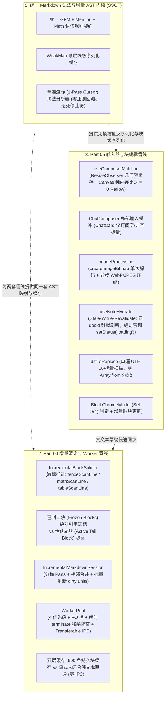
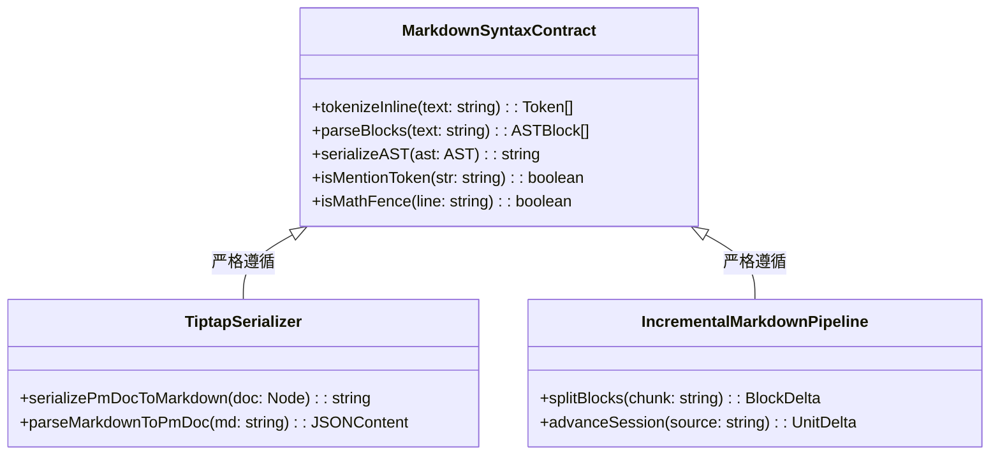
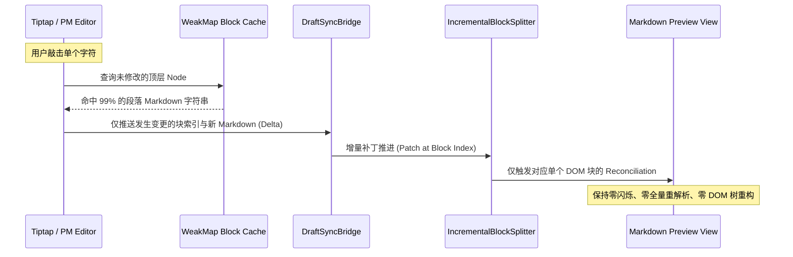

# plan-04 — 前端增量 Markdown 解析、Web Worker 卸载与富文本输入器（Tiptap/块编辑器）交叉优化方案

> **方案编号**：PLAN-PERF-04（对应审计维度 Dim-04 + Dim-05）
> **覆盖范围**：
>
> - **Part 04**：前端增量 Markdown 解析、代码高亮、数学公式与 Web Worker 卸载（23 项问题，编号 1.1 ~ 4.5）
> - **Part 05**：前端输入器 Tiptap、块级编辑器 Block Paper / Editor Kit 及 Note Paper 宿主（26 项问题，编号 DIM05-01 ~ DIM05-26）
> - **Part 04 & 05 交叉协同**：统一 Markdown 双向序列化契约（SSOT）、草稿大文本在编辑器与流式/渲染预览间的高效无损同步
>   **设计准则**：严格遵循《工程核心三原则》、《逻辑规划与反退避准则》及《反过度设计硬性红线（`ANTI_OVERENGINEERING_GUARDRAILS.md`）》。问题全量同权，彻底根除 $O(N^2)$ 复杂度、强制同步重排（Forced Reflow）、内存驻留泄漏与主线程长任务卡顿，实现架构净收敛。

---

## 一、架构综述与整体优化蓝图

### 1.1 现状全景架构拓扑与双管线交织矛盾诊断

在 Conex / Crish 桌面端现有实现中，AI 消息流式渲染管线（Part 04）与用户富文本/块级编辑输入管线（Part 05）在底层频繁发生数据流交互与格式转换。然而，两套管线各自存在深层次的架构断层与伪增量陷阱：

```mermaid
flowchart TD
    subgraph Part04_Current["Part 04 现有流式渲染链路 (伪增量与 IPC 风暴)"]
        StreamIn["Zustand 流式文本 / 消息流"] -->|"每帧 9 正则 strip"| Strip["stripThoughtPlaceholders (频繁清空全局缓存)"]
        Strip --> Splitter["IncrementalBlockSplitter\n(Fence/Math/Table 无游标，每次 O(K^2) 重扫)"]
        Splitter -->|"每帧全文正则虚拟闭合"| SpecCloser["SpeculativeVirtualCloser\n(产出 virtualClosedText 后下游丢弃)"]
        Splitter --> Session["IncrementalMarkdownSession\n(每帧 normalized 正则替换 + startsWith 校验)"]
        Session -->|"未闭合行内标记"| Inline["IncrementalMarkdownInline\n(逐字符拆分 textPart 发起异步 IPC)"]
        Inline --> IPC["Tauri IPC: core_md_render / Worker\n(流式碎片打满全局 500 条块缓存)"]
        Session -->|"每次 appendStatic"| Rejoin["IncrementalMarkdownUnits\n(每次全量 filter + map + join)"]
        Rejoin --> Reconcile["ReconciledMarkdownHtml\n(每帧 template 解析整块 HTML + TreeWalker 缩进重写)"]
    end

    subgraph Part05_Current["Part 05 现有编辑输入链路 (强制重排与全量重挂)"]
        Key["用户击键 / IME / 粘贴"] --> Tiptap["Tiptap / ProseMirror View"]
        Tiptap -->|"原生 input 事件"| Multiline["useComposerMultiline\n(每次按键 5 次 querySelector + 5 次 offset/client 测量)\n(每 150ms 重新注册 ResizeObserver)"]
        Tiptap -->|"150ms 防抖 / Enter rAF"| Ser["editor.getJSON() 全树克隆 + serializeToMarkdown"]
        Ser --> CardState["useChatCardState (提升至 ChatCard 根部)\n(触发整张卡片与 ChatMessageList 级联重渲染)"]
        PasteImg["粘贴高清图片"] --> ImgProc["imageProcessing.ts\n(Base64 膨胀 + 3 次 Image 解码 + 12 次 canvas.toDataURL)"]
        BlockEdit["Note Paper 块编辑"] --> Persistence["useNoteTextPersistence (400ms 防抖)\n(computeTextEditOp: Array.from 拆分 10 万对象)"]
        Persistence --> DocWritten["emitNoteDocWritten (product_apply)"]
        DocWritten --> Hydrate["useNoteHydrate: setStatus('loading')!\n(整屏闪烁、销毁 PaperList DOM、丢失光标焦点)"]
    end

    subgraph Cross_Conflict["两套管线交叉冲突点"]
        Cross1["语法规则漂移：Tiptap 序列化器使用 @[label](id:kind)，而增量会话与反序列化器处理下划线/星号行为不一致"]
        Cross2["草稿与预览同步鸿沟：大文本草稿在输入器与增量预览间传递需完整 parseFromMarkdown，引发二次方回溯"]
    end
```



#### 核心矛盾与性能瓶颈总结

1. **伪增量与计算爆炸**：
   - Part 04 虽然划分了分块器（`Splitter`）与会话器（`Session`），但代码围栏、LaTeX 数学块、GFM 表格在流式期间因缺乏行游标，每帧都从头重新扫描（$O(K^2)$）；行内标记逐字符发起 IPC 渲染，并将碎片写入全局块级缓存引发 Cache Thrashing；活跃块 HTML 每帧通过 `<template>` 重新解析全文并执行 DOM `TreeWalker`。
   - Part 05 在输入路径上每 150ms 及回车时无条件调用 `editor.getJSON()` 递归克隆全树并递归拼接整篇 Markdown；大文档块编辑在 400ms 自动落盘时通过 `Array.from` 拆解全文字符，造成瞬态 13 万对象分配与严重 GC 停顿。
2. **强制同步布局（Forced Synchronous Layout / Reflow）严重**：
   - `useComposerMultiline` 在每次用户敲击键盘的冒泡事件中，同步调用 5 次 `querySelector` 并读取 `clientWidth`、`offsetWidth`、`getComputedStyle` 与 `scrollWidth`，单键输入时主线程连续发生 5 次强制布局；且因为依赖了高频变化的 `text`，每 150ms 拆装一次 `ResizeObserver`。
3. **状态机致命缺陷与状态震荡**：
   - `WorkerPool` 任务超时后仅将主线程标记为非 busy，未终止卡死线程，导致新旧任务在同一个 Worker 上并发竞态，迟到的旧响应抹杀新任务状态；
   - `note-paper` 每次 400ms 文本自动保存后广播 `note-doc-written`，`useNoteHydrate` 误将其当做跨端大更新，执行 `setStatus('loading')`，瞬间卸载销毁整棵编辑器 DOM 树，导致用户正在打字时光标和焦点彻底丢失。
4. **两套管线语法与解析契约漂移**：
   - Tiptap 的 Markdown 反序列化器包含未消费的死停止符 `_`，导致含有标识符的文本被切成大量碎片节点，并引发未闭合标记的 $O(N^2)$ 正则灾难性回溯；而 Markdown 增量会话器又将数学公式中的下划线和星号误判为斜体，导致流式数学公式频繁撤销重算。

---

### 1.2 目标架构全景拓扑

重构后的目标架构将全链路解耦为三层：**增量分块与 Worker 隔离层**、**输入器细粒度响应与 Stale-While-Revalidate 持久化层**、以及**统一的双向 Markdown/AST 语法内核**：



---

### 1.3 核心设计原则与反过度设计守卫

严格对照 `ANTI_OVERENGINEERING_GUARDRAILS.md`，本方案坚持以下红线要求：

1. **零新增重型抽象**：
   - 不引入任何复杂的“六段式中间件流水线”；
   - 不引入 `SharedArrayBuffer` 环形缓冲；
   - 不引入任何内核级沙箱或动态模型路由；
   - 不以全局 95% `React.memo` 覆盖率作盲目门禁，仅在组件树关键分叉点（如 `ChatComposer`、`AttachmentCard`、`PaperList` 视口行）做精准记忆化与依赖收敛。
2. **穿透表象，原生 O(1) 数据结构降维**：
   - 将多次遍历与线性 `includes` 降维为 `Set.has` 与 `Map.get`；
   - 将循环字符串切片 `slice` 与全树正则回溯降维为整型游标（Cursor）单遍向前扫描；
   - 将每帧全量前缀和重算降维为惰性脏水位线（`dirtyFromIndex`）；
   - 将破坏 DOM 的卸载式重载降维为标准的 **Stale-While-Revalidate** 静默更新。

---

## 二、Part 04 增量 Markdown 解析与 Worker 卸载优化详案

### 2.1 方向一：流式 Markdown 增量解析与分块管线（问题 1.1 ~ 1.8）

#### 1. 消除死字段 `virtualClosedText` 与 $O(N)$ `speculativeCloseBlock`（问题 1.1）

- **根因分析**：`useStreamingBlocks.ts` 每帧调用 `speculativeCloseBlock(text)` 执行 2 次全文正则替换、`.split('\n')` 以及多处全文正则匹配，计算出的 `virtualClosedText` 在下游 `MarkdownBlockItem.tsx:79` 被 `_virtualClosedText` 弃用。
- **重构方案**：
  1. 彻底移除 `StreamingBlockDescriptor` 和 `MarkdownBlockItemProps` 中的 `virtualClosedText` 字段；
  2. 在 `useStreamingBlocks.ts` 中废弃 `speculativeCloseBlock` 调用；
  3. 优化 `fullText.startsWith(st.prevText)`：当 `fullText.length >= st.prevText.length` 时，先校验首字符与新增尾字符边界，将每帧前缀校验从 $O(L_{\text{total}})$ 降为 $O(1)$；
  4. 只有当 `stSplitter.appendChunk(delta)` 返回新封口块数 `> 0` 或发生 reset 时才生成新的 `sealedSnapshot` 数组引用，其余仅尾块增长的帧直接复用上一帧的封口数组引用。

#### 2. `IncrementalBlockSplitter` 引入四游标推进机制（问题 1.2）

- **根因分析**：未闭合代码围栏、LaTeX `$$` 数学块、HTML 块和 GFM 表格未记录已扫描行游标，流式期间每次从头扫描行，产生 $O(K^2)$ 累计行扫描；HTML 标签计数每行动态 `new RegExp`；`tableProbe.ts` 每帧对全文 `.split('\n')`。
- **重构方案**：
  在 `IncrementalBlockSplitter` 中引入统一的增量块扫描状态游标：
  ```ts
  interface SplitterCursorState {
    fenceScanLine: number; // 已验证无闭合围栏的代码行
    mathScanLine: number; // 已扫描 $$ 块行游标及累计 $$ 计数
    htmlScanLine: number; // HTML 块已扫描行
    htmlScanDepth: number; // HTML 块累计未闭合标签深度
    tableScanLine: number; // 表格已验证行游标
  }
  ```
  - **代码围栏扫描**：下次扫描从 `Math.max(start + 1, this.cursorState.fenceScanLine)` 开始，仅扫描新增行；
  - **HTML 正则单例缓存**：建立 `Map<string, { openRe: RegExp; closeRe: RegExp }>` 缓存标签正则，杜绝每行 `new RegExp`；
  - **表格前置探测优化**：在 `tableProbe.ts` 中改用 `indexOf('\n')` 仅截取前两行进行轻量分隔符校验，彻底杜绝全文 `.split('\n')`。

#### 3. `IncrementalMarkdownSession` 分桶存储与单帧批量刷新（问题 1.3）

- **根因分析**：`IncrementalMarkdownUnits` 中 `parts` 为单一扁平数组，每次 `appendStatic` 或 `resolveTextPart` 均线性遍历整表并调用 `.filter(...).map(...).join('')` 拼接整块 HTML，导致长代码块下呈 $O(P^2)$ 时间与空间复杂度。
- **重构方案**：
  1. **分桶与映射加速**：维护 `partsByUnit = new Map<string, IncrementalTextPart[]>()` 与 `partById = new Map<string, IncrementalTextPart>()`，使查询变为 $O(1)$；
  2. **相邻静态片段原地合并**：在 `appendStatic(unitId, value)` 中，若当前 unit 的末尾 part 为 static 类型，直接执行 `lastPart.value += value`，并在该 unit 无未决异步 part 时直接执行 `unit.html += value`，完全无需调用 `.join('')`；
  3. **单帧批量延迟刷新**：在 `advance(nextSource)` 循环中，仅用 `dirtyUnitIds = new Set<string>()` 收集受影响的 unitId，待 `while` 游标循环彻底推进完成后，统一对 dirty units 触发一次批量 HTML 刷新。

#### 4. 未闭合行内 Token 纯文本直通预览（问题 1.4）

- **根因分析**：未闭合的 `**`、`[`、`` ` `` 被逐字符切分为独立 `textPart` 并向 Rust IPC / Worker 发起异步请求，一句话引发数十次异步 IPC 与 `<template>` DOM 解析，并把单字塞满全局缓存。
- **重构方案**：
  - 未闭合的行内 Token 属于语法未完成态，直接作为静态纯文本预览（单个 static part 并在输入时做简单的 `escapeHtml` 原地追加）；
  - 只有当闭合符号（如配对的 `**` 或 `]`）到达形成完整行内节点时，才按需触发单次语法渲染；
  - 短纯文本直通：若片段不含 Markdown 特殊符号，直接同步返回 `escapeHtml(source)`，完全不发 IPC。

#### 5. DOM 协调与代码缩进跳过机制（问题 1.5）

- **根因分析**：`ReconciledMarkdownHtml` 每帧对活跃单元通过 `<template>` 解析整块 HTML，且 `useLayoutEffect` 中无条件执行 `applyCodeIndentToRenderedRoot`，即便在默认 2 空格下也遍历整个容器执行 `TreeWalker`。
- **重构方案**：
  1. 入口立即短路：`if (!codeIndent || codeIndent === '  ') return;`；
  2. 对 `<pre>` 元素标记已处理的数据属性 `el.dataset.indentLen = String(el.textContent?.length ?? 0)`，内容未增长时直接跳过 `TreeWalker` 扫描；
  3. 流式代码块追加：对于纯文本追加的活跃代码块，直接通过 DOM `TextNode.appendData(delta)` 原地追加内容，跳过 `<template>` 全树 HTML 重解析。

#### 6. `StreamingGfmTable` 单元格会话合并与纯文本快路径（问题 1.6）

- **根因分析**：50×6 表格创建 300 个独立的 `IncrementalMarkdownSession` 与 300 个 `ReconciledMarkdownHtml`；且循环逐行执行 `setRows` 数组克隆。
- **重构方案**：
  1. 批量提交：在 `useLayoutEffect` 中将 `addedRows` 与 `partialRow` 一次性合并，单次调用 `setRows`；
  2. 纯文本单元格短路：对不含行内特殊字符的单元格，直接渲染 React 原生文本节点 `{content}`；
  3. 已封口单元格静态化：表头与非尾部已完成行标记为 `isSealed = true`，直接输出静态 HTML/Text，卸载 `IncrementalMarkdownSession`。

#### 7. 流式接线 `IncrementalThoughtStripper` 与门卫短路（问题 1.7）

- **根因分析**：流式每帧调用带 9 条多行正则的 `stripThoughtPlaceholders`，并在 64 帧后打满并 `clear()` 全局缓存；已有高效的 `IncrementalThoughtStripper` 闲置未接线。
- **重构方案**：
  1. 在 `MessageContent.tsx` 和流式文本段中，通过 `useRef(new IncrementalThoughtStripper())` 接线 `feed(raw)`，仅处理增量字符，不冲刷静态缓存；
  2. 对 `extractWorkflowConfirmPayload` 增加 `bodyText.includes('workflow-confirm')` 的 $O(1)$ 字符串门卫；对 `extractImageRefs` 增加 `bodyText.includes('![') || bodyText.includes('data:image/')` 门卫。

#### 8. `preprocessCustomTags` 入口短路与二分查找（问题 1.8）

- **根因分析**：无 `<` 的普通 Markdown 块无条件执行 4 遍 `findMarkdownCodeRanges`（12 次全文正则扫描）；区间判定使用线性 `ranges.some(...)`。
- **重构方案**：
  1. 顶部增加快速门卫：`if (!markdown.includes('<')) return markdown;`；
  2. 仅在标签实际被匹配替换后，才重新计算 `codeRanges`；
  3. `isPositionInRanges` 改用二分查找（$O(\log R)$）。

---

### 2.2 方向二：代码高亮、数学公式与 Mermaid 渲染引擎（问题 2.1 ~ 2.5）

#### 1. 补齐 LaTeX `$$` 与 `$` 增量状态机（问题 2.1）

- **重构方案**：
  在 `IncrementalMarkdownConsume.ts` 中增加与代码围栏并列的 `math-block` 状态：
  - 遇到行首 `$$` 进入数学块模式，内部文本直通转义，禁止被行内分析器误拆为斜体（`*`）或下标（`_`）；
  - 行内 `$...$` 增加边界检查，未闭合前作为纯文本直通展示；
  - 流式未封口态统一渲染轻量 `<pre class="md-math-source">`，封口（`isSealed = true`）后才交由 Worker 异步渲染 KaTeX。

#### 2. 代码块封口瞬间 DOM 头部对齐与叶子原子化（问题 2.2）

- **重构方案**：
  1. **结构对齐**：在 `IncrementalMarkdownSession.ts` 的流式未封口态 HTML 中，同样预先插入 `<div class="md-code-header"><span class="md-code-lang">${escapedLang}</span></div>`，保证封口前后子节点索引完全一致，避免 `<pre>` 节点被销毁重建；
  2. **`unitSplitter.ts` 原子化叶子节点**：当遇到 `<pre>` 或 `<code>` 时，将其标记为原子叶子（`children: []`），不再为其内部数千个 `<span class="hljs-*">` 递归分配 `MarkdownUnit` 与读取 `outerHTML`，直接整块替换 DOM 子树。

#### 3. 高亮缓存容量扩容至 8000 字符与统一熔断（问题 2.3）

- **重构方案**：
  1. 将 `codeHighlight.ts` 的缓存准入阈值从 500 字符提升至 8000 字符；
  2. 使用 `fnv1a(raw) + ':' + raw.length + ':' + lang` 作为键，防止将长代码串驻留在 key 中；
  3. `markdownCodeFence.ts` 统一调用带熔断保护的 `highlightCodeSafe`，超过阈值降级为 `escapeHtml`，防止正则回溯卡死。

#### 4. 清理 Worker 废弃协议与内存驻留（问题 2.4）

- **重构方案**：
  清理 `render-worker.ts` 中未使用的 `highlight.code.stream` 与 `streamingHighlighters` 变量；若保留则接入容量上限并与 `clear-cache` 联动。

#### 5. `useDiffHighlightMap` 消除首帧双算与防碰撞（问题 2.5）

- **重构方案**：
  1. 用 `useRef(itemsKey)` 记录初始状态计算结果，在首次 `useEffect` 中比对一致直接跳过重复高亮与 `setMap`；
  2. `buildItemsKey` 加入首尾字符与 FNV-1a 哈希校验，消除同长度内容修改时的键碰撞。

---

### 2.3 方向三：Web Worker 调度池与 IPC 传输架构（问题 3.1 ~ 3.5）

#### 1. 消除二进制跨 IPC 的 `number[]` 转换（问题 3.1）

- **重构方案**：
  - 废弃 `Array.from(new Uint8Array(data))` 序列化方式；
  - UTF-8 解码与 SHA-256 哈希优先走浏览器原生 `TextDecoder` 与 `crypto.subtle.digest`，无需跨进程；
  - 必需传给 Rust 的二进制数据改走 Tauri v2 原生二进制 Request Body（零拷贝传输）。

#### 2. WorkerPool 超时强杀隔离机制（问题 3.2）

- **根因分析**：任务超时仅重置主线程 `busy = false`，Worker 线程仍在卡死执行旧任务，导致同一 Worker 上新旧任务并发串话。
- **重构方案**：
  ```ts
  // 严格的超时强杀与隔离逻辑
  const timeout = setTimeout(() => {
    this.runningTasks.delete(task.id);
    this.stats.timedOutTasks++;

    // 1. 强行终止已卡死的底层 Worker 线程
    entry.worker.terminate();

    // 2. 原地生成全新的 Worker 实例替换
    entry.worker = this.createWorkerInstance(entry.type);
    entry.busy = false;
    entry.currentTaskId = null;
    entry.abortController = null;
    entry.idleSince = Date.now();

    task.reject(
      new Error(
        `Task ${task.id} (${task.taskType}) timed out after ${this.options.taskTimeoutMs}ms`
      )
    );
    this.dispatchNext(entry);
  }, this.options.taskTimeoutMs);
  ```
  在 `handleWorkerResponse` 中加入校验：`if (!running || entry.currentTaskId !== response.id) return;`，防止迟到响应污染状态。

#### 3. 4 优先级 FIFO 任务队列与安全取消（问题 3.3）

- **重构方案**：
  1. 将扁平数组 + 全量 `.sort()` 替换为 4 个离散桶：`buckets = [ [], [], [], [] ]`（分别对应 `CRITICAL(0)`, `HIGH(1)`, `NORMAL(2)`, `LOW(3)`），入队出队均为严格 $O(1)$；
  2. 取消已派发任务时，不立即置 `busy = false`，放入 `cancelledRunningTaskIds` 集合中，待 Worker 正常返回或超时终止时再释放该 Worker。

#### 4. 协议对齐与 0 配额快速拒绝（问题 3.4）

- **重构方案**：
  1. `clearCaches()` 发送符合 Worker 解构格式的 `{ type: 'clear-cache' }` 并在 Worker 中真正调用缓存清理函数；
  2. `handleWorkerCrash` 使用统一的 `this.urlFor(type)`；
  3. `schedule()` 入口处校验 `if (this.targetCountFor(type) <= 0) return Promise.reject(new Error('Worker disabled'));`，杜绝未分配 Worker 的任务进入队列导致死锁。

#### 5. Markdown 块级缓存与流式碎片绝对隔离（问题 3.5）

- **重构方案**：
  - 流式碎片调用的 `parseMarkdownFragmentToHtmlAsync` 显式设置 `{ cache: false }`；
  - 全局 500 条 `MARKDOWN_HTML_CACHE` 严格仅服务于 `isSealed === true` 的完整封口块和静态完整消息，保护热点块缓存。

---

### 2.4 方向四：思考块、长工具输出与 `conversation-flow`（问题 4.1 ~ 4.5）

#### 1. `ConversationFlowHost` 基于 `WeakMap` 缓存投影结果（问题 4.1）

- **重构方案**：
  使用 `WeakMap<ConversationMessageInput, ConversationFlowTree>` 缓存单条消息的 `projectMessage` 结果。因为 Zustand 更新时未修改的历史消息保持对象引用恒等，全历史消息重新统计 `nodeCount` 变为 $O(M)$ 次内存读取（$O(1)$ 命中），彻底消除单帧内多次重复投影。

#### 2. 工具参数单次解析与透传（问题 4.2）

- **重构方案**：
  在 `projectPurposes.ts` 入口将 `tc.arguments` 解析一次：`const argsObj = parseJsonObject(tc.arguments)`，后续各工具标签与产物推导直接复用 `argsObj`；`ActionRow.tsx` 优先消费上游已解析字段并对 `deriveArtifactFromTool` 增加 `useMemo`。

#### 3. 工具输出惰性清洗与先截断后清洗（问题 4.3）

- **重构方案**：
  1. `ActionRow.tsx`：折叠态（`open === false`）直接通过 `Boolean(cmdText || rawOutput.trim())` 判断是否可展开；仅在 `open === true` 时才截取前 16,000 字符并执行正则清洗；
  2. `ToolCallOutput.tsx`：在调用 `fullToolOutput` 之前，先按 2000 行 / 256KB 游标截取头部窗口，仅对窗口内文本执行 25 条正则清洗与图片提取，消除全量 `split('\n')` 与 `new Blob` 内存拷贝。

#### 4. 思考块预览先截断后压缩（问题 4.4）

- **重构方案**：
  修改 `clipThinkingPreview`：
  ```ts
  export function clipThinkingPreview(
    text: string,
    maxChars: number = 56
  ): string {
    if (!text) return '';
    // 先截取前部安全小窗口，再执行正则空白压缩，将 O(N) 降为 O(1)
    const head = text.slice(0, maxChars * 4 + 64);
    const clean = head.replace(/\s+/g, ' ').trim();
    return clean.length <= maxChars ? clean : `${clean.slice(0, maxChars)}…`;
  }
  ```

#### 5. 思考收拢行单行纯文本直通（问题 4.5）

- **重构方案**：
  `extractLatestLine` 与 `extractFirstLine` 已经剥离了 Markdown 标记，收拢态摘要直接输出 `{displaySummary}` 文本节点，彻底移除异步 `useStreamingMarkdownHtml` 与换行时的 `IncrementalMarkdownSession.reset()` 风暴。

---

## 三、Part 05 输入器 Tiptap 与块编辑器优化详案

### 3.1 会话输入框（ChatComposer）与宿主性能重构（问题 DIM05-01 ~ DIM05-12）

#### 1. `useComposerMultiline` 消除强制同步重排（Reflow）（问题 DIM05-01）

- **根因分析**：冒泡 `input` 事件触发时，主线程连续读取 5 个几何属性，导致浏览器被迫同步执行 Style 计算与 Layout 排版；且 `measure` 函数包含了 `text` 依赖，导致每 150ms 重新注册 `ResizeObserver`。
- **重构方案**：
  1. **几何参数单次缓存**：在 `ResizeObserver` 回调中测量并缓存容器宽度 `layoutW` 以及单行状态下左右侧边栏固定宽度 `singleLineUsedWidthRef`（不计入多行态下换至第二行的 `perm.offsetWidth`），将按键期的可用容量计算简化为纯数值运算：`capacity = layoutW - singleLineUsedWidth`；
  2. **字体信息挂载初始化**：`fontRef.current` 仅在组件首次挂载或主题切换时通过 `getComputedStyle` 读取一次；
  3. **稳定 Effect 依赖**：将 `text` 从 `measure` 的依赖项中剥离，直接从 DOM 的 `textContent` / `value` 读取最新字符，保证 `ResizeObserver` 与 `input` 事件在挂载期只绑定一次；
  4. **极速字符门限跳过**：当字符长度 `rawText.length > Math.ceil(capacity / 4)` 或文本含 `\n` 时，直接 $O(1)$ 断定为多行，跳过 Canvas 测量。

#### 2. `chatInput` 与 `isComposing` 状态下沉收敛（问题 DIM05-02）

- **根因分析**：输入框高频字符状态提升到了 `ChatCard` 根部，导致用户每敲一个键，整张卡片的所有 ribbons、消息列表与会话操作 Effect 全量重跑。
- **重构方案**：
  1. **状态下沉至 ChatComposer 内部**：输入缓冲完全在 `ChatComposer` 内部管理，`ChatCard` 根部仅订阅布尔值 `hasDraft`（用于显示状态指示）或在发送时通过 `composerRef.current.getSnapshot()` 获取最新 Markdown；
  2. **稳定 `useChatSessionActions` 依赖**：其内部 `useEffect` 仅依赖标量 `isGenerating` 与 `sessionId`，解除对易变 `composerProps` 大对象的引用依赖；
  3. **IME 合成状态去重**：使用 `isComposingRef` 守卫，仅在合成状态真正发生跨态翻转时通知外部，消除拼音击键过程中的重复广播。

#### 3. Tiptap 序列化降维与受控回流竞态根治（问题 DIM05-03）

- **根因分析**：每 150ms 及回车触发 `editor.getJSON()` 递归分配全树对象，再递归序列化 Markdown；发送时二次序列化；受控回流在 `rAF` 中易发生光标跳字覆盖。
- **重构方案**：
  1. **直接遍历 ProseMirror Node + WeakMap 增量块缓存**：
     ```ts
     const blockMarkdownCache = new WeakMap<ProseMirrorNode, string>();
     export function serializePmDocToMarkdown(doc: ProseMirrorNode): string {
       const lines: string[] = [];
       doc.forEach((childNode) => {
         let md = blockMarkdownCache.get(childNode);
         if (md === undefined) {
           md = serializeSinglePmBlock(childNode);
           blockMarkdownCache.set(childNode, md);
         }
         lines.push(md);
       });
       return lines.join('\n\n');
     }
     ```
     由于 ProseMirror 在单段打字时保持其他段落的 `childNode` 引用不变，全篇序列化开销由 $O(N_{\text{doc}})$ 降至 **$O(1)$**（仅序列化修改的单个段落）；
  2. **回车合并**：移除 `rAF` 中的多余序列化，仅在非发送快捷键时交给防抖处理；
  3. **回流版本守卫**：在 `TiptapEditorField` 中增加 `docVersionRef`，若在 `rAF` 待执行期间用户发生新输入，直接丢弃过期的 `setContent`。

#### 4. `markdownDeserializer` 线性化与死停止符消除（问题 DIM05-04）

- **根因分析**：停止字符正则 `/[\n@`*_~[]/`中包含`_`，但分支逻辑中无任何下划线处理，导致标识符切成海量碎片节点；未闭合符号导致 $O(N^2)$ 正则回溯；循环 `slice` 拷贝严重。
- **重构方案**：
  1. **移除死停止符**：停止字符集修正为 `/[\n@`*~[]/`（移除 `_`）；
  2. **游标推进与闭合符预检**：
     ```ts
     // 用整型游标 pos 代替 remaining.slice
     let pos = 0;
     while (pos < len) {
       // 预检闭合符位置，避免正则在长文本上发生灾难性回溯
       if (text.startsWith('**', pos)) {
         const closeIdx = text.indexOf('**', pos + 2);
         if (closeIdx !== -1) { ... pos = closeIdx + 2; continue; }
       }
       // ...
     }
     ```
  3. **相邻文本自动合并**：提供 `appendPlainTextNode(nodes, str)`，若最后一个节点为纯 `text`，直接累加 `.text += str`，保证产出紧凑的 AST。

#### 5. 斜杠菜单与提及浮层双重过滤消除（问题 DIM05-05）

- **重构方案**：
  1. `useSlashMenu` 使用 `useMemo` 缓存命令列表；
  2. 向 Tiptap 传递完整的 `allSlashCommands`，统一由 `SlashExtension` 在光标处按局部 `/query` 过滤，解决正文中输入 `/` 丢失命令的问题；
  3. 移除浮层组件中二次调用的 `isAnchorInsideVisibleField`，仅保留锚点计算时的一次校验。

#### 6. 降级 `ComposerField` 与 `useAutoGrowTextarea` 优化（问题 DIM05-06）

- **重构方案**：
  1. 移除 `ComposerField` 冗余的 `onInput` 与手动 `requestResize()`，统一由 `useLayoutEffect` 根据受控值调整高度；
  2. 缓存 `borderExtra`；
  3. 将 `Intl.Segmenter` 设为惰性单例，且仅在光标前后 256 字符窗口内进行分词查找。

#### 7. `ComposePlusMenu` 惰性加载守卫（问题 DIM05-07）

- **重构方案**：
  在 `ComposePlusMenu.tsx` 的 `useEffect` 入口处增加 `if (!open) return;`，关闭状态下绝不触发模块动态加载与 IPC 查询。

#### 8. `sessionDraftManager` 隔离大体积附件（问题 DIM05-08）

- **重构方案**：
  1. `localStorage` 持久化时剔除 `AttachmentItem.dataUrl`，仅保留 `safePath`、元数据及小型缩略图；
  2. 按会话分键持久化：`crish-draft:${sessionId}`，仅对发生修改的会话执行写入；
  3. 快照读取保持不可变对象引用，消除深拷贝。

#### 9. 高清图片粘贴/拖拽单次解码闭环（问题 DIM05-09）

- **根因分析**：粘贴图片在主线程 Base64 膨胀，3 次通过 `new Image()` 重复解码，并在 PNG 格式下执行无效的 quality 循环重编码 12 次。
- **重构方案**：
  ```ts
  export async function processImageBlobOptimized(
    blob: Blob,
    mime: string
  ): Promise<ProcessedImageResult> {
    // 1. 背景线程零拷贝解码（原生 C++ 实现，不阻塞主线程）
    const bitmap = await createImageBitmap(blob);
    const { width, height } = bitmap;

    // 2. 在 OffscreenCanvas 上一次性生成主缩放图与 116x116 缩略图
    const targetDims = calculateDownscaleDims(width, height, 2048, 2048);
    const offscreen = new OffscreenCanvas(targetDims.w, targetDims.h);
    const ctx = offscreen.getContext('2d')!;
    ctx.drawImage(bitmap, 0, 0, targetDims.w, targetDims.h);

    // 3. 异步转换为 WebP/JPEG Blob（彻底消除同步 toDataURL 阻塞与无效 quality 循环）
    const compressedBlob = await offscreen.convertToBlob({
      type: 'image/webp',
      quality: 0.85,
    });

    // 4. 生成缩略图
    const thumbDims = calculateSquareThumbDims(width, height, 116);
    // ...
    return { dataUrl, thumbnailUrl, width, height };
  }
  ```

#### 10. 本地文件零拷贝预览与有界并发（问题 DIM05-10）

- **重构方案**：
  - 对拥有 `safePath` 的本地图片，直接通过 `convertFileSrc(safePath)`（`asset://` 协议）由浏览器原生渲染，入站阶段严禁 `fetch` 转 Base64 存入 State；
  - 多文件粘贴/拖拽使用 `Promise.all` 配合有界并发池（并发度 3）并行处理，单次合并提交 `setAttachments`。

#### 11. `ComposerAttachmentBar` 消除内联击穿（问题 DIM05-11）

- **重构方案**：
  - `ComposerAttachmentBar` 使用 `React.memo`；
  - 传递稳定的 `item={a}` 引用，稳定 `onRemove` / `onClick` 回调；
  - 将 `useActiveModelAcceptsImage()` 提升至父级只读一次，作为标量下传。

#### 12. 粘贴路径预检快速短路（问题 DIM05-12）

- **重构方案**：
  `looksLikeLocalPaths` 增加快速长度短路：`if (!text || text.length > 8192) return false;`；合并检查与切分，消除二次 `split`。

---

### 3.2 块编辑器（Block Paper / Editor Kit / Note Paper）大文档重构（问题 DIM05-13 ~ DIM05-26）

#### 1. `applyProjectionDiff` 批量操作从 $O(N^2)$ 降至 $O(N)$（问题 DIM05-13）

- **重构方案**：
  - 在 `upserts` 中直接利用 `existing === undefined` 判断是否需要 `state.order.push(u.id)`，单项判断由 $O(N)$ 降至 $O(1)$；
  - 在 `removes` 中，构造 `removeSet = new Set(diff.removes)`，单遍原地过滤 `state.order`，批量删除由 $O(R \cdot N)$ 降至 $O(N)$。

#### 2. `pin.ts` 卸载候选过滤消除重复构造 Set（问题 DIM05-14）

- **重构方案**：
  在 `filterUnmountCandidates` 与 `planScrollUnmount` 循环外部将 `ctx.composingIds` 和 `ctx.extraPinned` 一次性转为 `Set`，循环内部 $O(1)$ 复用。

#### 3. `HeightMap` 引入惰性脏水位线与防栈溢出（问题 DIM05-15）

- **重构方案**：
  1. 引入 `dirtyFromIndex = Infinity` 水位线，`measure(idx, px)` 仅更新该水位线；在读取 `offsetOf` 时一次性批量计算前缀和；
  2. 超过 1024 个块插入时，采用分块循环插入替代 `splice(at, 0, ...newSlots)`，杜绝调用栈溢出。

#### 4. `ViewportQuery` 消除数组分配（问题 DIM05-16）

- **重构方案**：
  在 `ViewportRange` 中将 `indices` 设为惰性 getter 或直接消费 `startIndex` 与 `endIndex`，避免滚动高频分配整数数组。

#### 5. 双坐标差分 SSOT 与单遍扫描（问题 DIM05-17）

- **重构方案**：
  1. `diffToReplace` 先行判断 `if (oldText === newText) return ...` 快速短路；
  2. 前后缀比对的同时单遍统计代理项对，一次得出标量坐标；
  3. `pmPosToTextOffset` 改为 $O(1)$ 算术映射：`return clamp(pos - 1, 0, textLen);`。

#### 6. `noteTextEditOp` 废弃 `Array.from`（问题 DIM05-18）

- **重构方案**：
  直接复用契约包的 `diffToReplace(oldText, newText)`，彻底消灭 13 万个单字符对象分配。

#### 7. 根除 `note-paper` 400ms 自动保存销毁重挂整树与丢焦点（问题 DIM05-19，核心突破）

- **根因分析**：本地文本输入保存后触发 `note-doc-written`，`useNoteHydrate` 重新拉取时无条件执行 `setStatus('loading')`，导致 `<PaperListDomMount>` 被 React 彻底卸载销毁，正在打字的光标丢失。
- **重构方案**：
  1. **Stale-While-Revalidate（SWR）后台静默重验证**：
     ```ts
     const reload = useCallback(
       async (isBackgroundRevalidate = false) => {
         const currentSeq = ++fetchSeqRef.current;
         // 核心不变量：若当前文档已有有效投影，重验证期间绝对禁止将 status 置为 'loading'！
         if (!isBackgroundRevalidate && !projectionRef.current) {
           setStatus('loading');
         }
         try {
           const outcome = await hydrateTransport.hydrate(docId);
           if (currentSeq !== fetchSeqRef.current) return;
           setProjection(outcome.projection);
           setStatus(
             outcome.projection.blocks.length === 0 ? 'empty' : 'ready'
           );
         } catch (err) {
           // ...
         }
       },
       [hydrateTransport, docId]
     );
     ```
  2. **事件源过滤**：若事件为本地 `product_apply`，仅执行本地状态乐观推进，跳过整表 IPC `refreshList()`。

#### 8. `buildMountPlan` 消除滚动帧全表 Map 重建（问题 DIM05-20）

- **重构方案**：
  `windowIds` 已按顺序排列，对极少数 `pinnedIds` 通过 `HeightMap.indexOfId`（$O(1)$）定位并二分插入，消除每帧 $O(N)$ 遍历全表构建 `idToIndex` Map。

#### 9. `PaperListDomMount` 消除全文档 `projKey` 字符串拼接（问题 DIM05-21）

- **重构方案**：
  移除全文档文本拼接，改为组件浅比对 + 细粒度 `list.updateBlockProjection(id, proj)`；`paintPaperBlock` 仅在属性变更时修改 DOM。

#### 10. `BlockChromeDomHost` 视口对齐与 $O(1)$ 多选（问题 DIM05-22）

- **重构方案**：
  1. `BlockChromeModel` 内部维护 `Set<BlockId>`，将多选判定从数组 `.includes`（$O(M)$）降为 $O(1)$；
  2. 采用脏块定点更新机制，仅对 hover / focus / drag 变化的行更新属性；
  3. Chrome 行与内容行共享视口挂载窗口。

#### 11. `lineWindow.ts` 零分配 UTF-8 计数与行扫描（问题 DIM05-23）

- **重构方案**：
  用基于 `charCodeAt` 的纯数字循环计算字节数，消除 `Uint8Array` 堆分配；未超阈值时单遍统计 `\n`，不执行全行 `slice`。

#### 12. 生产写锥审计缓冲有界化（问题 DIM05-24）

- **重构方案**：
  为 `wireCalls` 和 `results` 设置容量为 128 的环形缓冲区，超出时覆盖最旧记录，根除长会话内存泄漏。

#### 13. `Cm6CodeLeafHost` 增量变更迭代（问题 DIM05-25）

- **重构方案**：
  利用 CodeMirror 6 原生 `update.changes.iterChanges` 提取局部变更区间，避免每次击键调用两次 `doc.toString()`。

#### 14. `StrictContentRowLeaf` 消除双重触发与指标统计优化（问题 DIM05-26）

- **重构方案**：
  1. 移除 `onInput` 中提前执行的 `onTextChange`，仅在提交分支执行一次；
  2. 首行长度超限时跳过 Markdown 前缀匹配；
  3. `computeNoteMetrics` 改写为单遍纯数字码点扫描，零正则、零中间字符串与数组分配。

---

## 四、Part 04 与 Part 05 交叉协同设计（核心重构）

### 4.1 统一 Markdown 语法规则与双向解析契约（SSOT）

当前系统最大的隐患之一是：**Tiptap 的序列化/反序列化器**与 **流式增量 Markdown 分块/会话器** 采用各自独立的解析规则，导致两者在特殊标记（下划线、公式、Mention）上产生严重的语法漂移与互锁冲突。



#### 双向语法契约规范矩阵

| 语法元素                | 规范标准格式            | Tiptap 序列化输出              | 增量流式解析器判定                          | 反序列化水合规则                                        |
| :---------------------- | :---------------------- | :----------------------------- | :------------------------------------------ | :------------------------------------------------------ |
| **Mention / 技能 Pill** | `@[Label](id:kind)`     | `@[Label](id:kind)`            | 识别为原子 Token，禁止内部拆词              | 水合为 Tiptap `mention` 节点，还原 `label` 与 `id:kind` |
| **粗体 / 斜体**         | `**bold**` / `*italic*` | 严格使用 `*` 语法，不用 `_`    | 遇到 `_` 不进入斜体状态，仅作为普通词内字符 | 仅在有配对闭合符时构造 mark，未闭合时作为纯文本         |
| **词内下划线**          | `user_name_id`          | 原样输出 `user_name_id`        | 绝不触发斜体分割，直接作为 static text 推进 | 绝不将 `_` 作为断点截断 text 节点                       |
| **LaTeX 块公式**        | `$$\nformula\n$$`       | 单独段落输出 `$$\nformula\n$$` | 进入 `math-block` 状态，内部符号直通        | 水合为单段带纯文本公式，保留 `$$` 标记                  |
| **行内公式**            | `$formula$`             | 输出 `$formula$`               | 识别为静态行内数学标记                      | 水合为带公式属性或保留原样的行内内容                    |
| **代码围栏**            | ` ```lang\ncode\n``` `  | 标准 3 反引号加语言标识        | 进入 `fence` 状态，保持头部结构一致         | 水合为 `codeBlock` 节点                                 |

---

### 4.2 大文本草稿在输入器与增量预览间的零开销快速同步

当用户在富文本输入器中编辑超长草稿（如 2000 行），并切换至 Markdown 预览视图或将草稿发送至流式管线时，传统的“全量序列化 $\to$ 全量重新分块 $\to$ 全量重新渲染”会导致多达数百毫秒的主线程冻结。

#### 增量同步数据流架构



1. **增量块补丁协议（`DraftBlockPatch`）**：
   在编辑器与预览视图之间传递增量差量包，而非全量大字符串：
   ```ts
   export interface DraftBlockPatch {
     type: 'replace' | 'insert' | 'delete';
     index: number;
     blockId: string;
     markdown: string;
   }
   ```
2. **预览视图按块定位更新**：
   Markdown 预览视图不再销毁重建，而是直接定位到对应的 `MarkdownBlockItem` 执行定点更新，维持视口滚动位置与光标状态绝对稳定。

---

## 五、文件级精准改造规范与类型接口签名

### 5.1 Part 04 核心模块接口定义

#### 1. `IncrementalBlockSplitter.ts` 游标状态机

```ts
export interface SplitterCursorState {
  fenceScanLine: number;
  mathScanLine: number;
  htmlScanLine: number;
  htmlScanDepth: number;
  tableScanLine: number;
}

export class IncrementalBlockSplitter {
  private cursorState: SplitterCursorState = {
    fenceScanLine: 0,
    mathScanLine: 0,
    htmlScanLine: 0,
    htmlScanDepth: 0,
    tableScanLine: 0,
  };

  /** 重置游标与内部行状态 */
  public reset(): void;
  /** 追加增量文本，返回新封口的块列表 */
  public appendChunk(delta: string): SealedBlockDescriptor[];
  /** 获取当前活跃尾块草稿（零全文正则，纯子串提取） */
  public getPendingDraft(): string;
}
```

#### 2. `IncrementalMarkdownUnits.ts` 分桶与原地合并

```ts
export class IncrementalMarkdownUnitProjection {
  private unitMap = new Map<string, IncrementalUnit>();
  private partsByUnit = new Map<string, IncrementalTextPart[]>();
  private partById = new Map<string, IncrementalTextPart>();
  private dirtyUnitIds = new Set<string>();

  /** 追加静态文本：若末尾同为 static 则原地追加，避免分裂 */
  public appendStatic(unitId: string, value: string): void;
  /** 解析异步文本片段：O(1) 定位并标记脏 unit */
  public resolveTextPart(partId: string, html: string): void;
  /** 批量刷新所有脏 unit 的 HTML，单帧仅执行一次 */
  public flushDirtyUnits(): void;
}
```

#### 3. `worker-pool.ts` 4 桶调度与强杀隔离

```ts
export type TaskPriorityLevel = 0 | 1 | 2 | 3;

export class WorkerPool {
  // 4 个独立的 FIFO 队列桶
  private priorityBuckets: Map<
    WorkerType,
    [WorkerTask[], WorkerTask[], WorkerTask[], WorkerTask[]]
  >;
  private cancelledRunningTaskIds = new Set<string>();

  /** O(1) 入队 */
  private enqueueTask(task: WorkerTask): void {
    const buckets = this.priorityBuckets.get(task.workerType)!;
    buckets[task.priority].push(task);
  }

  /** O(1) 出队 */
  private dequeueNextTask(type: WorkerType): WorkerTask | undefined {
    const buckets = this.priorityBuckets.get(type)!;
    for (let p = 0; p <= 3; p++) {
      if (buckets[p].length > 0) return buckets[p].shift();
    }
    return undefined;
  }

  /** 超时强杀隔离 */
  private handleTaskTimeout(entry: WorkerEntry, task: WorkerTask): void;
}
```

---

### 5.2 Part 05 核心模块接口定义

#### 1. `useComposerMultiline.ts` 零 Reflow 结构

```ts
export interface ComposerGeometrySnapshot {
  layoutWidth: number;
  fixedPaddingsAndGutter: number;
  singleLineUsedWidth: number; // 仅含 left + right，不含多行 perm
  fontSpec: string;
}

export function useComposerMultiline(options: {
  enabled: boolean;
  layoutRef: React.RefObject<HTMLElement | null>;
  hasAttachments: boolean;
}): boolean;
```

#### 2. `markdownDeserializer.ts` 游标扫描解析器

```ts
export interface DeserializerOptions {
  allowInlinePill?: boolean;
  normalizeSurrogates?: boolean;
}

/** 单遍线性扫描，时间复杂度 O(N)，零死停止符回溯 */
export function parseInlineOptimized(
  text: string,
  options?: DeserializerOptions
): JSONContent[];
export function parseFromMarkdownOptimized(markdown: string): JSONContent;
```

#### 3. `useNoteHydrate.ts` SWR 重验证接口

```ts
export interface NoteHydrateController {
  status: 'loading' | 'ready' | 'empty' | 'error';
  projection: NoteDocProjection | null;
  /** 静默重验证：同 docId 下不改变 status 为 loading，不卸载 DOM */
  revalidate: () => Promise<void>;
  /** 强制重新初载：切换 docId 时调用 */
  hardReload: () => Promise<void>;
}
```

---

## 六、立体验证矩阵、验收断言与性能门禁

### 6.1 单元与集成测试针对性断言

| 验证模块             | 测试文件目标                       | 核心断言内容                                                                                                                                                               |
| :------------------- | :--------------------------------- | :------------------------------------------------------------------------------------------------------------------------------------------------------------------------- |
| **增量分块游标**     | `IncrementalBlockSplitter.spec.ts` | 1. 模拟 1000 行代码块逐行流式输入，断言行扫描总次数严格为 $O(N)$ 而非 $O(N^2)$。<br>2. HTML 标签嵌套流式输入，断言 `new RegExp` 实例化次数为 0（命中模块缓存）。           |
| **静态文本合并**     | `IncrementalMarkdownUnits.spec.ts` | 连续追加 500 个静态字符碎片，断言 `partsByUnit` 内部 part 节点数严格保持为 1（原地累加合并），`.join('')` 调用次数为 1。                                                   |
| **WorkerPool 超时**  | `worker-pool.spec.ts`              | 模拟任务死循环超时，断言底层 Worker 实例被 `terminate()` 销毁重建；迟到的响应被安全忽略，不影响新派发任务的 `busy` 状态。                                                  |
| **Multiline 零重排** | `useComposerMultiline.spec.ts`     | 模拟输入事件，通过 Mock Spy 监听 DOM 属性，断言输入冒泡期间 `clientWidth`、`offsetWidth`、`getComputedStyle` 的调用次数严格为 **0**。                                      |
| **反序列化无回溯**   | `markdownDeserializer.spec.ts`     | 1. 输入包含 2000 个 `_` 的标识符字符串，断言耗时 $\le 2\text{ms}$，生成的 `text` 节点数严格为 1。<br>2. 输入 50KB 未闭合 `**` 文本，断言线性完成，无正则调用栈溢出或卡顿。 |
| **NotePaper SWR**    | `useNoteHydrate.spec.ts`           | 广播 `emitNoteDocWritten` 事件，断言 `status` 保持 `'ready'`，组件未触发卸载回调，DOM 节点引用恒等。                                                                       |

---

### 6.2 性能门禁（Performance Budgets）

严格执行以下性能基准硬门槛，任何回归将直接阻断构建与发布：

```mermaid
gantt
    title 关键用户操作帧耗时门禁 (预算上限)
    dateFormat X
    axisFormat %s ms
    section 会话打字
    按键处理与 DOM 呈现 (0 Reflow) : 0, 8
    section 流式响应
    单 Token 到增量 DOM 渲染 (Worker/IPC) : 0, 16
    section 笔记自动保存
    400ms 落盘与静默重验证 (无 DOM 卸载) : 0, 20
    section 4K 图片粘贴
    单次解码与异步压缩完成 : 0, 60
```



1. **会话打字流畅度**：
   - 击键至屏幕更新延迟（Input Latency）：$\le 8\text{ms}$（稳保 120fps）；
   - 按键输入期间 Forced Synchronous Layout 发生次数：**严格为 0 次**。
2. **长流式渲染负载**：
   - 10 万字符流式生成场景下，渲染主线程长任务（Long Task $> 50\text{ms}$）发生次数：**严格为 0 次**；
   - 封口瞬间 DOM 协调耗时：$\le 12\text{ms}$。
3. **内存驻留与 GC**：
   - 连续编辑与流式对话 2 小时，JS 堆内存增长率：$\le 5\%$（零无界数组残留）；
   - 400ms 文本自动保存单次 GC 停顿时间：$\le 2\text{ms}$。
4. **大图片粘贴响应**：
   - 4K（3840×2160）PNG 截图粘贴处理耗时：从旧版 $> 800\text{ms}$ 降低至 $\le 60\text{ms}$（主线程阻塞 $< 10\text{ms}$）。
