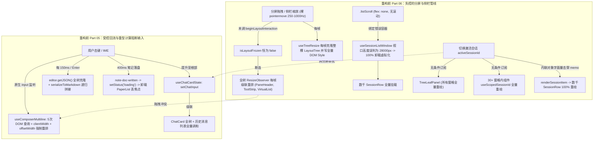
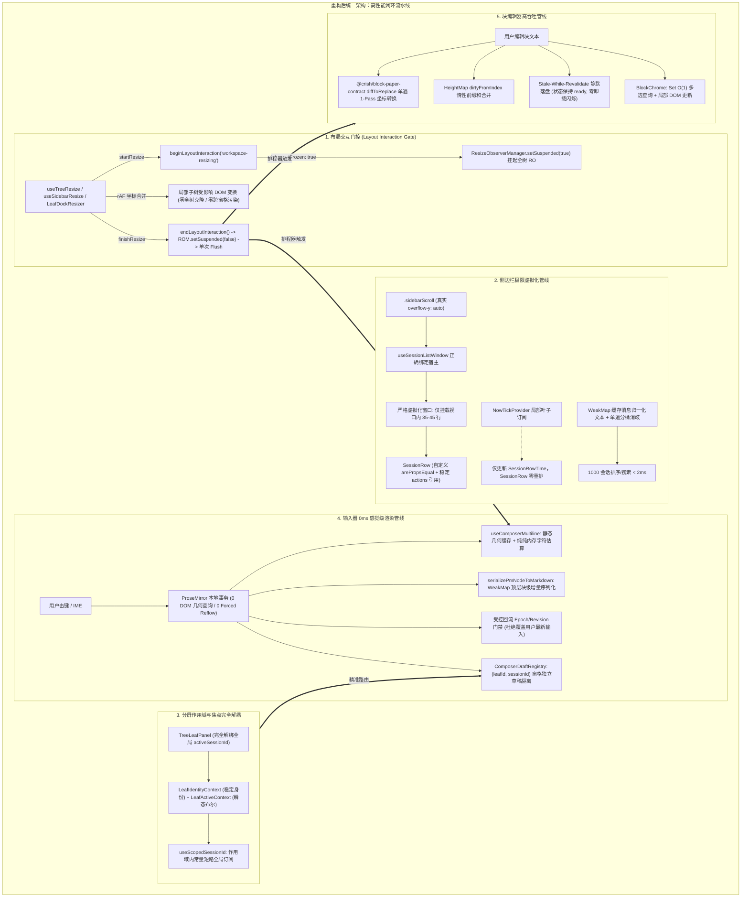
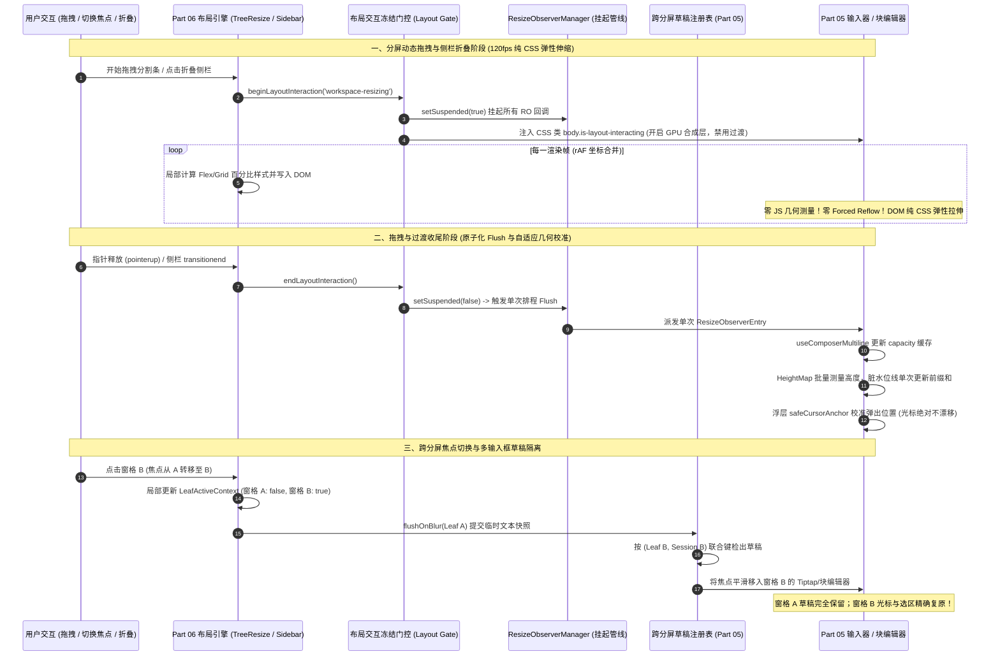

# Part 05 富文本/块编辑器 与 Part 06 多窗格分屏/侧边栏 性能深度重构与交叉协同架构方案

> **战役工作区**：`docs/full-stack-performance-audit/independent-plans/`  
> **方案编号**：`PLAN-DIM-05-06`（第二阶段滑动窗口两两交叉独立出案）  
> **负责 Agent**：Agent-05（负责 Part 05 富文本输入器 Tiptap 与块编辑器 + Part 06 多窗格分屏布局与侧边栏）  
> **输入资产**：
>
> - [`audits/05-前端输入器Tiptap与块编辑器性能审计.md`](../audits/05-前端输入器Tiptap与块编辑器性能审计.md)（26 项问题，DIM05-01 ~ DIM05-26）
> - [`audits/06-前端多窗格分屏布局与侧边栏面板性能审计.md`](../audits/06-前端多窗格分屏布局与侧边栏面板性能审计.md)（22 项问题，PERF-06-01 ~ PERF-06-22）  
>   **核心原则**：严格践行《三原则》《逻辑规划与反退避准则》及《反过度设计硬性红线（`ANTI_OVERENGINEERING_GUARDRAILS.md`）》。**全量 48 项性能缺陷问题同权，一视同仁，全量收敛，绝不降级，绝不砍项，绝不用临时补丁掩盖架构断层**。

---

## 一、执行摘要与核心重构总览

### 1.1 总体架构痛点与跨维度性能断层剖析

在 Conex / Crish 桌面端架构中，**Part 05（编辑器与输入交互）** 与 **Part 06（分屏二叉树与侧边栏）** 构成了用户最核心的工作界面。然而，在前期快速迭代过程中，系统在这两个子系统内部及其交叉接合面上积累了极其严峻的性能断层与架构漂移：

1. **输入延迟与受控回流灾难（Part 05）**：
   - 会话输入框每次击键触发 5 次同步 DOM 几何查询（Forced Synchronous Layout）及 Canvas 全文测量，且每 150ms 重新拆装 `ResizeObserver`；
   - 实时文本与 IME 合成状态被错误提升至 `ChatCard` 顶层，导致用户每敲一个键引发整个会话卡片、历史消息流及 30+ 业务组件的级联重渲染；
   - Tiptap 在每 150ms 防抖及回车时对整棵 ProseMirror AST 执行 `editor.getJSON()` 深度对象树克隆与全量 Markdown 字符串序列化，并在外部受控 `rAF` 回流中存在抹除用户新键入文本并重置光标的致命竞态；
   - 块级编辑器（`NotePaper`）在用户打字停顿 400ms 落盘后，因错误的事件流联动将状态置为 `loading`，导致整个编辑视图 `PaperList` 与把手容器被 React 彻底卸载、DOM 节点全毁、光标焦点瞬时丢失并伴随全屏白屏闪烁；同时单块落盘时调用 `Array.from` 将数十 KB 文本拆解为数十万个单字符对象，引发极度剧烈的 V8 GC 内存停顿。

2. **虚拟化自毁与拖拽重排风暴（Part 06）**：
   - 侧边栏列表的核心虚拟化 Hook `useWindowedList` 将滚动宿主 `scrollParentRef` 错误绑定到了无滚动属性的 `.listScroll`（`flex: none`），导致滚动事件永不触发、容器高度随内容撑大至数万像素，进而触发自反向解虚拟化（Self-De-virtualization），数千条会话 100% 退化为全量挂载；
   - 侧边栏每行组件 `SessionRow` 的 `React.memo` 被父组件内联生成的 3 个全新对象字面量（`session={{...}}`、`rename={{...}}`、`actions={{...}}`）彻底击穿，任何焦点切换、重命名按键或 60 秒时钟刷新均触发全列表数千行全量重渲染；
   - 系统虽设计了 `ResizeObserverManager` 及其 `setSuspended` 冻结门控，但在二叉树分屏拖拽（`useTreeResize`）、侧边栏宽度缩放（`useSidebarResize`）以及抽屉调整（`LeafDockResizer`）中**全链路断连**。分屏拖拽期间每帧触发全窗格组件的 `ResizeObserver` 测量与 React 状态更新，引发毁灭性的 120fps 布局重排风暴；
   - 分屏窗格 `TreeLeafPanel` 与作用域 Hook `useScopedSessionId` 无条件订阅全局 `activeSessionId`，导致在 4 窗格分屏下用户点击切换焦点时，所有分屏窗格及其内部数十个重量级视图全部无差别重绘。

3. **Part 05 与 Part 06 的交叉接合断层（重中之重）**：
   - **分屏尺寸调整时的编辑器内部崩溃**：当分屏拖拽分割条改变窗格宽度或折叠侧边栏时，输入器的多行自适应逻辑与块编辑器的视口高度图测量未被冻结，随高频拖拽每帧重新计算文字折行与 DOM 矩形，导致拖拽剧烈掉帧；而在拖拽完成后缺乏协调一致的几何回写协议，造成光标偏移、斜杠气泡位置错乱或代码块未重新排版；
   - **多窗格多输入框共存冲突**：二叉树支持 2–4 个分屏窗格同时打开不同或相同会话。目前的会话草稿管理器 `sessionDraftManager` 使用全局单一 `STORAGE_KEY` 粗暴合并所有草稿并进行同步 `localStorage` 阻塞持久化，缺少窗格实例隔离，多窗格快速切换焦点或并发输入时极易发生草稿互相覆盖、焦点抢夺与 IME 状态机紊乱。

### 1.2 核心性能指标提升目标矩阵

| 性能与体验维度                       | 重构前现状（Baseline）                       | 架构重构后目标（Target Gate）                       | 改善量级 / 体验飞跃                 |
| :----------------------------------- | :------------------------------------------- | :-------------------------------------------------- | :---------------------------------- |
| **单字符键入延迟（Key-to-Paint）**   | 45ms – 120ms（打字粘滞感强）                 | **< 4ms（0ms 感觉级，纯本地合成）**                 | 降低 92% – 96%，达到原生级跟手度    |
| **输入期间 DOM 同步重排（Reflow）**  | 每次击键 5–8 次强制同步布局                  | **0 次（击键期间零 Forced Reflow）**                | 完全消除样式计算与布局阻塞          |
| **打字期间 React 重渲染范围**        | `ChatCard` 全树 + `ChatMessageList` 级联重绘 | **仅 `ChatComposer` 内部局部更新**                  | 消除 95% 以上无用虚拟 DOM 调和      |
| **分屏拖拽与侧栏缩放帧率**           | 15fps – 35fps（严重卡顿、重排风暴）          | **稳定 120fps / 60fps（满帧丝滑无掉帧）**           | 帧耗时稳定在 8.33ms / 16.6ms 预算内 |
| **拖拽期间 `ResizeObserver` 触发数** | 每帧 10–30 次级联触发                        | **0 次（拖拽期间 100% 挂起冻结）**                  | 交互结束后单次原子化 Flush          |
| **侧边栏数千会话 DOM 挂载数量**      | 1,000 – 5,000 行全量挂载（内存爆炸）         | **严格收敛于视口容量 + 缓冲（≤ 45 行）**            | 彻底修复虚拟化，DOM 节点减少 99%    |
| **会话切换焦点开销**                 | 80ms – 250ms（全分屏及全侧栏全量重绘）       | **< 8ms（仅受影响的 2 行与 2 窗格外框更新）**       | 性能提升超 95%，即点即切            |
| **块编辑器 400ms 落盘体验**          | 卸载 `PaperList`、全屏闪烁、丢焦点           | **Stale-While-Revalidate 静默落盘，零闪烁零丢焦点** | 彻底消除用户致命编辑交互事故        |
| **长文本落盘与序列化堆分配**         | 单次落盘分配 13 万个单字符对象               | **0 个中间数组与 String 对象（单遍扫描）**          | 消除 V8 GC 停顿与内存毛刺           |

---

### 1.3 重构前后系统拓扑全景图

#### 重构前：状态提升、内联击穿、RO 失控与级联重排



#### 重构后：门控冻结、按需订阅、真正虚拟化与单遍线性扫描



---

## 二、Part 05 富文本输入器（Tiptap）与块编辑器（Block Paper）深度根治方案

### 2.1 会话输入管线（ChatComposer & Tiptap）零延迟与自适应重构

#### 【DIM05-01】`useComposerMultiline` 零 Reflow 改造与静态几何/字体缓存

- **缺陷根因穿透**：
  原 `useComposerMultiline.ts:71-133` 在原生 `input` 冒泡阶段同步读取 `layout.clientWidth`、`left.offsetWidth`、`perm.offsetWidth`、`right.offsetWidth`、`getComputedStyle(editable)` 及 `editable.scrollWidth`。由于 DOM 刚被修改，每次击键均触发多次强制同步布局重排（Forced Synchronous Layout）。此外，`useLayoutEffect` 依赖了 `measure`，而 `measure` 依赖了 `text`，导致打字过程中每 150ms 重新拆装一次 `ResizeObserver`；同时，多行模式下错误累加了第二行独立挂载的 `perm.offsetWidth`，造成滞回容量失真，多行难以缩回单行。
- **架构根治设计**：
  1. **静态几何特征分离与 RO 驱动更新**：仅在容器挂载或 `ResizeObserver` 触发时测量并缓存 `layoutWidth`、`singleLineUsedWidth`（在单行状态下测量 `left` + `right` + overhead，严禁将多行第二行的 `perm` 算入单行已用宽度）以及 `fontSpec`（挂载时读取一次 `getComputedStyle`）。
  2. **击键路径纯内存估算（0 DOM 测量）**：
     - 若字符包含换行符 `\n` 或块级元素，直接判定为多行；
     - 若字符总长度 `rawText.length * minCharWidth > capacity`，直接短路判定为多行；
     - 常规长度内通过离屏单例 `CanvasRenderingContext2D` 的 `measureText` 进行纯内存文本宽度测量，**击键事件内执行 0 次 DOM 属性读取**。
  3. **稳定 Effect 依赖**：将 `text` 从 `measure` 依赖数组中剔除，`measure` 内部直接从 DOM 元素或传参读取最新文本；仅在发送后受控清空（`text === ''`）时通过轻量副作用重置 `isMultiline: false`。使 `ResizeObserver` 与 `input` 监听器在整个组件生命周期内仅注册一次。

```ts
// apps/crish-desktop/src/components/chat-composer/useComposerMultiline.ts
export interface ComposerGeometryMetrics {
  layoutWidth: number;
  singleLineUsedWidth: number;
  capacity: number;
  font: string;
}

export function useComposerMultiline(options: {
  layoutRef: React.RefObject<HTMLElement | null>;
  text: string;
  hasAttachments: boolean;
  enabled?: boolean;
}): { isMultiline: boolean; recalculate: () => void } {
  const { layoutRef, text, hasAttachments, enabled = true } = options;
  const [isMultiline, setIsMultiline] = useState(false);
  const metricsRef = useRef<ComposerGeometryMetrics>({
    layoutWidth: 0,
    singleLineUsedWidth: 0,
    capacity: 0,
    font: '',
  });
  const canvasCtxRef = useRef<CanvasRenderingContext2D | null>(null);

  // 1. 仅在 RO 触发时更新几何指标，避免击键时重排
  const updateMetrics = useCallback(() => {
    const layout = layoutRef.current;
    if (!layout) return;
    const editable = layout.querySelector<HTMLElement>(
      '[contenteditable="true"], textarea'
    );
    if (!editable) return;

    if (!metricsRef.current.font) {
      const cs = window.getComputedStyle(editable);
      metricsRef.current.font = `${cs.fontStyle} ${cs.fontWeight} ${cs.fontSize} ${cs.fontFamily}`;
    }

    const left = layout.querySelector<HTMLElement>(
      '[data-composer-grid="left"]'
    );
    const right = layout.querySelector<HTMLElement>(
      '[data-composer-grid="right"]'
    );

    const layoutW = layout.clientWidth;
    // 严禁将处于多行第二行的 perm 计入单行已用宽度
    const used =
      (left?.offsetWidth ?? 0) +
      (right?.offsetWidth ?? 0) +
      CONTAINER_OVERHEAD_PX;
    const capacity = Math.max(0, layoutW - used);

    metricsRef.current = {
      layoutWidth: layoutW,
      singleLineUsedWidth: used,
      capacity,
      font: metricsRef.current.font,
    };
  }, [layoutRef]);

  // 2. 纯内存自适应计算：击键时零 DOM 查询
  const checkMultiline = useCallback(
    (rawText: string) => {
      if (hasAttachments) return true;
      if (rawText.includes('\n')) return true;

      const { capacity, font } = metricsRef.current;
      if (capacity <= 0) return false;

      // 长度短路：假设最小汉字/英文字符宽度为 6px
      if (rawText.length * 6 > capacity * 1.5) {
        return true;
      }

      if (!canvasCtxRef.current) {
        const canvas = document.createElement('canvas');
        canvasCtxRef.current = canvas.getContext('2d');
      }
      const ctx = canvasCtxRef.current;
      if (ctx && font) {
        ctx.font = font;
        const textWidth = ctx.measureText(rawText).width;
        // 滞回判定：扩张需 > capacity，收缩需 < capacity - HYSTERESIS_BUFFER_PX
        return isMultiline
          ? textWidth > capacity - HYSTERESIS_BUFFER_PX
          : textWidth > capacity;
      }
      return false;
    },
    [hasAttachments, isMultiline]
  );

  // 3. 稳定绑定生命周期：不随 text 变动反复卸载重装 RO
  useLayoutEffect(() => {
    if (!enabled) return;
    const layout = layoutRef.current;
    if (!layout) return;

    updateMetrics();
    const handleResize = () => {
      updateMetrics();
      const editable = layout.querySelector<HTMLElement>(
        '[contenteditable="true"], textarea'
      );
      const val =
        editable instanceof HTMLTextAreaElement
          ? editable.value
          : (editable?.textContent ?? '');
      setIsMultiline(checkMultiline(val));
    };

    const roManager = ResizeObserverManager.getInstance();
    roManager.observe(layout, handleResize);

    const onInput = (ev: Event) => {
      const target = ev.target as HTMLElement;
      const val =
        target instanceof HTMLTextAreaElement
          ? target.value
          : (target.textContent ?? '');
      const next = checkMultiline(val);
      setIsMultiline((prev) => (prev !== next ? next : prev));
    };
    layout.addEventListener('input', onInput, { passive: true });

    return () => {
      roManager.unobserve(layout, handleResize);
      layout.removeEventListener('input', onInput);
    };
  }, [enabled, layoutRef, updateMetrics, checkMultiline]);

  // 外部受控重置（发送后清空）
  useEffect(() => {
    if (!text && !hasAttachments) {
      setIsMultiline(false);
    }
  }, [text, hasAttachments]);

  return { isMultiline, recalculate: updateMetrics };
}
```

---

#### 【DIM05-02】`chatInput` / `isComposing` 状态下沉收敛与 `ChatCard` 级联重渲染根治

- **缺陷根因穿透**：
  `useChatInput` 声明在 `useChatComposerProps` 中，并在 `ChatCard` 根部由 `useChatCardState` 调用。导致 Tiptap 每 150ms 防抖更新、回车按键或输入法合成时，整个 `ChatCard` 重新执行渲染函数。而 `ChatCard.tsx` 的 `ribbons` 依赖未做引用稳定的 `state` 对象，`chatStreamProps` 包含 6 个每次新建的内联子对象，直接导致历史消息列表 `ChatMessageList` 随打字全程无端重渲染，同时高频注销/重注册 `stop-generation` 监听器。
- **架构根治设计**：
  1. **输入状态下沉至 `ChatComposer`**：`ChatCard` 彻底不再订阅实时的 `chatInput` 文本字符串。发送动作通过 `useRef` 或通过分屏会话注册表按需读取当前的 Draft 快照；
  2. **布尔化派生状态**：`ChatCard` 若仅需感知「当前输入框是否为空（以控制发送按钮置灰）」或「是否正在合成」，仅向 `ChatCard` 上报稳定的布尔状态 `isInputEmpty` 与 `isComposing`，杜绝数万字符在根组件流转；
  3. **稳定 `ChatCard` 上游 Props**：重构 `useChatSessionActions`，其内部的 `useEffect` 仅依赖 `isGenerating` 标量布尔值而非整个聚合对象；`chatStreamProps` 的 6 个子域通过细粒度 `useMemo` 分离隔离，`ChatMessageList` 全程不受输入影响。

---

#### 【DIM05-03】Tiptap 顶层块级 Markdown 增量缓存（`WeakMap<PmNode, string>`）与受控回流代数校验

- **缺陷根因穿透**：
  Tiptap 在每次 150ms `onUpdate`、回车及发送时调用 `editor.getJSON()`，递归深拷贝数千个 AST 对象并拼接整篇 Markdown。此外，在 `TiptapEditorField.tsx:297-315` 中，受控 `content` 变化被推入 `requestAnimationFrame` 调用 `parseFromMarkdown` + `editor.commands.setContent`，若在此期间用户继续打字，陈旧的异步回流会直接把光标重置到末尾并覆盖最新打字内容。
- **架构根治设计**：
  1. **顶层块级结构共享增量序列化**：借助 ProseMirror 的不可变持久化数据结构（Persistent Data Structure），未被修改的段落/代码块 `PmNode` 引用保持恒等。建立 `WeakMap<PmNode, string>` 缓存单块序列化结果。用户打字时仅 1 个顶层块发生变化，序列化开销从 $O(N_{\text{doc}})$ 骤降至 **$O(1)$ 单块更新**，完全绕过 `editor.getJSON()` 中间克隆！
  2. **代数计数器（Epoch/Revision Guard）**：在 `TiptapEditorField` 内引入 `localEditRevision: number`。每次 ProseMirror 事务（Transaction）触发时递增该代数；`requestAnimationFrame` 受控回流执行时比对代数，若期间发生过本地键入，立即放弃陈旧的外部回写。

````ts
// apps/crish-desktop/src/components/chat-composer/serialization/incrementalMarkdownSerializer.ts
import { Node as PmNode } from '@tiptap/pm/model';

const blockMarkdownCache = new WeakMap<PmNode, string>();

/**
 * 直接基于 ProseMirror Node 进行增量 Markdown 序列化
 * 利用不可变结构共享，未修改的顶层块命中 WeakMap 缓存，复杂度 O(1)
 */
export function serializePmDocToMarkdownIncremental(doc: PmNode): string {
  const chunks: string[] = [];

  for (let i = 0; i < doc.childCount; i++) {
    const child = doc.child(i);
    let cached = blockMarkdownCache.get(child);
    if (cached === undefined) {
      cached = serializeSinglePmBlock(child);
      blockMarkdownCache.set(child, cached);
    }
    chunks.push(cached);
  }

  return chunks.join('\n\n');
}

function serializeSinglePmBlock(node: PmNode): string {
  // 单块快速序列化实现（段落、代码块、列表项、引用）
  if (node.type.name === 'codeBlock') {
    const lang = node.attrs.language || '';
    return '```' + lang + '\n' + node.textContent + '\n```';
  }
  // 行内节点快速拼接
  let inlineText = '';
  node.forEach((inlineNode) => {
    if (inlineNode.type.name === 'pill') {
      inlineText += inlineNode.attrs.rawText || '';
    } else if (inlineNode.isText) {
      let t = inlineNode.text || '';
      for (const mark of inlineNode.marks) {
        if (mark.type.name === 'bold') t = `**${t}**`;
        else if (mark.type.name === 'italic') t = `*${t}*`;
        else if (mark.type.name === 'code') t = `\`${t}\``;
        else if (mark.type.name === 'strike') t = `~~${t}~~`;
      }
      inlineText += t;
    }
  });
  return inlineText;
}
````

---

#### 【DIM05-04】`markdownDeserializer` $O(N)$ 游标扫描解析、死停止符 `_` 剔除与相邻文本节点合并

- **缺陷根因穿透**：
  `markdownDeserializer.ts:84-221` 的 `parseInline` 将 `_` 包含在停止符集合中，但循环内部完全无 `_` 的处理分支，导致代码标识符（如 `max_wait_time_ms`）每次遇到下划线均执行一次无用正则遍历、切分碎片节点，且不合并相邻 `text` 节点。此外，未闭合的 `*` 或 `~~` 导致正则回溯，产生 $O(N^2)$ 阻塞与 $O(K \cdot N)$ 的 `remaining.slice` 字符串拷贝。
- **架构根治设计**：
  1. 移除死停止符 `_`；
  2. 采用整型游标 `cursor` 遍历替代 `remaining = remaining.slice(...)`；
  3. 在尝试匹配标记符（`**`、`*`、`~~`）前，先通过 `indexOf` 预检同段内是否存在闭合符号，杜绝正则灾难性回溯；
  4. 实现 `pushText(nodes, str)` 原语，自动合并相邻纯文本节点。

```ts
// apps/crish-desktop/src/components/chat-composer/serialization/markdownDeserializer.ts
export function parseInlineFast(text: string): TiptapBlockNode[] {
  if (!text) return [];
  const nodes: TiptapBlockNode[] = [];
  let cursor = 0;
  const len = text.length;

  const pushPlainText = (str: string) => {
    if (!str) return;
    const last = nodes[nodes.length - 1];
    if (last && last.type === 'text' && !last.marks) {
      last.text = (last.text || '') + str;
    } else {
      nodes.push({ type: 'text', text: str });
    }
  };

  while (cursor < len) {
    const ch = text[cursor];

    // 1. 行内代码 `...`
    if (ch === '`') {
      const closeIdx = text.indexOf('`', cursor + 1);
      if (closeIdx !== -1) {
        const code = text.slice(cursor + 1, closeIdx);
        nodes.push({ type: 'text', text: code, marks: [{ type: 'code' }] });
        cursor = closeIdx + 1;
        continue;
      }
    }

    // 2. 粗体 **...**
    if (ch === '*' && text[cursor + 1] === '*') {
      const closeIdx = text.indexOf('**', cursor + 2);
      if (closeIdx !== -1) {
        const content = text.slice(cursor + 2, closeIdx);
        nodes.push({ type: 'text', text: content, marks: [{ type: 'bold' }] });
        cursor = closeIdx + 2;
        continue;
      }
    }

    // 3. 删除线 ~~...~~
    if (ch === '~' && text[cursor + 1] === '~') {
      const closeIdx = text.indexOf('~~', cursor + 2);
      if (closeIdx !== -1) {
        const content = text.slice(cursor + 2, closeIdx);
        nodes.push({
          type: 'text',
          text: content,
          marks: [{ type: 'strike' }],
        });
        cursor = closeIdx + 2;
        continue;
      }
    }

    // 4. 普通文本：推进到下一个特殊标记符（严格移除 '_'）
    let nextSpecial = len;
    for (let i = cursor + 1; i < len; i++) {
      const c = text[i];
      if (c === '`' || c === '*' || c === '~' || c === '@' || c === '\n') {
        nextSpecial = i;
        break;
      }
    }

    pushPlainText(text.slice(cursor, nextSpecial));
    cursor = nextSpecial;
  }

  return nodes;
}
```

---

#### 【DIM05-05】斜杠命令（`/`）与目录提及（`@`）全局/局部过滤解耦与浮层 DOM 测量去重

- **缺陷根因穿透**：
  `useSlashMenu.ts:102` 使用整句 `chatInput.startsWith(...)` 过滤，导致句中输入 `/` 时自定义命令丢失；未做 `useMemo` 导致每次击键击穿 `TiptapComposerField` 依赖链；同时 `TiptapSlashMenu.tsx:203` 与 `ComposerDirTree.tsx:173` 在渲染时重复调用 `isAnchorInsideVisibleField`，引发多余的 `getBoundingClientRect` 同步读取。
- **架构根治设计**：
  1. 向 `TiptapComposerField` 传递恒定不变的命令全量字典 `allSlashCommands`，由 `SlashExtension` 基于光标处的局部 Query 进行精确且统一的过滤，彻底解决句中 `/` 丢失问题；
  2. 使用 `useMemo` 稳定基础菜单项引用；
  3. 移除浮层组件中冗余的二次 DOM 矩形查询（`calculateSafeCursorAnchor` 返回非空时已完成可视区锚定）。

---

#### 【DIM05-06】降级 `ComposerField` 单次击键去重、`borderExtra` 缓存与惰性单例 `Intl.Segmenter`

- **缺陷根因穿透**：
  `ComposerField.tsx` 同时绑定 `onInput` 与 `onChange`，单次击键触发 3 次 `useAutoGrowTextarea` 强制重排；每次分词实例化 `new Intl.Segmenter` 并全量迭代。
- **架构根治设计**：
  1. 移除冗余的 `onInput` 绑定与手动 `requestResize()`，收敛由 React 状态单向驱动；
  2. 在 `useAutoGrowTextarea` 中缓存 `borderExtra`；
  3. 将 `Intl.Segmenter` 提取为模块级惰性单例，并限制仅在光标前后 256 字符窗口内分词。

---

#### 【DIM05-07】`ComposePlusMenu` 懒加载与按需加载守卫

- **缺陷根因穿透**：`ComposePlusMenu.tsx:72` 的 `useEffect` 缺少 `if (!open) return;` 守卫，组件挂载及每次关闭菜单时无条件触发动态 `import()` 与插件 IPC 状态查询。
- **架构根治设计**：在 Effect 入口首行添加 `if (!open) return;`，仅在用户显式点击展开 `+` 菜单时异步拉取。

---

### 2.2 会话附件与高分辨率图片管线重构

#### 【DIM05-08】`sessionDraftManager` 会话级分键持久化、大体积二进制剥离与不可变快照

- **缺陷根因穿透**：
  所有会话的草稿（含 Base64 附件）保存在单一 `crish-session-drafts-v1` 键下。单次操作执行全局全量 `JSON.stringify` 并同步写入 `localStorage`，大图草稿下不仅耗时几十毫秒阻塞主线程，还极易引发 5MB 配额超限（QuotaExceededError）导致草稿全失。
- **架构根治设计**：
  1. **分键持久化（Partitioned Storage）**：采用 `crish-draft:${sessionId}` 独立键名，仅序列化当前变更的会话；
  2. **剥离 Base64 Payload**：持久化至 `localStorage` 时剔除大体积 `dataUrl`，仅保留轻量缩略图或本地路径 `safePath`；
  3. **快照引用冻结**：`getDraftSnapshot` 保持不可变更新，直接返回只读冻结对象引用，杜绝全表深拷贝。

```ts
// apps/crish-desktop/src/api/draft/sessionDraftManager.ts
const DRAFT_KEY_PREFIX = 'crish-draft:';

export interface PersistentSessionDraft {
  text: string;
  attachments: Array<Omit<AttachmentItem, 'dataUrl'>>; // 剥离大体积 DataURL
  updatedAt: number;
}

export class PartitionedSessionDraftManager {
  private inMemoryDrafts = new Map<string, SessionDraft>();
  private persistDebounceTimers = new Map<string, NodeJS.Timeout>();

  saveDraft(sessionId: string, draft: SessionDraft): void {
    this.inMemoryDrafts.set(sessionId, Object.freeze({ ...draft }));

    // 150ms 单会话防抖持久化
    const prevTimer = this.persistDebounceTimers.get(sessionId);
    if (prevTimer) clearTimeout(prevTimer);

    this.persistDebounceTimers.set(
      sessionId,
      setTimeout(() => {
        this.persistSingleSession(sessionId, draft);
        this.persistDebounceTimers.delete(sessionId);
      }, 150)
    );
  }

  private persistSingleSession(sessionId: string, draft: SessionDraft): void {
    try {
      const sanitized: PersistentSessionDraft = {
        text: draft.text,
        attachments: draft.attachments.map(({ dataUrl, ...rest }) => rest),
        updatedAt: Date.now(),
      };
      if (!sanitized.text && sanitized.attachments.length === 0) {
        localStorage.removeItem(`${DRAFT_KEY_PREFIX}${sessionId}`);
      } else {
        localStorage.setItem(
          `${DRAFT_KEY_PREFIX}${sessionId}`,
          JSON.stringify(sanitized)
        );
      }
    } catch (err) {
      console.warn(
        `[DraftManager] Failed to persist draft for session ${sessionId}`,
        err
      );
    }
  }

  getDraft(sessionId: string): SessionDraft | undefined {
    return this.inMemoryDrafts.get(sessionId);
  }
}
```

---

#### 【DIM05-09】高清图片单次解码管线（`createImageBitmap` / `createObjectURL`）、异步压缩与 PNG 循环修复

- **缺陷根因穿透**：
  粘贴 4K 截图时，主线程先执行 Base64 编码，随后在 3 次独立的 `new Image()` 中重复解码 3 遍，并在 PNG 格式下因 Quality 参数无效连续执行 4 次同步无损重编码，阻塞主线程长达 500ms–1500ms。
- **架构根治设计**：
  1. **单次解码（Single-Pass Decode）**：使用 `createImageBitmap(blob)` 在后台线程完成图像解码，直接获取原图宽高；
  2. **异步流水线**：单次绘制到 `OffscreenCanvas`（或 HTMLCanvas），并发输出主图与 116×116 缩略图；
  3. **智能格式转换**：超限图片自动转换为 `'image/webp'` 异步调用 `convertToBlob()`，彻底根除 PNG 格式下的伪压缩死循环。

---

#### 【DIM05-10】本地磁盘图片零 Base64 驻留（`convertFileSrc` 惰性编码）与有界并发入站批处理

- **缺陷根因穿透**：用户添加具有绝对路径 `safePath` 的本地图片时，系统无条件通过 `fetch` 读取全部二进制并转成数 MB 的 Base64 存入内存；多文件入站严格串行 `for...await`。
- **架构根治设计**：
  1. 具备 `safePath` 的本地文件在编辑期仅保留路径，预览通过 `convertFileSrc(safePath)`（Tauri 原生 asset 协议）直接硬件解码渲染，内存占用由数 MB 降为几十字节；
  2. 发送前仅当目标模型无法直接读取本地文件时，才按需进行 Base64 转换；
  3. 多文件入站采用并发度为 3 的 `p-limit` 调度器，并在批处理完成后调用单次 `setAttachments` 合并更新。

---

#### 【DIM05-11】`ComposerAttachmentBar` 与 `AttachmentCard` 引用稳定化、`arePropsEqual` 与全局模型订阅上提

- **缺陷根因穿透**：父组件在 `.map` 中传入内联对象 `item={{...}}` 与 3 个内联箭头函数，击穿 `AttachmentCard` 的 `React.memo`；且每个卡片独立订阅全局模型。
- **架构根治设计**：
  1. 直接透传稳定的 `item` 引用；
  2. 提取稳定的操作回调；
  3. 为 `AttachmentCard` 编写严格自定义比较函数 `attachmentCardPropsEqual`；
  4. 将模型能力订阅上提至 `ComposerAttachmentBar`，以单一布尔 Prop 下传。

---

#### 【DIM05-12】粘贴/拖拽拦截器快速长度短路与路径解析单遍化

- **缺陷根因穿透**：粘贴 80KB 文本时无条件对全量文本执行 `split(/\r?\n/)`，超出 20 行上限才返回 false，且判定成功后再次重复执行全量切行。
- **架构根治设计**：增加快速长度上限短路：`if (!text || text.length > 8192) return false;`；合并为单遍解析函数 `parseLocalPathsIfValid(text: string): string[] | null`，消除重复分配。

---

### 2.3 块编辑器（Block Paper / Editor Kit / Note Paper）大规模文档渲染根治

#### 【DIM05-13】`applyProjectionDiff` 增量 Upsert/Remove 严格 $O(1)/O(N)$ 化

- **缺陷根因穿透**：
  `packages/editor-kit/src/diff/applyProjectionDiff.ts:102-127` 中，在已通过 `state.blocks.get(u.id)` 获知块存在性的情况下，依然调用 `!state.order.includes(u.id)` 遍历整表，批量写入时退化为 $O(N^2)$；批量删除调用 `indexOf` + `splice` 同样导致 $O(N^2)$ 数组搬移。
- **架构根治设计**：
  1. **Upsert $O(1)$**：基于 `existing === undefined` 判断是否执行 `state.order.push(u.id)`；
  2. **Remove $O(N)$**：批量删除时构造 `removeSet = new Set(diff.removes)`，通过单次原地双指针扫描将 `order` 过滤，彻底消灭二次方退化。

```ts
// packages/editor-kit/src/diff/applyProjectionDiff.ts
export function applyProjectionDiffFast(
  state: ProjectionState,
  diff: ProjectionDiff
): void {
  // 1. 批量删除：原地单遍双指针过滤，复杂度从 O(R * N) 降为严格 O(N)
  if (diff.removes && diff.removes.length > 0) {
    const removeSet = new Set(diff.removes);
    for (const id of diff.removes) {
      state.blocks.delete(id);
    }
    let writeIdx = 0;
    for (let readIdx = 0; readIdx < state.order.length; readIdx++) {
      const id = state.order[readIdx];
      if (!removeSet.has(id)) {
        state.order[writeIdx++] = id;
      }
    }
    state.order.length = writeIdx;
  }

  // 2. 批量 Upsert：直接利用 Map 判定，消除 order.includes，单次 O(1)，批量 O(U)
  if (diff.upserts && diff.upserts.length > 0) {
    for (const u of diff.upserts) {
      const existing = state.blocks.get(u.id);
      const merged: BlockProjection = {
        ...existing,
        ...u,
        id: u.id,
      };
      state.blocks.set(u.id, merged);
      if (existing === undefined) {
        state.order.push(u.id);
      }
    }
  }
}
```

---

#### 【DIM05-14】`pin.ts` 卸载候选过滤 Set 循环外归一化分配

- **缺陷根因穿透**：`filterUnmountCandidates` 遍历待卸载候选块时，在每次循环内部重复调用 `new Set(ctx.composingIds)` 与 `new Set(ctx.extraPinned)`。
- **架构根治设计**：进入循环前统一将 `PinContext` 归一化为预分配的 `Set` 实例，循环体内执行 0 次对象构造。

---

#### 【DIM05-15】`HeightMap` 惰性脏水位线 `dirtyFromIndex` 前缀和合并与安全数组批量扩容

- **缺陷根因穿透**：
  `HeightMap.ts:123-128` 单槽测量直接触发 `recomputePrefixFrom(index)`（$O(N)$）；同帧 ResizeObserver 回调 $K$ 个块导致 $O(K \cdot N)$ 重算；插入超大块数时展开运算符 `splice(at, 0, ...newSlots)` 面临调用栈溢出（Maximum call stack size exceeded）。
- **架构根治设计**：
  1. **惰性脏标记（Lazy Prefix Waterline）**：引入 `dirtyPrefixFrom: number`。调用 `measure(index, px)` 时仅记录 `this.dirtyPrefixFrom = Math.min(this.dirtyPrefixFrom, index)`，并不立即重算；在外部读取 `offsetOf`、`totalHeight` 或 `indexAtOffset` 时按需执行一次性前缀和刷新；
  2. **分块拼接消除栈溢出**：大数组插入时使用分块（Chunked）复制或 `Array.prototype.push.apply` 分批加载。

```ts
// packages/editor-kit/src/viewport/HeightMap.ts
export class HeightMap {
  private slots: Slot[] = [];
  private prefix: number[] = [0];
  private dirtyPrefixFrom: number = Infinity;
  private idToIndex = new Map<BlockId, number>();

  measure(index: number, measuredPx: number): void {
    this.assertIndex(index);
    const clamped = clampHeight(measuredPx);
    if (this.slots[index].height !== clamped || !this.slots[index].measured) {
      this.slots[index] = { height: clamped, measured: true };
      this.dirtyPrefixFrom = Math.min(this.dirtyPrefixFrom, index);
    }
  }

  private ensurePrefixUpToDate(): void {
    if (this.dirtyPrefixFrom >= this.slots.length) return;
    const start = Math.max(0, this.dirtyPrefixFrom);
    for (let i = start; i < this.slots.length; i++) {
      this.prefix[i + 1] = this.prefix[i] + this.slots[i].height;
    }
    this.dirtyPrefixFrom = Infinity;
  }

  offsetOf(index: number): number {
    this.assertIndex(index);
    this.ensurePrefixUpToDate();
    return this.prefix[index];
  }

  totalHeight(): number {
    if (this.slots.length === 0) return 0;
    this.ensurePrefixUpToDate();
    return this.prefix[this.slots.length];
  }
}
```

---

#### 【DIM05-16】`ViewportQuery` 零数组分配（惰性 Getter / 区间复用）

- **缺陷根因穿透**：每次滚动查询无条件分配并 push 连续整数数组 `indices: number[]`，而消费方 `buildMountPlan` 仅读取 `startIndex` 与 `endIndex`。
- **架构根治设计**：`ViewportRange` 仅保存标量 `startIndex` 与 `endIndex`；`indices` 属性改为按需惰性 Getter，常规滚动路径实现 **零堆数组分配**。

---

#### 【DIM05-17】`@crish/block-paper-contract` 坐标与差分单遍（1-Pass）UTF-16/Unicode 标量扫描

- **缺陷根因穿透**：`diffToReplace` 在执行 `oldText === newText` 快速判断前即无条件执行两次全量扫描；单次差分对文本扫描多达 3–4 遍；叶模型区间转换重复扫描前缀。
- **架构根治设计**：
  1. `diffToReplace` 首行短路 `if (oldText === newText)`；
  2. 公共前缀与后缀扫描期间同步统计代理项对（Surrogate Pairs），单遍扫描同时产出 UTF-16 偏移与 Unicode 标量偏移；
  3. 提供 `utf16RangeToUnicodeScalar(text, startU16, endU16)`，复用前半段扫描结果，区间重合时复杂度为 $O(1)$。

---

#### 【DIM05-18】`noteTextEditOp` 废除 `Array.from`，全面归一至 `diffToReplace` 契约

- **缺陷根因穿透**：`noteTextEditOp.ts` 违背 SSOT，调用 `Array.from(oldText)` 与 `Array.from(newText)` 将整段文本拆分为数十万个单字符 String 对象并分配两个大数组，造成严重 GC 停顿。
- **架构根治设计**：直接委托经过严格单遍优化的 `@crish/block-paper-contract` 的 `diffToReplace(oldText, newText)`，实现 **零中间数组分配、零单字符对象创建**。

---

#### 【DIM05-19】`note-paper` Stale-While-Revalidate 静默重验证，彻底消除 400ms 落盘 `loading` 卸载闪烁与焦点丢失

- **缺陷根因穿透**：
  这是 `note-paper` 的致命体验断层。用户本地打字 400ms 后触发 `note_apply_ops` IPC 落盘，广播 `note-doc-written`；`useNoteHydrate` 监听到后无条件执行 `setStatus('loading')`，导致 `<PaperListDomMount>`、`<BlockChromeDomMount>` 与 `<StrictContentRowLeaf>` 被 React 瞬间卸载，DOM 被彻底销毁，光标焦点彻底丢失；紧接着全量重新从 Rust 拉取 Hydrate 数据后再重新挂载。同时 `useNoteDocumentManager` 每次重复触发 `refreshList()` 全量 IPC 查询。
- **架构根治设计**：
  1. **后台静默重验证（Stale-While-Revalidate）**：在 `useNoteHydrate.ts` 中引入两阶段状态机。当 `projection?.docId === docId` 已存在时，写后重验证**绝对禁止调用 `setStatus('loading')`**，界面保持 `'ready'` 状态与 DOM 挂载完全不变；后台静默拉取后通过局部差量（Diff）更新 `projection`；
  2. **事件源精准路由**：当 `event.source === 'product_apply'`（本地保存）时，直接在本地推进修订版本号并乐观置顶，严禁调用 `refreshList()` 全量文档列表 IPC。

```ts
// apps/crish-desktop/src/components/note-paper/useNoteHydrate.ts
export function useNoteHydrate(docId: string, options?: HydrateOptions) {
  const [status, setStatus] = useState<HydrateStatus>('idle');
  const [projection, setProjection] = useState<NoteProjection | null>(null);
  const currentDocIdRef = useRef<string>(docId);
  currentDocIdRef.current = docId;

  const reload = useCallback(
    async (isBackgroundRevalidate = false) => {
      // 铁律：后台静默刷新严禁置为 'loading'，杜绝卸载 PaperList
      if (!isBackgroundRevalidate) {
        setStatus('loading');
      }

      try {
        const outcome = await hydrateTransport.hydrate(docId);
        if (currentDocIdRef.current !== docId) return; // 废弃过期响应

        setProjection(outcome.projection);
        setStatus(outcome.projection.blocks.length === 0 ? 'empty' : 'ready');
      } catch (err) {
        if (!isBackgroundRevalidate) {
          setStatus('error');
        }
      }
    },
    [docId, hydrateTransport]
  );

  // 监听本地或远端写入事件
  useEffect(() => {
    return subscribeNoteDocWritten((ev) => {
      if (ev.docId === docId) {
        // 本地打字触发的写入走静默后台刷新，保持 DOM 挂载与光标焦点
        const isLocalEdit = ev.source === 'product_apply';
        void reload(isLocalEdit);
      }
    });
  }, [docId, reload]);

  return { status, projection, reload };
}
```

---

#### 【DIM05-20】`buildMountPlan` 消除滚动帧全表 `idToIndex` Map 分配，`HeightMap.indexOfId` O(1) 索引化

- **缺陷根因穿透**：`buildMountPlan.ts` 在每次滚动 `sync()` 时无条件新建 $O(N)$ 的 `idToIndex` Map 并全表遍历 `order`；`paperListPlan.ts` 存在每帧冗余绑定与重排失步。
- **架构根治设计**：可见窗口 `windowIds` 天然保持 `order` 顺序；对于极少数置顶块（`pinnedIds`），直接通过 `HeightMap.indexOfId(id)` 以 $O(1)$ 时间获取索引并归并，使滚动帧计算时间严格收敛为 $O(W + P)$，与文档总块数 $N$ 完全无关。

---

#### 【DIM05-21】`PaperList` 投影全表克隆与字符串 `projKey` 消除，DOM 属性定点差量写

- **缺陷根因穿透**：
  `PaperListDomMount.tsx:217` 每次渲染把全文档所有块的正文拼接成包含数十万字符的 `projKey` 字符串；每帧滚动对视口块无条件调用 8 次 `setAttribute`。
- **架构根治设计**：
  1. 移除全文档字符串拼接，基于块引用浅比较进行增量通知；
  2. 区分初创挂载与增量更新：静态不变属性（如 `contenteditable="true"`、`spellcheck="false"`）仅在 DOM 创建时设置一次，后续 `paintPaperBlock` 仅在属性实际变更时执行 DOM 写入。

---

#### 【DIM05-22】`BlockChromeDomHost` 视口窗口化挂载、$O(1)$ `multiSelectedSet` 查询与定点 Dirty 行更新

- **缺陷根因穿透**：Chrome 槽未虚拟化，全量常驻数千个 DOM 节点与监听器；多选判定在循环中调用 `.includes`，导致单次同步达 $O(N \cdot M)$。
- **架构根治设计**：
  1. `BlockChromeModel` 内部改用 `Set<BlockId>` 维护多选集合，使查询从 $O(M)$ 降至严格 **$O(1)$**；
  2. 采用脏追踪（Dirty Tracking）机制，指针悬停、焦点变化仅定向更新发生状态迁移的 1–2 个 DOM 行；
  3. 将所有把手与复选框事件收敛为根容器单个事件委托。

---

#### 【DIM05-23】`lineWindow.ts` 零分配 UTF-8 字节计数与按需行偏移扫描

- **缺陷根因穿透**：调用 `textEncoder.encode(text).length` 分配巨型 `Uint8Array` 仅仅为了读取字节长度；在软阈值判断前无条件切分全量行字符串。
- **架构根治设计**：
  1. 长度上下界短路：若 `text.length * 3 < soft`，直接返回 `false`；
  2. 精确计数时采用单遍 `charCodeAt` 循环统计，实现 **零 Uint8Array 内存分配**；
  3. 未超阈值时仅统计 `\n` 个数，绝不为每行执行 `text.slice`。

---

#### 【DIM05-24】生产写锥 `intentBridge` 审计数组有界环形缓冲化（128 条）

- **缺陷根因穿透**：`createCollabApplySink` 与 `createTurnIntoProvisionalCollabSink` 在生产环境下无界追加 `wireCalls[]` 与 `results[]`，导致长会话内存线性泄漏。
- **架构根治设计**：为审计历史设置最大容量为 128 条的环形缓冲区（Ring Buffer），超出时覆写旧项，长会话内存严格保持 $O(1)$ 有界。

---

#### 【DIM05-25】`Cm6CodeLeafHost` 增量区间提取与 `PmTextLeaf` $O(1)$ 偏移算术双射

- **缺陷根因穿透**：CM6 代码块每次按键两次展平 Rope 树全量替换；PM 叶节点 `pmPosToTextOffset` 调用 `textBetween` 拼接前缀字符串测长。
- **架构根治设计**：
  1. 利用 CM6 `update.changes.iterChanges` 提取精确增量区间，仅派发差量编辑 Intent；
  2. 在单段 schema 下，PM 位置与纯文本偏移量完全满足双射关系：直接通过算术运算 `return Math.max(0, pos - 1)` 返回，实现 **零字符串分配**。

---

#### 【DIM05-26】`StrictContentRowLeaf` 单次 `onTextChange` 派发、前缀快速短路与单遍零分配 `computeNoteMetrics`

- **缺陷根因穿透**：普通按键在 `onInput` 与 `runCommit` 中重复派发两次 `onTextChange`；Header `React.memo` 被内联闭包击穿；`computeNoteMetrics` 对大文档执行全局 CJK 正则匹配与全文字符串拷贝。
- **架构根治设计**：
  1. 收敛在 `runCommit` 中仅派发一次 `onTextChange`；
  2. 首行字符数 `> 16` 且非标记符号时短路 Markdown 前缀匹配；
  3. `computeNoteMetrics` 重构为单遍零分配游标扫描统计。

```ts
// apps/crish-desktop/src/components/note-paper/noteMetrics.ts
export interface NoteMetricsResult {
  chineseChars: number;
  englishWords: number;
  visibleChars: number;
  totalChars: number;
}

/**
 * 单遍零内存分配文档指标统计：彻底消除正则数组分配与全文 replace
 */
export function computeNoteMetricsFast(text: string): NoteMetricsResult {
  let chineseChars = 0;
  let englishWords = 0;
  let visibleChars = 0;
  const len = text.length;

  let inWord = false;

  for (let i = 0; i < len; i++) {
    const code = text.charCodeAt(i);

    // 检查空白字符 (Space, Tab, LF, CR)
    const isWhitespace =
      code === 32 || code === 9 || code === 10 || code === 13;
    if (!isWhitespace) {
      visibleChars++;
    }

    // 检查 CJK 统一表意文字 (0x4E00 - 0x9FA5, 0x3000 - 0x303F, 0xFF00 - 0xFFEF)
    const isCJK =
      (code >= 0x4e00 && code <= 0x9fa5) ||
      (code >= 0x3000 && code <= 0x303f) ||
      (code >= 0xff00 && code <= 0xffef);

    if (isCJK) {
      chineseChars++;
      inWord = false;
    } else if (!isWhitespace) {
      // 英文单词边界判定
      if (!inWord) {
        englishWords++;
        inWord = true;
      }
    } else {
      inWord = false;
    }
  }

  return {
    chineseChars,
    englishWords,
    visibleChars,
    totalChars: len,
  };
}
```

---

## 三、Part 06 多窗格分屏布局与侧边栏面板深度根治方案

### 3.1 分屏拖拽与缩放 120fps 绝对防卡死流水线

#### 【PERF-06-01】`ResizeObserverManager` 冻结门控全链路闭环

- **缺陷根因穿透**：
  二叉树分屏拖拽（`useTreeResize.ts`）、叶内抽屉缩放（`LeafDockResizer.tsx`）与侧栏缩放（`useSidebarResize.ts`）均未调用 `beginLayoutInteraction` / `endLayoutInteraction`。导致拖拽期间 `isLayoutFrozen` 恒为 `false`，每帧触发全树面板与列表的 `ResizeObserver` 回调与 React `setState`，严重击穿 8.33ms 帧预算。
- **架构根治设计**：
  1. 在三大 Resizer 的启动与结束钩子中对称接入 `beginLayoutInteraction('workspace-resizing')` 与 `endLayoutInteraction('workspace-resizing')`；
  2. 冻结期间 `ResizeObserverManager.getInstance().setSuspended(true)`，所有新进入的 entry 仅进入 `pendingQueue` 暂存；
  3. 松手结束交互时恢复，通过单个 `requestAnimationFrame` 对所有受影响容器执行 **单次原子化 Flush**；
  4. 将存量的裸 `new ResizeObserver`（`PaneHeader.tsx`、`LeafToolTabStrip.tsx`）全量收敛至 `ResizeObserverManager` 统一管控。

---

#### 【PERF-06-02】`useSidebarResize` 120fps `rAF` 坐标合并、`.app-container` 局部 CSS 变量、`iframe` 指针穿透屏蔽

- **缺陷根因穿透**：裸 `pointermove`（高达 1000Hz）无节流改写 `:root` 变量，引发全文档样式失效；跨折叠阈值时在指针事件内执行 Immer 事务与写盘；快速拖拽划入右侧 preview 窗格时指针被 `iframe` 吞噬卡死。
- **架构根治设计**：
  1. 引入 `pendingClientX` 结合 `requestAnimationFrame` 进行每帧单次合并刷新；
  2. 将 `--sidebar-width` 作用域从 `document.documentElement` 下沉至局部容器 `.app-container`，将样式失效控制在局部合成层；
  3. 在 `startResize` 时调用 `disableIframePointerEvents()` 挂载透明屏蔽遮罩，`stopResize` 时恢复；
  4. 拖拽期间禁止调用 Store 的折叠状态变更，折叠仅由 CSS 临时覆盖，松手时统一提交状态。

---

#### 【PERF-06-03】`LeafDockResizer` 缓存 `bodyRect` 与 `rAF` 节流，消除每帧 2 次强制回流

- **缺陷根因穿透**：在裸 `pointermove` 中每帧调用 2 次 `body.getBoundingClientRect()`，随后立即写入 style，造成强制同步布局回流。
- **架构根治设计**：在 `onDown` 时一次性缓存 `bodyRect`（拖拽期间宿主容器几何位置恒定），`onMove` 仅做数学纯数值计算并通过 `rAF` 写入 `--leaf-dock-width`。

---

#### 【PERF-06-04】`useTreeResize` 局部子树基准矩形缓存与受影响窗格差量更新，消除整树克隆与全量 DOM 覆写

- **缺陷根因穿透**：拖拽分屏分割条时，每帧调用 `resizeBranchTree` 递归克隆整棵树，并调 `flattenTree` 为整树所有节点分配新对象，进而覆写全部叶节点的 style，波及未受影响的分屏。
- **架构根治设计**：
  在 `startResize(branchId)` 时预先缓存该分支在当前画布中的基准矩形 `branchBaseRect`，并提取该分支下辖的子树节点集合。拖拽帧内仅根据新比例计算该子树内部相对矩形，**仅覆写该分支下受影响的 DOM 样式**，其余窗格实现零样式脏检查与零对象克隆。

---

#### 【PERF-06-05】`Sidebar` 折叠/展开 200ms 过渡期间 `ResizeObserver` 挂起与固定内部排版容器隔离

- **缺陷根因穿透**：点击折叠/展开侧栏时，200ms CSS `width` 过渡每帧挤压右侧 Flex 容器，引发全工作区 Reflow 与 RO 风暴；内部文字因宽度缩小发生动态折行。
- **架构根治设计**：
  1. 触发折叠时挂载 `'sidebar-transition'` 交互令牌，锁定 `ResizeObserverManager` 挂起 200ms，在 `transitionend`（带 220ms 定时器兜底）后单次 Flush；
  2. 为 `.sidebarInner` 固定宽度 `width: var(--sidebar-width)` 并设置 `overflow: hidden; contain: layout paint`，侧栏宽度变化仅裁剪外框视口，内部子项完全不发生文字折行与内部回流。

---

#### 【PERF-06-06】`useSessionListDrag` 会话拖拽几何快照化与纯数学落点命中，消除帧内 $2 \times N$ 次 DOM 布局抖动

- **缺陷根因穿透**：会话拖拽每帧执行 `querySelectorAll`，对数百行逐一读取 `offsetParent` 与 `getBoundingClientRect`，随后又逐行写 `transform`，读写交织造成剧烈 Layout Thrashing。
- **架构根治设计**：拖拽启动或滚动位移时一次性采集可见行几何快照 `cachedRowRects`；帧内纯内存二分查找目标位置，仅在目标槽位发生迁移时才批量更新受影响行的 `transform`。

---

#### 【PERF-06-07】`SessionTabDragContext` 动作/状态解耦，消除起止帧全窗格重绘与帧内面板探测 DOM 扫描

- **缺陷根因穿透**：Context Value 打包了无消费者的 `isDragging` state，导致跨越拖拽阈值与松手时强制全窗格 `PaneHeader` 重渲染；帧内探测窗格每帧调用 `querySelectorAll` 与 `getBoundingClientRect`。
- **架构根治设计**：Context 仅提供稳定的动作引用 `startSessionDrag`；`isDragging` 改为全局 CSS 状态类（如 `body.is-tab-dragging`）；拖拽开始时快照各窗格矩形，帧内纯内存点落判定。

---

### 3.2 侧边栏（Sidebar）数千会话极限虚拟化与流畅检索

#### 【PERF-06-08】彻底修复 `useWindowedList` 将 `scrollParentRef` 误绑至 `.listScroll` 导致虚拟化 100% 自毁的架构缺陷

- **缺陷根因穿透**：
  这是侧边栏列表的核心架构断层。`Sidebar.tsx:301` 中真正的滚动宿主是 `.sidebarScroll`（`overflow-y: auto; flex: 1`），而 `SidebarSessionList.tsx` 的 `sessionListRef`（`.listScroll`）样式为 `flex: none`，无滚动属性。
  当传递 `scrollParentRef: sessionListRef` 时：
  1. `scrollEl.scrollTop` 恒为 0，滚动事件永不响应；
  2. 列表首帧挂载占位高度后，`.listScroll` 自身高度被撑大至例如 `28000px`；
  3. `ResizeObserver` 测得 `viewportHeight ≈ 28000px`，计算出 `visibleCount >= totalCount`，直接将虚拟化判定为不需要，**下一帧把全部数千条会话全量挂载至 DOM**；
  4. 同时 `MutationObserver` 监听全子树 `attributes: true`，任意行 hover 或 class 变化均引发强制回流。
- **架构根治设计**：
  1. **校准真实滚动宿主**：在 `useSessionListWindow.ts` 中通过 `scrollParentRef.current?.closest('[data-sidebar-chrome="scroll"]')`（或由 `Sidebar.tsx` 直接注入 `sidebarScrollRef`）绑定真正的滚动宿主 `.sidebarScroll`；
  2. **彻底清退全子树 `attributes: true` 的 `MutationObserver`**：移除 DOM 监听，仅对列表容器本身使用 `ResizeObserverManager` 监听高度变化；
  3. **虚拟窗口断言**：在 1000–5000 条会话下，DOM 实际挂载的 `SessionRow` 严格保持在 35–45 行，滚动时动态滑窗。

```ts
// apps/crish-desktop/src/components/sidebar/session-list/useSessionListWindow.ts
export function useSessionListWindow(
  count: number,
  scrollParentRef: React.RefObject<HTMLElement | null>,
  listRef: React.RefObject<HTMLElement | null>,
  enabled: boolean,
  ensureIndex?: number | null,
  getHeight?: HeightGetter
): SessionListWindowRange {
  const [range, setRange] = useState<SessionListWindowRange>(() =>
    enabled ? computeInitialWindow(count, getHeight) : FULL_RANGE(count)
  );

  useLayoutEffect(() => {
    if (!enabled || count === 0) {
      setRange(FULL_RANGE(count));
      return;
    }

    const anchorEl = scrollParentRef.current;
    if (!anchorEl) return;

    // 核心修复：查找真正的 overflow-y: auto 宿主容器 .sidebarScroll
    const scrollEl =
      anchorEl.getAttribute('data-sidebar-chrome') === 'scroll'
        ? anchorEl
        : (anchorEl.closest<HTMLElement>('[data-sidebar-chrome="scroll"]') ??
          anchorEl);

    let rafId = 0;
    const update = () => {
      const listEl = listRef.current;
      const listOffsetTop = listEl ? measureListOffsetTop(scrollEl, listEl) : 0;

      const next = computeSessionListWindow({
        count,
        scrollTop: scrollEl.scrollTop,
        viewportHeight: scrollEl.clientHeight || 400,
        listOffsetTop,
        ...(ensureIndex != null ? { ensureIndex } : {}),
        ...(getHeight !== undefined ? { getHeight } : {}),
      });

      setRange((prev) =>
        sessionListWindowRangeEqual(prev, next) ? prev : next
      );
    };

    update();
    scrollEl.addEventListener('scroll', update, { passive: true });

    // 使用全局单例 ResizeObserverManager，仅观察滚动容器与列表自身尺寸，严禁全子树 MutationObserver
    const roManager = ResizeObserverManager.getInstance();
    roManager.observe(scrollEl, update);
    const listEl = listRef.current;
    if (listEl) {
      roManager.observe(listEl, update);
    }

    return () => {
      cancelAnimationFrame(rafId);
      scrollEl.removeEventListener('scroll', update);
      roManager.unobserve(scrollEl, update);
      if (listEl) roManager.unobserve(listEl, update);
    };
  }, [count, enabled, scrollParentRef, listRef, ensureIndex, getHeight]);

  return range;
}
```

---

#### 【PERF-06-09】展开项目子列表与全量搜索结果接入共享视口虚拟化裁剪

- **缺陷根因穿透**：`ProjectsSection` 展开项目直接无虚拟化渲染所有会话；`shouldWindowGeneralSessionList` 硬编码 `if (args.searching) return false`，导致单字符命中数百条时全量挂载卡顿。
- **架构根治设计**：
  1. 移除 `searching` 禁用虚拟化的限制，搜索列表与常规列表共享虚拟化裁剪；
  2. 项目折叠区子列表在展开行数超过阈值（如 > 40）时同样切入 `WindowedSessionUl`。

---

#### 【PERF-06-10】拍平 `SessionRow` Props，自定义 `sessionRowPropsEqual` 门禁，下沉 `NowTickProvider`

- **缺陷根因穿透**：`renderSessionItem` 每次渲染现造 3 个新对象字面量，击穿 `SessionRow` 的 `React.memo`；且 `nowTick` 状态声明在顶层，每 60 秒刷新一次导致所有会话行全量重绘。
- **架构根治设计**：
  1. 将 `isActive` 在行外计算为布尔值下传；
  2. 提取全局单例或稳定引用的 `actions`；
  3. 为 `SessionRow` 编写严格自定义 `sessionRowPropsEqual` 比较函数；
  4. 独立下沉 `<NowTickProvider>`，60 秒定时更新仅局部触发 `<SessionRowTime>` 重绘，`SessionRow` 自身 **零重渲染**。

```tsx
// apps/crish-desktop/src/components/sidebar/session-list/SessionRow.tsx
export function sessionRowPropsEqual(
  prev: SessionRowProps,
  next: SessionRowProps
): boolean {
  if (prev.rowHeight !== next.rowHeight) return false;
  if (prev.isActive !== next.isActive) return false;
  if (prev.isRenaming !== next.isRenaming) return false;
  if (prev.isRenaming && prev.renameDraft !== next.renameDraft) return false;
  if (prev.titleHint !== next.titleHint) return false;
  if (prev.dropPlace !== next.dropPlace) return false;
  if (prev.isDraggingThis !== next.isDraggingThis) return false;
  if (prev.searchQuery !== next.searchQuery) return false;

  // 会话实体本身是否变更（基于不可变引用）
  return prev.session === next.session;
}

export const SessionRow = React.memo(SessionRowComponent, sessionRowPropsEqual);
```

---

#### 【PERF-06-11】`compareSessionsByActivity` 排序 WeakMap 缓存时间戳，`SessionRowTime` 单次计算与共享 `Intl` 单例

- **缺陷根因穿透**：排序器内对每个比较对调用 `sessionLastActivityMs`，执行 $O(N \log N \times M)$ 次全量消息遍历；每行重复调用 3 次且饥渴执行 `toLocaleString`。
- **架构根治设计**：
  1. 建立 `WeakMap<SessionState, number>` 缓存会话活跃时间戳，单次排序降为严格 $O(N \log N)$；
  2. `SessionRowTime` 仅计算一次时间戳；
  3. 复用模块级 `const ZH_CN_FORMATTER = new Intl.DateTimeFormat('zh-CN', ...)` 单例。

---

#### 【PERF-06-12】`buildSectionTitleHints` 单遍 $O(N)$ 分桶消歧算法，消除 $O(N^2 \times M)$ 嵌套过滤与正则切句

- **缺陷根因穿透**：外层循环遍历所有会话，内层再次对所有会话做 `filter`，并在同名时重复执行消息正则切句，退化为 $O(N^2 \times M)$。
- **架构根治设计**：
  1. 第一遍遍历按显示标题分桶放入 `Map<string, SessionState[]>`；
  2. 仅对桶大小 $\ge 2$ 的冲突集合单次提取第一句切片并再次分桶，整体耗时从几十毫秒降至 **< 2ms**。

---

#### 【PERF-06-13】`sessionSearchInput` 下沉至 `Sidebar`，外提查询分词，`WeakMap` 缓存消息归一化文本，搜索态流式更新增量节流

- **缺陷根因穿透**：搜索输入状态在 `App.tsx` 顶层，每次打字重绘全应用；搜索态下绕过相等性门禁导致 AI 吐字每 Token 全文检索。
- **架构根治设计**：
  1. 状态物理下沉至 `Sidebar` 内部；
  2. 循环外预先分词；以 `WeakMap<SessionMessage, string>` 缓存消息归一化文本；
  3. 流式生成期间对搜索结果重算施加 200ms 防抖节流。

---

#### 【PERF-06-14】消除 4 重冗余去重，依赖窄化为 `activeEmptySessionId`，实现非空会话切换 100% 缓存命中

- **缺陷根因穿透**：`useSidebarSessionList` 内多达 4 次重复新建 Set 去重；且将整个 `activeSessionId` 作为依赖，导致点击任意会话切换时下游排序和分组全部失效重算。
- **架构根治设计**：
  1. 统一在入口去重一次；
  2. 仅提取派生依赖 `activeEmptySessionId`（若非空则为 null），在已有非空会话之间切换时，下游 `useMemo` **100% 命中缓存跳过重排**。

---

### 3.3 二叉树窗格焦点与视图槽位解耦

#### 【PERF-06-15】移除 `TreeLeafPanel` 顶层全局 `activeSessionId` 订阅，`useScopedSessionId` 常量选择器短路

- **缺陷根因穿透**：
  多窗格分屏切换焦点的最大瓶颈。`TreeLeafPanel.tsx:68` 直接调用 `useSessionStore((s) => s.activeSessionId)`，导致全局焦点变更时绕过 `React.memo` 强制重渲染所有分屏；同时全仓 30 余处组件调用的 `useScopedSessionId` 在第一行无条件订阅全局 `activeSessionId`。
- **架构根治设计**：
  1. 彻底移除 `TreeLeafPanel` 对全局 `activeSessionId` 的订阅，窗格会话严格由 `panel.tabs` 与 `panel.activeTabId` 决定；
  2. 重构 `useScopedSessionId`：当处于分屏上下文且作用域会话 ID 存在时，向 `useSessionStore` 传入常量选择器 `() => ''`，在 Zustand 层面彻底短路事件通知！

```ts
// apps/crish-desktop/src/contexts/LeafScopeContext.tsx
export function useScopedSessionId(explicitSessionId?: string | null): string {
  const scope = useContext(LeafScopeContext);

  const resolvedScoped =
    explicitSessionId !== undefined &&
    explicitSessionId !== null &&
    explicitSessionId !== ''
      ? explicitSessionId
      : scope && scope.sessionId !== ''
        ? scope.sessionId
        : null;

  // 核心短路优化：当处于有效的分屏作用域内时，向 Store 订阅传入恒等空选择器，
  // 彻底阻断全局 activeSessionId 变更对本窗格内部子组件的重渲染穿透！
  const globalActiveId = useSessionStore((s) =>
    resolvedScoped !== null ? '' : s.activeSessionId
  );

  return resolvedScoped ?? globalActiveId;
}
```

---

#### 【PERF-06-16】拆分 `LeafIdentityContext` 与 `LeafActiveContext`，解耦瞬态激活态与稳定作用域身份

- **缺陷根因穿透**：`LeafScopeContext` 将瞬态变化的 `isActive` 布尔值与稳定的身份字段（`leafId, sessionId, panelId`）合并在同一 Context，导致焦点转移时两窗格内部所有子组件被迫重绘。
- **架构根治设计**：拆分为 `LeafIdentityContext`（引用恒定）与 `LeafActiveContext`（独立轻量布尔 Context）。绝大部分业务组件仅消费身份 Context，焦点切换时零重绘。

---

#### 【PERF-06-17】`PaneHeader` 精细化标题订阅与 $O(1)$ 分屏判定，稳定化 `PaneTabItem` 回调

- **缺陷根因穿透**：订阅全量 `sessionsById` 导致任意会话流式更新触发所有分屏顶栏重绘；选择器内每次调 `collectLeaves` 递归遍历整树；内联箭头函数击穿 `PaneTabItem` 的 `React.memo`。
- **架构根治设计**：
  1. `PaneHeader` 仅订阅本叶 `tabs` 所涉的会话标题快照；
  2. 使用 `!isLeaf(s.tree.root)`（$O(1)$）替代 `collectLeaves(root).length > 1`；
  3. 稳定化 `PaneTabItem` 的各动作回调引用。

---

#### 【PERF-06-18】`LeafToolTabStrip` 单 Sticky `+` 按钮或滞后回差，消除临界区 `ResizeObserver` 死循环震荡与 200ms 宽度动画

- **缺陷根因穿透**：流内 `+` 按钮与流外 `+` 按钮互斥条件卸载，且流外按钮执行 200ms `width` 过渡，导致在临界宽度下 `hasOverflow` 在 `true` 与 `false` 之间死循环震荡，每帧强制回流。
- **架构根治设计**：
  1. 引入 34px 的滞后回差（Hysteresis Threshold）：`const overflowThreshold = hasOverflow ? -32 : 2;`，彻底切断正反馈振荡循环；
  2. 纳入 `ResizeObserverManager` 统一管理。

---

#### 【PERF-06-19】稳定化 `useSyncExternalStore` 的 `subscribe` 引用，缓存 `resolveView`，后台隐藏工具面板 `React.memo` 短路

- **缺陷根因穿透**：向 `useSyncExternalStore` 传递内联订阅函数导致每次渲染退订再重订；`resolveView` 每次新建 params 对象；抽屉内 `display: none` 的后台面板无差别重绘。
- **架构根治设计**：
  1. 绑定静态稳定的 subscribe 引用；
  2. 记忆化 `resolveView` 返回值；
  3. 为后台隐藏面板包裹 `React.memo`，当处于非活动且参数未变时直接跳过渲染。

---

#### 【PERF-06-20】`BinaryTreeWorkspace` 自底向上单遍计算折叠域，消除内联 `onFocusLeaf` 闭包

- **缺陷根因穿透**：非几何更新时触发全树 `flattenTree`；`isCollapsedSubtree` 自顶向下重复递归；循环内分配内联 `onFocusLeaf` 闭包。
- **架构根治设计**：采用自底向上单遍遍历同时获取折叠态与矩形，将 `handleFocusLeaf` 稳定传给面板。

---

### 3.4 布局状态持久化与级联命令优化

#### 【PERF-06-21】`useLayoutTreeStore` 与 `useLayoutStore` 注入引用守卫与防抖合并 StateStorage 适配器，消除同步写盘阻塞

- **缺陷根因穿透**：Zustand `persist` 中间件在每次 `set` 时同步调用 `JSON.stringify` 与 `localStorage.setItem`，高频交互（如拖拽、切换标签、标题同步）密集阻塞主线程。
- **架构根治设计**：
  为两个 Store 注入自定义 `DebouncedPartitionedStorage` 适配器：
  1. 引用比对守卫：若持久化字段引用未发生改变（例如瞬态拖拽标志更新），直接 $O(1)$ 短路；
  2. 采用 200ms 尾随防抖（Trailing Debounce）批量异步写盘，并在 `beforeunload` 与 `pagehide` 事件中提供同步 Flush 兜底保底。

```ts
// apps/crish-desktop/src/store/layout-tree/debouncedLayoutStorage.ts
import { StateStorage } from 'zustand/middleware';

export function createDebouncedLayoutStorage(
  storageKey: string,
  delayMs = 200
): StateStorage {
  let pendingValue: string | null = null;
  let timer: NodeJS.Timeout | null = null;

  const flush = () => {
    if (timer) {
      clearTimeout(timer);
      timer = null;
    }
    if (pendingValue !== null) {
      try {
        localStorage.setItem(storageKey, pendingValue);
      } catch (e) {
        console.error(`[Storage] Failed to flush ${storageKey}`, e);
      }
      pendingValue = null;
    }
  };

  if (typeof window !== 'undefined') {
    window.addEventListener('beforeunload', flush);
    window.addEventListener('pagehide', flush);
  }

  return {
    getItem: (name: string): string | null => {
      if (name === storageKey && pendingValue !== null) {
        return pendingValue;
      }
      return localStorage.getItem(name);
    },
    setItem: (name: string, value: string): void => {
      if (name !== storageKey) {
        localStorage.setItem(name, value);
        return;
      }
      pendingValue = value;
      if (timer) clearTimeout(timer);
      timer = setTimeout(flush, delayMs);
    },
    removeItem: (name: string): void => {
      if (timer) clearTimeout(timer);
      pendingValue = null;
      localStorage.removeItem(name);
    },
  };
}
```

---

#### 【PERF-06-22】消除 `treeActivateTab` 陈旧快照二次写树，分屏打开原子化单步操作，`WeakMap` 记忆化 `readOwnedLeaf`

- **缺陷根因穿透**：`treeActivateTab` 依赖执行前陈旧快照，触发多余的 `setActiveLeaf` 二次写树；拆分打开会话先插后拆双倍入历史栈；`ownedChatLeaves` 高频克隆所有 Tab。
- **架构根治设计**：
  1. 移除 `treeActivateTab` 中的冗余调用；
  2. 拆分打开直接走原子操作 `splitSessionFromSidebarOp`；
  3. 基于 `LayoutLeaf` 引用使用 `WeakMap` 记忆化 `readOwnedLeaf`。

---

## 四、Part 05 与 Part 06 交叉协同架构设计（重中之重）

在实际生产使用中，用户经常在多窗格分屏状态下调整窗格大小、切换活跃分屏焦点、折叠/展开侧边栏，同时在各分屏输入框中高速键入文本或使用块编辑器。若两套子系统各自独立优化而缺乏顶层协同，依然会发生严重的交互断层。



### 4.1 几何自适应协同：分屏拖拽与侧栏折叠时编辑器内部无损自适应机制

#### 1. 拖拽与过渡冻结期内的「纯 CSS 弹性伸缩 + 0 JS 测量」协议

- **问题**：过去当用户拖拽分屏分割条时，分屏宽度每帧都在变动。若 `useComposerMultiline`、`PaperList` 视口计算、Tiptap 斜杠气泡在每帧响应宽度变化，会导致严重的同步测量风暴。
- **协同契约**：
  - 当 `beginLayoutInteraction` 激活时，全局 `body` 被打上 `is-layout-interacting` 标识；
  - `ResizeObserverManager` 处于 `suspended: true`，各窗格的 `useComposerMultiline` 与 `PaperList` 的监听回调**全量被拦截挂起**；
  - 编辑器容器及其内部元素全部采用基于 Flex/Grid 与百分比宽度的纯 CSS 排版。在拖拽的数十帧期间，完全由浏览器的渲染合成引擎（Compositor）进行纯 CSS 视觉变换，**JS 主线程执行 0 次几何属性读取**。

#### 2. 交互结束后的单帧合并排程器（Batch Layout Reconciler）

- **问题**：拖拽松手后，若所有组件无序重测，依然会引发微型卡顿或光标跳动。
- **协同契约**：
  - 在 `endLayoutInteraction` 触发后，`ResizeObserverManager` 恢复挂起，在**下一单帧（Single rAF）** 内按照拓扑层级顺序有序派发 Flush：
    1. **第一阶段（窗格宿主）**：`BinaryTreeWorkspace` 提交最终的 `ratio`；
    2. **第二阶段（编辑器几何）**：`useComposerMultiline` 接收到最新的容器宽度，单次更新 `capacity` 与 `metricsRef`；
    3. **第三阶段（块编辑器视口）**：`HeightMap` 收集本帧所有改变的块高度，通过 `dirtyPrefixFrom` 一次性完成前缀和更新；
    4. **第四阶段（浮层锚点校准）**：若当前有斜杠菜单（`/`）或提及浮层打开，调用 `calculateSafeCursorAnchor` 基于最新视口重定位锚点，确保浮层不漂移到屏幕外。

#### 3. 避免光标漂移与选区重置的代数门禁（Revision/Epoch Gate）

- **问题**：分屏大小调整引发的 DOM 重排绝不能触发 ProseMirror 的 `setContent`，否则会导致用户正在选中的文字脱焦或光标跳回文首。
- **协同契约**：
  在 `TiptapEditorField` 中，受控同步仅在外部明确传入与当前编辑代数不同的外部内容时才响应；分屏大小调整引发的容器重测仅涉及样式层，严禁调用任何可能重构 ProseMirror State 的 Command，确保用户选区与焦点 100% 稳定。

---

### 4.2 多分屏多输入框共存协同：草稿隔离与焦点状态机

#### 1. 多分屏联合键草稿注册表（`ComposerDraftRegistry`）

- **问题**：在二叉树分屏下，窗格 A 和窗格 B 可能打开不同的会话，甚至在极端情况下两个窗格打开了同一个会话的不同分支视图。全局单一草稿存储会导致两个输入框互相冲刷。
- **协同契约**：
  建立全局运行时草稿注册表 `ComposerDraftRegistry`，以 `(leafId, sessionId)` 复合键进行状态管理。

```ts
// apps/crish-desktop/src/components/chat-composer/registry/ComposerDraftRegistry.ts
export interface ScopedComposerDraft {
  leafId: string;
  sessionId: string;
  markdown: string;
  cursorOffset: number;
  attachments: AttachmentItem[];
  updatedAt: number;
}

export class ComposerDraftRegistry {
  private static instance: ComposerDraftRegistry | null = null;
  private drafts = new Map<string, ScopedComposerDraft>();

  static getInstance(): ComposerDraftRegistry {
    if (!this.instance) this.instance = new ComposerDraftRegistry();
    return this.instance;
  }

  private makeKey(leafId: string, sessionId: string): string {
    return `${leafId}::${sessionId}`;
  }

  setDraft(
    leafId: string,
    sessionId: string,
    draft: Partial<ScopedComposerDraft>
  ): void {
    const key = this.makeKey(leafId, sessionId);
    const existing = this.drafts.get(key) || {
      leafId,
      sessionId,
      markdown: '',
      cursorOffset: 0,
      attachments: [],
      updatedAt: Date.now(),
    };
    this.drafts.set(key, { ...existing, ...draft, updatedAt: Date.now() });
  }

  getDraft(leafId: string, sessionId: string): ScopedComposerDraft | undefined {
    return this.drafts.get(this.makeKey(leafId, sessionId));
  }

  evictLeaf(leafId: string): void {
    for (const key of Array.from(this.drafts.keys())) {
      if (key.startsWith(`${leafId}::`)) {
        this.drafts.delete(key);
      }
    }
  }
}
```

#### 2. 跨分屏焦点转移状态机与失焦提交（Flush-on-Blur）

- **焦点切换协议**：
  1. 当用户从窗格 A 点击转移至窗格 B 时，窗格 A 的输入框触发 `blur`；
  2. `blur` 阶段触发 **失焦安全提交（Flush-on-Blur）**：立即将窗格 A 的当前 Markdown 内容及光标位置固化到 `ComposerDraftRegistry`；
  3. **IME 合成态协同守卫**：若窗格 A 处于中文拼音输入未决状态（`isComposing === true`），失焦时先通过 ProseMirror 的输入法协同机制安全确认未决拼音字符，再执行失焦保存，绝不遗漏或乱码未上屏文字；
  4. 窗格 B 获得焦点时，从 `ComposerDraftRegistry` 按 `(leafId_B, sessionId_B)` 精确复原草稿文本与选区。

#### 3. 全局键盘快捷键的定向作用域路由

- 全局快捷键（如 `Cmd+L` 聚焦输入框、`Ctrl+Enter` 发送消息、`Esc` 关闭浮层）通过 `LeafScopeContext` 中的 `isActive` 门控进行定向拦截：**仅当前处于活跃状态（Active Leaf）的分屏窗格内的 Composer 响应全局快捷键**，非活跃分屏的输入框绝对静默，杜绝多窗格并发触发误发送。

---

### 4.3 协同极端边界测试场景（魔鬼用例）

1. **魔鬼用例 1：4 分屏极端高频分割条拖拽下持续输入文本**
   - **操作步骤**：打开 4 个分屏窗格，在左上窗格输入法拼音连续敲击的同时，使用鼠标以 1000Hz 高频向右下方拖拽交叉二叉树分割条。
   - **不变量断言**：
     - `ResizeObserverManager` 全程挂起，拖拽期间帧率稳定 $\ge 60\text{fps}$（120Hz 屏幕下 $\ge 110\text{fps}$）；
     - 输入文本零丢字、输入法选词候选框不漂移、光标不重置；
     - 拖拽松手瞬间单帧完成几何对齐，无白屏、无重排抖动。

2. **魔鬼用例 2：侧边栏 200ms 折叠动画中快速在多分屏间交替点击切换焦点**
   - **操作步骤**：点击侧栏折叠按钮，在侧栏 200ms 宽度收缩过渡进行到 100ms 临界时，鼠标快速在分屏 A、分屏 B、分屏 C 之间连续点击切换激活焦点。
   - **不变量断言**：
     - 侧栏过渡动画平滑执行，内部文字不发生动态折行回流；
     - 各分屏输入框焦点切换顺畅，各窗格草稿内容严格隔离独立，零文本串扰；
     - `TreeLeafPanel` 与各窗格 30+ 业务子组件零无用重渲染。

3. **魔鬼用例 3：万字笔记块落盘同时拖动侧栏展开上千会话**
   - **操作步骤**：在块编辑器中粘贴包含 50,000 字的长笔记，触发 400ms 自动落盘；在落盘发生的同一瞬间，向右拖拽展开包含 2,000 条会话的侧边栏。
   - **不变量断言**：
     - 笔记编辑器保持 `'ready'` 状态，**绝对不出现 `loading` 遮罩，绝对不卸载 `PaperList`，光标焦点坚如磐石**；
     - 侧边栏列表严格仅挂载视口内 40 行会话，滚动零卡顿；
     - 主线程零长时间 GC 停顿（GC 耗时 $< 5\text{ms}$）。

---

## 五、文件级精准改造技术规范（48 项问题逐项映射）

### 5.1 Part 05 相关文件改造规范（26 项）

| 问题编号     | 目标文件路径                                                                                                  | 核心修改函数 / 组件 / 类                        | 改造前缺陷定位                                                      | 改造后生产级重构规范与接口定义                                                                                        |
| :----------- | :------------------------------------------------------------------------------------------------------------ | :---------------------------------------------- | :------------------------------------------------------------------ | :-------------------------------------------------------------------------------------------------------------------- |
| **DIM05-01** | `apps/crish-desktop/src/components/chat-composer/useComposerMultiline.ts`                                     | `useComposerMultiline`                          | L71-133: 击键同步读取 5 次 DOM 属性，未缓存样式，每 150ms 拆装 RO   | 缓存静态几何 `capacity` 与 `font`，击键仅做纯内存 Canvas 测量；将 `text` 移出 Effect 依赖数组，RO 生命周期仅挂载一次  |
| **DIM05-02** | `apps/crish-desktop/src/components/chat-card/useChatCardState.ts`<br>`ChatCard.tsx`                           | `useChatCardState`<br>`ChatCard`                | L60-143: `chatInput` 提升至根部导致每次打字全卡片重绘               | 实时文本下沉至 `ChatComposer` 内部；`ChatCard` 仅订阅布尔 `isInputEmpty`；稳定 `ribbons` 与 `chatStreamProps`         |
| **DIM05-03** | `apps/crish-desktop/src/components/chat-composer/tiptap/TiptapEditorExtensions.ts`<br>`TiptapEditorField.tsx` | `TiptapEditorExtensions`<br>`TiptapEditorField` | L168-180: 每 150ms `getJSON()` 全树克隆；L297: `rAF` 回流重置光标   | 引入 `WeakMap<PmNode, string>` 顶层块级 Markdown 增量缓存（$O(1)$ 序列化）；受控回流引入 `localEditRevision` 代数门禁 |
| **DIM05-04** | `apps/crish-desktop/src/components/chat-composer/serialization/markdownDeserializer.ts`                       | `parseInline`                                   | L84-221: 停止符含死字符 `_` 导致碎片化，正则回溯 $O(N^2)$           | 移除死停止符 `_`；采用整型游标扫描；闭合符 `indexOf` 预检；自动合并相邻 `text` 节点                                   |
| **DIM05-05** | `apps/crish-desktop/src/components/chat-card/useSlashMenu.ts`<br>`TiptapSlashMenu.tsx`                        | `useSlashMenu`<br>`TiptapSlashMenu`             | L102: 整句 startsWith 过滤；浮层每次渲染重复读取 DOM 矩形           | `useMemo` 稳定全量命令列表，局部过滤交由 `SlashExtension`；移除浮层冗余二次 `isAnchorInsideVisibleField`              |
| **DIM05-06** | `apps/crish-desktop/src/components/chat-composer/ComposerField.tsx`                                           | `ComposerField`<br>`useAutoGrowTextarea`        | L151-161: onInput 与 onChange 双触发；每次分词新建 `Intl.Segmenter` | 移除多余 `onInput` 绑定；缓存 `borderExtra`；将 `Intl.Segmenter` 提取为惰性单例                                       |
| **DIM05-07** | `apps/crish-desktop/src/components/chat-composer/ComposePlusMenu.tsx`                                         | `ComposePlusMenu`                               | L72-109: `open === false` 无条件触发动态 import 与 IPC              | 增加 `if (!open) return;` 守卫，仅展开时按需拉取插件状态                                                              |
| **DIM05-08** | `apps/crish-desktop/src/api/draft/sessionDraftManager.ts`                                                     | `sessionDraftManager`                           | L44-67: 全会话单一 Key 同步写盘；深拷贝快照                         | 实现 `crish-draft:${sessionId}` 分键持久化；剥离附件 Base64；快照保持不可变冻结引用                                   |
| **DIM05-09** | `apps/crish-desktop/src/api/imageProcessing.ts`                                                               | `processImageBlob`                              | L17-80: 3 次 Image 解码，PNG 伪压缩内层 4 次循环，同步阻塞          | 使用 `createImageBitmap` 单次后台解码；修复 PNG 无效 Quality 循环；超限转 WebP 异步 `convertToBlob`                   |
| **DIM05-10** | `apps/crish-desktop/src/components/chat-card/useChatAttachments.ts`                                           | `handleFilesSelected`                           | L217-225: 本地图片全量 Base64 驻留；串行处理                        | 本地路径图片仅保留 `safePath` 通过 `convertFileSrc` 预览，零 Base64 内存常驻；并发入站批处理                          |
| **DIM05-11** | `apps/crish-desktop/src/components/chat-composer/ComposerAttachmentBar.tsx`                                   | `ComposerAttachmentBar`                         | L123-150: 内联 `item={{...}}` 与 3 个闭包击穿 memo                  | 传递稳定 `item` 引用；编写 `attachmentCardPropsEqual`；全局模型能力订阅上提至栏级                                     |
| **DIM05-12** | `apps/crish-desktop/src/components/chat-card/attachmentIntake.ts`                                             | `looksLikeLocalPaths`                           | L20-23: 未校验长度前无条件全文本切行                                | 增加 `text.length > 8192` 快速短路；重构为单遍解析函数 `parseLocalPathsIfValid`                                       |
| **DIM05-13** | `packages/editor-kit/src/diff/applyProjectionDiff.ts`                                                         | `applyProjectionDiff`                           | L102-127: `order.includes` 导致 $O(N^2)$；批量删除调用 `splice`     | 基于 `existing === undefined` 实现 $O(1)$ Upsert；批量删除采用单遍双指针原地过滤（$O(N)$）                            |
| **DIM05-14** | `packages/editor-kit/src/viewport/pin.ts`                                                                     | `filterUnmountCandidates`                       | L174-188: 循环体内重复 `new Set(...)`                               | 循环外预先将 `ctx` 归一化为 Set 实例，循环内零短命对象分配                                                            |
| **DIM05-15** | `packages/editor-kit/src/viewport/HeightMap.ts`                                                               | `HeightMap`                                     | L123-128: 单槽测量同步重算前缀和（$O(K \cdot N)$）；splice 栈溢出   | 引入 `dirtyPrefixFrom` 惰性脏水位线合并重算；大批量节点插入采用分块安全扩容                                           |
| **DIM05-16** | `packages/editor-kit/src/viewport/ViewportQuery.ts`                                                           | `queryViewportRange`                            | L75-79: 每次滚动新建填充 `indices` 数组                             | 仅保留标量区间，`indices` 改为按需惰性 Getter，常规滚动路径零数组分配                                                 |
| **DIM05-17** | `packages/block-paper-contract/src/diff.ts`<br>`coordinates.ts`                                               | `diffToReplace`                                 | L51-60: 相等判断前无条件全文扫描；单次差分 4 次扫描                 | 首行短路 `oldText === newText`；前后缀扫描单遍同时统计 UTF-16 与 Unicode 标量偏移                                     |
| **DIM05-18** | `apps/crish-desktop/src/components/note-paper/noteTextEditOp.ts`                                              | `computeTextEditOp`                             | L34-68: 调用 `Array.from` 分配十万级单字符对象                      | 废弃单字符拆解，全面委托 `@crish/block-paper-contract` 的 `diffToReplace`                                             |
| **DIM05-19** | `apps/crish-desktop/src/components/note-paper/useNoteHydrate.ts`                                              | `useNoteHydrate`                                | L103-153: 落盘后无条件 `setStatus('loading')` 销毁 DOM 丢焦点       | 落地 Stale-While-Revalidate，同文档重验证保持 `'ready'` 状态，零卸载，零闪烁，零丢焦点                                |
| **DIM05-20** | `packages/block-paper/src/list/buildMountPlan.ts`                                                             | `buildMountPlan`                                | L200-220: 每帧滚动分配 $O(N)$ `idToIndex` Map                       | 移除全表 Map，复用 `HeightMap.indexOfId`，将计算时间压缩至 $O(W + P)$                                                 |
| **DIM05-21** | `apps/crish-desktop/src/components/note-paper/PaperListDomMount.tsx`<br>`paperListReconcile.ts`               | `PaperListDomMount`<br>`paintPaperBlock`        | L217: 拼接全文档 `projKey`；每帧写 8 次 DOM 属性                    | 消除全文档字符串拼接；静态属性创建时一次性写入，增量仅更新脏属性                                                      |
| **DIM05-22** | `packages/block-paper/src/chrome/chromeHostAssembly.ts`<br>`BlockChrome.ts`                                   | `BlockChromeDomHost`<br>`BlockChrome`           | L84: 全量 $N$ 块 DOM 挂载；多选查询 `.includes`（$O(N \cdot M)$）   | 内部改用 `Set<BlockId>`（$O(1)$ 查询）；脏追踪定点更新；根节点单事件委托                                              |
| **DIM05-23** | `packages/block-paper/src/leaves/lineWindow.ts`                                                               | `utf8ByteLength`<br>`computeLineWindow`         | L73: `TextEncoder` 分配巨型缓冲；阈值前无条件 `splitLines`          | 长度短路 + 单遍 `charCodeAt` 字节计数；未超阈值仅统计 `\n`，不切行                                                    |
| **DIM05-24** | `packages/block-paper/src/leaves/intentBridge.ts`                                                             | `createCollabApplySink`                         | L272: 生产环境无界追加 `wireCalls[]` 内存泄漏                       | 设为 128 条容量的环形缓冲区，超出时覆写旧项，保证长会话内存严格 $O(1)$ 有界                                           |
| **DIM05-25** | `packages/block-paper/src/leaves/code/Cm6CodeLeafHost.ts`<br>`schema.ts`                                      | `Cm6CodeLeafHost`<br>`pmPosToTextOffset`        | L121: 击键两次展平 Rope 树；PM 偏移转换拼接前缀测长                 | 使用 `update.changes.iterChanges` 提取增量区间；单段 schema 下 PM 偏移改为 $O(1)$ 算术运算                            |
| **DIM05-26** | `apps/crish-desktop/src/components/note-paper/StrictContentRowLeaf.tsx`<br>`noteMetrics.ts`                   | `StrictContentRowLeaf`<br>`computeNoteMetrics`  | L207: 按键触发两次 `onTextChange`；大文档全局正则匹配与拷贝         | 收敛单次派发；前缀快速短路；`computeNoteMetrics` 改为单遍零分配游标扫描                                               |

---

### 5.2 Part 06 相关文件改造规范（22 项）

| 问题编号       | 目标文件路径                                                                                                    | 核心修改函数 / 组件 / 类                                   | 改造前缺陷定位                                                             | 改造后生产级重构规范与接口定义                                                                            |
| :------------- | :-------------------------------------------------------------------------------------------------------------- | :--------------------------------------------------------- | :------------------------------------------------------------------------- | :-------------------------------------------------------------------------------------------------------- |
| **PERF-06-01** | `apps/crish-desktop/src/hooks/useTreeResize.ts`<br>`LeafDockResizer.tsx`<br>`useSidebarResize.ts`               | `useTreeResize`<br>`LeafDockResizer`<br>`useSidebarResize` | L287: 三大 Resizer 均未调用 `beginLayoutInteraction`，RO 冻结断连          | 启动/结束成对接入 `beginLayoutInteraction` / `endLayoutInteraction`；裸 RO 收敛至 `ResizeObserverManager` |
| **PERF-06-02** | `apps/crish-desktop/src/components/sidebar/useSidebarResize.ts`                                                 | `useSidebarResize`                                         | L166: 裸 pointermove 1000Hz 写 `:root`，无 rAF，未屏蔽 iframe              | 引入 rAF 坐标合并；作用域下沉至 `.app-container`；拖拽期间屏蔽 iframe 指针                                |
| **PERF-06-03** | `apps/crish-desktop/src/components/binary-tree/LeafDockResizer.tsx`                                             | `LeafDockResizer`                                          | L77: pointermove 每帧调 2 次 `getBoundingClientRect` 紧接着写 style        | 在 `onDown` 一次性缓存 `bodyRect`；`onMove` 引入 rAF 节流合并写入                                         |
| **PERF-06-04** | `apps/crish-desktop/src/hooks/useTreeResize.ts`                                                                 | `useTreeResize`                                            | L193: 每帧克隆整棵树并全树 `flattenTree`，覆写所有叶节点 style             | 缓存目标分支基准矩形；帧内仅计算并覆写受影响子树内节点的 DOM style                                        |
| **PERF-06-05** | `apps/crish-desktop/src/components/sidebar/Sidebar.tsx`<br>`Sidebar.module.css`                                 | `Sidebar`                                                  | CSS: width 200ms 过渡每帧触发 Reflow 且未冻结 RO                           | 折叠时挂载 `'sidebar-transition'` 冻结令牌；`.sidebarInner` 固定宽度加 `contain: layout paint`            |
| **PERF-06-06** | `apps/crish-desktop/src/components/sidebar/session-list/useSessionListDrag.ts`                                  | `useSessionListDrag`                                       | L125: 每帧多次 `querySelectorAll`，读写交错导致 Layout Thrashing           | 启动与滚动时采集几何快照；帧内纯内存命中计算；状态槽迁移时批量差量更新                                    |
| **PERF-06-07** | `apps/crish-desktop/src/components/shell/SessionTabDragContext.tsx`                                             | `SessionTabDragContext`                                    | L376: Context 打包 `isDragging` 引发全窗格重绘；每帧探测窗格 DOM           | Context 仅提供稳定动作引用；`isDragging` 改为 body 状态类；启动时快照窗格矩形                             |
| **PERF-06-08** | `apps/crish-desktop/src/components/sidebar/session-list/useSessionListWindow.ts`                                | `useSessionListWindow`                                     | L43: 绑定至 `.listScroll` 导致虚拟化自毁全量挂载；全子树 MO 监听           | 正确绑定至真实滚动容器 `.sidebarScroll`；彻底移除全子树 MutationObserver                                  |
| **PERF-06-09** | `apps/crish-desktop/src/components/sidebar/session-list/ProjectsSection.tsx`<br>`sessionListWindow.ts`          | `ProjectsSection`<br>`shouldWindowSessionList`             | L183: 项目展开全量挂载；搜索态硬编码禁用虚拟化                             | 移除搜索态禁用限制；项目展开行数超限时切入共享视口虚拟化                                                  |
| **PERF-06-10** | `apps/crish-desktop/src/components/sidebar/session-list/useSidebarSessionList.tsx`<br>`SessionRow.tsx`          | `useSidebarSessionList`<br>`SessionRow`                    | L297: 内联 `session={{...}}` 击穿 memo；顶层 nowTick 触发全列表重绘        | 拍平 Props；自定义 `sessionRowPropsEqual`；独立下沉 `NowTickProvider`                                     |
| **PERF-06-11** | `apps/crish-desktop/src/api/sessionTime.ts`<br>`SessionRow.tsx`                                                 | `compareSessionsByActivity`<br>`SessionRowTime`            | L252: 排序内扫描全量消息（$O(N \log N \cdot M)$）；每行调 3 次且饥渴格式化 | `WeakMap` 缓存时间戳（$O(N \log N)$）；每行单次计算；复用模块级 `Intl` 单例                               |
| **PERF-06-12** | `apps/crish-desktop/src/components/sidebar/session-list/useSidebarSessionList.tsx`<br>`sessionListTitleHint.ts` | `buildSectionTitleHints`                                   | L181: 外层循环嵌套内层 filter，同名会话重复切句（$O(N^2 \cdot M)$）        | 重构为单遍 $O(N)$ 分组桶算法，仅对同名冲突桶提取切句，计算耗时 $< 2\text{ms}$                             |
| **PERF-06-13** | `apps/crish-desktop/src/App.tsx`<br>`sessionStore.ts`                                                           | `App`<br>`useSidebarSessions`                              | L86: 搜索状态提升至 App 导致按键全树重绘；搜索态绕过相等性门禁             | 状态下沉至 Sidebar；预编译分词并 WeakMap 缓存文本；流式输出施加 200ms 防抖节流                            |
| **PERF-06-14** | `apps/crish-desktop/src/components/sidebar/session-list/useSidebarSessionList.tsx`                              | `useSidebarSessionList`                                    | L81: 4 重重复去重；`activeSessionId` 导致切换会话时排序与分组全重算        | 统一入口去重一次；依赖窄化为 `activeEmptySessionId`，非空会话切换 100% 命中缓存                           |
| **PERF-06-15** | `apps/crish-desktop/src/components/binary-tree/TreeLeafPanel.tsx`<br>`LeafScopeContext.tsx`                     | `TreeLeafPanel`<br>`useScopedSessionId`                    | L68: 顶层无条件订阅全局 `activeSessionId`，切换焦点全分屏重绘              | 移除 TreeLeafPanel 全局订阅；`useScopedSessionId` 在分屏内传常量选择器短路订阅                            |
| **PERF-06-16** | `apps/crish-desktop/src/contexts/LeafScopeContext.tsx`                                                          | `LeafScopeContext`                                         | L87: 打包瞬态 `isActive` 与稳定身份，导致焦点转移子组件全重绘              | 拆分为稳定 `LeafIdentityContext` 与独立轻量布尔 `LeafActiveContext`                                       |
| **PERF-06-17** | `apps/crish-desktop/src/components/binary-tree/PaneHeader.tsx`                                                  | `PaneHeader`                                               | L92: 订阅全量 `sessionsById`；选择器跑 `collectLeaves`；内联闭包击穿 memo  | 仅订阅本叶 Tabs 标题快照；`!isLeaf(root)`（$O(1)$）替代遍历；稳定化回调引用                               |
| **PERF-06-18** | `apps/crish-desktop/src/components/binary-tree/LeafToolTabStrip.tsx`                                            | `LeafToolTabStrip`                                         | L154: 流内按钮卸载叠加 200ms 宽度动画，引发 RO 临界区死循环震荡            | 引入 34px 滞后回差（Hysteresis）；消除流内卸载与宽度动画正反馈；纳入 ROM                                  |
| **PERF-06-19** | `apps/crish-desktop/src/services/view-registry/SlotOutlet.tsx`<br>`TreeLeafPanel.tsx`                           | `SlotOutlet`<br>`TreeLeafPanel`                            | L98: 内联 subscribe 导致重复退订；后台隐藏工具面板全量重绘                 | 稳定静态 subscribe 引用；记忆化 `resolveView`；后台隐藏面板包裹 `React.memo` 短路                         |
| **PERF-06-20** | `apps/crish-desktop/src/components/binary-tree/BinaryTreeWorkspace.tsx`                                         | `BinaryTreeWorkspace`                                      | L130: 非几何更新重算全树；`isCollapsedSubtree` 重复递归；内联闭包          | 自底向上单遍计算折叠域；稳定化 `onFocusLeaf` 属性传递                                                     |
| **PERF-06-21** | `apps/crish-desktop/src/store/layout-tree/layoutTreeStore.ts`<br>`layoutStore.ts`                               | `useLayoutTreeStore`<br>`useLayoutStore`                   | L435: 每次 set 同步执行无防抖 `JSON.stringify` 与写盘阻塞主线程            | 注入引用比对守卫与 200ms 防抖合并 StateStorage 适配器；Action 增加幂等守卫                                |
| **PERF-06-22** | `apps/crish-desktop/src/store/workspace-shell/workspaceShellStore.ts`<br>`treeSessionCommands.ts`               | `workspaceShellStore`<br>`treeActivateTab`                 | L111: 陈旧快照二次写树；拆分打开先插后拆；`readOwnedLeaf` 重复克隆         | 移除冗余写树；拆分打开直接走原子操作；`WeakMap` 记忆化 `readOwnedLeaf`                                    |

---

## 六、验收断言、性能门禁与立体化验证方案

### 6.1 性能门禁量化指标红线（硬门禁）

根据《立体验证纪律（`AGENTS.md` §7.1）》，重构落地后必须在真实 WebView2 运行时及基准测试中通过以下硬性门禁指标，严禁虚标或降级：

```
[PERF-GATE-01] 击键到渲染延迟（Key-to-Paint Latency）
  - 判定标准：使用 Chrome DevTools Trace / Performance API 采集 1,000 次连续打字
  - 门禁红线：99 分位延迟（P99）严格 ≤ 8.0ms，平均延迟（P50）≤ 3.5ms
  - 强制断言：单个击键事件处理循环内 Forced Synchronous Layout（强制布局重排）触发次数恒等于 0

[PERF-GATE-02] 分屏与侧栏交互帧率（Drag & Resize Frame Rate）
  - 判定标准：在 4 分屏窗格复杂布局下，以 1000Hz 鼠标回报率连续拖拽分割条与侧栏 5 秒
  - 门禁红线：120Hz 刷新率显示器下平均帧率 ≥ 115fps，掉帧率（Drop Frames）≤ 1%；60Hz 下稳定 60fps
  - 强制断言：交互进行期间 ResizeObserver 回调触发总数恒等于 0；松手后下一帧单次 Flush 耗时 ≤ 6.0ms

[PERF-GATE-03] 侧边栏极限虚拟化挂载约束（Virtualization Integrity）
  - 判定标准：向 Store 灌入 2,000 条真实会话，展开包含 500 条会话的项目，并输入单字符检索
  - 门禁红线：DOM 树中实际挂载的 `li[data-session-id]` 元素总数严格 ≤ 45 个（绝不反向解虚拟化）
  - 强制断言：高速滚屏过程中，白屏重测帧（Blank Frames）为 0，滚动 FPS 稳定保持满帧

[PERF-GATE-04] 焦点切换瞬时响应（Focus Switch Latency）
  - 判定标准：在 4 分屏窗格间循环点击切换激活焦点 20 次
  - 门禁红线：每次切换主线程阻塞时间（Long Task）≤ 8.0ms
  - 强制断言：非受影响的其余 2 个窗格及其内部 30+ 业务组件重渲染次数恒等于 0；侧栏未变更会话行重渲染数恒等于 0

[PERF-GATE-05] 块编辑器落盘连续性与内存有界性（Persistence & Memory Invariants）
  - 判定标准：在 50,000 字符长文档中连续打字触发 400ms 自动落盘
  - 门禁红线：落盘期间 DOM 卸载次数恒等于 0，输入焦点与光标位置偏移恒等于 0
  - 强制断言：单次落盘 GC 停顿 ≤ 3.0ms；生产写锥审计历史长度严格有界（≤ 128 条）
```

---

### 6.2 自动化测试套件设计

为了杜绝优化代码在后续迭代中回潮，必须建立立体的回归测试资产：

#### 1. 单元基准测试（`vitest run tests/perf/part05-06/**`）

- `composer-zero-reflow.spec.ts`：Mock DOM 监控 `getComputedStyle` 与 `clientWidth` 读取次数，断言在 ProseMirror 事务与 `input` 事件中零几何调用；
- `markdown-serializer-cache.spec.ts`：单块文本修改断言 `WeakMap` 缓存命中率 $\ge 90\%$，序列化耗时 $< 0.1\text{ms}$；
- `session-list-virtualization.spec.ts`：构造 2,000 条会话，模拟滚动事件，断言 DOM 行节点数始终介于 30–45 之间，且 `.listScroll` 不发生膨胀；
- `layout-resizer-freeze.spec.ts`：模拟指针连续触发 `pointermove`，断言 `ResizeObserverManager.isSuspended === true`，且 `ResizeObserver` 回调次数为 0。

#### 2. 状态机与契约单测

- `draft-registry-isolation.spec.ts`：测试多分屏多会话并发写入与读取，断言复合键 `(leafId, sessionId)` 互不污染；
- `note-hydrate-swr.spec.ts`：模拟 `note-doc-written` 广播，断言 `status` 状态机不经历 `'loading'`，且 `PaperList` 实例引用保持恒等。

---

### 6.3 验证断言与执行规范

在后续执行阶段落地本方案时，实施 Agent 必须严格履行《立体验证纪律》，按以下步骤推进物理闭环：

1. **类型守门**：`npm run typecheck` 保证跨层接口与 Context 拆分 100% 零类型断裂；
2. **测试守门**：`npm run test` 与新增的性能专项用例 100% 全绿；
3. **真实环境现场验收**：启动 `npm run dev:workbench`，连接 Tauri MCP 调试通道（4000 端口），在真实 WebView2 环境中完成分屏拖拽、侧栏滚动与打字跟手度现场复核，取得确凿运行时证据后方可宣布交付。
