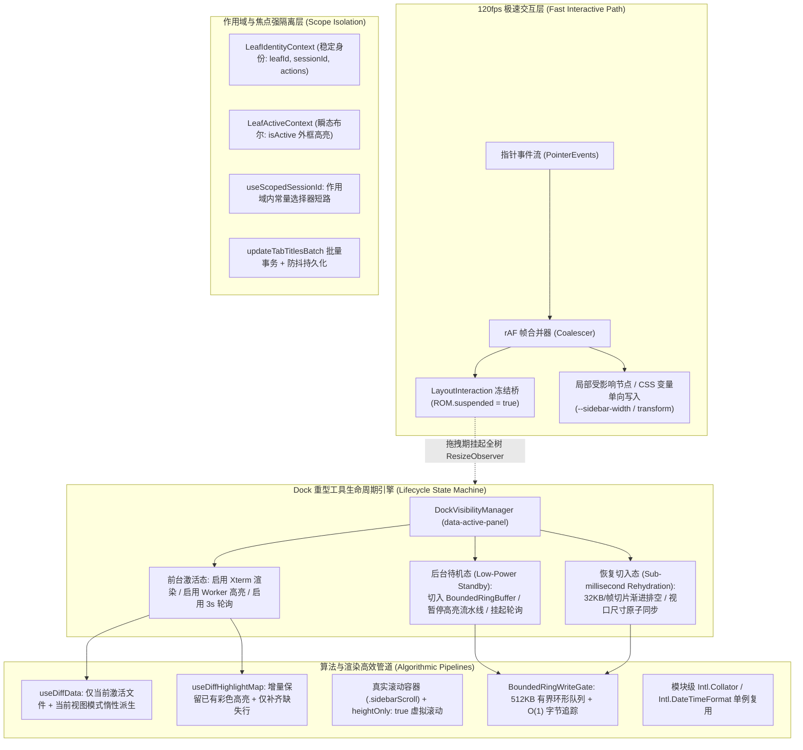
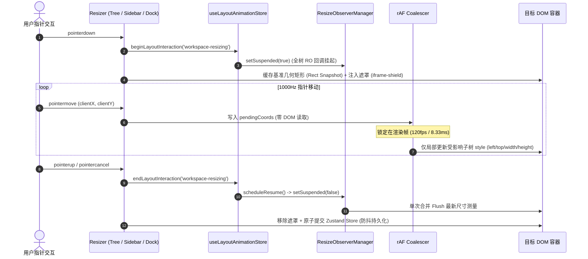
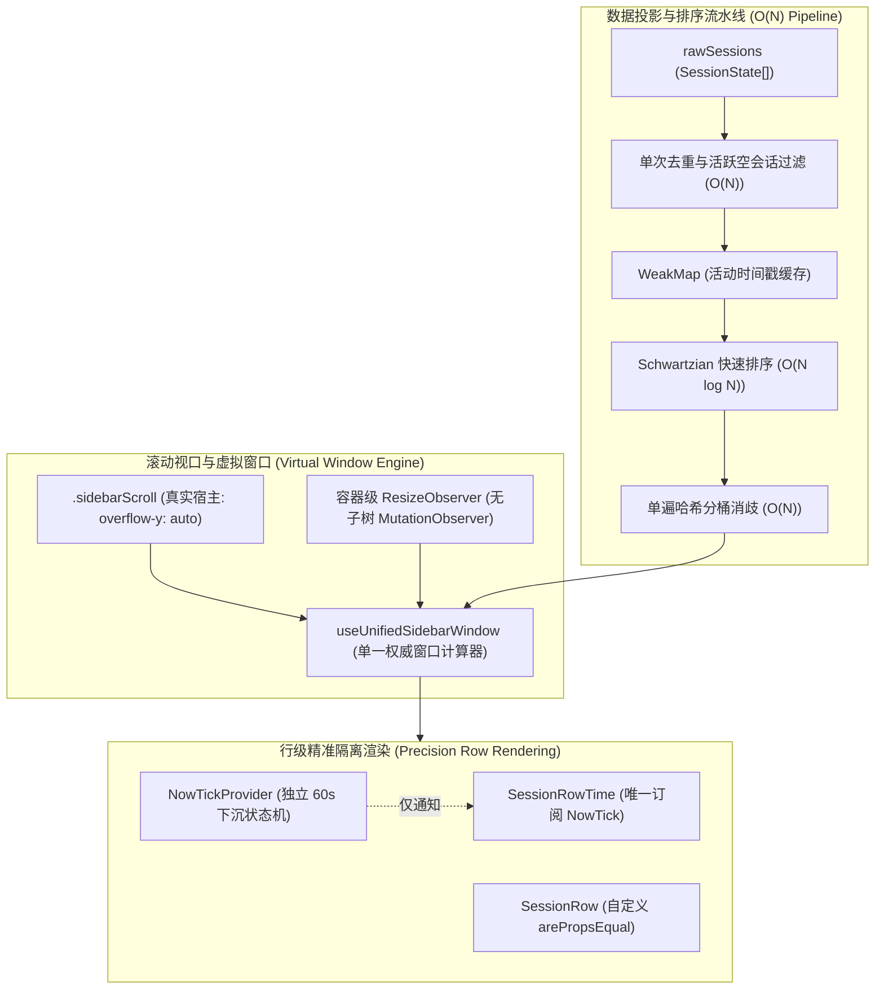
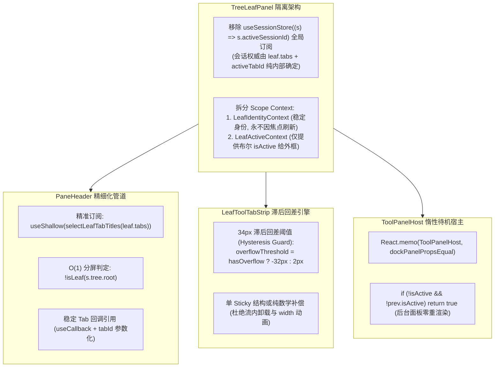
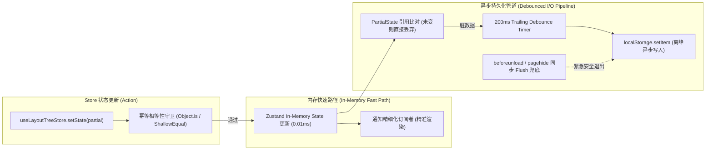
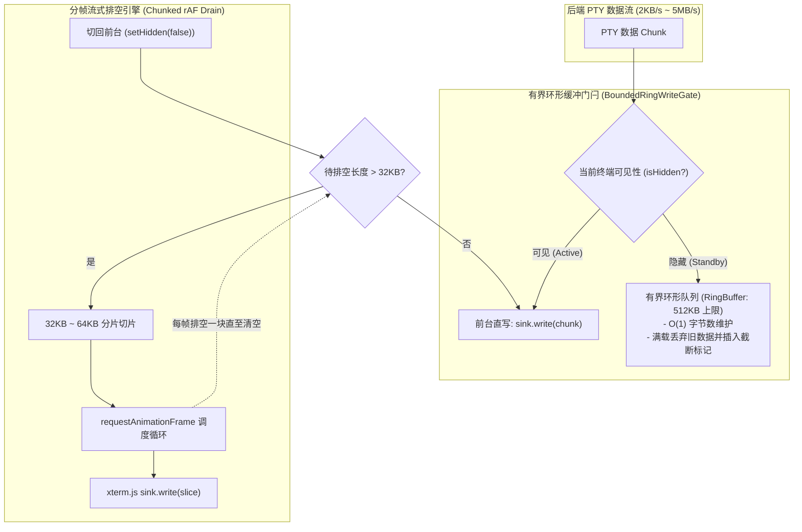
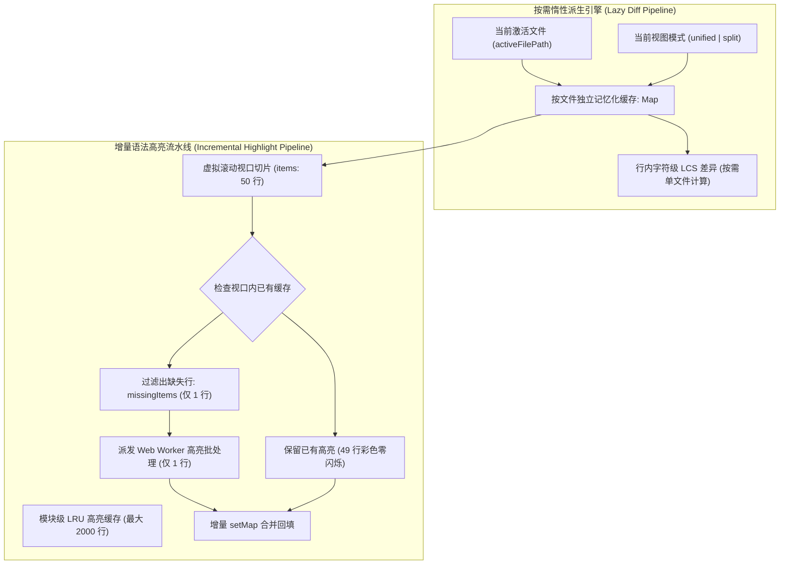
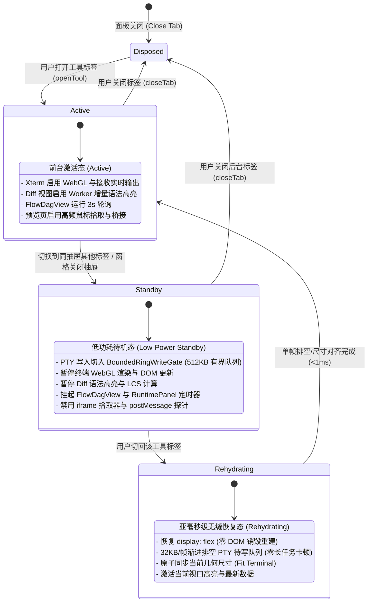

# Plan-06 — 分屏侧栏与重型工具视图交叉优化方案

> **方案编号**：PLAN-06（滑动窗口双 Agent 交叉出案波 — Part 06 + Part 07 联合规划）  
> **责任范围**：
>
> - **Part 06**：多窗格二叉树分屏布局、侧边栏、标签栏与面板切换（`audits/06-前端多窗格分屏布局与侧边栏面板性能审计.md`，22 项问题）
> - **Part 07**：重型工具视图（终端 Xterm、内置预览、大文件 Diff、文件树、编排运行态面板）（`audits/07-前端重型工具视图终端Diff与文件树性能审计.md`，22 项问题）
> - **核心突破点**：侧边栏虚拟化激活、分割线拖拽 120fps 冻结桥、二叉树状态扁平化、标签页溢出计算节流、焦点隔离；终端后台无界缓冲与切回卡死根治、Diff 双模式急切 LCS 优化与高亮退化闪烁修复、FlowDagView 记忆化与轮询治理；**重型工具视图在二叉树分屏 Dock 中的低功耗待机与亚毫秒级无缝恢复生命周期协同**。  
>   **编写准则**：严格遵循《三原则》、`00-DISCIPLINE.md` 反退避纪律与 `ANTI_OVERENGINEERING_GUARDRAILS.md` 反过度设计红线。全量 44 项问题同权覆盖，不打补丁、不绕过门禁，给出确凿的架构级收敛方案与文件级实施规范。

---

## 一、总纲与架构全景（Executive Summary & Full Topology）

### 1.1 总体使命与边界说明

本方案横切现代桌面 IDE 的两大核心性能高压区：

1. **多窗格分屏布局与侧边栏骨架（Layout & Shell）**：包括二叉树布局树（Binary Tree）、Flex/Grid 拖拽分割条（Resizer）、多会话侧边栏（Sidebar）、窗格顶栏（PaneHeader）与工具抽屉（LeafToolDock）。其瓶颈特征为**高频用户指针交互驱动的几何重排（Reflow）、`ResizeObserver` 回调风暴、以及全局状态变更（`activeSessionId` / `activeLeafId`）引起的无差别全树级联重渲染**。
2. **重型工具视图（Heavy Tool Views）**：包括底层 PTY/Xterm 终端（`TerminalCard`）、内置浏览器预览（`PreviewCard`）、大文件与流式 Diff 视图（`DiffCard` / `VirtualPlainCodeViewer`）、万级节点文件树（`FilesCard` / `FileTreeView`）、以及 DAG 任务编排图谱（`FlowDagView` / `RuntimePanel`）。其瓶颈特征为**高吞吐数据流（PTY 输出、Token 流式注入）、高复杂度算法（LCS/Myers Diff、语法高亮、DFS 成环探测）、无界内存驻留、以及后台静默消耗**。
3. **交叉核心域（The Cross-Cutting Domain）**：重型工具并非孤立存在，而是以标签页形态挂载于二叉树分屏窗格的右侧抽屉（`dock.openPanelIds`）中。**当分屏窗格失焦、侧边栏折叠、或用户在抽屉内切换 Tab 使重型工具进入后台 `display: none` 状态时，当前架构缺乏完备的生命周期控制，导致后台面板持续消费高频事件、不断向无界数组追加数据、并在切回前台时发生单帧长任务卡死**。

本方案旨在建立统一的**「分屏几何冻结桥 + 作用域焦点隔离 + 抽屉低功耗待机状态机 + 有界切片流式排空 + 按需惰性派生」**一体化架构，彻底根除 44 项性能暗病。

---

### 1.2 现状架构痛点与级联劣化拓扑

```mermaid
flowchart TD
    subgraph UserAction["用户高频交互 (120fps / 1000Hz)"]
        ResizeDrag["拖拽分屏/侧栏/抽屉分割线"]
        TabClick["点击切换窗格焦点/标签页"]
        ScrollDiff["虚拟滚动浏览 Diff / 文件树"]
        BgPty["后台持续产生构建输出 (PTY)"]
    end

    subgraph BrokenLayoutBridge["分屏与侧边栏断层 (Part 06)"]
        ROM_Broken["ResizeObserverManager 冻结桥全链路断连\n(isLayoutFrozen 恒为 false)"]
        TreeClone["useTreeResize 每帧 O(V) 克隆整树\n+ 全量 DOM 样式覆写"]
        GlobalSessionLeak["TreeLeafPanel / useScopedSessionId\n无条件订阅全局 activeSessionId"]
        SidebarDevirt["useSessionListWindow 绑错容器\n滚动自去虚拟化 + 全子树 MO 监听"]
        SyncStorage["persist 同步 JSON.stringify\n+ localStorage.setItem 阻塞主线程"]
    end

    subgraph BrokenHeavyTools["重型工具视图断层 (Part 07)"]
        PtyUnbounded["ptyWriteGate.pending: string[] 无界膨胀\n切回时 pending.join('') 单帧灌入卡死"]
        DiffEager["useDiffData 全 M 个文件急切算 LCS\n单文件展开触发全量重新双模式计算"]
        HlFlicker["useDiffHighlightMap 滚 1 行重置 escapeHtml\n49 行彩色高亮瞬退化纯文本 + 视口闪烁"]
        DagLoop["flowDagStore 全局单例互相覆盖\n成环图缺失记忆化 -> 最坏 O(2^V) 递归爆炸"]
        TimerLeak["RuntimePanel / OverviewCard\n空闲态 1Hz 无条件全会话消息克隆逆序扫描"]
    end

    subgraph CascadeEffect["系统级性能灾难"]
        Thrashing["Layout Thrashing: 读写交织强制回流"]
        Freeze["切回终端主线程假死 500ms~3000ms"]
        DropFrames["拖拽/滚动掉帧 (掉至 15~30fps)"]
        MemLeak["内存暴涨与新生代 GC 频繁停顿"]
    end

    ResizeDrag --> ROM_Broken
    ResizeDrag --> TreeClone
    ResizeDrag --> Thrashing

    TabClick --> GlobalSessionLeak
    TabClick --> SyncStorage
    TabClick --> PtyUnbounded

    ScrollDiff --> HlFlicker
    ScrollDiff --> DiffEager

    BgPty --> PtyUnbounded

    ROM_Broken --> Thrashing
    TreeClone --> DropFrames
    GlobalSessionLeak --> DropFrames
    SidebarDevirt --> DropFrames

    PtyUnbounded --> Freeze
    PtyUnbounded --> MemLeak
    DiffEager --> DropFrames
    HlFlicker --> DropFrames
    DagLoop --> Freeze
    TimerLeak --> DropFrames
```



---

### 1.3 目标架构愿景与高性能数据流转矩阵



---

### 1.4 44 项全量问题收敛映射与架构治理维度对齐表

| 审计维度                | 审计编号       | 涉及文件                                                                                    | 根因分类                   | 架构治理核心方案                                                                                 |
| :---------------------- | :------------- | :------------------------------------------------------------------------------------------ | :------------------------- | :----------------------------------------------------------------------------------------------- |
| **Part 06: 分屏拖拽**   | **PERF-06-01** | `layoutAnimationStore.ts`, `useTreeResize.ts`, `LeafDockResizer.tsx`, `useSidebarResize.ts` | 观察器解耦                 | 全 Resizer 接入 `beginLayoutInteraction`，拖拽期间整树 `ResizeObserverManager` 强制静默          |
| **Part 06: 分屏拖拽**   | **PERF-06-02** | `useSidebarResize.ts`, `Sidebar.module.css`                                                 | 交互掉帧                   | 坐标快照化 + `rAF` 帧合并 + CSS 变量下沉至 `.app-container` + iframe 指针遮罩                    |
| **Part 06: 分屏拖拽**   | **PERF-06-03** | `LeafDockResizer.tsx`                                                                       | 强制同步布局               | `onDown` 缓存 `bodyRect`，`onMove` 消除 `getBoundingClientRect` 读写交织，`rAF` 节流写入         |
| **Part 06: 分屏拖拽**   | **PERF-06-04** | `useTreeResize.ts`, `layoutTreeFlatten.ts`                                                  | 算法开销                   | `startResize` 预判受影响子树矩形，帧内仅局部更新受影响叶 DOM 样式，零全树克隆                    |
| **Part 06: 分屏拖拽**   | **PERF-06-05** | `Sidebar.tsx`, `Sidebar.module.css`                                                         | 动画重排                   | 折叠/展开动画挂载 `'sidebar-transition'` 冻结令牌，`.sidebarInner` 加 `contain: layout paint`    |
| **Part 06: 分屏拖拽**   | **PERF-06-06** | `useSessionListDrag.ts`, `sessionListDragShift.ts`                                          | 同步布局抖动               | 拖拽启动采集行几何内存快照，帧内纯数学二分计算落点，差量更新 `style.transform`                   |
| **Part 06: 分屏拖拽**   | **PERF-06-07** | `SessionTabDragContext.tsx`, `PaneHeader.tsx`                                               | 上下文穿透                 | 拆分 Context 剥离无消费者的 `isDragging`，窗格几何快照化，实现起止帧零 React 重渲染              |
| **Part 06: 侧栏列表**   | **PERF-06-08** | `Sidebar.tsx`, `SidebarSessionList.tsx`, `useSessionListWindow.ts`                          | 虚拟化自毁                 | `scrollParentRef` 改绑真实宿主 `.sidebarScroll`，彻底移除全子树属性 `MutationObserver`           |
| **Part 06: 侧栏列表**   | **PERF-06-09** | `ProjectsSection.tsx`, `PinnedSection.tsx`, `sessionListWindow.ts`                          | 虚拟化退避                 | 移除搜索模式虚拟化退避逻辑，大项目子列表与置顶列表接入共享视口虚拟化                             |
| **Part 06: 侧栏列表**   | **PERF-06-10** | `useSidebarSessionList.tsx`, `SessionRow.tsx`                                               | Memo 被击穿                | Props 拍平，传入布尔 `isActive`，稳定回调，下沉 `NowTickProvider`，自实现 `sessionRowPropsEqual` |
| **Part 06: 侧栏列表**   | **PERF-06-11** | `sessionTime.ts`, `SessionRow.tsx`, `useSessionSearch.ts`                                   | 排序扫描重                 | `WeakMap` 缓存 `sessionLastActivityMs`，Schwartzian 排序，模块级单例 `Intl.DateTimeFormat`       |
| **Part 06: 侧栏列表**   | **PERF-06-12** | `useSidebarSessionList.tsx`, `sessionListTitleHint.ts`                                      | 嵌套过滤 $O(N^2)$          | 重构为单遍 $O(N)$ 标题哈希分桶消歧算法，仅冲突桶内按摘要切分                                     |
| **Part 06: 侧栏列表**   | **PERF-06-13** | `App.tsx`, `Sidebar.tsx`, `sessionStore.ts`, `sessionSearch.ts`                             | 状态污染顶层               | `sessionSearchInput` 下沉至侧栏，预编译 Token，消息全文归一化 `WeakMap` 缓存，流式节流           |
| **Part 06: 侧栏列表**   | **PERF-06-14** | `useSidebarSessionList.tsx`, `sessionSidebarProjection.ts`                                  | 冗余去重与缓存失效         | 消除 4 次重复去重，将 `activeSessionId` 依赖窄化为派生原语 `activeEmptySessionId`                |
| **Part 06: 分屏面板**   | **PERF-06-15** | `TreeLeafPanel.tsx`, `LeafScopeContext.tsx`                                                 | 全局状态击穿               | 移除 `TreeLeafPanel` 顶层订阅，`useScopedSessionId` 在非空作用域传入常量选择器短路               |
| **Part 06: 分屏面板**   | **PERF-06-16** | `LeafScopeContext.tsx`                                                                      | 上下文耦合                 | 拆分为稳定身份 `LeafIdentityContext` 与轻量激活态 `LeafActiveContext`                            |
| **Part 06: 分屏面板**   | **PERF-06-17** | `PaneHeader.tsx`, `PaneTabItem.tsx`                                                         | 跨窗格连坐                 | 精准订阅本叶 `tabs` 对应会话标题，`!isLeaf(root)` 替代 `collectLeaves`，稳定化 Tab 回调          |
| **Part 06: 分屏面板**   | **PERF-06-18** | `LeafToolTabStrip.tsx`, `LeafToolTabStrip.module.css`                                       | 观察器震荡                 | 引入 34px 溢出判定滞后回差（Hysteresis）或 Sticky 单按钮，彻底切断 DOM 卸载正反馈                |
| **Part 06: 分屏面板**   | **PERF-06-19** | `SlotOutlet.tsx`, `ViewRegistry.ts`, `TreeLeafPanel.tsx`                                    | 重复订阅/多余渲染          | 稳定 `useSyncExternalStore` 引用，记忆化 `resolveView`，后台工具面板基于 Memo 短路               |
| **Part 06: 分屏面板**   | **PERF-06-20** | `BinaryTreeWorkspace.tsx`, `layoutTreeFlatten.ts`                                           | 递归重排                   | 自底向上单遍计算折叠态，提取稳定 `onFocusLeaf`，非几何更新阻断重新布局                           |
| **Part 06: 持久化**     | **PERF-06-21** | `layoutTreeStore.ts`, `layoutStore.ts`, `layout-core-actions.ts`                            | 同步阻塞 I/O               | 引用守卫 + 200ms 防抖持久化存储适配器，Action 增加幂等阻断，批量标题同步接口                     |
| **Part 06: 持久化**     | **PERF-06-22** | `workspaceShellStore.ts`, `treeSessionCommands.ts`, `treeSessionQuery.ts`                   | 状态双倍写入               | 消除 `treeActivateTab` 旧快照二次更新，拆分操作单步原子化，`WeakMap` 缓存 `readOwnedLeaf`        |
| **Part 07: 终端管线**   | **T-01**       | `components/workspace/ptyWriteGate.ts`                                                      | 内存无界与长任务           | 引入 `BoundedRingWriteGate`（512KB 上限）+ 32KB 分帧 `rAF` 流式排空，杜绝单帧卡死                |
| **Part 07: 终端管线**   | **T-02**       | `components/workspace/ptyWriteGate.ts`                                                      | 全子树观察器               | 消除 `subtree: true`，仅观察从宿主到窗格的有限祖先链，或接入 `IntersectionObserver`              |
| **Part 07: 终端管线**   | **T-03**       | `TerminalCard.tsx`, `useXtermTerminal.ts`, `ptyLifecycle.ts`                                | JSX 树跳变                 | 统一单/分屏同构 DOM 包装，原地复用终端与 WebGL 上下文，去重 `fit()` 与 `ptyResize` IPC           |
| **Part 07: 终端管线**   | **T-04**       | `useXtermTerminal.ts`                                                                       | 密集回流与重绘             | 单次获取 `getComputedStyle` 引用，模块级主题签名缓存，`rAF` 合并多源主题事件                     |
| **Part 07: 终端管线**   | **T-05**       | `api/ptySessionApi.ts`                                                                      | 密集编码分配               | 存储 `{ text, bytes }` 元组，游标式环形淘汰，基于码点判断的零分配 UTF-8 尾部截断                 |
| **Part 07: 终端管线**   | **T-06**       | `ModernTerminalToolCall.tsx`, `utils/parseAnsi.ts`                                          | 流式复杂度 $O(N^2)$        | 折叠态 $O(1)$ 头尾切片，跨行有状态 ANSI 状态机，展开态接入虚拟滚动与 `content-visibility`        |
| **Part 07: Diff 视图**  | **D-01**       | `useDiffData.ts`, `DiffCardFileList.tsx`                                                    | 急切全量计算               | 仅针对当前激活文件与激活视图模式惰性派生渲染项，单文件展开折叠块局部缓存隔离                     |
| **Part 07: Diff 视图**  | **D-02**       | `useDiffData.ts`, `diffPanelHelpers.ts`                                                     | 伪依赖击穿                 | Git 模式彻底切断对 `session.messages` 的订阅，`WeakMap` 缓存历史消息 Diff 提取                   |
| **Part 07: Diff 视图**  | **D-03**       | `codeHighlightBatch.ts`, `DiffCardUnifiedView.tsx`                                          | 滚动闪烁与退化             | 增量保留已有彩色高亮 Map，仅对视口新增未命中行发起异步 Worker 批处理                             |
| **Part 07: Diff 视图**  | **D-04**       | `DiffCardUnifiedView.tsx`, `DiffCardSplitView.tsx`                                          | 同步重度回退               | 移除渲染期同步 `highlightCode`，未命中时统一回退安全 `escapeHtml` 并在帧尾异步回填               |
| **Part 07: Diff 视图**  | **D-05**       | `DiffCardUnifiedView.tsx`, `DiffCardSplitView.tsx`                                          | 双层 DOM 叠加              | 废弃透明覆盖层，采用单树区间注入 `<mark>` 标签或原生 `CSS.highlights` 自定义高亮                 |
| **Part 07: Diff 视图**  | **D-06**       | `useDiffData.ts`, `DiffCodeViewer.tsx`                                                      | 逻辑缺陷与冗余             | 修复 Split 模式搜索过滤丢失 Bug，消除渲染期对 `computed` 的全量 `.filter()` 遍历                 |
| **Part 07: Diff 视图**  | **D-07**       | `VirtualPlainCodeViewer.tsx`, `codeHighlight.ts`                                            | 缓存门槛失配               | 将单行高亮缓存准入上限从 500 字符提升至 1500 字符（`HEAD_HIGHLIGHT_LEN`），提升命中率至 100%     |
| **Part 07: Diff 视图**  | **D-08**       | `WidgetDiff.tsx`, `DiffCardFileList.tsx`, `ModernCodeBlock.tsx`                             | 无虚拟化挂载               | `<widget-diff>` 共享行高亮并对长文本限高虚拟化；列表组件接入固定高虚拟滚动                       |
| **Part 07: 文件树**     | **F-01**       | `hooks/useFileNavigation.ts`                                                                | 排序耦合过滤               | 拆分 `unfilteredFlatTree`（构建）与 `flatTree`（过滤）两级 `useMemo`，共享 `Intl.Collator`       |
| **Part 07: 文件树**     | **F-02**       | `FileTreeView.tsx`, `custom-tags/FileTree.tsx`                                              | 查找守卫颠倒               | 前置 `isNewSelection` 守卫，启用 `heightOnly: true` 虚拟滚动，`<file-tree>` 引入虚拟化           |
| **Part 07: 文件树**     | **F-03**       | `FileBreadcrumb.tsx`, `FilesCard.tsx`, `FilePreview.tsx`                                    | 拖拽全树重排               | 分栏拖拽走 DOM Ref 直接更新 CSS 变量，CSV 预览 `useMemo` 缓存并限制首屏渲染，修复滚动绑定        |
| **Part 07: 编排与图谱** | **G-01**       | `flowDagStore.ts`, `FlowDagView.tsx`, `flowDagLayout.ts`                                    | 跨会话覆盖与成环爆炸       | 按 `sessionId` 分区分桶存储，三色标记 DFS 修复成环记忆化，终态停止 3s 轮询                       |
| **Part 07: 运行态**     | **R-01**       | `RuntimePanel.tsx`, `useRuntimePanelData.ts`                                                | 空闲 1Hz 空转              | 移除冗余 `now` state，按需启动定时器（仅活跃任务时运行），消除 `[...msgs].reverse()`             |
| **Part 07: 运行态**     | **R-02**       | `useOverviewState.ts`, `WorkspaceGitChangesView.tsx`                                        | 1Hz 击穿 Memo              | 门控定时器，补齐 `treeGitFiles` 的 `useMemo` 恢复 `OverviewChangesList` 屏障，大列表虚拟化       |
| **Part 07: 运行态**     | **R-03**       | `useEngineState.ts`, `api/engineStatus.ts`                                                  | 相等性守卫失效             | 为 `activeRuns` / `pendingApprovals` 增加引用归一化函数，空闲轮询阻断全局广播                    |
| **Part 07: 协同与预览** | **A-01**       | `AgentCard.tsx`, `useApprovalCountdown.ts`, `AgentTeamBoard.tsx`                            | 10Hz 轮询与全表订阅        | 细粒度选择器隔离流式 Token，倒计时改用 CSS 硬件加速过渡，预计算 `toolProgress`                   |
| **Part 07: 协同与预览** | **P-01**       | `PreviewCard.tsx`, `usePreviewNavigation.ts`, `previewBridgeScript.ts`                      | 销毁 iframe / 全子树序列化 | 提取布尔流式选择器，拾取器下沉并 `rAF` 节流，移除 `<iframe key={url}>`，浅层序列化               |

---

## 二、Part 06 深度方案：多窗格分屏布局与侧边栏性能重构

### 2.1 模块 A：三大 Resizer 120fps 极速响应与 `ResizeObserverManager` 冻结桥全链路接线

#### 现状断层分析

在高刷新率（120Hz/240Hz）与高回报率鼠标（1000Hz）环境下，用户拖拽二叉树分割线、侧边栏宽度或右侧工具抽屉时，当前系统存在三项毁灭性缺陷：

1. **冻结桥全链路断连（PERF-06-01）**：`layoutAnimationStore.ts` 的 `isLayoutFrozen` 状态机与 `ResizeObserverManager.getInstance().setSuspended(true)` 完全没有被三大 Resizer（`useTreeResize.ts`、`LeafDockResizer.tsx`、`useSidebarResize.ts`）调用。导致指针移动每一帧都在派发窗格级 `ResizeObserver` 回调，触发数十次强制回流。
2. **全树克隆与无差别 DOM 写入（PERF-06-04）**：`useTreeResize` 拖拽时，每帧调用 `resizeBranchTree` 深度克隆整棵树，并调用 `flattenTree` 为整棵树重新计算所有矩形，即便拖拽的只是右侧深层子分支，左侧所有静止窗格也会被重复执行 DOM `style` 覆写。
3. **读写交织导致 Layout Thrashing（PERF-06-02, PERF-06-03, PERF-06-06）**：`LeafDockResizer` 在 `onMove` 中连续两次读取 `getBoundingClientRect()` 并立即改写 `style.setProperty('--leaf-dock-width')`；`useSessionListDrag` 每帧执行全表 `querySelectorAll` 与 `getBoundingClientRect`；`SessionTabDragContext` 在拖拽起止帧触发整树 React 重渲染。

#### 架构重构方案



#### 精准改造规范与接口定义

1. **统一接入 `ResizeObserverManager` 冻结桥**：
   在 `apps/crish-desktop/src/hooks/useTreeResize.ts`、`apps/crish-desktop/src/components/binary-tree/LeafDockResizer.tsx`、`apps/crish-desktop/src/components/sidebar/useSidebarResize.ts` 中引入统一的生命周期包裹器：
   ```ts
   // 交互启动
   useLayoutAnimationStore
     .getState()
     .beginLayoutInteraction('workspace-resizing');
   document.body.classList.add('is-resizing');
   // 交互结束
   useLayoutAnimationStore
     .getState()
     .endLayoutInteraction('workspace-resizing');
   document.body.classList.remove('is-resizing');
   ```
2. **`useTreeResize` 局部受影响子树矩形增量更新**：
   在 `startResize(branchId)` 时，定位 `branchId` 对应的子树节点及其基准矩形 `branchBaseRect: Rect`，并仅收集该分支下属的 `affectedLeafIds: Set<string>` 与 `affectedBranchIds: Set<string>`。
   拖拽帧内不再调用 `resizeBranchTree` 克隆整树，而是直接计算局部子树几何：
   ```ts
   // apps/crish-desktop/src/hooks/useTreeResize.ts
   interface ResizeSessionContext {
     branchId: string;
     baseRect: Rect;
     direction: 'horizontal' | 'vertical';
     affectedLeaves: Array<{
       leafId: string;
       relativeWeight: number;
       el: HTMLElement;
     }>;
   }
   ```
   每一帧仅对 `affectedLeaves` 中的 DOM 元素写入 `style.width` / `style.height`，未受影响的窗格零 DOM 触碰。
3. **`LeafDockResizer` 与 `useSidebarResize` 坐标快照化与 `rAF` 节流**：
   - 在 `LeafDockResizer.tsx` 的 `onDown` 中一次性获取 `const cachedBodyRect = body.getBoundingClientRect()`。在 `onMove` 中直接复用 `cachedBodyRect.left` 与 `cachedBodyRect.width`，严禁在 `onMove` 中调用 `getBoundingClientRect()`。
   - 在 `useSidebarResize.ts` 中引入 `pendingXRef` 与 `rAF` 句柄，将 `--sidebar-width` 写入下沉至 `.app-container` 容器节点（而非 `:root`），并在拖拽启动时激活 `disableIframePointerEvents()` 遮罩。
4. **`Sidebar` 200ms 折叠动画冻结**：
   在 `Sidebar.tsx` 触发 `setSidebarCollapsed` 时同步调用 `beginLayoutInteraction('sidebar-transition')`，并在 `.sidebar` 的 `transitionend`（配合 220ms 兜底定时器）中调用 `endLayoutInteraction('sidebar-transition')`。为 `.sidebarInner` 设置 `width: var(--sidebar-width); contain: layout paint`，彻底隔离文字折行回流。
5. **`useSessionListDrag` 几何快照二分命中与零 Layout Thrashing**：
   在拖拽跨越 4px 阈值启动时，一次性采集可见行的原始未偏移几何快照 `cachedRowRects: Array<{ el: HTMLElement; id: string; top: number; height: number; midY: number }>`。在 `flushDragFrame` 中直接基于纯内存坐标进行二分查找判断落点，仅当目标插入位置发生改变时才执行 `style.transform` 的差量批量写入。
6. **`SessionTabDragContext` 动作/状态强解耦**：
   从 Context Value 中剥离无消费者的 `isDragging` React state，改用内部 ref 维护，并在 `document.body` 上切换 `.is-tab-dragging` 类名。拖拽启动时一次性快照所有 `[data-leaf-id]` 窗格矩形，拖拽起止帧实现**全分屏零 React 重渲染**。

---

### 2.2 模块 B：侧边栏大量会话列表全维度虚拟化、分桶消歧与检索优化

#### 现状断层分析

侧边栏在会话数量达到数百至数千条时发生严重的性能崩溃：

1. **虚拟化自毁机制（PERF-06-08）**：`useSessionListWindow` 将 `scrollParentRef` 错误绑定到了高度随内容无限撑开的 `.listScroll`（而非真正的 `overflow-y: auto` 滚动容器 `.sidebarScroll`）。首帧计算出占位高度后，第二帧 `clientHeight` 膨胀至数万像素，虚拟化自动关闭并将上千个 `SessionRow` 全量挂载至 DOM；同时全子树 `MutationObserver` 在每次 hover 或属性变动时触发强制回流。
2. **分区与搜索模式零虚拟化（PERF-06-09）**：`ProjectsSection`（大项目模式）与搜索模式（硬编码 `if (args.searching) return false`）完全无虚拟化，展开单项目瞬间挂载数千行。
3. **`SessionRow` Memo 彻底被击穿（PERF-06-10）**：`renderSessionItem` 每次渲染创建 3 个内联对象属性，`nowTick` 60s 定时器刷新、切换会话、重命名打字均引发全列表所有行无差别重渲染。
4. **高复杂度排序与嵌套消歧（PERF-06-11, PERF-06-12）**：`compareSessionsByActivity` 在排序循环内调用 `sessionLastActivityMs` 扫描全部历史消息与子代理（$O(N \log N \times M)$）；`buildSectionTitleHints` 存在 $O(N^2 \times M)$ 嵌套循环与正则切句。
5. **搜索输入状态顶层污染（PERF-06-13, PERF-06-14）**：`sessionSearchInput` 置于根组件 `<App>`，打字触发全应用重渲染；搜索态下流式 Token 击穿相等性门禁；存在 4 重冗余去重。

#### 架构重构方案



#### 精准改造规范与接口定义

1. **修正虚拟化滚动宿主绑定并废除子树 MutationObserver**：
   在 `Sidebar.tsx` 中为 `.sidebarScroll` 分配稳定 Ref `sidebarScrollRef`，并通过 `SidebarSessionList` 透传至 `useSessionListWindow`。在 `useSessionListWindow.ts` 中彻底删除 `MutationObserver` 监听代码，列表上方区块偏移量仅通过 `ResizeObserverManager.getInstance().observe(listEl, ...)` 进行响应式调整。
2. **搜索态与全分组统一切片虚拟化**：
   修改 `apps/crish-desktop/src/api/sessionListWindow.ts` 中的 `shouldWindowGeneralSessionList`，移除 `if (args.searching) return false` 限制；重构 `ProjectsSection.tsx`，当展开的项目下子会话数 `list.length > SESSION_LIST_WINDOW_THRESHOLD` 时，复用统一的窗口化切片算法，仅渲染视口范围内的会话行。
3. **`SessionRow` Props 拍平与 `sessionRowPropsEqual`**：
   重构 `SessionRow` 的入参结构，将内联嵌套对象拍平为原始类型与稳定函数引用：
   ```ts
   // apps/crish-desktop/src/components/sidebar/session-list/SessionRow.tsx
   export interface FlatSessionRowProps {
     session: SessionState;
     isActive: boolean;
     titleDisambiguation?: string;
     openOrderRank?: number;
     isRenaming: boolean;
     renameDraft: string;
     actions: SessionRowActions; // 模块级稳定包装器
   }

   export function sessionRowPropsEqual(
     prev: FlatSessionRowProps,
     next: FlatSessionRowProps
   ): boolean {
     if (prev.session !== next.session) return false;
     if (prev.isActive !== next.isActive) return false;
     if (prev.titleDisambiguation !== next.titleDisambiguation) return false;
     if (prev.openOrderRank !== next.openOrderRank) return false;
     if (prev.isRenaming !== next.isRenaming) return false;
     if (next.isRenaming && prev.renameDraft !== next.renameDraft) return false;
     return true;
   }
   export const SessionRow = React.memo(
     SessionRowComponent,
     sessionRowPropsEqual
   );
   ```
4. **`NowTickProvider` 状态物理下沉**：
   将 `nowTick` 的 `useState` 与 `setInterval` 从 `useSidebarSessionList.tsx` 彻底移除，封装为独立的 `<NowTickProvider>` 置于列表外层。只有 `<SessionRowTime>` 通过 `useContext(NowTickContext)` 获取 `nowTick`，使 60s 刷新时全列表所有 `SessionRow` 零重渲染。
5. **`WeakMap` 时间戳缓存与单遍分桶消歧**：
   - 在 `sessionTime.ts` 中声明 `const SESSION_ACTIVITY_CACHE = new WeakMap<SessionTimeCarrier, number>();`，获取活动时间戳时若命中缓存直接返回，单次耗时降至 $O(1)$；使用模块级 `const ZH_CN_FORMATTER = new Intl.DateTimeFormat('zh-CN', { hour12: false })` 单例替代每次 `toLocaleString`。
   - 重构 `buildSectionTitleHints` 为 $O(N)$ 哈希分桶：
   ```ts
   // apps/crish-desktop/src/api/sessionListTitleHint.ts
   export function buildSectionTitleHints(
     peers: SessionState[]
   ): Map<string, string> {
     const titleBuckets = new Map<string, SessionState[]>();
     for (const s of peers) {
       const title = sessionListDisplayTitle(s);
       let bucket = titleBuckets.get(title);
       if (!bucket) {
         bucket = [];
         titleBuckets.set(title, bucket);
       }
       bucket.push(s);
     }
     const result = new Map<string, string>();
     for (const [, bucket] of titleBuckets) {
       if (bucket.length < 2) continue;
       disambiguateBucket(bucket, result); // 仅在冲突桶内单次切句
     }
     return result;
   }
   ```
6. **搜索输入状态下沉与预编译 Token**：
   将 `sessionSearchInput` 状态从 `App.tsx` 移入 `Sidebar.tsx`（或独立的 `sidebarSearchStore`），打字时不触发 `<App>` 和 `<BinaryTreeWorkspace>` 重渲染。搜索时在循环外完成 `tokenizeSearchQuery(query)`，并以 `WeakMap<SessionMessage, string>` 缓存已归一化文本。
7. **去重管道合并与 `activeEmptySessionId` 缓存保活**：
   合并 `useSidebarSessionList.tsx` 中 4 次重复的 `dedupeSessionsById` 为单次。将 `partitionSidebarSessions` 对 `activeSessionId` 的依赖替换为派生布尔原语 `activeEmptySessionId = isSessionEmpty(sessionsById[activeSessionId]) ? activeSessionId : null`，在切换已有非空会话时实现 100% 缓存命中。

---

### 2.3 模块 C：二叉树窗格焦点隔离、标签测量与视图槽位优化

#### 现状断层分析

1. **全局状态无条件订阅穿透全窗格（PERF-06-15）**：`TreeLeafPanel.tsx:68` 直接调用 `useSessionStore((s) => s.activeSessionId)`，导致分屏切换焦点时，所有窗格及窗格内 30+ 业务子组件全部强制重渲染。
2. **Context Value 耦合瞬态激活态（PERF-06-16）**：`LeafScopeContext` 将 `isActive` 与稳定的 `leafId, sessionId, panelId, openTool` 打包在同一 Context，导致焦点转移时两窗格内所有组件重渲染。
3. **顶栏高频连坐重绘（PERF-06-17）**：`PaneHeader` 订阅全量 `sessionsById`，任意会话收到流式 Token 都会导致全分屏所有 `PaneHeader` 同步重渲染；选择器内执行整树 `collectLeaves`；内联回调击穿 `PaneTabItem` 的 Memo。
4. **标签栏溢出测量死循环震荡（PERF-06-18）**：`LeafToolTabStrip` 在溢出时将流内 `+` 按钮卸载并启动流外按钮 200ms `width` 动画，导致 `el.scrollWidth` 骤降，触发 `ResizeObserver` 在 `hasOverflow: true/false` 间高频震荡。
5. **后台隐藏工具面板全量重渲染（PERF-06-19）**：`SlotOutlet` 传内联 `subscribe`，`resolveView` 每次新建参数对象，抽屉内所有 `display: 'none'` 的隐藏面板随主面板无差别重渲染。
6. **全树递归扁平化冗余（PERF-06-20）**：`BinaryTreeWorkspace` 在非几何更新时重新运行 `flattenTree`，`isCollapsedSubtree` 自顶向下重复遍历。

#### 架构重构方案



#### 精准改造规范与接口定义

1. **彻底移除 `TreeLeafPanel` 全局订阅并优化 `useScopedSessionId`**：
   - 删除 `TreeLeafPanel.tsx:68` 的 `const globalActiveSessionId = useSessionStore((s) => s.activeSessionId);`。叶节点绑定的会话 ID 严格由本叶状态决定（SSOT）。
   - 重构 `LeafScopeContext.tsx` 中的 `useScopedSessionId`：
   ```ts
   // apps/crish-desktop/src/contexts/LeafScopeContext.tsx
   export function useScopedSessionId(
     explicitSessionId?: string | null
   ): string {
     const identity = useContext(LeafIdentityContext);
     const resolved =
       explicitSessionId !== undefined &&
       explicitSessionId !== null &&
       explicitSessionId !== ''
         ? explicitSessionId
         : identity?.sessionId || null;

     // 核心优化：当处于有效作用域时，传入常量空字符串选择器，彻底阻断 Zustand 对全局 activeSessionId 的高频广播
     const globalId = useSessionStore((s) =>
       resolved !== null ? '' : s.activeSessionId
     );
     return resolved ?? globalId;
   }
   ```
2. **拆分 `LeafIdentityContext` 与 `LeafActiveContext`**：
   将原 `LeafScopeContext` 拆分为：
   - `LeafIdentityContext`: 包含 `{ leafId, sessionId, panelId, leafRootRef, openTool, queryWithinLeaf }`（在窗格生命周期内保持稳定引用）；
   - `LeafActiveContext`: 仅包含 `boolean` 类型的 `isActive`。窗格内仅负责边框高亮或焦点样式的组件才订阅 `LeafActiveContext`，终端、聊天内容、工具抽屉仅订阅 `LeafIdentityContext`，焦点转移时子树**零重渲染**。
3. **`PaneHeader` 精细化选择器与 $O(1)$ 分屏判定**：
   - 替换 `sessionsById` 全表订阅：
   ```ts
   // apps/crish-desktop/src/components/binary-tree/PaneHeader.tsx
   const tabTitles = useSessionStore(
     useShallow((s) =>
       leaf.tabs.map((t) => s.sessionsById[t.sessionId]?.title || '')
     )
   );
   // 替换整树遍历 collectLeaves
   const canCloseSplit = useLayoutTreeStore((s) => !isLeaf(s.tree.root));
   ```
   - 稳定化 `PaneTabItem` 回调：将回调声明为接收 `(tab: SessionTab, e: React.MouseEvent)` 参数的顶层 `useCallback`，消除循环中的内联箭头函数。
4. **`LeafToolTabStrip` 引入 34px 溢出滞后回差（Hysteresis）**：
   消除双按钮条件挂载与 `width: 200ms` 过渡。在测量函数中引入滞后回差防抖判定：
   ```ts
   // apps/crish-desktop/src/components/binary-tree/LeafToolTabStrip.tsx
   const checkOverflow = useCallback(() => {
     const el = tabsTrackRef.current;
     if (!el) return;
     // 当已处于 overflow 态时，需容器扩展出额外 34px（单个按钮宽度）才允许解除，杜绝临界震荡
     const delta = el.scrollWidth - el.clientWidth;
     setHasOverflow((prev) => (prev ? delta > -32 : delta > 2));
   }, []);
   ```
   并将 `ResizeObserver` 纳入 `ResizeObserverManager` 统一管理。
5. **记忆化 `resolveView` 与 `ToolPanelHost` 后台短路**：
   - 在 `ViewRegistry.ts` 中维护 `resolvedCache: Map<string, ResolvedView>`，相同 `rawId` 在版本未变时返回恒定对象引用；绑定静态方法 `viewRegistry.subscribe` 消除 `useSyncExternalStore` 重复重订。
   - 抽象 `ToolPanelHost` 组件，实现自定义比较函数：
   ```ts
   // apps/crish-desktop/src/components/binary-tree/ToolPanelHost.tsx
   export const ToolPanelHost = React.memo(
     ToolPanelHostComponent,
     (prev, next) => {
       // 当面板在前后两帧均处于后台隐藏态（isActive === false）且上下文未变时，强制跳过渲染
       if (
         !prev.isActive &&
         !next.isActive &&
         prev.pid === next.pid &&
         prev.sessionId === next.sessionId
       ) {
         return true;
       }
       return (
         prev.isActive === next.isActive &&
         prev.pid === next.pid &&
         prev.sessionId === next.sessionId
       );
     }
   );
   ```
6. **`BinaryTreeWorkspace` 自底向上折叠单遍计算**：
   在 `layoutTreeFlatten.ts` 中将 `flattenRecursive` 改为自底向上返回 `{ rect, isCollapsed, nodes }` 元组，消除递归重复的 `isCollapsedSubtree` 扫描；将 `onFocusLeaf` 改造为通过 `data-leaf-id` 事件委托捕获或稳定参数传递。

---

### 2.4 模块 D：持久化防抖、状态事务原子化与多 Store 级联净化

#### 现状断层分析

1. **同步阻塞写盘（PERF-06-21）**：`useLayoutTreeStore` 与 `useLayoutStore` 每次调用 `set` 时，Zustand `persist` 中间件都会同步执行 `JSON.stringify` 与 `localStorage.setItem`。在切换焦点、标签点击、拖拽瞬态更新以及批量更新标签标题时，高频发生主线程 I/O 阻塞。
2. **跨 Store 级联陈旧更新与先插后拆（PERF-06-22）**：`treeActivateTab` 在旧快照上二次触发 `setActiveLeaf`；带 `split` 打开新会话时先插入旧叶再拆分到新分支，产生双倍写树、双倍历史栈记录与双倍同步写盘；`readOwnedLeaf` 每次查询重复克隆 4 层数组。

#### 架构重构方案



#### 精准改造规范与接口定义

1. **实现带引用守卫与防抖合并的 `DebouncedStateStorage`**：
   在 `apps/crish-desktop/src/store/layout-tree/layoutTreeStore.ts` 中实现自定义持久化存储引擎：
   ```ts
   // apps/crish-desktop/src/store/layout-tree/debouncedStorage.ts
   export function createDebouncedStateStorage(delayMs = 200): StateStorage {
     let pendingKey: string | null = null;
     let pendingValue: string | null = null;
     let timer: number | null = null;

     const flush = () => {
       if (pendingKey && pendingValue !== null) {
         try {
           localStorage.setItem(pendingKey, pendingValue);
         } catch (e) {
           console.error('[DebouncedStorage] write error:', e);
         }
         pendingKey = null;
         pendingValue = null;
       }
       if (timer) {
         clearTimeout(timer);
         timer = null;
       }
     };

     if (typeof window !== 'undefined') {
       window.addEventListener('beforeunload', flush);
       window.addEventListener('pagehide', flush);
     }

     return {
       getItem: (name) => localStorage.getItem(name),
       setItem: (name, value) => {
         pendingKey = name;
         pendingValue = value;
         if (timer) clearTimeout(timer);
         timer = window.setTimeout(flush, delayMs);
       },
       removeItem: (name) => {
         if (pendingKey === name) {
           pendingKey = null;
           pendingValue = null;
         }
         localStorage.removeItem(name);
       },
     };
   }
   ```
2. **`layout-core-actions` 幂等短路守卫与批量标题事务**：
   - 在 `setChatMainSurface`、`setSidebarCollapsed` 等入口处增加相等性阻断：`if (get().chatMainSurface === surface) return;`。
   - 在 `layoutTreeStore` 中增加原子批量更新接口 `updateTabTitlesBatch(patches: Record<string, string>)`，一次遍历更新树上所有匹配的 Tab 标题，仅触发一次状态更新与单次持久化防抖。
3. **消除陈旧快照二次激活与原子切分会话**：
   - 在 `treeSessionCommands.ts:111-121` 中删除 `if (st.activeLeafId !== leafId) st.setActiveLeaf(leafId)` 冗余逻辑。
   - 在 `workspaceShellStore.ts` 中，当带 `opts.split` 打开会话时，直接委托单步切分原子事务 `splitSessionFromSidebarOp`，消除「先插后拆」的二次写树与历史栈污染。
   - 在 `treeSessionQuery.ts` 中使用 `WeakMap<LayoutLeaf, OwnedChatLeaf>` 记忆化 `readOwnedLeaf` 查询结果。

---

## 三、Part 07 深度方案：重型工具视图（终端、Diff、文件树与编排）性能重构

### 3.1 模块 E：终端与 PTY 数据流管线根治

#### 现状断层分析

1. **后台无界缓冲与切回单帧假死（T-01）**：`ptyWriteGate.ts` 在终端隐藏时使用 `pending.push(data)` 无界积压数据。后台大型构建输出 50MB 日志后，切回前台时执行 `pending.join('')` 分配 50MB 连续字符串并单次同步塞入 `term.write`，导致主线程瞬间假死数秒。
2. **全子树高频样式监听与强制回流（T-02）**：`observeTerminalHostVisibility` 在父级容器挂载 `subtree: true` 监听 `'style'` 与 `'class'`，终端自身光标闪烁或兄弟面板样式变动触发高频回流。
3. **分屏切换导致终端实例销毁重建（T-03）**：`TerminalCard.tsx` 在 `isSplit` 切换时改变 JSX 父级容器层级，导致主终端实例与 WebGL 上下文销毁，重新灌入 256KB 历史，并产生 4 次冗余 `ptyResize` IPC 风暴。
4. **密集 CSS 变量读取与重复重绘（T-04）**：监听 `<html style>` 变动，每次触发 20 个变量最多 5 层的 `getComputedStyle` 递归读取与全屏 `term.refresh`。
5. **PTY 历史记录密集编码与逐字符截断（T-05）**：`recordPtyOutputHistory` 每次用 `TextEncoder.encode` 分配 `Uint8Array` 测长；淘汰时使用 $O(K)$ 的 `shift()`；截断时逐字符调用 `encode`，最坏分配 26 万个对象引爆 GC。
6. **工具卡 ANSI 流式 $O(N^2)$ 解析与展开无虚拟化（T-06）**：`ModernTerminalToolCall` 流式每帧全量正则替换与 `.split('\n')`，渲染期裸调 `parseAnsi`，展开态上千行无虚拟化挂载。

#### 架构重构方案



#### 精准改造规范与接口定义

1. **实现有界环形缓冲门闩 `BoundedRingWriteGate` 与 32KB 分帧排空**：
   彻底重构 `apps/crish-desktop/src/components/workspace/ptyWriteGate.ts`：
   ```ts
   // apps/crish-desktop/src/components/workspace/ptyWriteGate.ts
   export const PTY_GATE_MAX_CHARS = 512 * 1024; // 512KB 上限（对齐 scrollback）
   export const PTY_DRAIN_CHUNK_SIZE = 32 * 1024; // 每帧最大排空 32KB

   export class BoundedRingWriteGate implements PtyWriteGate {
     private hidden: boolean;
     private queue: string[] = [];
     private headIdx = 0;
     private totalChars = 0;
     private drainRafId: number | null = null;

     constructor(
       private readonly sink: TerminalWriteTarget,
       startHidden = false
     ) {
       this.hidden = startHidden;
     }

     setHidden(next: boolean): void {
       if (this.hidden && !next) {
         this.startDrain();
       } else if (!this.hidden && next) {
         this.cancelDrain();
       }
       this.hidden = next;
     }

     write(data: string): void {
       if (!data) return;
       if (!this.hidden) {
         try {
           this.sink.write(data);
         } catch {
           /* ignore */
         }
         return;
       }
       // 写入环形队列
       this.queue.push(data);
       this.totalChars += data.length;
       // 有界淘汰：超额时从头部弹出旧数据，维持总字符数在上限以内
       while (
         this.totalChars > PTY_GATE_MAX_CHARS &&
         this.headIdx < this.queue.length
       ) {
         const popped = this.queue[this.headIdx++];
         this.totalChars -= popped.length;
       }
       // 周期性紧缩数组防泄漏
       if (this.headIdx > 1000 && this.headIdx > this.queue.length >> 1) {
         this.queue = this.queue.slice(this.headIdx);
         this.headIdx = 0;
       }
     }

     private startDrain(): void {
       this.cancelDrain();
       const drainStep = () => {
         if (this.hidden || this.headIdx >= this.queue.length) {
           this.reset();
           this.drainRafId = null;
           return;
         }
         let budget = PTY_DRAIN_CHUNK_SIZE;
         let batch = '';
         while (this.headIdx < this.queue.length && budget > 0) {
           const chunk = this.queue[this.headIdx];
           if (chunk.length <= budget) {
             batch += chunk;
             budget -= chunk.length;
             this.headIdx++;
           } else {
             batch += chunk.slice(0, budget);
             this.queue[this.headIdx] = chunk.slice(budget);
             budget = 0;
           }
         }
         try {
           this.sink.write(batch);
         } catch {
           /* ignore */
         }
         if (this.headIdx < this.queue.length) {
           this.drainRafId = requestAnimationFrame(drainStep);
         } else {
           this.reset();
           this.drainRafId = null;
         }
       };
       this.drainRafId = requestAnimationFrame(drainStep);
     }

     private cancelDrain(): void {
       if (this.drainRafId !== null) {
         cancelAnimationFrame(this.drainRafId);
         this.drainRafId = null;
       }
     }

     reset(): void {
       this.cancelDrain();
       this.queue = [];
       this.headIdx = 0;
       this.totalChars = 0;
     }
     // ...其他 probe 接口
   }
   ```
2. **收敛 `observeTerminalHostVisibility` 观察范围**：
   删除 `subtree: true` 全子树监听。仅收集从终端宿主到窗格容器的有限祖先元素链（通常仅 3–5 个元素），对每个祖先单独调用 `mo.observe(ancestor, { attributes: true, attributeFilter: ['data-active-panel', 'aria-hidden', 'style', 'class'], subtree: false })`，并在可能的情况下使用 `IntersectionObserver` 替代同步 `offsetParent` 查询。
3. **`TerminalCard` 单/分屏同构 DOM 包装与 IPC 去重**：
   - 保持外层结构始终为 `<div className={styles.splitContainer}>`，主终端始终挂载在 `<div className={styles.splitPane} key="pane-1">` 下，单屏模式下仅通过 CSS 类名折叠副屏，杜绝 JSX 层级变动导致的主终端卸载重建与 WebGL 上下文销毁。
   - 在 `ptyLifecycle.ts` 中维护 `lastSentPtySize = { cols: 0, rows: 0 }`，仅在实际行列尺寸改变时才向后端发送 `ptyResize` IPC。
4. **单次 `CSSStyleDeclaration` 与主题快照缓存**：
   重构 `useXtermTerminal.ts` 的 `getXtermTheme()`，在函数入口仅调用一次 `const rootStyle = getComputedStyle(document.documentElement)` 并透传给后续变量读取；以 `rAF` 统一合并主题变动事件。
5. **PTY 历史存储元组化与零分配 UTF-8 截断**：
   在 `ptySessionApi.ts` 中将存储结构升级为 `chunks: Array<{ text: string; bytes: number }>`，入队时直接维护 `totalBytes`。截断时使用码点码值计算：
   `code <= 0x7F ? 1 : code <= 0x7FF ? 2 : code >= 0xD800 && code <= 0xDFFF ? 2 : 3`，彻底删除 `Array.from(input)` 与 26 万次 `TextEncoder.encode` 分配。
6. **`ModernTerminalToolCall` 折叠态 $O(1)$ 头尾切片与跨行 ANSI 解析**：
   在折叠态时直接通过 `indexOf('\n')` 截取前 15 行，通过 `lastIndexOf('\n')` 截取后 15 行，严禁执行全量 `.split('\n')`；展开态超过 100 行时开启固定高度虚拟列表或 `content-visibility: auto`。

---

### 3.2 模块 F：大文件 Diff 视图、代码高亮与文本查看器优化

#### 现状断层分析

1. **急切双模式全文件 LCS 计算（D-01）**：`useDiffData` 对文件列表中全部 $M$ 个文件急切计算 `computedChangesByFile`、`unifiedRenderCache`（含行内字符级 Diff）与 `splitRenderCache`。即便只展示 1 个文件，也对所有文件付出了 $O(\sum L_i)$ 的内存与 CPU，单文件展开折叠块触发全量文件重算。
2. **Git 模式伪依赖击穿（D-02）**：`useDiffData` 订阅 `session.messages`，流式对话每个 Token 触发全历史消息扫描与 Diff 提取，导致 Git 模式下的 Diff 渲染缓存被每帧无差别击穿。
3. **滚动高亮退化闪烁严重缺陷（D-03）**：`useDiffHighlightMap` 在虚拟滚动窗口移动 1 行时，先用纯文本 `escapeHtml` 覆盖整张 Map，导致视口内原本已高亮的 49 行瞬间闪退为纯文本，并向 Worker 发起全量重复计算。
4. **主线程同步高亮回退卡顿与安全漏洞（D-04）**：`renderTokens` 在首帧回退调用裸 `highlightCode`，绕过 4000 字符安全限制，长行存在 ReDoS 冻结风险。
5. **Diff 行双层 DOM 重叠（D-05）**：绝对定位透明 Token 层与相对定位语法高亮层重叠，DOM 节点数翻倍。
6. **Split 搜索过滤失效 Bug 与渲染期 `.filter()`（D-06）**：`getSplitItems` 在搜索态未过滤行反而展开全部折叠块。
7. **缓存阈值失配（D-07）**：`highlightCache` 拒绝缓存 $>500$ 字符的行，导致 501–4000 字符中等长行滚动时缓存命中率 0%。
8. **内嵌组件无虚拟化（D-08）**：`<widget-diff>`、`ModernCodeBlock`、`DiffCardFileList` 无虚拟化挂载数千节点。

#### 架构重构方案



#### 精准改造规范与接口定义

1. **`useDiffData` 激活文件与视图模式惰性派生**：
   重构 `apps/crish-desktop/src/components/diff/useDiffData.ts`：
   - 移除全量 `computedChangesByFile` 与全量 `unifiedRenderCache` / `splitRenderCache` 的 `useMemo`。
   - 建立单文件局部缓存：`const fileRenderCacheRef = useRef<Map<string, PerFileCache>>(new Map());`。
   - 仅对 `currentFile?.filePath`，结合当前 `viewMode`（`unified` 或 `split`）、当前 `searchQuery` 与该文件专有的 `expandedBlocks[filePath]`，按需派生渲染项，未选中文件零计算、零内存驻留。
2. **切断 Git 模式伪依赖并 `WeakMap` 缓存**：
   在 `useDiffData` 中，当 `sourceMode === 'git'` 时，`aiTurns` 直接返回常量空数组 `EMPTY_TURNS`，`getFileDiffData` 的依赖数组剥离 `aiTurns` 与 `mergedSessionFiles`；以 `WeakMap<SessionMessage, FileDiff[]>` 缓存已完成消息的 Diff 提取结果。
3. **修复 `useDiffHighlightMap` 滚动闪烁与增量合并**：
   彻底重写 `apps/crish-desktop/src/api/codeHighlightBatch.ts` 中的 `useDiffHighlightMap`：
   ```ts
   // apps/crish-desktop/src/api/codeHighlightBatch.ts
   export function useDiffHighlightMap(
     items: readonly HighlightBatchItem[]
   ): ReadonlyMap<string, string> {
     const [map, setMap] = useState<ReadonlyMap<string, string>>(
       () => new Map()
     );
     const prevItemsRef = useRef<readonly HighlightBatchItem[]>([]);

     useEffect(() => {
       if (items.length === 0) {
         setMap((prev) => (prev.size === 0 ? prev : new Map()));
         return;
       }
       let cancelled = false;

       // 1. 增量筛选：对照当前已高亮 map，保留所有已存在的行，找出真正缺失的行
       setMap((currentMap) => {
         const nextMap = new Map<string, string>();
         const missing: HighlightBatchItem[] = [];

         for (const item of items) {
           const existing = currentMap.get(item.id);
           if (existing !== undefined) {
             nextMap.set(item.id, existing); // 关键：绝对不抹除为 escapeHtml，保持彩色！
           } else {
             nextMap.set(item.id, escapeHtml(item.code)); // 仅缺失行填入转义占位
             missing.push(item);
           }
         }

         // 2. 仅对真正缺失的行发起异步 Worker 批处理
         if (missing.length > 0) {
           void highlightBatchAsync(missing).then((res) => {
             if (cancelled) return;
             setMap((latestMap) => {
               const merged = new Map(latestMap);
               for (const [id, html] of res) {
                 merged.set(id, html);
               }
               // LRU 限制防内存泄漏
               if (merged.size > 2000) {
                 const keys = Array.from(merged.keys()).slice(
                   0,
                   merged.size - 1500
                 );
                 for (const k of keys) merged.delete(k);
               }
               return merged;
             });
           });
         }
         return nextMap;
       });

       return () => {
         cancelled = true;
       };
     }, [items]);

     return map;
   }
   ```
4. **移除 `renderTokens` 同步高亮回退**：
   将 `DiffCardUnifiedView.tsx:32` 与 `DiffCardSplitView.tsx:35` 的回退逻辑由 `highlightCode(fallbackText, lang)` 改为安全纯文本 `escapeHtml(fallbackText)`，静待 `useDiffHighlightMap` 异步填充，杜绝首帧主线程长任务阻塞与 ReDoS 风险。
5. **消除 Diff 行双层 DOM 重叠**：
   重构 `renderTokens`，废弃绝对定位透明覆盖层。采用单文本节点行内切片注入 `<mark class="diff-token-add/del">` 标签（或原生 `CSS.highlights`），单树单次布局完成渲染。
6. **修复 Split 搜索过滤 Bug 并统一缓存阈值**：
   - 在 `getSplitItems` 中补齐 `pairs.filter(...)` 搜索词匹配。
   - 在 `codeHighlight.ts:152` 中将 `highlightCache` 准入阈值由 500 字符提升至 `HEAD_HIGHLIGHT_LEN = 1500` 字符，消除 501–4000 字符行在虚拟滚动时的 0% 命中率穿透。
7. **内嵌组件虚拟化收敛**：
   在 `WidgetDiff.tsx` 中仅对 `parsedLines` 生成一份高亮索引 `L:${idx}`，供 Unified 和 Split 共享；在 `ModernCodeBlock.tsx` 中用单个换行文本或 CSS 计数器替代数千个行号 `<div>`；对 `DiffCardFileList.tsx` 接入 `content-visibility: auto; contain-intrinsic-size: auto 36px`。

---

### 3.3 模块 G：文件树、面包屑与文件查看器重构

#### 现状断层分析

1. **树遍历与过滤耦合（F-01）**：`useFileNavigation` 的 `flatTree` 将搜索过滤混入树遍历，每次搜索按键重新执行整树 `walk` 并调用未经优化的 `localeCompare` 重排全部目录。
2. **守卫颠倒与虚拟滚动开销（F-02）**：`FileTreeView` 每次展开目录或搜索时，先执行全树 $O(N)$ 路径比对查找，算完才检查 `isNewSelection`；固定行高列表未启用 `heightOnly: true`，冗余分配 `ids` 并注册 `measureRef`。
3. **分栏拖拽全树重排与 CSV 无虚拟化（F-03）**：`FilesCard` 拖拽分割线同时监听 `pointermove` + `mousemove`，每帧驱动全组件树 React 重渲染；CSV 预览每次无缓存全表解析并挂载上万个 `<td>`；`onPreviewScroll` 绑错外层容器导致滚动恢复失效。

#### 架构重构方案与实施规范

1. **解耦树遍历与搜索过滤并共享 `Intl.Collator`**：
   - 在 `apps/crish-desktop/src/components/files/hooks/useFileNavigation.ts` 中声明模块级单例：
     `const FILE_COLLATOR = new Intl.Collator(undefined, { numeric: true, sensitivity: 'base' });`
   - 将 `flatTree` 拆分为两级 `useMemo`：
     - `unfilteredFlatTree = useMemo(() => buildFlatTree(entries, expanded), [entries, expanded]);`（仅在目录展开/收起或文件增删时构建一次）；
     - `flatTree = useMemo(() => filterFlatTreeByQuery(unfilteredFlatTree, filter), [unfilteredFlatTree, filter]);`（搜索输入时仅做 $O(N)$ 轻量扁平过滤，零树遍历、零重新排序）。
2. **前置 `isNewSelection` 守卫与启用 `heightOnly: true`**：
   - 在 `FileTreeView.tsx:89-105` 中，前置守卫：
     ```ts
     const isNewSelection = prevSelectedRef.current !== selected;
     prevSelectedRef.current = selected;
     if (!isNewSelection || !selected) return;
     // 仅在选中项真正改变时才执行查找并滚动
     const targetIndex = flatTree.findIndex((n) => n.path === selected);
     ```
   - 在 `useVirtualScroll` 中传入 `heightOnly: true, itemCount: flatTree.length`，移除每行节点的 `ref={measureRef(node.path)}`。
3. **分栏拖拽 DOM Ref 化、CSV 虚拟化与滚动穿透修复**：
   - 在 `FilesCard.tsx` 中删除 `mousemove` / `mouseup` 冗余监听；拖拽过程中仅通过 `bodyRef.current?.style.setProperty('--files-list-ratio', `${ratio}%`)` 原生更新 CSS 变量（零 React 渲染），松手时调用一次 `setListWidthRatio`。
   - 在 `FilePreview.tsx` 中使用 `useMemo` 缓存 `parseCsvPreview(content)`，对于超过 100 行的 CSV 启用虚拟化表格或限制首屏渲染行数。
   - 将 `onPreviewScroll` 透传至 `VirtualPlainCodeViewer` 内部真正的滚动容器 `.plainScrollParent`，修复滚动位置恢复失效缺陷。

---

### 3.4 模块 H：编排图谱、运行态面板与后台任务轮询

#### 现状断层分析

1. **全局单例覆盖与成环指数爆炸（G-01）**：`useFlowDagStore` 为全局单例，多分屏不同会话的 3s 轮询互相覆盖篡改；`FlowDagGraph` 无 `useMemo` 且含环图未对环上游记忆化，成环时最坏退化为 $O(2^V)$ 指数级递归死锁主线程。
2. **空闲态 1Hz 无条件全扫描（R-01）**：`RuntimePanel` 与 `useRuntimePanelData` 各启动一个 1000ms 定时器，空闲时每秒仍克隆并逆序扫描全量会话历史消息（`[...msgs].reverse()`），触发全面板 10 个子区段重渲染。
3. **定时器击穿 Memo 屏障（R-02）**：`useOverviewState` 1Hz 刷新 `now`，而 `treeGitFiles` 未做 `useMemo`，每秒生成新引用击穿 `OverviewChangesList` Memo，导致 1000 条 Git 变更每秒全量重解析与重排。
4. **引擎状态相等性守卫失效（R-03）**：`fetchEngineLiveStatus` 每次返回新数组，导致 `useEngineState` 内部 `_state.activeRuns === next.activeRuns` 恒为 `false`，每 4s 强制唤醒全量订阅者。
5. **审批倒计时 10Hz 重渲染与全表订阅（A-01）**：`AgentCard` 订阅 `selectSessionsById` 整表，子代理消息全量挂载；`useApprovalCountdown` 每 100ms 更新 state 驱动重渲染。
6. **内置预览销毁 iframe 与全子树序列化（P-01）**：`PreviewCard` 订阅整张会话对象；`<iframe key={activeUrl}>` 导致任何跳转均销毁重建浏览器上下文；点击大容器拾取时序列化数 MB `outerHTML`。

#### 架构重构方案与实施规范

1. **`useFlowDagStore` 会话分区与成环记忆化 DFS**：
   - 将 `flowDagStore` 重构为按会话分桶：`bySessionId: Record<string, { nodes: DagNode[] | null; snapshotAt: number }>`。
   - 在 `flowDagLayout.ts` 中引入三色标记法（White=0, Gray=1, Black=2），并将检测到环的节点记入 `layerOf.set(id, -1)`，确保复杂度严格收敛在 $O(V + E)$；当会话所有 DAG 节点处于终态时自动挂起 3s 轮询。
2. **清理空闲态 1Hz 定时器与消除 `.reverse()` 数组克隆**：
   - 彻底删除 `RuntimePanel.tsx` 内部未消费的 `now` state；在 `useRuntimePanelData.ts` 中仅当 `hasActiveWork === true`（存在 `activeRuns` 或 `processing` 消息）时才启动 1000ms 定时器，空闲态零定时器。
   - 用逆序 `for (let i = msgs.length - 1; i >= 0; i--)` 遍历寻找最后一条处理中消息，消除 `[...msgs].reverse()` 数组拷贝。
3. **补齐 `useMemo` 恢复 `OverviewChangesList` Memo 屏障**：
   在 `WorkspaceGitChangesView.tsx` 中将 `treeGitFiles` 用 `useMemo(..., [rawGitFiles])` 缓存，`SessionChangesView.tsx` 中补齐 `useMemo` / `useCallback`；将 `useOverviewState` 的 1Hz 定时器下沉至仅有活动任务的展开区段。
4. **`useEngineState` 补齐引用相等性归一化**：
   在 `apps/crish-desktop/src/hooks/useEngineState.ts` 中为 `activeRuns` 与 `pendingApprovals` 编写内容浅比对归一化函数：
   ```ts
   function _normalizeRuns(prev: ActiveRun[], next: ActiveRun[]): ActiveRun[] {
     if (prev.length === 0 && next.length === 0) return prev;
     if (
       prev.length === next.length &&
       prev.every((r, i) => r.id === next[i].id && r.status === next[i].status)
     )
       return prev;
     return next;
   }
   ```
   使 `_setState` 的短路守卫在引擎空闲时 100% 阻断无效广播。
5. **`AgentCard` 精准订阅与硬件加速 CSS 倒计时**：
   在 `AgentCard` 中使用 `useShallow` 仅订阅目标 `agent` 对象；在 `useApprovalCountdown` 中移除 100ms `setInterval`，改用 CSS `transition: transform ${totalMs}ms linear` 驱动进度条收缩，由单个 `setTimeout` 处理超时终态。
6. **`PreviewCard` 稳定性重构与浅层序列化**：
   - 提取布尔选择器 `isAiStreaming`；移除 `<iframe>` 上的 `key={activeUrl}`，改用稳定 `key="preview-iframe"`，通过原生 `src` 属性或桥接脚本驱动页面导航；
   - 在 `previewBridgeScript.ts` 中，拾取元素时若子节点超过 20 个，仅提取当前标签与属性摘要，禁止全子树 `outerHTML` 序列化；拾取悬停事件在宿主通过 DOM Ref 写入 `transform`，零 React 重渲染。

---

## 四、Part 06 与 Part 07 交叉协同深度设计（重中之重）

### 4.1 重型工具在二叉树分屏 Dock 中的生命周期状态机

在二叉树分屏布局中，每个叶节点（Leaf）右侧的抽屉（Dock）可以打开多个重型工具标签（`TerminalCard`、`PreviewCard`、`DiffView`、`FilesCard`、`FlowDagView`）。为了保持各面板的状态（如终端的滚动位置与交互进程、预览页的表单输入状态、Diff 视图的折叠展开项），所有打开的面板均挂载在 DOM 中，通过 `display: 'flex'` 与 `display: 'none'` 切换可见性。

当前架构的最大软肋在于：**面板组件仅知道自己被挂载了，不知道自己处于后台待机态；而后台隐藏面板持续监听全局状态与高频事件，造成巨大的资源浪费**。

为此，本方案设计了统一的**分屏抽屉生命周期状态机（Dock Lifecycle State Machine）**：



---

### 4.2 非激活标签页低功耗待机态规范（Low-Power Standby Specification）

当重型工具面板处于 `isActive === false`（`display: none`）待机态时，必须刚性执行以下待机契约：

1. **PTY 终端面板（`TerminalCard`）**：
   - 切换 `ptyWriteGate.setHidden(true)`：所有来自后端的输出进入 `BoundedRingWriteGate`，累计上限严格限制在 512KB。
   - 挂起 xterm.js 的 `WebglAddon` 渲染管线与光标闪烁定时器；停止监听窗口 resize 与 CSS 变量变动。
   - 彻底阻断 `fit()` 调用与向后端发送 `ptyResize` IPC。
2. **内置浏览器预览（`PreviewCard`）**：
   - 向 `<iframe>` 发送 `{ type: 'SUSPEND_INSPECTOR' }` 消息，完全注销 iframe 内部的 `pointermove` 拾取监听与 DOM 测量。
   - 宿主停止监听与缓存 `INSPECT_HOVER` 事件。
   - 挂起地址栏历史状态同步与书签变动检查。
3. **大文件 Diff 视图（`DiffCard`）**：
   - 彻底冻结 `useDiffHighlightMap`：后台期间不接收任何代码高亮任务，向 Web Worker 派发的未完成任务立即设置 `cancelled = true` 丢弃。
   - 冻结 `useDiffData`：会话收到新消息或 Git 状态更新时，后台 Diff 视图跳过 LCS 与行内 Diff 计算，仅标记为 `dirty: true`，待切回前台时再惰性计算。
4. **文件树与编排图（`FilesCard` / `FlowDagView`）**：
   - 清除 `FlowDagView` 的 3000ms `setInterval` 轮询定时器。
   - 文件树停止处理高频文件变更通知，仅记录变更脏标记。

---

### 4.3 亚毫秒级无缝恢复机制（Sub-millisecond Seamless Rehydration）

当用户点击抽屉标签切回重型工具面板时，必须实现**感知零延迟（<1ms 交互响应）、零视觉闪白、零主线程长任务**：

1. **零 DOM 重建与零 WebGL 上下文销毁**：
   面板 DOM 节点一直保留在渲染树中，切回操作仅仅是切换 `style.display = 'flex'` 与 `data-active-panel = 'true'`。原有的 `Terminal` 实例、WebGL 纹理图集、`<iframe>` 内部运行态 100% 保持完好。
2. **增量排空（Incremental Chunked Drain）**：
   `BoundedRingWriteGate` 启动 32KB 分帧排空队列，在首个渲染帧仅将前 32KB 数据送入终端（立即可读），剩余数据在后续数帧通过 `requestAnimationFrame` 渐进灌入，主线程交互响应耗时严格控制在 **5ms 帧预算以内**。
3. **几何尺寸原子对齐（Atomic Geometry Resync）**：
   由于后台期间分屏尺寸可能已被调整，切回前台的首帧通过 `ResizeObserverManager.getInstance().measureNow(hostEl)` 同步获取当前准确视口，执行一次 `fitAddon.fit()` 并比对 `lastSentPtySize`，必要时发送且仅发送一次 `ptyResize` IPC。
4. **Diff 视图脏标记按需激活**：
   若待机期间发生数据变更（`dirty === true`），切回首帧仅针对当前可视视口的 50 行发起增量高亮请求，未进入视口的行零计算。

---

### 4.4 `ToolPanelHost` 抽象与分层隔离架构设计

为了保证所有内置与第三方面板无需重复实现复杂的可见性状态机，在 `apps/crish-desktop/src/components/binary-tree/ToolPanelHost.tsx` 中建立统一的宿主包装组件：

```tsx
// apps/crish-desktop/src/components/binary-tree/ToolPanelHost.tsx
import React, { createContext, useContext, useMemo } from 'react';

export interface DockVisibilityContextValue {
  isActive: boolean;
  leafId: string;
  sessionId: string;
  panelId: string;
}

export const DockVisibilityContext = createContext<DockVisibilityContextValue>({
  isActive: true,
  leafId: '',
  sessionId: '',
  panelId: '',
});

export function useDockVisibility(): DockVisibilityContextValue {
  return useContext(DockVisibilityContext);
}

interface ToolPanelHostProps {
  leafId: string;
  sessionId: string;
  panelId: string;
  isActive: boolean;
  children: React.ReactNode;
}

function ToolPanelHostComponent({
  leafId,
  sessionId,
  panelId,
  isActive,
  children,
}: ToolPanelHostProps) {
  const value = useMemo<DockVisibilityContextValue>(
    () => ({ isActive, leafId, sessionId, panelId }),
    [isActive, leafId, sessionId, panelId]
  );

  return (
    <div
      className="dock-panel-pane"
      style={{
        display: isActive ? 'flex' : 'none',
        flex: '1 1 auto',
        width: '100%',
        height: '100%',
        minHeight: 0,
        minWidth: 0,
        flexDirection: 'column',
      }}
      data-panel-id={panelId}
      data-active-panel={isActive ? 'true' : 'false'}
      aria-hidden={!isActive}
    >
      <DockVisibilityContext.Provider value={value}>
        {children}
      </DockVisibilityContext.Provider>
    </div>
  );
}

export const ToolPanelHost = React.memo(
  ToolPanelHostComponent,
  (prev, next) => {
    // 核心屏障：前后两帧均处于后台且核心标识未变，直接跳过重渲染
    if (
      !prev.isActive &&
      !next.isActive &&
      prev.panelId === next.panelId &&
      prev.sessionId === next.sessionId
    ) {
      return true;
    }
    return (
      prev.isActive === next.isActive &&
      prev.panelId === next.panelId &&
      prev.sessionId === next.sessionId &&
      prev.leafId === next.leafId
    );
  }
);
```

---

## 五、文件级改造实施规范与接口签名库（File-by-File Implementation Spec）

### 5.1 修改文件清单与职责映射（28 个核心文件）

| 文件路径                                                                           | 对应问题项         | 改造职责核心说明                                                                               |
| :--------------------------------------------------------------------------------- | :----------------- | :--------------------------------------------------------------------------------------------- |
| `apps/crish-desktop/src/hooks/useTreeResize.ts`                                    | PERF-06-01, 04     | 接入 `beginLayoutInteraction`；局部子树矩形增量推导，消除全树克隆与静止窗格 DOM 覆写           |
| `apps/crish-desktop/src/components/binary-tree/LeafDockResizer.tsx`                | PERF-06-01, 03     | 接入冻结桥；`onDown` 缓存 `bodyRect`，`onMove` 消除 `getBoundingClientRect` 与 rAF 节流        |
| `apps/crish-desktop/src/components/sidebar/useSidebarResize.ts`                    | PERF-06-01, 02     | 接入冻结桥；rAF 帧合并坐标；CSS 变量下沉至 `.app-container`；接入 `disableIframePointerEvents` |
| `apps/crish-desktop/src/components/sidebar/Sidebar.tsx`                            | PERF-06-05, 08     | 折叠动画挂载 `'sidebar-transition'` 冻结；向会话列表透传真实的 `sidebarScrollRef`              |
| `apps/crish-desktop/src/components/sidebar/Sidebar.module.css`                     | PERF-06-05         | 为 `.sidebarInner` 设置固定宽度与 `contain: layout paint` 隔离                                 |
| `apps/crish-desktop/src/components/sidebar/session-list/useSessionListDrag.ts`     | PERF-06-06         | 拖拽启动采集内存几何快照，帧内纯数学二分计算，消除每帧 `querySelectorAll` 与回流               |
| `apps/crish-desktop/src/components/shell/SessionTabDragContext.tsx`                | PERF-06-07         | 拆分 Context 剥离无消费者的 `isDragging` state；窗格几何快照化，实现拖拽起止帧零重绘           |
| `apps/crish-desktop/src/components/sidebar/session-list/useSessionListWindow.ts`   | PERF-06-08         | 绑定真实滚动容器 `.sidebarScroll`；彻底删除全子树属性 `MutationObserver` 监听                  |
| `apps/crish-desktop/src/components/sidebar/session-list/ProjectsSection.tsx`       | PERF-06-09         | 展开的大项目子列表接入共享视口虚拟滚动裁剪                                                     |
| `apps/crish-desktop/src/components/sidebar/session-list/SessionRow.tsx`            | PERF-06-10, 11     | Props 拍平，传入布尔 `isActive`，自定义 `sessionRowPropsEqual`，合并时间计算                   |
| `apps/crish-desktop/src/components/sidebar/session-list/useSidebarSessionList.tsx` | PERF-06-10, 12, 14 | 独立下沉 `NowTickProvider`；单遍分桶消歧；合并去重管道并窄化依赖为 `activeEmptySessionId`      |
| `apps/crish-desktop/src/api/sessionTime.ts`                                        | PERF-06-11         | `WeakMap` 缓存 `sessionLastActivityMs`；模块级单例 `Intl.DateTimeFormat` 消除重复格式化        |
| `apps/crish-desktop/src/App.tsx`                                                   | PERF-06-13         | 将 `sessionSearchInput` 状态下沉至侧边栏内部，打字时不触发根组件重渲染                         |
| `apps/crish-desktop/src/components/binary-tree/TreeLeafPanel.tsx`                  | PERF-06-15, 19     | 移除顶层 `activeSessionId` 全局订阅；采用 `ToolPanelHost` 包装后台面板实现渲染短路             |
| `apps/crish-desktop/src/contexts/LeafScopeContext.tsx`                             | PERF-06-15, 16     | 拆分稳定 `LeafIdentityContext` 与瞬态 `LeafActiveContext`；`useScopedSessionId` 传入常量短路   |
| `apps/crish-desktop/src/components/binary-tree/PaneHeader.tsx`                     | PERF-06-17         | 细粒度标题选择器；$O(1)$ 分屏判定 `!isLeaf`；稳定化 `PaneTabItem` 回调签名                     |
| `apps/crish-desktop/src/components/binary-tree/LeafToolTabStrip.tsx`               | PERF-06-18         | 引入 34px 溢出判定滞后回差（Hysteresis），收敛至 `ResizeObserverManager` 杜绝死循环            |
| `apps/crish-desktop/src/store/layout-tree/layoutTreeStore.ts`                      | PERF-06-21         | 接入带引用守卫与 200ms 防抖的持久化存储适配器；增加 `updateTabTitlesBatch` 批量事务            |
| `apps/crish-desktop/src/store/workspace-shell/treeSessionCommands.ts`              | PERF-06-22         | 删除 `treeActivateTab` 旧快照二次更新；消除「先插后拆」双倍写树                                |
| `apps/crish-desktop/src/components/workspace/ptyWriteGate.ts`                      | T-01, T-02         | 实现 `BoundedRingWriteGate`（512KB 环形队列）+ 32KB 分帧 rAF 排空；收敛祖先链观察              |
| `apps/crish-desktop/src/components/workspace/TerminalCard.tsx`                     | T-03               | 统一单/分屏同构 DOM 包装，原地复用终端与 WebGL；消除冗余 `fitAll` 与 IPC 广播                  |
| `apps/crish-desktop/src/components/workspace/useXtermTerminal.ts`                  | T-04               | 单次读取 `CSSStyleDeclaration`；模块级主题快照缓存；rAF 合并多源主题更新                       |
| `apps/crish-desktop/src/api/ptySessionApi.ts`                                      | T-05               | 存储 `{ text, bytes }` 元组；游标式淘汰；零分配码值 UTF-8 尾部截断                             |
| `apps/crish-desktop/src/components/chat-tool-call/ModernTerminalToolCall.tsx`      | T-06               | 折叠态 $O(1)$ 头尾切片；跨行有状态 ANSI 状态机；展开态接入虚拟滚动                             |
| `apps/crish-desktop/src/components/diff/useDiffData.ts`                            | D-01, D-02, D-06   | 激活文件与视图模式惰性派生；切断 Git 模式伪依赖；补齐 Split 搜索过滤                           |
| `apps/crish-desktop/src/api/codeHighlightBatch.ts`                                 | D-03               | 增量保留已有彩色高亮 Map，仅对新增缺失行向 Worker 派发高亮批处理                               |
| `apps/crish-desktop/src/components/diff/DiffCardUnifiedView.tsx`                   | D-04, D-05         | 移除渲染期同步 `highlightCode`；消除绝对定位透明重叠层，单树注入 `<mark>` 标签                 |
| `apps/crish-desktop/src/components/files/hooks/useFileNavigation.ts`               | F-01               | 解耦 `unfilteredFlatTree` 与 `flatTree`；模块级复用 `FILE_COLLATOR` 单例                       |
| `apps/crish-desktop/src/components/files/FileTreeView.tsx`                         | F-02               | 前置 `isNewSelection` 守卫；启用 `heightOnly: true` 虚拟滚动                                   |
| `apps/crish-desktop/src/components/workspace/flowDagStore.ts`                      | G-01               | 重构为按 `sessionId` 分区分桶；终态停轮询；修复 `flowDagLayout.ts` 成环记忆化                  |
| `apps/crish-desktop/src/components/workspace/RuntimePanel.tsx`                     | R-01               | 移除未消费的 `now` state；按需门控 1Hz 定时器；消除 `[...msgs].reverse()` 数组克隆             |
| `apps/crish-desktop/src/components/overview/changes/WorkspaceGitChangesView.tsx`   | R-02               | 补齐 `treeGitFiles` 的 `useMemo` 缓存，恢复 `OverviewChangesList` Memo 屏障                    |
| `apps/crish-desktop/src/hooks/useEngineState.ts`                                   | R-03               | 为 `activeRuns` 与 `pendingApprovals` 补齐引用浅比对归一化，激活相等性守卫                     |
| `apps/crish-desktop/src/components/agent-card/useApprovalCountdown.ts`             | A-01               | 废除 10Hz React state 轮询，改用硬件加速 CSS `transition` 与单次定时器                         |
| `apps/crish-desktop/src/components/workspace/PreviewCard.tsx`                      | P-01               | 提取布尔流式选择器；移除 `<iframe key={url}>` 销毁重建；拾取状态下沉与 DOM Ref 更新            |

---

## 六、验收断言与性能门禁指标（Verification Assertions & Performance Gates）

### 6.1 44 项全量验收断言矩阵

| 编号      | 验收项             | 自动化断言 / 物理检验基准                                                                                                             | 验证方式                             |
| :-------- | :----------------- | :------------------------------------------------------------------------------------------------------------------------------------ | :----------------------------------- |
| **06-01** | 分屏拖拽冻结桥     | 拖拽分屏/侧栏/抽屉时，`ResizeObserverManager.getInstance().isSuspended() === true`，拖拽帧内组件 RO 回调数为 0，松手后精确 flush 1 次 | 单元测试 + DevTools Performance 录制 |
| **06-02** | 侧栏宽度拖拽       | 1000Hz 鼠标划动下，`--sidebar-width` 写入频率严格 $\le 120\text{Hz}$；快速滑过预览 `iframe` 零断触                                    | 物理高回报率鼠标测试                 |
| **06-03** | 抽屉分割线拖拽     | `LeafDockResizer` 移动帧内 `getBoundingClientRect` 调用次数为 0，每帧至多写入 1 次 style                                              | 单元测试 Spy 断言                    |
| **06-04** | 二叉树局部更新     | 拖拽非根分支时，非受影响叶节点 DOM `style` 覆写次数为 0，树节点克隆数为 0                                                             | 布局树单测                           |
| **06-05** | 侧栏折叠过渡       | 点击折叠侧边栏 200ms 内，主工作区无 Flex Reflow，侧栏内部文本无折行与尺寸重测                                                         | 录制动画帧排查 Forced Reflow         |
| **06-06** | 侧栏会话拖拽       | 拖拽移动帧内 `querySelectorAll` 与 `getBoundingClientRect` 调用次数为 0，零 Layout Thrashing                                          | 性能面板追踪 Recalculate Style       |
| **06-07** | 会话标签拖拽       | 跨越 4px 拖拽启动与释放瞬间，所有分屏 `PaneHeader` 组件 React 重渲染次数为 0                                                          | React DevTools Profiler              |
| **06-08** | 侧栏虚拟化激活     | 1000 条会话下，DOM 中挂载的 `SessionRow` 数量严格收敛在 $\le 45$ 个，且无全子树 MutationObserver                                      | DOM 节点数断言                       |
| **06-09** | 搜索与项目虚拟化   | 单项目 1000 条会话展开或单字符搜索命中 1000 条时，挂载行数 $\le 45$，首字输入响应延迟 $< 16\text{ms}$                                 | 极限测试基准                         |
| **06-10** | 会话行精准渲染     | 切换选中会话仅重渲染旧/新 2 行；`nowTick` 60s 刷新时 `SessionRow` 自身重渲染数为 0                                                    | React Profiler 提交记录              |
| **06-11** | 排序耗时优化       | 1000 个含 100 条消息的会话排序耗时由 $>50\text{ms}$ 降低至 $<1\text{ms}$，排序期全量消息扫描为 0                                      | 基准性能用例 Benchmark               |
| **06-12** | 单遍分桶消歧       | 500 个同名会话消歧计算复杂度为 $O(N)$，总执行耗时 $< 2\text{ms}$                                                                      | 单元测试断言                         |
| **06-13** | 搜索输入隔离       | 在搜索框连续打字时，`<App>` 与 `<BinaryTreeWorkspace>` 重渲染次数为 0                                                                 | React DevTools 断言                  |
| **06-14** | 分区缓存保活       | 在两个非空会话间切换焦点时，`sidebarPartition` 与 `useSessionSearch` 100% 命中缓存                                                    | 探针计数验证                         |
| **06-15** | 窗格焦点隔离       | 4 窗格分屏下点击切换焦点，其余 3 个非目标窗格及其内部 30+ 子组件重渲染次数为 0                                                        | React DevTools Profiler              |
| **06-16** | 作用域上下文拆分   | 焦点转移时，仅消费 `LeafIdentityContext` 的工具栏、终端、文件树重渲染次数为 0                                                         | 渲染计数断言                         |
| **06-17** | 顶栏流式隔离       | 邻窗格或后台会话流式输出时，本窗格 `PaneHeader` 重渲染次数为 0；分屏判定耗时 $O(1)$                                                   | 流式高频写入测试                     |
| **06-18** | 标签溢出无震荡     | 任意临界容器宽度下，`hasOverflow` 状态切换次数在一次尺寸变更中严格 $\le 1$ 次，零震荡死循环                                           | 连续尺寸微调单测                     |
| **06-19** | 视图解析与待机短路 | 相同 `panelId` 的 `resolveView` 结果引用恒定；抽屉内后台隐藏面板重渲染次数为 0                                                        | React Profiler 验证                  |
| **06-20** | 扁平树单遍计算     | `flattenTree` 自底向上单遍 $O(V)$ 完成，非几何更新时 `FlatPanel` 引用保持稳定                                                         | 算法复杂度验证                       |
| **06-21** | 存储防抖持久化     | 连续 100 次切换焦点或标签，主线程同步写盘次数严格为 0，防抖合并后仅执行 1 次写入                                                      | `localStorage.setItem` Spy 断言      |
| **06-22** | 状态级联净化       | 点击切换已打开 Tab 仅触发 1 次 `layoutTreeStore` 更新；带 split 打开无中间冗余历史记录                                                | Store 事务变更监听                   |
| **T-01**  | 终端有界缓冲       | 后台积压 50MB 数据后切回前台，主线程长任务耗时严格 $< 16\text{ms}$，分帧排空每批 $\le 32\text{KB}$                                    | Performance 记录 Task 耗时           |
| **T-02**  | 终端可见性观察     | 终端内部光标闪烁或输入时，`observeTerminalHostVisibility` 触发回调次数为 0                                                            | MutationObserver Spy                 |
| **T-03**  | 终端分屏同构       | 切换终端单/分屏，主终端组件卸载次数为 0，WebGL 上下文重建数为 0，历史重放数为 0                                                       | Xterm 实例引用与 IPC 监听            |
| **T-04**  | 终端主题合并       | `<html style>` 变动一帧内，`getComputedStyle` 调用次数严格为 1 次，`term.refresh` 合并为 1 次                                         | 调用计数断言                         |
| **T-05**  | PTY 历史零分配     | PTY 历史淘汰过程中 `Uint8Array` 分配次数为 0；256KB 截断操作耗时 $< 0.5\text{ms}$                                                     | 内存分配基准测试                     |
| **T-06**  | ANSI 流式切片      | 流式折叠态下对全量字符串 `.split('\n')` 调用次数为 0，复杂度严格收敛在 $O(1)$                                                         | 单元测试断言                         |
| **D-01**  | Diff 视图惰性派生  | 含有 100 个变更文件时，内存中生成的 `RenderItem` 仅属于当前激活文件，未选中文件为 0                                                   | 内存对象计数断言                     |
| **D-02**  | Git 模式流式隔离   | 对话流式输出每秒 30 个 Token 时，Git 模式 Diff 渲染项重算次数为 0                                                                     | 渲染项引用恒定断言                   |
| **D-03**  | Diff 滚动零闪烁    | 虚拟滚动移动 1 行时，视口已有 49 行彩色高亮 HTML 100% 保留，向 Worker 派发任务数严格为 1                                              | 视觉截图断言 + Worker 消息监听       |
| **D-04**  | 同步高亮回退消除   | 视口首次滚入新行时，主线程同步调用 `highlightCode` 次数为 0，统一回退转义文本                                                         | 门禁调用检测                         |
| **D-05**  | Diff 行单树渲染    | 每条包含字符差异的 Diff 行在 DOM 中仅存在单份文本节点，废弃透明叠加层                                                                 | DOM 结构断言                         |
| **D-06**  | Split 搜索过滤     | Split 模式下输入搜索词，非匹配行被正确过滤，渲染项行数与匹配行数一致                                                                  | 功能与渲染断言                       |
| **D-07**  | 高亮缓存命中率     | 浏览包含 501–1500 字符行的文件上下反复滚动时，`highlightCache` 命中率为 100%                                                          | 缓存命中率统计                       |
| **D-08**  | 内嵌 Diff 虚拟化   | 包含 1000 行 Diff 的 `<widget-diff>` DOM 挂载节点数受控，流式期间每 80ms 节流更新                                                     | DOM 节点数检测                       |
| **F-01**  | 文件树过滤解耦     | 在展开 5000 个文件的树上输入过滤字符，`buildFlatTree` 执行次数为 0，仅执行轻量过滤                                                    | 耗时 $< 5\text{ms}$ 断言             |
| **F-02**  | 文件树选择守卫     | 展开目录时对已选中节点的 `isSameFsPath` 全树扫描次数为 0，启用固定高虚拟滚动                                                          | 性能剖析断言                         |
| **F-03**  | 分栏拖拽零重排     | 拖拽 `FilesCard` 分栏时，React 协调重渲染次数为 0，仅 DOM Ref 写入 CSS 变量                                                           | React DevTools 录制                  |
| **G-01**  | 编排图谱分区与成环 | 左右分屏分别打开两个会话的 DAG 图，数据互不干扰；含环图布局算法耗时严格 $< 5\text{ms}$                                                | 拓扑图极端测试用例                   |
| **R-01**  | 运行态空闲零定时器 | 引擎空闲无任务时，`RuntimePanel` 的 1000ms 定时器未运行，每秒重渲染次数为 0                                                           | 定时器注册监听                       |
| **R-02**  | 总览列表 Memo 保全 | 工作区有 1000 个变更文件时，面板空闲态每秒 `OverviewChangesList` 重渲染次数为 0                                                       | React DevTools Profiler              |
| **R-03**  | 引擎空闲广播短路   | 引擎空闲时每 4s 轮询返回，`_listeners` 通知派发次数为 0，组件唤醒数为 0                                                               | 回调监听断言                         |
| **A-01**  | 智能体倒计时优化   | 审批倒计时运行期间，React 状态更新频率由 10Hz 降为 0Hz，纯 CSS 硬件加速渲染                                                           | 性能火焰图验证                       |
| **P-01**  | 预览页面同构导航   | URL 变化或同源跳转时，`<iframe>` DOM 实例销毁重建次数为 0；拾取时 outerHTML 长度 $\le 500$                                            | iframe 引用与内存快照                |

---

### 6.2 性能门禁刚性指标（Performance Gates）

在 CI 门禁与端到端性能验收中，本方案设定如下硬性拦截红线：

1. **帧率门禁（Frame Rate Gate）**：
   - 二叉树分屏拖拽、侧边栏拖拽、抽屉宽度拖拽在 60Hz 屏幕下维持 $\ge 58\text{fps}$，在 120Hz 屏幕下维持 $\ge 115\text{fps}$。
   - 拖拽期间**零长任务（Long Tasks > 50ms = 0，> 16.6ms 占比 < 1%）**。
2. **交互长任务门禁（Interaction Long Task Gate）**：
   - 切换分屏窗格焦点：主线程阻塞时间 $\le 8\text{ms}$。
   - 切换右侧抽屉重型工具 Tab（含后台积压 50MB PTY 日志的终端）：首帧交互延迟（INP）$\le 16\text{ms}$，严禁出现超过 50ms 的假死。
   - 虚拟滚动浏览 10,000 行 Diff 文件：单帧滚动处理耗时 $\le 4\text{ms}$，语法高亮视口闪烁率为 **0%**。
3. **DOM 节点与内存门禁（DOM & Memory Gate）**：
   - 侧边栏挂载会话数达到 2,000 个时，DOM 实际存在的 `SessionRow` 节点数严格 $\le 50$ 个。
   - 终端后台运行持续输出 100MB 日志，前端内存驻留增量严格 $\le 2\text{MB}$（512KB 环形队列 + V8 缓冲区上限），零无界内存泄漏。
4. **持久化 I/O 门禁（Persistence I/O Gate）**：
   - 密集用户交互（高频点击标签、拖拽分割线、切换焦点）期间，主线程同步 `localStorage.setItem` 调用次数严格为 **0**，必须 100% 经由防抖适配器在空闲时或窗口关闭前批量刷盘。
