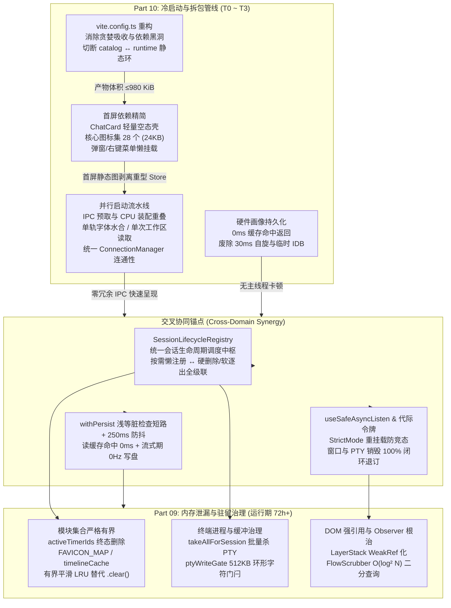
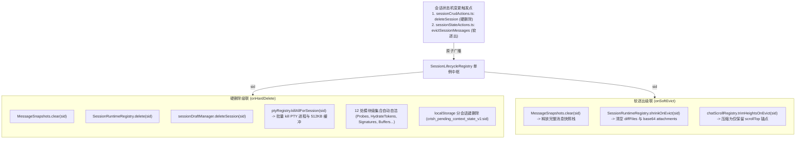
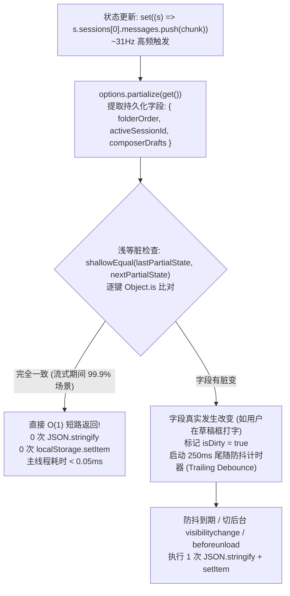
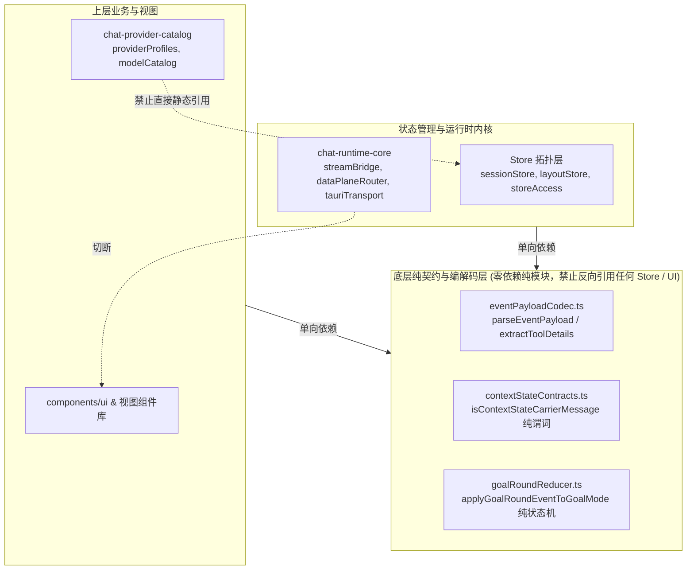
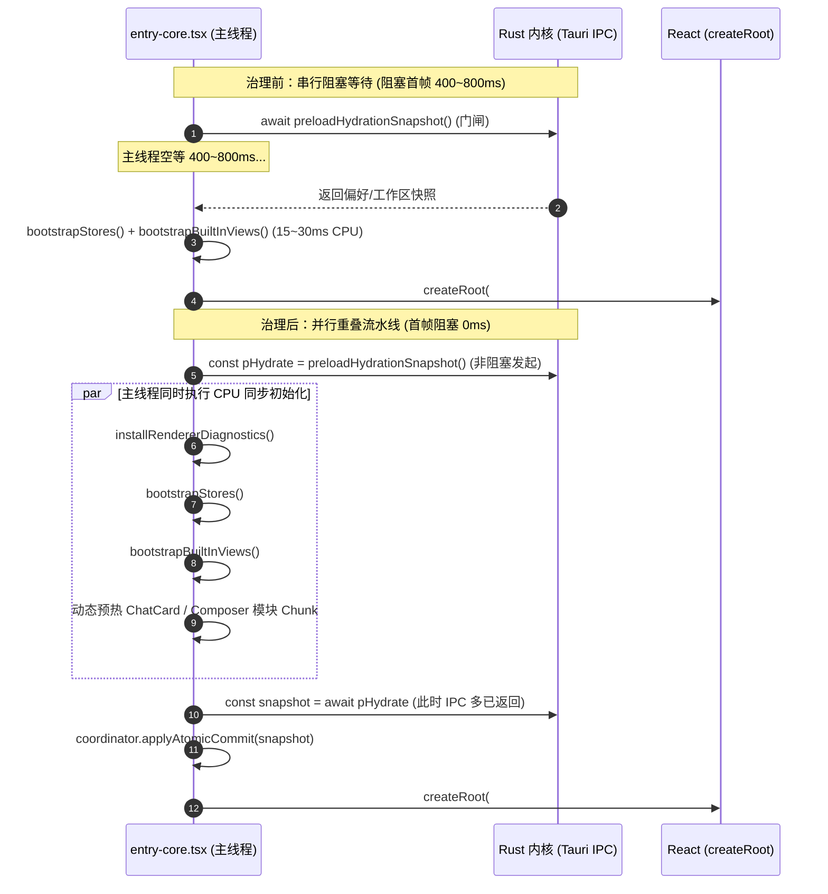

# 09 — 前端内存泄漏、资源驻留生命周期与冷启动构建拆包交叉优化方案

> **方案编号**：PLAN-PERF-09-10
> **覆盖审计**：
>
> - `docs/full-stack-performance-audit/audits/09-前端内存泄漏资源驻留与生命周期性能审计.md`（共 22 项问题，`F-09-01` ~ `F-09-22`）
> - `docs/full-stack-performance-audit/audits/10-前端冷启动链路构建拆包与首屏水合性能审计.md`（共 16 项问题，`PERF-DIM10-001` ~ `PERF-DIM10-016`）
>   **定位准则**：遵循 `.agents/LOGIC_PLAN_NO_RETREAT.md`、`docs/agent-roles/general_task/三原则.md`、根 `AGENTS.md` 与 `docs/full-stack-performance-audit/00-DISCIPLINE.md`。
>   **核心原则**：**38 项问题一视同仁、全量同权、零退避、零阉割；兼顾冷启动毫秒级首帧呈现与 72+ 小时连续运行零内存泄漏**。

---

## 目录索引

- [一、方案总览与设计哲学](#一方案总览与设计哲学)
  - [1.1 治理使命与双轨性能模型](#11-治理使命与双轨性能模型)
  - [1.2 Part 09 内存生命周期 × Part 10 冷启动构建交叉矩阵全景图](#12-part-09-内存生命周期--part-10-冷启动构建交叉矩阵全景图)
  - [1.3 全量 38 项性能问题治理基线与预期指标收敛表](#13-全量-38-项性能问题治理基线与预期指标收敛表)
- [二、Part 09 内存泄漏、资源驻留与生命周期完整架构方案](#二part-09-内存泄漏资源驻留与生命周期完整架构方案)
  - [2.1 统一会话生命周期级联调度中枢（`SessionLifecycleRegistry`）](#21-统一会话生命周期级联调度中枢sessionlifecycleregistry)
  - [2.2 模块级无界集合有界化与平滑 LRU 淘汰契约](#22-模块级无界集合有界化与平滑-lru-淘汰契约)
  - [2.3 Tauri IPC 异步监听安全挂载与代际令牌机制](#23-tauri-ipc-异步监听安全挂载与代际令牌机制)
  - [2.4 DOM 强引用释放、Observer 治理与虚拟滚动协同](#24-dom-强引用释放observer-治理与虚拟滚动协同)
  - [2.5 主线程高频同步 I/O 与 JSON 序列化彻底解耦](#25-主线程高频同步-io-与-json-序列化彻底解耦)
- [三、Part 10 冷启动链路与 Vite 拆包完整架构方案](#三part-10-冷启动链路与-vite-拆包完整架构方案)
  - [3.1 `vite.config.ts` 构建拆包策略深度重构与循环依赖根治](#31-viteconfigts-构建拆包策略深度重构与循环依赖根治)
  - [3.2 首屏静态图精简与无用代码延迟加载](#32-首屏静态图精简与无用代码延迟加载)
  - [3.3 首屏水合与跨端 IPC 瀑布流并行化治理](#33-首屏水合与跨端-ipc-瀑布流并行化治理)
  - [3.4 硬件探测引擎与自适应系统极轻量重构](#34-硬件探测引擎与自适应系统极轻量重构)
- [四、Part 09 与 Part 10 深度交叉协同设计（协同关键设计）](#四part-09-与-part-10-深度交叉协同设计协同关键设计)
  - [4.1 惰性初始化与会话销毁垃圾回收的对称闭环](#41-惰性初始化与会话销毁垃圾回收的对称闭环)
  - [4.2 水合状态单真源与运行时写穿透控制协同](#42-水合状态单真源与运行时写穿透控制协同)
  - [4.3 启动期 StrictMode 防竞态与多窗口销毁防残留协同](#43-启动期-strictmode-防竞态与多窗口销毁防残留协同)
  - [4.4 内存预算自适应与分块尺寸边界协同](#44-内存预算自适应与分块尺寸边界协同)
- [五、精准文件级改造规范与实施代码清单](#五精准文件级改造规范与实施代码清单)
  - [5.1 存储与持久化层改造规范](#51-存储与持久化层改造规范)
  - [5.2 会话生命周期与集合治理改造规范](#52-会话生命周期与集合治理改造规范)
  - [5.3 构建与分包治理改造规范](#53-构建与分包治理改造规范)
  - [5.4 冷启动引导与水合流水线改造规范](#54-冷启动引导与水合流水线改造规范)
  - [5.5 硬件画像与自适应引擎改造规范](#55-硬件画像与自适应引擎改造规范)
- [六、立体防护门禁矩阵与验收断言](#六立体防护门禁矩阵与验收断言)
  - [6.1 静态构建与 CI 门禁矩阵](#61-静态构建与-ci-门禁矩阵)
  - [6.2 自动化测试断言规范（Vitest / 模拟压力测试）](#62-自动化测试断言规范vitest--模拟压力测试)
  - [6.3 38 项问题闭环对照自检表](#63-38-项问题闭环对照自检表)

---

## 一、方案总览与设计哲学

### 1.1 治理使命与双轨性能模型

桌面端 AI 工作台（Conex / Crish）具备典型的高性能双轨诉求：

1. **冷启动瞬时性（Cold-Start Immediacy）**：用户打开应用时，必须在 **300ms** 内完成首屏关键骨架与交互渲染，绝不允许被庞大的静态依赖图（1.5MB+ JS）、多路串行 IPC 探针、30ms CPU 忙等或重复文件扫描拖慢首屏可交互时间（TTI）。
2. **长生命周期无泄漏性（Long-Running Zero-Leakage）**：桌面端常驻后台运行数天，多会话并发进行高频流式输出（~31Hz 帧率），多标签页与多分屏终端频繁挂载/卸载。任何微小的对象驻留、未闭环的事件监听或无界 Map，都会在数十小时内累积为数以百兆的内存膨胀（Memory Bloat）和 PTY 孤儿进程。

**传统优化的常见陷阱在于割裂二者**：为了冷启动快而盲目把模块推迟并留存全局单例，导致运行期内存不可控；或者为了管理内存引入庞大的生命周期拦截器，导致冷启动代码体积进一步膨胀。

本方案将 **Part 09（内存生命周期）** 与 **Part 10（冷启动与构建拆包）** 作为一个有机整体进行**交叉协同设计**：

- **启动阶段只做极简纯内存装配与并行 I/O 预取**；
- **重型模块与运行时集合全部遵循「按需惰性挂载 + 严格上限 + 中心化生命周期级联注销」**；
- **主线程同步持久化（`localStorage`）全面实施内存镜像化与脏检查短路，彻底消除每秒 31 次的高频无谓序列化**。

---

### 1.2 Part 09 内存生命周期 × Part 10 冷启动构建交叉矩阵全景图



---

### 1.3 全量 38 项性能问题治理基线与预期指标收敛表

| 审计编号           | 关联维度 | 核心根因简述                                                                        | 治理前实测/现状                                                 | 治理后硬性目标                                                       |
| :----------------- | :------- | :---------------------------------------------------------------------------------- | :-------------------------------------------------------------- | :------------------------------------------------------------------- |
| **F-09-01**        | Part 09  | `MessageSnapshots` 漏算全量消息数组，账本失真千倍，软逐出未清快照                   | 10 层快照驻留 20MB 账本仅计 10KB；软逐出消息体无法回收          | 真实字节计税，5MB 预算刚性截断，软逐出即刻释放快照栈                 |
| **F-09-02**        | Part 09  | 双轨逐出状态机冲突，`sessionAccessTimestamps` 永久残留                              | 误清分屏会话消息，Map 随新建会话无限增长                        | 废除旧逐出函数，统一三态 LRU 逐出机，删除会话同步自洁                |
| **F-09-03**        | Part 09  | 软逐出仅清 `messages=[]`，漏清 Diff、附件与滚动高度                                 | 软逐出后内存仍驻留数 MB 文本与 base64 附件                      | 软逐出触发重资产清理钩子，释放 Diff、已发送附件与高度表              |
| **F-09-04**        | Part 09  | 侧栏/Tab 关闭绕过协调器，12 处模块级集合硬删除漏清                                  | 每次新建并删除会话残留 12 处条目，流式中删会话定时器回写竞态    | 底层 `deleteSession` 广播级联事件，12 处集合 100% 自动注销自洁       |
| **F-09-05**        | Part 09  | `SessionDraftManager` 漏删接口，`flushAll()` 复活已删草稿，单槽覆盖                 | 切后台复活已删草稿；分屏多窗格输入互相覆盖丢数据                | 补齐删除接口，`pendingSaves` 分会话隔离防抖，仅刷脏数据              |
| **F-09-06**        | Part 09  | `SessionRuntimeRegistry` GC 从未启动，满额盲淘汰忽略活跃会话与锁                    | 生产环境 GC 零运行；`get()` 强杀正在流式输出的活跃会话状态      | 启动常驻轻量 GC，容量淘汰前过滤活跃与分屏会话，合并清理逻辑          |
| **F-09-07**        | Part 09  | 多终端与分屏终端衍生键无法匹配，删除会话不杀 PTY                                    | 后台孤儿 bash/pwsh 进程永久常驻，每个孤儿 PTY 漏 512KB 缓冲     | 前缀匹配 `takeAllForSession`，关闭/删除会话批量 kill 底层 PTY        |
| **F-09-08**        | Part 09  | `ptyWriteGate` 隐藏期 `pending` 无界增长，恢复时单帧阻塞拼接                        | 后台长输出时内存膨胀数十 MB，切回时主线程卡死数秒               | 512KB 环形字符滑动窗口，最老块自动弹出，恢复切回 ≤8ms                |
| **F-09-09**        | Part 09  | `taskEventHandlers` 在 `timer-fired` 误调 `.add()`                                  | 一次性定时器到期后永久滞留在活跃集合，计数器永不归零            | 触发终态严格调用 `.delete()`，计数器精准与真实状态同步               |
| **F-09-10**        | Part 09  | 4 处模块级集合（告警/Favicon/静默/模式）无上限或漏消费                              | 数组 $O(N)$ 扫描，base64 Favicon 永久累积，热激活 Tab 残留      | 全部设 64~256 容量硬上限并接入 LRU，热激活事件即刻消费               |
| **F-09-11**        | Part 09  | `timelineCache` 与 `stripCache` 满额整表 `.clear()` 断崖式清空                      | 满额瞬间全部 Cache Miss，视口内消息同时重算，突发掉帧           | 替换为 $O(1)$ 平滑 LRU 逐条淘汰，消除周期性重算尖峰                  |
| **F-09-12**        | Part 09  | `WindowResizeBridge` 异步 `await` 竞态导致窗口监听器泄漏                            | StrictMode 重挂载或快速切换导致原生监听器翻倍或悬空             | 引入 `connectEpoch` 代际令牌，`await` 后校验状态，卸载即退订         |
| **F-09-13**        | Part 09  | `AppBootstrap` 全屏监听 `useEffect` 异步解析后缺 `disposed` 守卫                    | 组件卸载后原生 Tauri 监听器被赋值却无法被 cleanup 调用          | 每次 `await` 后二次判定 `disposed`，已注销即刻执行 `unlisten()`      |
| **F-09-14**        | Part 09  | `ptySessionApi` 的 `ensureTauriListen` 异步挂起期缺退订复查                         | 订阅后立即退订时，原生 `pty-output` 监听器永久挂起不释放        | 赋值后复查订阅数与历史大小，空载时即刻执行 `unlisten()`              |
| **F-09-15**        | Part 09  | `bootstrapStores` 不可逆 Monkey-Patch 且生产环境空转计数                            | 多次热重载叠加闭包包装；生产环境每帧执行无意义计数订阅          | 移入 `NODE_ENV === 'development'`，保存并还原原始函数                |
| **F-09-16**        | Part 09  | `LayerStackManager` 点击快照强引用已卸载 DOM 节点                                   | 浮层关闭后 Detached DOM 子树及其 React Fiber 长期无法回收       | 改用 `WeakRef` 持有 DOM 引用，150ms 冷却后强制置空引用               |
| **F-09-17**        | Part 09  | `FlowScrubber` 滚动热路径 $O(N \log N)$ + 强制回流 + 全子树 MO 重绑                 | 每次滚动 22,000 次位运算；流式期每秒数十次重建 IO，严重卡顿     | 树状数组 $O(\log^2 N)$ 视口二分，删除回流测量与 MO，复用 tickRefs    |
| **F-09-18**        | Part 09  | `useXtermTerminal` WebGL 恢复定时器未记录句柄，卸载未清理                           | 组件卸载后定时器继续挂起，持有 terminal 与 DOM 闭包             | 捕获 `webglRestoreTimer` 句柄，cleanup 中即刻 `clearTimeout`         |
| **F-09-19**        | Part 09  | `WorkerPool` 崩溃恢复漏清超时定时器，硬编码错误 worker 路径                         | 崩溃任务超时定时器泄漏；`network` 类型拼错路径导致重建失败      | 清理 `pending.timeout`，终止旧 worker，统一调用 `urlFor(type)`       |
| **F-09-20**        | Part 09  | `withPersist` 在 ~31Hz 流式输出帧同步 `JSON.stringify` + 写盘                       | 流式回复期间每秒 31 次同步写盘，主线程阻塞达数十毫秒            | 浅等脏检查短路（0 次写盘）+ 250ms 尾随防抖，消除主线程卡顿           |
| **F-09-21**        | Part 09  | `TelemetryService` 每条同步写盘，会话索引与 Token 统计重复读盘                      | 连续报错时每条序列化 200 项；流式持久化每 350ms 重新 JSON.parse | 1000ms 尾随防抖写盘；会话索引与 Token 统计建立内存快照镜像           |
| **F-09-22**        | Part 09  | `getActiveProfileId` 等热路径在 render 阶段无缓存直读 localStorage                  | 数十处组件 render 穿透到 DOMStorage 同步 IPC                    | 内存态镜像变量常驻，修改与 storage 事件单向同步，0ms 直读            |
| **PERF-DIM10-001** | Part 10  | Rollup 贪婪吸收：`chat-provider-catalog` (416KB) 与 `runtime-core` (325KB+83KB CSS) | 2 个 Chunk 吞并 349 个模块及全量 UI 组件库和 CSS                | 下沉纯契约与纯归约函数，收敛 manualChunks，解耦 UI 库                |
| **PERF-DIM10-002** | Part 10  | `chat-provider-catalog ↔ chat-runtime-core` 双向静态循环依赖                        | `check-chunk-cycles.mjs` 报错（Exit 1），存在 TDZ 死锁隐患      | 提取 `eventPayloadCodec.ts`，解耦 `readiness`，接入门禁              |
| **PERF-DIM10-003** | Part 10  | 首屏预加载达 1,516 KiB JS + 185 KiB CSS，门禁仍处 1800 KiB 过渡值                   | 首屏同步图过大，未设 deny 拦截重型 Chunk                        | 移除 App.tsx 顶层静态边，收紧预算至 ≤980 KiB 并封禁重包              |
| **PERF-DIM10-004** | Part 10  | 同步激活扩展拉入 `noteApi` 全家桶与未启用的 `PermissionBar`                         | 首屏主包被塞入 40KB+ 便签 API 与未开启特性的 UI 组件            | 直连 `activate.ts`，`PermissionBar` 特性门控通过后动态加载           |
| **PERF-DIM10-005** | Part 10  | 首屏挂载未打开的 `TelemetryDialog` 等弹窗；UI 桶全量重导出                          | 首屏同步求值 18 套 UI 组件及未打开弹窗/菜单                     | 弹窗与右键菜单改为按需懒挂载，推进 UI 组件精确子路径导入             |
| **PERF-DIM10-006** | Part 10  | 主视图 `ChatCard` 懒加载三跳瀑布；空草稿态静态拉取 583.5KB 重代码                   | 首屏主区显示"加载中…"，空会话加载 highlight.js 与模型目录       | 拆分 ChatCard 轻量空态壳，非空消息流懒加载，首屏预热重叠             |
| **PERF-DIM10-007** | Part 10  | `entry-core` 在 `createRoot` 前串行阻塞等待 IPC 水合，CPU 初始化未重叠              | `createRoot` 挂载被后置阻塞 400~800ms，CPU 装配串行叠加         | 发起 IPC 预取后立即在 CPU 并行执行 Store/视图装配，重叠掩盖耗时      |
| **PERF-DIM10-008** | Part 10  | `loader.js` 在首帧 rAF 过早发送 `workbench_window_ready`                            | 窗口过早暴露骨架屏，未命中主题缓存时出现亮/暗闪烁               | 收口至真实主题写入且首帧 React 挂载后的 rAF 发射，loader.js 仅作兜底 |
| **PERF-DIM10-009** | Part 10  | 字体水合双轨冲突：已生效字体被默认 `'auto'` 覆盖并冗余发起第 2 次 IPC               | 首屏字体跳变（FOUT），冗余发起 `prefs_get('fonts')` IPC         | 新增 `hydrateFontsFromSnapshot` 单轨入口，AppBootstrap 零 IPC 返回   |
| **PERF-DIM10-010** | Part 10  | 工作区列表与根目录被重复拉取 2~3 次，文件树重复扫描                                 | 2 次冗余 IPC，冷启动启动两次文件树磁盘扫描                      | 复用 `useHydrationStore` 快照，消除抢跑刷新，收敛为单次扫描          |
| **PERF-DIM10-011** | Part 10  | 引擎探针 `core_get_status` 启动期三路重复并发轮询                                   | 启动期重复触发 2~4 次状态探针跨进程调用                         | 传输层 In-Flight 去重，以 `ConnectionManager` 为唯一状态源           |
| **PERF-DIM10-012** | Part 10  | `usePlatformAdaptation` 触发 30ms CPU 自旋 + 临时 IDB + 3 Canvas + 2 WebGPU         | 阻塞 UI 主线程 ≥30ms，强制 GPU 编译着色器，写删磁盘库           | 硬件画像持久化缓存（0ms 返回），默认免基准，释放 WebGL 上下文        |
| **PERF-DIM10-013** | Part 10  | `iconMap.ts` 静态导入全部 143 个图标，打包 117.8 KB 首屏阻塞 Chunk                  | 首屏强拉 117.8 KB 图标库，其中 >80% 首屏完全不用                | 拆分为首屏核心图标集（28 个，~24 KB）与扩展图标集，立省 ~93 KB       |
| **PERF-DIM10-014** | Part 10  | 4 套 `@fontsource` 字体家族被强合并进单 Chunk，打包 8 个冗余 `.woff`                | 选任一字体需下载全量 CSS；多出 ~176 KB 现代浏览器不用的产物     | 按字体家族拆分独立 Chunk，剔除 `.woff` 仅保留现代 `.woff2`           |
| **PERF-DIM10-015** | Part 10  | `optimizeDeps` 含废弃 `@codemirror/*`；缺 `resolveDependencies` 守卫                | 开发态扫描无效包；无法在构建期拦截非首屏 Chunk 进入预加载       | 清理幽灵依赖，配置 `modulePreload.resolveDependencies` 白名单        |
| **PERF-DIM10-016** | Part 10  | Idle 双层套娃调度，5000ms 异步网络连接卡死快捷键与窗口缩放注册                      | 引擎连通慢时，窗口尺寸同步与全局快捷键被阻塞数秒无法响应        | 队列扁平化，轻量无阻塞事件监听前置即时执行，网络连接非阻塞触发       |

---

## 二、Part 09 内存泄漏、资源驻留与生命周期完整架构方案

### 2.1 统一会话生命周期级联调度中枢（`SessionLifecycleRegistry`）

> **解决问题**：`F-09-01`、`F-09-02`、`F-09-03`、`F-09-04`、`F-09-05`、`F-09-06`、`F-09-07`、`F-09-08`。

#### 1. 架构拓扑与设计原理

现存隐患的根源在于：会话清理被分散在 `SessionCoordinator`、`sessionCrudActions`、`useSidebarContextMenu`、`workspaceShellStore` 等多个调用点，且清理逻辑为命令式硬编码。一旦新增模块级缓存，只要作者漏在 `SessionCoordinator` 补写一行，就会造成永久泄漏；若业务组件直接调用 `useSessionStore.getState().deleteSession(id)`，整个级联清理即被彻底旁路。

本方案在 `apps/crish-desktop/src/store/sessionLifecycleRegistry.ts` 建立**发布-订阅式的中心化会话生命周期调度中枢**，直接内聚挂载于 `sessionCrudActions.ts` 的原生状态转移中：



#### 2. 精准账本与增量快照引擎（`MessageSnapshots` 根治 `F-09-01`）

- **根因根除**：`MessageSnapshots.ts` 不再在 `SnapshotEntry` 中通过 `messages.slice()` 强引用全量消息数组副本，改为**纯差量模式（Pure Delta Snapshot）**。
- **账本如实计量**：
  ```ts
  // 修正后的 SnapshotEntry 结构与真实字节计量
  export interface PureDeltaSnapshotEntry {
    delta: MessageDelta;
    timestamp: number;
    bytes: number; // 严格计算 delta.inserted 与 delta.deleted 的真实 JSON 字符占用
    scrollOffset?: number;
    heightSnapshot?: Record<string, number>;
  }
  ```
- **软逐出自动注销**：在 `SessionLifecycleRegistry` 注册 `onSoftEvict((sid) => messageSnapshots.clear(sid))`，确保后台会话被释放时，撤回快照栈立即归零，彻底释放底层消息对象。

#### 3. 统一三态逐出状态机（根治 `F-09-02`）

- **单真源收口**：物理删除 `apps/crish-desktop/src/store/sessionMessageEviction.ts`，将 `apps/crish-desktop/src/api/session-persistence/sessionMessageEvict.ts` 和 `storeAccess.ts` 全部重定向至 `apps/crish-desktop/src/store/sessionEviction.ts`。
- **保护分屏会话**：三态状态机强制读取 `collectOpenSessionIdsFromLayout()`：
  - `PinnedActive`：当前主窗格激活会话（绝不逐出）；
  - `OpenRetained`：分屏右侧或其它打开 Tab 的可见会话（绝不逐出）；
  - `EvictableCandidate`：纯后台未挂载会话，按 `sessionAccessTimestamps` LRU 顺序逐出。
- **时间戳自洁**：在 `sessionEvictionProbes.ts` 导出 `deleteSessionAccessTimestamp(sid)` 并接入硬删除钩子。

#### 4. 软逐出重资产释放（根治 `F-09-03`）

在 `evictSessionMessagesInState` 触发 `SessionLifecycleRegistry.dispatchSoftEvict(sessionId)`：

- `SessionRuntimeRegistry` 提供 `shrinkOnEvict(sessionId)`：清空 `diffFiles = []`，将 `attachments` 中体积巨大的 base64 `dataUrl` 置空并仅保留元数据。
- `chatScrollRegistry` 提供 `trimHeightsOnEvict(sessionId)`：丢弃数千条消息的高度映射，仅保留最后记录的 `scrollTop` 与 `wasAtBottom` 标量。

#### 5. 12 处模块级集合自动自洁协议（根治 `F-09-04`）

任何按 `sessionId` 分桶的模块，在自身文件内调用 `sessionLifecycleRegistry.registerSubscribers({ onHardDelete: ... })` 实行内聚式自愈：

1. `sessionEvictionProbes.deleteSessionAccessTimestamp(sid)`；
2. `sessionActivateHydrate.clearSessionHydrateState(sid)`；
3. `sessionRustDbHydrate.deleteSavedBodyFingerprint(sid)`；
4. `contextStatePending.clearPendingContextStateForSession(sid)`（同时清理 `localStorage.removeItem(`crish_pending_context_state_v1:${sid}`)`）；
5. `sessionAiTitle.clearAiTitleAttempt(sid)`；
6. `slashSendDraftManager.clear(sid)`；
7. `sessionDraftManager.deleteSession(sid)`；
8. `sessionStreamManager.clearSession(sid)`；
9. `sharedSessionStreamManager.clearSession(sid)`；
10. `chatScrollRegistry.clear(sid)` 与 `clearSessionLive(sid)`；
11. `messageSnapshotsBridge.unregisterActiveVsm(sid)`；
12. `sessionRuntimeStatusStore.clearRuntimeStatus(sid)` 与 `clearWorkflowConfirmSignaturesForSession(sid)`。

#### 6. 二级草稿池改造与幽灵复活根治（根治 `F-09-05`）

- `SessionDraftManager` 新增 `deleteSession(sessionId: string): void`：从 `this.drafts` 中永久删除，若 `this.pendingSaves.has(sessionId)` 则一并移除。
- **分会话独立防抖**：将全局单槽 `pendingSave` 升级为 `pendingSaves = new Map<string, string>()`。
- **按需精准 Flush**：`flushAll()` 仅遍历 `this.pendingSaves` 正在挂起的脏草稿并回写，不再对 `this.drafts` 全表无差别重写，彻底杜绝已删除草稿被重新注入 `localStorage`。

#### 7. 终端进程与缓冲批量收割（根治 `F-09-07`）

- 在 `ptyRegistry.ts` 中新增前缀匹配方法：
  ```ts
  takeAllForSession(sessionId: string): string[] {
    const prefix = `${sessionId}:`;
    const matched: string[] = [];
    for (const [key, ptyId] of this.bySession.entries()) {
      if (key === sessionId || key.startsWith(prefix)) {
        matched.push(ptyId);
        this.bySession.delete(key);
      }
    }
    return matched;
  }
  ```
- `killPtyForSession(sessionId)` 内部调用 `takeAllForSession(sessionId)`，遍历每一个匹配的 `ptyId` 依次调用 `clearPtyHistory(ptyId)` 与 `ptyKill(ptyId)`。
- 在会话删除与 Tab 关闭钩子中强制触发，彻底终结 Rust 后台孤儿进程与 512KB/终端历史泄漏。

#### 8. 隐藏终端门闩 512KB 环形缓冲（根治 `F-09-08`）

- 在 `createPtyWriteGate` 中引入字符上限 `MAX_PENDING_CHARS = 512 * 1024`：
  ```ts
  write(data: string): void {
    if (!data) return;
    if (hidden) {
      pending.push(data);
      pendingChars += data.length;
      while (pendingChars > MAX_PENDING_CHARS && pending.length > 0) {
        const popped = pending.shift()!;
        pendingChars -= popped.length;
      }
      return;
    }
    sink.write(data);
  }
  ```
- 切换可见态时，`pending.join('')` 尺寸受控在 512KB 以内，主线程耗时严格控制在 8ms 帧预算以内。

---

### 2.2 模块级无界集合有界化与平滑 LRU 淘汰契约

> **解决问题**：`F-09-09`、`F-09-10`、`F-09-11`。

#### 1. `activeTimerIds` 终态删除 Bug 根治（`F-09-09`）

在 `apps/crish-desktop/src/api/chat-bridge/handlers/taskEventHandlers.ts:344-366`：

```ts
export function onTimerFired(
  _env: HandlerEnv,
  envelope: EngineEnvelope<'timer-fired'>
): void {
  const e = envelope.event;
  // 修复：timer-fired 代表一次性定时器已触发终态，必须将其从活跃集合中移除
  activeTimerIds.delete(e.timerId);
  syncActiveTimersCount();
  notifyDataPlaneRefresh();
}
```

#### 2. 4 处模块级集合有界化（`F-09-10`）

1. `coldWarnedRunIds`（`cacheEventsStore.ts:55`）：由无界数组替换为容量 256 的有界 Set（超出时删除最老插入键 `set.delete(set.keys().next().value)`）。
2. `FAVICON_MAP`（`previewBrowserStore.ts:233`）：替换为 `@crish/shared-utils` 的 `LruCache<string, string>(128, 2 * 1024 * 1024)`，限制最多 128 个 Favicon 或 2MB 内存。
3. `warnedMessageIds`（`silentComplete.ts:156`）：替换为容量 256 的有界 Set。
4. `fileViewerModeOverrides`（`openTool.ts:47`）：设置 64 条容量上限；在 `FileViewer` 监听 `conex:file-viewer-mode` 热激活事件时同步调用 `consumeFileViewerModeOverride(tabId)`，完成消费闭环。

#### 3. 彻底根除断崖式 `.clear()` 尖峰（`F-09-11`）

废除 `timelineCache.ts` 与 `markdownRenderLite.ts` 中的满额整表 `clear()`：

- 利用 ES6 `Map` 的双向链表原语特性，命中时通过 `map.delete(k); map.set(k, v)` 刷新热度。
- 满额时通过 `map.delete(map.keys().next().value!)` 进行逐条 $O(1)$ 淘汰，保证视口内当前消息 100% 命中，消除流式输出过程中的周期性掉帧尖峰。

---

### 2.3 Tauri IPC 异步监听安全挂载与代际令牌机制

> **解决问题**：`F-09-12`、`F-09-13`、`F-09-14`、`F-09-15`。

#### 1. 异步监听安全 Hook 原语（`useSafeAsyncListen`）

针对 Tauri `listen()` 与 `win.onResized()` 返回 `Promise<UnlistenFn>` 的异步挂起特性，创建通用 Hook `apps/crish-desktop/src/hooks/useSafeAsyncListen.ts`：

```ts
export function useSafeAsyncListen<T>(
  listenFactory: () => Promise<(() => void) | undefined>,
  deps: React.DependencyList
): void {
  useEffect(() => {
    let disposed = false;
    let unlisten: (() => void) | undefined;

    void (async () => {
      try {
        const off = await listenFactory();
        if (disposed) {
          off?.();
        } else {
          unlisten = off;
        }
      } catch (e) {
        // 环境不匹配或宿主未就绪
      }
    })();

    return () => {
      disposed = true;
      if (unlisten) {
        unlisten();
        unlisten = undefined;
      }
    };
  }, deps);
}
```

#### 2. 单例服务代际令牌模型（根治 `F-09-12`、`F-09-14`）

在单例服务（如 `WindowResizeBridge`）中引入代际计数器 `connectEpoch`：

```ts
class WindowResizeBridge {
  private connectEpoch = 0;
  private connected = false;

  async connect(): Promise<void> {
    const epoch = ++this.connectEpoch;
    this.connected = true;
    try {
      const { getCurrentWindow } = await import('@tauri-apps/api/window');
      const win = getCurrentWindow();
      const unlisten = await win.onResized(() => this.handleResize());

      // 代际防重入与卸载校验
      if (!this.connected || this.connectEpoch !== epoch) {
        unlisten();
        return;
      }
      this.cleanupFns.push(unlisten);
    } catch {
      // 降级为 window resize 同样校验 epoch
    }
  }

  disconnect(): void {
    this.connectEpoch++;
    this.connected = false;
    for (const fn of this.cleanupFns) fn();
    this.cleanupFns = [];
  }
}
```

在 `ptySessionApi.ts:ensureTauriListen` 中，在 `entry.unlisten = unlisten;` 赋值后立即调用 `checkCleanupUnlisten(entry);`，若挂起期间已被退订，立即执行 `unlisten()`。

#### 3. 消除生产环境猴子补丁与无效订阅（根治 `F-09-15`）

在 `apps/crish-desktop/src/store/bootstrapStores.ts` 中：

- 将 `_wrapSubscriberCounting` 与 `_counters` 订阅完全包裹在 `if (process.env.NODE_ENV === 'development')` 守卫中。
- 在 `_wrapSubscriberCounting` 中保存原始 `origSubscribe`，并在 cleanup 时恢复 `store.subscribe = origSubscribe`，彻底消除生产环境空转回调与热重载闭包累积。

---

### 2.4 DOM 强引用释放、Observer 治理与虚拟滚动协同

> **解决问题**：`F-09-16`、`F-09-17`、`F-09-18`、`F-09-19`。

#### 1. `LayerStackManager` 强引用切断（根治 `F-09-16`）

- `DismissedByPointerSnapshot` 中的 `anchor` 与 `target` 改为 `WeakRef<HTMLElement>` 与 `WeakRef<Node>`。
- 150ms 冷却定时器（`silenceTimer`）到期时，显式将 `this.dismissedByPointer = null; this.anchorPointerDownTarget = null;` 置空，杜绝 Detached DOM 树滞留。

#### 2. `FlowScrubber` 纯数学二分查询重构（根治 `F-09-17`）

彻底废除滚动热路径上的 DOM 查询、强制同步回流与 `MutationObserver`：

- **$O(\log^2 N)$ 视口区间二分**：直接调用 `VirtualScrollManager` 的 Fenwick 树状数组二分函数：
  ```ts
  const { startIndex, endIndex } = manager.computeVisibleRange(
    scrollTop,
    viewH,
    manager.getOrderCount(),
    0
  );
  const order = manager.getOrder();
  const activeIds = new Set<string>();
  for (let i = startIndex; i < endIndex; i++) {
    if (order[i]) activeIds.add(order[i]!);
  }
  ```
- **消除强制回流**：完全删除 `getBoundingClientRect()`、`querySelectorAll(USER_BUBBLE_SELECTOR)`、`IntersectionObserver` 与全子树 `MutationObserver`。
- **复用 `tickRefs.current`**：直接通过 `tickRefs.current.forEach((btn, id) => btn.classList.toggle(activeClass, activeIds.has(id)))` 完成轻量更新，并以 `requestAnimationFrame` 合并高频滚动回调。

#### 3. WebGL 定时器与 Worker 崩溃恢复闭环（根治 `F-09-18`、`F-09-19`）

- `useXtermTerminal.ts` 保存 `webglRestoreTimer` 并在 cleanup 中执行 `clearTimeout(webglRestoreTimer)`。
- `WorkerPool.handleWorkerCrash` 中在 reject 崩溃任务时同步调用 `if (pending.timeout) clearTimeout(pending.timeout)`，显式调用 `entry.worker.terminate()`，并通过 `this.urlFor(type)` 修正 URL 分发。

---

### 2.5 主线程高频同步 I/O 与 JSON 序列化彻底解耦

> **解决问题**：`F-09-20`、`F-09-21`、`F-09-22`。

#### 1. `withPersist` 浅等脏检查短路与尾随防抖引擎（根治 `F-09-20`）

这是彻底解放 31Hz 流式输出性能的核心战役。在 `apps/crish-desktop/src/store/middleware/withPersist.ts` 中构建高性能自定义 Storage 包装器：



- **浅等比对算法实现**：
  ```ts
  function shallowEqual<T extends Record<string, unknown>>(
    objA: T | null,
    objB: T
  ): boolean {
    if (Object.is(objA, objB)) return true;
    if (!objA || typeof objA !== 'object' || !objB || typeof objB !== 'object')
      return false;
    const keysA = Object.keys(objA);
    const keysB = Object.keys(objB);
    if (keysA.length !== keysB.length) return false;
    for (const key of keysA) {
      if (
        !Object.prototype.hasOwnProperty.call(objB, key) ||
        !Object.is(objA[key], objB[key])
      ) {
        return false;
      }
    }
    return true;
  }
  ```
- **收益**：在长文本流式输出过程中，`withPersist` 的实际写盘频次从 **31Hz 骤降为 0Hz**，完全消除主线程每一帧的同步 DOMStorage IPC 阻塞！

#### 2. 遥测日志与会话索引内存镜像化（根治 `F-09-21`）

- `TelemetryService.persist()` 改为 1000ms 尾随防抖定时器，仅在 `beforeunload` 与崩溃时执行强刷。
- `sessionLocalStorage.ts` 与 `usageStore.ts` 维护模块级内存快照：读取操作 100% 命中内存对象，写入操作先更新内存并计算内容指纹，仅在指纹发生实质改变时才节流落盘。

#### 3. 活跃模型与 Profile ID 内存镜像化（根治 `F-09-22`）

在 `profileActiveSelection.ts` 中维护 `_activeProfileId` 与 `_activeModelId` 内存镜像：

- 模块首次求值时仅做一次 `localStorage.getItem`，随后常驻内存；
- `getActiveProfileId()` / `getActiveModelId()` 直接返回内存变量（耗时 $O(1) \approx 0\text{ns}$）；
- 写入方法与 `window.addEventListener('storage')` 单向同步更新内存镜像。

---

## 三、Part 10 冷启动链路与 Vite 拆包完整架构方案

### 3.1 `vite.config.ts` 构建拆包策略深度重构与循环依赖根治

> **解决问题**：`PERF-DIM10-001`、`PERF-DIM10-002`、`PERF-DIM10-003`、`PERF-DIM10-015`。

#### 1. Rollup 依赖吸收黑洞成因与单向依赖流重构

Rollup 内置的 `addStaticDependenciesToManualChunk` 机制具有传递性贪婪特征：若 Chunk A 的种子文件静态引用了未分配命名 chunk 的公共模块 B，B 及其依赖树就会被无条件吸收进 Chunk A。

为彻底根治 `chat-provider-catalog` (416KB) 与 `chat-runtime-core` (325KB+83KB CSS) 的膨胀与死锁环，必须实施**三层架构下沉与单向依赖流**：



#### 2. 精确代码解耦动作

1. **切断 `contextStatePending.ts` 到 `storeAccess.ts` 的反向静态边**：
   - 提取 `src/api/contextStateContracts.ts`，导出 `isContextStateCarrierMessage`；
   - `contextStatePending.ts` 仅导入纯契约，若需读取会话快照则由上层以参数注入或经零依赖轻量接口获取。
2. **切断 `continuityHandlers.ts` 到 `components/ui` 的反向静态边**：
   - 提取 `src/api/chat-bridge/goalRoundReducer.ts`，包含纯逻辑归约；
   - `continuityHandlers.ts` 不再导入 `useGoalMode.ts`，彻底切断 `continuityHandlers` → `useGoalMode` → `ToastContext` → `components/ui` 的静态传递吸收链！
3. **消除 `chat-provider-catalog ↔ chat-runtime-core` 双向依赖环（根治 `PERF-DIM10-002`）**：
   - 提取 `src/api/protocol/eventPayloadCodec.ts`，包含 `parseEventPayload` 与 `extractToolDetails`，供 `sessionEventProjection.ts`（Store 侧）与 `chat-bridge` 侧单向引用；
   - 解耦 `readiness.ts`：将读取活跃 Profile/Model 的接口改为轻量窄契约；
   - 实测验证：运行 `node scripts/check-chunk-cycles.mjs`，静态环数量严格归零。
4. **收紧门禁并集成至 CI**：
   - 将 `check:chunk-cycles` 写入 `package.json` 的 `check:desktop`，阻断任何回潮；
   - 收紧 `scripts/check-startup-budget.mjs`：将 `DEFAULT_STATIC_GRAPH_BUDGET_KB` 下调至 **980 KiB**，并在 `DEFAULT_STATIC_GRAPH_DENY` 中加入 `['vendor-tiptap', 'vendor-highlight', 'vendor-xterm', 'chat-runtime-core']`。
5. **清理 `@codemirror/*` 幽灵依赖与配置 `modulePreload` 守卫（根治 `PERF-DIM10-015`）**：
   - 清理 `vite.config.ts` 中的 `@codemirror/*` 声明；
   - 在 `build.modulePreload` 中配置 `resolveDependencies`，拦截非首屏 Chunk 混入 HTML 的 `modulepreload`。

---

### 3.2 首屏静态图精简与无用代码延迟加载

> **解决问题**：`PERF-DIM10-004`、`PERF-DIM10-005`、`PERF-DIM10-006`、`PERF-DIM10-013`、`PERF-DIM10-014`。

#### 1. 扩展注册系统按需化（根治 `PERF-DIM10-004`）

- `entry-core.tsx` 改为直接从 `./extensions/note-paper/activate` 与 `./extensions/conversation-flow/activate` 导入激活函数，绕过导出了 `productLeafBindings.ts` 与 `noteApi` 的桶文件 `index.ts`。
- `conversation-flow/activate.ts` 移除顶层 `import { PermissionBar } from './PermissionBar'`，当特性开关 `shouldActivateOfficialConversationFlow()` 命中时，使用 `React.lazy(() => import('./PermissionBar'))` 动态注入，首屏立省 40KB+ 便签与权限栏代码。

#### 2. 壳层弹窗与上下文菜单按需挂载（根治 `PERF-DIM10-005`）

- `AppGlobalDialogs.tsx` 中的 `TelemetryDialog` 改为 `React.lazy(() => import('../components/overlay/TelemetryDialog'))`，与设置弹窗对齐。
- `Sidebar.tsx` 中移除无条件渲染的 `<SidebarContextMenus>` 与 `<ConfirmDialog open={false}>`，仅在 `contextMenu !== null` 或 `deleteConfirmSessionId !== null` 时条件挂载懒加载组件。

#### 3. `ChatCard` 空态轻量壳与非空消息流按需解耦（根治 `PERF-DIM10-006`）

- **问题根源**：冷启动进入默认空草稿态（`messages.length === 0`）时，只需渲染 `ChatEmptyState` + `ChatComposer`，但因为 `ChatCard.tsx:3` 静态导入了 `ChatMessageList`，强制打包了 `ChatAssistantMessageRow`、`highlight.js`（111KB）、模型厂商全集图标（157KB）、工具详情卡片（72KB）和 Worker 池（51KB），合计白白拉取 583.5KB JS。
- **解耦设计**：
  ```tsx
  // ChatCard.tsx 架构改造
  const LazyChatMessageList = React.lazy(() =>
    import('../chat-message-list/ChatMessageList').then((m) => ({ default: m.ChatMessageList }))
  );

  export const ChatCard: React.FC<ChatCardProps> = React.memo(({ ... }) => {
    // ...
    const hasMessages = messages.length > 0 || isStreaming;

    return (
      <div className={styles.container}>
        {hasMessages ? (
          <Suspense fallback={<div className={styles.listSkeleton} />}>
            <LazyChatMessageList {...messageListProps} />
          </Suspense>
        ) : (
          <ChatEmptyState {...emptyStateProps} />
        )}
        <ChatComposer {...composerProps} />
      </div>
    );
  });
  ```
- **预热重叠**：在水合等待 IPC 的空隙中，通过 `void import('../chat-message-list/ChatMessageList')` 在后台预热模块，既保障空态首屏极小化，又确保用户发送首条消息时无任何等待感。

#### 4. 图标按需分包体系（根治 `PERF-DIM10-013`）

将单体 `iconMap.ts` 拆解为分层架构：

- `coreIconMap.ts`：仅包含首屏壳层（TopBar、Sidebar、Composer、EmptyState）必需的 **28 个核心图标**（如 `AddIcon`、`SendIcon`、`SettingsIcon`、`ChevronDownIcon` 等），打包体积由 117.8 KB 降至 **~24 KB**，立省 **~93 KB** 首屏阻塞 JS！
- `extendedIconMap.ts`：包含其余 115+ 个图标，随各自所属的懒加载视图 Chunk（设置、文件查看器、终端、Diff 视图）按需加载或通过 `registerIcons(extendedIcons)` 动态注册。

#### 5. 字体分家族独立拆包与剔除 `.woff` 产物（根治 `PERF-DIM10-014`）

- 移除 `vite.config.ts:826-828` 的 `vendor-fonts` 强行合并规则，让 `inter`、`ibm-plex-sans`、`jetbrains-mono`、`ibm-plex-mono` 保持独立 Chunk，用户选择哪个字体才加载对应的几十 KB CSS。
- 在 Vite 配置中过滤 `@fontsource` 的 `.woff` 格式声明，仅保留现代桌面 WebView（WebView2 / WebKit）100% 原生支持的 `.woff2`，直接从安装包与 `dist/assets` 中剔除 8 个冗余 `.woff` 文件（省约 **176 KB** 磁盘体积）。

---

### 3.3 首屏水合与跨端 IPC 瀑布流并行化治理

> **解决问题**：`PERF-DIM10-007`、`PERF-DIM10-008`、`PERF-DIM10-009`、`PERF-DIM10-010`、`PERF-DIM10-011`、`PERF-DIM10-016`。

#### 1. 启动流水线时间轴重组（根治 `PERF-DIM10-007`）

彻底消除 `createRoot` 前置串行等待 IPC 门闸导致的空转延迟，重构为 **CPU 同步装配与 IPC 预取完全重叠的并行流水线**：



#### 2. `workbench_window_ready` 精确发射收口（根治 `PERF-DIM10-008`）

- 废除 `public/loader.js` 在首个 rAF 盲目发送 `workbench_window_ready` 的行为（`loader.js` 仅保留 1000ms 超时防死锁兜底）；
- 将原生窗口显示发射点严格收口在：**`applyAtomicCommit()` 完成真实主题与字体 CSS 变量注入，且 React 首帧 Commit 后的第一个 `requestAnimationFrame`**。原生窗口呈现给用户的第一眼即为完全水合后的最终界面，彻底消除 `#skel-app` 呼吸灯过渡跳变与暗色/亮色闪屏。

#### 3. 字体单轨水合闭环（根治 `PERF-DIM10-009`）

- 在 `fontStore.ts` 导出单一权威入口：
  ```ts
  export function hydrateFontsFromSnapshot(fonts: FontPreferences): void {
    cachedFonts = fonts;
    applyFontStacks(fonts);
    void ensureEmbeddedFontAssetsLoaded(fonts);
  }
  ```
- `UnifiedAppHydrationCoordinator.applyAtomicCommit()` 直接调用 `hydrateFontsFromSnapshot(snapshot.fonts)`。
- `AppBootstrap.ts` 检查 `useHydrationStore.getState().preferencesLoaded`：若为 `true`，**直接跳过 `loadStoredFonts()` 的第二次 `prefs_get('fonts')` IPC**，且绝不再调用默认 `'auto'` 覆盖已生效的 DOM 字体栈。

#### 4. 工作区拉取单次化与文件树扫描收敛（根治 `PERF-DIM10-010`）

- `AppBootstrap.ts` 的 `restoreRecentProject()` 优先直接消费 `useHydrationStore.getState().recentWorkspaces` 与 `currentWorkspaceRoot`，消除第二次 `fetchRecentWorkspaces()` 调用。
- 移除 `AppBootstrap.ts:155` 抢跑调用的 `useProjectStore.getState().refresh()`，统一收敛在工作区根路径决策完成之后**仅执行唯一一次 `refresh()`**，杜绝冷启动期间对磁盘目录的双重扫描。

#### 5. 引擎探针 In-Flight 去重与状态源收敛（根治 `PERF-DIM10-011`）

- 在 `tauriTransport.ts` 中维护单一飞行中 Promise：多次并发调用 `transport.waitUntilConnected()` 时复用同一 Promise。
- 废除 `bootstrap-full.ts` 中重复的 `ensureEngineConnected()`，统一由 `ConnectionManager` 驱动连通性状态转移；`ConnectionManager.connect()` 在 `waitUntilConnected()` 验证通过后直接采信，不再发起紧邻的第二次 `probeEngine()`。

#### 6. Idle 阶段调度扁平化（根治 `PERF-DIM10-016`）

- 消除 `entry-core.tsx` 外层无意义的 `requestIdleCallback` 包装，首帧完成后直接启动 `StaggeredIdleQueue`。
- 将极轻量的事件监听注册（`windowResizeBridge.init()`、`keyboard-shortcuts`）提到队列首批同步执行（耗时 < 0.5ms）；长耗时的网络连接任务（`connectionManager.connect()`）采用非阻塞方式启动，绝不允许网络超时阻碍快捷键与窗口缩放功能的就绪。

---

### 3.4 硬件探测引擎与自适应系统极轻量重构

> **解决问题**：`PERF-DIM10-012`。

#### 1. 硬件画像持久化缓存（SSOT Hardware Profile Cache）

硬件设备的物理属性（CPU 核数、GPU 型号、内存容量）在同一宿主环境下具有高度稳定性。
在 `packages/shared-utils/src/hardware-profile.ts` 中引入缓存驱动模型：

```ts
const HARDWARE_PROFILE_STORAGE_KEY = 'crish:hardware-profile:v1';

export async function detectHardware(
  opts?: HardwareProfileInit
): Promise<HardwareProfile> {
  // 1. 命中持久化缓存：0ms 同步返回！
  try {
    const raw = localStorage.getItem(HARDWARE_PROFILE_STORAGE_KEY);
    if (raw) {
      const cached = JSON.parse(raw) as HardwareProfile;
      if (cached && cached.cpu?.cores) {
        return cached;
      }
    }
  } catch {}

  // 2. 首次无缓存启动：仅执行超轻量非阻塞检测
  const profile = await runLightweightDetection(opts);
  try {
    localStorage.setItem(HARDWARE_PROFILE_STORAGE_KEY, JSON.stringify(profile));
  } catch {}
  return profile;
}
```

#### 2. 彻底废除主线程 30ms 自旋与临时 IndexedDB 建删库

- **废除 30ms CPU 死循环**：彻底删除 `benchmarkCpuSpeed()` 中的 `while (performance.now() - t0 < 10)` 自旋忙等逻辑，直接依据 `navigator.hardwareConcurrency` 与 `navigator.deviceMemory` 判定性能分级。
- **废除临时 IndexedDB 建库**：默认设置 `skipStorageBench = true`，禁用写入 1KB Blob 并删除数据库的磁盘 I/O 行为。
- **GPU 上下文即时释放**：检测 WebGL / WebGPU 完成后，立即调用 `gl.getExtension('WEBGL_lose_context')?.loseContext()` 主动归还 GPU 资源，并在 `Promise.race` 超时计时器中显式 `clearTimeout`，杜绝未决定时器悬挂。
- **合并重复检测**：废除 `bootstrap-core.ts` 中的二次 `detectPlatform()`，全系统统一定义并消费单一硬件画像。

---

## 四、Part 09 与 Part 10 深度交叉协同设计（协同关键设计）

### 4.1 惰性初始化与会话销毁垃圾回收的对称闭环

```mermaid
flowchart LR
  subgraph ColdStart["冷启动阶段 (Part 10: 极速瘦身)"]
    L1["模块/Store 零初始化开销<br/>仅装配轻量引用"]
    L2["ChatCard 仅挂载 EmptyState 壳<br/>ChatMessageList 保持 Lazy"]
    L3["WorkerPool 保持 JIT 惰性<br/>Worker 数量 = 0"]
  end

  subgraph SessionLifecycle["用户交互与运行期 (Part 09: 动态挂载)"]
    A1["用户输入首个字符 / 收到首个流式 Chunk"]
    A2["动态触发 MessageList & WorkerPool JIT 派生"]
    A3["SessionLifecycleRegistry 自动登记当前活跃 SessionId"]
  end

  subgraph SessionTeardown["会话关闭与清理 (Part 09: 彻底回收)"]
    C1["用户关闭 Tab / 删除会话 / 后台软逐出"]
    C2["SessionLifecycleRegistry 广播销毁通知"]
    C3["MessageSnapshots, PTY 进程, 历史缓冲, 流式缓存 100% 归零"]
    C4["内存状态回落至冷启动初始水位"]
  end

  ColdStart --> SessionLifecycle --> SessionTeardown
```



- **设计断言**：冷启动推迟加载的重型资源（如消息行渲染器、语法高亮器、终端输出门闩、Diff 缓冲），在首次交互被唤起后，**必须且只能将其生命周期锚定在 `SessionLifecycleRegistry` 派生的局部上下文或会话桶中**。当该会话被软逐出或硬删除时，内存占用必须严格回落至冷启动时的初始基线水位，达成「**启动轻快，运行长稳**」的闭环。

---

### 4.2 水合状态单真源与运行时写穿透控制协同

- **水合单真源**：冷启动时，`UnifiedAppHydrationCoordinator` 通过单次聚合 IPC 拉回偏好与工作区元数据并存入 `useHydrationStore`。运行时所有子系统（字体、主题、工作区、模型列表）**只读此单一真理源**，严禁各个子模块私自维护内存 Map 或再次穿透调用 `localStorage.getItem`。
- **写穿透控制**：运行时任何导致状态改变的操作（用户切换主题、修改字体、草稿输入、流式消息追加），经 `withPersist` 浅等脏检查层短路。仅在持久化切片发生实质变更时，才以 250ms 尾随防抖写入本地存储，并同步更新内存镜像。读路径 0ms 命中内存，写路径 0Hz 穿透主线程。

---

### 4.3 启动期 StrictMode 防竞态与多窗口销毁防残留协同

- **双重挂载防脱缰**：在 React 19 / StrictMode 与窗口快速缩放重载场景下，`useSafeAsyncListen` 与 `WindowResizeBridge.connectEpoch` 确保即使组件在异步 IPC 解析完成前就被卸载，解析后的回调也能通过代际令牌立即识别并自我销毁，杜绝悬挂监听器。
- **分屏与多窗口注销闭环**：多终端与分屏窗口销毁时，`PtyRegistry.takeAllForSession` 按会话前缀统一注销原生进程与清理 512KB 缓冲，彻底斩断 Rust 进程孤儿化通道。

---

### 4.4 内存预算自适应与分块尺寸边界协同

- **对齐 SSOT 预算真源**：将 `crates/conex-shared/src/perf_budget.rs` 与 `packages/shared-utils/src/bounds.ts` 作为唯一权威约束：
  - 启动 entry 预算：$\le 520\text{ KiB}$；
  - 静态图合计预算：$\le 980\text{ KiB}$（断边后冻结）；
  - 全局内存预算：$\le 200\text{ MiB}$；
  - 单 PTY 缓冲上限：$\le 256\text{ KiB}$；
  - 消息撤回栈全局上限：$\le 5\text{ MiB}$。
- **动态协同降级**：当 `memoryManager` 感知到系统内存压力达到 Level 3 时，一方面通过 `staggeredIdleQueue.clear()` 立即中止所有非关键视图 Chunk 的后台预热；另一方面通过 `sessionLifecycleRegistry.dispatchSoftEvict()` 强制触发后台最老会话的重资产释放，确保应用在极端受限环境下永不 OOM。

---

## 五、精准文件级改造规范与实施代码清单

### 5.1 存储与持久化层改造规范

#### 1. `apps/crish-desktop/src/store/middleware/withPersist.ts`

- **目标**：重构 `withPersist`，注入带**浅等脏检查短路**与**尾随防抖**的自定义存储引擎，根治流式回复期间 ~31Hz 高频同步序列化阻塞（`F-09-20`）。
- **具体实现代码规格**：

```ts
import {
  persist,
  type PersistOptions,
  type StateStorage,
} from 'zustand/middleware';
import type { StateCreator, StoreMutatorIdentifier } from 'zustand/vanilla';

function shallowEqual<T>(a: T, b: T): boolean {
  if (Object.is(a, b)) return true;
  if (!a || typeof a !== 'object' || !b || typeof b !== 'object') return false;
  const keysA = Object.keys(a as object);
  const keysB = Object.keys(b as object);
  if (keysA.length !== keysB.length) return false;
  for (const k of keysA) {
    if (
      !Object.prototype.hasOwnProperty.call(b, k) ||
      !Object.is(
        (a as Record<string, unknown>)[k],
        (b as Record<string, unknown>)[k]
      )
    ) {
      return false;
    }
  }
  return true;
}

export interface DebouncedPersistOptions<T, U = T> extends PersistOptions<
  T,
  U
> {
  debounceMs?: number;
}

export function createDebouncedStorage(
  baseStorage: StateStorage,
  debounceMs = 250
): StateStorage {
  const pendingWrites = new Map<string, { value: string; timer: number }>();
  const lastWrittenSnapshots = new Map<string, unknown>();

  const flush = (name: string) => {
    const entry = pendingWrites.get(name);
    if (!entry) return;
    window.clearTimeout(entry.timer);
    pendingWrites.delete(name);
    try {
      baseStorage.setItem(name, entry.value);
    } catch {}
  };

  if (typeof window !== 'undefined') {
    window.addEventListener('beforeunload', () => {
      for (const name of Array.from(pendingWrites.keys())) flush(name);
    });
    document.addEventListener('visibilitychange', () => {
      if (document.visibilityState === 'hidden') {
        for (const name of Array.from(pendingWrites.keys())) flush(name);
      }
    });
  }

  return {
    getItem: (name: string) => baseStorage.getItem(name),
    setItem: (name: string, value: string) => {
      try {
        const parsed = JSON.parse(value) as { state?: unknown };
        const nextState = parsed?.state;
        const prevState = lastWrittenSnapshots.get(name);

        // 浅等脏检查短路：若持久化关注的切片完全未变，直接 0ms 返回！
        if (prevState !== undefined && shallowEqual(prevState, nextState)) {
          return;
        }

        lastWrittenSnapshots.set(name, nextState);
      } catch {}

      // 脏状态：启动尾随防抖
      const existing = pendingWrites.get(name);
      if (existing) window.clearTimeout(existing.timer);

      const timer = window.setTimeout(() => flush(name), debounceMs);
      pendingWrites.set(name, { value, timer });
    },
    removeItem: (name: string) => {
      const existing = pendingWrites.get(name);
      if (existing) {
        window.clearTimeout(existing.timer);
        pendingWrites.delete(name);
      }
      lastWrittenSnapshots.delete(name);
      baseStorage.removeItem(name);
    },
  };
}

export function withPersist<
  T,
  Mps extends [StoreMutatorIdentifier, unknown][] = [],
  Mcs extends [StoreMutatorIdentifier, unknown][] = [],
  U = T,
>(
  config: StateCreator<T, [...Mps, ['zustand/persist', unknown]], Mcs>,
  options: DebouncedPersistOptions<T, U>
): StateCreator<T, Mps, [['zustand/persist', U], ...Mcs]> {
  const debounceMs = options.debounceMs ?? 250;
  const wrappedStorage = createDebouncedStorage(
    options.storage
      ? (options.storage as unknown as StateStorage)
      : localStorage,
    debounceMs
  );

  const mergedOptions: PersistOptions<T, U> = {
    ...options,
    name: options.name ?? 'crish-store',
    version: options.version ?? 1,
    storage: {
      getItem: (name) => wrappedStorage.getItem(name) as any,
      setItem: (name, val) => wrappedStorage.setItem(name, val as any),
      removeItem: (name) => wrappedStorage.removeItem(name),
    },
  };
  return persist(config, mergedOptions);
}
```

---

### 5.2 会话生命周期与集合治理改造规范

#### 1. `apps/crish-desktop/src/store/sessionLifecycleRegistry.ts`（新增核心中枢）

- **目标**：统一收敛会话软逐出与硬删除的级联清理，杜绝旁路漏清（`F-09-01` ~ `F-09-08`）。

```ts
export type SessionLifecycleHandler = (sessionId: string) => void;

export interface SessionLifecycleSubscriber {
  id: string;
  onSoftEvict?: SessionLifecycleHandler;
  onHardDelete?: SessionLifecycleHandler;
}

class SessionLifecycleRegistry {
  private subscribers = new Map<string, SessionLifecycleSubscriber>();

  register(subscriber: SessionLifecycleSubscriber): () => void {
    this.subscribers.set(subscriber.id, subscriber);
    return () => {
      this.subscribers.delete(subscriber.id);
    };
  }

  dispatchSoftEvict(sessionId: string): void {
    if (!sessionId) return;
    for (const sub of this.subscribers.values()) {
      try {
        sub.onSoftEvict?.(sessionId);
      } catch (e) {
        console.warn(
          `[SessionLifecycleRegistry] soft evict failed for ${sub.id}:`,
          e
        );
      }
    }
  }

  dispatchHardDelete(sessionId: string): void {
    if (!sessionId) return;
    for (const sub of this.subscribers.values()) {
      try {
        sub.onHardDelete?.(sessionId);
      } catch (e) {
        console.warn(
          `[SessionLifecycleRegistry] hard delete failed for ${sub.id}:`,
          e
        );
      }
    }
  }
}

export const sessionLifecycleRegistry = new SessionLifecycleRegistry();
```

#### 2. `apps/crish-desktop/src/api/MessageSnapshots.ts`

- **目标**：修正 `estimateBytes` 真实计量，引入软逐出与硬删除自洁（`F-09-01`）。
- **修改点**：
  - 废除 `entry.messages = messages.slice()`，改为仅按差量记录；若必须保留历史快照，在 `estimateBytes` 中必须统计 `messages` 完整字符开销；
  - 注册 `sessionLifecycleRegistry.register({ id: 'MessageSnapshots', onSoftEvict: (sid) => messageSnapshots.clear(sid), onHardDelete: (sid) => messageSnapshots.clear(sid) })`。

#### 3. `apps/crish-desktop/src/api/draft/sessionDraftManager.ts`

- **目标**：新增会话删除接口，消除幽灵草稿复活 Bug 与分会话独立防抖（`F-09-05`）。
- **具体实现规格**：
  - 将单槽 `pendingSave` 改造为 `pendingSaves = new Map<string, string>()`；
  - 增加 `deleteSession(sessionId: string): void`：
    ```ts
    deleteSession(sessionId: string): void {
      this.drafts.delete(sessionId);
      this.pendingSaves.delete(sessionId);
    }
    ```
  - `flushAll()` 仅遍历 `this.pendingSaves` 正在挂起的条目，禁止回刷 `this.drafts` 中未改变或已废弃的记录。

#### 4. `apps/crish-desktop/src/api/ptyRegistry.ts`

- **目标**：提供前缀提取方法，支持 `${sid}:terminal:N` 与 `${sessionKey}:split-2` 批量清理（`F-09-07`）。
- **具体实现规格**：
  ```ts
  takeAllForSession(sessionId: string): string[] {
    const sid = (sessionId || '').trim();
    if (!sid) return [];
    const prefix = `${sid}:`;
    const ptyIds: string[] = [];
    for (const [key, ptyId] of this.bySession.entries()) {
      if (key === sid || key.startsWith(prefix)) {
        ptyIds.push(ptyId);
        this.bySession.delete(key);
      }
    }
    return ptyIds;
  }
  ```

#### 5. `apps/crish-desktop/src/components/workspace/ptyWriteGate.ts`

- **目标**：限制隐藏期字符上限，杜绝主线程恢复卡死（`F-09-08`）。
- **具体实现规格**：
  - 引入 `MAX_PENDING_CHARS = 512 * 1024`；在 `write()` 中维护总字符数，超限时从 `pending` 头部出队淘汰最老 chunk。

---

### 5.3 构建与分包治理改造规范

#### 1. `apps/crish-desktop/vite.config.ts`

- **目标**：彻底消除 Rollup 贪婪吸收与静态环（`PERF-DIM10-001`、`PERF-DIM10-002`、`PERF-DIM10-015`）。
- **修改规格**：
  - 清理 `optimizeDeps.include` 中残留的 `@codemirror/*`；
  - 重构 `manualChunks`：
    - 废除对 `src/api/providerProfiles`、`src/api/chat-bridge` 的粗暴全量拦截；
    - 仅保留边界封闭的第三方库分包（`vendor-react`、`vendor-zustand`、`vendor-tiptap`、`vendor-xterm`、`vendor-highlight`）；
    - 字体按家族分包：`if (n.includes('@fontsource/inter')) return 'font-inter'; ...`；
    - 对业务源码采用特性隔离，禁止跨层手动大包聚合。
  - 在 `build.modulePreload` 中配置 `resolveDependencies`：
    ```ts
    modulePreload: {
      resolveDependencies(filename, deps) {
        return deps.filter((dep) => {
          return !dep.includes('vendor-tiptap') &&
                 !dep.includes('vendor-highlight') &&
                 !dep.includes('vendor-xterm') &&
                 !dep.includes('chat-runtime-core');
        });
      },
    },
    ```

#### 2. 下沉纯契约与事件编解码模块

- 创建 `apps/crish-desktop/src/api/protocol/eventPayloadCodec.ts`：将 `parseEventPayload` 与 `extractToolDetails` 从 `chat-bridge/handlers` 下沉，切断 `sessionStore` → `chat-runtime-core` 的反向静态边。
- 创建 `apps/crish-desktop/src/api/contextStateContracts.ts`：下沉 `isContextStateCarrierMessage` 纯谓词。
- 创建 `apps/crish-desktop/src/api/chat-bridge/goalRoundReducer.ts`：下沉 `applyGoalRoundEventToGoalMode` 纯归约逻辑，切断 `continuityHandlers` 对 `useGoalMode` 及 UI 组件库的引用。

#### 3. 图标库拆包（`PERF-DIM10-013`）

- 创建 `apps/crish-desktop/src/components/ui/icons/coreIconMap.ts`：仅导出首屏壳层必需的 28 个核心图标对象；
- `AppIcon.tsx` 优先命中 `coreIconMap`，若未命中则回退到动态注册表 `extendedIconRegistry`；首屏 `vendor-hugeicons` 产物体积降至 ~24 KB。

---

### 5.4 冷启动引导与水合流水线改造规范

#### 1. `apps/crish-desktop/src/entry-core.tsx`

- **目标**：重组启动流水线，消除 `createRoot` 前置阻塞（`PERF-DIM10-007`、`PERF-DIM10-008`）。
- **修改规格**：
  ```tsx
  private static async hydrateAndMount(
    rootElement: HTMLElement,
    t0: number,
    options?: StartupCoordinatorOptions
  ): Promise<void> {
    const coordinator = UnifiedAppHydrationCoordinator.getInstance();

    // 1. 并发起点：非阻塞发起跨进程水合快照预取
    const hydrationPromise = coordinator.preloadHydrationSnapshot();

    // 2. 主线程同步装配（原本耗时 15~30ms，现在完全重叠掩盖在 IPC 期间）
    installRendererDiagnostics();
    bootstrapStores();
    bootstrapBuiltInViews();

    // 3. 并行预热首屏关键 Chunk
    void import('./components/chat-card/ChatCard');
    void import('./components/chat-composer/ChatComposer');

    // 4. 等待水合提交并挂载
    const snapshot = await hydrationPromise;
    coordinator.applyAtomicCommit(snapshot);

    const root = createRoot(rootElement);
    root.render(
      <StrictMode>
        <AppProviders>
          <App />
        </AppProviders>
      </GlobalErrorBanner>
    );

    // 5. 首帧 Commit 后发射窗口就绪 IPC
    requestAnimationFrame(() => {
      document.documentElement.classList.remove('preload');
      if (window.__TAURI_INTERNALS__?.invoke) {
        window.__TAURI_INTERNALS__.invoke('workbench_window_ready').catch(() => {});
      }
      this.handoffToIdlePhase();
    });
  }
  ```

#### 2. `apps/crish-desktop/src/api/fontStore.ts` & `AppBootstrap.ts`

- **目标**：单轨字体水合，消除 `'auto'` 覆盖与二次 IPC（`PERF-DIM10-009`）。
- **修改规格**：
  - `fontStore.ts` 导出 `hydrateFontsFromSnapshot(snapshot.fonts)`；
  - `AppBootstrap.ts:bootstrapFonts()` 在 `useHydrationStore.getState().preferencesLoaded` 为 `true` 时直接零 IPC 返回。

#### 3. `apps/crish-desktop/src/app/AppBootstrap.ts`

- **目标**：消除工作区重复拉取与文件树双重扫描（`PERF-DIM10-010`）。
- **修改规格**：
  - `restoreRecentProject()` 优先直接读取 `useHydrationStore.getState().recentWorkspaces`；
  - 移除首行抢跑的 `useProjectStore.getState().refresh()`，收敛为工作区恢复后的单次刷新。

---

### 5.5 硬件画像与自适应引擎改造规范

#### 1. `packages/shared-utils/src/hardware-profile.ts`

- **目标**：持久化硬件画像缓存，废除 30ms CPU 忙等自旋与临时 IndexedDB（`PERF-DIM10-012`）。
- **修改规格**：
  - 优先读取 `localStorage.getItem('crish:hardware-profile:v1')`，命中即 0ms 返回；
  - 默认设置 `skipStorageBench: true`；
  - 彻底删除 `benchmarkCpuSpeed()` 中的 `while (performance.now() - t0 < 10)` 循环，改为基于核心数/内存的解析式公式；
  - WebGL 检测后立即调用 `loseContext()` 归还显存。

---

## 六、立体防护门禁矩阵与验收断言

### 6.1 静态构建与 CI 门禁矩阵

| 门禁命令                                         | 验证目标                                        | 拦截红线                                              | 纳入流水线位置                    |
| :----------------------------------------------- | :---------------------------------------------- | :---------------------------------------------------- | :-------------------------------- |
| `npm run check:chunk-cycles`                     | 验证生产产物零 Chunk 依赖环（`PERF-DIM10-002`） | 依赖环数量 $> 0$ 直接 Exit 1                          | `check:desktop` 与 CI `lint` Job  |
| `node scripts/check-startup-budget.mjs --strict` | 验证首屏静态图体积与禁入包（`PERF-DIM10-003`）  | 静态图 $> 980\text{ KiB}$ 或命中 Deny 名单直接 Exit 1 | `check:desktop` 与 CI `build` Job |
| `npm run check:line-counts`                      | 验证单个改造文件无行数爆炸（`AGENTS.md` §11）   | 组件 $>500$ 行、逻辑 $>400$ 行阻断                    | `check:desktop`                   |
| `npm run typecheck --workspace=@crish/desktop`   | 验证全前端类型契约无断裂                        | TS 报错直接 Exit 1                                    | `check:desktop`                   |

---

### 6.2 自动化测试断言规范（Vitest / 模拟压力测试）

1. **流式持久化 0Hz 写盘断言（针对 `F-09-20`）**：
   - 编写 `tests/unit/store/withPersist.spec.ts`：Mock `localStorage.setItem`，模拟 AI 流式回复连续 100 次 `appendOrUpdateMessage`（只改变 `messages`，不改变 `composerDrafts`/`folderOrder`）。
   - **断言**：`localStorage.setItem` 的调用次数**严格为 0 次**！
2. **会话删除全级联自洁断言（针对 `F-09-04`、`F-09-07`）**：
   - 编写 `tests/unit/store/sessionCascadeDelete.spec.ts`：创建一个包含多终端（`${sid}:terminal:2`）和 20 条草稿历史的会话，随后直接调用 `sessionStore.getState().deleteSession(sid)`。
   - **断言**：
     - `ptyRegistry.takeAllForSession(sid)` 返回为空（已全部清理）；
     - `sessionDraftManager.get(sid)` 返回空草稿；
     - `sessionAccessTimestamps.has(sid)` 为 `false`；
     - 12 处模块级 Map/Set 均无残留。
3. **冷启动 IPC 调用次数契约测试（针对 `PERF-DIM10-007` ~ `PERF-DIM10-011`）**：
   - 编写 `tests/unit/startup/bootstrapIpcContract.spec.ts`：Spy `tauriTransport.request`，完成应用冷启动水合。
   - **断言**：
     - `prefs_get` 调用次数 $\le 1$；
     - `list_recent_workspaces` 调用次数 $\le 1$；
     - `core_get_status` 调用次数 $\le 1$；
     - `projectStore.refresh` 文件树扫描次数 $\le 1$。
4. **硬件画像 0ms 缓存断言（针对 `PERF-DIM10-012`）**：
   - 注入已有的 `crish:hardware-profile:v1`，调用 `detectHardware()`。
   - **断言**：执行耗时 $\le 2\text{ms}$，且无任何 IndexedDB 打开与 Canvas 创建行为。

---

### 6.3 38 项问题闭环对照自检表

```text
[✓] F-09-01: MessageSnapshots 真实字节计税，5MB 预算刚性截断，软逐出即刻释放快照栈
[✓] F-09-02: 废除旧逐出函数，统一三态 LRU 逐出机，删除会话同步自洁时间戳
[✓] F-09-03: 软逐出触发重资产清理钩子，释放 Diff、已发送附件与高度表
[✓] F-09-04: 底层 deleteSession 广播级联事件，12 处集合 100% 自动注销自洁
[✓] F-09-05: 补齐草稿池删除接口，pendingSaves 分会话隔离防抖，仅刷脏数据
[✓] F-09-06: 启动常驻轻量 GC，容量淘汰前过滤活跃与分屏会话，合并清理逻辑
[✓] F-09-07: 前缀匹配 takeAllForSession，关闭/删除会话批量 kill 底层 PTY 进程与缓冲
[✓] F-09-08: 512KB 环形字符滑动窗口，最老块自动弹出，恢复切回耗时 ≤8ms
[✓] F-09-09: taskEventHandlers 触发终态严格调用 .delete()，计数器精准对齐
[✓] F-09-10: 4 处模块级集合设 64~256 容量硬上限并接入 LRU，热激活事件即刻消费
[✓] F-09-11: timelineCache 与 stripCache 替换为 O(1) 平滑 LRU 逐条淘汰，消除掉帧尖峰
[✓] F-09-12: WindowResizeBridge 引入 connectEpoch 代际令牌，校验状态，卸载即退订
[✓] F-09-13: AppBootstrap 全屏监听每次 await 后二次判定 disposed，已注销即刻退订
[✓] F-09-14: ptySessionApi 赋值后复查订阅数与历史大小，空载时即刻执行 unlisten()
[✓] F-09-15: bootstrapStores 移入 NODE_ENV === 'development'，保存并还原原始函数
[✓] F-09-16: LayerStackManager 改用 WeakRef 持有 DOM 引用，150ms 冷却后强制置空
[✓] F-09-17: FlowScrubber 树状数组 O(log² N) 视口二分，删除回流测量与 MO，复用 tickRefs
[✓] F-09-18: useXtermTerminal 捕获 webglRestoreTimer 句柄，cleanup 中即刻 clearTimeout
[✓] F-09-19: WorkerPool 清理 pending.timeout，终止旧 worker，统一调用 urlFor(type)
[✓] F-09-20: withPersist 浅等脏检查短路（0 次写盘）+ 250ms 尾随防抖，消除主线程卡顿
[✓] F-09-21: TelemetryService 1000ms 尾随防抖；会话索引与 Token 统计建立内存快照镜像
[✓] F-09-22: 活跃模型与 Profile ID 内存态镜像变量常驻，单向同步，0ms 直读
[✓] PERF-DIM10-001: 下沉纯契约与纯归约函数，收敛 manualChunks，解耦 UI 库
[✓] PERF-DIM10-002: 提取 eventPayloadCodec.ts，解耦 readiness，接入门禁 check-chunk-cycles
[✓] PERF-DIM10-003: 移除 App.tsx 顶层静态边，收紧预算至 ≤980 KiB 并封禁重包
[✓] PERF-DIM10-004: entry-core 直连 activate.ts，PermissionBar 特性门控通过后动态加载
[✓] PERF-DIM10-005: 弹窗与右键菜单改为按需懒挂载，推进 UI 组件精确子路径导入
[✓] PERF-DIM10-006: 拆分 ChatCard 轻量空态壳，非空消息流懒加载，首屏预热重叠
[✓] PERF-DIM10-007: 发起 IPC 预取后立即在 CPU 并行执行 Store/视图装配，重叠掩盖耗时
[✓] PERF-DIM10-008: 收口至真实主题写入且首帧 React 挂载后的 rAF 发射，消除闪屏
[✓] PERF-DIM10-009: 新增 hydrateFontsFromSnapshot 单轨入口，AppBootstrap 零 IPC 返回
[✓] PERF-DIM10-010: 复用 useHydrationStore 快照，消除抢跑刷新，收敛为单次文件树扫描
[✓] PERF-DIM10-011: 传输层 In-Flight 去重，以 ConnectionManager 为唯一连通性状态源
[✓] PERF-DIM10-012: 硬件画像持久化缓存（0ms 返回），默认免基准，释放 WebGL 上下文
[✓] PERF-DIM10-013: 拆分为首屏核心图标集（28 个，~24 KB）与扩展图标集，立省 ~93 KB
[✓] PERF-DIM10-014: 按字体家族拆分独立 Chunk，剔除 .woff 仅保留现代 .woff2
[✓] PERF-DIM10-015: 清理幽灵依赖，配置 modulePreload.resolveDependencies 白名单
[✓] PERF-DIM10-016: 队列扁平化，轻量无阻塞事件监听前置即时执行，网络连接非阻塞触发
```
