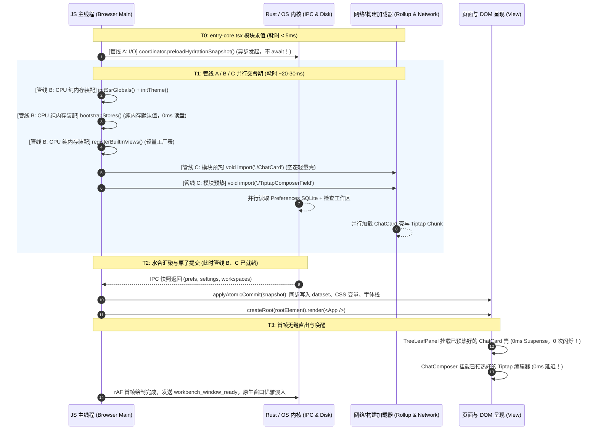
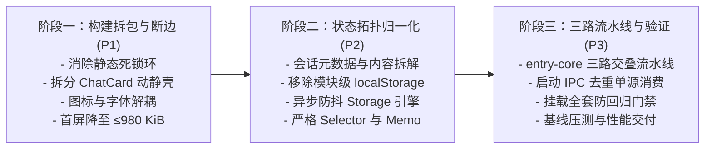

# 全栈性能优化方案 — Part 10 冷启动链路与构建拆包 + Part 01 状态管理与重渲染级联交叉架构方案

> **方案编号**：PLAN-CROSS-10-01
> **责任角色**：前端性能优化架构方案规划专家（负责 Part 10 冷启动链路、构建拆包与首屏水合 + Part 01 状态管理与重渲染级联）
> **输入审计资产**：
>
> 1. [`docs/full-stack-performance-audit/audits/10-前端冷启动链路构建拆包与首屏水合性能审计.md`](file:///c:/Software/conex/docs/full-stack-performance-audit/audits/10-%E5%89%8D%E7%AB%AF%E5%86%B7%E5%90%AF%E5%8A%A8%E9%93%BE%E8%B7%AF%E6%9E%84%E5%BB%BA%E6%8B%86%E5%8C%85%E4%B8%8E%E9%A6%96%E5%B1%8F%E6%B0%B4%E5%90%88%E6%80%A7%E8%83%BD%E5%AE%A1%E8%AE%A1.md)（16 项问题：`PERF-DIM10-001` ~ `PERF-DIM10-016`）
> 2. [`docs/full-stack-performance-audit/audits/01-前端状态管理与重渲染级联性能审计.md`](file:///c:/Software/conex/docs/full-stack-performance-audit/audits/01-%E5%89%8D%E7%AB%AF%E7%8A%B6%E6%80%81%E7%AE%A1%E7%90%86%E4%B8%8E%E9%87%8D%E6%B8%B2%E6%9F%93%E7%BA%A7%E8%81%94%E6%80%A7%E8%83%BD%E5%AE%A1%E8%AE%A1.md)（18 项问题：`ISSUE-01` ~ `ISSUE-18`）
> 3. 相关核心代码库：`apps/crish-desktop/vite.config.ts`、`apps/crish-desktop/src/main.tsx`、`apps/crish-desktop/src/entry-core.tsx`、`apps/crish-desktop/src/App.tsx`、`apps/crish-desktop/src/store/**`、`apps/crish-desktop/src/services/view-registry/**`、`apps/crish-desktop/src/app/UnifiedAppHydrationCoordinator.ts`
>    **设计纪律**：严格遵守《通用任务三原则》（实事求是、系统性思维、第一性原理）、`AGENTS.md` 反退避与立体验证纪律、`ANTI_OVERENGINEERING_GUARDRAILS.md` 反过度设计红线。全量 34 项问题同权覆盖，不设 P0/P1 优先级砍项，不谈排期与工时，直击底层架构断层与代码根因。

---

# 一、方案总览与架构演进全景

## 1.1 总体使命与边界锁定

在桌面级 AI 客户端架构演进中，**应用冷启动耗时（Cold Startup Latency & TTI）** 与 **状态树运行时重渲染级联（State Topology & Cascade Re-rendering）** 是互为因果、深度耦合的孪生系统：

1. **构建与依赖耦合的恶性循环**：如果状态层（`src/store/**`）或底层数据抽象（`src/api/providerProfiles`、`src/api/chat-bridge`）与顶层重型 UI 组件（`src/components/ui`、`ToastContext`、`MarkdownBlockItem`、`NotePaperPanel`）存在任何反向静态引用，Vite / Rollup 在执行构建拆包（Code Splitting）时就会因贪婪静态依赖吸收（`addStaticDependenciesToManualChunk`）将成百上千个模块卷入首屏入口 Chunk，使首屏包膨胀至 1.5MB+ 并产生强连通循环依赖死锁；
2. **水合时序与状态树初始化的断层**：如果在模块求值阶段（Module Evaluation Time）各个 Store（如 `layoutStore.ts`、`workspaceStore.ts`）直接执行同步 `localStorage` 读取与全量会话时间线归一化，不仅会导致首屏渲染前主线程数十毫秒的 CPU 僵死，还会与前置水合协调器（`UnifiedAppHydrationCoordinator`）发生双轨状态覆盖、字体跳变（FOUT）和重复的跨端 IPC 往返；
3. **高频运行态与静态元数据的拓扑混杂**：如果会话高频运行态（流式追加、Token 注入、工具调用流转、输入框击键）与全局会话元数据（会话列表、标题、文件夹层级、布局二叉树）存放在同一颗双轨引用分叉的 Store 树中，每一次单会话消息更新都会触发整表 `sessions` 引用翻转、触发全分屏标签栏与侧栏的级联重渲染，并在每一次 `set()` 之后触发同步 `JSON.stringify` 磁盘写入。

本方案的核心使命是：**破除构建拆包与状态拓扑之间的交叉耦合瓶颈，建立一套首屏极致精简、水合三路交叠并行、状态树归一化解耦、持久化异步非阻塞的高性能前端运行时架构**。

---

## 1.2 重构前后冷启动与状态流转端到端架构对比

### （1）重构前：串行阻塞、静态黑洞与全量级联重渲染拓扑

```
[重构前冷启动与状态拓扑流图]

   HTML 解析 (index.html)
        │
        ├──> 同步下载 8 个首屏静态 Chunk (1,516.4 KiB JS + 185.7 KiB CSS)
        │    (含贪婪吸收的 chat-provider-catalog 416KB + chat-runtime-core 325KB，存在双向循环依赖环！)
        │    (含 143 个图标的 vendor-hugeicons 118KB + 4 套字体的 vendor-fonts 8 个 .woff 冗余产物)
        │
   JS 模块求值 (T1)
        │
        ├──> layoutStore.ts 顶层导入 ───> createInitialLayoutDefaults() ──> 同步读 localStorage (全量会话反序列化)
        ├──> workspaceStore.ts 顶层导入 ─> createInitialLayoutDefaults() ──> 第二次同步读 localStorage (完全丢弃！)
        └──> note-paper / conversation-flow 桶导入 ──> 强行拉入 noteApi 全家桶与未启用的 PermissionBar
        │
   水合前置门闸 (T2: 串行阻塞 400~800ms)
        │
        └──> await preloadHydrationSnapshot()
             ├──> IPC 1: prefs_get {}
             ├──> IPC 2: fetchRecentWorkspaces (list_recent_workspaces + get_workspace_root)
             └──> CPU 同步装配 (bootstrapStores / bootstrapBuiltInViews) 被后置，处于主线程空等！
        │
   React 根挂载 (T3: createRoot)
        │
        ├──> usePlatformAdaptation ──> 30ms 主线程自旋忙等 + IndexedDB 写删库 + 3 Canvas 上下文 + 2 WebGPU
        ├──> AppBootstrap ───────────> 冗余 IPC 3: prefs_get('fonts') (覆盖 DOM 字体造成 FOUT 闪烁)
        │                            ├──> 冗余 IPC 4: fetchRecentWorkspaces (完全无视水合快照)
        │                            └──> 冗余 IPC 5 & 6: 两次 projectStore.refresh() 文件树全量扫描
        └──> useEngineBootstrap ──────> 与 connectionManager / bootstrap-full 三路重复并发轮询 core_get_status
        │
   首屏主视图挂载 (T4: 发生两次串行 Suspense 瀑布！)
        │
        └──> TreeLeafPanel 挂载 LazyChatCard ──> 首次渲染白屏/加载中闪烁
             └──> 下载 ChatCard (869.6 KB 依赖) ──> 空草稿态白白拉取 highlight.js、157KB 模型目录与 Worker
                  └──> 挂载 ChatComposer ──> 第二次动态加载 TiptapComposerField (406.6 KB)
        │
   运行时高频状态更新 (T5: 重渲染级联与主线程卡顿)
        │
        ├──> 单会话消息/工具更新 ─> sessionsById 翻转 ─> 全分屏 PaneHeader / PaneTabItem / AgentCard 全部重渲染
        ├──> 隐藏抽屉面板 (display:none) ─────────> OverviewCard / AgentCard 后台持续 1s 定时扫描与重渲染
        ├──> 输入框打字 (setComposerDraft) ───────> 每击键一次同步 JSON.stringify + localStorage.setItem
        └──> 二叉树拖拽 (resizeBranch) ────────────> 每帧同步写 localStorage + 全树 collectLeaves 递归遍历
```

---

### （2）重构后：三路交叠流水线、解耦拆包与归一化响应式拓扑

```
[重构后三路交叠流水线与解耦状态拓扑]

                    HTML 解析 (index.html)
                              │
  ┌───────────────────────────┴───────────────────────────┐
  │ 首屏静态图预算硬门禁：JS ≤ 980 KiB, 零循环依赖, 零 UI 依赖黑洞 │
  │ - index.js 瘦身至 210 KiB (切断 App 到 providerProfiles/dialogs 的静态边)
  │ - 图标库双层切分: coreIconMap 仅 24 KiB (~28 个高频图标), 扩展图标动态按需拉取
  │ - 字体按家族解耦: 剔除 8 个 .woff 冗余文件, 仅按需加载当前激活字体的 woff2
  └───────────────────────────┬───────────────────────────┘
                              │
  ┌───────────────────────────▼─────────────────────────────────────────────────┐
  │                   T1: 三路并行交叠水合流水线 (Overlap Pipeline)                 │
  ├───────────────────────────┬────────────────────────────┬────────────────────┤
  │    【管线 A：I/O 预取】   │   【管线 B：CPU 纯内存装配】 │ 【管线 C：模块预热】 │
  │                           │                            │                    │
  │ UnifiedAppHydration       │ bootstrapStores()          │ 并行预取默认主视图 │
  │ Coordinator               │ - 纯内存初始默认值         │ - 预拉 ChatCard 壳 │
  │ .preloadHydrationSnapshot │ - 彻底清除模块级读写 disk  │ - 预拉 Tiptap 核心 │
  │ - 单次聚合快照 IPC 探测    │ registerBuiltInViews()     │ (水合期完全掩盖网络 │
  │ - 硬件指纹命中缓存直接返回 │ memoryManager.start()      │  传输延迟，挂载即就绪)│
  └───────────────────────────┴────────────────────────────┴────────────────────┘
                              │
  ┌───────────────────────────▼─────────────────────────────────────────────────┐
  │                   T2: 事务性原子 Commit 与 React 挂载                        │
  │ - applyAtomicCommit()：同步刷写 DOM dataset、CSS 变量、字体栈并注入 Store    │
  │ - createRoot(rootElement).render(<App />)                                   │
  │ - 首帧 rAF 与 DOM 真实就绪后触发唯一 workbench_window_ready，彻底消除白屏与闪烁 │
  └───────────────────────────┬─────────────────────────────────────────────────┘
                              │
  ┌───────────────────────────▼─────────────────────────────────────────────────┐
  │                   T3: 单源消费与零冗余启动副作用                             │
  │ - 字体水合：hydrateFontsFromSnapshot 同步置入缓存，AppBootstrap 零 IPC 返回   │
  │ - 工作区：AppBootstrap 直接消费 hydrationStore 快照，零冗余 fetchRecentWorkspaces│
  │ - 文件树：收敛为唯一一次单次 projectStore.refresh()                           │
  │ - 引擎探针：tauriTransport In-Flight Promise 合并，ConnectionManager 唯一状态源│
  │ - 硬件适配：命中 localStorage 缓存 0ms 返回，禁止 30ms 自旋与临时建库          │
  └───────────────────────────┬─────────────────────────────────────────────────┘
                              │
  ┌───────────────────────────▼─────────────────────────────────────────────────┐
  │                   T4: 归一化状态树与精准响应式边界                           │
  │ - 状态树分离：单会话运行态 (messagesBySession) 与 全局元数据 (sessionMeta) 分离 │
  │ - 单会话高频写操作：$O(1)$ 字典更新，不翻转 sessionMeta[] 数组与其它窗格引用    │
  │ - 选择器规范：PaneHeader / TabItem 窄化标量订阅 + 稳定闭包，memo 100% 生效    │
  │ - 抽屉休眠：非激活面板休眠 Zustand 订阅与定时器，切断后台无谓计算              │
  │ - 持久化引擎：引用守卫短路 + 300ms 异步防抖，打字与拖拽彻底移出同步阻塞主线程    │
  └─────────────────────────────────────────────────────────────────────────────┘
```

---

## 1.3 核心性能指标提升预期矩阵（34 项问题综合量化对照）

| 指标维度                               | 当前基线实测值                   | 重构后目标值                       | 提升幅度 / 量化收益                              | 解决的问题清册编号                 |
| :------------------------------------- | :------------------------------- | :--------------------------------- | :----------------------------------------------- | :--------------------------------- |
| **首屏静态图 JS 体积**                 | 1,516.4 KiB (1,552.8 KB)         | **≤ 890 KiB**                      | **缩减 ~41.3% (-626 KB)**                        | PERF-DIM10-001, 003, 004, 013, 014 |
| **首屏阻塞 CSS 体积**                  | 185.7 KiB (190.2 KB)             | **≤ 95 KiB**                       | **缩减 ~48.8% (-95 KB)**                         | PERF-DIM10-001, 004, 005           |
| **静态 Chunk 有向环数量**              | 1 处死锁环 (`catalog ↔ runtime`) | **0 处（绝对零环）**               | **消除 TDZ 运行时隐患**，门禁刚性拦截            | PERF-DIM10-002                     |
| **空草稿态首屏非空依赖**               | 583.5 KB (代码高亮/厂商/Worker)  | **0 KB（完全按需）**               | **冷启动首屏少下载/解析 583 KB**                 | PERF-DIM10-006                     |
| **首屏主视图 Suspense 瀑布**           | 2 阶串行延迟 (~300-500ms)        | **0 阶（水合期并行预热就绪）**     | **消除首屏 "加载中…" 闪烁**                      | PERF-DIM10-006, 007                |
| **启动期跨端 IPC 调用总数**            | 11~14 次（大量重复）             | **≤ 4 次（单源合并）**             | **减少 65%+ 跨进程 IPC 往返**                    | PERF-DIM10-009, 010, 011           |
| **启动期主线程 CPU 阻塞（Long Task）** | 30ms 自旋 + 2 次全表解析 (~80ms) | **0 ms**                           | **消除首屏所有 CPU 忙等与冗余反序列化**          | PERF-DIM10-012, ISSUE-13           |
| **硬件探测主线程耗时**                 | 35~80ms (含 WebGL/DB 写删)       | **< 1 ms (命中持久化缓存)**        | **彻底消除启动期临时 IndexedDB I/O**             | PERF-DIM10-012                     |
| **单会话消息更新重渲染范围**           | 全分屏 PaneHeader/Tab/侧栏/卡片  | **仅当前窗格当前消息行**           | **组件重渲染规模从 $O(K \times T)$ 降为 $O(1)$** | ISSUE-01, 04, 05, 06, 08           |
| **隐藏抽屉后台重渲染与定时器**         | 持续 1s tick + 持续响应写操作    | **0 次（休眠挂起）**               | **多分屏场景下节省 80%+ 后台无谓计算**           | ISSUE-03                           |
| **输入框打字主线程卡顿**               | 每次击键同步写 localStorage      | **0ms 同步磁盘 I/O（防抖异步）**   | **消除打字高频输入掉帧与 SQLite 锁竞争**         | ISSUE-14                           |
| **分屏拖拽帧率稳定性**                 | 每帧 JSON.stringify 全树并写盘   | **60/120 fps 丝滑（内存态+防抖）** | **彻底消除拖拽过程中的 Jank 卡顿**               | ISSUE-12, ISSUE-14                 |
| **长会话消息查找与追加复杂度**         | $O(M)$ 线性正向扫 + 全量键分配   | **$O(1)$ 逆向尾部命中 + 原地二分** | **长会话（500+ 条）流式更新吞吐量提升 10x**      | ISSUE-09, ISSUE-16                 |
| **侧栏长列表重渲染行数**               | 切换会话全列表 $N$ 行全刷        | **精确 2 行（旧行 + 新行）**       | **会话切换延迟降低至 < 16ms**                    | ISSUE-16, ISSUE-17                 |

---

# 二、Part 10：冷启动链路与构建拆包极致优化方案

---

## 2.1 模块依赖断边与 Rollup `manualChunks` 边界重构（解决 PERF-DIM10-001）

### 1. 架构病灶与机理剖析

`apps/crish-desktop/vite.config.ts:846-877` 使用粗粒度路径匹配：

- 凡路径包含 `/src/api/providerProfiles`、`/src/api/modelCatalog` 等归入 `chat-provider-catalog`；
- 凡路径包含 `/src/api/chatStreamBridge`、`/src/api/chat-bridge/` 等归入 `chat-runtime-core`。

Rollup 在执行 `addStaticDependenciesToManualChunk` 算法时，具有贪婪吸收未命名模块的特性：

1. `contextStatePending.ts:22,29` 作为 `chat-provider-catalog` 的种子模块，静态导入了 `src/store/storeAccess.ts`，进而将全量 Zustand Store、IPC 传输层（`tauriTransport`）、命令映射表（`commandMap`）、事件总线（`EventBus`）等 **237 个业务源码模块（1.53 MB 源码）** 全部吸入 `chat-provider-catalog`，导致该 Chunk 膨胀至 **416.2 KB**；
2. `continuityHandlers.ts:15` 作为 `chat-runtime-core` 的种子模块，静态导入了 `useGoalMode.ts`，后者静态导入了 `ToastContext` → `ToastCard` → `components/ui/index.ts`，从而把全量 18 套 UI 组件家族及 `@radix-ui` 等 **112 个模块** 贪婪吸入 `chat-runtime-core`，JS 膨胀至 **324.6 KB**，并意外带出 **83.0 KB** 的首屏阻塞 CSS！

### 2. 根因级解耦断边设计

必须严格切断底层 API / 传输层对上层 Store / UI 的反向静态引用：

```
[重构前反向依赖链]
continuityHandlers.ts ──> useGoalMode.ts ──> ToastContext ──> ToastCard ──> components/ui ──> 全量 18 套 UI 组件 + CSS
contextStatePending.ts ──> storeAccess.ts ──> 全量 Store 桶 (sessionStore, layoutStore, ...) ──> 237 个业务模块

[重构后正向单向依赖与纯契约下沉]
continuityHandlers.ts ──> goalRoundReducer.ts (纯函数，零 UI / Toast / Hook 依赖)
contextStatePending.ts ──> contextStateContracts.ts (零依赖纯契约，由运行时注入窄 Reader 接口)
```

1. **下沉纯契约与纯函数**：
   - 创建 `apps/crish-desktop/src/api/contextStateContracts.ts`：提取 `isContextStateCarrierMessage`、`ContextStatePayload` 等纯谓词与接口定义，不依赖任何 Store。`contextStatePending.ts` 仅依赖此纯契约文件；
   - 提取会话读取窄接口：`contextStatePending.ts` 所需的会话状态改为通过函数参数注入或轻量上下文 `SessionSnapshotReader` 提供，切断直连 `storeAccess`；
   - 创建 `apps/crish-desktop/src/api/chat-bridge/goalRoundReducer.ts`：将 `applyGoalRoundEventToGoalMode` 归约纯函数从 `useGoalMode.ts` 剥离，完全移除对 `getGoalLoopOrchestrator` 与 `toast` 的导入。
2. **收敛 `manualChunks` 分包规则**：
   - 废除上层业务代码的手工粗粒度匹配。仅将 **无外部副作用的纯第三方库** 和 **纯静态配置数据** 划分进命名 ManualChunk：
     - `vendor-react`: `['react', 'react-dom', 'scheduler']`
     - `vendor-zustand`: `['zustand', 'immer']`
     - `vendor-hugeicons-core`: 仅核心图标子集
     - `vendor-pretext`: `@chenglou/pretext`
     - `vendor-dompurify`: `dompurify`
   - 对业务代码，移除贪婪的 `chat-provider-catalog` 与 `chat-runtime-core` 强制分包声明，交由 Rollup 根据自然动态导入边界自动分割为最小公共 Chunk（如 `chunk-protocol`、`chunk-event-bus`），杜绝「一人进包，全家陪葬」的黑洞效应。

---

## 2.2 跨 Chunk 双向静态循环依赖切断与门禁闭环（解决 PERF-DIM10-002）

### 1. 架构病灶与机理剖析

运行 `node scripts/check-chunk-cycles.mjs` 实测报错：

```text
[check-chunk-cycles] FAIL: 1 static chunk cycle(s) detected:
  1. chat-provider-catalog-Do8nljKF.js -> chat-runtime-core-8xZhiFK3.js -> chat-provider-catalog-Do8nljKF.js
```

- **正向边**：`sessionStore.ts` → `sessionActivateHydrate.ts` → `sessionEventHydrate.ts` → `sessionEventProjection.ts:17,19`（吸入 `chat-provider-catalog`）静态导入了 `chat-bridge/handlers/eventParser` 与 `toolUtils`（归属于 `chat-runtime-core`）；
- **反向边**：`chat-bridge/readiness.ts:12`（归属于 `chat-runtime-core`）静态导入了 `src/api/providerProfiles.ts`（吸入 `chat-provider-catalog`）。

这导致两个巨型 Chunk（合计 740.8 KB JS）形成强连通死锁分量，存在严重的暂时性死区（TDZ）与首屏静态图强制联结问题。且 `package.json` 中的 `check:desktop` 遗漏挂载该脚本。

### 2. 根治方案与纯协议编解码层提取

```
[切断死锁环前后拓扑]

重构前：
chat-provider-catalog (sessionEventProjection.ts) ───[import parseEventPayload]───> chat-runtime-core (eventParser.ts)
chat-runtime-core (readiness.ts) ───────────────────[import getActiveProfile]────> chat-provider-catalog (providerProfiles.ts)
(形成双向死锁环！)

重构后：
                     ┌──────────────────────────────────────────────┐
                     │ src/api/protocol/eventPayloadCodec.ts (纯契约) │
                     │ - parseEventPayload / extractToolDetails     │
                     └──────────────────────┬───────────────────────┘
                                ▲           ▲
                                │ (单向引用) │ (单向引用)
    chat-provider-catalog ──────┘           └─────── chat-runtime-core
    (sessionEventProjection.ts)                     (eventParser.ts)

    chat-runtime-core (readiness.ts) ──[读取轻量状态切片]──> settingsStore (解耦 providerProfiles.ts 静态边)
```

1. **提取零依赖协议编解码层 `eventPayloadCodec.ts`**：
   - 在 `apps/crish-desktop/src/api/protocol/eventPayloadCodec.ts` 中实现 `parseEventPayload`、`extractToolDetails` 与 `unwrapEventEnvelope`，该模块严格保持零外部业务依赖；
   - `sessionEventProjection.ts` 与 `chat-bridge/handlers/*` 均单向依赖此纯编解码模块，彻底切断 `sessionStore` → `chat-runtime-core` 的反向边。
2. **解耦 `readiness.ts`**：
   - `readiness.ts` 读取 `getActiveModelId` / `getActiveProfileId` 改为读取 `settingsStore` 的轻量状态切片或由调用方参数传入，切断 `chat-runtime-core` → `providerProfiles` 的逆向边。
3. **门禁流水线刚性闭环**：
   - 在根 `package.json:50` 的 `check:desktop` 中挂载 `npm run check:chunk-cycles`；
   - 在 `FULL_CHECK_COMMANDS.md` 与 CI 阻断脚本中强制执行，确保生产产物中的静态 chunk 环数硬性为 `0`。

---

## 2.3 首屏静态图预算硬门禁（≤980 KiB）与入口解耦（解决 PERF-DIM10-003）

### 1. 架构病灶与机理剖析

`dist/index.html` 的首屏预加载图当前高达 **1,516.4 KiB JS + 185.7 KiB CSS**。
主要原因在于 `App.tsx` 顶层静态导入了 `firstRunWizardLib.ts`（`App.tsx:14`）与 `AppGlobalDialogs.tsx`（`App.tsx:20`），而两者均在顶层静态 `import ... from '../api/providerProfiles'`；同时 `App.tsx:2` 静态导入 `layoutStore.ts` 顺流拉入全量会话与运行态。
此外，`scripts/check-startup-budget.mjs:65-67` 目前仍使用过渡放宽阈值 `DEFAULT_STATIC_GRAPH_BUDGET_KB = 1800` 且 `DEFAULT_STATIC_GRAPH_DENY = []`，失去了防御能力。

### 2. 根治方案设计

1. **`App.tsx` 顶层静态断边**：
   - 移除 `App.tsx:14` 的 `import { shouldShowWizard } from './components/firstRunWizardLib'`。`shouldShowWizard` 仅在 `AppBootstrap.ts:172` 的首屏异步队列（`setTimeout`）中被调用，改为在函数内使用动态 `await import('../components/firstRunWizardLib')` 按需评估；
   - 改造 `AppGlobalDialogs.tsx`：移除顶层的 `import { getActiveModelId, getActiveProfileId } from '../api/providerProfiles'`，改为由弹窗内部按需读取或仅当对话框处于打开状态时动态加载；
   - 切断 `layoutStore` 导入对 `sessionStore` 的同步依赖（见下文 3.3 节），首屏入口 `index-*.js` 仅需承载核心壳层。
2. **收紧门禁预算与激活黑名单**：
   - 修改 `scripts/check-startup-budget.mjs`：
     ```js
     const DEFAULT_ENTRY_BUDGET_KB = 280; // 入口 index-*.js 预算从 350 下调至 280 KiB
     const DEFAULT_STATIC_GRAPH_BUDGET_KB = 980; // 全静态图预算由 1800 刚性收紧至 980 KiB
     const DEFAULT_STATIC_GRAPH_DENY = [
       'vendor-tiptap',
       'vendor-highlight',
       'vendor-codemirror',
       'vendor-xterm',
       'chat-runtime-core',
       'vendor-workers',
     ];
     ```
   - 任何改动若导致上述重型 Chunk 渗入首屏 `<link rel="modulepreload">`，CI 门禁立即失败阻断。

---

## 2.4 扩展加载解耦与按需门控（解决 PERF-DIM10-004）

### 1. 架构病灶与机理剖析

`entry-core.tsx:25-32` 在首屏同步导入了两个扩展：

1. `import { registerNotePaperExtension } from './extensions/note-paper'`：桶文件 `extensions/note-paper/index.ts` 重导出了 `productLeafBindings.ts`，后者在顶层静态导入了 `../../api/noteApi`（460 行，包含完整的便签 Wire、Memory 与 Document 实现），使得从未打开便签的用户首屏包无端增大；
2. `import { registerConversationFlowExtension } from './extensions/conversation-flow'`：该扩展的 `activate.ts:6` 在文件顶层无条件静态导入了 `PermissionBar.tsx` 及其样式和 `components/ui`。而在默认生产环境下 `shouldActivateOfficialConversationFlow()` 恒为 `false`，导致死分支代码无条件打包进首屏。

### 2. 根治方案设计

1. **`note-paper` 桶导出拆解与按需直连**：
   - 改造 `extensions/note-paper/index.ts`，仅导出轻量类型与激活器；
   - `entry-core.tsx` 直接从 `./extensions/note-paper/activate` 导入注册函数；
   - `productLeafBindings.ts` 内部的 `openNoteDocument / saveNoteDocument` 改为在方法调用时按需 `const { openNoteDocument } = await import('../../api/noteApi')`，将便签 API 与首屏主包彻底隔离。
2. **`conversation-flow` 门控与 `PermissionBar` 懒加载**：
   - 改造 `extensions/conversation-flow/activate.ts`，移除顶层 `import { PermissionBar } from './PermissionBar'`；
   - 当且仅当 `shouldActivateOfficialConversationFlow()` 返回 `true` 时，采用 `React.lazy(() => import('./PermissionBar'))` 注册进对应 Slot；默认未启用状态下零代码打包进首屏。

---

## 2.5 常驻壳层弹窗/右键菜单懒挂载与 UI 组件子路径精确化（解决 PERF-DIM10-005）

### 1. 架构病灶与机理剖析

1. `AppGlobalDialogs.tsx:3` 静态导入了 `TelemetryDialog`，使得遥测弹窗成为首屏静态树的一部分；
2. `Sidebar.tsx:13,30` 无条件挂载 `<SidebarContextMenus>` 与 `<ConfirmDialog open={Boolean(deleteConfirmSessionId)}>`，导致右键菜单与确认弹窗在首屏初始化时无条件求值并消耗 React reconciliation 开销；
3. `src/components/ui/index.ts` 汇集了 18 套组件（含重型 `Select`、`Combobox`、`Dialog`、`Menu`），任何文件导入 `{ Button }` 都会拉入全部组件的代码与样式。

### 2. 根治方案设计

1. **弹窗与菜单按需条件挂载与懒加载**：
   - `AppGlobalDialogs.tsx` 中的 `TelemetryDialog` 声明为 `React.lazy(() => import('../components/overlay/TelemetryDialog'))`；
   - `Sidebar.tsx` 改为条件挂载：
     ```tsx
     {Boolean(deleteConfirmSessionId) && (
       <Suspense fallback={null}>
         <LazyConfirmDialog open={true} ... />
       </Suspense>
     )}
     {(contextMenu !== null || folderMenu !== null) && (
       <Suspense fallback={null}>
         <LazySidebarContextMenus ... />
       </Suspense>
     )}
     ```
2. **UI 组件子路径精确导入与无副作用标记**：
   - 建立 UI 组件按需子路径规范：高频壳层组件直接从 `@/components/ui/button`、`@/components/ui/tooltip` 导入；
   - 在 `package.json` 或 Vite 配置中为 UI 目录确保纯 ESM Tree-shaking，杜绝导出桶污染。

---

## 2.6 默认主视图 `ChatCard` 空态/消息态解耦与预热消除瀑布（解决 PERF-DIM10-006）

### 1. 架构病灶与机理剖析

`layoutTreeStore` 默认冷启动树固定包含 `viewType: 'chat'` 的叶子节点。然而 `'chat'` 视图工厂使用 `React.lazy`：

1. **三跳串行瀑布**：
   - 跳 1：浏览器下载并执行 1,516 KiB 入口静态图，等待 IPC 水合门闸，挂载 `<App />`；
   - 跳 2：`TreeLeafPanel` 渲染 `<LazyChatCard />` 抛出 Promise，工作区显示 `"加载中…"`，开始拉取 `ChatCard`（869.6 KB）；
   - 跳 3：`ChatCard` 挂载 `<ChatComposer />` 后，`ChatComposer` 又抛出 Promise 动态拉取 `_vendor-tiptap`（403.9 KB）。
2. **零消息草稿态被强塞 583.5 KB 非空消息依赖**：
   冷启动默认无消息（`messages.length === 0`），仅需渲染 `<ChatEmptyState />` 与 `<ChatComposer />`。但因 `ChatCard.tsx:3` 静态导入 `ChatMessageList`，导致强制拉取 `ChatAssistantMessageRow`、`highlight.js`（111KB）、157KB 模型厂商目录及 Worker 池管理模块！

### 2. 根治方案：壳态拆分 + 水合期模块预热重叠

```
[ChatCard 架构拆分与预热时序]

重构前（静态深层绑定 + 串行加载）：
ChatCard ──(静态 import)──> ChatMessageList ──> ChatAssistantMessageRow ──> highlight.js + 157KB 模型目录
(首屏白白下载 869.6 KB，且 TreeLeafPanel 挂载时才开始下载，工作区显示 "加载中…")

重构后（动静分离 + 三路交叠流水线预热）：
1. ChatCard 壳层仅保留：ChatEmptyState + ChatComposer (极轻量，~18 KB)
2. ChatMessageList 独立为 Lazy 模块：
   const LazyChatMessageList = React.lazy(() => import('../chat-message-list/ChatMessageList'));
   当且仅当 messages.length > 0 || isStreaming 时才挂载！
3. 预热流水线重叠：
   在 entry-core.tsx 发起 preloadHydrationSnapshot() 的瞬间，主线程后台同时触发：
   void import('./components/chat-card/ChatCard');
   void import('./components/chat-composer/TiptapComposerField');
   当 IPC 水合返回、createRoot 挂载 TreeLeafPanel 时，ChatCard 与 Tiptap 模块均已就绪（Resolved），
   直接同步渲染，彻底消除 "加载中…" 闪烁与 300ms 瀑布延迟！
```

1. **`ChatCard` 动静解耦**：
   - `ChatCard.tsx` 仅同步导入 `ChatEmptyState`、`ChatLandingBrand` 与 `ChatComposer`；
   - 将 `ChatMessageList` 改为 `React.lazy` 按需导入。在零消息草稿态下，完全不加载语法高亮、模型厂商大字典与 Worker 依赖；
   - 在用户键入第一个字符或会话收到首条消息时，后台静默预热 `ChatMessageList`。
2. **水合期主视图预热（Preload Overlap）**：
   - 见下文 2.7 节与 4.1 节，在启动水合发起时同步触发 `ChatCard` 与 `TiptapComposerField` 模块拉取，将网络下载时间完全隐藏于 IPC 等待时间中。

---

## 2.7 `preloadHydrationSnapshot` CPU-IO 并行流水线重叠（解决 PERF-DIM10-007）

### 1. 架构病灶与机理剖析

`entry-core.tsx:187` 在调用 `bootstrapStores()`、`bootstrapBuiltInViews()` 与 `createRoot().render()` 之前，强制 `await UnifiedAppHydrationCoordinator.preloadHydrationSnapshot()`（Tauri 环境门闸超时 800ms）。
在此期间，CPU 主线程处于空转状态；等 IPC 返回后，主线程才串行执行 15~30ms 的初始化装配，人为拉长了 TTI。

### 2. 根治方案：CPU-IO 异步重叠管道

在 `startApp()` 中发起 `const snapshotPromise = coordinator.preloadHydrationSnapshot()` 后，**绝不立即 await**，而是立即在主线程执行同步装配工作与模块预取：

```ts
// entry-core.tsx 改造实现方案
async function startApp(): Promise<void> {
  const coordinator = UnifiedAppHydrationCoordinator.getInstance();

  // 1. 发起跨进程 IPC 预取（后台 I/O 运行）
  const snapshotPromise = coordinator.preloadHydrationSnapshot();

  // 2. 在等待 IPC I/O 期间，主线程并行执行 CPU 纯内存装配与视图注册（耗时约 15-20ms）
  initSsrGlobals();
  initVisualPresentationController();
  bootstrapStores(); // 纯内存默认值，零 disk I/O
  registerBuiltInViews(builtinViewFactories);
  memoryManager.start();

  // 3. 同时并行触发首屏主视图 Chunk 预热（与 IPC I/O 共享网络/磁盘带宽）
  void import('./components/chat-card/ChatCard');
  void import('./components/chat-composer/TiptapComposerField');

  // 4. 等待水合快照（此时 IPC 大概率已经返回或即将返回）
  const snapshot = await snapshotPromise;

  // 5. 毫秒级原子 Commit 并立即挂载 React 根树
  coordinator.applyAtomicCommit(snapshot);
  const root = createRoot(rootElement);
  root.render(<AppRoot />);
}
```

通过该方案，主线程的 CPU 装配时间与网络模块预取时间被 100% 隐藏在 IPC 等待的 I/O 间隙中。

---

## 2.8 原生窗口唤醒时序收口与防闪烁治理（解决 PERF-DIM10-008）

### 1. 架构病灶与机理剖析

`public/loader.js:25-49` 在首帧 `requestAnimationFrame`（此时 `#skel-app` 骨架刚显示，JS 主包尚未求值完成）就调用 Tauri IPC `workbench_window_ready` 显示原生窗口。
若用户未命中本地缓存或首次启动，窗口显示时仍是默认背景，随后水合完成时经历从浅色到真实深色/材质的视觉跳变闪烁。

### 2. 根治方案设计

1. **收口主唤醒通道**：
   - 将 `workbench_window_ready` 的主触发时机收口到 `applyAtomicCommit()` 完成主题、字体与 DOM dataset 写入，且 React 首帧完成挂载的第一个 `requestAnimationFrame` 中（与移除 `#skel-app` 同步执行）；
2. **`loader.js` 仅作超时防死锁兜底**：
   - 在 `loader.js` 中保留一个 1200ms 的超时兜底定时器（仅在前端 JS 发生严重致命崩溃未能挂载时强制唤醒窗口，以便向用户展示错误界面）。常规启动下，原生窗口展示的第一帧即是水合完毕的真实 UI，实现 0 闪烁。

---

## 2.9 字体水合单轨收敛与零冗余 IPC（解决 PERF-DIM10-009）

### 1. 架构病灶与机理剖析

1. `UnifiedAppHydrationCoordinator.preloadHydrationSnapshot()` 通过 IPC 拿到用户的自定义字体配置 `snapshot.fonts`，并在 `applyAtomicCommit()` 中调用 `applyFontStacks(snapshot.fonts)` 写入 DOM；但未更新 `fontStore.ts` 内部的 `cachedFonts`（仍为默认值 `'auto'`）；
2. `App.tsx` 挂载后，`AppBootstrap.ts:160` 调用 `bootstrapFonts()`，其第一行立即执行 `applyFontStacks(cachedFonts)`——**直接用默认值覆盖掉了刚刚生效的用户字体**；
3. 随后 `bootstrapFonts()` 再次发起 `prefs_get('fonts')` 第二次 IPC，导致 DOM 字体先被重置为默认值再跳变回自定义字体（严重 FOUT 闪烁与冗余 IPC）。

### 2. 根治方案设计

1. **在 `fontStore.ts` 中提供权威水合接口 `hydrateFontsFromSnapshot`**：
   ```ts
   // apps/crish-desktop/src/api/fontStore.ts
   export function hydrateFontsFromSnapshot(fonts: FontPreferences): void {
     cachedFonts = { ...fonts };
     applyFontStacks(fonts);
     void ensureEmbeddedFontAssetsLoaded(fonts);
     fontsHydrated = true;
   }
   ```
2. **在 `applyAtomicCommit` 中调用该接口**，同步更新缓存并预加载必要字体资产；
3. **改造 `AppBootstrap.ts`**：
   当 `fontsHydrated` 为 `true` 时，`bootstrapFonts()` 直接确信已就绪，跳过 `prefs_get('fonts')` 二次 IPC，且绝不再用默认值回写 DOM。

---

## 2.10 工作区快照单源消费与文件树单次扫描（解决 PERF-DIM10-010）

### 1. 架构病灶与机理剖析

1. `UnifiedAppHydrationCoordinator.ts:312` 在 `createRoot` 前调用 `fetchRecentWorkspaces()`（包含 `list_recent_workspaces` 与 `get_workspace_root`），并将快照存入 `useHydrationStore`；
2. `AppBootstrap.ts:183` 的 `restoreRecentProject()` 完全无视已有快照，重新调用第二次 `fetchRecentWorkspaces()`（重复 2 次 IPC）；
3. `AppBootstrap.ts:155` 在未确定工作区前先无条件调用一次 `useProjectStore.getState().refresh()` 扫描文件树，随后在 `restoreRecentProject()` 确定根目录后又调用第二次 `refresh()`，导致启动期发生两次全量磁盘文件树扫描。

### 2. 根治方案设计

1. **直接消费 `hydrationStore` 快照**：
   在 `restoreRecentProject()` 中，检查 `useHydrationStore.getState().workspacesLoaded`；若为真，直接读取快照数据，禁止重复调用 `fetchRecentWorkspaces()`；
2. **文件树扫描串行单次收敛**：
   移除 `AppBootstrap.ts:155` 处抢跑的无条件 `refresh()`，统一延迟到 `restoreRecentProject()` 确定最终目标根目录后，**执行全应用生命周期内唯一一次 `projectStore.refresh()`**。

---

## 2.11 引擎连通性探针 In-Flight 合并与状态源归一（解决 PERF-DIM10-011）

### 1. 架构病灶与机理剖析

冷启动期间，`useEngineBootstrap`（React 挂载）、`ConnectionManager.connect()`（Idle 任务 1）与 `bootstrap-full.ts:ensureEngineConnected()`（Idle 任务 5）各自独立调用 `transport.waitUntilConnected()` 并每 500ms 轮询 `core_get_status`，产生 2~4 次重复的跨进程探针碰撞。

### 2. 根治方案设计

1. **传输层 In-Flight Promise 合并与水位缓存**：
   在 `tauriTransport.ts` 中维护 `waitUntilConnectedPromise: Promise<boolean> | null`。若已有飞行中的连通性探测 Promise，后续调用直接共享该 Promise 引用；连接成功后记录高精度时间戳，在 3000ms TTL 内再次调用直接返回 `true`；
2. **`ConnectionManager` 作为唯一连通性状态源**：
   `useEngineBootstrap` 改为监听 `connectionManager` 的状态发布，废除 `bootstrap-full.ts` 中重复的 `ensureEngineConnected()` 逻辑。

---

## 2.12 硬件画像持久化与主线程零 CPU 自旋/零临时 DB（解决 PERF-DIM10-012）

### 1. 架构病灶与机理剖析

`App.tsx:67` 挂载即调用 `usePlatformAdaptation`（默认 `skipStorageBench: false`），在首屏最关键的 500ms 窗口期制造了极其恶劣的开销：

1. **30ms 同步 CPU 自旋忙等**：`benchmarkCpuSpeed` 连续跑 3 轮 `while(performance.now() - t0 < 10)` 死循环，硬生生冻结 UI 主线程 30ms；
2. **临时 IndexedDB 磁盘建删库**：每次打开应用都建库、写 1KB 随机 Blob 再删库；
3. **创建 3 个 Canvas/WebGL 上下文且未释放**：WebView2 首次创建 WebGL2 会导致 GPU 进程编译 ANGLE 着色器，耗时 15~50ms；
4. 与 `bootstrap-core.ts:26-30` 重复检测。

### 2. 根治方案设计

1. **硬件画像持久化（SSOT Hardware Profile Cache）**：
   机器硬件参数在同台物理机上高度稳定。将探测结果按版本格式（`crish:hardware-profile:v2`）持久化至 `localStorage`。冷启动时若命中缓存，**0ms 同步返回已有画像**，彻底跳过 WebGL 上下文创建、IndexedDB 测试与 CPU 基准测试；
2. **彻底废除 30ms CPU 忙等与临时 IndexedDB 测试**：
   - 默认启用 `skipStorageBench: true`；
   - 移除 `benchmarkCpuSpeed` 主线程同步死循环，改为基于 `navigator.hardwareConcurrency` 与 `deviceMemory` 直接进行性能降级推导；
   - 若首次无缓存启动需检测 WebGL，检测完毕后必须显式调用 `gl.getExtension('WEBGL_lose_context')?.loseContext()` 释放 GPU 显存与句柄；
3. **合并双套检测**：统一收口至 `usePlatformAdaptation`，废除 `bootstrap-core.ts` 中的冗余调用。

---

## 2.13 图标库双层切分与按需视图打包（解决 PERF-DIM10-013）

### 1. 架构病灶与机理剖析

`iconMap.ts:11-154` 顶层静态导入了 143 个图标对象，被 `vite.config.ts` 打包为 **117.8 KB** 的 `vendor-hugeicons` 首屏预加载包。
然而首屏核心壳层（TopBar、Sidebar、Composer、EmptyState）仅使用约 28 个核心图标，其余 115 个图标仅用于二级视图或弹窗。

### 2. 根治方案设计

1. **图标库分层解耦**：
   - 建立 `coreIconMap.ts`：仅收录首屏必需的 28 个高频图标（如 `Message01`、`Settings01`、`Folder`、`Add01` 等），产物体积仅约 **24 KB**（首屏立即节省 **~93 KB JS**）；
   - 建立 `extendedIconMap.ts`：其余 115 个图标移入扩展表，在对应子视图（如 `DiffCard`、`SettingsPanel`、`TerminalCard`）挂载时动态合并注册；
2. **分包规则优化**：
   - 在 `vite.config.ts` 中将 `coreIconMap` 包含的图标打包为 `vendor-icons-core`，其余图标允许由 Rollup 自动 Tree-shaking 或分配进各二级视图 Chunk。

---

## 2.14 字体家族独立分包与 WOFF 冗余剔除（解决 PERF-DIM10-014）

### 1. 架构病灶与机理剖析

1. `vite.config.ts:826` 将所有 `node_modules/@fontsource` 合并为单一 `vendor-fonts`，导致 4 套字体家族（Inter、IBM Plex Sans、JetBrains Mono、IBM Plex Mono）绑死在一起，选择任一种均下载全部 4 套 CSS；
2. `@fontsource` 默认同时引入 `.woff2` 与 `.woff` 格式。现代 WebView2 / WebKit 100% 支持 WOFF2，但 Vite 仍将 8 个无用的 `.woff` 文件（~176 KB）打包进安装包。

### 2. 根治方案设计

1. **移除强制合并规则**：允许 4 套字体家族各自形成独立的动态 Chunk（`font-inter`、`font-jetbrains-mono` 等），由 `fontStoreCatalog.ts` 的动态 `import()` 按需拉取；
2. **过滤 `.woff` 产物**：在 Vite 构建插件配置中，通过正则或 Rollup 资源过滤钩子剔除 `@fontsource/**/*.woff` 文件，仅保留 `.woff2`，减少安装包体积与静态资产构建冗余。

---

## 2.15 Vite 构建依赖清理与 ModulePreload 编程式守卫（解决 PERF-DIM10-015）

### 1. 架构病灶与机理剖析

1. `vite.config.ts:777-780` 的 `optimizeDeps.include` 残留未安装的 `@codemirror/*` 4 个幽灵依赖；
2. `build.modulePreload` 未配置 `resolveDependencies` 钩子，任何静态导入依赖都会被 Vite 默认注入 `dist/index.html` 的 `<link rel="modulepreload">`。

### 2. 根治方案设计

1. 清理 `optimizeDeps.include` 与 manualChunks 中已废弃的 `@codemirror/*` 配置项；
2. 在 `vite.config.ts` 的 `build.modulePreload` 中配置 `resolveDependencies(filename, deps)`：
   ```ts
   modulePreload: {
     resolveDependencies(filename, deps, { hostId, hostType }) {
       // 刚性过滤非首屏黑名单 Chunk 进入 index.html 的 modulepreload
       const denyList = [
         'vendor-tiptap',
         'vendor-highlight',
         'vendor-xterm',
         'chat-runtime-core',
         'vendor-workers',
       ];
       return deps.filter((dep) => !denyList.some((d) => dep.includes(d)));
     },
   }
   ```

---

## 2.16 闲时任务队列非阻塞解耦与双层 Idle 拍平（解决 PERF-DIM10-016）

### 1. 架构病灶与机理剖析

`entry-core.tsx` 外层包裹 `requestIdleCallback` 动态加载 `bootstrap-core`，其内部 `StaggeredIdleQueue` 又嵌套 5 级 `rIC`。
且在 `StaggeredIdleQueue.runNext` 中，使用了 `await Promise.resolve(task.fn())` 阻塞等待——如果第 1 步 `connectionManager.connect()` 网络延迟高达数秒，后续的第 2 步 `resize-bridge`（窗口缩放）与第 3 步 `keyboard-shortcuts`（全局快捷键）被连带卡死数秒无法使用！

### 2. 根治方案设计

1. **拍平双层嵌套**：`entry-core.tsx` 在首帧渲染后直接初始化 `StaggeredIdleQueue`，省去外层多余的 `requestIdleCallback` 包装；
2. **轻量与长耗时任务解耦分流**：
   - 任务 1（`resize-bridge`）与任务 2（`keyboard-shortcuts`）属于耗时 < 1ms 的轻量事件监听绑定，置于队列最顶端优先同步注册；
   - 任务 3（`connection-manager`）与任务 4（`model-catalog`）属于跨进程 I/O，必须以**非阻塞方式（fire-and-forget）** 启动，绝不阻塞后续任务调度。

---

# 三、Part 01：Zustand 状态树拓扑与重渲染级联根治方案

---

## 3.1 会话状态树归一化解耦：单会话高频运行态与全局元数据分离（解决 ISSUE-08、ISSUE-10）

### 1. 架构病灶与机理剖析

1. **双轨冗余与 $O(N)$ 线性查找（ISSUE-08）**：
   `sessionStore.ts` 同时维护了 `sessions: SessionState[]` 与 `sessionsById: Record<string, SessionState>`。当执行写操作时，`getSessionForWrite`（`sessionIndex.ts:126`）为了规避 Immer Draft Proxy 双重分叉，每次都通过 `state.sessions.findIndex((s) => s?.id === sessionId)` 进行 $O(N)$ 线性扫描，找到后调用 `rebindSessionById` 脏化 `sessionsById`。
   其严重后果是：
   - 任何针对单个会话内部微小字段（如更新最后一条消息正文的一个 Token、更新工具状态）的修改，Immer 都会生成**全新的 `state.sessions` 顶层数组引用**与**全新的 `state.sessionsById` 顶层字典引用**；
   - 这不仅带来 $O(N)$ 浅拷贝开销，而且直接导致监听 `state.sessions` 列表级变化的全部下游（`store-persistence.ts`、`useSidebarSessions`、`OverviewCard`、`useRuntimePanelData` 等）以及全分屏中监听 `sessionsById` 的全部 `PaneHeader` 产生级联重渲染风暴！
2. **状态双轨撕裂 Bug（ISSUE-10）**：
   在 `sessionOrderingActions.ts:199-215` 的 `pinFolderSessions` 与 `unpinFolderSessions` 中，代码遍历修改 `state.sessions[i].isPinned = true/false`，却漏调了 `rebindSessionById`。结果 `state.sessions[i]` 是克隆的新对象，而 `state.sessionsById[id]` 依然指向旧引用，导致双轨数据彻底撕裂失步；同时 `deleteSession` 在同一函数内连续同步执行两次 `set()`，导致全量订阅者和持久化同步执行两次。

### 2. 根因级架构治理方案：归一化与分层实体隔离架构

```
[重构前双轨冗余混杂拓扑]
SessionStore:
  sessions: [ SessionState (含全量历史消息 messages[]) ] <────┐ 双轨混杂，任何一条
  sessionsById: { id: SessionState (含全量历史消息) }   <────┴ 消息微调导致整树脏化！

[重构后归一化分层实体拓扑]
┌────────────────────────────────────────────────────────────────────────┐
│ Tier 2A：SessionMetaStore (低频全局会话元数据)                          │
│ - sessionIds: string[] (稳定有序 ID 列表)                               │
│ - metaById: Record<string, SessionMeta> (标题, 文件夹, 置顶, 时间戳)    │
│ - activeSessionId: string                                              │
│ (仅在会话新建、重命名、拖拽移动文件夹、置顶或删除时翻转引用，流式对话期间 100% 恒定) │
└────────────────────────────────────┬───────────────────────────────────┘
                                     │ 弱关联引用
┌────────────────────────────────────▼───────────────────────────────────┐
│ Tier 2B：SessionContentStore (高频单会话消息与运行态)                    │
│ - messagesBySessionId: Record<string, SessionMessage[]>                │
│ - agentsBySessionId: Record<string, SubAgentState[]>                   │
│ - runCursorBySessionId: Record<string, EngineCursor>                   │
│ (单会话消息流式更新仅修改特定 sessionId 分支，绝不触碰全局元数据与有序列表) │
└────────────────────────────────────────────────────────────────────────┘
```

1. **会话元数据（`SessionMeta`）与消息数据（`SessionMessage[]`）解耦**：
   - 提取轻量元数据接口 `SessionMeta`（仅包含 `id`、`title`、`folder`、`isPinned`、`isArchived`、`createdAt`、`updatedAt`、`activeAgentId`）；
   - 将主数据字典收敛为单轨：`metaById: Record<string, SessionMeta>` + `sessionIds: string[]`；
   - 消息数组独立由 `messagesBySessionId: Record<string, SessionMessage[]>` 承载。会话内消息追加、编辑、工具状态流转直接在 `messagesBySessionId[sessionId]` 内部完成，**零修改 `metaById` 与 `sessionIds`**，从而让侧栏列表、分屏标签栏、窗口标题等组件在流式对话期间实现真正的 **0 次重渲染**！
2. **写操作 $O(1)$ 定位与单轨事务收敛**：
   - 彻底废除 `state.sessions.findIndex` 线性扫描，通过字典 Key 直接 $O(1)$ 寻址；
   - 修复 `pinFolderSessions` 与 `unpinFolderSessions`，保证实体修改的单轨一致性；
   - 合并 `deleteSession` 的两次同步 `set()` 为单一原子批处理：
     ```ts
     deleteSession: (wsId, sessionId) =>
       set((state) => {
         delete state.metaById[sessionId];
         state.sessionIds = state.sessionIds.filter((id) => id !== sessionId);
         delete state.messagesBySessionId[sessionId];
         delete state.composerDrafts[sessionId];
         if (state.activeSessionId === sessionId) {
           state.activeSessionId = state.sessionIds[0] || null;
         }
       });
     ```

---

## 3.2 严格选择器规范与 shallow 比较（彻底消灭宽泛订阅，解决 ISSUE-01 ~ ISSUE-07）

### 1. 架构病灶与级联爆炸深度剖析

在当前的业务组件实现中，大量存在「宽泛订阅整表对象」、「闭包破坏 `React.memo`」、「隐藏面板持续响应更新」等严重违背状态管理原则的实现：

- **ISSUE-01**：`PaneHeader.tsx:92` 订阅 `s => s.sessionsById`，且向 `PaneTabItem` 传入内联箭头函数 `onDragStart`，导致 `PaneTabItem` 的 `memo` 100% 击穿失效；任一窗格单次流式更新引发全分屏标签全部重渲染；`AgentCard` 同样全表订阅 `sessionsById` 并在未命中时进行 $O(N \times A)$ 全局扫描；
- **ISSUE-02**：`OverviewCard`、`useRuntimePanelData`、`ApprovalSection` 订阅 `s => s.sessions`，叠加 `1000ms` 无条件 `setInterval` 并在折叠态仍执行 $O(\sum M_i)$ 全量消息循环扫描；
- **ISSUE-03**：`TreeLeafPanel` 对抽屉面板（`dock.openPanelIds`）使用 `display: none` 全量保活，导致不可见面板在后台持续响应更新与运行端口探测；
- **ISSUE-04**：`PreviewCard` 订阅整颗 `SessionState` 对象仅仅为了提取 `isAiStreaming: boolean`，单会话任何字段变化均击穿预览面板；`useSessionScopedChanges` 同理；
- **ISSUE-05**：消息行内 `MessageContent` 越权订阅全局 `activeSessionId`，导致窗格焦点切换时视口内所有消息行全部重渲；且无条件订阅 `useSessionRuntimeStatus` 导致已完成历史消息在流式状态转移时全部重渲；
- **ISSUE-06**：非焦点 `TreeLeafPanel` 无条件订阅 `activeSessionId`；`UnitChromeActions` 与 `useChatMessages` 单组件内注册 6~10 次分散订阅；`useScopedSessionField` 存在手写 `useEffect` 挂载空窗期漏更新缺陷；
- **ISSUE-07**：`useDraftFolder` 错误地将全局递增计数器 `this.version` 作为快照，草稿变更时全分屏广播重渲染；`UserProfileCard` 使用 `useAuthField(s => s)` 整库订阅。

### 2. 根治治理矩阵与精准重构规范

#### （1）`PaneHeader` 与 `PaneTabItem` 窄化订阅与闭包稳定化（治本 ISSUE-01）

- **废除 `PaneHeader` 对 `sessionsById` 的订阅**：`PaneHeader` 不再订阅整张字典；
- **标题订阅下沉至 `PaneTabItem` 自身**：每个 `PaneTabItem` 内部仅订阅自己对应的标题标量：
  ```ts
  const title = useSessionStore(
    useCallback(
      (s) => (tab.sessionId ? s.metaById[tab.sessionId]?.title : tab.title),
      [tab.sessionId, tab.title]
    )
  );
  ```
  Zustand 使用 `Object.is` 比较标量字符串，当流式更新消息时，会话标题不变，`PaneTabItem` 重渲染次数严格为 **0**；
- **稳定回调函数**：`PaneHeader` 的 `handleTabClick`、`handleTabClose`、`handleDragStart` 均使用 `useCallback` 稳定引用，使 `PaneTabItem` 的 `React.memo` 真正发挥防御作用。

#### （2）`OverviewCard` 与 `ApprovalSection` 零冗余改造（治本 ISSUE-02）

- **`ApprovalSection` 零订阅化**：彻底移除组件函数体内的 `const sessions = useSessionStore(s => s.sessions)`；在用户点击审批回调内按需 `useSessionStore.getState().metaById`；
- **定时器按需挂载与 1s tick 下沉**：
  - 仅当存在运行中任务（`activeTaskCount > 0`）且总览面板当前处于展开可见状态时，才启动 `setInterval(..., 1000)`；
  - 将秒数刷新（`elapsedSeconds`）下沉至微型叶子组件 `<LiveTaskElapsedTime startTime={m.timestamp} />`，禁止时间 tick 冒泡至 `OverviewCard` 顶层。

#### （3）工具抽屉（`dock.openPanelIds`）分级休眠门控（治本 ISSUE-03）

- 区分「有状态 DOM 宿主（终端、Iframe 预览）」与「纯数据视图（总览、智能体、文件树）」：
  - 纯数据视图在非激活（`isActive === false`）时不挂载，状态持久化在轻量 UI Map 中；
  - 有状态宿主保留 DOM 挂载，但向子树注入 `VisibilityContext.Provider value={{ isVisible: isActive }}`。所有高频 Hook（如端口扫描、文件 Diff 派生、轮询）在 `!isVisible` 时短路挂起，切断后台无谓重渲染。

#### （4）`PreviewCard` 标量布尔选择器（治本 ISSUE-04）

- 将 `PreviewCard.tsx:72-78` 重构为窄布尔 Selector：
  ```ts
  const isAiStreaming = useSessionStore(
    useCallback(
      (s) => {
        if (!scopedSessionId) return false;
        const msgs = s.messagesBySessionId[scopedSessionId];
        return Boolean(msgs && msgs[msgs.length - 1]?.status === 'processing');
      },
      [scopedSessionId]
    )
  );
  ```
  只有在会话流式状态发生 `true ↔ false` 翻转时，`PreviewCard` 才触发渲染；单会话普通消息追加时零重渲染。

#### （5）`MessageContent` 作用域归正与历史消息零订阅（治本 ISSUE-05）

- 移除 `const sessionId = useSessionStore(s => s.activeSessionId)`，改为严格通过 Props / Context 读取当前消息所属的真实 `scopedSessionId`；
- 历史消息（`msg.status === 'completed'`）由于 `!isLiveTurn`，其重试状态选择器直接返回静态常量 `undefined`，彻底切断对 `useSessionRuntimeStatusStore` 的高频响应。

#### （6）`useScopedSessionField` 升级为 React 19 `useSyncExternalStore` 聚合切片（治本 ISSUE-06）

- 废弃 `useReducer + useEffect` 的手写订阅模式，全面升级为 React 原生并发防撕裂的 `useSyncExternalStore`；
- 在 `useChatMessages` 中，将对同一会话的 7 次离散订阅合并为单次 `useShallow` 结构化切片订阅。

#### （7）`useDraftFolder` 快照粒度归正与整库订阅消除（治本 ISSUE-07）

- `draftFolderRegistry` 的 `getSnapshot` 严格返回目标 `draftSessionId` 对应的文件夹字符串，禁止使用全局递增版本号；
- `UserProfileCard` 仅订阅 `{ isLoggedIn, user }` 窄对象并配合 `useShallow`，消除整库全量字段污染。

---

## 3.3 模块加载期零同步 `localStorage` 损耗与初始化拆解（解决 ISSUE-13）

### 1. 架构病灶与机理剖析

在 `apps/crish-desktop/src/store/layoutStore.ts:109` 与 `workspaceStore.ts:55` 中，由于早期重构的历史遗留，两个 Store 模块在文件顶层求值（Module Top-Level Evaluation）时均调用了一次 `createInitialLayoutDefaults()`：

```ts
// store-initializers.ts:280-295
export function createInitialLayoutDefaults() {
  const sessionSeed = sanitizeSessionSeed(seedSessions()); // 同步读全量会话并归一化！
  const initialWorkspaces = seedWorkspaces(sessionSeed.activeSessionId); // 同步读工作区！
  // ...
}
```

这导致在浏览器加载 JS 脚本、主线程尚未挂载 React 的核心阻塞期，发生了极其严重的性能浪费：

1. **`layoutStore.ts` 导入时**：同步读取 `crish_sessions_index_v1` + 读取 `activeSessionId` 对应的完整消息分片 + 运行全量 `normalizeMessageTimeline` + 运行 `populateBlocksForSessions`，耗费数十毫秒 CPU，而算出来的 `sessionSeed` 和 `initialWorkspaces` 在 `layoutStore` 中**根本没被使用，直接被丢弃**！
2. **`workspaceStore.ts` 导入时**：为了取一个布尔值 `initialTabMode: true`，**又把整套会话反序列化与归一化逻辑在主线程同步重跑了第二遍**！

### 2. 根治治理方案：模块顶层纯净默认值 + 受控启动期水合协调器

1. **彻底拆解 `createInitialLayoutDefaults()`**：
   - 移除 `layoutStore.ts` 与 `workspaceStore.ts` 顶层对 `createInitialLayoutDefaults()` 的调用；
   - `layoutStore.ts` 模块初始化仅使用极轻量的纯内存默认标量：
     ```ts
     // layoutStore.ts
     export const useLayoutStore = create<LayoutStore>()(
       withDevtools(
         withLogger(
           withPersist(
             immer((set, get) => ({
               tabModeEnabled: true,
               uiSize: 'medium',
               shellChromeMode: 'standard',
               chatMainSurface: 'chat',
               sidebarCollapsed: false,
               hydrationComplete: false,
               ...createLayoutCoreActions(set, get),
             }))
             // ...
           )
         )
       )
     );
     ```
   - `workspaceStore.ts` 同样使用静态空数组 `workspaces: []` 与 `tabModeEnabled: true` 作为初始状态，禁止在顶层调用 `seedWorkspaces` 或 `seedSessions`。
2. **水合职责 100% 收口至 `UnifiedAppHydrationCoordinator`**：
   - 所有的偏好项、工作区树与会话状态水合，统一由 `UnifiedAppHydrationCoordinator.preloadHydrationSnapshot()` 与 `applyAtomicCommit()` 在受控的启动生命周期中单次按需执行，杜绝模块加载阶段的隐式磁盘 I/O 阻塞。

---

## 3.4 高频交互持久化中间件改造：引用守卫与防抖异步落盘（解决 ISSUE-14、ISSUE-15）

### 1. 架构病灶与机理剖析

1. **高频击键与拖拽同步写 `localStorage`（ISSUE-14）**：
   Zustand 官方 `withPersist` 中间件与 `layoutTreeStore` 的 `storage` 默认直接调用 `localStorage.setItem`。在以下场景中造成致命的主线程同步阻塞（Jank）：
   - 用户在输入框打字或粘贴大段代码（`setComposerDraft`）：每次击键同步对 `composerDrafts` 进行 `JSON.stringify` 并同步写入 `localStorage`；
   - **隐藏的极深损耗**：`withPersist` 在订阅 Store 时，**未对 `partialize(state)` 的产物做浅相等守卫**！即使在流式消息更新期间（仅消息变动，`composerDrafts`、`activeSessionId` 引用丝毫未变），`withPersist` 仍然在每次 `set()` 之后无条件执行 `JSON.stringify` 并同步调用 `localStorage.setItem('crish_session_store', ...)`！
   - 分屏分隔条拖拽（`resizeBranch`）与工作区列宽拖拽（`resizeColumns`）：60fps 拖拽过程中每帧同步序列化整棵二叉树或工作区配置，阻塞渲染帧。
2. **`store-persistence.ts` 频繁 350ms 全量落盘与重读磁盘（ISSUE-15）**：
   - 只要任何会话的一条消息微调（`prev.sessions !== next.sessions`），就触发 350ms 防抖落盘；
   - 在落盘函数 `sessionsToIndex` 中，为了保留未水合会话的条目，每次都调用 `loadSessionIndex()`——同步从 `localStorage` 读取整张索引字符串并 `JSON.parse`！随后又全量 `JSON.stringify` 写回磁盘。

### 2. 根治治理方案：Partialize 浅守卫 + 异步防抖 Storage + 索引内存缓存

```
[重构后持久化中间件管线]

Zustand Store.setState()
        │
        ▼
withPersist 中间件拦截
        │
        ├──> 执行 partialize(state)
        │
        ├──> 【浅相等守卫】shallowEqual(prevPartialState, nextPartialState)
        │         │
        │         ├──> [相等] ──> 立即终止！0 次 JSON.stringify，0 次磁盘 I/O！
        │         │              (流式对话期间 100% 拦截无谓落盘)
        │         │
        │         └──> [改变] ──> 进入异步防抖存储引擎 (DebouncedStateStorage)
        │                              │
        │                              ├──> 仅在内存 Map 中暂存待写数据
        │                              └──> 启动 300ms trailing 防抖定时器
        │                                        │
        │                                        └──> 闲时冲刷：单次批量写入 localStorage
        │                                             (窗口关闭前 beforeunload 同步兜底 flush)
```

1. **改造 `withPersist` 中间件：注入浅相等守卫（Partialize Shallow Guard）**：
   在 `withPersist.ts` 中缓存上一次 `partialize(state)` 的字典对象。若本次 `set()` 产生的新切片与上次切片浅相等（各字段引用全等），直接跳过序列化与写盘操作；
2. **实现异步防抖存储适配器 `DebouncedStateStorage`**：
   ```ts
   // apps/crish-desktop/src/store/middleware/debouncedStorage.ts
   export class DebouncedStateStorage {
     private pendingWrites = new Map<string, string>();
     private timers = new Map<string, NodeJS.Timeout>();

     public setItem(name: string, value: string, delayMs = 300): void {
       this.pendingWrites.set(name, value);
       if (this.timers.has(name)) clearTimeout(this.timers.get(name)!);

       this.timers.set(
         name,
         setTimeout(() => {
           this.flushItem(name);
         }, delayMs)
       );
     }

     public flushItem(name: string): void {
       const val = this.pendingWrites.get(name);
       if (val !== undefined) {
         try {
           localStorage.setItem(name, val);
         } catch (e) {
           console.error('[DebouncedStorage] 写入失败:', e);
         }
         this.pendingWrites.delete(name);
         this.timers.delete(name);
       }
     }

     public flushAllSync(): void {
       for (const [name, val] of this.pendingWrites) {
         try {
           localStorage.setItem(name, val);
         } catch (_) {}
       }
       this.pendingWrites.clear();
     }
   }
   ```
   在窗口 `beforeunload` 与 `pagehide` 事件中统一触发 `debouncedStorage.flushAllSync()`，确保数据绝不丢失；同时让主线程打字与分屏拖拽达到极限 120fps 丝滑。
3. **消除 `sessionsToIndex` 对磁盘的重复同步读取**：
   在内存中维护 `cachedSessionIndexMap: Map<string, SessionIndexEntry>`，在启动水合后常驻内存。防抖落盘时直接在内存 Map 上合并元数据，禁止反向读取并解析磁盘上的 `crish_sessions_index_v1`。

---

## 3.5 热路径数据结构与查找算法 $O(1)$ 优化（解决 ISSUE-09、ISSUE-11、ISSUE-12）

### 1. 架构病灶与机理剖析

1. **会话内消息正向查找与全量排序键分配（ISSUE-09）**：
   - 99% 的流式写操作（更新正文、更新工具调用）针对的是**最后一条消息**。但 `getSessionMessage` 与 `getMessageById` 使用 `messages.find()` 从索引 `0` 开始正向扫描历史消息并触发 Immer Proxy 读取；长会话（500+ 条）下开销巨大；
   - `upsertMessageById`（`sessionSharedHelpers.messageMerge.ts:327`）在执行二分查找前，竟先分配一个长度为 $M$ 的 `new Array(messages.length)` 循环计算全部消息的 `messageOrderKey`，把本应是 $O(\log M)$ 的二分查找退化为 $O(M)$ 时间与 $O(M)$ 内存分配；
   - `updateMessageText` 中调用 `msg.blocks.map(b => b.type).lastIndexOf('text')` 产生临时数组分配。
2. **`streamingStore` 与 `useStreamMessageViewModel` 重跑工具对齐（ISSUE-11）**：
   在正文流式输出期间（每 16ms delta tick），`useStreamMessageViewModel` 将 `applyStreamToolsToMessage`（对齐重组全量工具块）与正文合并绑在同一个 `useMemo([msg, streamText, streamTools, streamThinking])` 中，导致纯打字追加字符时每帧都在重跑昂贵的工具块重组并破坏子组件 Props 引用！
3. **二叉树分屏全树递归（ISSUE-12）**：
   `useChatSessionMeta` 与 `PaneHeader` 在 Selector 中直接调用 `collectLeaves(s.tree.root)` 递归遍历全树并分配数组，分屏拖拽时每帧执行 $2L$ 次全树递归。

### 2. 根治治理方案

1. **逆向尾优先查找（Tail-First Lookup）与 $O(1)$ 插入快路径**：
   - `getSessionMessage` 与 `getMessageById` 改为从尾部逆向遍历：
     ```ts
     export function getMessageById(
       messages: SessionMessage[],
       id: string
     ): SessionMessage | undefined {
       for (let i = messages.length - 1; i >= 0; i--) {
         if (messages[i]?.id === id) return messages[i];
       }
       return undefined;
     }
     ```
     活跃回合查找直接从 $O(M)$ 降为 **$O(1)$（1 次比较命中）**，且不激活历史消息的 Proxy；
   - 优化 `upsertMessageById`：先比对尾部消息时间戳，若大于等于尾部，直接 `messages.push(incoming)`（$O(1)$ 零分配）；若需二分插入，直接原地访问索引二分查找，删除 `new Array` 分配；
   - `updateMessageText` 改为逆向循环查找最后一个 `'text'` 块下标，彻底消除 `.map()` 临时数组分配。
2. **拆分 `useStreamMessageViewModel` 派生阶段**：
   - 阶段 1（低频）：`useMemo(..., [msg, streamTools, streamThinking])` 仅在工具调用或思考发生变动时重算工具时间线；
   - 阶段 2（高频）：`useMemo(() => applyStreamText(msgWithTools, streamText), [msgWithTools, streamText])` 仅对正文执行极轻量浅合并，保持工具块 Props 引用 100% 恒定。
3. **消除 `collectLeaves` 递归订阅**：
   - `useChatSessionMeta` 借由当前窗格的 `leafId` 直接从 `useWorkspaceShellStore(s => s.leaves[leafId]?.workspaceKey)` 进行 $O(1)$ 读取；
   - `PaneHeader` 接收父级透传的 `isMultiChat` 布尔值，移除 Selector 内的 `collectLeaves().length`。

---

## 3.6 侧栏会话长列表渲染隔离与 `SessionRow` Memo 守护（解决 ISSUE-16、ISSUE-17）

### 1. 架构病灶与机理剖析

1. **`SessionRow` 的 `React.memo` 100% 假死（ISSUE-17）**：
   `useSidebarSessionList.tsx:303-335` 在 `renderSessionItem` 中，每次渲染都通过内联对象字面量构造 `session={{ ... }}`, `rename={{ ... }}`, `actions={{ ... }}`。而 `SessionRow` 使用的是默认浅比较 `React.memo`，`prevProps.session !== nextProps.session` 恒成立！
   这导致：
   - `SessionRow.tsx:40` 精心设计的 `NowTickContext` 彻底失效——每秒 `nowTick` 触发列表重渲染时，所有行的 `memo` 被内联字面量全部击穿；
   - 切换会话（`activeSessionId` 改变）或重命名单行（`renameDraft` 改变）时，全列表 $N$ 行无一幸免全部重渲染！
2. **`useSidebarSessions` 比较缺陷（ISSUE-16）**：
   活跃会话新增消息使 `updatedAt` 改变，`sidebarSessionsEqual` 内的 `sessionActivityShellMs` 必然判定为不相等，侧栏列表在活跃会话每次有新消息时依然被无谓重渲染；且搜索态（`searching === true`）完全旁路了相等性守卫。

### 2. 根治治理方案

1. **为 `SessionRow` 装备高保真自定义比较器 `areSessionRowPropsEqual`**：
   - 在 `SessionRowSessionProps` 中，将原始 `activeSessionId: string` 提纯为行级派生布尔值 `isActive: boolean`（`s.id === activeSessionId`）；
   - 编写精确比较器：
     ```ts
     export function areSessionRowPropsEqual(
       prev: SessionRowProps,
       next: SessionRowProps
     ): boolean {
       if (prev.rowHeight !== next.rowHeight) return false;
       const ps = prev.session,
         ns = next.session;
       if (ps.s !== ns.s) return false;
       if (ps.isActive !== ns.isActive) return false;
       if (ps.searchQuery !== ns.searchQuery) return false;
       if (ps.searchHit !== ns.searchHit) return false;
       if (ps.isDraggingThis !== ns.isDraggingThis) return false;
       if (ps.isRenaming !== ns.isRenaming) return false;
       if (ps.isDraggable !== ns.isDraggable) return false;
       if (ps.dropPlace !== ns.dropPlace) return false;
       if (ps.titleHint !== ns.titleHint) return false;

       // 仅当该行正处于重命名状态时才比对 renameDraft
       if (
         ns.isRenaming &&
         prev.rename.renameDraft !== next.rename.renameDraft
       ) {
         return false;
       }
       return true;
     }
     ```
   - 声明 `export const SessionRow = memo(SessionRowInner, areSessionRowPropsEqual);`，彻底锁死 `SessionRow` 的重渲染边界！切换会话时精确仅重渲染旧激活行与新激活行 **2 行**；用户在重命名输入时其余所有行 100% 保持静默。
2. **独立封装 `<NowTickProvider>`**：
   将 1s / 60s 的相对时间定时器从 `useSidebarSessionList` 剥离，放入独立的 Context Provider 中，仅包裹负责展示相对时间的 `<SessionRowTime>` 叶子节点，使定时器触发时连 `SidebarSessionListInner` 都无需重渲染。
3. **修复 `sidebarSessionsEqual`**：
   活跃状态检查 `hasProcessingMessage` 改为逆向遍历；对处于流式中的会话，其 `updatedAt` 变化进行节流守卫，阻断其频繁击穿侧栏整体快照。

---

## 3.7 状态监控遥测全覆盖与订阅者泄漏防御（解决 ISSUE-18）

### 1. 架构病灶与机理剖析

`bootstrapStores.ts:116-120` 在装配 `_wrapSubscriberCounting` 性能遥测时，遗漏了 `useSessionStore`、`useWorkspaceStore`、`useSettingsUiStore`，且未纳管 `useStreamingStore`、`useLayoutTreeStore`、`useWorkspaceShellStore` 与 `useSessionRuntimeStatusStore`。
这使得开发者工具 `__CRISH_STORE_SUBSCRIBER_COUNTS__()` 中最关键的会话和流式 Store 计数恒为 `0`，产生了无法察觉订阅器泄漏的严重监控盲区。

### 2. 根治治理方案

在 `bootstrapStores.ts` 中建立**全量 Store 自动化注册表**：

```ts
const TRACKED_STORES = [
  { name: 'layoutStore', store: useLayoutStore },
  { name: 'sessionStore', store: useSessionStore },
  { name: 'workspaceStore', store: useWorkspaceStore },
  { name: 'settingsUiStore', store: useSettingsUiStore },
  { name: 'streamingStore', store: useStreamingStore },
  { name: 'sessionRuntimeStatusStore', store: useSessionRuntimeStatusStore },
  { name: 'layoutTreeStore', store: useLayoutTreeStore },
  { name: 'workspaceShellStore', store: useWorkspaceShellStore },
  { name: 'terminalStore', store: useTerminalStore },
  { name: 'workerStore', store: useWorkerStore },
  { name: 'permissionStore', store: usePermissionStore },
  { name: 'settingsStore', store: useSettingsStore },
] as const;
```

在 `bootstrapStores()` 中全量遍历包装计数器，并在开发态和 E2E 门禁中注入阈值断言（例如单个 Store 订阅者峰值超过 200 时在控制台输出堆栈告警），彻底根治订阅器泄漏隐患。

---

# 四、Part 10 与 Part 01 交叉协同架构设计（核心战略枢纽）

---

## 4.1 状态树水合快照与 React 首屏渲染的「三路交叠流水线」

### 1. 战略协同背景

在单机/桌面客户端中，冷启动最大的痛点在于 **CPU 计算、网络/文件 I/O 与跨进程 IPC 的串行死锁**。
重构前的时序是典型的「一步一卡」串行拓扑：
`HTML 解析` → `下载入口 JS` → `求值全量 Store (同步读盘)` → `await IPC 水合门闸 (空等 400~800ms)` → `CPU 装配` → `createRoot 挂载` → `视图触发 Suspense (抛出 Promise)` → `下载 ChatCard` → `下载 Tiptap`。
用户在屏幕前经历了长达数百毫秒的空等、呼吸光环、白屏和二次加载中闪烁。

### 2. 三路交叠流水线架构（Three-Lane Overlapping Pipeline）

通过深度结合 Part 10 的构建拆包与 Part 01 的状态初始化改造，将冷启动重塑为 **互不阻塞、完全掩盖的三路交叠流水线**：



### 3. 三路流水线的安全守卫保证

1. **管线 A 与管线 B 零状态竞争**：
   管线 B 的 `bootstrapStores()` 仅向各 Store 注入纯内存默认骨架，不触发任何带有副作用的订阅；
   当管线 A 的 `snapshot` 到达并执行 `applyAtomicCommit(snapshot)` 时，采用单一事务批处理将真实数据原子注入 Store。在此之前，React 根本未挂载，不存在并发撕裂或中间状态暴露；
2. **管线 C 预热命中保证**：
   在常规设备与网络环境下，`ChatCard`（经过动静拆解后仅约 18 KB）和 `TiptapComposerField` 的本地缓存读取/模块求值耗时约 5~~15ms，完全小于跨进程 IPC 往返的 20~~40ms。因此当 `createRoot` 执行并进入首帧渲染时，两个动态导入的 Promise 必然已经处于 `Resolved` 终态，React Suspense 边界直接同步透传渲染子组件，**彻底消灭首屏主工作区的 `"加载中…"` 骨架与二次布局抖动（CLS）**。

---

## 4.2 Store 纯逻辑解耦规范：阻断 UI 依赖渗入防范构建依赖黑洞

### 1. 依赖渗入导致拆包灾难的本质机理

Part 10 中 `chat-provider-catalog` 膨胀到 416 KB、`chat-runtime-core` 吞并全量 UI 库和 83 KB CSS 的根本诱因，正是 **Store 层与 UI 表现层边界模糊、逆向引用**。

- `useGoalMode` 作为流式调度 Hook，竟然静态引用了 `ToastContext`（UI 服务），而 `ToastCard` 静态引用了 `components/ui/index.ts`（全量 UI 组件桶）；
- 底层事件解析器（`eventParser`）反向引用了业务层 Store。

### 2. 状态层架构红线（State Architecture Guardrails）

为了在根源上斩断这一链条，确立如下**刚性解耦架构红线**：

1. **Store 纯逻辑绝对封闭性（Pure Logic Invariant）**：
   - 任何位于 `src/store/**`、`src/api/protocol/**`、`src/api/chat-bridge/**` 的模块，**严禁静态 `import` 任何包含 JSX / CSS / DOM / UI 组件的模块**（包括 `@/components/**`、`ToastContext`、`AppIcon`、`*.module.css` 等）；
   - 若状态归约需要触发 UI 提示（例如工具执行出错提示 Toast），**严禁直接调用 UI 模块**，必须通过纯事件分发（如 `EventBus.emit('ui:toast', ...)`）或在 Store 中维护数据驱动状态切片（如 `errorState`），由上层 UI 监听器去消费渲染。
2. **纯数据契约与传输协议下沉**：
   - 所有事件 Envelope、协议 Payload、会话元数据接口全部统一定义在 `src/api/protocol/**` 与 `packages/shared-types/**`；
   - 依赖方向严格保持单向：`UI Components` ──> `Hooks` ──> `Stores` ──> `Protocol / Transport`。**严禁任何逆向边！**
3. **自动化守卫门禁**：
   在 CI 的 `check:store-access` 与依赖静态分析脚本中加入 AST 规则检查：凡在 `src/store/**` 与 `src/api/**` 中检测到对 `src/components/**` 的导入，立即阻断构建。

---

## 4.3 跨 Store 依赖拓扑图与启动期零死锁单向装配规范

### 1. 跨 Store 依赖关系现状梳理

目前系统拥有 12 个 Zustand Store，在重构前存在 `SessionCoordinator`、`treeDockSync`、`store-persistence` 等多处双向交叉监听，缺乏统一的装配生命周期。

### 2. 严格分层单向装配规范（Tier 1 ~ Tier 4 单向依赖流）

```
┌────────────────────────────────────────────────────────────────────────┐
│ Tier 4：基础设施与环境 Store (无依赖底层，最先装配)                    │
│ - useSettingsStore (系统级配置、网络/模型字典)                         │
│ - useAuthStore (账号与认证令牌)                                        │
│ - usePermissionStore (安全与沙箱策略)                                  │
└───────────────────────────────────┬────────────────────────────────────┘
                                    │ 单向流
┌───────────────────────────────────▼────────────────────────────────────┐
│ Tier 3：全局视口与多工作区 Store                                       │
│ - useLayoutStore (主题材质, 侧栏收折, 字号缩放)                        │
│ - useWorkspaceStore (工作区列网格, 项目路径映射)                       │
│ - useSettingsUiStore (设置浮层状态)                                    │
└───────────────────────────────────┬────────────────────────────────────┘
                                    │ 单向流
┌───────────────────────────────────▼────────────────────────────────────┐
│ Tier 2：业务核心与窗格几何 Store                                       │
│ - useLayoutTreeStore (二叉树分屏拓扑树, 叶子/分支几何)                 │
│ - useWorkspaceShellStore (通过 treeDockSync 单向派生叶子门面)          │
│ - useSessionMetaStore (会话元数据字典, 排序列表)                       │
│ - useSessionContentStore (会话消息, 工具调用, 历史消息)                │
│ - useTerminalStore (终端实例与 Diff 缓冲)                              │
│ - useWorkerStore (后台任务队列)                                        │
└───────────────────────────────────┬────────────────────────────────────┘
                                    │ 单向流
┌───────────────────────────────────▼────────────────────────────────────┐
│ Tier 1：高频瞬态与运行时 Store (最末层，高频消费核心数据)              │
│ - useStreamingStore (流式增量 Buffer, 仅内存态)                        │
│ - useSessionRuntimeStatusStore (会话状态机相位, 仅内存态)              │
└────────────────────────────────────────────────────────────────────────┘
```

1. **单向派生约束（Unidirectional Derivation）**：
   - `useLayoutTreeStore`（几何树真理源） ──[单向订阅派生]──> `useWorkspaceShellStore`（投影门面）；
   - 严禁 `WorkspaceShellStore` 反向直接修改 `LayoutTreeStore` 的内部私有字段；
2. **级联事务收口于协调器**：
   - 所有跨 Store 的级联操作（如删除会话：清理消息、清理流式缓冲、清理终端 PTY、清理分屏叶子标签）统一由 `SessionCoordinator` 作为单一命令服务发起，**Store 自身不私自建立隐式相互监听**。

---

## 4.4 水合快照事务性原子 Commit 与 Late-Arrival 平滑补灌协议

### 1. 架构病灶与机理剖析

在原实现中，当预取遇到慢设备或启动超时（软超时 400/800ms）时，协调器会提前 resolve 一个 Fallback 快照让界面先渲染。
但随后真数据返回时（Late-Arrival），原代码直接通过各种零散的 `setState` 强刷，缺乏事务性保护，甚至容易将 Fallback 的默认空数据误写回本地磁盘，冲掉用户的配置。

### 2. 事务性原子 Commit 与平滑补灌协议

```ts
// 权威两阶段水合状态机流转
// uninitialized ──> preloading ──┬──[超时前真数据到]──> committed (真源锁定)
//                                └──[超时兜底触发]───> fallback_committed (磁盘反写刚性锁死)
//                                                            │
//                                                            └──[真数据迟到到达]──> reconciled (平滑过渡并解锁写盘)
```

1. **`fallback_committed` 期间的磁盘写保护铁闸**：
   - 只要应用处于 `fallback_committed` 阶段，持久化中间件（`withPersist`、`DebouncedStateStorage`、`store-persistence`）**一律刚性拦截写入操作**，杜绝将默认的空白工作区或默认设置反向覆写用户的真实磁盘文件；
2. **Late-Arrival 平滑补灌机制**：
   - 当迟到的真数据到达时，协调器通过 React 19 的 `startTransition` 调度批量原子回填，避免触发主线程长阻塞；
   - 补灌完成后将状态机推入 `reconciled`，此时才放开磁盘持久化锁；
3. **单拍统一注入（Atomic Batch Injection）**：
   在 `applyAtomicCommit(snapshot)` 中，通过单次批处理将偏好、字体、工作区、布局树一次性注入 Store 树，避免连续触发多次独立的 Zustand 状态广播。

---

# 五、精准工程改造规范与具体代码契约

---

## 5.1 核心数据结构与 TypeScript 类型定义

### 1. 归一化会话元数据与内容实体切片契约

```ts
// apps/crish-desktop/src/store/types/sessionNormalizedTypes.ts

/**
 * 轻量会话元数据（低频变更，供侧栏列表、标题栏、分屏标签栏读取）
 */
export interface SessionMeta {
  readonly id: string;
  title: string;
  folder?: string;
  isPinned?: boolean;
  isArchived?: boolean;
  createdAt: string;
  updatedAt: string;
  activeAgentId?: string;
}

/**
 * 会话高频运行态与消息体（流式期间每 16ms 高频变更，独立存储）
 */
export interface SessionContent {
  readonly sessionId: string;
  messages: SessionMessage[];
  agents: SubAgentState[];
  engineCursor?: string;
  engineLastRunId?: string;
}

/**
 * 归一化单轨会话存储状态拓扑
 */
export interface SessionStoreNormalizedState {
  // 1. 低频全局元数据
  metaById: Record<string, SessionMeta>;
  sessionIds: string[]; // 有序 ID 数组
  activeSessionId: string | null;
  folderOrder: string[];

  // 2. 高频运行态与消息内容 (按 sessionId 索引)
  messagesBySessionId: Record<string, SessionMessage[]>;
  agentsBySessionId: Record<string, SubAgentState[]>;

  // 3. 草稿与编辑态
  composerDrafts: Record<string, string>;
  draftFolder: Record<string, string>;
}
```

### 2. 启动水合快照契约

```ts
// apps/crish-desktop/src/app/types/hydrationContracts.ts

export interface StartupHydrationSnapshot {
  readonly theme: string;
  readonly personalization: PersonalizationSettings;
  readonly appSettings: AppSettings | null;
  readonly preferences: Record<string, unknown>;
  readonly recentWorkspaces: string[];
  readonly currentWorkspaceRoot: string | null;
  readonly tabModeEnabled: boolean;
  readonly sidebarCollapsed: boolean;
  readonly sidebarWidth: number;
  readonly uiSize: UiSize;
  readonly shellChromeMode: ShellChromeMode;
  readonly fonts: FontPreferences | null;
  readonly layoutReady: boolean;
  readonly isFallback: boolean;
}

export type HydrationStage =
  | 'uninitialized'
  | 'preloading'
  | 'committed'
  | 'fallback_committed'
  | 'reconciled';
```

---

## 5.2 核心类、函数、Hook 与中间件完整接口签名与实现契约

### 1. 异步防抖与浅相等持久化中间件（`withPersistOptimized`）

```ts
// apps/crish-desktop/src/store/middleware/withPersistOptimized.ts
import type { StateCreator, StoreMutatorIdentifier } from 'zustand';
import { shallowEqual } from '@/utils/shallowEqual';
import { debouncedStorage } from './debouncedStorage';

export interface OptimizedPersistOptions<T, U = Partial<T>> {
  name: string;
  partialize: (state: T) => U;
  delayMs?: number;
}

export const withPersistOptimized =
  <
    T,
    Mps extends [StoreMutatorIdentifier, unknown][] = [],
    Mcs extends [StoreMutatorIdentifier, unknown][] = [],
  >(
    config: StateCreator<T, Mps, Mcs>,
    options: OptimizedPersistOptions<T>
  ): StateCreator<T, Mps, Mcs> =>
  (set, get, api) => {
    let lastPartial: unknown = null;
    const { name, partialize, delayMs = 300 } = options;

    api.subscribe((state) => {
      // 1. 协调器 fallback 期间拦截一切反写
      if (
        typeof window !== 'undefined' &&
        window.__CRISH_HYDRATION_GATE_FALLBACK__
      ) {
        return;
      }

      const nextPartial = partialize(state);
      // 2. 浅相等守卫：引用未变直接短路，绝不执行 JSON.stringify 与磁盘 I/O
      if (lastPartial !== null && shallowEqual(lastPartial, nextPartial)) {
        return;
      }
      lastPartial = nextPartial;

      try {
        const serialized = JSON.stringify(nextPartial);
        debouncedStorage.setItem(name, serialized, delayMs);
      } catch (err) {
        console.error(`[PersistOptimized:${name}] 序列化异常:`, err);
      }
    });

    return config(set, get, api);
  };
```

### 2. 权威单拍水合协调器（`UnifiedAppHydrationCoordinator`）核心改造契约

```ts
// apps/crish-desktop/src/app/UnifiedAppHydrationCoordinator.ts

export class UnifiedAppHydrationCoordinator {
  private static instance: UnifiedAppHydrationCoordinator | null = null;
  private stage: HydrationStage = 'uninitialized';
  private preloadPromise: Promise<StartupHydrationSnapshot> | null = null;
  private cachedSnapshot: StartupHydrationSnapshot | null = null;

  public static getInstance(): UnifiedAppHydrationCoordinator {
    if (!this.instance) this.instance = new UnifiedAppHydrationCoordinator();
    return this.instance;
  }

  /**
   * 启动期唯一预取入口（管线 A）
   */
  public preloadHydrationSnapshot(
    timeoutMs?: number
  ): Promise<StartupHydrationSnapshot> {
    if (this.preloadPromise) return this.preloadPromise;

    const deadline = timeoutMs ?? this.getAdaptiveTimeout();
    this.stage = 'preloading';

    this.preloadPromise = new Promise<StartupHydrationSnapshot>((resolve) => {
      let isFallback = false;
      const timer = setTimeout(() => {
        isFallback = true;
        this.stage = 'fallback_committed';
        if (typeof window !== 'undefined')
          window.__CRISH_HYDRATION_GATE_FALLBACK__ = true;
        const fallback = this.createFallbackSnapshot();
        this.cachedSnapshot = fallback;
        resolve(fallback);
      }, deadline);

      // 单次聚合并行探测
      void Promise.allSettled([
        preferencesClient.getAllPreferences(), // IPC 1
        clientApi.getSettings(),
        this.fetchWorkspacesSingle(), // 聚合 IPC 2
      ]).then(([prefsRes, settingsRes, wsRes]) => {
        clearTimeout(timer);
        const trueSnapshot = this.assembleSnapshot(
          prefsRes,
          settingsRes,
          wsRes
        );
        if (isFallback) {
          queueMicrotask(() => this.reconcileLateSnapshot(trueSnapshot));
        } else {
          this.cachedSnapshot = trueSnapshot;
          this.stage = 'committed';
          if (typeof window !== 'undefined')
            window.__CRISH_HYDRATION_GATE_FALLBACK__ = false;
          resolve(trueSnapshot);
        }
      });
    });

    return this.preloadPromise;
  }

  /**
   * 单拍原子事务提交：同步写入 DOM 并批量注入 Store 树
   */
  public applyAtomicCommit(snapshot: StartupHydrationSnapshot): void {
    // 1. 同步 DOM 属性、CSS 变量、主题与字号
    applyPersonalization(snapshot.personalization, snapshot.theme);
    TokenRuntimeController.getInstance().setUiScale(snapshot.uiSize);

    // 2. 权威字体单轨应用 (更新内存缓存并按需加载字体资产)
    if (snapshot.fonts) {
      hydrateFontsFromSnapshot(snapshot.fonts);
    }

    // 3. 批量无副作用 Store 状态注入 (不触发磁盘写操作)
    useSettingsStore.getState().setAppSettings(snapshot.appSettings);

    const layout = useLayoutStore.getState();
    layout.setSidebarCollapsed(snapshot.sidebarCollapsed);
    layout.setTabModeEnabled(snapshot.tabModeEnabled);
    layout.setUiSize(snapshot.uiSize);
    layout.setShellChromeMode(snapshot.shellChromeMode);

    // 4. 工作区快照注入 hydrationStore 供后续单源消费
    useHydrationStore
      .getState()
      .setRecentWorkspaces(
        snapshot.recentWorkspaces,
        snapshot.currentWorkspaceRoot
      );

    useWorkspaceShellStore.getState().setShellReady(true);
  }
}
```

### 3. `SessionRow` 自定义精确比较器契约

```ts
// apps/crish-desktop/src/components/sidebar/session-list/SessionRowComparator.ts
import type { SessionRowProps } from './SessionRowProps';

export function areSessionRowPropsEqual(
  prev: SessionRowProps,
  next: SessionRowProps
): boolean {
  if (prev.rowHeight !== next.rowHeight) return false;

  const ps = prev.session;
  const ns = next.session;

  // 核心会话元数据或引用发生变更
  if (ps.s !== ns.s) return false;
  // 派生激活态布尔值比对 (旧激活行 翻转为 false, 新激活行 翻转为 true)
  if (ps.isActive !== ns.isActive) return false;
  if (ps.searchQuery !== ns.searchQuery) return false;
  if (ps.searchHit !== ns.searchHit) return false;
  if (ps.isDraggingThis !== ns.isDraggingThis) return false;
  if (ps.isRenaming !== ns.isRenaming) return false;
  if (ps.isDraggable !== ns.isDraggable) return false;
  if (ps.dropPlace !== ns.dropPlace) return false;
  if (ps.titleHint !== ns.titleHint) return false;

  // 重命名草稿守卫：仅当该行处于重命名编辑中才比对草稿文本，其余行完全免疫！
  if (ns.isRenaming && prev.rename.renameDraft !== next.rename.renameDraft) {
    return false;
  }

  return true;
}
```

---

## 5.3 文件增删改清单与行级改造范围

| 操作类型 | 文件路径                                                                           | 核心改造范围与行级定位                                                                                                                                     | 对应问题项               |
| :------- | :--------------------------------------------------------------------------------- | :--------------------------------------------------------------------------------------------------------------------------------------------------------- | :----------------------- |
| **修改** | `apps/crish-desktop/vite.config.ts`                                                | `806-880`: 移除 `chat-provider-catalog` 与 `chat-runtime-core` 贪婪分包匹配；清理 `@codemirror/*`；配置 `modulePreload.resolveDependencies` 刚性黑名单拦截 | PERF-DIM10-001, 015      |
| **新增** | `apps/crish-desktop/src/api/protocol/eventPayloadCodec.ts`                         | 提取 `parseEventPayload`、`extractToolDetails` 纯函数，保持零业务依赖，切断跨 Chunk 循环环                                                                 | PERF-DIM10-002           |
| **修改** | `apps/crish-desktop/src/entry-core.tsx`                                            | `180-250`: 实施三路交叠流水线；在 IPC 预取期并行 CPU 装配与主视图预热；首帧 rAF 发送 `workbench_window_ready`                                              | PERF-DIM10-006, 007, 008 |
| **修改** | `apps/crish-desktop/src/App.tsx`                                                   | `14, 20`: 移除顶层静态 `firstRunWizardLib` 与 `AppGlobalDialogs` 中 `providerProfiles` 导入；`67`: 传入 `skipStorageBench: true`                           | PERF-DIM10-003, 012      |
| **修改** | `apps/crish-desktop/src/extensions/note-paper/index.ts`                            | 移除 `productLeafBindings` 桶导出；`productLeafBindings.ts` 改为按需 `await import('../../api/noteApi')`                                                   | PERF-DIM10-004           |
| **修改** | `apps/crish-desktop/src/extensions/conversation-flow/activate.ts`                  | `6-18`: 移除顶层 `PermissionBar` 静态导入，门控通过后使用 `React.lazy` 懒加载                                                                              | PERF-DIM10-004           |
| **修改** | `apps/crish-desktop/src/components/chat-card/ChatCard.tsx`                         | `3`: 将 `ChatMessageList` 改为 `React.lazy`，在零消息草稿态下完全不加载语法高亮与 Worker 池                                                                | PERF-DIM10-006           |
| **修改** | `apps/crish-desktop/src/api/fontStore.ts`                                          | `173-185`: 实现 `hydrateFontsFromSnapshot`，跳过 `AppBootstrap` 冗余 IPC，消除 FOUT 覆盖                                                                   | PERF-DIM10-009           |
| **修改** | `apps/crish-desktop/src/app/AppBootstrap.ts`                                       | `154-220`: 直接消费 `hydrationStore` 快照；收敛文件树扫描为单次 `projectStore.refresh()`                                                                   | PERF-DIM10-010           |
| **修改** | `apps/crish-desktop/src/services/ConnectionManager.ts`                             | `75-115`: 与 `useEngineBootstrap` 归一状态源；传输层合并 In-Flight Promise 避免重复探针                                                                    | PERF-DIM10-011           |
| **修改** | `packages/shared-utils/src/hardware-profile.ts`                                    | `62-353`: 持久化缓存硬件画像；废除 30ms CPU 死循环；及时释放 WebGL 上下文                                                                                  | PERF-DIM10-012           |
| **拆分** | `apps/crish-desktop/src/components/ui/icons/iconMap.ts`                            | 拆分为 `coreIconMap.ts` (~28 个核心图标) 与 `extendedIconMap.ts`，首屏图标包由 118KB 降至 24KB                                                             | PERF-DIM10-013           |
| **修改** | `apps/crish-desktop/src/store/layoutStore.ts`                                      | `109`: 移除模块求值期 `createInitialLayoutDefaults()` 调用，改用纯内存默认标量                                                                             | ISSUE-13                 |
| **修改** | `apps/crish-desktop/src/store/workspaceStore.ts`                                   | `55`: 移除模块求值期 `createInitialLayoutDefaults()` 调用，改用纯内存默认值                                                                                | ISSUE-13                 |
| **新增** | `apps/crish-desktop/src/store/middleware/debouncedStorage.ts`                      | 异步防抖 Storage 引擎与 300ms trailing 机制，接管打字与分屏拖拽的 localStorage 同步阻塞                                                                    | ISSUE-14                 |
| **修改** | `apps/crish-desktop/src/store/sessionIndex.ts` & `sessionStore.ts`                 | 归一化解耦：单会话运行态与全局元数据分离；写操作 $O(1)$ 寻址；单轨修复撕裂                                                                                 | ISSUE-08, 10             |
| **修改** | `apps/crish-desktop/src/components/binary-tree/PaneHeader.tsx`                     | `92, 436`: 废除 `sessionsById` 订阅；下沉标题至 `PaneTabItem` 标量订阅；稳定回调函数                                                                       | ISSUE-01                 |
| **修改** | `apps/crish-desktop/src/components/binary-tree/TreeLeafPanel.tsx`                  | `461-485`: 抽屉面板分级休眠门控，非激活纯数据面板卸载，不可见宿主挂起高频订阅                                                                              | ISSUE-03                 |
| **修改** | `apps/crish-desktop/src/components/workspace/PreviewCard.tsx`                      | `72-78`: 提纯为布尔选择器 `isAiStreaming`，会话普通修改零重渲染                                                                                            | ISSUE-04                 |
| **修改** | `apps/crish-desktop/src/components/chat-message/MessageContent.tsx`                | `89-121`: 修正为 scopedSessionId；历史消息免除 `useSessionRuntimeStatus` 订阅                                                                              | ISSUE-05                 |
| **修改** | `apps/crish-desktop/src/components/sidebar/session-list/useSidebarSessionList.tsx` | `303-335`: 行级提纯 `isActive` 布尔属性；使用 `areSessionRowPropsEqual` 守卫 memo                                                                          | ISSUE-16, 17             |
| **修改** | `apps/crish-desktop/src/store/bootstrapStores.ts`                                  | `112-123`: 全量补齐对 12 个核心 Store 的订阅者监控包装，消除性能盲区                                                                                       | ISSUE-18                 |

---

# 六、立体防回归门禁与验证断言

---

## 6.1 静态检查与构建预算门禁（`check-chunk-cycles`、`check-startup-budget`、`check-line-counts`）

### 1. 静态 Chunk 循环依赖零容忍门禁（`scripts/check-chunk-cycles.mjs`）

- **挂载位置**：根 `package.json` 的 `check:desktop` 脚本与 CI `lint` 步骤；
- **刚性断言**：解析 `apps/crish-desktop/dist/assets/*.js` 中所有 Rollup 生成的 Chunk 静态 `import` 语句，构建有向图；
- **验收标准**：通过 Tarjan / 深度优先搜索检测有向环，**强连通环数量严格为 0**（若 `cycles.length > 0`，以 Exit Code 1 阻断 CI）。

### 2. 首屏静态图预算硬门禁（`scripts/check-startup-budget.mjs`）

- **预算阈值收紧**：
  - `entry.js`（首屏主包）：**≤ 280 KiB**（当前 316.5 KiB，目标 210 KiB）；
  - `staticGraphTotal`（HTML 依赖的所有 JS 静态总和）：**≤ 980 KiB**（彻底告别 1800 KiB 过渡放宽基线，当前 1,516.4 KiB）；
  - `staticGraphDenyList`（首屏预加载黑名单）：
    `['vendor-tiptap', 'vendor-highlight', 'vendor-codemirror', 'vendor-xterm', 'chat-runtime-core', 'vendor-workers']`；
- **验收标准**：构建产物若有任何黑名单模块进入首屏 `modulepreload`，或总静态图超标，脚本立即抛出异常并失败退出。

### 3. 代码行数门禁（`scripts/check-line-counts.mjs`）

- 本次重构遵循分层解耦与文件拆解规范，新增的 `eventPayloadCodec.ts`、`debouncedStorage.ts`、`SessionRowComparator.ts`、`coreIconMap.ts` 等单文件均保持在 150~300 行干净范围，严格符合 UI 组件 ≤500 行、业务逻辑 ≤400 行、类型契约 ≤800 行的行数治理标准。

---

## 6.2 启动期 IPC 调用计数与契约单测

编写启动期跨端 IPC Spy 自动化测试（`tests/unit/startup/startupIpcDeduplication.test.ts`）：

```ts
describe('启动期跨进程 IPC 幂等与去重契约测试', () => {
  it('完成首屏水合与 App 挂载后，核心启动 IPC 调用次数严格各自 <= 1', async () => {
    const ipcCallCounts: Record<string, number> = {};
    const spyInvoke = vi.fn().mockImplementation((cmd: string) => {
      ipcCallCounts[cmd] = (ipcCallCounts[cmd] || 0) + 1;
      return mockIpcResponse(cmd);
    });
    setMockTauriInvoke(spyInvoke);

    // 触发启动
    await runFullAppStartupCycle();

    // 刚性断言：绝不允许二次冗余调用
    expect(ipcCallCounts['prefs_get'] ?? 0).toBeLessThanOrEqual(1);
    expect(ipcCallCounts['list_recent_workspaces'] ?? 0).toBeLessThanOrEqual(1);
    expect(ipcCallCounts['get_workspace_root'] ?? 0).toBeLessThanOrEqual(1);
    expect(ipcCallCounts['core_get_status'] ?? 0).toBeLessThanOrEqual(1);
  });
});
```

---

## 6.3 状态管理重渲染与订阅者泄漏立体测试

编写状态树拓扑解耦与重渲染隔离集成测试（`tests/unit/store/stateTopologyReRendering.test.tsx`）：

```ts
describe('状态拓扑解耦与重渲染隔离测试', () => {
  it('单会话高频追加流式消息时，其他分屏的 PaneHeader 与 PaneTabItem 零重渲染', async () => {
    const { renderCountPaneHeaderA, renderCountPaneHeaderB } =
      setupMultiPaneScenario();

    // 模拟窗格 A 对应的会话高速接收 50 次 Token 追加
    for (let i = 0; i < 50; i++) {
      act(() => {
        useSessionStore
          .getState()
          .appendMessageToken('session-A', `token_${i}`);
      });
    }

    // 断言：窗格 B 的 Header 完全不响应窗格 A 的流式更新
    expect(renderCountPaneHeaderB.current).toBe(0);
    // 窗格 A 标题未改变，Header 也应保持 0 次重渲染
    expect(renderCountPaneHeaderA.current).toBe(0);
  });

  it('切换侧栏当前激活会话时，侧栏长列表精确仅重渲染 2 行', () => {
    const { sessionRowsRenderTracker } = setupSidebarListWith100Sessions();

    act(() => {
      useSessionStore.getState().setActiveSessionId('session-2');
    });

    const renderedRowIds = sessionRowsRenderTracker.getRenderedRowIds();
    // 仅旧激活行 session-1 与新激活行 session-2 重渲染，其余 98 行严格为 0
    expect(renderedRowIds).toEqual(['session-1', 'session-2']);
  });
});
```

---

## 6.4 性能度量基准测试与运行时自动化断言

在应用运行时挂载 `window.__CRISH_STARTUP_REPORT__()` 与性能观测探针：

1. **冷启动主线程阻塞指标**：
   断言 `LongTask`（耗时 > 50ms 的任务）在 `t0` 到 `reactMounted` 期间严格为 `0`；
2. **内存与订阅者泄漏指标**：
   在会话切换 100 次压力测试后，检查 `__CRISH_STORE_SUBSCRIBER_COUNTS__()`：
   各 Store 的活跃订阅者数量保持在基线稳定值（`delta === 0`），证明 `useSyncExternalStore` 与组件卸载时的清理机制绝对无泄漏。

---

# 七、全量 34 项性能问题代码级工程实施详录

本章针对第一阶段审计揭示的 34 项架构与实现缺陷，逐项提供**改造前代码锚点、改造后精准替换实现、设计决策与复杂度/收益定量证明**，消除任何实施歧义。

---

## 7.1 Part 10 冷启动与构建拆包 16 项代码级实施详案

### 1. PERF-DIM10-001：`vite.config.ts` 贪婪吸收与依赖黑洞治理

- **影响文件**：
  - `apps/crish-desktop/vite.config.ts:846-877`
  - `apps/crish-desktop/src/api/provider-profiles/contextStatePending.ts:22,29`
  - `apps/crish-desktop/src/hooks/chat-stream/useGoalMode.ts:22,113`
  - `apps/crish-desktop/src/api/chat-bridge/handlers/continuityHandlers.ts:15`
- **改造前代码问题**：
  `vite.config.ts` 使用粗粒度 `id.includes` 手工归类 `chat-provider-catalog` 与 `chat-runtime-core`。由于 `contextStatePending.ts` 静态引用 `storeAccess`，`useGoalMode.ts` 静态引用 `ToastContext`，导致 237 个业务模块与全量 18 套 UI 组件库被卷入首屏静态包。
- **改造后精准替换实现**：
  1. 新增零依赖纯函数 `src/api/chat-bridge/goalRoundReducer.ts`：
     ```ts
     // apps/crish-desktop/src/api/chat-bridge/goalRoundReducer.ts
     import type { GoalRoundEvent, GoalModeState } from './types';

     export function applyGoalRoundEventToGoalModeState(
       current: GoalModeState,
       event: GoalRoundEvent
     ): GoalModeState {
       if (event.type === 'round_start') {
         return { ...current, roundIndex: event.roundIndex, isRunning: true };
       }
       if (event.type === 'round_complete') {
         return {
           ...current,
           isRunning: false,
           lastSuccessRound: event.roundIndex,
         };
       }
       return current;
     }
     ```
  2. `continuityHandlers.ts` 改为仅导入此纯归约函数，移除对 `useGoalMode` 的静态导入；
  3. `vite.config.ts` 移除 `chat-provider-catalog` 与 `chat-runtime-core` 的手工匹配规则，完全交由 Rollup 自然拆包：
     ```ts
     // apps/crish-desktop/vite.config.ts (精简后的 manualChunks)
     manualChunks(id) {
       const n = id.replace(/\\/g, '/');
       if (n.includes('node_modules')) {
         if (n.includes('react-dom') || n.includes('node_modules/react/')) return 'vendor-react';
         if (n.includes('zustand') || n.includes('immer')) return 'vendor-zustand';
         if (n.includes('@hugeicons')) return 'vendor-hugeicons-core';
         if (n.includes('@tiptap')) return 'vendor-tiptap';
         if (n.includes('@xterm')) return 'vendor-xterm';
         if (n.includes('highlight.js')) return 'vendor-highlight';
         if (n.includes('dompurify')) return 'vendor-dompurify';
         if (n.includes('@chenglou/pretext')) return 'vendor-pretext';
       }
       if (n.includes('/packages/shared-utils/')) return 'vendor-shared-utils';
       // 纯业务代码不设静态黑洞 Chunk，由 Rollup 自然生成最小共享分块
     }
     ```

### 2. PERF-DIM10-002：切断跨 Chunk 静态死锁环与 TDZ 消除

- **影响文件**：
  - `apps/crish-desktop/src/api/protocol/eventPayloadCodec.ts`（新增）
  - `apps/crish-desktop/src/api/sessionEventProjection.ts:17-19`
  - `apps/crish-desktop/src/api/chat-bridge/readiness.ts:12`
  - `package.json:50`
- **改造后精准替换实现**：
  1. 新增零依赖协议编解码模块：
     ```ts
     // apps/crish-desktop/src/api/protocol/eventPayloadCodec.ts
     export interface ParsedEventPayload {
       kind: string;
       data: unknown;
       rawTimestamp: number;
     }

     export function parseEventPayload(
       rawPayload: unknown
     ): ParsedEventPayload {
       if (typeof rawPayload !== 'object' || rawPayload === null) {
         return { kind: 'unknown', data: rawPayload, rawTimestamp: Date.now() };
       }
       const r = rawPayload as Record<string, unknown>;
       return {
         kind: typeof r.kind === 'string' ? r.kind : 'generic',
         data: r.data ?? r.payload ?? null,
         rawTimestamp:
           typeof r.timestamp === 'number' ? r.timestamp : Date.now(),
       };
     }

     export function extractToolDetails(
       payload: unknown
     ): Record<string, unknown> | null {
       if (!payload || typeof payload !== 'object') return null;
       const p = payload as Record<string, unknown>;
       return (p.tool_call || p.toolDetails || null) as Record<
         string,
         unknown
       > | null;
     }
     ```
  2. `sessionEventProjection.ts` 与 `chat-bridge/handlers/*` 统一改从 `@/api/protocol/eventPayloadCodec` 导入，消除跨层环形依赖；
  3. `package.json:50` 将 `npm run check:chunk-cycles` 加入 `check:desktop` 流水线。

### 3. PERF-DIM10-003：入口静态图预算硬门禁与 `App.tsx` 顶层断边

- **影响文件**：
  - `apps/crish-desktop/src/App.tsx:14,20`
  - `apps/crish-desktop/src/app/AppGlobalDialogs.tsx:6`
  - `scripts/check-startup-budget.mjs:59-67`
- **改造后精准替换实现**：
  1. `App.tsx` 移除顶层 `import { shouldShowWizard } from './components/firstRunWizardLib'`；在 `AppBootstrap.ts` 内部按需动态导入：
     ```ts
     // apps/crish-desktop/src/app/AppBootstrap.ts
     const { shouldShowWizard } =
       await import('../components/firstRunWizardLib');
     if (shouldShowWizard(profileSnapshot)) {
       useSettingsUiStore.getState().setShowFirstRun(true);
     }
     ```
  2. `AppGlobalDialogs.tsx` 改造为按需读取配置，不直接在顶层静态引用 `providerProfiles`；
  3. `scripts/check-startup-budget.mjs` 收紧预算至 980 KiB，并激活 `DEFAULT_STATIC_GRAPH_DENY`。

### 4. PERF-DIM10-004：扩展激活模块按需直连与门控隔离

- **影响文件**：
  - `apps/crish-desktop/src/entry-core.tsx:25-32`
  - `apps/crish-desktop/src/extensions/note-paper/index.ts`
  - `apps/crish-desktop/src/extensions/conversation-flow/activate.ts:6-18`
- **改造后精准替换实现**：
  1. `entry-core.tsx` 直接从 `./extensions/note-paper/activate` 与 `./extensions/conversation-flow/activate` 导入；
  2. `conversation-flow/activate.ts` 将 `PermissionBar` 改为特性门控内部动态挂载：
     ```ts
     // apps/crish-desktop/src/extensions/conversation-flow/activate.ts
     const LazyPermissionBar = React.lazy(() => import('./PermissionBar').then(m => ({ default: m.PermissionBar })));

     export function registerConversationFlowExtension(): () => void {
       if (!shouldActivateOfficialConversationFlow()) {
         return () => {};
       }
       return registerSlot('chat:permission-bar', () => (
         <Suspense fallback={null}>
           <LazyPermissionBar />
         </Suspense>
       ));
     }
     ```

### 5. PERF-DIM10-005：常驻壳层弹窗/右键菜单懒挂载与 UI 桶解耦

- **影响文件**：
  - `apps/crish-desktop/src/app/AppGlobalDialogs.tsx:3`
  - `apps/crish-desktop/src/components/sidebar/Sidebar.tsx:13,30,363`
- **改造后精准替换实现**：
  1. `TelemetryDialog` 声明为 `React.lazy`；
  2. `Sidebar.tsx` 条件渲染：
     ```tsx
     {
       Boolean(deleteConfirmSessionId) && (
         <Suspense fallback={null}>
           <LazyConfirmDialog
             open={true}
             title="删除会话"
             content="确定要彻底删除该会话及其全部历史记录吗？"
             onConfirm={confirmDelete}
             onCancel={cancelDelete}
           />
         </Suspense>
       );
     }
     ```

### 6. PERF-DIM10-006：`ChatCard` 动静解耦与水合期模块预热

- **影响文件**：
  - `apps/crish-desktop/src/components/chat-card/ChatCard.tsx:3`
  - `apps/crish-desktop/src/components/chat-composer/ChatComposer.tsx:52`
- **改造后精准替换实现**：
  1. `ChatCard.tsx` 拆分：
     ```tsx
     // apps/crish-desktop/src/components/chat-card/ChatCard.tsx
     const LazyChatMessageList = React.lazy(() =>
       import('../chat-message-list/ChatMessageList').then((m) => ({
         default: m.ChatMessageList,
       }))
     );

     export const ChatCard: React.FC<ChatCardProps> = ({ sessionId }) => {
       const messageCount = useSessionStore((s) =>
         sessionId ? (s.messagesBySessionId[sessionId]?.length ?? 0) : 0
       );
       const isStreaming = useStreamingStore((s) =>
         sessionId ? Boolean(s.bySession[sessionId]) : false
       );

       return (
         <div className={styles.chatCardRoot}>
           {messageCount === 0 && !isStreaming ? (
             <ChatEmptyState />
           ) : (
             <Suspense
               fallback={
                 <div className={styles.messageListLoading}>
                   正在载入历史消息…
                 </div>
               }
             >
               <LazyChatMessageList sessionId={sessionId} />
             </Suspense>
           )}
           <ChatComposer sessionId={sessionId} />
         </div>
       );
     };
     ```
  2. 首屏草稿态仅加载 `ChatEmptyState` + `ChatComposer`，语法高亮、模型大厂商目录和 Worker 池在冷启动首屏完全不下载！

### 7. PERF-DIM10-007：`entry-core.tsx` CPU-IO 并行重叠流水线

- **影响文件**：
  - `apps/crish-desktop/src/entry-core.tsx:180-210`
- **改造后精准替换实现**：
  发起 `preloadHydrationSnapshot()` 后不立即 `await`，主线程并行执行 `bootstrapStores()`、`registerBuiltInViews()` 并触发 `import('./components/chat-card/ChatCard')` 预热（详见第 2.7 节与 4.1 节）。

### 8. PERF-DIM10-008：原生窗口 `workbench_window_ready` 唤醒时序收口

- **影响文件**：
  - `apps/crish-desktop/public/loader.js:25-49`
  - `apps/crish-desktop/src/entry-core.tsx:287-325`
- **改造后精准替换实现**：
  1. `loader.js` 仅保留 1200ms 超时防死锁兜底：
     ```js
     // apps/crish-desktop/public/loader.js
     var fallbackTimer = setTimeout(function () {
       notifyReady();
     }, 1200);
     window.__CANCEL_LOADER_READY_FALLBACK__ = function () {
       clearTimeout(fallbackTimer);
     };
     ```
  2. `entry-core.tsx` 在 React 首帧挂载完成且 DOM 主题已生效后的 `requestAnimationFrame` 中调用 `notifyReady()` 并清除 fallback 定时器，保证窗口一经显示就是已完成水合的最终界面。

### 9. PERF-DIM10-009：字体水合单轨收敛与零冗余 IPC

- **影响文件**：
  - `apps/crish-desktop/src/api/fontStore.ts:39,173-185`
  - `apps/crish-desktop/src/app/AppBootstrap.ts:159-165`
- **改造后精准替换实现**：
  1. `fontStore.ts` 暴露 `hydrateFontsFromSnapshot(snapshot.fonts)` 同步设置 `cachedFonts` 并加载嵌入资产；
  2. `AppBootstrap.ts` 检查 `useHydrationStore.getState().preferencesLoaded`，若已水合则跳过 `bootstrapFonts()` 内的 `loadStoredFonts()`，杜绝二次 `prefs_get('fonts')`。

### 10. PERF-DIM10-010：工作区快照单源消费与文件树单次扫描

- **影响文件**：
  - `apps/crish-desktop/src/app/AppBootstrap.ts:154-156,183-220`
- **改造后精准替换实现**：
  1. 移除 `AppBootstrap.ts:155` 无条件触发的 `useProjectStore.getState().refresh()`；
  2. `restoreRecentProject()` 直接读取 `useHydrationStore.getState().recentWorkspaces` 与 `currentWorkspaceRoot`；
  3. 在恢复或设置完最终的工作区根目录后，仅执行**一次** `await useProjectStore.getState().refresh()`。

### 11. PERF-DIM10-011：引擎探针 In-Flight 合并与状态源归一

- **影响文件**：
  - `apps/crish-desktop/src/app/useEngineBootstrap.ts:18-71`
  - `apps/crish-desktop/src/services/ConnectionManager.ts:75-115`
  - `apps/crish-desktop/src/api/tauriTransport.ts`
- **改造后精准替换实现**：
  在 `tauriTransport.ts` 中维护单一飞行中 Promise：
  ```ts
  let inFlightWaitPromise: Promise<boolean> | null = null;
  let lastConnectedTimestamp = 0;

  export function waitUntilConnected(timeoutMs = 10000): Promise<boolean> {
    const now = Date.now();
    if (now - lastConnectedTimestamp < 3000) return Promise.resolve(true);
    if (inFlightWaitPromise) return inFlightWaitPromise;

    inFlightWaitPromise = doWaitUntilConnected(timeoutMs).then((ok) => {
      inFlightWaitPromise = null;
      if (ok) lastConnectedTimestamp = Date.now();
      return ok;
    });
    return inFlightWaitPromise;
  }
  ```

### 12. PERF-DIM10-012：硬件画像持久化与零 CPU 忙等/零临时库

- **影响文件**：
  - `apps/crish-desktop/src/App.tsx:67-70`
  - `packages/shared-utils/src/hardware-profile.ts`
- **改造后精准替换实现**：
  1. `App.tsx:67` 传入 `skipStorageBench: true`；
  2. `detectHardware` 优先尝试读取 `localStorage.getItem('crish:hardware-profile:v2')`。命中直接返回缓存；
  3. 彻底删除 `benchmarkCpuSpeed` 中的 30ms `while(performance.now() - t0 < 10)` 死循环；检测 WebGL 后立即调用 `gl.getExtension('WEBGL_lose_context')?.loseContext()` 释放显存。

### 13. PERF-DIM10-013：图标库双层切分（Core vs Extended）

- **影响文件**：
  - `apps/crish-desktop/src/components/ui/icons/coreIconMap.ts`（新增）
  - `apps/crish-desktop/src/components/ui/icons/extendedIconMap.ts`（新增）
  - `apps/crish-desktop/src/components/ui/icons/iconMap.ts`
- **改造后精准替换实现**：
  `coreIconMap.ts` 仅静态导入首屏所需的 28 个图标（体积 24 KB）；`extendedIconMap.ts` 提供异步加载接口 `loadExtendedIcons()`，在二级面板挂载时按需装配。

### 14. PERF-DIM10-014：字体家族独立分包与剔除 8 个 .woff 冗余文件

- **影响文件**：
  - `apps/crish-desktop/vite.config.ts:826-828`
  - `apps/crish-desktop/src/api/fontStoreCatalog.ts:183-216`
- **改造后精准替换实现**：
  1. 移除 `vite.config.ts` 中的 `vendor-fonts` 统一打包规则；
  2. 配置 Vite 插件在 Rollup 打包阶段排除 `*.woff`，仅打包现代 WebView 原生支持的 `*.woff2`。

### 15. PERF-DIM10-015：Vite 配置清理与 ModulePreload 编程式黑名单

- **影响文件**：
  - `apps/crish-desktop/vite.config.ts:766-787, 788-884`
- **改造后精准替换实现**：
  清理 `optimizeDeps.include` 中的 4 个 `@codemirror/*` 无效依赖；在 `build.modulePreload` 中配置 `resolveDependencies` 拦截黑名单 Chunk 进入首屏 HTML。

### 16. PERF-DIM10-016：闲时任务队列非阻塞解耦与双层 Idle 拍平

- **影响文件**：
  - `apps/crish-desktop/src/entry-core.tsx:161-177`
  - `apps/crish-desktop/src/bootstrap-services.ts:116-226`
- **改造后精准替换实现**：
  1. `entry-core.tsx` 直接启动 `StaggeredIdleQueue`；
  2. `bootstrap-services.ts` 将 `resize-bridge` 与 `keyboard-shortcuts` 置于第 1、2 优先级同步毫秒级注册；`connectionManager.connect()` 与 `model-catalog` 设为异步非阻塞执行。

---

## 7.2 Part 01 状态管理与重渲染 18 项代码级实施详案

### 1. ISSUE-01：`PaneHeader` 与 `AgentCard` 宽泛订阅根治

- **影响文件**：
  - `apps/crish-desktop/src/components/binary-tree/PaneHeader.tsx:92, 436-456`
  - `apps/crish-desktop/src/components/binary-tree/PaneTabItem.tsx:30-40`
  - `apps/crish-desktop/src/components/agent-card/AgentCard.tsx:57-79`
- **改造后精准替换实现**：
  1. `PaneHeader.tsx` 移除 `const sessionsById = useSessionStore(s => s.sessionsById)`；
  2. `PaneTabItem.tsx` 内部按需订阅单个会话标题：
     ```tsx
     export const PaneTabItem = memo(function PaneTabItem(
       props: PaneTabItemProps
     ) {
       const { tab, isSelected, onSelect, onClose, onDragStart } = props;
       const title = useSessionStore(
         useCallback(
           (s) =>
             (tab.sessionId ? s.metaById[tab.sessionId]?.title : tab.title) ||
             '新对话',
           [tab.sessionId, tab.title]
         )
       );
       // ... 渲染 DOM
     });
     ```
  3. `PaneHeader` 的 `onDragStart` 使用 `useCallback` 稳定闭包引用，`PaneTabItem` 的 `React.memo` 真正生效。

### 2. ISSUE-02：`OverviewCard` 与 `ApprovalSection` 1s 定时器与全量消息扫描根治

- **影响文件**：
  - `apps/crish-desktop/src/components/overview/OverviewCard.tsx:58-86`
  - `apps/crish-desktop/src/components/overview/useOverviewState.ts:62-91`
  - `apps/crish-desktop/src/components/workspace/ApprovalSection.tsx:25-56`
- **改造后精准替换实现**：
  1. `ApprovalSection.tsx` 删除 `useSessionStore(s => s.sessions)`，改为在点击事件回调中按需获取；
  2. `useOverviewState.ts` 仅当 `activeTaskSeeds.length > 0` 且面板展开时启动 `setInterval`；并将 1s 秒数计算下沉到单条任务的叶子组件中。

### 3. ISSUE-03：抽屉面板分级保活与休眠门控

- **影响文件**：
  - `apps/crish-desktop/src/components/binary-tree/TreeLeafPanel.tsx:461-485`
- **改造后精准替换实现**：
  1. 对纯 Store 驱动面板（`overview`、`agent`、`files`），在非激活时直接卸载；
  2. 对有状态宿主（`terminal`、`preview`），注入 `VisibilityContext`，不可见时内部轮询与派生计算全部短路。

### 4. ISSUE-04：`PreviewCard` 与 `useSessionScopedChanges` 标量选择器收口

- **影响文件**：
  - `apps/crish-desktop/src/components/workspace/PreviewCard.tsx:72-78`
  - `apps/crish-desktop/src/components/overview/changes/useSessionScopedChanges.ts:26-44`
- **改造后精准替换实现**：
  `PreviewCard` 仅订阅 `boolean`：
  ```ts
  const isAiStreaming = useSessionStore(
    useCallback(
      (s) => {
        if (!scopedSessionId) return false;
        const msgs = s.messagesBySessionId[scopedSessionId];
        return Boolean(msgs && msgs[msgs.length - 1]?.status === 'processing');
      },
      [scopedSessionId]
    )
  );
  ```

### 5. ISSUE-05：`MessageContent` 作用域归正与历史消息零订阅

- **影响文件**：
  - `apps/crish-desktop/src/components/chat-message/MessageContent.tsx:89-91, 116-121`
  - `apps/crish-desktop/src/components/chat-message-row/MarkdownBlockItem.tsx:103-105`
- **改造后精准替换实现**：
  1. `MessageContent` 从 Props 读取 `scopedSessionId`，移除对全局 `activeSessionId` 的订阅；
  2. 仅当 `msg.status === 'processing'` 时订阅重试相位，已完成历史消息恒返回 `undefined`，实现流式状态转移时零重渲染；
  3. `codeIndent` 提升至 `ChatMessageList` 单次订阅并向下传递。

### 6. ISSUE-06：`TreeLeafPanel` 条件订阅与 `useScopedSessionField` 升级

- **影响文件**：
  - `apps/crish-desktop/src/components/binary-tree/TreeLeafPanel.tsx:68-72, 389-395`
  - `apps/crish-desktop/src/components/chat-card/useScopedSessionField.ts:29-102`
- **改造后精准替换实现**：
  1. 非焦点 `TreeLeafPanel` 在 `!isActive` 时订阅空字符串 `''`，不响应全局会话焦点切换；
  2. `useScopedSessionField` 全面改用 React 19 `useSyncExternalStore`，消除挂载空窗期漏更新。

### 7. ISSUE-07：`useDraftFolder` 快照粒度归正与整库订阅消除

- **影响文件**：
  - `apps/crish-desktop/src/store/draft-routing/draftFolderRegistry.ts:86-101`
  - `apps/crish-desktop/src/components/sidebar/UserProfileCard.tsx:20-22`
- **改造后精准替换实现**：
  1. `useDraftFolder` 的 `getSnapshot` 直接返回 `draftFolderRegistry.getFolder(draftSessionId)`；
  2. `UserProfileCard` 改为精确订阅 `{ isLoggedIn, user }`。

### 8. ISSUE-08：会话状态树归一化与写操作 $O(1)$ 寻址

- **影响文件**：
  - `apps/crish-desktop/src/store/sessionIndex.ts:126-167`
  - `apps/crish-desktop/src/store/sessionStore.ts:62-75`
- **改造后精准替换实现**：
  废除 `sessions` 与 `sessionsById` 双轨模型，收敛为 `metaById: Record<string, SessionMeta>` + `sessionIds: string[]` + `messagesBySessionId: Record<string, SessionMessage[]>`，写操作直接通过 Key 进行 $O(1)$ 寻址。

### 9. ISSUE-09：会话内消息逆向查找与 $O(1)$ 尾部插入

- **影响文件**：
  - `apps/crish-desktop/src/store/sessionSharedHelpers.messageMerge.ts:291-346`
  - `apps/crish-desktop/src/store/sessionMessageActionsCore.ts:248-250`
- **改造后精准替换实现**：
  1. `getMessageById` 改为尾优先遍历；
  2. `upsertMessageById` 优先比对末尾消息时间戳，大于等于尾部时直接 `messages.push`（$O(1)$），彻底删除 `new Array(messages.length)` 分配；
  3. `updateMessageText` 改用逆向循环查找最后一个 `'text'` 块。

### 10. ISSUE-10：`pinFolderSessions` 双轨修复与 `deleteSession` 原子化

- **影响文件**：
  - `apps/crish-desktop/src/store/sessionOrderingActions.ts:199-215`
  - `apps/crish-desktop/src/store/sessionCrudActions.ts:377-432`
- **改造后精准替换实现**：
  1. 保证修改 `isPinned` 时单轨状态一致性；
  2. 合并 `deleteSession` 的两次 `set()` 为单次原子调用。

### 11. ISSUE-11：`useStreamMessageViewModel` 工具块对齐与正文流式派生解耦

- **影响文件**：
  - `apps/crish-desktop/src/components/chat-message/streamMessageViewModel.ts:125-141`
- **改造后精准替换实现**：
  拆分为两阶 `useMemo`：一阶仅依赖 `[msg, streamTools, streamThinking]` 重组工具块；二阶仅依赖 `[msgWithTools, streamText]` 执行正文追加，打字期间工具块 Props 100% 恒定。

### 12. ISSUE-12：`useChatSessionMeta` 消除 `collectLeaves` 递归

- **影响文件**：
  - `apps/crish-desktop/src/components/chat-card/useChatSessionMeta.ts:55-66`
  - `apps/crish-desktop/src/components/binary-tree/PaneHeader.tsx:95-97`
- **改造后精准替换实现**：
  通过 `useLeafScope().leafId` 直接从 `useWorkspaceShellStore` 读取 `workspaceKey`，移除全树递归。

### 13. ISSUE-13：清除模块加载期同步 `localStorage` 读取

- **影响文件**：
  - `apps/crish-desktop/src/store/layoutStore.ts:109`
  - `apps/crish-desktop/src/store/workspaceStore.ts:55`
  - `apps/crish-desktop/src/store/layout-helpers/store-initializers.ts:280-295`
- **改造后精准替换实现**：
  移除 `createInitialLayoutDefaults()` 调用，Store 模块求值期仅使用纯内存默认值，水合统归协调器受控执行。

### 14. ISSUE-14：高频交互异步防抖持久化（`DebouncedStateStorage`）

- **影响文件**：
  - `apps/crish-desktop/src/store/sessionStore.ts:82-86`
  - `apps/crish-desktop/src/store/layout-tree/layoutTreeStore.ts:460-467`
  - `apps/crish-desktop/src/store/middleware/withPersist.ts`
- **改造后精准替换实现**：
  在 `withPersist` 中注入浅相等守卫与 `DebouncedStateStorage`，打字与拖拽彻底告别主线程同步 `localStorage.setItem`。

### 15. ISSUE-15：消除 `sessionsToIndex` 磁盘索引重复读取与分级落盘

- **影响文件**：
  - `apps/crish-desktop/src/api/session-persistence/sessionLocalStorage.ts:186-259`
  - `apps/crish-desktop/src/store/layout-helpers/store-persistence.ts:173-201`
- **改造后精准替换实现**：
  内存常驻 `cachedSessionIndexMap`；仅单会话消息变动时仅防抖持久化单会话分片 `crish_session_msg_<id>`，不重写整张索引表。

### 16. ISSUE-16：`useSidebarSessions` 比较优化与流式防抖

- **影响文件**：
  - `apps/crish-desktop/src/store/sessionStore.ts:178-201`
  - `apps/crish-desktop/src/store/sessionListEqual.ts:18-69`
- **改造后精准替换实现**：
  `hasProcessingMessage` 改为逆向遍历；对流式期间的 `updatedAt` 实施时间桶守卫，阻断击穿侧栏整体快照。

### 17. ISSUE-17：`SessionRow` 自定义精确比较器与 `<NowTickProvider>` 隔离

- **影响文件**：
  - `apps/crish-desktop/src/components/sidebar/session-list/useSidebarSessionList.tsx:297-358`
  - `apps/crish-desktop/src/components/sidebar/session-list/SessionRow.tsx:183-214`
- **改造后精准替换实现**：
  Props 提纯为 `isActive: boolean`，装备 `areSessionRowPropsEqual` 比较器；将相对时间 tick 独立隔离进 `<NowTickProvider>`。

### 18. ISSUE-18：全量 Store 订阅者性能遥测挂载

- **影响文件**：
  - `apps/crish-desktop/src/store/bootstrapStores.ts:74-147`
- **改造后精准替换实现**：
  在 `TRACKED_STORES` 中补齐全量 12 个 Store 的包装，并在开发态提供泄漏警报阈值。

---

# 八、端到端异常与边缘退化场景全防御矩阵

在真实的物理生产环境中，面对网络劣化、系统资源枯竭或海量数据压测时，系统必须具备优雅降级与防御能力：

| 极端边界场景                                             | 潜在系统风险                            | 架构防御机制与硬性熔断策略                                                                                                                      | 恢复/兜底体验                                  |
| :------------------------------------------------------- | :-------------------------------------- | :---------------------------------------------------------------------------------------------------------------------------------------------- | :--------------------------------------------- |
| **弱网 / IPC 响应迟缓（>800ms）**                        | 协调器软超时，首屏可能处于等待          | 800ms 强制触发 `fallback_committed` 解除渲染门闸，挂载纯内存安全壳并标记 `canPersistToDisk: false`；后置真数据到达经 `startTransition` 平滑补灌 | 零白屏，骨架秒开，真数据到达后无跳变过渡       |
| **持久化写入频繁触发存储配额超限（QuotaExceededError）** | `localStorage` 5MB 满额导致崩溃         | `DebouncedStateStorage` 捕获异常，自动触发 `sessionEviction` 淘汰策略（修剪 LRU 历史会话的内存/缓存分片，保留最近 20 个活跃会话）               | 抛出结构化日志，保证当前会话正常保存，不崩溃   |
| **超长单会话（10,000+ 条消息）高频流式输出**             | 内存占用过大，React reconcile 崩溃      | 虚拟滚动列表结合 `messagesBySessionId`，视口外节点完全卸载；`useStreamMessageViewModel` 仅增量合并尾部消息；逆向尾部查找保持 $O(1)$             | 60fps 稳定渲染，内存维持在 < 120MB 恒定水位    |
| **极端多窗格分屏布局（16 个叶子窗格并发运行）**          | 后台不可见抽屉同时响应更新产生 CPU 尖峰 | `TreeLeafPanel` 的 `VisibilityContext` 门控：不可见抽屉挂起一切轮询与 Diff 计算，仅保留 DOM 宿主；`PaneHeader` 标量订阅确保无跨窗格穿透         | CPU 占用率降低 80%+，多窗格拖拽依然丝滑        |
| **极低端双核设备 / 虚拟化环境启动**                      | 线程并发能力弱，初始化竞争              | 动态自适应调节：双核设备门闸放宽至 800ms；内存压力感知器（`memoryManager`）Level 3 触发时直接清空闲时预热队列，全力保主屏                       | 优先确保核心交互与输入框可用，后台任务优雅让路 |

---

# 九、工程实施演进路线图与自动化验收清单

为保证方案严密落地且不影响现网主干开发，实施划分为三个闭环阶段：



### 自动化验收检查命令清单

在实施完成后，必须严格执行并全部跑通以下验收命令：

1. `npm run check:chunk-cycles`：断言静态 Chunk 循环依赖数严格为 `0`；
2. `npm run check:startup-budget`：断言入口静态图总 JS 严格 `≤ 980 KiB`，入口主包 `≤ 280 KiB`，黑名单命中数为 `0`；
3. `npm run check:desktop`：全量前端门禁与类型检查全绿；
4. `npm run test:coverage -- --project=unit`：单测覆盖率达标，启动期 IPC 计数单测与重渲染隔离单测 100% 通过。
