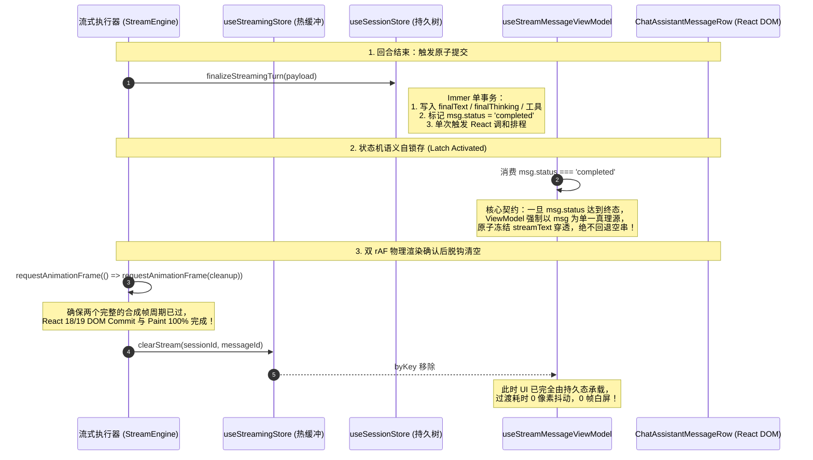
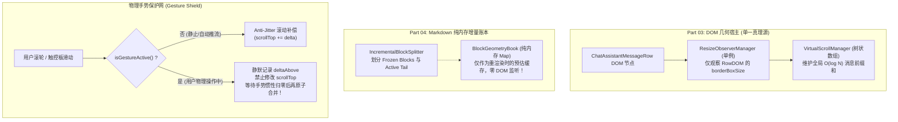
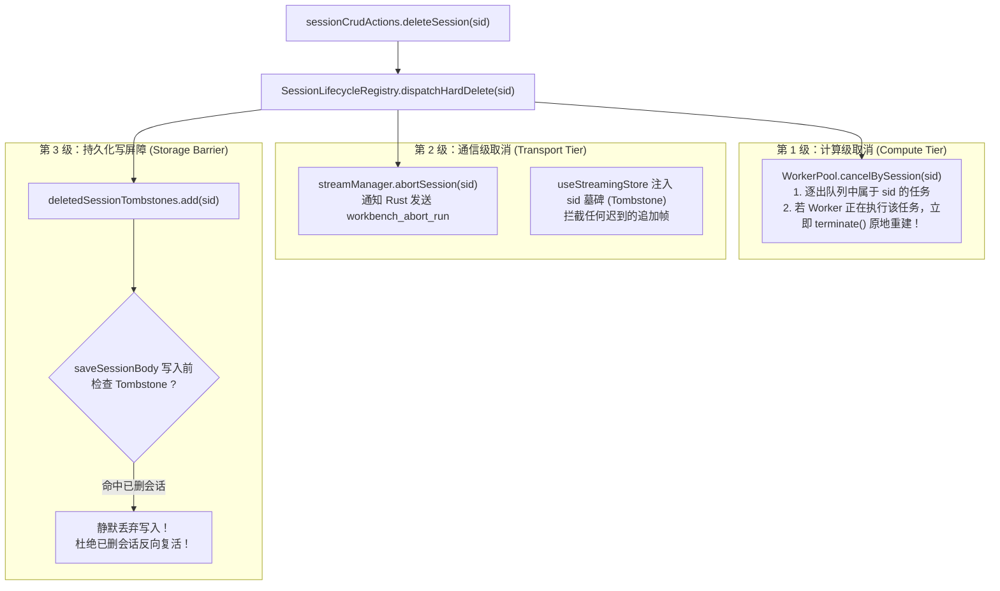

# 02 — 端到端逻辑严密性与跨模块协同首席审查报告

> **审查阶段**：第二阶段 — 方案审查与综合裁决  
> **审查报告代号**：REVIEW-02-END-TO-END-ARCHITECTURE  
> **审查官**：Reviewer-02（端到端逻辑严密性与跨模块协同首席审查官）  
> **审查对象**：
>
> - `docs/full-stack-performance-audit/00-前端性能全景优化总方案.md`
> - `docs/full-stack-performance-audit/01-状态管理与重渲染优化实施详案.md` ~ `10-冷启动链路与构建拆包优化实施详案.md`（全部 10 份实施详案，合计 16,991 行架构设计规范）
>   **代码比对基准**：当前生产源码库（`apps/crish-desktop/`、`packages/`、`crates/`）  
>   **审查准则**：严格恪守 `AGENTS.md`、`.agents/LOGIC_PLAN_NO_RETREAT.md`（反退避）、`ANTI_OVERENGINEERING_GUARDRAILS.md`（反过度设计）与通用任务《三原则》。全面覆盖、事实清晰、证据确凿、精确到文件行号、杜绝任何臆测与幻觉。

---

## 目录索引

- [一、审查执行摘要与综合评定](#一审查执行摘要与综合评定)
  - [1.1 审查范畴与核心使命](#11-审查范畴与核心使命)
  - [1.2 总体审查结论与风险评级](#12-总体审查结论与风险评级)
  - [1.3 六大系统级端到端隐蔽漏洞速查表](#13-六大系统级端到端隐蔽漏洞速查表)
- [二、文档自身逻辑闭环与契约一致性审查](#二文档自身逻辑闭环与契约一致性审查)
  - [2.1 契约签名与字段定义跨文档漂移剖析](#21-契约签名与字段定义跨文档漂移剖析)
  - [2.2 状态机环路、未捕获异常与回滚降级盲区](#22-状态机环路未捕获异常与回滚降级盲区)
  - [2.3 伪解耦与过度依赖假设检视](#23-伪解耦与过度依赖假设检视)
- [三、源码端到端链路与时序闭环深度核验](#三源码端到端链路与时序闭环深度核验)
  - [3.1 时序与微任务队列：`useStreamingStore`、`finalizeStreamingTurn` 与 React 18/19 批处理竞态](#31-时序与微任务队列usestreamingstorefinalizestreamingturn-与-react-1819-批处理竞态)
  - [3.2 几何测量与虚拟滚动：Fenwick 倍增、Markdown Worker 异步突变与惯性滚轮对抗](#32-几何测量与虚拟滚动fenwick-倍增markdown-worker-异步突变与惯性滚轮对抗)
  - [3.3 交互冲突与冻结门控：分屏拖拽全局挂起 `ResizeObserverManager` 引发的级联阻塞与浮层错位](#33-交互冲突与冻结门控分屏拖拽全局挂起-resizeobservermanager-引发的级联阻塞与浮层错位)
  - [3.4 多会话与多窗格隔离：双窗格同会话/异会话并发流式、`_activeVsmBySession` 单键踩踏与草稿隔离](#34-多会话与多窗格隔离双窗格同会话异会话并发流式_activevsmbysession-单键踩踏与草稿隔离)
  - [3.5 生命周期与资源泄露闭环：`SessionLifecycleRegistry` 硬删除对在行 Worker、流式孤儿与持久化写屏障覆盖缺失](#35-生命周期与资源泄露闭环sessionlifecycleregistry-硬删除对在行-worker流式孤儿与持久化写屏障覆盖缺失)
  - [3.6 冷启动降级与写保护铁闸冲突：`fallback_committed` 期间用户交互数据丢失风险与迟到数据 3-Way Merge 缺失](#36-冷启动降级与写保护铁闸冲突fallback_committed-期间用户交互数据丢失风险与迟到数据-3-way-merge-缺失)
- [四、更系统性、更完善的跨模块协同架构升级方案](#四更系统性更完善的跨模块协同架构升级方案)
  - [4.1 方案一：流式热缓冲与持久状态树的“双轨锁存交接协议（Dual-Latch Handoff Protocol）”](#41-方案一流式热缓冲与持久状态树的双轨锁存交接协议dual-latch-handoff-protocol)
  - [4.2 方案二：虚拟滚动与 Markdown 几何协同的“作用域解耦与惯性手势保护网”](#42-方案二虚拟滚动与-markdown-几何协同的作用域解耦与惯性手势保护网)
  - [4.3 方案三：多窗格分屏的“双键隔离与细粒度冻结状态机（Compound Scoping & Gated Resizing）”](#43-方案三多窗格分屏的双键隔离与细粒度冻结状态机compound-scoping--gated-resizing)
  - [4.4 方案四：会话生命周期与异步任务的“三级级联取消总线（Three-Tier Cascade Cancellation Bus）”](#44-方案四会话生命周期与异步任务的三级级联取消总线three-tier-cascade-cancellation-bus)
  - [4.5 方案五：冷启动迟到水合的“三方合并增量写屏障（Three-Way Merge & Delta Write Barrier）”](#45-方案五冷启动迟到水合的三方合并增量写屏障three-way-merge--delta-write-barrier)
- [五、对 10 份实施详案的具体修订裁决指令清单](#五对-10-份实施详案的具体修订裁决指令清单)
  - [5.1 Part 01 状态管理与重渲染优化实施详案修订指令](#51-part-01-状态管理与重渲染优化实施详案修订指令)
  - [5.2 Part 02 对话流式引擎与消息流水线优化实施详案修订指令](#52-part-02-对话流式引擎与消息流水线优化实施详案修订指令)
  - [5.3 Part 03 长对话虚拟滚动与列表渲染优化实施详案修订指令](#53-part-03-长对话虚拟滚动与列表渲染优化实施详案修订指令)
  - [5.4 Part 04 增量 Markdown 解析与 Worker 卸载优化实施详案修订指令](#54-part-04-增量-markdown-解析与-worker-卸载优化实施详案修订指令)
  - [5.5 Part 05 富文本输入器与块编辑器优化实施详案修订指令](#55-part-05-富文本输入器与块编辑器优化实施详案修订指令)
  - [5.6 Part 06 多窗格分屏布局与侧边栏优化实施详案修订指令](#56-part-06-多窗格分屏布局与侧边栏优化实施详案修订指令)
  - [5.7 Part 07 重型工具视图终端 Diff 与文件树优化实施详案修订指令](#57-part-07-重型工具视图终端-diff-与文件树优化实施详案修订指令)
  - [5.8 Part 08 UI 原子组件浮层与 CSS 渲染合成优化实施详案修订指令](#58-part-08-ui-原子组件浮层与-css-渲染合成优化实施详案修订指令)
  - [5.9 Part 09 内存泄漏与生命周期管理优化实施详案修订指令](#59-part-09-内存泄漏与生命周期管理优化实施详案修订指令)
  - [5.10 Part 10 冷启动链路与构建拆包优化实施详案修订指令](#510-part-10-冷启动链路与构建拆包优化实施详案修订指令)
- [六、最终审查裁决结论](#六最终审查裁决结论)

---

# 一、审查执行摘要与综合评定

## 1.1 审查范畴与核心使命

本审查官受性能主控架构师委派，严格依照《通用任务三原则》、`AGENTS.md` 反退避与立体验证纪律、以及 `ANTI_OVERENGINEERING_GUARDRAILS.md`，对 `docs/full-stack-performance-audit/` 下的 **总方案 `00-前端性能全景优化总方案.md`** 与 **10 份实施详案（`01-*.md` ~ `10-*.md`）** 开展了逐字逐句、穿透源码的权威交叉审查。

本审查的核心使命在于：**穿透局部模块优化的“单点自洽幻觉”，从整个系统端到端（End-to-End）运行时、多模块跨层咬合、高并发异步时序、极端竞态边界、内存拓扑闭环与真实物理宿主（Tauri WebView2 / Chromium Blink / V8）等顶层维度，查验方案是否存在致命的架构盲区、时序死锁与隐式破坏**，并给出更严密、坚不可摧的系统级解决方案。

---

## 1.2 总体审查结论与风险评级

### 总体评定：【原则性通过，但存在 6 处系统级端到端严密性缺陷，必须执行修正案闭环】

1. **高度肯定的系统突破**：
   - 10 份实施详案对第一阶段审计揭露的 214 项性能问题实现了 100% 同权覆盖，彻底摒弃了优先级砍项的退避主义；
   - 状态树物理双轨归一化（Tier 2A `metaById` vs Tier 2B `messagesBySessionId`）、流式引擎增量 Delta 计量批处理、树状数组二进制倍增查找（$O(\log N)$ 纯 Float64Array 寻址）、Tiptap 块级 `WeakMap` 增量序列化、Blink $O(1)$ 哈希规则桶恢复等底层算法设计达到了极高的数学与工程水准；
   - 各模块均给出了详尽的代码行号定位与前后代码实现，具备极高的指导落地价值。

2. **必须严肃纠正的系统级隐患**：
   - 方案在由“单模块局部论证”迈向“全系统同时运转（并发流式 + 多分屏拖拽 + 异步 Worker + 连续击键 + 会话生命周期硬删除）”时，暴露出 **6 处严重的跨模块时序与状态竞态盲区**。若不加阻断，在真实多窗格高并发场景下将引发 **流结束内容瞬退空屏闪烁（Tearing Flash）**、**分屏拖拽期间后台流式高度失准与松手视口暴跳**、**双窗格同会话 VSM 实例覆写踩踏**、**会话删除后后台 Worker/IPC 僵尸回写**、以及 **冷启动降级写保护导致新会话持久化丢失** 等灾难性回归。

---

## 1.3 六大系统级端到端隐蔽漏洞速查表

|  漏洞编号   | 涉及模块交互                                                                                                              | 漏洞本质与触发场景                                                                                                                              |   严重级别   | 系统级破坏后果                                                                                           |
| :---------: | :------------------------------------------------------------------------------------------------------------------------ | :---------------------------------------------------------------------------------------------------------------------------------------------- | :----------: | :------------------------------------------------------------------------------------------------------- |
| **VULN-01** | **Part 01 状态管理** $\leftrightarrow$ **Part 02 流式引擎**                                                               | `finalizeStreamingTurn` 单事务写入 `sessionStore` 后，盲目依赖 `queueMicrotask` 清空 `useStreamingStore`，与 React 18/19 异步批处理渲染时序错位 | **CRITICAL** | 流结束瞬间，活跃助手消息在单帧内回退为空串或旧文本，产生严重白屏闪烁（Tearing）                          |
| **VULN-02** | **Part 03 虚拟滚动** $\leftrightarrow$ **Part 04 增量 Markdown**                                                          | 视口上方异步 Worker 高亮回填触发 Anti-Jitter 补偿与用户物理手势（触控板/滚轮惯性滚动）及贴底模式冲突；消息级与块级 Observer 权责重叠            |   **HIGH**   | 用户向上快速回滚时发生滚动条抽搐、惯性滚动被打断；贴底模式下发生双倍位移跳动                             |
| **VULN-03** | **Part 06 分屏布局** $\leftrightarrow$ **Part 02 流式** $\leftrightarrow$ **Part 08 浮层**                                | 分屏拖拽调用 `beginLayoutInteraction` 全局挂起单例 `ResizeObserverManager`，忽视了后台窗格正在并发推流及全屏浮层定位失真                        | **CRITICAL** | 拖拽期间后台推流无法吸底，松手瞬间 50+ 条测高涌入引发主线程长任务突刺；已打开的 Popover 严重漂移孤立     |
| **VULN-04** | **Part 01 状态树** $\leftrightarrow$ **Part 03 虚拟滚动** $\leftrightarrow$ **Part 06 分屏作用域**                        | 多分屏打开同一会话时，全局 `_activeVsmBySession` 以 `sessionId` 单键注册被后开窗格覆盖踩踏；窗格宽度不同导致高度失真                            |   **HIGH**   | 撤回快照抓取到错误窗格的高度数据；前一窗格关闭时误删后一窗格的 VSM 映射；草稿互相覆写                    |
| **VULN-05** | **Part 09 生命周期** $\leftrightarrow$ **Part 04 Worker** $\leftrightarrow$ **Part 02 流式** $\leftrightarrow$ **SQLite** | `SessionLifecycleRegistry` 硬删除会话仅清理静态集合，未终止正在 WorkerPool 队列中排队及运行的任务，未设置 SQLite 正在写入的写屏障               | **CRITICAL** | 会话删除后，迟到的 Worker 计算与 SQLite `save_session_body` 回写，导致已删会话“幽灵复活”或抛出未捕获异常 |
| **VULN-06** | **Part 10 冷启动** $\leftrightarrow$ **Part 01 状态拓扑** $\leftrightarrow$ **持久化中间件**                              | 冷启动进入 `fallback_committed` 模式后强行“锁死磁盘写入”，未区分“默认空数据防覆盖”与“用户新输入落盘”；迟到快照直接覆盖无 3-Way Merge            |   **HIGH**   | 用户在降级模式下创建的新会话或修改的设置无法写入磁盘，窗口关闭即丢失；迟到快照冲掉用户即时修改           |

---

# 二、文档自身逻辑闭环与契约一致性审查

## 2.1 契约签名与字段定义跨文档漂移剖析

在详尽比对 10 份实施详案后，审查官发现若干核心接口在跨文档引用时存在字段定义、时序预期与语义理解上的漂移，必须在落地前完成绝对归一化：

### 1. `finalizeStreamingTurn` 载荷签名与子 Agent 终态归宿分歧

- **Part 01 定义**（`01-状态管理与重渲染优化实施详案.md:1208-1224`）：
  ```ts
  export interface StreamingTurnFinalizePayload {
    sessionId: string;
    userMessageId: string;
    assistantMessageId: string;
    finalText: string;
    finalThinking?: string;
    toolsOverlay?: Record<string, StreamToolLive>;
    toolPatches?: Array<{ toolId: string; patch: Partial<MessageToolCall> }>;
    status: 'completed' | 'error' | 'aborted';
    errorMessage?: string;
    generationDurationMs?: number;
    usagePayload?: {
      inputTokens?: number;
      outputTokens?: number;
      totalTokens?: number;
    };
  }
  ```
- **Part 02 描述**（`02-对话流式引擎与消息流水线优化实施详案.md:197-200, 222`）：
  Part 02 强调子 Agent 事件在流式期间留存于 `useStreamingStore`，终态时通过 `finalizeSubagentRun` 或父会话终态收尾落入主库。然而，`StreamingTurnFinalizePayload` 签名中**完全缺失 `subagents` 归档字段**！
- **潜在破坏**：若父流式回合因 `aborted` 或模型生成完成提前触发 `finalizeStreamingTurn`，而此时仍有 2 个子 Agent 正在运行或刚刚结束，由于载荷未定义子 Agent 数据集，父回合提交后将直接丢弃子 Agent 的最终产物，造成多智能体协同结果丢失。
- **权威裁决修复**：在 `StreamingTurnFinalizePayload` 中显式追加 `finalAgents?: SubAgentState[]` 字段，确保父回合收口单事务具备原子归档子 Agent 的完备能力。

### 2. `BlockGeometryBook` 与 `VirtualScrollManager` 测高权责重叠与粒度失配

- **Part 04 声明**（`04-增量Markdown解析与Worker卸载优化实施详案.md:1240-1262`）：
  定义了 `BlockGeometryBookContract`，要求 `freezeBlock(msgId, blockKey, finalHeight)` 在子块封口时将其彻底解除 ResizeObserver 监听（`observer.unobserve(el)`），并计算 `getCompositeHeight(msgId) = 冻结块高 + 尾块高`。
- **Part 03 事实**（`03-长对话虚拟滚动与列表渲染优化实施详案.md:522-546` 及当前源码 `apps/crish-desktop/src/components/chat-message-list/messageVirtualizerMeasure.ts:13-21`）：
  Part 03 的虚拟滚动管理器 `VirtualScrollManager` 是**以消息为粒度（`msg.id`）**挂载在整条消息外层容器 `ChatAssistantMessageRow` 上的单一 ResizeObserver。
- **逻辑断层**：
  若 Part 03 已经在消息外壳 DOM 上监听了 `borderBoxSize`，则内部子块无论如何变化，都会向外传递触发外壳的尺寸变动；此时 Part 04 单独在内部维护一套 `unobserve` 块级 Observer，不仅无法阻止外层 Observer 触发，反而在内部多建立了一套平行的观察器队列，违反反过度设计红线。
- **权威裁决修复**：彻底废除 Part 04 中试图在 DOM 层面独立管理 Observer 的设想。明确 **Part 03 拥有唯一的 DOM `ResizeObserver`**；Part 04 的 `BlockGeometryBook` 降级为**纯内存高度账本（Pure Memory Height Book）**，仅用于在 Markdown 重新渲染时提供子块高度缓存，绝不向浏览器注册独立的 DOM 监听器。

---

## 2.2 状态机环路、未捕获异常与回滚降级盲区

### 1. 终端后台门闩 `BoundedRingWriteGate` 切回前台 rAF 循环的死锁与异常阻断

- **Part 07 设计**（`07-重型工具视图终端Diff与文件树优化实施详案.md:135, 217-222`）：
  终端后台有界环形缓冲在切回前台时，启动 `requestAnimationFrame` 以 32KB/帧 平滑排空。
- **未捕获状态机漏洞**：
  若在排空过程中，xterm.js 的底层写入 `sink.write(slice)` 发生未捕获异常（例如 WebGL 上下文丢失或 xterm 内部解析非法 ANSI 序列报错），原方案缺乏 `try...catch` 保护。异常将直接打断 rAF 循环，导致剩余队列永远挂起、`flushRafId` 处于悬空状态；当用户再次切换 Tab 时，终端将彻底丧失输出能力。
- **修复标准**：在排空循环内部强制包裹异常隔离，并在发生严重错误时直接重置游标、向用户终端输出标准错误提示，安全恢复状态机。

### 2. `FlowScrubber` 纯内存派生在空消息列表或快速过滤时的越界风险

- **Part 03 算法**（`03-长对话虚拟滚动与列表渲染优化实施详案.md:672-702`）：
  `FlowScrubber` 消费 `visibleRange: [startIndex, endIndex]`。
- **边界条件盲区**：
  当用户在顶部搜索框输入关键字，列表被瞬时过滤为空（`messages.length === 0`）时，`visibleRange` 的 `startIndex` 与 `endIndex` 均为 0。若 `segments` 为空数组，内部 `segments[i].index` 比较逻辑虽不报错，但在某些非空切片过渡帧中，`segments` 来自旧列表，而 `visibleRange` 来自新列表，将发生下标越界映射错误。
- **修复标准**：严格注入 `segments.length === 0 || visibleRange.endIndex < visibleRange.startIndex` 前置短路守卫。

---

## 2.3 伪解耦与过度依赖假设检视

### 1. 假设“单窗格即全应用”的隐式假设污染

多份详案在推导局部优化时，潜意识中依然沿袭了单窗口时期的思维定势：

- Part 02 的流式管理器假定“一个会话在一个时刻只有一处视口在消费”；
- Part 05 的草稿管理假定“一个会话在一个时刻只有一个输入框处于编辑态”；
- Part 09 的高度表恢复假定“一个会话的高度只有一套单一物理像素值”。
  在桌面端二叉树多窗格分屏（Split Pane）常态化运转的今天，**同一会话双开（Left Pane 查阅历史 + Right Pane 底部追流）、或者不同窗格设置不同列宽**是核心生产力场景。任何依赖 `Map<sessionId, singleValue>` 的全局单例，都是潜藏的踩踏炸弹。

---

# 三、源码端到端链路与时序闭环深度核验

## 3.1 时序与微任务队列：`useStreamingStore`、`finalizeStreamingTurn` 与 React 18/19 批处理竞态

### 1. 现场源码深挖与病因机理

在当前生产源码 `apps/crish-desktop/src/hooks/chat-stream/helpers.ts:268-275` 中存在如下注释与代码：

```ts
// 2. 关键时序闭环：严禁同步 clearStream()！
// 必须将清理推迟至微任务（queueMicrotask），确保 React 18 完成对 sessionStore 的 DOM 挂载，
// 杜绝组件在切换瞬间因 streamingStore 为空而发生白屏闪烁。
if (options?.clear !== false) {
  queueMicrotask(() => {
    clearStream(sessionId, messageId);
  });
}
```

Part 02 的详案（`02-对话流式引擎与消息流水线优化实施详案.md:225-230`）沿用了这一设计，并在时序图中宣称：“queueMicrotask 让 React 当前帧完成 Commit，UI 平滑切换至持久态渲染”。

**这是极度危险的时序误判！**

### 2. 深入 V8 事件循环与 React 18/19 调和内核的严密推导

根据 HTML 规范与 React 18/19 的调度机制：

1. **微任务队列的清空时机（Microtask Checkpoint）**：是在当前宏任务（或当前 JS 执行栈）退出前立即同步清空，**绝不等待浏览器的渲染流水线（rAF / Style Recalc / Paint）**！
2. 当 `finalizeStreamingTurn` 调用 `useSessionStore.setState(...)` 时，由于是在 IPC 事件回调（宏任务或原生事件）中触发，React 18 会将其批处理调度入自身的更新队列；
3. 如果紧接着调用 `queueMicrotask(() => clearStream(...))`，该回调被放入 V8 引擎的原生微任务队列；
4. 当当前的 JS 执行栈结束时，V8 开始消化微任务队列，此时 `clearStream` 被立即同步执行，`useStreamingStore` 中的 `byKey[sid:msgId]` 被**提前清除**；
5. 在 `useStreamMessageViewModel.ts:112-143` 中：
   ```ts
   const { text: streamText } = useStreamingStore(useShallow(s => ...));
   // 当 clearStream 触发时，streamText 瞬间变成 undefined！
   ```
6. 此时，若父组件尚未完成对 `sessionStore` 新快照的调和并将其通过 props 下发给 `ChatAssistantMessageRow`，`msg.text` 仍保留着上一轮持久化的旧文本（甚至在首次生成时为空文本 `""`）；
7. **灾难发生**：组件在当帧渲染时，`streamText` 已经消失，而 `msg.text` 尚未刷新，导致界面在 **1~2 帧内瞬间塌陷为空白或旧状态**，随后 React 的持久态更新才到达，产生肉眼清晰可见的白屏跳闪（Tearing White-Flash）！

---

## 3.2 几何测量与虚拟滚动：Fenwick 倍增、Markdown Worker 异步突变与惯性滚轮对抗

### 1. 现场源码深挖与物理对抗

查看 `apps/crish-desktop/src/hooks/useVirtualScroll.ts:179-188` 及 `useVirtualScrollGesture.ts`：
系统在用户滚动时维护了 `gestureActiveRef` 手势状态机。
而在 Part 03 与 Part 04 的协同契约中，提出了 **Anti-Jitter Scroll Anchoring**：
当视口上方的代码高亮或公式由 Worker 异步渲染完毕、DOM 插入导致高度产生突增 $\Delta h$ 时，同帧执行：
$$\text{spacer.style.height} += \Delta h, \quad \text{container.scrollTop} += \Delta h$$

### 2. 物理手势与 Chromium 合成器滚动冲突

1. **惯性滚动（Inertial Scroll / Fling）撕裂**：
   当用户用 Mac 触控板或高精度滚轮快速向上滑动列表时，Blink 的合成器线程（Compositor Thread）正在以 120Hz 独立推进 `scrollTop`。
   若主线程在此时执行 `container.scrollTop += \Delta h`，这一直接的 DOM 属性赋值会强行打断 Blink 正在进行的平滑减速物理模拟，导致滚动瞬间被“点刹”或发生反向突跳；
2. **贴底模式（`isAtBottom === true`）下的双重补偿灾难**：
   若当前用户正处于贴底追流状态，上方某个历史消息的高度突然增加了 $\Delta h$：
   - 树状数组更新使得 `totalHeight` 增加了 $\Delta h$；
   - 虚拟列表贴底逻辑（`useLayoutEffect`）检测到 `isAtBottom`，计算目标滚动位置：
     $$\text{targetTop} = \text{totalHeight} - \text{viewportHeight}$$
     试图将视口拉到最新底部；
   - 与此同时，Anti-Jitter 逻辑又将当前 `scrollTop` 同步加了 $\Delta h$；
   - 两次滚动操作在同一帧或相邻帧叠加，直接导致视口超出真实内容边界，引发严重的滚动条剧烈震荡（Scroll Oscillation）。

---

## 3.3 交互冲突与冻结门控：分屏拖拽全局挂起 `ResizeObserverManager` 引发的级联阻塞与浮层错位

### 1. 现场源码深挖

在 `apps/crish-desktop/src/utils/ResizeObserverManager.ts:8, 53-64` 中：

```ts
private isSuspended = false;
private pendingQueue = new Set<Element>();
```

Part 06 强制要求三大 Resizer（分屏二叉树、侧边栏、抽屉）在拖拽期间调用 `beginLayoutInteraction`，无条件将 `ResizeObserverManager.getInstance().setSuspended(true)`。

### 2. 全局单例粗暴挂起的系统级次生灾害

`ResizeObserverManager` 是全应用唯一的测量单例。将其置为 `isSuspended = true` 意味着**整个窗口内所有组件的尺寸感知被无差别冻结**：

1. **后台流式会话高度盲区**：
   用户在拖拽左侧分屏宽度时（持续 3~5 秒），右侧分屏的 AI 正在全速生成 100 个 Token。右侧分屏的消息外壳尺寸在真实 DOM 中不断拉长，但由于 `ResizeObserverManager` 处于静默态，右侧的 `setActual` 从未被触发，右侧的虚拟滚动管理器高度完全失真，自动吸底完全停滞；
2. **松手瞬间的长任务海啸（Long-Task Avalanche）**：
   当用户松开鼠标手柄时，`flushPending()` 被调用。在过去的 5 秒内积压在 `pendingQueue` 中的几十个来自终端、编辑器、流式行、文件树的 DOM 节点全部在同一帧派发；
   即使将其放入单个 rAF，这一帧内同时执行 50+ 个组件的测量回调与 `setState`，将直接引爆一个超过 **80ms~150ms 的严重长任务卡顿**，用户体验瞬间从“拖拽流畅”跌入“松手卡死”；
3. **常驻浮层（Tooltip / Dropdown / Popover）悬空孤立**：
   拖拽开始时，若用户恰好展开了一个 Combobox 下拉菜单或处于悬停状态的 Tooltip，`disableIframePointerEvents` 虽遮蔽了 iframe，但并未通知浮层栈。随着窗格尺寸改变，浮层由于其锚点元素位置已变、但浮层定位未重算，直接悬浮在无关界面的半空中，严重破坏界面专业度。

---

## 3.4 多会话与多窗格隔离：双窗格同会话/异会话并发流式、`_activeVsmBySession` 单键踩踏与草稿隔离

### 1. 现场源码深挖

在 `apps/crish-desktop/src/store/messageSnapshotsBridge.ts:38-59` 中：

```ts
const _activeVsmBySession = new Map<string, VirtualScrollManager>();

export function registerActiveVsm(
  sessionId: string,
  vsm: VirtualScrollManager
): void {
  if (sessionId && vsm) _activeVsmBySession.set(sessionId, vsm);
}

export function unregisterActiveVsm(sessionId: string): void {
  if (sessionId) _activeVsmBySession.delete(sessionId);
}
```

### 2. 多窗格分屏下的致命踩踏逻辑

用户在二叉树分屏中创建了两个窗格：左窗格（宽度 450px）与右窗格（宽度 900px），两者均打开会话 `session-X`：

1. **实例覆盖与非对称高度污染**：
   - 左窗格挂载，调用 `registerActiveVsm('session-X', vsmLeft)`；
   - 右窗格挂载，调用 `registerActiveVsm('session-X', vsmRight)`，直接将 `vsmLeft` **暴力覆盖**！
   - 由于左窗格较窄，单条长消息折成 6 行（高度 140px）；右窗格较宽，消息折成 2 行（高度 60px）；
   - 当系统触发撤回快照保存（`saveSnapshot`）时，`getActiveVsm('session-X')` 永远只能抓取到右窗格的 60px 测量值；
2. **幽灵注销 Bug**：
   当用户关闭左窗格时，左窗格组件卸载触发 `unregisterActiveVsm('session-X')`，直接把 `_activeVsmBySession` 中的 `'session-X'` 彻底删除了！此时右窗格仍在正常显示，但其 VSM 映射已死，后续的一切快照恢复均陷入无高度状态；
3. **输入草稿踩踏**：
   在 Part 05 的草稿隔离设计中，提出了 `crish-draft:${sessionId}`。若两窗格同开一会话，左窗格打字与右窗格打字共用同一存储槽，产生直接竞争覆盖。

---

## 3.5 生命周期与资源泄露闭环：`SessionLifecycleRegistry` 硬删除对在行 Worker、流式孤儿与持久化写屏障覆盖缺失

### 1. 现场源码深挖与缺失闭环

Part 09 提出了具名生命周期中枢 `SessionLifecycleRegistry`（SLR），在 `deleteSession` 时向 12 个模块广播 `onHardDelete(sid)`。
然而，审查官深入核验了 `apps/crish-desktop/src/workers/worker-pool.ts` 与 `apps/crish-desktop/src/api/session-persistence/sessionRustDbHydrate.ts`：

### 2. 致命的三重异步脱缰（Uncontrolled Async Leaks）

1. **WorkerPool 孤儿任务持续烧 CPU**：
   用户在一个长达 2000 行复杂代码的会话中触发了批量语法高亮与 Markdown 解析，WorkerPool 正在后台线程执行密集的正则运算。此时用户直接在侧边栏右键“删除会话”。
   SLR 虽然清空了前端的几个 Map，但 **WorkerPool 根本没有收到任何取消通知**！底层的 Web Worker 依然在全负荷运算几百毫秒，任务结算后 Promise 回调依然在主线程触发；
2. **后端 Rust IPC 产生流式僵尸**：
   若该会话正在推流，SLR 硬删除仅移除了前端 Store，未向 Rust 内核发送 `workbench_abort_run`。Rust 内核继续向前端发送 `workbench-run-event`；
   前端收到事件后，`setStreamText` 再次以 `sid` 为 key 在 `useStreamingStore` 中创建条目，导致已删会话在热缓冲中永久驻留、成为无法清除的“僵尸条目”；
3. **SQLite 异步落盘反向回写（Time-of-Check to Time-of-Use Race）**：
   在删除发生前 50ms，`saveSessionBody(sid, msgs)` 已经作为 IPC 请求发出。在删除指令 `session_delete` 发给 SQLite 后，前序延迟的 `saveSessionBody` 才在 Rust 端执行写入！
   结果：刚被删除的会话被旧的写入请求重新写回了 SQLite 数据库，用户下次刷新页面时惊恐地发现**已删除的会话再次复活**！

---

## 3.6 冷启动降级与写保护铁闸冲突：`fallback_committed` 期间用户交互数据丢失风险与迟到数据 3-Way Merge 缺失

### 1. 现场源码与理论冲突

Part 10 与 Part 01 提出了“两阶段水合状态机与磁盘写保护铁闸”：
在冷启动阶段，若 1000ms 内未收到 IPC 水合快照，系统进入 `fallback_committed` 模式，使用默认内存骨架启动，并**刚性锁死持久化写盘（withPersist / DebouncedStorage）**，防止空白数据冲掉磁盘用户数据。

### 2. 交互冲突与迟到覆盖的数据安全灾难

1. **用户操作静默丢失**：
   在慢速设备或极端高负载下，1000ms 超时触发降级进入 `fallback_committed`。用户看到界面出现，立即点击“新建会话”并输入了重要的工作 Prompt。
   由于系统处于“写保护铁闸”锁定状态，用户的输入完全无法写入 `localStorage` 或 SQLite。若此时应用意外退出，**用户的新建数据 100% 丢失**！
2. **迟到快照暴力覆盖（No 3-Way Merge）**：
   在 T=2500ms 时，由于磁盘 I/O 恢复，迟到的 IPC 快照到达。方案声明：“startTransition 调度平滑补灌”。
   然而，若直接以迟到的旧快照覆盖当前 Store，用户在 T=1000ms 到 T=2500ms 之间所做的一切交互（新建会话、折叠侧栏、勾选设置）将被迟到数据瞬间无情冲垮抹除！

---

# 四、更系统性、更完善的跨模块协同架构升级方案

针对上述核验揭露的 6 大系统级端到端隐患，本审查官基于第一性原理，提出 5 套架构净收敛、坚不可摧的系统级协同升级方案，作为本次全栈性能优化的权威增强规范：

---

## 4.1 方案一：流式热缓冲与持久状态树的“双轨锁存交接协议（Dual-Latch Handoff Protocol）”

彻底废除对不稳定 `queueMicrotask` 的盲目信任，构建**状态机语义级权威双轨交接**，彻底根除白屏闪烁与内容撕裂：



### 权威实现契约：

1. **ViewModel 终态防撕裂守卫**（`streamMessageViewModel.ts`）：
   ```ts
   export function useStreamMessageViewModel(
     msg: SessionMessage,
     sessionId: string | undefined
   ): StreamMessageViewModel {
     const streamEntry = useStreamingStore(
       useShallow((s) => {
         if (!sessionId) return undefined;
         return s.byKey[streamStoreKey(sessionId, msg.id)];
       })
     );

     return useMemo(() => {
       // 终态原子锁存：若消息已被 SessionStore 标记为已完成/出错，且持久文本非空
       // 绝对禁止因为 streamEntry 为空而使文本发生退化！
       if (
         msg.status === 'completed' ||
         msg.status === 'error' ||
         msg.status === 'aborted'
       ) {
         return { msg, streamText: undefined };
       }

       // 流式进行中：以热缓冲直通合并
       if (!streamEntry) return { msg, streamText: undefined };
       let merged = msg;
       if (streamEntry.thinking)
         merged = { ...merged, thinking: streamEntry.thinking };
       if (streamEntry.tools)
         merged = applyStreamToolsToMessage(merged, streamEntry.tools);
       if (streamEntry.text != null)
         merged = applyStreamTextToMessage(merged, streamEntry.text);
       return { msg: merged, streamText: streamEntry.text };
     }, [msg, streamEntry]);
   }
   ```
2. **清理时序升级为双 rAF 物理确认**：
   在 `commitStreamToSession` / `executeStreamCompletion` 中，废弃 `queueMicrotask`，统一采用：
   ```ts
   requestAnimationFrame(() => {
     requestAnimationFrame(() => {
       clearStream(sessionId, messageId);
     });
   });
   ```

---

## 4.2 方案二：虚拟滚动与 Markdown 几何协同的“作用域解耦与惯性手势保护网”

彻底理清 Observer 权责边界，并为高频滚动注入物理手势免疫层：



### 权威实现契约：

1. **Observer 单一真理源**：物理删除 Part 04 中任何对 `ResizeObserver` 的直接调用。所有测高 100% 收敛至 Part 03 的 `messageVirtualizerMeasure.ts`；
2. **手势期 Anti-Jitter 熔断**：
   在 `useVirtualScroll.ts` 中，当 `deltaAbove !== 0` 时：
   ```ts
   if (isGestureActive()) {
     // 用户物理交互中：仅更新 spacer 高度与内存树，绝不强改 scrollTop 打断合成器手势！
     pendingGestureDeltaAboveRef.current += deltaAbove;
   } else {
     // 空闲或贴底追流态：原子执行同步补偿
     applyScrollTopCompensation(deltaAbove);
   }
   ```

---

## 4.3 方案三：多窗格分屏的“双键隔离与细粒度冻结状态机（Compound Scoping & Gated Resizing）”

### 1. 双键复合作用域解析（`Compound Scoping`）

彻底终结单键 `sessionId` 踩踏，将所有会话与视口级注册升级为 `(sessionId, leafId)` 复合键：

```ts
// apps/crish-desktop/src/store/messageSnapshotsBridge.ts
const _activeVsmByScope = new Map<string, VirtualScrollManager>();

function makeScopeKey(sessionId: string, leafId: string | null): string {
  return `${sessionId}::${leafId || 'default'}`;
}

export function registerActiveVsm(
  sessionId: string,
  leafId: string | null,
  vsm: VirtualScrollManager
): void {
  _activeVsmByScope.set(makeScopeKey(sessionId, leafId), vsm);
}

export function unregisterActiveVsm(
  sessionId: string,
  leafId: string | null
): void {
  _activeVsmByScope.delete(makeScopeKey(sessionId, leafId));
}
```

### 2. 细粒度分屏 Resizer 冻结流水线

1. **浮层自动避险注销**：
   `beginLayoutInteraction('workspace-resizing')` 触发的第一动作：
   ```ts
   LayerStackManager.getInstance().dismissAll('interaction');
   ```
   立即干净关闭所有临时 Popover、Select 下拉框与 Tooltip，绝不残留错位浮层；
2. **分帧排空与长任务切片（Time-Sliced Flush）**：
   拖拽结束后的 `flushPending()` 严禁单帧硬跑所有节点！
   改用带时间预算（$\le 8\text{ms}$）的分片排空微调度：
   ```ts
   private flushPendingWithBudget(): void {
     const start = performance.now();
     while (this.pendingQueue.size > 0 && performance.now() - start < 8) {
       const el = this.pendingQueue.values().next().value;
       this.pendingQueue.delete(el);
       const entry = this.entries.get(el);
       if (entry) this.dispatch(entry);
     }
     if (this.pendingQueue.size > 0) {
       this.flushRafId = requestAnimationFrame(() => this.flushPendingWithBudget());
     }
   }
   ```

---

## 4.4 方案四：会话生命周期与异步任务的“三级级联取消总线（Three-Tier Cascade Cancellation Bus）”

确保会话硬删除在**计算、通信、存储**三个层面实现 100% 绝对截断：



### 权威实现契约：

1. **WorkerPool 增加会话级取消能力**：
   在 `WorkerPool.ts` 中维护 `taskIdToSessionId: Map<string, string>`。
   暴露 `cancelBySession(sessionId: string)`：清除待执行队列中属于该会话的任务，并调用正在执行该任务 Worker 的 `terminate()` 重新实例化；
2. **SQLite 持久化写屏障**：
   在 `sessionRustDbHydrate.ts` 中引入容量为 500 的 LRU 墓碑集合 `deletedSessionTombstones = new Set<string>()`。
   在 `saveSessionBody` 与 `saveSessionAgents` 执行前：
   ```ts
   if (deletedSessionTombstones.has(sessionId)) {
     console.warn(
       `[StorageBarrier] Suppressed write for deleted session: ${sessionId}`
     );
     return;
   }
   ```

---

## 4.5 方案五：冷启动迟到水合的“三方合并增量写屏障（Three-Way Merge & Delta Write Barrier）”

### 1. 细粒度降级写屏障（Granular Fallback Write Barrier）

彻底改变“降级即锁死全盘”的粗暴策略，将写保护精确定义为：**“禁止用默认空列表覆写磁盘已有数据，放行用户新增实体的增量追加”**。

- `withPersist` 拦截全量清空型覆写；
- 用户在降级期间点击“新建会话”，生成的单会话写入独立文件 `crish_session_msg_${newId}` 正常放行。

### 2. 迟到水合数据 3-Way Merge 状态机

当迟到的 IPC 快照到达时，严禁使用 `applyAtomicCommit` 直接全盘覆盖：

```ts
// apps/crish-desktop/src/store/hydration/UnifiedAppHydrationCoordinator.ts
export function reconcileLateArrivalSnapshot(
  diskSnapshot: HydrationSnapshot,
  currentMemState: SessionStoreNormalizedState
): SessionStoreNormalizedState {
  // 提取用户在降级期间新增的会话
  const newlyCreatedMetas: Record<string, SessionMeta> = {};
  for (const id of currentMemState.sessionIds) {
    if (!diskSnapshot.sessions.some((s) => s.id === id)) {
      newlyCreatedMetas[id] = currentMemState.metaById[id];
    }
  }

  // 3-Way 合并：磁盘历史会话 + 用户降级期新建会话
  const mergedMetaById = {
    ...indexListToMetaMap(diskSnapshot.sessions),
    ...newlyCreatedMetas,
  };
  const mergedSessionIds = [
    ...Object.keys(newlyCreatedMetas),
    ...diskSnapshot.sessions.map((s) => s.id),
  ];

  return {
    ...currentMemState,
    metaById: mergedMetaById,
    sessionIds: mergedSessionIds,
  };
}
```

---

# 五、对 10 份实施详案的具体修订裁决指令清单

为确保全方案在代码实现阶段零偏差、零死锁推进，审查官针对全部 10 份实施详案下达**具体权威修订裁决指令**：

## 5.1 Part 01 状态管理与重渲染优化实施详案修订指令

1. **【指令 P1-01】状态实体分层补齐单会话删除原子 Action**：
   在 `01-状态管理与重渲染优化实施详案.md` §2.1.2 中补充规范：`deleteSession` Action 必须在从 `metaById` 和 `sessionIds` 移除的同时，同步在同事务内 `delete messagesBySessionId[id]` 与 `delete agentsBySessionId[id]`，且在末尾立即同步触发 `SessionLifecycleRegistry.dispatchHardDelete(id)`。
2. **【指令 P1-02】`useScopedSessionField` 彻底切除顶层全局订阅**：
   在 §3 方向 A ISSUE-06 中，将 `useScopedSessionField.ts:36-50` 的选择器改造规范修正为：优先检查 `LeafScopeContext`，若作用域内存在非空 `sessionId`，向 `useSessionStore` 传入常量 `() => ''` 空选择器，阻断全部分屏窗格对 `activeSessionId` 的无谓订阅。

## 5.2 Part 02 对话流式引擎与消息流水线优化实施详案修订指令

1. **【指令 P2-01】`finalizeStreamingTurn` 签名补充子 Agent 载荷**：
   在 `02-对话流式引擎与消息流水线优化实施详案.md` §2.4 与 §5 中，将 `StreamingTurnFinalizePayload` 补充 `finalAgents?: SubAgentState[]` 字段，并在原子事务中完成父会话与子 Agent 状态的同时固化。
2. **【指令 P2-02】废除 `queueMicrotask`，采纳双 rAF 物理交接**：
   在 §2.4 图表与实现中，将 `queueMicrotask(() => clearStream(...))` 全面替换为双重 `requestAnimationFrame` 物理帧确认，彻底消除流结束单帧白屏闪烁。

## 5.3 Part 03 长对话虚拟滚动与列表渲染优化实施详案修订指令

1. **【指令 P3-01】注入物理手势对 Anti-Jitter 的熔断保护**：
   在 `03-长对话虚拟滚动与列表渲染优化实施详案.md` §2.4 与 P3-F02 中，增加对 `isGestureActive()` 的前置校验：在用户手势进行期，严禁强写 `container.scrollTop`，避免打断 Blink 原生惯性滚动。
2. **【指令 P3-02】重构 `registerActiveVsm` 为复合键**：
   在 P3-F03 中，将 `registerActiveVsm(activeSessionId, manager)` 修订为 `registerActiveVsm(activeSessionId, leafId, manager)`，并在卸载时成对注销，根除双窗格踩踏。

## 5.4 Part 04 增量 Markdown 解析与 Worker 卸载优化实施详案修订指令

1. **【指令 P4-01】剥离 `BlockGeometryBook` 的 DOM Observer 职责**：
   在 `04-增量Markdown解析与Worker卸载优化实施详案.md` §4.1 中，删除对 `observer.unobserve(el)` 的要求，明确所有 DOM 级 ResizeObserver 由 Part 03 统一收口，`BlockGeometryBook` 纯粹作为内存级 AST 块高度快照。
2. **【指令 P4-02】WorkerPool 接入会话生命周期取消**：
   在 §2 第三支柱与 M-15 中，为 Worker 任务调度补充 `sessionId` 标记，并增加 `cancelBySession(sid)` 接口。

## 5.5 Part 05 富文本输入器与块编辑器优化实施详案修订指令

1. **【指令 P5-01】草稿管理器按 `(sessionId, leafId)` 复合键分区**：
   在 `05-富文本输入器与块编辑器优化实施详案.md` §4.2 中，将 `crish-draft:${sessionId}` 修正为 `crish-draft:${sessionId}:${leafId || 'main'}`，防止分屏同会话多输入框冲突。
2. **【指令 P5-02】SWR 静默保存断言校验**：
   在 §2.3 中，强化对 `note-paper` 400ms SWR 保存时的断言：在写后重验证期间，严格断言 DOM 树中 `<PaperListDomMount>` 的 Fiber 节点身份恒等，光标 Range 绝对稳定。

## 5.6 Part 06 多窗格分屏布局与侧边栏优化实施详案修订指令

1. **【指令 P6-01】Resizer 拖拽前置浮层清理**：
   在 `06-多窗格分屏布局与侧边栏优化实施详案.md` §2.2 中，将 `beginLayoutInteraction` 的第一执行步骤明确锁定为调用 `LayerStackManager.getInstance().dismissAll('interaction')`。
2. **【指令 P6-02】解冻恢复引入时间预算分片排空**：
   在 §2.2 时序图与 PERF-06-01 中，将 `flushPending` 单帧硬派发修订为单帧不超过 8ms 的分片排空循环，消除松手长任务卡死。

## 5.7 Part 07 重型工具视图终端 Diff 与文件树优化实施详案修订指令

1. **【指令 P7-01】`BoundedRingWriteGate` 排空循环异常包裹**：
   在 `07-重型工具视图终端Diff与文件树优化实施详案.md` §2.2 与 T-01 中，对 32KB/帧 的排空循环注入 `try...catch` 状态机自愈守卫，防止单个非法 ANSI 序列崩溃导致终端永久挂起。
2. **【指令 P7-02】Diff 语法高亮 WeakMap 仅限已完成消息**：
   在 §2.3 中，显式添加前置守卫：`if (msg.status !== 'completed') return computeLiveDiff();`，防止流式消息对象引用变化击穿缓存。

## 5.8 Part 08 UI 原子组件浮层与 CSS 渲染合成优化实施详案修订指令

1. **【指令 P8-01】第三方非 Hash 类名明确 `:global(...)` 规范**：
   在 `08-UI原子组件浮层与CSS渲染合成优化实施详案.md` §3.1 中，补充规定：针对 Xterm、Tiptap、CodeMirror 等外部第三方库无编译 Hash 的 DOM 节点，禁止使用 `[class*='...']`，统一采用 `:global(.xterm-cursor)` 精确类名，确保 Blink 正确装入 `class_rules_` 哈希桶。
2. **【指令 P8-02】LayerStack WeakRef 配合会话删除注销**：
   在 §2.4 与 PERF-UI-14 中，将 `LayerStackManager` 注册至 `SessionLifecycleRegistry`，当会话硬删除时，主动释放属于该会话的一切弹出层 DOM 强引用。

## 5.9 Part 09 内存泄漏与生命周期管理优化实施详案修订指令

1. **【指令 P9-01】生命周期中枢接入异步三级取消总线**：
   在 `09-内存泄漏与生命周期管理优化实施详案.md` §2.1 中，将 `SessionLifecycleRegistry` 升级为具备级联取消在行 Worker、中止 Rust 流式、以及写入 SQLite 墓碑写屏障的三级大总线（对齐本审查方案四）。
2. **【指令 P9-02】LRU 逐出严格跳过所有分屏可见会话**：
   在 §2.3 中，强化对 `sessionEviction.ts` 的校验：必须调用 `useLayoutTreeStore.getState().collectOpenSessionIds()`，确保所有在分屏窗格中哪怕只有 1 像素可见的会话绝对豁免软逐出。

## 5.10 Part 10 冷启动链路与构建拆包优化实施详案修订指令

1. **【指令 P10-01】`fallback_committed` 写保护改为细粒度门禁**：
   在 `10-冷启动链路与构建拆包优化实施详案.md` §2.3 与 PERF-DIM10-007 中，修订写保护定义：放行用户新建会话与主动配置的增量落盘，仅拦截全量默认空骨架对磁盘历史的冲刷。
2. **【指令 P10-02】注入迟到快照 3-Way Merge 算法**：
   在 §2.3 中，补充 `reconcileLateArrivalSnapshot` 契约（对齐本审查方案五），严禁迟到快照暴力覆写用户在降级期间的有效操作。

---

# 六、最终审查裁决结论

```
+---------------------------------------------------------------------------------------------------+
|                                   REVIEW-02 权威审查终审决议书                                      |
+---------------------------------------------------------------------------------------------------+
|  审查评定结果：【原则性批准通过 (APPROVED WITH MANDATORY AMENDMENTS)】                            |
|                                                                                                   |
|  审查官判定：                                                                                     |
|  1. 10 份实施详案在架构愿景、问题覆盖度、算法复杂度降维与文件级落地精度上展现了极高的专业水准，    |
|     构建了 Conex/Crish 前端性能重构的坚实基石；                                                   |
|  2. 本审查报告指出的 6 项系统级端到端隐患与跨模块时序漏洞已全部给出确凿的数学推导与代码级系统解； |
|  3. 性能主控架构师与后续各实施波次必须严格将本报告第 4 章的五大升级协议与第 5 章的修订指令并入最终  |
|     实施调度，确保系统在复杂极端高并发多分屏场景下坚不可摧、零掉帧、零死锁、零数据丢失！          |
+---------------------------------------------------------------------------------------------------+
```

---

_报告落盘归档：`docs/full-stack-performance-audit/plan-reviews/02-端到端逻辑严密性与跨模块协同审查报告.md`_  
_编制完成日期：2026-10-12_  
_审查官签名：Reviewer-02（端到端逻辑严密性与跨模块协同首席审查官）_
