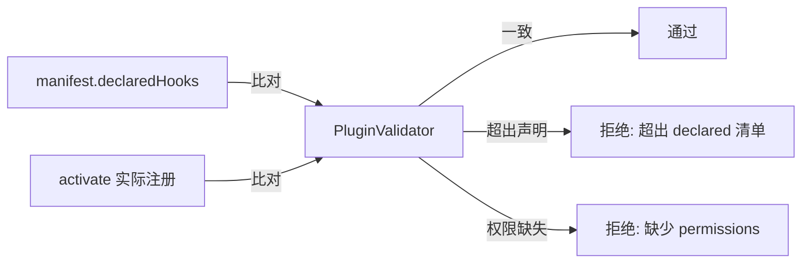

# 插件开发指南

> 本文是 `@crish/plugin-sdk` 的权威开发指南，与 `ARCHITECTURE.md` §6（插件系统）保持一致。
> 类型真源：`packages/plugin-sdk/src/` 与 `packages/shared-types/src/plugin.ts`。
> 设计依据：`analysis/iterative-repair/v2/ROUND-08-plugin-sdk.md`，遵守 `ANTI_OVERENGINEERING_GUARDRAILS.md` 禁令 13-19（不使用任何 emoji）。

---

## 1. Plugin Manifest

插件清单是**声明式能力清单**：只声明"会注册哪些能力"，不声明实现细节。实际注册通过 `activate(api)` 命令式完成。`PluginValidator` 会比对 `activate` 实际注册与 manifest 声明清单，超出则拒绝。

类型真源：`packages/plugin-sdk/src/manifest/manifest.ts`。

```ts
import type { PluginManifest } from '@crish/plugin-sdk';

const manifest: PluginManifest = {
  id: '@crish/my-plugin',
  name: 'My Plugin',
  version: '1.0.0',
  description: '演示用插件',
  entrypoints: { main: './dist/index.js' },
  permissions: ['hook:observe', 'tool:register', 'session:read'],
  trustLevel: 'restricted',
  engineVersion: '>=0.2.0 <0.3.0',
  declaredHooks: ['turn.start', 'tool.post'],
  declaredTools: ['my-plugin.greet'],
  declaredMcpServers: [],
  author: { name: 'Crish' },
  keywords: ['demo'],
};
```

### 1.1 字段说明

| 字段 | 类型 | 约束 |
| --- | --- | --- |
| `id` | `string` | npm scope 风格，非空 |
| `name` | `string` | 显示名，非空 |
| `version` | `string` | 合法 semver（`x.y.z`） |
| `entrypoints.main` | `string` | 相对插件根目录的入口路径，须导出 `activate` |
| `trustLevel` | `'restricted' \| 'full'` | 禁止 `sandboxed`（禁令 18） |
| `engineVersion` | `string` | semver range，如 `>=0.2.0 <0.3.0` |
| `permissions` | `readonly PluginPermission[]` | 11 项枚举（见 §5） |
| `declaredHooks` | `readonly HookEventName[]` | 14 事件子集（见 §3） |
| `declaredTools` | `readonly string[]` | 工具名清单 |
| `declaredMcpServers` | `readonly string[]` | MCP 服务器名清单 |
| `origin` | `'user-dir' \| 'project-dir'` | 由 `PluginDiscoverer` 填充，非作者手填 |

### 1.2 校验

`validateManifest(manifest)` 返回 `{ valid, errors }`，9 条规则（见 `packages/plugin-sdk/src/manifest/validate.ts`）：

1. `id`/`name`/`version`/`entrypoints.main`/`engineVersion` 必填非空
2. `version` 须为合法 semver
3. `trustLevel` 须为 `restricted` | `full`
4. `permissions` 项须为合法枚举
5. `declaredHooks` 项须为 14 事件之一
6. `declaredTools` / `declaredMcpServers` 项须为非空字符串
7. `engineVersion` 须为合法 semver range
8. `origin`（若填充）须为 `user-dir` | `project-dir`
9. **`full` 级别仅允许 `user-dir` origin**（防仓库投毒，禁令 18）

```ts
import { validateManifest } from '@crish/plugin-sdk';

const result = validateManifest(manifest);
if (!result.valid) {
  for (const e of result.errors) {
    console.error(`${e.field}: ${e.message} (${e.code})`);
  }
}
```

---

## 2. HookAPI

`HookAPI` 是插件作者接触的**唯一入口**，在 `activate(api)` 时注入。聚合钩子注册 + 工具注册 + MCP 声明。类型真源：`packages/plugin-sdk/src/hooks/api.ts`。

```ts
export interface HookAPI {
  readonly manifest: PluginManifest;
  observe<E extends HookEventName>(event: E, handler: HookObserveHandler<E>): HookUnsubscribe;
  on<E extends HookEventName>(event: E, handler: HookOnHandler<E>): HookUnsubscribe;
  registerTool(definition: ToolDefinition, options?: ToolRegistrationOptions): RegisteredTool;
  registerMcpServer(declaration: PluginMcpServerDeclaration): void;
  getSessionContext?(): SessionContextSnapshot;
  log(level: 'debug' | 'info' | 'warn' | 'error', message: string, metadata?: JsonObject): void;
}
```

### 2.1 observe / on 双模式（禁令 14）

| 模式 | 语义 | 失败处理 | 所需权限 | 典型用途 |
| --- | --- | --- | --- | --- |
| `observe` | 容错并行 | 失败吞掉，不影响主路径 | `hook:observe` | 日志、监控、审计 |
| `on` | 串行语义合并 | 可返回控制信号 | `hook:intercept` | 权限拦截、内容修改、流程控制 |

`observe` 处理器返回值被忽略；`on` 处理器可返回 `LifecycleHandlerResult` / `ToolErrorHandlerResult` 等控制信号（如 `stop` / `block` / `modifiedInput`）。

```ts
import type { PluginLifecycle } from '@crish/plugin-sdk';

const plugin: PluginLifecycle = {
  activate(api) {
    // observe：仅观测，不干扰主流程
    api.observe('tool.post', (payload) => {
      api.log('info', `tool ${payload.toolName} done`, { toolCallId: payload.toolCallId });
    });

    // on：可拦截/改写
    api.on('tool.pre', (payload) => {
      if (payload.toolName === 'dangerous_op') {
        return { type: 'block', reason: 'policy denied' };
      }
      return { type: 'continue' };
    });
  },
  deactivate() {
    // 清理资源（取消订阅、关闭连接）
  },
};

export default plugin;
```

### 2.2 入口模块形状

入口模块（`entrypoints.main`）支持两种导出方式，类型真源：`packages/plugin-sdk/src/hooks/lifecycle.ts`。

```ts
export interface PluginModule {
  readonly default?: PluginLifecycle;
  readonly activate?: PluginLifecycle['activate'];
  readonly deactivate?: PluginLifecycle['deactivate'];
}
```

即：default 导出 `PluginLifecycle` 对象，或具名导出 `activate` / `deactivate` 函数均可。

---

## 3. 14 Hook 事件

类型真源：`packages/plugin-sdk/src/manifest/manifest.ts`（`HookEventName`）+ `packages/shared-types/src/plugin.ts`（`HookPayloadMap`）。

| 事件名 | payload 类型 | 触发时机 |
| --- | --- | --- |
| `turn.start` | `TurnStartPayload` | 每个 turn 开始 |
| `turn.end` | `TurnEndPayload` | 每个 turn 结束 |
| `tool.pre` | `ToolPrePayload` | 工具执行前（可拦截） |
| `tool.post` | `ToolPostPayload` | 工具执行后 |
| `tool.error` | `ToolErrorPayload` | 工具抛错（可返回错误处理策略） |
| `context.compact.start` | `ContextCompactStartPayload` | 上下文压缩开始 |
| `context.compact.end` | `ContextCompactEndPayload` | 上下文压缩结束 |
| `session.start` | `SessionStartPayload` | 会话启动 |
| `session.end` | `SessionEndPayload` | 会话结束 |
| `model.beforeRequest` | `ModelBeforeRequestPayload` | 调用 provider 前 |
| `model.afterResponse` | `ModelAfterResponsePayload` | provider 响应后 |
| `subagent.start` | `SubagentStartPayload` | 子代理启动 |
| `subagent.end` | `SubagentEndPayload` | 子代理结束 |
| `error.occurred` | `ErrorOccurredPayload` | 任意错误发生 |

```ts
import type { HookPayloadMap, HookEventName } from '@crish/shared-types';

// 类型安全：payload 按 HookPayloadMap 自动推导
type TurnStartPayload = HookPayloadMap['turn.start'];
```

**注册约束**：`api.observe` / `api.on` 注册的事件必须已在 `manifest.declaredHooks` 中声明，且拥有对应权限（`hook:observe` 或 `hook:intercept`）。`PluginValidator` 比对声明与实际注册，超出则拒绝。

---

## 4. Tool Registration

工具注册通过 `api.registerTool(definition, options?)` 命令式完成，委托给 `agent-tools` 的 `ToolRegistry`（禁令 13：plugin-sdk 仅类型依赖 agent-tools，运行时由宿主注入 `ToolRegistrar`）。

```ts
import type { ToolDefinition } from '@crish/shared-types';

const greetTool: ToolDefinition = {
  name: 'my-plugin.greet',
  description: '向指定对象问好',
  inputSchema: {
    type: 'object',
    properties: { name: { type: 'string', description: '目标名称' } },
    required: ['name'],
    additionalProperties: false,
  },
  async execute(input, ctx) {
    const name = String(input.name ?? 'world');
    return { text: `Hello, ${name}!` };
  },
};

// 在 activate 内：
// api.registerTool(greetTool);
```

**三层体系**（类型真源：`packages/plugin-sdk/src/tools/plugin-api.ts`）：

1. `ToolDefinition` —— 作者提供的工具定义（shared-types）
2. `ToolRegistrationOptions` —— 注册选项（agent-tools）
3. `RegisteredTool` —— 系统自动填充字段的已注册工具（agent-tools）

注册约束：`definition.name` 必须在 `manifest.declaredTools` 内，且 `manifest.permissions` 含 `'tool:register'`。

---

## 5. Trust Model

### 5.1 信任级别（禁令 18）

类型真源：`packages/plugin-sdk/src/manifest/permissions.ts`。

| 级别 | 执行线程 | 权限校验 | 允许的 origin |
| --- | --- | --- | --- |
| `restricted` | 主线程 | `TrustGate.assertPermission` 强制白名单校验 | `user-dir` / `project-dir` |
| `full` | 主线程 | 无校验（用户显式授权） | **仅 `user-dir`** |

禁止 `sandboxed` 级别（无 `worker_threads` 隔离方案时禁止）。`full` 级别仅允许 `user-dir` 来源，`project-dir` 插件不得声明 `full`（防仓库投毒）。

### 5.2 权限清单（11 项）

```ts
export type PluginPermission =
  | 'file:access'      // 文件读写（合并 file:read + file:write）
  | 'tool:execute'     // 工具执行（含 shell，合并 shell:execute / subprocess.spawn）
  | 'tool:register'    // 注册新工具
  | 'mcp:connect'      // 连接 MCP 服务器
  | 'network:connect'  // 网络出站连接
  | 'session:read'     // 读取会话上下文（合并 system.info）
  | 'session:write'    // 写入会话上下文（合并 env.write）
  | 'env:read'         // 读取环境变量
  | 'hook:observe'     // 注册 observe 处理器（只读容错）
  | 'hook:intercept'   // 注册 on 处理器（可返回控制信号）
  | 'plugin:manage';   // 管理其他插件（启用/禁用/卸载）
```

### 5.3 TrustGate 契约

`TrustGate` 实现归属 `agent-permissions`（复用 `TrustZonePermissionPolicy` 的 T0-T4 信任区矩阵）。plugin-sdk 仅声明契约，通过依赖注入接收实例（避免运行时依赖与循环边）。类型真源：`packages/plugin-sdk/src/manifest/trust-gate.ts`。

```ts
export interface TrustGateLike {
  assertPermission(pluginId: string, permission: PluginPermission): void;
  decide(pluginId: string, permission: PluginPermission): 'allow' | 'deny';
  registerPlugin(pluginId: string, trustLevel: PluginTrustLevel, permissions: readonly PluginPermission[]): void;
  unregisterPlugin(pluginId: string): void;
}
```

- `full` 级别：`assertPermission` 直接通过，`decide` 始终返回 `'allow'`
- `restricted` 级别：检查 `manifest.permissions` 白名单，命中则通过，否则抛错

### 5.4 MCP 服务器声明（禁令 19）

MVP 阶段仅支持 stdio 本地进程，禁止 OAuth / HTTP / SSE。类型真源：`packages/plugin-sdk/src/tools/mcp-declaration.ts`。

```ts
import type { PluginMcpServerDeclaration } from '@crish/plugin-sdk';

const mcpServer: PluginMcpServerDeclaration = {
  name: 'my-plugin.fs-server',
  transport: 'stdio',
  command: 'node',
  args: ['./dist/mcp-server.js'],
  env: { NODE_ENV: 'production' },
  cwd: process.cwd(),
  startupTimeoutMs: 5000,
};
```

注册约束：`declaration.name` 必须在 `manifest.declaredMcpServers` 内，且 `manifest.permissions` 含 `'mcp:connect'`。实际注册委托给 `agent-mcp` 的 `registerPluginServer`（通过 `PluginAPIDeps.mcpRegistrar` 注入）。

---

## 6. Skill Loader

`SkillLoader` 将 `SKILL.md` 文件加载为技能并转换为可被 LLM 调用的工具。类型真源：`packages/plugin-sdk/src/skills/skill-loader.ts`。

### 6.1 技能目录结构

```text
skills/
  <skill-name>/
    SKILL.md          # frontmatter + 正文
    scripts/          # 可选，辅助脚本
    prompts/          # 可选，prompt 片段
```

### 6.2 SKILL.md frontmatter

```markdown
---
name: my-skill
description: 演示技能
scope: project
activation: enabled
run-as: inline
read-only: true
allowed-tools: [read_file, grep]
tags: [demo, example]
---
正文内容
```

支持的字段：`name`、`description`、`scope`（`global` | `project` | `workspace`）、`activation`（`enabled` | `recommended` | `disabled`）、`run-as`（`inline` | `subagent`）、`read-only`、`invocation`（`auto` | `manual`）、`allowed-tools`、`applies-to`、`tags`、`disable-model-invocation`。

### 6.3 加载与转换

```ts
import { SkillLoader } from '@crish/plugin-sdk';

const loader = new SkillLoader();
const result = await loader.loadFromDirectory('./skills', { maxSkillBytes: 512 * 1024 });

for (const diag of result.diagnostics) {
  console.warn(`[${diag.severity}] ${diag.code}: ${diag.message} (${diag.path})`);
}

for (const skill of result.skills) {
  const tool = loader.toTool(skill); // 转为 ToolDefinition
  // api.registerTool(tool);
}
```

**名称校验**（`validateSkillName`）：小写字母 + 数字 + 连字符，禁止首尾连字符、连续连字符，长度 ≤ 64。**描述校验**：非空，长度 ≤ 1024。**二进制检测**：探测前 8KB 是否含 null byte（对齐 git 启发式）。单个技能加载失败不影响其他技能（记录 warning 诊断）。

---

## 7. Examples

### 7.1 完整插件示例

```ts
// my-plugin/src/manifest.ts
import type { PluginManifest } from '@crish/plugin-sdk';

export const manifest: PluginManifest = {
  id: '@crish/example',
  name: 'Example Plugin',
  version: '1.0.0',
  entrypoints: { main: './dist/index.js' },
  permissions: ['hook:observe', 'hook:intercept', 'tool:register', 'session:read'],
  trustLevel: 'restricted',
  engineVersion: '>=0.2.0 <0.3.0',
  declaredHooks: ['turn.end', 'tool.pre'],
  declaredTools: ['example.echo'],
  declaredMcpServers: [],
};
```

```ts
// my-plugin/src/index.ts
import type { PluginLifecycle } from '@crish/plugin-sdk';
import type { ToolDefinition } from '@crish/shared-types';

const echoTool: ToolDefinition = {
  name: 'example.echo',
  description: '原样返回输入',
  inputSchema: {
    type: 'object',
    properties: { message: { type: 'string' } },
    required: ['message'],
    additionalProperties: false,
  },
  async execute(input) {
    return { text: String(input.message ?? '') };
  },
};

const plugin: PluginLifecycle = {
  activate(api) {
    api.observe('turn.end', (payload) => {
      api.log('debug', `turn ${payload.turnIndex} ended`, {
        toolCallCount: payload.toolCallCount,
      });
    });

    api.on('tool.pre', (payload) => {
      if (payload.toolName.startsWith('unsafe_')) {
        return { type: 'block', reason: 'unsafe tool blocked by example plugin' };
      }
      return { type: 'continue' };
    });

    api.registerTool(echoTool);
  },
  deactivate() {
    // 资源清理
  },
};

export default plugin;
```

### 7.2 能力声明 vs 实际注册

`PluginValidator` 比对流程：



---

## 8. Testing

### 8.1 manifest 校验测试

```ts
import { describe, it, expect } from 'vitest';
import { validateManifest } from '@crish/plugin-sdk';
import type { PluginManifest } from '@crish/plugin-sdk';

describe('manifest validation', () => {
  it('rejects full trust with project-dir origin', () => {
    const manifest: PluginManifest = {
      id: '@crish/test',
      name: 'Test',
      version: '1.0.0',
      entrypoints: { main: './dist/index.js' },
      permissions: [],
      trustLevel: 'full',
      engineVersion: '>=0.2.0 <0.3.0',
      declaredHooks: [],
      declaredTools: [],
      declaredMcpServers: [],
      origin: 'project-dir',
    };
    const result = validateManifest(manifest);
    expect(result.valid).toBe(false);
    expect(result.errors.some(e => e.code === 'full-trust-forbidden-origin')).toBe(true);
  });
});
```

### 8.2 HookAPI 测试

测试时构造 mock `HookAPI`，验证 `activate` 注册行为符合 manifest 声明：

```ts
import { describe, it, expect, vi } from 'vitest';
import type { HookAPI, PluginLifecycle } from '@crish/plugin-sdk';

function createMockApi(): HookAPI & { calls: string[] } {
  const calls: string[] = [];
  return {
    manifest: {} as never,
    observe: vi.fn((event) => { calls.push(`observe:${event}`); return () => {}; }),
    on: vi.fn((event) => { calls.push(`on:${event}`); return () => {}; }),
    registerTool: vi.fn((def) => { calls.push(`tool:${def.name}`); return {} as never; }),
    registerMcpServer: vi.fn(),
    log: vi.fn(),
    calls,
  } as never;
}

describe('plugin activate', () => {
  it('registers declared capabilities', async () => {
    const api = createMockApi();
    const plugin: PluginLifecycle = { activate: (a) => a.observe('turn.end', () => {}) };
    await plugin.activate(api);
    expect(api.calls).toContain('observe:turn.end');
  });
});
```

### 8.3 SkillLoader 测试

```ts
import { describe, it, expect } from 'vitest';
import { SkillLoader } from '@crish/plugin-sdk';
import { mkdir, writeFile, rm } from 'node:fs/promises';
import { join } from 'node:path';

describe('SkillLoader', () => {
  it('loads SKILL.md with frontmatter', async () => {
    const dir = join(process.tmpdir(), `skill-test-${Date.now()}`);
    await mkdir(join(dir, 'my-skill'), { recursive: true });
    await writeFile(
      join(dir, 'my-skill', 'SKILL.md'),
      '---\nname: my-skill\ndescription: test\n---\nbody',
    );
    try {
      const loader = new SkillLoader();
      const result = await loader.loadFromDirectory(dir);
      expect(result.skills).toHaveLength(1);
      expect(result.skills[0]?.name).toBe('my-skill');
      const tool = loader.toTool(result.skills[0]!);
      expect(tool.name).toBe('my-skill');
    } finally {
      await rm(dir, { recursive: true, force: true });
    }
  });
});
```

---

## 9. 参考

- 架构总览：[`../ARCHITECTURE.md`](../ARCHITECTURE.md) §6
- 设计文档：[`../analysis/iterative-repair/v2/ROUND-08-plugin-sdk.md`](../analysis/iterative-repair/v2/ROUND-08-plugin-sdk.md)
- 错误处理：[`./error-handling.md`](./error-handling.md)
- 守卫约束：[`../ANTI_OVERENGINEERING_GUARDRAILS.md`](../ANTI_OVERENGINEERING_GUARDRAILS.md) 禁令 13-19
