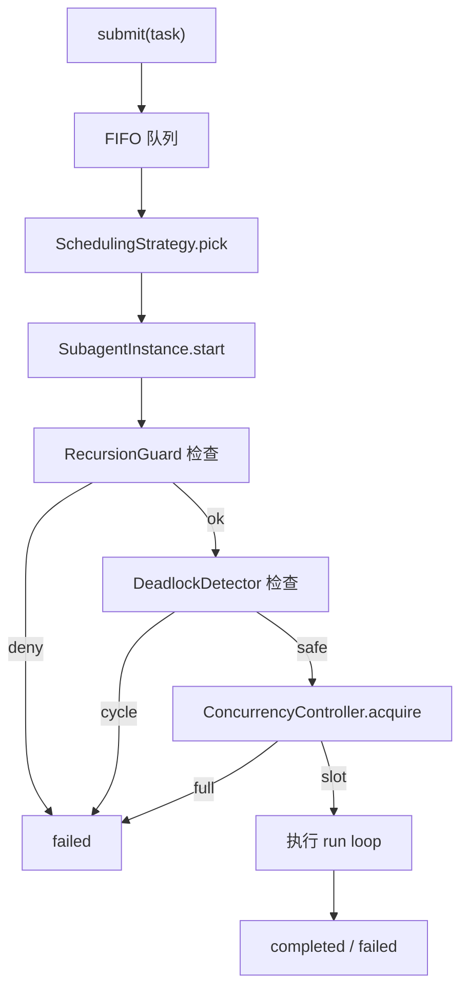
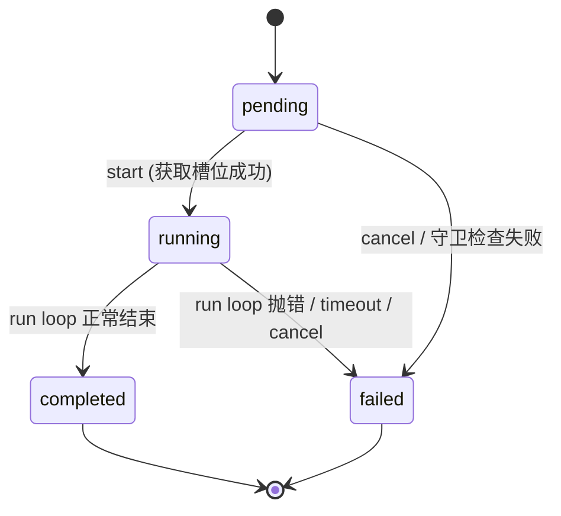

# 子代理开发指南

> 本文是 `@crish/agent-subagent` 的权威开发指南，与 `ARCHITECTURE.md` §5（子代理系统）保持一致。
> 类型真源：`packages/agent-subagent/src/`。
> 设计依据：`analysis/iterative-repair/v2/ROUND-09-*.md`，遵守 `ANTI_OVERENGINEERING_GUARDRAILS.md` 禁令 20-23（不使用任何 emoji）。

---

## 1. Overview

`agent-subagent`（Layer 5）负责子代理的调度、递归守卫、并发控制、死锁检测与生命周期管理。依赖 `agent-core` / `agent-tools` / `agent-mcp` / `agent-context`，不依赖 `agent-orchestrator` / `agent-daemon`。



**核心约束**（禁令 20-23）：

- 禁止新建 `SubagentCommunicationBus`，父子代理通信复用 `ControlBus`（禁令 20）
- 调度器只看 `capabilityMode`，不看 `role`（禁令 21）
- `role` 仅用于展示与过滤，不影响调度
- 迁移阶段 re-export 旧接口保持向后兼容（禁令 23）

---

## 2. SubagentScheduler

`SubagentScheduler` 负责任务提交、队列维护、异步调度循环与查询接口。类型真源：`packages/agent-subagent/src/scheduler.ts`。

```ts
import type { AgentRuntime } from '@crish/agent-core';
import type { ToolExecutionContext } from '@crish/shared-types';
import { createSubagentScheduler, type SubagentScheduler } from '@crish/agent-subagent';

const scheduler = createSubagentScheduler(runtime, context, guard);
```

### 2.1 接口

```ts
export interface SubagentScheduler {
  readonly recursionGuard: RecursionGuard;
  readonly concurrencyController: ConcurrencyController;
  readonly deadlockDetector: DeadlockDetector;
  readonly strategy: SchedulingStrategy;
  submit(task: SubagentTaskCard): Promise<string>;
  cancel(taskId: string): Promise<boolean>;
  getStatus(taskId: string): SubagentInstance['status'] | undefined;
  await(taskId: string, timeoutMs?: number): Promise<SubagentResult>;
  snapshot(): SchedulerSnapshot;
}
```

### 2.2 调度策略

第一版仅 FIFO，`priority` / `affinity` 推迟（`SchedulingStrategy` 接口预留扩展点）。

```ts
export interface SchedulingStrategy {
  readonly name: string;
  pick(queue: SubagentTaskCard[]): SubagentTaskCard | undefined;
}

export class FifoSchedulingStrategy implements SchedulingStrategy {
  readonly name = 'fifo';
  pick(queue: SubagentTaskCard[]) { return queue.shift(); }
}
```

### 2.3 调度循环

`submit` 流程：

1. 生成 `taskId`（`createId('subagent-task')`）
2. **maxQueued 检查**（防止无限排队 / OOM 防护）：超过 `concurrencyController.maxQueued` 抛 `subagent.queue_full`
3. 创建 `SubagentInstance`（状态 `pending`），入表 `instances`
4. 任务入队，异步触发 `scheduleNext`（不阻塞 `submit`）
5. `scheduleNext` 循环出队 → `instance.start()`（不 await，并发由 `ConcurrencyController` 控制）

**关键设计**：`RecursionGuard` / `Deadlock` 检查不在 `submit` 时做，而在 `instance.start()` 内做（因为队列可能等待，检查时机应在实际 spawn 前）。

### 2.4 快照

```ts
export interface SchedulerSnapshot {
  pending: number;
  running: number;
  completed: number;
  failed: number;
  maxConcurrent: number;
  currentConcurrent: number;
  currentQueued: number;
}
```

```ts
const snap = scheduler.snapshot();
// 容量监控：currentConcurrent / maxConcurrent / currentQueued 可直接读取
if (snap.currentQueued >= snap.maxConcurrent * 2) {
  // 队列将满，实际抛错由 scheduler.submit 内部用 subagent.queue_full 处理
}
```

`scheduler.submit` 在队列满时抛 `subagent.queue_full`（`category: 'permanent'`，`retryable: false`）；`scheduler.await` 在任务不存在时抛 `subagent.not_found`（`permanent`）。

---

## 3. RecursionGuard

三维度递归检查，防止子代理无限递归与过度并行。类型真源：`packages/agent-subagent/src/recursion-guard.ts`。

### 3.1 配置

```ts
export interface RecursionGuard {
  readonly maxDepth: number;          // 祖先链最大深度（默认 3）
  readonly maxSiblings: number;       // 同一父 session 下最大兄弟子代理数（默认 5）
  readonly maxConcurrent: number;     // 全局同时运行子代理上限（默认 6）
  readonly totalTokenBudget: number;  // 预留，默认 0 = 不限制
  readonly totalTimeoutMs: number;    // 预留，默认 0 = 不限制
}

export const DEFAULT_RECURSION_GUARD: RecursionGuard = {
  maxDepth: 3,
  maxSiblings: 5,
  maxConcurrent: 6,
  totalTokenBudget: 0,
  totalTimeoutMs: 0,
};
```

`DEFAULT_RECURSION_GUARD` 是唯一权威默认值（ROUND-09 §3.2）。

### 3.2 检查函数

`checkRecursionGuard` 是**纯函数**，不修改状态，按早退顺序检查（不占配额）：

1. `maxDepth`：`ancestorSessionIds.length + 1 > maxDepth` → 拒绝
2. `maxSiblings`：`siblingCounter.get(parentSessionId) >= maxSiblings` → 拒绝
3. `maxConcurrent`：`concurrentCounter.current >= maxConcurrent` → 拒绝

```ts
export type RecursionCheckResult =
  | { ok: true }
  | {
      ok: false;
      reason: 'max-depth-exceeded' | 'max-siblings-exceeded' | 'max-concurrent-exceeded';
      limit: number;
      actual: number;
    };
```

```ts
import { checkRecursionGuard, extractRecursionContext, DEFAULT_RECURSION_GUARD } from '@crish/agent-subagent';

const ctx = extractRecursionContext(context, siblingCounter, concurrentCounter);
const result = checkRecursionGuard(DEFAULT_RECURSION_GUARD, ctx);
if (!result.ok) {
  // 不抛异常，由调用方决定如何处理
  return { denied: true, reason: result.reason, limit: result.limit, actual: result.actual };
}
```

### 3.3 祖先链传递

递归上下文通过 `ToolExecutionContext.metadata.ancestorSessionIds` 在父子间传递（数组，替代旧 `subagentDepth` 数字）。

```ts
export interface RecursionCheckContext {
  ancestorSessionIds: string[];  // 从根到当前父 session，不含 spawn 目标
  parentSessionId: string;        // 当前父 session ID（用于兄弟计数）
  siblingCounter: SiblingCounter;
  concurrentCounter: ConcurrentCounter;
}
```

**共存阶段**（禁令 23）：`extractRecursionContext` 优先读 `ancestorSessionIds`；若未设置但 `subagentDepth > 0`，从 `subagentDepth` 推断深度（使用占位 ID，死锁检测在此阶段无法检测真实环，但深度检查正确）。

### 3.4 role vs capabilityMode（禁令 21）

```ts
export type SubagentRole = 'researcher' | 'implementer' | 'reviewer' | 'debugger' | 'planner';
export type CapabilityMode = 'read-only' | 'read-write' | 'execute' | 'all';
```

- `role`：元数据维度，仅用于展示与过滤，调度器不读取
- `capabilityMode`：实际权限控制维度，调度逻辑只看此字段

禁止 `role` 与 `capabilityMode` 并存的双重维度。

---

## 4. ConcurrencyController

多维度并发控制，封装原 `AsyncSemaphore` + 全局变量 `currentActiveSubagents`（消除模块级全局变量反模式）。类型真源：`packages/agent-subagent/src/concurrency-controller.ts`。

### 4.1 三维度上限

| 维度 | 字段 | 取值 |
| --- | --- | --- |
| 全局并发 | `maxConcurrent` | `= RecursionGuard.maxConcurrent`（默认 6） |
| 每父并发 | `maxSiblings` | `= RecursionGuard.maxSiblings`（默认 5） |
| 队列上限 | `maxQueued` | `= maxConcurrent * 2`（默认 12，防无限排队） |

```ts
export interface ConcurrencyController {
  readonly maxConcurrent: number;
  readonly maxSiblings: number;
  readonly maxQueued: number;
  readonly currentConcurrent: number;
  readonly currentQueued: number;
  readonly siblingCounter: SiblingCounter;
  readonly concurrentCounter: ConcurrentCounter;
  acquire(parentSessionId: string): Promise<() => void>;
  snapshot(): ConcurrencySnapshot;
}
```

### 4.2 获取槽位

`acquire(parentSessionId)` 异步阻塞直到有可用槽位，返回 `release` 函数（**必须在 `finally` 中调用**）。

```ts
import { createConcurrencyController } from '@crish/agent-subagent';

const controller = createConcurrencyController(DEFAULT_RECURSION_GUARD);
const release = await controller.acquire(parentSessionId);
try {
  // 子代理 run loop
} finally {
  release(); // 幂等：内部 released 标志位防止重复 release
}
```

**设计决策**：

- 不重写 `AsyncSemaphore`（成熟原语，来自 `@crish/shared-utils`）
- 不引入 `Mutex`（Node.js 单线程事件循环，`acquire`/`release` 是原子异步操作）
- `release` 幂等性（`released` 标志位防止重复 release）

### 4.3 计数器契约

`SiblingCounter` 与 `ConcurrentCounter` 由 `ConcurrencyController` 提供，供 `RecursionGuard.check` 使用（外部注入，避免守卫内部维护全局状态）。

```ts
export interface SiblingCounter {
  get(parentSessionId: string): number;
  increment(parentSessionId: string): void;
  decrement(parentSessionId: string): void;
}

export interface ConcurrentCounter {
  readonly current: number;
  increment(): void;
  decrement(): void;
}
```

`AsyncSemaphore` 内部已维护 `activeCount`，`ConcurrentCounter` 的 `increment`/`decrement` 为 no-op（语义保留供未来扩展）。

---

## 5. DeadlockDetector

轻量级 spawn 时环检测，防止子代理祖先链形成环导致死锁。类型真源：`packages/agent-subagent/src/deadlock-detector.ts`。

### 5.1 检测逻辑

在 spawn 时检查 `ancestorSessionIds` 是否包含目标 session。如果 `targetSessionId` 已经在祖先链中，则 spawn 会形成环（如 A→B→C→A），导致死锁。

```ts
export interface DeadlockDetector {
  detectCycle(ancestorSessionIds: string[], targetSessionId: string): boolean;
  assertNoCycle(ancestorSessionIds: string[], targetSessionId: string): void;
}
```

- 复杂度：**O(depth)**，`depth = ancestorSessionIds.length`，典型 ≤ 3（由 `maxDepth=3` 限制）
- 无状态：不维护任何 `Map`/`Set`，每次调用独立计算
- 纯函数：`detectCycle` 无副作用，可在测试中直接断言
- 无后台线程：不引入 `setInterval`/`setTimeout` 周期扫描

```ts
import { createDeadlockDetector } from '@crish/agent-subagent';

const detector = createDeadlockDetector();
// 线性祖先链 A→B→C（无环）
expect(detector.detectCycle(['A', 'B', 'C'], 'D')).toBe(false);
// 环 A→B→A
expect(detector.detectCycle(['A', 'B'], 'A')).toBe(true);
```

### 5.2 死锁错误

检测到环时抛 `CrishError`，错误码 `subagent.deadlock`，`category: 'permanent'`，`retryable: false`（死锁不可重试，必须修改调用图）。

```ts
import { createDeadlockError } from '@crish/agent-subagent';
import { CrishError } from '@crish/shared-types';

const error = createDeadlockError(['A', 'B'], 'A');
// error.code === 'subagent.deadlock'
// error.metadata === { ancestorSessionIds: ['A','B'], targetSessionId: 'A', cycleLength: 1 }
```

**明确排除的场景**：跨树环（需全局等待图分析，超出轻量级实现范围）、已运行子代理的动态环（本实现仅在 spawn 时检查）。

---

## 6. SubagentInstance

子代理生命周期管理，4 状态机。类型真源：`packages/agent-subagent/src/instance.ts`。

### 6.1 状态机



```ts
export type SubagentState = 'pending' | 'running' | 'completed' | 'failed';
```

**禁止的状态**（本 Round 推迟）：`paused`（context snapshot 复杂）、`resuming`。**终态**（不可转换）：`completed`、`failed`。

### 6.2 接口

```ts
export interface SubagentInstance {
  readonly taskId: string;
  readonly task: SubagentTaskCard;
  readonly status: SubagentState;
  readonly createdAt: number;
  readonly startedAt: number | undefined;
  readonly finishedAt: number | undefined;
  readonly timeoutMs: number;
  start(): Promise<void>;
  cancel(): Promise<void>;
  join(timeoutMs?: number): Promise<SubagentResult>;
  getTimeline(): SubagentProgressEvent[];
  getStats(): SubagentRunStats;
}
```

### 6.3 start 流程

`start()` 内部依次执行（任一失败转 `failed` 状态）：

1. 状态转换 `pending → running`（非法转换抛 `subagent.invalid_state`）
2. **递归守卫检查**：失败转 `failed`，错误码 `subagent.${reason}`（如 `subagent.max-depth-exceeded`）
3. **死锁检测**：`assertNoCycle`，失败转 `failed`，错误码 `subagent.deadlock`
4. **并发槽位获取**：`acquire(parentSessionId)`，失败转 `failed`，错误码 `subagent.concurrency_acquire_failed`（`transient`，可重试）
5. 启动 timeout 计时器（`timeoutMs > 0` 时，`setTimeout` + `unref`）
6. 执行 run loop（委托 `AgentRuntime.run`）
7. `finally` 中清理 timer + 释放槽位

### 6.4 取消与超时

- **取消**：`cancel()` 触发 `AbortController.abort()`，run loop 在下次安全点检查 `signal.aborted` 并抛 `subagent.cancelled`
- **超时**：`handleTimeout()` 调用 `abortController.abort()`，run loop 在下次安全点抛错
- **join 超时**：`join(timeoutMs)` 用 `Promise.race`，超时仅拒绝 await 的 Promise，**不取消任务**

```ts
const instance = new DefaultSubagentInstance(
  taskId, task, runtime, context,
  recursionGuard, concurrencyController, deadlockDetector,
  30_000, // timeoutMs（0 = 不限制）
  (event) => console.log(`progress: ${event.status}`),
);

await instance.start();
const result = await instance.join(60_000);
console.log(result.status, result.finalText);
```

### 6.5 执行结果

```ts
export interface SubagentResult {
  taskId: string;
  status: SubagentState;
  output?: JsonObject;
  error?: CrishError;
  stats: SubagentRunStats;
  timeline: SubagentProgressEvent[];
  finalText: string;
  completionSummary: string;
}

export interface SubagentRunStats {
  toolUses: number;
  turns: number;
  events: Record<string, number>;
}
```

`finalText` 从 `AgentMessage[]` 中提取最后一条 `assistant` 消息的文本块。

---

## 7. ControlBus L1/L2/L3

子代理通信复用 `ControlBus`（禁令 20：禁止新建 `SubagentCommunicationBus`）。ControlBus 提供 L0-L3 四级 Run 控制语义。协议真源：`packages/shared-types/src/run-control.ts`，运行时真源：`packages/agent-core/src/control/`，详见 `docs/architecture/run-control.md`。

### 7.1 L0-L3 一览

| 级别 | wire 名 | 谁发起 | 效果 | AI 是否继续 | 是否 abort provider |
| --- | --- | --- | --- | --- | --- |
| L0 | `continue` | AI / loop | 进入下一 turn | 是 | 否 |
| L1 | `soft_inject` | 用户 / steer | 安全点注入消息，**不杀**当前 stream | 是 | 否 |
| L2 | `cooperative_stop` | 用户 Stop / AI 策略 / hook | 当前 turn 正常收尾，干净停止 | 否 | 否 |
| L3 | `force_cancel` | 用户 Force / 系统 | 硬停：abort provider + tools | 否 | 是 |

固定映射（禁止私自改 wire 字面量）：`L0 → continue`、`L1 → soft_inject`、`L2 → cooperative_stop`、`L3 → force_cancel`。

### 7.2 L1 三环（AgentInputQueue）

运行时扩展 `steer` / `follow_up` 与 `soft_inject` 同属 L1，投影到协议时折叠为 `soft_inject`，但**入队环不同**：

| 环 | 触发 kind | 何时 drain | 用途 |
| --- | --- | --- | --- |
| force | `enqueue` / 默认 | streaming 中途可打断 | legacy mid-stream 打断 |
| steer | `soft_inject` / `steer` | 安全点：provider 消费结束 / tool 批后 | mid-run 改向（对齐 pi `agent.steer()`） |
| followUp | `follow_up` | 仅 run 本将 idle（无 tool、无 force/steer）时 | 本轮跑完再补一句（对齐 pi `agent.followUp()`） |

优先级：`force_cancel (L3) > cooperative_stop (L2) > L1 inject（steer / followUp）`。

### 7.3 与子代理的关系

父代理 spawn 子代理后，通过 `ControlBus` 发送控制意图：

- 父代理 `cooperative_stop`（L2）→ 子代理干净收尾
- 父代理 `force_cancel`（L3）→ 子代理 `AbortController.abort()`，硬停
- 父代理 `soft_inject`（L1）→ 子代理在安全点注入消息，不杀当前 stream

```ts
import type { RunControlIntentInput } from '@crish/agent-core';
import type { AgentMessage } from '@crish/shared-types';

// L2 协作停：子代理当前 turn 正常收尾
const l2: RunControlIntentInput = { kind: 'cooperative_stop', reason: 'parent requested stop' };

// L3 硬停：abort provider + tools
const l3: RunControlIntentInput = { kind: 'force_cancel', reason: 'parent hard cancel' };

// L1 steer：mid-run 改向（不杀 stream）
const l1: RunControlIntentInput = { kind: 'steer', message: assistantMessage, reason: 'redirect' };
// assistantMessage: AgentMessage 由调用方构造
declare const assistantMessage: AgentMessage;
```

**关键原则**：禁止用 L3 表达"模型觉得差不多了"——那会丢结果、工具打断、日志误导。默认用户 Stop = L2；长按或二次确认 = L3。`AbortController` 是机制（取消 in-flight IO），L0-L3 是产品语义，只有 L3 应触发 provider/tools abort。

---

## 8. 完整示例

```ts
import { AgentRuntime } from '@crish/agent-core';
import { createSubagentScheduler, DEFAULT_RECURSION_GUARD } from '@crish/agent-subagent';
import { CrishError } from '@crish/shared-types';
import type { ToolExecutionContext } from '@crish/shared-types';

async function runChildAgent(
  runtime: AgentRuntime,
  context: ToolExecutionContext,
  objective: string,
): Promise<void> {
  const scheduler = createSubagentScheduler(runtime, context, DEFAULT_RECURSION_GUARD);

  const taskId = await scheduler.submit({
    objective,
    description: 'research subtask',
    mode: 'research',
    capabilityMode: 'read-only',
  } as never);

  try {
    const result = await scheduler.await(taskId, 60_000);
    if (result.status === 'failed') {
      throw result.error ?? new CrishError('subagent failed', 'subagent.execution_failed', 'transient', true);
    }
    console.log('subagent output:', result.finalText);
  } catch (error) {
    if (error instanceof CrishError && error.code === 'subagent.await_timeout') {
      await scheduler.cancel(taskId);
    }
    throw error;
  }
}
```

---

## 9. 测试

### 9.1 递归守卫测试

```ts
import { describe, it, expect } from 'vitest';
import { checkRecursionGuard, DEFAULT_RECURSION_GUARD } from '@crish/agent-subagent';

describe('RecursionGuard', () => {
  it('denies when depth exceeds maxDepth', () => {
    const ctx = {
      ancestorSessionIds: ['A', 'B', 'C'], // depth = 4
      parentSessionId: 'C',
      siblingCounter: { get: () => 0, increment: () => {}, decrement: () => {} },
      concurrentCounter: { current: 0, increment: () => {}, decrement: () => {} },
    };
    const result = checkRecursionGuard(DEFAULT_RECURSION_GUARD, ctx);
    expect(result.ok).toBe(false);
    if (!result.ok) {
      expect(result.reason).toBe('max-depth-exceeded');
      expect(result.limit).toBe(3);
      expect(result.actual).toBe(4);
    }
  });
});
```

### 9.2 死锁检测测试

```ts
import { describe, it, expect } from 'vitest';
import { createDeadlockDetector, createDeadlockError } from '@crish/agent-subagent';

describe('DeadlockDetector', () => {
  const detector = createDeadlockDetector();

  it('detects cycle when target is in ancestor chain', () => {
    expect(detector.detectCycle(['A', 'B', 'C'], 'B')).toBe(true);
  });

  it('returns false for linear chain', () => {
    expect(detector.detectCycle(['A', 'B', 'C'], 'D')).toBe(false);
  });

  it('assertNoCycle throws on cycle', () => {
    expect(() => detector.assertNoCycle(['A', 'B'], 'A')).toThrow();
    const error = createDeadlockError(['A', 'B'], 'A');
    expect(error.code).toBe('subagent.deadlock');
    expect(error.category).toBe('permanent');
    expect(error.retryable).toBe(false);
  });
});
```

### 9.3 并发控制器测试

```ts
import { describe, it, expect } from 'vitest';
import { createConcurrencyController, DEFAULT_RECURSION_GUARD } from '@crish/agent-subagent';

describe('ConcurrencyController', () => {
  it('respects maxConcurrent', async () => {
    const controller = createConcurrencyController(DEFAULT_RECURSION_GUARD);
    const releases: (() => void)[] = [];
    for (let i = 0; i < DEFAULT_RECURSION_GUARD.maxConcurrent; i++) {
      releases.push(await controller.acquire(`parent-${i}`));
    }
    expect(controller.currentConcurrent).toBe(DEFAULT_RECURSION_GUARD.maxConcurrent);
    releases.pop()?.();
    expect(controller.currentConcurrent).toBe(DEFAULT_RECURSION_GUARD.maxConcurrent - 1);
    for (const release of releases) release();
  });

  it('release is idempotent', async () => {
    const controller = createConcurrencyController(DEFAULT_RECURSION_GUARD);
    const release = await controller.acquire('parent');
    release();
    release(); // 幂等，不抛错
    expect(controller.currentConcurrent).toBe(0);
  });
});
```

---

## 10. 参考

- 架构总览：[`../ARCHITECTURE.md`](../ARCHITECTURE.md) §5
- Run 控制语义：[`./architecture/run-control.md`](./architecture/run-control.md)
- 错误处理：[`./error-handling.md`](./error-handling.md)
- 设计文档：[`../analysis/iterative-repair/v2/`](../analysis/iterative-repair/v2/)（ROUND-09 系列）
- 守卫约束：[`../ANTI_OVERENGINEERING_GUARDRAILS.md`](../ANTI_OVERENGINEERING_GUARDRAILS.md) 禁令 20-23
