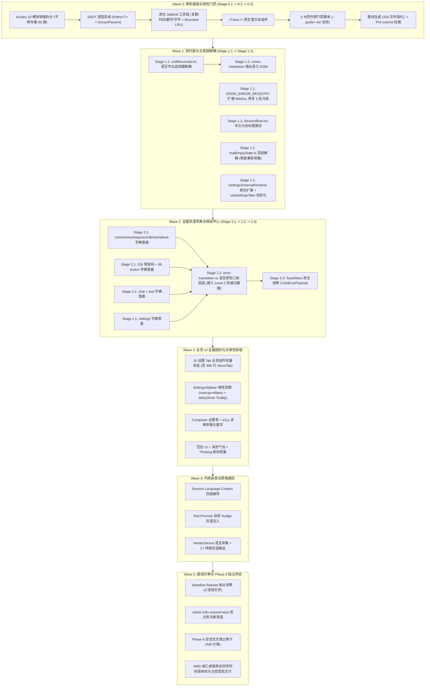

# 多语言化与全景系统重构总方案（Master Plan v2.0 · 经双盲审计加固定审版）

> **战役代号**：`i18n-full-remediation`
> **版本**：v2.0.0 终审定稿（已吸收 Phase 5 全部 5 位独立审计员 24 项整改意见）
> **发布日期**：2026-10-14
> **权威协作指令**：仓库根目录 [`AGENTS.md`](../../AGENTS.md)、[`.agents/LOGIC_PLAN_NO_RETREAT.md`](../../.agents/LOGIC_PLAN_NO_RETREAT.md) 与 [`docs/i18n-full-remediation/00-战役工作纪律与规范.md`](./00-战役工作纪律与规范.md)。
> **依据产物**：融合 Phase 1（6 份全景勘察）、Phase 2（5 份分维系统解）、Phase 3（5 份独立总案）以及 Phase 5（5 份双盲独立审计报告，含 AUDITOR-01~05 全部 Blocker 裁决与修复方案）。

---

## 一、战役背景与战略定位

### 1.1 现状危机与 7 大深层缺陷治理
在开源准备度专项冲刺中，项目虽然完成了初步的 i18n 骨架打底，但经地毯式排查，全系统多语言化真实覆盖率仅有 **约 5%**，且潜藏 **7 大深层架构与功能缺陷**：
1. **75.95% 生产组件散落硬编码中文**：全仓 420 个生产 TSX 文件中，多达 319 个文件包含未国际化的中文字符串；
2. **反向耦合导致排版脆弱**：`unitReconciler.ts:45` 硬编码匹配 `[aria-label="表格"]` 实施 `contain: layout`，一旦底层 Rust 简单改词将导致表格排版引擎无声瘫痪与剧烈抖动；
3. **会话分支业务逻辑致命 Bug**：`SessionRow.tsx:270` 写死中文正则 `replace(/ - 分支$/, '')`，导致非中文会话分支判定失效；
4. **内核意图自愈语言污染**：Rust 内核意图推进与自愈 Prompt 强行注入纯中文，导致英文会话发生严重的大模型语言漂移；
5. **错误注册表契约污染**：105 个错误码中 3 处混入中文长句，13 个 Domain 在字典中 0% 覆盖，生产 UI 零调用本地化错误模型；
6. **侧边栏物理排版断裂**：SettingsSidebar 220px 宽度缺乏 `nowrap + ellipsis` 保护，英文展开必遭恶性折行与高度塌陷；UserProfileCard 读屏拼接导致 TTS 严重畸变；
7. **缺乏防作弊门禁**：现有单测无法拦截“将中文原样复制进英文包骗过 key 对齐”的偷懒行为。

### 1.2 战役效果锁与核心原则
依据 [`AGENTS.md`](../../AGENTS.md) §1.1、§1.7 与 7.1，本战役**零降级、零妥协、绝不搞表面翻译补丁**：
- **完整性**：15 个设置 Tab、对话核心流、Composer、工具卡片、105 错误码、Rust Markdown 渲染器、Push 通知、无障碍读屏 100% 深度治理；
- **架构净收敛**：根治所有暴露的深层架构断层与业务 Bug，同一概念保持单一真理源（SSOT）；
- **刚性防作弊**：三道自动化质量门禁与基线棘轮（Baseline Ratchet）彻底封死伪翻译与硬编码；
- **立体验证**：静态检查、单测资产、DOM 几何排版、汉字纯度、真实 4000 端口桌面真机现场核验立体把关。

---

## 二、7 大深层问题与系统级突破综合解（已吸纳审计整改）



### 2.1 缺陷 1：反向耦合排版崩溃解耦（吸纳 TOP-B05 审计）
- **时序屏障**：必须严格分为 **Stage 1.1**（前端调和器解耦）与 **Stage 1.2**（Rust 渲染器改造），严禁平铺并行。
- **Stage 1.1 前端解耦先行**：在 [`apps/crish-desktop/src/api/markdown/unitReconciler.ts:44-48`](file:///c:/Software/conex/apps/crish-desktop/src/api/markdown/unitReconciler.ts) 中，将排版隔离选择器重构为：
  ```typescript
  const TABLE_SELECTOR = '.md-table-wrap, [data-md-table="true"], [role="region"][aria-label="表格"]';
  ```
  优先放行类名与 `data-md-table`，保留存量选择器向下兼容历史离线消息。
- **Stage 1.2 Rust 渲染中立化紧随**：在 `crates/conex-markdown/src/renderer.rs` 中输出：
  `<button type="button" class="md-code-copy" data-code-action="copy" aria-label="Copy code"></button>` 与 `<div class="md-table-wrap" role="region" data-md-table="true" aria-label="Data table">`。

### 2.2 缺陷 2：会话分支正则 Bug 根治与路径校正（吸纳 AUDITOR-02）
- **物理路径校正**：真实文件位于 [`apps/crish-desktop/src/components/sidebar/session-list/SessionRow.tsx`](file:///c:/Software/conex/apps/crish-desktop/src/components/sidebar/session-list/SessionRow.tsx)。
- **算法重构**：彻底废除脆弱中文正则，重构为语言中立的 `getSessionCleanTitle`，基于 `s.branchParentId` 单一真理源判定；兼容正则升级为 `BRANCH_SUFFIX_REGEX = / - (?:分支|Branch)$/i`；分支命名工厂接入当前语言环境。

### 2.3 缺陷 3：内核意图自愈与 Prompt 语言对齐
- 建立 **Session Language Context (SLC)** 四级推导引擎（显式配置 $\to$ 意图命中 $\to$ Assistant 消息 CJK 密度 $\to$ 客户端默认）；
- 自愈推进 Tool-Promise Nudge 重构为中英双语模板，英文会话注入纯英文 `[System Auto-Steer]`；
- 长期目标 `/goal` 续写指令（`run_resume.rs`）与完成判据（`goal completed`, `\bDONE\b`）支持双语；子代理提示词（`engine_build.rs`, `subagent_inject.rs`）双语模板化。

### 2.4 缺陷 4：`chatEmptyState.ts` 纯逻辑双层解耦与单测资产保护（吸纳 AUDITOR-05）
- **Layer 1（结构化描述符）**：纯逻辑输出语义化 `ChatEmptyDescriptor`（`titleKey`, `actionLabelKey`, `params`），100% 语言中立；
- **Layer 2A（UI 适配 Hook）**：`useChatEmptyCopy` 消费 `useI18n()` 动态查字典求值；
- **Layer 2B（单测完全保护）**：在 [`apps/crish-desktop/src/api/chatEmptyState.ts`](file:///c:/Software/conex/apps/crish-desktop/src/api/chatEmptyState.ts) 中**显式保留导出现有常量**：
  `CHAT_EMPTY_TITLES`, `CHAT_EMPTY_ACTION_LABELS`, `CHAT_EMPTY_ARIA_LABELS`，确保现有 `chatEmptyState.test.ts` 699 行单测资产 **零报错、零退化（Zero Test Regression）**。

### 2.5 缺陷 5：105 错误码契约升级与权威元数据兜底（吸纳 AUDITOR-04 BLK-02）
- TS 与 Rust 同步扩展强类型 `titleKey: ErrorTitleTranslationKey`，保留 `title` 原生中文作为零破坏兜底；
- 彻底拔除 `tool.aborted_before_dispatch`、`tool.cancelled`、`tool.outcome_unknown` 的中文长句，收敛为合法的 `action.tool.*` 键；
- `CrishErrorPayload` 补充 `params: Option<HashMap<String, Value>>`；
- **接通 Level 2 权威元数据通道**：在 `createTranslateFunction` 中正式接通 `resolveAuthorityMetadata`。当错误码 Title 未在字典中命中时，直接从 `CRISH_ERROR_REGISTRY` 提取权威元数据，**彻底杜绝向用户弹窗展示荒谬的单词“Title”**！
- 重构 `ToastStore` 原生消费 `CrishErrorPayload`，剔除中文正则猜类型坏味道。

### 2.6 缺陷 6：侧边栏排版防御与 Tooltip 契约校正（吸纳 AUDITOR-04 DEF-02/03）
- **物理路径校正**：真实文件位于 [`apps/crish-desktop/src/components/settings/SettingsSidebar.tsx`](file:///c:/Software/conex/apps/crish-desktop/src/components/settings/SettingsSidebar.tsx)；
- **CSS Ellipsis 三道刚性防线**：`.sidebarTabLabel` 锁定 `flex: 1 1 0%; min-width: 0; overflow: hidden; text-overflow: ellipsis; white-space: nowrap;`；在 `en-US` 激活时自动弹性扩至 `--settings-nav-width: 236px`；
- **Tooltip 属性校正与条件挂载**：使用真实的属性名 `delayShow={300}`（修正误写的 `delayMs`）；引入 `useIsTruncated` 挂钩，**仅当文本实际发生物理溢出触发 Ellipsis 时才激活 Tooltip**，消除未截断词条的视觉悬停噪音与 DOM 损耗；
- **无障碍 a11y 读屏参数化重构**：`UserProfileCard` 改为参数化语义词条，英文读屏汉字残留率 0%。

### 2.7 缺陷 7：刚性防作弊门禁与全漏洞加固（吸纳 AUDITOR-03 全部 4 大 Blocker）
- **两段式 AST 深度穿透**：修正 AST 遍历引擎，**完整捕获 JsxExpression 内的三元条件表达式、模板字面量与二元加号拼接**，彻底消除漏检黑洞；
- **专有名词白名单差分剔除**：废除危险的 `trimmed.includes(brand)`，改用精确 Token 差分剔除算法，严禁因包含品牌词放行整句裸中文长句；
- **模块化 Node 加载引擎修复**：重写 `check-i18n-symmetry.mjs` 中的 `loadDictionaryModule`，采用目录递归遍历与虚拟 TS 模块解析，支持物理子目录架构，杜绝 Node require 崩溃；
- **纯度断言全角标点全覆盖**：非中文包语言纯度正则升级为：
  `[\u4e00-\u9fff\u3400-\u4dbf\u3000-\u303f\uff01-\uff0f\uff1a-\uff20\uff3b-\uff40\uff5b-\uff65]`，严禁拷贝中文标点作弊；
- **门禁脚本守卫合规**：3 个新增门禁脚本全量支持 `--list` 与 `--guide` 参数，确保 `scripts/check-guard-system.mjs` 基线零破坏；
- **未消费死词条门禁激活**：`check-i18n-unused-keys.mjs` 检出死词条时断言退出码为 1，拒绝纸面门禁。

---

## 三、i18n 核心架构与工程基建标准

### 3.1 词典物理目录隔离架构（10 模块全量覆盖）
```
apps/crish-desktop/src/i18n/locales/
├── zh-CN/
│   ├── index.ts        # 模块聚合入口（只读冻结，SHA-256 守护）
│   ├── common.ts       # 通用基础操作词汇（ok, cancel, save, loading, retry...）
│   ├── nav.ts          # 导航模块与 Tab 标题
│   ├── chat.ts         # 会话、Composer、消息卡片、空态
│   ├── settings.ts     # 15 个设置 Tab 与动态表单配置
│   ├── error.ts        # 105 个错误码 Title
│   ├── action.ts       # 96 个用户建议行动
│   ├── tool.ts         # 工具调用卡片状态与参数
│   ├── about.ts        # 法律声明、开源许可、MPL-2.0 依赖、字体
│   ├── workspace.ts    # 工作区与用户资料
│   └── units.ts        # 本地化单位（时间、数据度量、代币）
└── en-US/              # 目录结构与 zh-CN 100% 对称物理镜像
```

### 3.2 单一真理源（SSOT）类型系统
以 `locales/zh-CN/index.ts` 聚合对象作为全仓唯一的类型真理源：
```typescript
export type Paths<T, Depth extends number = 3> = [Depth] extends [0]
  ? never
  : T extends object
    ? {
        [K in keyof T & (string | number)]: T[K] extends object
          ? `${K}` | `${K}.${Paths<T[K], [-1, 0, 1, 2][Depth]>}`
          : `${K}`;
      }[keyof T & (string | number)]
    : never;

export type KnownTranslationKey = Paths<typeof zhCN>;
export type TranslationKey = KnownTranslationKey | (string & {});
```
- **模板参数强校验（ExtractParams）**：根据模板中的 `{param}` 自动推导必填参数类型，编译期拦截参数漏传。

### 3.3 原生 SafeIntl 工具链与 Bounded LRU
全量收敛为 `SafeIntl` 包裹器（捕获精简版 OS 抛出的 ICU `RangeError`）与 `BoundedFormatterCache`（上限 128）：
1. **复数化（`formatPlural`）**：封装 `Intl.PluralRules`，杜绝 `item(s)` 拼凑；
2. **日期时间（`formatDate`, `formatRelativeTime`）**：封装 `Intl.DateTimeFormat`，100% 绑定客户端当前语言；
3. **数字与货币（`formatNumber`, `formatCurrency`）**：支撑 Token 计费与百分比格式化；
4. **字节换算（`formatBytesLocalized`）**：清除 `0 字节` 等硬编码。

### 3.4 原生轻量 `<Trans />` 富文本插槽组件
40 行原生零依赖正则解析组件，支持 `<link>条款</link>` 或 `<0>强调</0>` 结构化标签插槽，彻底杜绝违规拆词拼句。

### 3.5 Context 双通道解耦与容灾降级
- 拆分为 `I18nStateContext` (读通道) 与 `I18nDispatchContext` (写通道)；
- **Session Language Epoch 令牌**：通过 IPC 传输层拦截器自动打标，阻断延迟到达的旧语言响应，且严禁在 catch 块中吞匿异常；
- **虚拟滚动高度失效监听**：切换语言时调用 `invalidateAllVirtualHeightsOnLocaleChange()` 广播重置虚拟滚动列表高度快照，彻底消灭滚动条跳跃；
- **四级平滑降级漏斗**：当前语言 $\to$ 语言感知权威元数据（接通 105 错误码） $\to$ 默认语言 (zh-CN) $\to$ 语义化末段美化（Title Case，带驼峰分词与尾点过滤）。

---

## 四、全仓文件物理所有权互斥锁矩阵（File Ownership Mutex Lock SSOT）

依据 [`AGENTS.md`](../../AGENTS.md) §1.3 与 AUDITOR-01/02 审计裁决，确立修正后的全仓物理独占锁矩阵：

| 模块 / 物理路径 | 独占波次 | 独占 Agent 标识 | 锁定规则与边界 |
| :--- | :---: | :---: | :--- |
| `apps/crish-desktop/src/i18n/types.ts` & `I18nContext.tsx` | Wave 0 | `AGENT-INFRA` | 架构基座独占，支持存量 66 键平移 |
| `scripts/check-i18n-*.mjs` & `.husky/pre-commit` | Wave 0 | `AGENT-GATE` | 门禁基建独占，支持 `--list`/`--guide` |
| `apps/crish-desktop/src/i18n/locales/{lang}/index.ts` | Wave 0 | `AGENT-INFRA` | 聚合骨架完成后，**SHA-256 固化只读冻结** |
| `packages/shared-types/src/errors/` | Wave 1 | `AGENT-CONTRACT` | 错误码注册表扩展 titleKey，修复 3 处污染 |
| `apps/crish-desktop/src/api/markdown/unitReconciler.ts` | Wave 1 (Stage 1.1) | `AGENT-RECONCILER` | **必须在 Stage 1.1 先行合并**，解除表格选择器耦合 |
| `crates/conex-markdown/src/renderer.rs` | Wave 1 (Stage 1.2) | `AGENT-RENDER` | **必须在 Stage 1.2 启动**，输出纯语义中立 DOM |
| `apps/crish-desktop/src/api/chatEmptyState.ts` | Wave 1 | `AGENT-EMPTY-CORE` | 纯逻辑描述符解耦，显式保留现有导出常量 |
| `apps/crish-desktop/src/components/sidebar/session-list/SessionRow.tsx` | Wave 1 | `AGENT-SESSION-BUG` | 修复中文分支正则 Bug，提取中立标题算法 |
| `apps/crish-desktop/src/components/settings/SettingsSchemaRenderer.tsx` & `settingsTabsMeta.ts` | Wave 1 | `AGENT-W1-SCHEMA` | **前置到 Wave 1 改造**，扩展 titleKey 与动态 tabs |
| `apps/crish-desktop/src/i18n/locales/*/{common,workspace,units,nav,about}.ts` | Wave 2 (Stage 2.1) | `AGENT-W2-DICT-BASE`| **补齐孤儿文件**，基础与公共字典独占写入 |
| `apps/crish-desktop/src/i18n/locales/*/{error,action}.ts` | Wave 2 (Stage 2.1) | `AGENT-DICT-ERROR` | 105 错误码 + 96 Action 字典独占写入 |
| `apps/crish-desktop/src/i18n/locales/*/settings.ts` | Wave 2 (Stage 2.1) | `AGENT-DICT-SETTINGS`| 15 设置 Tab 字典独占写入 |
| `apps/crish-desktop/src/i18n/locales/*/chat.ts` & `tool.ts` | Wave 2 (Stage 2.1) | `AGENT-DICT-CHAT` | 对话流与工具卡片字典独占写入 |
| `apps/crish-desktop/src/utils/error-translation.ts` | Wave 2 (Stage 2.2) | `AGENT-ERR-TRANS` | 双向语言感知回退链重构，接通 Level 2 元数据 |
| `apps/crish-desktop/src/components/overlay/Toast*.tsx` | Wave 2 (Stage 2.3) | `AGENT-TOAST` | ToastStore 原生消费错误模型，清除写死中文 |
| `apps/crish-desktop/src/components/settings/SettingsSidebar.tsx` & `SettingsPanel.module.css` | Wave 3 | `AGENT-UI-SIDEBAR` | 220px/236px 弹性排版防御，Tooltip 条件挂载 |
| `apps/crish-desktop/src/components/settings/SettingsAboutTab.tsx` | Wave 3 | `AGENT-UI-ABOUT` | 496 行法律合规与开源协议声明深度结构化 |
| `apps/crish-desktop/src/components/settings/` (其余 14 Tabs) | Wave 3 | `AGENT-UI-TABS` | 14 个设置 Tab 业务组件批量改造 |
| `apps/crish-desktop/src/components/chat-composer/` | Wave 3 | `AGENT-UI-COMPOSER` | Composer 全要素改造 |
| `apps/crish-desktop/src/components/chat-card/` & `chat-message-row/` | Wave 3 | `AGENT-UI-CHAT` | 空态 UI、消息气泡、Thinking 耗时度量 |
| `apps/crish-desktop/src/components/sidebar/` (排除 SettingsSidebar/SessionRow) | Wave 3 | `AGENT-UI-SIDEBAR-BASE`| 用户卡片 a11y 读屏参数化重构 |
| `crates/session-loop/` & `crates/orchestrator/` | Wave 4 | `AGENT-KERNEL-PROMPT`| 自愈推进 SLC 推导与双语 Prompt 模板化 |
| `crates/conex-push/` & `src-tauri/src/push/` | Wave 4 | `AGENT-PUSH` | 设备注册语言感知与 17 场景双语 Push 引擎 |
| `crates/conex-types/` (错误派生层) | Wave 4 | `AGENT-CORE-ERRORS` | 严格限定在错误类型与序列化派生层 |
| `docs/i18n-full-remediation/基线记录/` | Wave 0-5 | **主控独占收口** | 基线棘轮单向收紧递减，仅主控有权在合并时更新 |

---

## 五、分波次实施路线图与微观时序屏障

### Wave 0：架构底座、Intl 工具链与刚性防作弊门禁（三步严密微时序）
- **Stage 0.1（脚本与骨架，平移存量 66 键）**：
  1. `AGENT-INFRA` 建立 `locales/{zh-CN,en-US}/` 10 模块骨架，**完整平移存量 66 键与 33 错误码**，确保现有代码 `Paths<typeof zhCN>` 编译不红；
  2. 实现 `SafeIntl`、`BoundedFormatterCache` (128) 与 `<Trans />`；重塑双通道 Context 与 Session Language Epoch；
  3. `AGENT-GATE` 编写 3 大扫描器（支持 `--list`/`--guide`，AST 深度穿透，语言纯度包含全角标点，死键 exit 1）。
- **Stage 0.2（主控初扫固化基线）**：
  - 主控调度器执行扫描，将 319 个违规文件固化于 `docs/i18n-full-remediation/基线记录/i18n-hardcoded-baseline.md`。
- **Stage 0.3（挂载 Pre-commit 与守卫自审）**：
  - 将门禁挂载至 `.husky/pre-commit`，联动 `scripts/check-guard-system.mjs`，SHA-256 固化 `index.ts`。
- **准出指标**：`npm run check:i18n` 通过，基线锁定 319 文件，Pre-commit 耗时 < 180ms，单测 20/20 绿灯。

### Wave 1：契约源头治理与底层反向耦合紧急解耦（两阶刚性隔离）
- **Stage 1.1（前端解耦与契约扩展先行）**：
  1. `AGENT-RECONCILER`：修改 `unitReconciler.ts:44-48` 解除表格耦合，单测全绿；
  2. `AGENT-CONTRACT`：`CRISH_ERROR_REGISTRY` 扩展 `titleKey`，修复 3 处中文长句污染；`CrishErrorPayload` 扩展 `params`；
  3. `AGENT-EMPTY-CORE`：`chatEmptyState.ts` 双层解耦，显式保留兼容常量；
  4. `AGENT-SESSION-BUG`：修复 `SessionRow.tsx` 中文分支正则 Bug；
  5. `AGENT-W1-SCHEMA`：**前置重构 `SettingsSchemaRenderer.tsx`** 支持 `titleKey` / `descKey`，重构 `settingsTabsMeta.ts`。
- **Stage 1.2（Rust 渲染中立化紧随）**：
  - `AGENT-RENDER`：改造 `crates/conex-markdown/src/renderer.rs` 输出纯语义 DOM，前端 fallback 解析器同构对齐。
- **准出指标**：`cargo test --workspace` 全绿，`chatEmptyState.test.ts` 699 行单测 100% 通过，DOM 调和器排版隔离无抖动。

### Wave 2：全量双语字典落盘与错误提示消费闭环（三阶微时序）
- **Stage 2.1（全量字典落盘）**：
  - `AGENT-W2-DICT-BASE`、`AGENT-DICT-ERROR`、`AGENT-DICT-SETTINGS`、`AGENT-DICT-CHAT` 分工落盘 10 模块全量字典。
- **Stage 2.2（错误翻译中心重构）**：
  - `AGENT-ERR-TRANS` 重构 `error-translation.ts`，接入 Level 2 权威元数据双向回退链。
- **Stage 2.3（Toast 消费闭环）**：
  - `AGENT-TOAST` 重构 `ToastStore` 原生消费 `CrishErrorPayload`，清除 ToastCard/Viewport 硬编码。
- **准出指标**：`scripts/check-i18n-symmetry.mjs` 通过，`en-US` 汉字数严格为 0，`codes-drift.test.ts` 全绿。

### Wave 3：前端 UI 视图全量接入与弹性排版防御
- **任务分工（6 Agent 物理隔离）**：
  1. `AGENT-UI-SIDEBAR`：SettingsSidebar 实施 CSS Ellipsis 三道防线，英文扩至 236px，`delayShow={300}` 条件 Tooltip；
  2. `AGENT-UI-ABOUT`：496 行 `SettingsAboutTab.tsx` 法律合规声明全量接入；
  3. `AGENT-UI-TABS`：其余 14 个设置 Tab 业务组件批量改造；
  4. `AGENT-UI-COMPOSER`：Composer 全要素改造（占位符、Plus 菜单、权限四档、10 斜杠指令）；
  5. `AGENT-UI-CHAT`：空态 UI、消息行、Thinking 耗时度量、Token 缓存指标参数化；
  6. `AGENT-UI-SIDEBAR-BASE`：`UserProfileCard` a11y 读屏参数化重构。
- **准出指标**：Baseline Ratchet 存量违规文件削减 $\ge 85\%$（剩余 $\le 45$ 个文件），DOM 几何比对零溢出折行，读屏播报零汉字污染。

### Wave 4：内核意图自愈推进与跨端通信语言对齐
- **任务分工（3 Agent 并行）**：
  1. `AGENT-KERNEL-PROMPT`：重构 `no_tool_calls.rs` 自愈推进消息为双语模板，接入 SLC 动态推导；重构 `/goal` 续写与英文完成判据，子代理提示词双语化；
  2. `AGENT-PUSH`：`VendorDevice` 扩充 `preferred_language` 与 SQLite 迁移；重构 17 种场景通知与夜间折叠摘要为双语渲染引擎；
  3. `AGENT-CORE-ERRORS`：严格限定在 `crates/conex-types/` 错误派生层。
- **准出指标**：英文会话上下文零中文系统提示词注入，海外设备推送纯英文通知，Rust 单测全绿。

### Wave 5：基线归零、死键清退与 Phase 8 双盲交叉独立审计
- **全流程终验收口**：
  1. 执行 `scripts/check-i18n-unused-keys.mjs`，清退所有未消费死词条；
  2. 执行 `node scripts/check-i18n-hardcoded.mjs --ratchet`，**断言基线违规文件数严格为 0**，清空基线记录文件；
  3. 启动 **Phase 8 双盲交叉独立审计组**，执行 5 大专项审计协议；
  4. 审计组出具无保留 PASS 报告，主控执行统一 `git commit --only` 收口与交付签批。

---

## 六、反作弊铁律与 8 维刚性准出指标（全自动化验证命令清单）

### 6.1 8 维刚性准出指标与自动化执行命令
为确保方案绝不流于口头承诺，确立以下全自动化终端执行命令清单（缺一不可，任何一项失败禁止交付）：

| 准出指标 | 验证维度 | 刚性阈值与判定标准 | 自动化终端执行命令 |
| :--- | :--- | :--- | :--- |
| **指标 1** | 类型安全 | TypeScript 严格模式零错误（0 errors） | `npm run typecheck` |
| **指标 2** | 单测资产 | 前端单测全绿，`chatEmptyState.test.ts` 699 行单测 100% 保持；Rust 单元测试全绿 | `npm run test` & `cargo test --workspace` |
| **指标 3** | 词典对称 | 10 模块全语言包键集合对称度 100%，零缺失、零冗余、零空值 | `node scripts/check-i18n-symmetry.mjs` |
| **指标 4** | 语言纯度 | `en-US` 词典及读屏属性中汉字与全角标点字符数**严格为 0** | `node scripts/check-i18n-symmetry.mjs --check-purity` |
| **指标 5** | 源码清零 | 全仓 420 个生产 TSX 文件硬编码行数**严格归零（0 files, 0 lines）** | `node scripts/check-i18n-hardcoded.mjs --ratchet` |
| **指标 6** | 死键清退 | 词典中零无用死词条（检出死键直接 exit 1） | `node scripts/check-i18n-unused-keys.mjs` |
| **指标 7** | 排版几何 | 220px/236px 侧栏与紧凑态下零高度塌陷、超长长词 100% 触发 Ellipsis | `npx playwright test tests/e2e/i18n-layout-overflow.spec.ts` |
| **指标 8** | 真机核验 | 真实 4000 端口桌面真机四阶段核验无闪烁、无白屏、无未翻译残留 | `node scripts/verify-desktop-i18n-mcp.mjs` |

---

## 七、主控决策与下一步行动

本总方案 v2.0 作为战役最终法定大纲，即刻生效。

主控调度器下一步行动：
1. **发布 Phase 6 执行规范**：发布《00-本轮次子Agent通用执行规范.md》；
2. **正式启动 Wave 0 实施**：派发 Wave 0 专职 Agent 落地物理字典架构、`SafeIntl` 工具链、双通道 Context 与 3 大门禁脚本。
