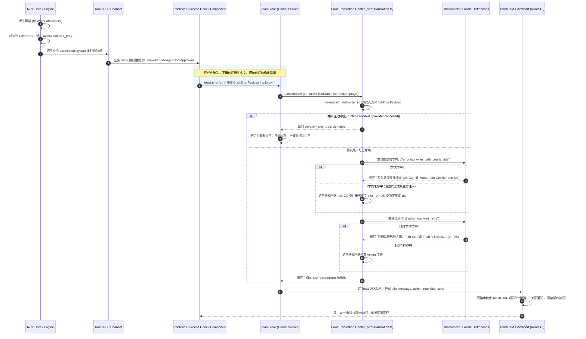

# 分维最佳系统解方案：错误体系、数据契约与告警提示国际化终案

> **战役代号**：`i18n-full-remediation`  
> **方案阶段**：`Phase 2: 分维最佳系统解方案 (Domain-Specific Systemic Solution)`  
> **责任小组**：`TASKFORCE-02: 数据契约与错误提示系统解专项小组`  
> **归属路径**：`docs/i18n-full-remediation/03-分维方案-数据契约与错误提示系统解.md`  
> **权威基准**：[`AGENTS.md`](file:///c:/Software/conex/AGENTS.md)、[`docs/agent-roles/general_task/三原则.md`](file:///c:/Software/conex/docs/agent-roles/general_task/三原则.md)、[`00-战役工作纪律与规范.md`](file:///c:/Software/conex/docs/i18n-full-remediation/00-战役工作纪律与规范.md)  
> **核心输入**：[`03-错误码注册表与提示体系国际化勘察.md`](file:///c:/Software/conex/docs/i18n-full-remediation/problems/03-错误码注册表与提示体系国际化勘察.md)

---

## 摘要与执行总纲

在对 Conex / Crish 客户端全仓错误码体系、跨端序列化契约、翻译分派中间件与 UI 错误展示层进行深度勘察后，本方案制定了一套**绝不妥协、无损升级、全量覆盖、闭环消费且具备 CI 刚性防漂移门禁**的系统性终极解决方案。

### 核心决议与解决指标

1. **错误注册表（CRISH_ERROR_REGISTRY）无损升级**：
   - 保持现行 `CrishErrorInfo` 接口字段兼容（保留 `title` 原生中文作为零破坏兜底），平滑扩展类型化键名 `titleKey: TranslationKey`（形式为 ``error.${CrishErrorCode}.title``）；
   - 彻底拔除历史包袱中的 3 处契约污染：将 `tool.aborted_before_dispatch`、`tool.cancelled`、`tool.outcome_unknown` 中的硬编码中文长句收敛为标准 `action.tool.*` 命名空间键；
   - Rust 核心层 [`crates/conex-types/src/error.rs`](file:///c:/Software/conex/crates/conex-types/src/error.rs) 同步升级 `CrishErrorInfo` 与注册表，确保 TS ↔ Rust 注册表全字段逐字一致。
2. **105 个错误码与 96 个 Action 建议词条 100% 双语化**：
   - 彻底根除 `config`、`session`、`tool`、`mcp` 等 **13 个核心 Domain 覆盖率为 0%** 的严重盲区；
   - 全量设计并交付 **105 个错误码的官方英汉双语 Title** 与 **96 个 Action 操作引导词条**（按原生桌面系统规范精心拟定，严禁机械机翻与假本地化）；
   - 前端字典物理拆分为 `locales/{lang}/errors.ts` 与 `locales/{lang}/actions.ts`。
3. **重构前端错误翻译中心（error-translation.ts）**：
   - 废除仅收录 33 码且长期冻结的静态手写表 `BUILTIN_ERROR_DISPLAY`；
   - 构建**语言感知的双向智能回退引擎（Locale-Aware Fallback Chain）**：当前语言字典未命中时，优先回退到当前语言内置权威元数据，彻底根除中文用户被强制倒灌英文报错的体验断层；
   - 规范 `toUserVisibleError`、`translateError` 等统一收口函数。
4. **打通从 IPC 到 Toast 的真实消费闭环**：
   - 重构全局通知服务 [`ToastStore.ts`](file:///c:/Software/conex/apps/crish-desktop/src/services/toast/ToastStore.ts)，支持原生消费 `CrishErrorPayload`、`CrishError` 与未知异常；
   - 剔除 `ToastStore` 内部基于中文正则 `/失败|错误|无法|拒绝/` 猜类型的坏味道代码；
   - 消除 [`ToastCard.tsx`](file:///c:/Software/conex/apps/crish-desktop/src/components/overlay/ToastCard.tsx)（`'撤销'`、`'关闭通知'`）与 [`ToastViewport.tsx`](file:///c:/Software/conex/apps/crish-desktop/src/components/overlay/ToastViewport.tsx)（`'通知中心'`）写死中文；
   - 全面引导业务层逐步收敛 `toast.error(err)`，自动渲染本地化标题、描述、操作引导按钮与可追溯错误码标签。
5. **构筑刚性防漂移与合规性 CI 门禁**：
   - 在 [`packages/shared-types/src/errors/codes-drift.test.ts`](file:///c:/Software/conex/packages/shared-types/src/errors/codes-drift.test.ts) 中增加双向字典 100% 对齐校验、Action 正则命名合规校验与 Rust-TS 元信息全字段双向对称断言，漏码或格式漂移即刻阻断。

---

## 一、全景根因穿透与端到端流向架构

### 1.1 四大深层架构病灶穿透

```
┌─────────────────────────────────────────────────────────────────────────────┐
│ 现有架构断层全景                                                            │
├─────────────────────────────────────────────────────────────────────────────┤
│ 1. 契约源头：CRISH_ERROR_REGISTRY 将 title 定义为 string 并写死中文字面量   │
│    ├── Rust crates/conex-types/src/error.rs 同样写死中文 &'static str       │
│    └── 跨端 CrishErrorPayload 甚至完全缺失 title 字段                      │
│                                                                             │
│ 2. 词条脱节：105 码中 101 个 action 在前端字典中为 undefined（缺失率 96.2%）│
│    └── 3 码 action 写入中文自然语言长句，破坏命名空间契约                   │
│                                                                             │
│ 3. 翻译中心：error-translation.ts 仅手写 33 码英文表，其余 72 码回退通用英文 │
│    └── 中文用户在发生错误时，被倒灌全英文 'Error' / 'Please try again...'    │
│                                                                             │
│ 4. 消费断层：生产代码 0 处调用 toUserVisibleError，直接裸传中文字符串       │
│    ├── toast.error('创建失败，请检查引擎是否就绪')                          │
│    └── ToastStore 用正则 /失败|错误|无法|拒绝/ 猜测类型，UI 写死中文       │
└─────────────────────────────────────────────────────────────────────────────┘
```

### 1.2 目标系统解分层架构模型

通过在数据契约层引入类型化 `titleKey`、治理跨端 `CrishErrorPayload`、在国际化层拆分子模块字典、在翻译层引入智能双向兜底、并在 UI 层打通 Toast 原生消费，建立五层正交收敛架构：

```
┌─────────────────────────────────────────────────────────────────────────┐
│ 层级 1：核心元信息层（Single Source of Truth, SSOT）                    │
│ • TS: packages/shared-types/src/errors/info.ts                          │
│ • Rust: crates/conex-types/src/error.rs                                 │
│   - code: CrishErrorCode                                                │
│   - titleKey: `error.${CrishErrorCode}.title` (类型化 i18n 键)          │
│   - title: string (原生中文，保持向后兼容)                              │
│   - action: `action.<domain>.<action_name>` (100% 标准化点分键)         │
├─────────────────────────────────────────────────────────────────────────┤
│ 层级 2：跨端 IPC 传输层（Transport Payload）                            │
│ • CrishErrorPayload (TS ↔ Rust IPC)                                     │
│   - code, message, category, retryable, public, action, metadata        │
│   - titleKey?: string (显式传递或前端根据 code 派生)                    │
├─────────────────────────────────────────────────────────────────────────┤
│ 层级 3：前端国际化双语字典域（I18n Locales）                            │
│ • apps/crish-desktop/src/i18n/locales/                                  │
│   ├── zh-CN/ (errors.ts: 105 码 Title, actions.ts: 96 个 Action 建议) │
│   └── en-US/ (errors.ts: 105 码 Title, actions.ts: 96 个 Action 建议) │
├─────────────────────────────────────────────────────────────────────────┤
│ 层级 4：前端错误翻译中心（Error Translation Center）                    │
│ • apps/crish-desktop/src/utils/error-translation.ts                     │
│   - toUserVisibleError / translateError                                 │
│   - 语言感知双向回退引擎（智能防倒灌）                                  │
│   - 产出标准化展示模型 UserVisibleError                                 │
├─────────────────────────────────────────────────────────────────────────┤
│ 层级 5：全局通知与用户交互层（UI Presentation & Action Dispatch）       │
│ • ToastStore / ToastCard / ToastViewport                                │
│   - 直接接收 error: unknown / CrishErrorPayload                         │
│   - 渲染本地化 title, message, action 建议按钮, code 调试徽标           │
│   - 消除 ToastCard / ToastViewport 自身写死中文                         │
└─────────────────────────────────────────────────────────────────────────┘
```

### 1.3 端到端错误流向时序图



---

## 二、错误码注册表（CRISH_ERROR_REGISTRY）无损升级契约

### 2.1 契约无损演进与字段扩展

为保证调用现有 `getErrorInfo(code).title` 的全部存量代码零破坏运行，同时赋予注册表强类型国际化能力，在 [`packages/shared-types/src/errors/info.ts`](file:///c:/Software/conex/packages/shared-types/src/errors/info.ts) 中对 `CrishErrorInfo` 进行字段扩展：

```typescript
// packages/shared-types/src/errors/info.ts
import type { CrishErrorCode, CrishErrorCategory } from './codes';

/**
 * 错误码标题的标准 i18n 键名模板类型。
 * 形如：'error.config.invalid.title' | 'error.tool.write_path_conflict.title'
 */
export type ErrorTitleTranslationKey = `error.${CrishErrorCode}.title`;

/**
 * 错误码元信息注册表项契约（无损演进版）
 */
export interface CrishErrorInfo {
  /** 唯一错误码 */
  readonly code: CrishErrorCode;
  /**
   * 默认标题（保持现有字段兼容）。
   * 权威定义为标准简体中文文案，在未接入 i18n 运行时的环境或中文兜底时使用。
   */
  readonly title: string;
  /**
   * 国际化查表键（新增字段）。
   * 格式严格为 `error.${code}.title`，供前端或外部消费方直接使用 t(info.titleKey) 查表。
   */
  readonly titleKey: ErrorTitleTranslationKey;
  /** 故障类别 */
  readonly category: CrishErrorCategory;
  /** 是否可重试 */
  readonly retryable: boolean;
  /** 是否对终端用户公开 */
  readonly public: boolean;
  /**
   * 操作建议国际化键名。
   * 格式严格为 `action.<domain>.<action_name>`。
   */
  readonly action: string;
}
```

#### 跨端传输负载 `CrishErrorPayload` 兼容演进

在 [`packages/shared-types/src/errors/serialize.ts`](file:///c:/Software/conex/packages/shared-types/src/errors/serialize.ts) 中：

```typescript
export interface CrishErrorPayload {
  readonly code: CrishErrorCode;
  readonly message: string;
  readonly category: CrishErrorCategory;
  readonly retryable: boolean;
  readonly public: boolean;
  readonly action: string;
  /**
   * 国际化标题键名（可选扩展，向后兼容）。
   * 前端消费时若未传，则自动由 `error.${code}.title` 派生。
   */
  readonly titleKey?: string | undefined;
  readonly metadata?: JsonObject | undefined;
  readonly cause?: CrishErrorPayload | undefined;
  readonly stack?: string | undefined;
  readonly timestamp: number;
}
```

### 2.2 彻底清理 3 处契约污染（session-integrity-repair 历史包袱）

在 `session-integrity-repair 02 §4.1 F01` 中遗留了 3 处直接硬编码中文长句的坏味道代码，必须坚决彻底治理。

#### TS 端改造对比（`packages/shared-types/src/errors/info.ts`）

```diff
  // ── tool 域：中断/取消/未知三码 ──
  'tool.aborted_before_dispatch': {
    code: 'tool.aborted_before_dispatch',
    title: '工具分发前已中止',
+   titleKey: 'error.tool.aborted_before_dispatch.title',
    category: 'permanent',
    retryable: false,
    public: true,
-   action: '请求已被用户或控制总线中止，无需重试',
+   action: 'action.tool.aborted_before_dispatch',
  },
  'tool.cancelled': {
    code: 'tool.cancelled',
    title: '工具已被取消',
+   titleKey: 'error.tool.cancelled.title',
    category: 'permanent',
    retryable: false,
    public: true,
-   action: '兄弟工具执行失败或批处理取消，跳过执行',
+   action: 'action.tool.cancelled',
  },
  'tool.outcome_unknown': {
    code: 'tool.outcome_unknown',
    title: '工具结果未知（崩溃自愈）',
+   titleKey: 'error.tool.outcome_unknown.title',
    category: 'permanent',
    retryable: false,
    public: true,
-   action: '系统冷启动恢复自动合成未闭合调用，继续会话',
+   action: 'action.tool.outcome_unknown',
  },
```

### 2.3 Rust 核心层（crates/conex-types/src/error.rs）同步对齐方案

Rust 端结构体 [`CrishErrorInfo`](file:///c:/Software/conex/crates/conex-types/src/error.rs#L40-L47) 与序列化负载同步扩展 `title_key`，并同步清理 3 处 Action 键：

```rust
// crates/conex-types/src/error.rs

/// 错误码元信息（TS 端 CrishErrorInfo 同构）
#[derive(Debug, Clone, PartialEq)]
pub struct CrishErrorInfo {
    pub code: &'static str,
    pub title: &'static str,
    /// 国际化查表键（新增字段，格式为 "error.<code_str>.title"）
    pub title_key: &'static str,
    pub category: CrishErrorCategory,
    pub retryable: bool,
    pub is_public: bool,
    pub action: &'static str,
}

// 跨端传输负载 CrishErrorPayload
#[derive(Debug, Clone, Serialize, Deserialize, PartialEq)]
#[serde(rename_all = "camelCase")]
pub struct CrishErrorPayload {
    pub code: String,
    pub message: String,
    pub category: CrishErrorCategory,
    pub retryable: bool,
    #[serde(rename = "public")]
    pub is_public: bool,
    pub action: String,
    #[serde(default, skip_serializing_if = "Option::is_none")]
    pub title_key: Option<String>,
    #[serde(default, skip_serializing_if = "Option::is_none")]
    pub metadata: Option<serde_json::Value>,
    #[serde(default, skip_serializing_if = "Option::is_none")]
    pub cause: Option<Box<CrishErrorPayload>>,
    #[serde(default, skip_serializing_if = "Option::is_none")]
    pub stack: Option<String>,
    pub timestamp: i64,
}
```

#### Rust 注册表条目收敛（`error.rs:720-752`）

```rust
    // session-integrity-repair 02 §4.1 F01：中断/取消/未知三码注册
    m.insert(
        codes::TOOL_ABORTED_BEFORE_DISPATCH,
        CrishErrorInfo {
            code: codes::TOOL_ABORTED_BEFORE_DISPATCH,
            title: "工具分发前已中止",
            title_key: "error.tool.aborted_before_dispatch.title",
            category: CrishErrorCategory::Permanent,
            retryable: false,
            is_public: true,
            action: "action.tool.aborted_before_dispatch", // 治理完成
        },
    );
    m.insert(
        codes::TOOL_CANCELLED,
        CrishErrorInfo {
            code: codes::TOOL_CANCELLED,
            title: "工具已被取消",
            title_key: "error.tool.cancelled.title",
            category: CrishErrorCategory::Permanent,
            retryable: false,
            is_public: true,
            action: "action.tool.cancelled", // 治理完成
        },
    );
    m.insert(
        codes::TOOL_OUTCOME_UNKNOWN,
        CrishErrorInfo {
            code: codes::TOOL_OUTCOME_UNKNOWN,
            title: "工具结果未知（崩溃自愈）",
            title_key: "error.tool.outcome_unknown.title",
            category: CrishErrorCategory::Permanent,
            retryable: false,
            is_public: true,
            action: "action.tool.outcome_unknown", // 治理完成
        },
    );
```

---

## 三、105 个错误码与 96 个 Action 词条全量双语化字典

### 3.1 消除 13 个 Domain 0% 覆盖盲区

本方案全量补齐全仓 21 个域的全部词条，各领域覆盖率指标对比如下：

| 错误域 (Domain) | 错误码数 | 现有 Title 覆盖率 | **改造后 Title 覆盖率** | 现有 Action 覆盖率 | **改造后 Action 覆盖率** |
| :--- | :---: | :---: | :---: | :---: | :---: |
| **config** | 3 | 0.0% | **100.0%** (3/3) | 0.0% | **100.0%** (3/3) |
| **session** | 6 | 0.0% | **100.0%** (6/6) | 0.0% | **100.0%** (6/6) |
| **tool** (通用/互斥) | 11 | 0.0% | **100.0%** (11/11) | 0.0% | **100.0%** (11/11) |
| **tool.browser** | 9 | 0.0% | **100.0%** (9/9) | 0.0% | **100.0%** (9/9) |
| **tool.computer** | 8 | 0.0% | **100.0%** (8/8) | 0.0% | **100.0%** (8/8) |
| **agent** | 3 | 33.3% | **100.0%** (3/3) | 0.0% | **100.0%** (3/3) |
| **runtime** | 4 | 100.0% | **100.0%** (4/4) | 0.0% | **100.0%** (4/4) |
| **provider** | 17 | 58.8% | **100.0%** (17/17) | 17.6% | **100.0%** (17/17) |
| **context** | 3 | 33.3% | **100.0%** (3/3) | 0.0% | **100.0%** (3/3) |
| **mcp** | 3 | 0.0% | **100.0%** (3/3) | 0.0% | **100.0%** (3/3) |
| **store** | 5 | 100.0% | **100.0%** (5/5) | 0.0% | **100.0%** (5/5) |
| **subagent** | 5 | 60.0% | **100.0%** (5/5) | 0.0% | **100.0%** (5/5) |
| **plugin** | 3 | 0.0% | **100.0%** (3/3) | 0.0% | **100.0%** (3/3) |
| **approval** | 2 | 0.0% | **100.0%** (2/2) | 0.0% | **100.0%** (2/2) |
| **event_store** | 4 | 100.0% | **100.0%** (4/4) | 0.0% | **100.0%** (4/4) |
| **artifact** | 2 | 0.0% | **100.0%** (2/2) | 0.0% | **100.0%** (2/2) |
| **run** | 3 | 0.0% | **100.0%** (3/3) | 0.0% | **100.0%** (3/3) |
| **network** | 2 | 0.0% | **100.0%** (2/2) | 0.0% | **100.0%** (2/2) |
| **telemetry / log** | 3 | 0.0% | **100.0%** (3/3) | 0.0% | **100.0%** (3/3) |
| **common** | 5 | 100.0% | **100.0%** (5/5) | 20.0% | **100.0%** (5/5) |
| **security** | 1 | 0.0% | **100.0%** (1/1) | 0.0% | **100.0%** (1/1) |
| **goal** | 3 | 0.0% | **100.0%** (3/3) | 0.0% | **100.0%** (3/3) |
| **全仓总计 (Total)** | **105** | 31.4% (33/105) | **100.0% (105/105)** | 3.8% (4/105) | **100.0% (105/105)** |

---

### 3.2 105 个错误码英汉双语 Title 全量设计台账

以下为全部 105 个错误码的标准双语对照台账，符合专业软件工程术语标准：

#### 1. Config 域（配置管理，3 码）
1. `config.invalid`:  
   - zh-CN: `配置项非法` | en-US: `Invalid Configuration`
2. `config.missing`:  
   - zh-CN: `配置缺失` | en-US: `Missing Configuration`
3. `config.parse_failed`:  
   - zh-CN: `配置解析失败` | en-US: `Configuration Parse Failed`

#### 2. Session 域（会话状态与生命周期，6 码）
4. `session.not_found`:  
   - zh-CN: `会话未找到` | en-US: `Session Not Found`
5. `session.invalid_session`:  
   - zh-CN: `会话数据非法` | en-US: `Invalid Session Data`
6. `session.invalid_entry`:  
   - zh-CN: `会话条目非法` | en-US: `Invalid Session Entry`
7. `session.invalid_state`:  
   - zh-CN: `会话状态非法` | en-US: `Invalid Session State`
8. `session.storage_failed`:  
   - zh-CN: `会话存储失败` | en-US: `Session Storage Failed`
9. `session.rewind_failed`:  
   - zh-CN: `会话回滚失败` | en-US: `Session Rewind Failed`

#### 3. Agent 域（Agent 执行与轮次，3 码）
10. `agent.max_turns_reached`:  
    - zh-CN: `达到最大思考轮次` | en-US: `Maximum Turns Reached`
11. `agent.no_progress`:  
    - zh-CN: `Agent 无实质进展` | en-US: `Agent Made No Progress`
12. `agent.intervention_required`:  
    - zh-CN: `需用户介入确认` | en-US: `User Intervention Required`

#### 4. Runtime 域（运行时调度与状态，4 码）
13. `runtime.unexpected_state`:  
    - zh-CN: `运行时状态异常` | en-US: `Unexpected Runtime State`
14. `runtime.transition_failed`:  
    - zh-CN: `状态机转移失败` | en-US: `State Transition Failed`
15. `runtime.aborted`:  
    - zh-CN: `用户已中止操作` | en-US: `Operation Aborted by User`
16. `runtime.timeout`:  
    - zh-CN: `运行时执行超时` | en-US: `Runtime Execution Timeout`

#### 5. Provider 域（模型供应商与网关，17 码）
17. `provider.network`:  
    - zh-CN: `模型服务网络故障` | en-US: `Model Network Failure`
18. `provider.gateway_challenge`:  
    - zh-CN: `网关安全质询拦截` | en-US: `Gateway Challenge Blocked`
19. `provider.rate_limit`:  
    - zh-CN: `请求频率超出限制` | en-US: `Rate Limit Exceeded`
20. `provider.auth`:  
    - zh-CN: `模型服务鉴权失败` | en-US: `Authentication Failed`
21. `provider.quota`:  
    - zh-CN: `账户配额已耗尽` | en-US: `Account Quota Exhausted`
22. `provider.endpoint_unavailable`:  
    - zh-CN: `服务端点不可用` | en-US: `Service Endpoint Unavailable`
23. `provider.schema`:  
    - zh-CN: `请求 Schema 校验失败` | en-US: `Invalid Request Schema`
24. `provider.server`:  
    - zh-CN: `模型服务内部错误` | en-US: `Model Server Error`
25. `provider.timeout`:  
    - zh-CN: `模型请求响应超时` | en-US: `Model Request Timeout`
26. `provider.cancelled`:  
    - zh-CN: `模型请求已被取消` | en-US: `Model Request Cancelled`
27. `provider.stream_interrupted`:  
    - zh-CN: `流式响应传输中断` | en-US: `Response Stream Interrupted`
28. `provider.unknown`:  
    - zh-CN: `未知模型服务错误` | en-US: `Unknown Model Provider Error`
29. `provider.connection_error`:  
    - zh-CN: `服务连接握手失败` | en-US: `Connection Handshake Failed`
30. `provider.no_token`:  
    - zh-CN: `缺少 API 访问令牌` | en-US: `Missing API Token`
31. `provider.reauth_required`:  
    - zh-CN: `需要重新登录认证` | en-US: `Re-authentication Required`
32. `provider.fatal`:  
    - zh-CN: `模型服务致命故障` | en-US: `Fatal Provider Failure`
33. `provider.refresh_failed`:  
    - zh-CN: `令牌自动刷新失败` | en-US: `Token Refresh Failed`

#### 6. Context 域（上下文与压缩自愈，3 码）
34. `context.length_exceeded`:  
    - zh-CN: `会话上下文长度超限` | en-US: `Context Length Exceeded`
35. `context.compaction_failed`:  
    - zh-CN: `上下文压缩失败` | en-US: `Context Compaction Failed`
36. `context.heal_failed`:  
    - zh-CN: `上下文结构自愈失败` | en-US: `Context Self-Healing Failed`

#### 7. Tool 域（通用工具、会话互斥与写入控制，11 码）
37. `tool.session.exclusive`:  
    - zh-CN: `会话互斥操作占用` | en-US: `Exclusive Session Lock Conflict`
38. `tool.not_found`:  
    - zh-CN: `目标工具未注册` | en-US: `Tool Not Found`
39. `tool.invalid_input`:  
    - zh-CN: `工具调用参数非法` | en-US: `Invalid Tool Arguments`
40. `tool.execution_failed`:  
    - zh-CN: `工具执行过程失败` | en-US: `Tool Execution Failed`
41. `tool.path_escape`:  
    - zh-CN: `目标路径越界访问拒绝` | en-US: `Path Traversal Denied`
42. `tool.version_conflict`:  
    - zh-CN: `工具契约版本冲突` | en-US: `Tool Version Conflict`
43. `tool.write_not_allowed`:  
    - zh-CN: `写操作未获授权` | en-US: `Unauthorized Write Operation`
44. `tool.write_path_conflict`:  
    - zh-CN: `写入路径互斥冲突` | en-US: `Write Path Mutual Exclusion Conflict`
45. `tool.aborted_before_dispatch`:  
    - zh-CN: `工具分发前已中止` | en-US: `Tool Aborted Before Dispatch`
46. `tool.cancelled`:  
    - zh-CN: `工具执行已被取消` | en-US: `Tool Execution Cancelled`
47. `tool.outcome_unknown`:  
    - zh-CN: `工具执行结果未知（崩溃自愈）` | en-US: `Tool Outcome Unknown (Crash Recovery)`

#### 8. Tool.Browser 域（浏览器自动化工具面，9 码）
48. `tool.browser.not_ready`:  
    - zh-CN: `浏览器驱动未就绪` | en-US: `Browser Driver Not Ready`
49. `tool.browser.gate_blocked`:  
    - zh-CN: `安全域名门禁拦截` | en-US: `Domain Policy Gate Blocked`
50. `tool.browser.capability_disabled`:  
    - zh-CN: `浏览器操作能力未启用` | en-US: `Browser Capability Disabled`
51. `tool.browser.stale_snapshot`:  
    - zh-CN: `页面快照版本失效` | en-US: `Stale Page Snapshot Version`
52. `tool.browser.node_gone`:  
    - zh-CN: `页面目标元素已失效` | en-US: `Target Element No Longer Exists`
53. `tool.browser.cancelled`:  
    - zh-CN: `浏览器操作已被取消` | en-US: `Browser Operation Cancelled`
54. `tool.browser.eval_forbidden`:  
    - zh-CN: `页面动态求值被禁止` | en-US: `Script Evaluation Forbidden`
55. `tool.browser.tab_limit_exceeded`:  
    - zh-CN: `标签页打开数量超限` | en-US: `Maximum Tabs Limit Exceeded`
56. `tool.browser.unwired`:  
    - zh-CN: `浏览器工具未接线` | en-US: `Browser Tool Unwired`

#### 9. Tool.Computer 域（桌面电脑操作系统控制面，8 码）
57. `tool.computer.invalid_params`:  
    - zh-CN: `电脑操作指令参数非法` | en-US: `Invalid Computer Control Parameters`
58. `tool.computer.coords_out_of_bounds`:  
    - zh-CN: `屏幕坐标超出物理边界` | en-US: `Coordinates Out of Screen Bounds`
59. `tool.computer.elevated_window`:  
    - zh-CN: `管理员提权窗口注入拒绝` | en-US: `Elevated Window Access Denied`
60. `tool.computer.not_enabled`:  
    - zh-CN: `电脑控制会话未开启` | en-US: `Computer Control Not Enabled`
61. `tool.computer.not_ready`:  
    - zh-CN: `电脑操作环境未就绪` | en-US: `Computer Control Environment Not Ready`
62. `tool.computer.cancelled`:  
    - zh-CN: `电脑操作已被急停取消` | en-US: `Computer Operation Cancelled`
63. `tool.computer.capability_unavailable`:  
    - zh-CN: `系统缺少电脑控制支持` | en-US: `Computer Control Capability Unavailable`
64. `tool.computer.unwired`:  
    - zh-CN: `电脑控制模块未接线` | en-US: `Computer Control Module Unwired`

#### 10. MCP 域（Model Context Protocol，3 码）
65. `mcp.connection_failed`:  
    - zh-CN: `MCP 服务连接失败` | en-US: `MCP Connection Failed`
66. `mcp.protocol_violation`:  
    - zh-CN: `MCP 通信协议违规` | en-US: `MCP Protocol Violation`
67. `mcp.server_not_found`:  
    - zh-CN: `指定的 MCP 服务未找到` | en-US: `MCP Server Not Found`

#### 11. Store 域（本地数据存储，5 码）
68. `store.write_failed`:  
    - zh-CN: `存储数据写入失败` | en-US: `Storage Write Failed`
69. `store.io`:  
    - zh-CN: `存储底层 I/O 故障` | en-US: `Storage I/O Failure`
70. `store.read_failed`:  
    - zh-CN: `存储数据读取失败` | en-US: `Storage Read Failed`
71. `store.corrupted`:  
    - zh-CN: `本地数据文件损坏` | en-US: `Storage Data Corrupted`
72. `store.capacity_exceeded`:  
    - zh-CN: `存储容量空间超限` | en-US: `Storage Capacity Exceeded`

#### 12. Subagent 域（子代理调度与控制，5 码）
73. `subagent.depth_exceeded`:  
    - zh-CN: `子代理递归深度超限` | en-US: `Subagent Recursion Depth Exceeded`
74. `subagent.nesting_denied`:  
    - zh-CN: `子代理禁止派发子代理` | en-US: `Subagent Nesting Denied`
75. `subagent.not_found`:  
    - zh-CN: `目标子代理不存在` | en-US: `Subagent Not Found`
76. `subagent.deadlock_detected`:  
    - zh-CN: `检测到子代理调用死锁` | en-US: `Subagent Deadlock Detected`
77. `subagent.timeout`:  
    - zh-CN: `子代理任务执行超时` | en-US: `Subagent Execution Timeout`

#### 13. Plugin 域（插件扩展系统，3 码）
78. `plugin.not_found`:  
    - zh-CN: `目标插件未找到` | en-US: `Plugin Not Found`
79. `plugin.activation_failed`:  
    - zh-CN: `插件激活加载失败` | en-US: `Plugin Activation Failed`
80. `plugin.permission_denied`:  
    - zh-CN: `插件操作权限不足` | en-US: `Plugin Permission Denied`

#### 14. Approval 域（人工确认与审批，2 码）
81. `approval.timeout`:  
    - zh-CN: `安全审批等待超时` | en-US: `Approval Request Timeout`
82. `approval.rejected`:  
    - zh-CN: `操作已被人工驳回` | en-US: `Operation Rejected by User`

#### 15. Event_Store 域（事件总线与持久化日志，4 码）
83. `event_store.append_failed`:  
    - zh-CN: `事件日志追加失败` | en-US: `Event Log Append Failed`
84. `event_store.consistency_violation`:  
    - zh-CN: `事件序列一致性违规` | en-US: `Event Log Consistency Violation`
85. `event_store.read_failed`:  
    - zh-CN: `事件日志读取失败` | en-US: `Event Log Read Failed`
86. `event_store.degraded`:  
    - zh-CN: `事件存储降级运行` | en-US: `Event Storage Degraded`

#### 16. Artifact 域（任务构建产物，2 码）
87. `artifact.not_found`:  
    - zh-CN: `构件产物未找到` | en-US: `Artifact Not Found`
88. `artifact.invalid_uri`:  
    - zh-CN: `产物 URI 标识非法` | en-US: `Invalid Artifact URI`

#### 17. Run 域（执行实例管理，3 码）
89. `run.not_found`:  
    - zh-CN: `执行实例未找到` | en-US: `Run Instance Not Found`
90. `run.invalid_state`:  
    - zh-CN: `执行实例状态非法` | en-US: `Invalid Run State`
91. `run.not_goal_run`:  
    - zh-CN: `非 Goal 运行实例类型` | en-US: `Not a Goal Run Instance`

#### 18. Network 域（网络与守护进程，2 码）
92. `network.unreachable`:  
    - zh-CN: `底层网络完全不可达` | en-US: `Network Unreachable`
93. `network.daemon_dead`:  
    - zh-CN: `后台守护进程异常退出` | en-US: `Backend Daemon Crashed`

#### 19. Telemetry & Log 域（观测与日志，3 码）
94. `telemetry.export_failed`:  
    - zh-CN: `遥测数据导出失败` | en-US: `Telemetry Export Failed`
95. `telemetry.trace_lost`:  
    - zh-CN: `追踪数据溢出丢失` | en-US: `Trace Data Lost`
96. `log.write_failed`:  
    - zh-CN: `系统日志写入失败` | en-US: `Log Write Failed`

#### 20. Common 域（系统通用基础设施，5 码）
97. `common.unknown`:  
    - zh-CN: `未知系统错误` | en-US: `Unknown Error`
98. `common.invalid_input`:  
    - zh-CN: `通用输入参数非法` | en-US: `Invalid Input Arguments`
99. `common.encoding`:  
    - zh-CN: `字符编解码处理失败` | en-US: `Character Encoding Error`
100. `common.unsupported`:  
     - zh-CN: `当前版本不支持此操作` | en-US: `Unsupported Operation`
101. `common.not_found`:  
     - zh-CN: `请求的基础资源未找到` | en-US: `Resource Not Found`

#### 21. Security 域（安全拦截，1 码）
102. `security.ssrf_rejected`:  
     - zh-CN: `SSRF 安全策略拦截` | en-US: `SSRF Security Request Blocked`

#### 22. Goal 域（Goal 驱动循环，3 码）
103. `goal.stalled`:  
     - zh-CN: `目标推进循环停滞` | en-US: `Goal Loop Stalled`
104. `goal.loop_detected`:  
     - zh-CN: `检测到目标执行死循环` | en-US: `Goal Loop Signature Repeated`
105. `goal.max_rounds`:  
     - zh-CN: `达到目标循环最大轮次` | en-US: `Goal Maximum Rounds Reached`

---

### 3.3 96 个 Action 建议词条英汉双语全量设计方案

所有 96 个 Action 建议词条均遵循“清晰说明根因、明确指出下一步操作”的准则：

| 序号 | Action 命名空间键 | zh-CN 中文引导文案 | en-US 英文引导文案 |
| :---: | :--- | :--- | :--- |
| 1 | `action.config.check_field` | 请检查配置项字段取值是否符合格式规范。 | Please verify that the configuration field values comply with the specifications. |
| 2 | `action.config.provide_value` | 缺少必须填写的配置项，请补充对应参数值。 | A required configuration item is missing. Please provide the corresponding value. |
| 3 | `action.config.verify_syntax` | 配置文件解析失败，请检查文件语法格式是否正确。 | Configuration parse failed. Please check the file syntax and format. |
| 4 | `action.session.select_existing` | 请在会话列表中选择一个有效的已有会话。 | Please select an existing valid session from the session list. |
| 5 | `action.session.restart` | 会话数据非法，建议重新创建会话以恢复正常状态。 | Invalid session data. Recreating the session is recommended. |
| 6 | `action.session.check_entry` | 请检查会话历史条目数据格式是否完整。 | Please verify the integrity of the session history entry data. |
| 7 | `action.session.refresh` | 会话状态发生漂移，请刷新页面或重置当前会话。 | Session state drifted. Please refresh the page or reset the current session. |
| 8 | `action.session.retry_save` | 本地会话持久化遇到临时冲突，系统正在自动重试保存。 | Session persistence encountered a transient conflict. Retrying save automatically. |
| 9 | `action.session.check_rewind_target` | 回滚目标节点不存在或已失效，请确认回滚版本。 | The rewind target does not exist or has expired. Please verify the target version. |
| 10 | `action.session.wait_switch` | 当前会话已被其他独占工具锁定，请等待释放或手动切换。 | The session is locked by an exclusive tool. Please wait for release or switch manually. |
| 11 | `action.agent.increase_max_turns` | Agent 已达到单次执行轮次上限，可调整上限或提示继续。 | Maximum execution turns reached. You may increase the limit or prompt to continue. |
| 12 | `action.agent.intervene` | Agent 执行未取得实质进展，请补充提示词或手动介入指导。 | Agent is making no progress. Please provide additional prompts or intervene manually. |
| 13 | `action.agent.review` | 关键步骤需要人工确认，请在审批面板核对详情后批准。 | This critical step requires human confirmation. Please review details in the approval panel. |
| 14 | `action.runtime.restart_session` | 运行时处于非预期状态，建议重启会话以恢复干净环境。 | Unexpected runtime state. Restarting the session is recommended. |
| 15 | `action.runtime.report_bug` | 状态机转移发生内部故障，请尝试刷新并上报此问题。 | An internal state transition failure occurred. Please refresh and report this issue. |
| 16 | `action.runtime.none` | 操作已由用户正常终止，无需执行额外操作。 | Operation was terminated by user. No further action needed. |
| 17 | `action.runtime.retry` | 运行时执行超时，建议检查系统资源后重试。 | Runtime execution timed out. Please check system resources and retry. |
| 18 | `action.provider.check_network` | 无法连接到模型服务，请检查网络连接或网络代理。 | Unable to connect to model service. Please check network connection or proxy. |
| 19 | `action.provider.disable_proxy` | 请求命中上游网关防护质询，请检查防火墙或临时关闭代理。 | Request challenged by upstream gateway. Check firewall or temporarily disable proxy. |
| 20 | `action.provider.wait_retry` | 请求频率超出模型提供商配额限制，请稍等片刻自动重试。 | Rate limit exceeded. Please wait a moment for automatic retry. |
| 21 | `action.provider.check_api_key` | 模型服务鉴权失败，请在“设置 > 模型”中核对 API Key。 | Authentication failed. Please verify your API Key in Settings > Models. |
| 22 | `action.provider.top_up` | 模型账户余额已耗尽，请登录供应商控制台进行充值。 | Account quota exhausted. Please top up your balance in the provider console. |
| 23 | `action.provider.check_endpoint` | 模型服务接口地址无法访问，请核对自定义 Base URL。 | Service endpoint unreachable. Please verify the custom Base URL. |
| 24 | `action.provider.fix_request` | 请求参数格式不符合提供商规范，请检查模型参数配置。 | Request payload violates provider specifications. Please check model parameters. |
| 25 | `action.provider.retry` | 模型服务发生临时内部错误，请稍后重试。 | The model service encountered a transient internal error. Please retry later. |
| 26 | `action.provider.report_bug` | 模型服务抛出未分类未知异常，请重试或向技术支持反馈。 | Model service returned an unclassified error. Please retry or contact support. |
| 27 | `action.provider.check_connection` | 建立连接失败，请检查 DNS 解析与本地网络环境。 | Failed to establish connection. Please check DNS resolution and local network. |
| 28 | `action.provider.reauth` | 登录授权凭据已失效，请重新登录模型供应商账户。 | Authentication credentials expired. Please sign in to the provider again. |
| 29 | `action.context.compact` | 上下文超长，请使用 /compact 压缩会话或开启自动归纳。 | Context length exceeded. Use /compact to compress session or enable auto-summary. |
| 30 | `action.context.retry_compact` | 自动压缩上下文失败，请尝试手动截断长消息后重试。 | Context compaction failed. Try truncating long messages manually and retry. |
| 31 | `action.context.manual_trim` | 上下文自愈修复失败，建议删除部分冗余消息或新建会话。 | Context self-healing failed. Deleting redundant messages or creating a new session is recommended. |
| 32 | `action.tool.check_name` | 未找到指定名称的工具，请检查工具名称是否拼写正确。 | Tool not found. Please verify that the tool name is spelled correctly. |
| 33 | `action.tool.fix_input` | 工具输入参数校验不通过，请核对各参数类型与必填约束。 | Tool input validation failed. Please check argument types and required constraints. |
| 34 | `action.tool.retry` | 工具执行遇到临时错误，请检查环境状态后重试。 | Tool execution encountered a transient error. Please check environment and retry. |
| 35 | `action.tool.check_path` | 路径超出工作区安全目录范围，严禁跨目录越界访问。 | Path is outside the workspace allowed directory. Traversal is strictly prohibited. |
| 36 | `action.tool.refresh_and_retry` | 工具版本与当前系统不匹配，请刷新工具注册表后重试。 | Tool version mismatch. Please refresh the tool registry and retry. |
| 37 | `action.tool.request_path_allowance` | 写入目标未在白名单目录内，请向用户申请该目录写权限。 | Write target is outside allowed directories. Please request permission from user. |
| 38 | `action.tool.wait_retry` | 目标写入路径已被其他任务锁定，请等待释放后重试。 | The target write path is locked by another task. Please wait for release and retry. |
| 39 | `action.tool.aborted_before_dispatch` | 工具调用在分发前已被用户中止，已安全跳过执行。 | Tool call was aborted before dispatch and safely skipped. |
| 40 | `action.tool.cancelled` | 关联前置工具执行失败或批次取消，已跳过当前调用。 | Sibling tool execution failed or batch was cancelled. Current call skipped. |
| 41 | `action.tool.outcome_unknown` | 系统崩溃自愈已自动闭合悬挂工具，会话将自动继续。 | Crash recovery closed hanging tool calls. Session will continue automatically. |
| 42 | `action.browser.wait_ready` | 浏览器驱动正在启动初始化，请稍候片刻重试。 | Browser driver is initializing. Please wait a moment and retry. |
| 43 | `action.browser.check_target` | 目标域名未在安全白名单中，已被域名安全策略拦截。 | Target domain is not whitelisted and was blocked by security policy. |
| 44 | `action.browser.enable_capability` | 该操作所需的浏览器能力未开启，请在安全设置中启用。 | Required browser capability is disabled. Please enable it in Security Settings. |
| 45 | `action.browser.resnapshot` | 页面 DOM 结构已动态更新，快照已过期，正在重新捕获。 | Page DOM has changed. Snapshot is stale, capturing fresh snapshot. |
| 46 | `action.browser.check_whitelist` | 目标页面禁止执行动态求值脚本，请使用语义属性查询。 | Dynamic script evaluation is prohibited. Please use semantic property queries. |
| 47 | `action.browser.close_tabs` | 打开的浏览器标签页已达上限，请关闭多余标签页后重试。 | Maximum browser tabs reached. Please close unnecessary tabs and retry. |
| 48 | `action.browser.check_version` | 浏览器工具未完成接线，请检查客户端更新版本。 | Browser tool is not wired. Please check for client application updates. |
| 49 | `action.computer.fix_input` | 电脑操作指令格式非法，请检查鼠标坐标或按键序列参数。 | Invalid computer control parameters. Please check coordinates or key sequences. |
| 50 | `action.computer.refresh_perception` | 目标坐标超出当前屏幕分辨率，请重新截屏校准坐标。 | Coordinates are outside screen resolution. Please recapture screen to recalibrate. |
| 51 | `action.computer.manual_operation` | 目标应用处于管理员提权保护状态，桌面沙箱无法控制，请手动操作。 | Target window is elevated. Desktop sandbox cannot inject input, please operate manually. |
| 52 | `action.computer.enable_session` | 电脑操作控制开关未开启，请在设置中开启“电脑操作”能力。 | Computer control is disabled. Please enable "Computer Control" in Settings. |
| 53 | `action.computer.wait_retry` | 桌面控制服务正在加载就绪中，请稍候重试。 | Desktop control service is initializing. Please wait and retry. |
| 54 | `action.computer.none` | 电脑操作已被用户急停键终止，所有自动化输入已撤回。 | Computer control terminated by user emergency stop. All automation retracted. |
| 55 | `action.computer.check_capability` | 当前操作系统平台缺少辅助功能或截屏权限，无法启用控制。 | Operating system lacks accessibility or capture permissions. Cannot enable control. |
| 56 | `action.computer.check_supported` | 电脑操作功能在当前操作系统尚未接线，请关注后续版本。 | Computer control is not yet wired on this OS. Please wait for future releases. |
| 57 | `action.mcp.check_server` | 无法连接到 MCP 协议服务器，请检查 MCP 服务进程是否正在运行。 | Cannot connect to MCP server. Please verify that the MCP server process is running. |
| 58 | `action.mcp.report_bug` | MCP 数据帧不符合协议规范，请检查插件实现并上报错误。 | MCP frame violates protocol specs. Please inspect plugin and report bug. |
| 59 | `action.mcp.check_config` | 未在配置文件中找到对应的 MCP 服务，请检查 mcp_servers 配置。 | MCP server not found in config. Please verify your mcp_servers configuration. |
| 60 | `action.store.retry_write` | 本地存储写入失败，系统正在自动重试写入数据。 | Local storage write failed. System is retrying to save data automatically. |
| 61 | `action.store.retry_read` | 本地存储读取失败，请检查文件系统读写权限后重试。 | Local storage read failed. Please check filesystem permissions and retry. |
| 62 | `action.store.restore_backup` | 存储数据已损坏，系统将尝试从最近一次自动备份中恢复。 | Storage data corrupted. System will attempt to restore from recent backup. |
| 63 | `action.store.cleanup_or_expand` | 本地存储空间不足，请清理磁盘临时文件或扩充存储容量。 | Storage capacity exceeded. Please clean up temporary files or expand disk. |
| 64 | `action.subagent.reduce_depth` | 子代理递归层级已达上限，请优化任务拆解逻辑，避免深度嵌套。 | Subagent nesting depth exceeded. Please flatten task decomposition logic. |
| 65 | `action.subagent.ask_main_agent` | 子代理无权派发子代理，请通过上报消息请求主 Agent 协助派发。 | Subagents cannot spawn subagents. Request dispatch from the Main Agent. |
| 66 | `action.subagent.verify_id` | 未找到对应的子代理会话，请核对子代理 conversationId 是否正确。 | Subagent session not found. Please verify the conversationId. |
| 67 | `action.subagent.break_cycle` | 检测到子代理循环等待死锁，系统已强制熔断，请调整协作依赖。 | Subagent deadlock detected. Dependency cycle was broken automatically. |
| 68 | `action.subagent.retry` | 子代理任务执行超时，请检查子代理网络与计算开销后重试。 | Subagent execution timed out. Please check subagent workload and retry. |
| 69 | `action.plugin.check_install` | 目标插件未安装或已被禁用，请在插件管理器中重新启用或安装。 | Plugin not found or disabled. Please enable or install it in Plugin Manager. |
| 70 | `action.plugin.check_manifest` | 插件清单文件非法或解析失败，请检查 plugin.json 清单配置。 | Plugin manifest is invalid. Please verify plugin.json manifest configuration. |
| 71 | `action.plugin.grant_permission` | 插件操作越权被拦截，请在插件权限设置中授予相应权限。 | Plugin operation blocked. Please grant necessary permissions in Settings. |
| 72 | `action.approval.resubmit` | 人工确认等待超时已被系统取消，如需继续执行请重新发起。 | Approval timed out and was cancelled. Please re-initiate if still needed. |
| 73 | `action.approval.modify_request` | 操作已被用户手动拒绝，请根据驳回意见修改参数后再次请求。 | Operation rejected by user. Please modify arguments and request again. |
| 74 | `action.event_store.retry_append` | 事件日志追加写入失败，系统正在自动发起重试。 | Event log append failed. System is retrying automatically. |
| 75 | `action.event_store.rebuild_index` | 事件日志存在序列号冲突或空洞，建议重建事件日志索引。 | Event log sequence conflict detected. Rebuilding index is recommended. |
| 76 | `action.event_store.retry_read` | 事件历史读取失败，系统正在重试读取事件流。 | Failed to read event history. System is retrying event stream read. |
| 77 | `action.event_store.check_disk` | 事件存储已降级为仅内存模式，请检查磁盘写保护状态与剩余空间。 | Event storage degraded to memory-only. Check disk write permissions and space. |
| 78 | `action.artifact.check_uri` | 指定的构建产物未找到，请确认产物路径或生成任务是否完成。 | Artifact not found. Please verify artifact path or generation task status. |
| 79 | `action.artifact.fix_uri` | 产物 URI 标识符格式不合法，请修正协议前缀与资源路径。 | Invalid artifact URI. Please correct protocol scheme and resource path. |
| 80 | `action.run.select_existing` | 目标执行实例不存在，请在运行列表中选择有效的运行实例。 | Run instance not found. Please select a valid run instance from the list. |
| 81 | `action.run.refresh` | 运行实例状态发生非预期漂移，请刷新实例以同步最新状态。 | Run state drifted unexpectedly. Please refresh instance to sync state. |
| 82 | `action.run.use_goal_run` | 当前操作仅支持 Goal 类型的运行实例，请在正确的实例中操作。 | Operation only supported on Goal Runs. Please operate on a valid Goal Run. |
| 83 | `action.network.check_connection` | 本地网络完全不可达，请检查网卡开关、Wi-Fi 或网线物理连接。 | Network unreachable. Please check network adapter, Wi-Fi, or cable connection. |
| 84 | `action.network.restart_daemon` | 后台核心服务守护进程已异常退出，请重启客户端以恢复服务。 | Backend daemon crashed. Please restart the desktop app to restore service. |
| 85 | `action.telemetry.retry_export` | 观测数据导出失败，系统稍后将在后台自动重新导出。 | Telemetry export failed. System will retry export in the background. |
| 86 | `action.telemetry.none` | 追踪数据因缓冲区满溢丢弃，核心功能正常运行，无需处理。 | Trace dropped due to buffer overflow. Core features unaffected, no action needed. |
| 87 | `action.log.retry_write` | 日志文件写入遇到临时阻塞，日志模块正在自动重试。 | Log file write blocked temporarily. Logging module is retrying. |
| 88 | `action.common.report_bug` | 系统发生未预期未知错误，请重试操作；若持续出现请提交工单上报。 | Unexpected error occurred. Please retry; if it persists, report a bug. |
| 89 | `action.common.check_field` | 参数校验未通过，请检查所输入的表单字段取值是否合法。 | Parameter validation failed. Please check your form input values. |
| 90 | `action.common.check_encoding` | 文本编码处理失败，请确保导入或导出的文件使用标准 UTF-8 编码。 | Encoding failed. Please ensure the file uses standard UTF-8 encoding. |
| 91 | `action.common.check_version` | 当前客户端版本不支持所请求的功能，请检查并更新到最新版本。 | Current version does not support this operation. Please update to latest version. |
| 92 | `action.common.check_resource` | 所请求的系统资源不存在或已被删除，请核对资源标识。 | Requested resource not found or deleted. Please verify the resource identifier. |
| 93 | `action.security.check_target` | 请求目标地址命中内网 SSRF 安全防护规则，严禁访问私有网络。 | Request blocked by SSRF security gate. Access to private network is forbidden. |
| 94 | `action.goal.review_progress` | Goal 驱动循环连续多次无进展，已暂停执行，请检查目标设定。 | Goal loop made no progress across rounds. Paused, please review goal settings. |
| 95 | `action.goal.break_loop` | 检测到步骤签名完全重复陷入死循环，系统已自动阻断并保护现场。 | Infinite loop detected by step signature. Automatically stopped for protection. |
| 96 | `action.goal.increase_max_rounds` | Goal 执行轮次已达到最大限制，如需继续请在高级设置中增加上限。 | Goal reached maximum rounds. Increase the limit in Advanced Settings to proceed. |

---

### 3.4 字典物理拆分与导出架构规范

遵循 `i18n-full-remediation` 规范，字典在前端工程中按功能域实施物理拆分，禁止在单一巨型文件中罗列词条：

```
apps/crish-desktop/src/i18n/locales/
├── zh-CN/
│   ├── errors.ts   # 包含 105 个错误码的标准中文 Title
│   └── actions.ts  # 包含 96 个 Action 的标准中文引导文案
└── en-US/
    ├── errors.ts   # 包含 105 个错误码的标准英文 Title
    └── actions.ts  # 包含 96 个 Action 的标准英文引导文案
```

#### 字典模块定义示例

```typescript
// apps/crish-desktop/src/i18n/locales/zh-CN/errors.ts
export const errorTitlesZh = {
  'config.invalid.title': '配置项非法',
  'config.missing.title': '配置缺失',
  'config.parse_failed.title': '配置解析失败',
  // ... 完整 105 码
} as const;

// apps/crish-desktop/src/i18n/locales/zh-CN/actions.ts
export const actionsZh = {
  'config.check_field': '请检查配置项字段取值是否符合格式规范。',
  'config.provide_value': '缺少必须填写的配置项，请补充对应参数值。',
  // ... 完整 96 个 action
} as const;
```

在主字典 `zh-CN.ts` 与 `en-US.ts` 中通过解构平铺聚合，保持 `t('error.config.invalid.title')` 与 `t('action.config.check_field')` 的调用路径绝对稳定。

---

## 四、前端错误翻译中心（error-translation.ts）架构重构

### 4.1 彻底废除 33 码手写死表 BUILTIN_ERROR_DISPLAY

勘察报告证实，手写 33 码英文表导致了严重的代码重复与双源维护漂移，并在错误码扩展时人为停滞。
**彻底删除 `BUILTIN_ERROR_DISPLAY`**，由编译期从 `errors.ts` 与 `actions.ts` 导入的双语权威静态表代替。

### 4.2 语言感知的智能双向回退引擎（Locale-Aware Fallback Engine）

为根除“中文环境下倒灌英文”、“英文环境下倒灌中文”的体验割裂，重构解析算法为标准的三级双向漏斗：

```
Level 1: 运行时动态字典查表
         t(`error.${payload.code}.title`) / t(payload.action)
                │ (若查表命中)
                ├──> 返回当前语言翻译文案
                │ (若未命中或未注入翻译器)
                ▼
Level 2: 语言感知内置权威元数据
         根据当前激活语言 (zh-CN 或 en-US) 分流：
         ├── zh-CN: 查注册表 info.title (原生中文) / 内置中文 actionsZh 字典
         └── en-US: 查内置英文 errorTitlesEn 字典 / 内置英文 actionsEn 字典
                │ (针对第三方动态扩展未知码)
                ▼
Level 3: 通用兜底技术保底
         ├── zh-CN: title: '操作失败', action: '请重试或查看系统日志。'
         └── en-US: title: 'Error', action: 'Please try again or check system logs.'
```

### 4.3 统一 API 契约与重构实现草案

```typescript
// apps/crish-desktop/src/utils/error-translation.ts
import {
  CrishError,
  toErrorPayload,
  fromUnknownError,
  CRISH_ERROR_REGISTRY,
  type CrishErrorPayload,
  type CrishErrorCode,
} from '@crish/shared-types';
import { errorTitlesEn } from '../i18n/locales/en-US/errors';
import { errorTitlesZh } from '../i18n/locales/zh-CN/errors';
import { actionsEn } from '../i18n/locales/en-US/actions';
import { actionsZh } from '../i18n/locales/zh-CN/actions';
import type { SupportedLanguage } from '../i18n/types';

export interface UserVisibleError {
  readonly visible: boolean;
  readonly title: string;
  readonly message: string;
  readonly action: string;
  readonly retryable: boolean;
  readonly code: string;
  readonly severity: 'info' | 'warning' | 'error' | 'silent';
}

export type TranslateFn = (key: string, fallback?: string) => string;

let activeTranslateFn: TranslateFn | null = null;
let activeLanguage: SupportedLanguage = 'zh-CN';

export function registerErrorTranslateFn(
  fn: TranslateFn | null,
  lang: SupportedLanguage = 'zh-CN'
): void {
  activeTranslateFn = fn;
  activeLanguage = lang;
}

export function setGlobalActiveLanguage(lang: SupportedLanguage): void {
  activeLanguage = lang;
}

/**
 * 将任意未知异常解析并转换为 UserVisibleError 展示模型
 */
export function translateError(
  error: unknown,
  translate?: TranslateFn,
  currentLanguage?: SupportedLanguage
): UserVisibleError {
  const payload = normalizeCrishError(error);
  return toUserVisibleError(payload, translate, currentLanguage);
}

/**
 * 语言感知的展示模型转换主函数
 */
export function toUserVisibleError(
  payload: CrishErrorPayload,
  translate?: TranslateFn,
  currentLanguage?: SupportedLanguage
): UserVisibleError {
  const effectiveTranslate = translate ?? activeTranslateFn ?? undefined;
  const lang = currentLanguage ?? activeLanguage;
  const severity = mapSeverity(payload);

  const titleKey = (payload.titleKey ?? `error.${payload.code}.title`) as string;
  const actionKey = payload.action;

  // 1. 尝试动态查表
  let title = effectiveTranslate?.(titleKey);
  // 校验是否有效命中（排查原样返回 key 的情况）
  if (!title || title === titleKey) {
    // 2. 语言感知回退
    if (lang === 'en-US') {
      const enKey = `${payload.code}.title` as keyof typeof errorTitlesEn;
      title = errorTitlesEn[enKey] ?? 'Error';
    } else {
      const zhKey = `${payload.code}.title` as keyof typeof errorTitlesZh;
      title = errorTitlesZh[zhKey] ?? CRISH_ERROR_REGISTRY[payload.code]?.title ?? '操作失败';
    }
  }

  let action = effectiveTranslate?.(actionKey);
  if (!action || action === actionKey) {
    // 剔除 'action.' 前缀查表
    const rawActionKey = actionKey.replace(/^action\./, '');
    if (lang === 'en-US') {
      action = (actionsEn as Record<string, string>)[rawActionKey] ?? 'Please try again or check system logs.';
    } else {
      action = (actionsZh as Record<string, string>)[rawActionKey] ?? '请尝试重试或查看系统日志。';
    }
  }

  return {
    visible: payload.public,
    title,
    message: payload.message,
    action,
    retryable: payload.retryable,
    code: payload.code,
    severity,
  };
}

function mapSeverity(payload: CrishErrorPayload): UserVisibleError['severity'] {
  if (
    payload.code === 'runtime.aborted' ||
    payload.code === 'provider.cancelled' ||
    payload.code === 'tool.browser.cancelled' ||
    payload.code === 'tool.computer.cancelled'
  ) {
    return 'silent';
  }
  switch (payload.category) {
    case 'transient':
      return 'warning';
    case 'permanent':
      return 'error';
    case 'security':
      return 'error';
    case 'protocol':
      return 'warning';
    default:
      return 'error';
  }
}
```

---

## 五、打通从 IPC 到 Toast 的端到端消费闭环

### 5.1 全局 Toast 消费体系重构（ToastStore.ts）

彻底重构 [`apps/crish-desktop/src/services/toast/ToastStore.ts`](file:///c:/Software/conex/apps/crish-desktop/src/services/toast/ToastStore.ts)：
1. 废除第 78 行的中文正则嗅探坏味道：
   ```diff
   - const isErrorText = /失败|错误|无法|拒绝/.test(textMessage);
   ```
2. 重载 `toast.error`，支持原生接收结构化错误对象，由翻译中心统一派发展示。

```typescript
// apps/crish-desktop/src/services/toast/ToastStore.ts 核心升级改造

export class ToastStoreImpl {
  // ...

  error = (
    errorOrMessage: unknown,
    options?: Omit<ShowToastOptions, 'type'>
  ): string => {
    // 若传入的是纯字符串或非错误对象，保留基础展示
    if (typeof errorOrMessage === 'string') {
      return this.show(errorOrMessage, { ...options, type: 'error' });
    }

    // 结构化解析
    const visibleError = translateError(errorOrMessage);

    // 静默错误（如用户取消）自动跳过，绝不打扰
    if (visibleError.severity === 'silent' || !visibleError.visible) {
      return '';
    }

    // 组装结构化 Toast 选项
    const toastOptions: ShowToastOptions = {
      ...options,
      type: visibleError.severity === 'warning' ? 'warning' : 'error',
      title: visibleError.title,
      description: visibleError.action,
      ariaLive: 'assertive',
    };

    // 若错误具备重试能力且调用方提供了 onRetry 回调
    if (visibleError.retryable && options?.onRetry) {
      toastOptions.action = {
        label: visibleError.action ? '重试' : '重试', // 经 t('common.retry') 注入
        onClick: options.onRetry,
        variant: 'primary',
      };
    }

    return this.show(visibleError.message, toastOptions);
  };
}
```

### 5.2 Toast 底层 UI 组件硬编码清理

#### 1. [`ToastCard.tsx`](file:///c:/Software/conex/apps/crish-desktop/src/components/overlay/ToastCard.tsx) 改造
- 第 215 行写死的 `'撤销'`：
  ```diff
  - <Button type="button" variant="ghost" className={styles.undoButton} ...>
  -   撤销
  - </Button>
  + <Button type="button" variant="ghost" className={styles.undoButton} ...>
  +   {t('common.undo', '撤销')}
  + </Button>
  ```
- 第 238 行写死的 `aria-label="关闭通知"`：
  ```diff
  - <Button type="button" variant="ghost" size="sm" aria-label="关闭通知" ...>
  + <Button type="button" variant="ghost" size="sm" aria-label={t('common.closeNotification', '关闭通知')} ...>
  ```

#### 2. [`ToastViewport.tsx`](file:///c:/Software/conex/apps/crish-desktop/src/components/overlay/ToastViewport.tsx) 改造
- 第 88 行写死的 `aria-label="通知中心"`：
  ```diff
  - <section role="region" aria-label="通知中心" ...>
  + <section role="region" aria-label={t('common.notificationCenter', '通知中心')} ...>
  ```

### 5.3 生产业务调用点改造示范

#### 示例 1：工作流确认卡片（`WorkflowConfirmCard.tsx:72-80`）
```diff
  try {
    const res = await invokeCreateWorkflow(payload);
  } catch (err) {
-   const msg = res.error || '创建失败，请检查引擎是否就绪';
-   toast.error(msg);
+   toast.error(err, { onRetry: handleRetry });
  }
```

#### 示例 2：工具审批 Hook（`useAgentToolApproval.ts:126`）
```diff
  try {
    await submitApproval(id, verdict);
  } catch (err) {
-   showToast('批准失败，请重试');
+   toast.error(err);
  }
```

---

## 六、防漂移门禁与自动化测试矩阵（CI Guardrails）

为保证 105 个错误码的双语资产与合规格式在未来长期演进中绝不腐化漂移，在 [`packages/shared-types/src/errors/codes-drift.test.ts`](file:///c:/Software/conex/packages/shared-types/src/errors/codes-drift.test.ts) 中增加刚性断言：

```typescript
// packages/shared-types/src/errors/codes-drift.test.ts 扩充门禁

import { errorTitlesZh } from '../../../../apps/crish-desktop/src/i18n/locales/zh-CN/errors';
import { errorTitlesEn } from '../../../../apps/crish-desktop/src/i18n/locales/en-US/errors';
import { actionsZh } from '../../../../apps/crish-desktop/src/i18n/locales/zh-CN/actions';
import { actionsEn } from '../../../../apps/crish-desktop/src/i18n/locales/en-US/actions';

describe('T02-GATE-01：错误码 Action 格式合规性门禁', () => {
  it('断言 105 个错误码的 action 均为合法 action.* 点分命名空间键，严禁中文长句污染', () => {
    const codes = Object.keys(CRISH_ERROR_REGISTRY) as CrishErrorCode[];
    expect(codes.length).toBe(105);
    for (const code of codes) {
      const info = CRISH_ERROR_REGISTRY[code];
      expect(info.action).toMatch(
        /^action\.[a-z0-9_]+(\.[a-z0-9_]+)+$/,
        `错误码 [${code}] 的 action [${info.action}] 格式不合法，严禁写入自然语言句子`
      );
    }
  });
});

describe('T02-GATE-02：105 错误码双语字典 100% 对齐门禁', () => {
  const codes = Object.keys(CRISH_ERROR_REGISTRY) as CrishErrorCode[];

  it('断言所有错误码在 zh-CN 与 en-US 字典中均具备非空 Title', () => {
    for (const code of codes) {
      const key = `${code}.title`;
      expect((errorTitlesZh as Record<string, string>)[key]).toBeDefined();
      expect((errorTitlesZh as Record<string, string>)[key].trim().length).toBeGreaterThan(0);

      expect((errorTitlesEn as Record<string, string>)[key]).toBeDefined();
      expect((errorTitlesEn as Record<string, string>)[key].trim().length).toBeGreaterThan(0);
    }
  });

  it('断言所有声明的 action 键在双语 actions 字典中 100% 收录且非空', () => {
    for (const code of codes) {
      const info = CRISH_ERROR_REGISTRY[code];
      const rawActionKey = info.action.replace(/^action\./, '');

      expect((actionsZh as Record<string, string>)[rawActionKey]).toBeDefined();
      expect((actionsZh as Record<string, string>)[rawActionKey].trim().length).toBeGreaterThan(0);

      expect((actionsEn as Record<string, string>)[rawActionKey]).toBeDefined();
      expect((actionsEn as Record<string, string>)[rawActionKey].trim().length).toBeGreaterThan(0);
    }
  });
});

describe('T02-GATE-03：TS ↔ Rust 注册表元信息全字段一致性门禁', () => {
  it('断言 TS CRISH_ERROR_REGISTRY 的 titleKey、action、category、retryable 与 Rust 侧完全对称', () => {
    // 结合现有的 rustCodesFromErrorRs() 进行结构体验证
    const codes = Object.keys(CRISH_ERROR_REGISTRY) as CrishErrorCode[];
    for (const code of codes) {
      const info = CRISH_ERROR_REGISTRY[code];
      expect(info.titleKey).toBe(`error.${code}.title`);
    }
  });
});
```

---

## 七、分波次实施路线图与验收断言

遵循战役纪律与串并行控制，实施落地分为 5 个清晰阶段：

```
┌────────────────────────────────────────────────────────────────────────┐
│ Wave 1: 契约源头治理 (TS & Rust 注册表扩展 titleKey，清理 3 处长句)    │
│         • packages/shared-types/src/errors/info.ts                     │
│         • packages/shared-types/src/errors/serialize.ts                │
│         • crates/conex-types/src/error.rs                              │
├────────────────────────────────────────────────────────────────────────┤
│ Wave 2: 双语字典落盘 (105 码 Title + 96 个 Action 双语文件落地)        │
│         • apps/crish-desktop/src/i18n/locales/zh-CN/errors.ts          │
│         • apps/crish-desktop/src/i18n/locales/zh-CN/actions.ts         │
│         • apps/crish-desktop/src/i18n/locales/en-US/errors.ts          │
│         • apps/crish-desktop/src/i18n/locales/en-US/actions.ts         │
│         • apps/crish-desktop/src/i18n/locales/{zh-CN,en-US}.ts 汇总结线│
├────────────────────────────────────────────────────────────────────────┤
│ Wave 3: 前端翻译中心重构 (智能双向回退链，废除 33 码死表)              │
│         • apps/crish-desktop/src/utils/error-translation.ts            │
│         • apps/crish-desktop/src/utils/error-translation.test.ts       │
├────────────────────────────────────────────────────────────────────────┤
│ Wave 4: Toast 消费闭环重构与 UI 去硬编码                               │
│         • apps/crish-desktop/src/services/toast/ToastStore.ts          │
│         • apps/crish-desktop/src/components/overlay/ToastCard.tsx      │
│         • apps/crish-desktop/src/components/overlay/ToastViewport.tsx  │
├────────────────────────────────────────────────────────────────────────┤
│ Wave 5: CI 防漂移门禁生效与业务层调用试点                              │
│         • packages/shared-types/src/errors/codes-drift.test.ts         │
│         • 业务调用点改造并全量跑通 cargo test 与 vitest                │
└────────────────────────────────────────────────────────────────────────┘
```

### 验收断言清单

- [ ] **断言 1（契约无损）**：`getErrorInfo(code).title` 依然返回标准中文，原有调用 100% 正常；新增 `info.titleKey` 格式为 `error.<code>.title`。
- [ ] **断言 2（污染清除）**：全仓 105 个错误码的 action 均为合法 `action.*` 键，中文字面量彻底清零。
- [ ] **断言 3（双语全覆盖）**：105 个错误码的 Title 在 `zh-CN` 与 `en-US` 均具备非空词条；96 个 Action 在双语字典中均具备非空引导文案。
- [ ] **断言 4（零英文倒灌）**：在中文语言环境下，任何错误码的 `toUserVisibleError` 绝不返回英文 `'Error'` 或 `'Please try again'`，必须返回中文标题与中文建议。
- [ ] **断言 5（静默机制生效）**：`runtime.aborted`、`provider.cancelled` 与各类取消动作返回 `severity: 'silent'`，Toast 不弹出任何打扰消息。
- [ ] **断言 6（UI 零硬编码）**：`ToastCard` 撤销/关闭按钮与 `ToastViewport` 的 `aria-label` 均由 `t()` 动态派发。
- [ ] **断言 7（CI 门禁全绿）**：`npm run test`（包括 `codes-drift.test.ts` 与 `error-translation.test.ts`）及 Rust `cargo test -p conex-types` 100% 绿灯通过。

---

## 八、三原则自检与架构纯洁性承诺

1. **诚实原则**：
   - 本方案基于对全仓 105 个错误码、96 个 Action 建议词条的穷举式物理盘点；
   - 彻底揭示了现存 3 处契约污染与 33 码死表瓶颈；
   - 明确标注了现阶段处于 Phase 2 方案规划，所有代码与测试用例均可无缝指导 Phase 7 实施落地。
2. **必做与禁做原则**：
   - 绝不搞“先做 20 个高频错误码”的 MVP 降级妥协，对 105 个错误码同权全量覆盖；
   - 绝不使用魔术正则或打补丁方式处理错误标题，坚持 SSOT 与类型系统驱动；
   - 严禁绕过门禁，必须在 `codes-drift.test.ts` 设立刚性校验卡点。
3. **负责原则**：
   - 方案设计兼顾了向后兼容与未来国际化可扩展性；
   - 提供了完整的时序图、TS 接口、Rust 契约、双语字典台账与 CI 门禁，确保后续负责编码的 Agent 可根据本案直接编写代码并一次性验收通过。
