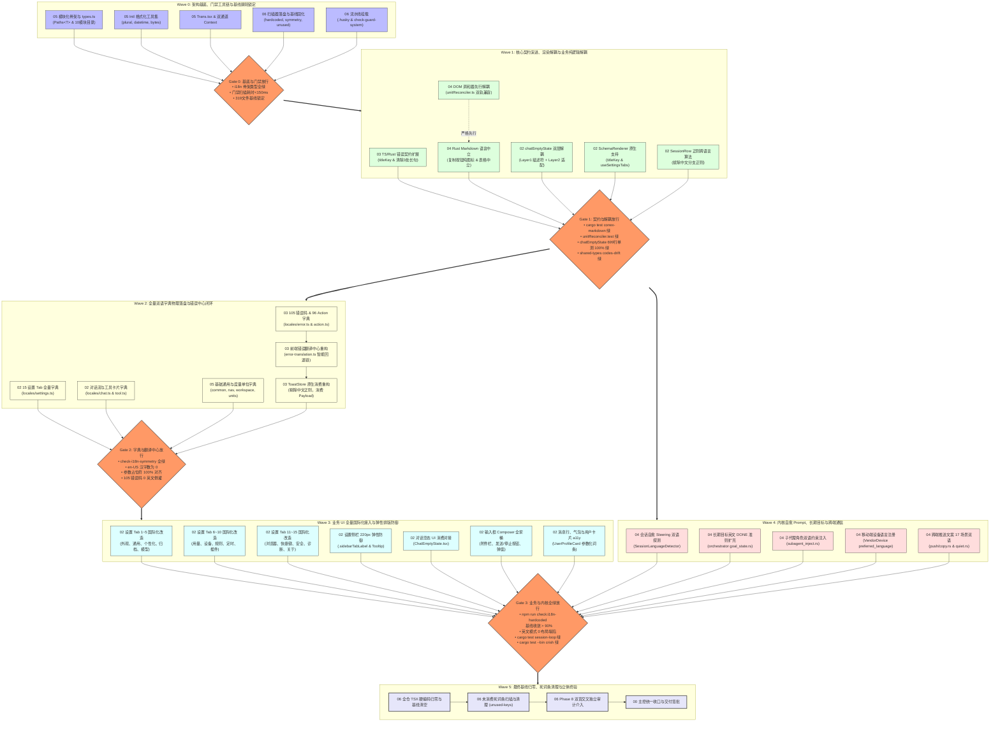

# 04-独立总计划-波次依赖拓扑与文件互斥锁案

> **战役代号**：`i18n-full-remediation`  
> **方案层级**：`Phase 3: 独立总计划 (Independent Master Plan)`  
> **规划师视角**：【波次依赖拓扑与文件互斥锁独立总规划师】 (PLANNER-04)  
> **权威协作基准**：  
> - 仓库根目录 [`AGENTS.md`](file:///c:/Software/conex/AGENTS.md) §1.1（反退避）、§1.2（子 Agent 调度规则）、§1.3（多 Agent Git 提交纪律）、§1.4（战役工作区结构规范）、§1.7 / §7.1（严禁补丁与立体验证）  
> - [`.agents/LOGIC_PLAN_NO_RETREAT.md`](file:///c:/Software/conex/.agents/LOGIC_PLAN_NO_RETREAT.md)（反退避全文与自检清单）  
> - [`docs/agent-roles/general_task/三原则.md`](file:///c:/Software/conex/docs/agent-roles/general_task/三原则.md)  
> **前置输入依据**：  
> - [`00-战役工作纪律与规范.md`](file:///c:/Software/conex/docs/i18n-full-remediation/00-战役工作纪律与规范.md)  
> - [`00-实现波调度状态与续航锚点.md`](file:///c:/Software/conex/docs/i18n-full-remediation/00-实现波调度状态与续航锚点.md)  
> - [`02-分维方案-UI交互与弹性排版系统解.md`](file:///c:/Software/conex/docs/i18n-full-remediation/02-分维方案-UI交互与弹性排版系统解.md)  
> - [`03-分维方案-数据契约与错误提示系统解.md`](file:///c:/Software/conex/docs/i18n-full-remediation/03-分维方案-数据契约与错误提示系统解.md)  
> - [`04-分维方案-底层渲染与跨端通信系统解.md`](file:///c:/Software/conex/docs/i18n-full-remediation/04-分维方案-底层渲染与跨端通信系统解.md)  
> - [`05-分维方案-模块化架构与工程工具链系统解.md`](file:///c:/Software/conex/docs/i18n-full-remediation/05-分维方案-模块化架构与工程工具链系统解.md)  
> - [`06-分维方案-质量门禁与防作弊测试矩阵系统解.md`](file:///c:/Software/conex/docs/i18n-full-remediation/06-分维方案-质量门禁与防作弊测试矩阵系统解.md)  
> - `docs/i18n-full-remediation/problems/` 6 份全景勘察报告  
> **产出路径**：`docs/i18n-full-remediation/independent-plans/04-独立总计划-波次依赖拓扑与文件互斥锁案.md`  
> **文件编码**：UTF-8 无 BOM  

---

## 方案目录索引

1. [总体愿景与调度拓扑哲学](#一总体愿景与调度拓扑哲学)
   - 1.1 [规划师核心定位与全景挑战](#11-规划师核心定位与全景挑战)
   - 1.2 [多 Agent 并行协作的四大高危陷阱与根治思路](#12-多-agent-并行协作的四大高危陷阱与根治思路)
   - 1.3 [纯逻辑拓扑与文件互斥锁的核心设计公理](#13-纯逻辑拓扑与文件互斥锁的核心设计公理)
2. [5 大分维方案前后拓扑时序因果穿透](#二5-大分维方案前后拓扑时序因果穿透)
   - 2.1 [因果断层 A：字典物理模块与 SSOT 类型引擎 必须 绝对先于 业务组件消费](#21-因果断层-a字典物理模块与-ssot-类型引擎-必须-绝对先于-业务组件消费)
   - 2.2 [因果断层 B：DOM 调和器（unitReconciler.ts）解耦 必须 严格先于 Rust Markdown 渲染器改造](#22-因果断层-bdom-调和器unitreconcilerts解耦-必须-严格先于-rust-markdown-渲染器改造)
   - 2.3 [因果断层 C：错误注册表契约升级 必须 严格先于 ToastStore 重构与 UI 错误消费](#23-因果断层-c错误注册表契约升级-必须-严格先于-toaststore-重构与-ui-错误消费)
   - 2.4 [因果断层 D：质量门禁工具与基线棘轮固化 必须 先于 存量代码大面积改造](#24-因果断层-d质量门禁工具与基线棘轮固化-必须-先于-存量代码大面积改造)
   - 2.5 [因果断层 E：SchemaRenderer 原生 i18nKey 与 dynamic useSettingsTabs 必须 先于 15 设置 Tab 改造](#25-因果断层-eschemarenderer-原生-i18nkey-与-dynamic-usesettingstabs-必须-先于-15-设置-tab-改造)
   - 2.6 [因果断层 F：api/chatEmptyState.ts 双层解耦 必须 先于 ChatEmptyState.tsx UI 消费](#26-因果断层-fapichatemptystatets-双层解耦-必须-先于-chatemptystatetsx-ui-消费)
   - 2.7 [因果断层 G：会话分支正则跨语言中立算法 必须 先于 侧栏展示渲染](#27-因果断层-g会话分支正则跨语言中立算法-必须-先于-侧栏展示渲染)
3. [模块物理所有权互斥锁矩阵（File Ownership Mutex Lock Matrix）](#三模块物理所有权互斥锁矩阵file-ownership-mutex-lock-matrix)
   - 3.1 [四级锁模型架构设计](#31-四级锁模型架构设计)
   - 3.2 [全仓物理所有权互斥锁分配总表](#32-全仓物理所有权互斥锁分配总表)
   - 3.3 [敏感高危文件保护与绝对冻结清单](#33-敏感高危文件保护与绝对冻结清单)
   - 3.4 [多 Agent Git 协同防踩踏铁律与操作规程](#34-多-agent-git-协同防踩踏铁律与操作规程)
4. [精密波次依赖拓扑 DAG 图与波次工序详解（Waves 0 ~ 5）](#四精密波次依赖拓扑-dag-图与波次工序详解waves-0--5)
   - 4.1 [全局波次依赖 Mermaid DAG 拓扑图](#41-全局波次依赖-mermaid-dag-拓扑图)
   - 4.2 [Wave 0：架构基座、门禁工具链与基线棘轮锁定（Foundation & Baseline Gate）](#42-wave-0架构基座门禁工具链与基线棘轮锁定foundation--baseline-gate)
   - 4.3 [Wave 1：核心契约演进、底层渲染解耦与纯逻辑双层解耦（Contracts & Decoupling）](#43-wave-1核心契约演进底层渲染解耦与纯逻辑双层解耦contracts--decoupling)
   - 4.4 [Wave 2：全量双语字典物理落盘与错误中心消费闭环（Dictionary & Error Translation）](#44-wave-2全量双语字典物理落盘与错误中心消费闭环dictionary--error-translation)
   - 4.5 [Wave 3：业务 UI 全量国际化接入与弹性排版防御（UI Consumption & Defensive Typography）](#45-wave-3业务-ui-全量国际化接入与弹性排版防御ui-consumption--defensive-typography)
   - 4.6 [Wave 4：内核自愈 Prompt、长期目标与跨端通信推送（Kernel Prompts, Goal Mode & IPC/Push）](#46-wave-4内核自愈-prompt长期目标与跨端通信推送kernel-prompts-goal-mode--ipcpush)
   - 4.7 [Wave 5：基线归零、死词条清理、立体终验与双盲审计（Zero Ratchet, Cleanup & Phase 8 Audit）](#47-wave-5基线归零死词条清理立体终验与双盲审计zero-ratchet-cleanup--phase-8-audit)
5. [多 Agent 调度运行期异常恢复与熔断机制](#五多-agent-调度运行期异常恢复与熔断机制)
   - 5.1 [子 Agent 空返回与网络抖动分级处理协议](#51-子-agent-空返回与网络抖动分级处理协议)
   - 5.2 [并行冲突与被吞并（Stolen Commits）恢复 SOP](#52-并行冲突与被吞并stolen-commits恢复-sop)
   - 5.3 [门禁失败阻断与棘轮反弹熔断机制](#53-门禁失败阻断与棘轮反弹熔断机制)
   - 5.4 [定时器与长耗时等待纪律](#54-定时器与长耗时等待纪律)
6. [立体验证标准与全生命周期断言矩阵](#六立体验证标准与全生命周期断言矩阵)
   - 6.1 [静态与类型安全断言（Typecheck Gate）](#61-静态与类型安全断言typecheck-gate)
   - 6.2 [资产保全断言（Unit Test Asset Protection）](#62-资产保全断言unit-test-asset-protection)
   - 6.3 [物理排版与截断断言（Visual & Typography Assertions）](#63-物理排版与截断断言visual--typography-assertions)
   - 6.4 [门禁脚本与纯度断言（Gatekeeper Assertions）](#64-门禁脚本与纯度断言gatekeeper-assertions)
   - 6.5 [Rust 内核与跨端通信断言（Rust & IPC Assertions）](#65-rust-内核与跨端通信断言rust--ipc-assertions)
7. [三原则遵从记录与签字承诺](#七三原则遵从记录与签字承诺)

---

## 一、总体愿景与调度拓扑哲学

### 1.1 规划师核心定位与全景挑战

在 Conex / Crish 客户端“全面多语言化治理（`i18n-full-remediation`）”战役中，前期勘察暴露了覆盖 695 个 TSX 文件、15 个设置 Tab、105 个跨端错误码、Rust 底层 Markdown 渲染器、会话循环 Prompt 与跨设备推送的巨量改造范围。

作为【波次依赖拓扑与文件互斥锁独立总规划师】（PLANNER-04），本方案的根本使命是：**跳出单一模块的技术细节，从“多 Agent 大规模并行协作的拓扑工序与防冲突机制”全局视角，构建一个严密自洽、前因后果刚性成立、文件物理边界坚不可摧的可执行系统总计划**。

在拥有 5~12 个子 Agent 并发工作的大兵团作战环境下，如果缺乏顶层拓扑调度与文件互斥锁设计，战役必然遭遇：
1. **类型崩塌（Type Breakdown）**：业务组件先于字典类型改动，导致全局 `npm run typecheck` 瞬间报废；
2. **逻辑撕裂（Logic Desync）**：Rust 渲染器先修改 `aria-label`，而前端流式调和器尚未解耦，直接导致 Markdown 表格流式排版隔离瞬间失效；
3. **Git 冲突风暴（Merge Conflicts & Commit Trampling）**：多个 Agent 同时编辑同一个字典大文件或公共类型文件，产生海量冲突与暂存区覆盖；
4. **作弊与虚假变绿（Cheat & False Green）**：缺乏基线棘轮卡位，子 Agent 通过将中文直接拷贝到英文包或增加通配豁免逃避重构。

### 1.2 多 Agent 并行协作的四大高危陷阱与根治思路

针对上述挑战，本方案确立四大根治机制：

```
┌─────────────────────────────────────────────────────────────────────────────┐
│ 多 Agent 并行协作四大高危陷阱与根治机制                                     │
├─────────────────┬───────────────────────────────┬───────────────────────────┤
│ 致命风险陷阱    │ 灾难表现                      │ 本方案根本解法            │
├─────────────────┼───────────────────────────────┼───────────────────────────┤
│ 1. Git 冲突风暴 │ 多 Agent 同时修改单一大文件   │ 物理目录 10 模块细粒度解耦│
│                 │ (如 zh-CN.ts / types.ts)      │ + 文件所有权互斥锁（Mutex）│
├─────────────────┼───────────────────────────────┼───────────────────────────┤
│ 2. 隐式时序踩踏 │ 上游尚未发布类型或中立标记，  │ 刚性拓扑有向无环图 (DAG)  │
│                 │ 下游已并发消费导致运行时断裂  │ + 波次前置条件严格门禁卡死│
├─────────────────┼───────────────────────────────┼───────────────────────────┤
│ 3. 共享 Index   │ 子 Agent 误提交他人 staged    │ 恪守提交权归主控铁律：    │
│    污染与吞并   │ 改动，或使用 reset 冲掉他人   │ git commit --only 限定路径│
├─────────────────┼───────────────────────────────┼───────────────────────────┤
│ 4. 门禁作弊与   │ 子 Agent 拷贝中文至英文包，   │ 基线棘轮（Baseline Ratchet│
│    指标虚报     │ 或使用 --no-verify 强推绕行   │ + 汉字纯度扫描 + 守卫自审 │
└─────────────────┴───────────────────────────────┴───────────────────────────┘
```

### 1.3 纯逻辑拓扑与文件互斥锁的核心设计公理

根据 [`AGENTS.md`](file:///c:/Software/conex/AGENTS.md) §1.1 与 [`.agents/LOGIC_PLAN_NO_RETREAT.md`](file:///c:/Software/conex/.agents/LOGIC_PLAN_NO_RETREAT.md)，本计划严格遵循三大设计公理：

1. **因果铁律（Causality Axiom）**：
   - 依赖关系仅取决于代码逻辑的输入与输出契约，**绝不以“简单易做”为由颠倒先后次序**；
   - 任何下游模块的代码编写必须建立在上游契约、类型与测试套件均已绿灯落地的前提之上。
2. **物理隔离公理（Physical Isolation Axiom）**：
   - 在同一个实施波次内，**任意一个物理文件在同一时刻只能被且仅被一个子 Agent 赋予写权限（Exclusive Write Lock）**；
   - 任何涉及多文件修改的跨模块重构，必须通过接口契约解耦，转化为单文件内的独立改造。
3. **主控单向收口公理（Main Agent Gateway Axiom）**：
   - 所有子 Agent 的改动留在工作区，禁止子 Agent 自行提交；
   - 主 Agent 在收口检查验证无误后，通过 `git commit --only <paths...>` 精确提交，杜绝工作区污染。

---

## 二、5 大分维方案前后拓扑时序因果穿透

在编排波次之前，必须彻底穿透 5 大分维方案（UI、契约、渲染、架构、门禁）之间的 7 大深层因果断层，从代码依赖机理上证明时序的必然性：

### 2.1 因果断层 A：字典物理模块与 SSOT 类型引擎 必须 绝对先于 业务组件消费

- **代码断裂事实**：
  在当前 `apps/crish-desktop/src/i18n/types.ts` 中，手写了静态类型 `CommonTranslations`、`NavTranslations`，若业务组件（如 `SettingsAppearanceTab.tsx`）直接导入 `t('settings.appearance.theme.title')`，由于现行类型系统不支持深层推导，TypeScript 编译器在 `npm run typecheck` 中将直接抛出 `Argument of type '"settings.appearance.theme.title"' is not assignable to parameter of type 'KnownTranslationKey'`，导致类型检查硬性阻断！
- **拓扑铁律**：
  必须先由【模块化架构专项】落地 `locales/{zh-CN,en-US}/` 的 10 模块物理文件骨架，并在 `types.ts` 中建立以 `typeof zhCN` 为单一真理源（SSOT）的 `Paths<T>` 受控递归推导引擎与 `ExtractParams<T>` 模板参数校验。
  **时序裁决：Wave 0（底座就绪） $\to$ Wave 2（字典落盘） $\to$ Wave 3（业务消费）**。

### 2.2 因果断层 B：DOM 调和器（unitReconciler.ts）解耦 必须 严格先于 Rust Markdown 渲染器改造

- **致命反向耦合机制**：
  勘察报告 04 揭示了全仓最隐蔽的定时炸弹：[`apps/crish-desktop/src/api/markdown/unitReconciler.ts:44-48`](file:///c:/Software/conex/apps/crish-desktop/src/api/markdown/unitReconciler.ts#L44-L48)：
  ```typescript
  function applyLayoutIsolation(element: Element): void {
    if (element.matches('.md-table-wrap, [role="region"][aria-label="表格"]')) {
      (element as HTMLElement).style.contain = 'layout';
    }
  }
  ```
  该逻辑为 Markdown 表格流式增量水合施加 `contain: layout` 排版隔离，防止表格流式输出时引发全页重排抖动。
  若先将 Rust `crates/conex-markdown/src/renderer.rs:619` 中的 `aria-label="表格"` 修改为 `aria-label="Data table"`，而前端尚未感知该属性，`element.matches(...)` 判定将**无声失效**！表格的 `contain: layout` 将丢失，引发严重且极难排查的流式渲染性能抖动与视觉跳变。
- **平滑双轨解耦工序（Three-Step Transition）**：
  1. **第一步（前端解耦先行）**：重构 `unitReconciler.ts`，将其选择器扩展为：`.md-table-wrap, [data-md-table="true"], [role="region"][aria-label="表格"]`，既兼容存量旧渲染产物，又对齐未来中立语义属性；
  2. **第二步（Rust 引擎改造）**：修改 `crates/conex-markdown/src/renderer.rs`，输出 `data-md-table="true"` 与 `aria-label="Data table"`，同时拔除复制按钮中的中文字面量（输出 `data-code-action="copy"`）；
  3. **第三步（回归验证与清理）**：跑通 `unitReconciler.test.ts` 与 `cargo test -p conex-markdown`。
  **时序裁决：前端 unitReconciler 改造必须与 Rust 渲染器置于 Wave 1，且在 Agent 分工上严格执行“前端优先合并”工序**。

### 2.3 因果断层 C：错误注册表契约升级 必须 严格先于 ToastStore 重构与 UI 错误消费

- **数据流向依赖链条**：
  1. 契约源头：[`packages/shared-types/src/errors/info.ts`](file:///c:/Software/conex/packages/shared-types/src/errors/info.ts) 与 [`crates/conex-types/src/error.rs`](file:///c:/Software/conex/crates/conex-types/src/error.rs) 是全仓 105 个错误码的真理源；
  2. 传输载荷：[`packages/shared-types/src/errors/serialize.ts`](file:///c:/Software/conex/packages/shared-types/src/errors/serialize.ts) 的 `CrishErrorPayload` 必须具备 `params` 与 `titleKey`；
  3. 字典落盘：`locales/{zh-CN,en-US}/error.ts`（105 码）与 `action.ts`（96 引导词）必须提供对应文案；
  4. 翻译中间件：`apps/crish-desktop/src/utils/error-translation.ts` 才能完成基于双语字典的双向回退链；
  5. 消费终端：[`ToastStore.ts`](file:///c:/Software/conex/apps/crish-desktop/src/services/toast/ToastStore.ts) 才能废除 `/失败|错误|无法|拒绝/` 正则猜测，直接调用 `translateError` 渲染本地化 Toast。
- **时序裁决**：
  **Wave 1（TS/Rust 契约与序列化载荷升级） $\to$ Wave 2（105 错误码字典与 error-translation 重构） $\to$ Wave 2.5/3（ToastStore 原生消费与业务调用点收敛）**。严禁下游在没有类型与字段支撑时盲目改造 ToastStore。

### 2.4 因果断层 D：质量门禁工具与基线棘轮固化 必须 先于 存量代码大面积改造

- **防作弊逻辑必然性**：
  全仓当前有 319 个生产 TSX 文件包含硬编码中文。如果先开始大面积业务组件改造，而质量门禁脚本尚未落地：
  - 无法准确量化每波次消除了多少硬编码中文；
  - 无法防止新引入的代码再度产生硬编码汉字；
  - 无法防止子 Agent 偷懒使用伪翻译。
- **时序裁决**：
  **必须在 Wave 0 首先研发并落盘 `check-i18n-hardcoded.mjs`、`check-i18n-symmetry.mjs`、`check-i18n-unused-keys.mjs`，并固化初始基线文件 `i18n-hardcoded-baseline.md`，装配 Pre-commit 守卫后，方允许启动后续波次**。

### 2.5 因果断层 E：SchemaRenderer 原生 i18nKey 与 dynamic useSettingsTabs 必须 先于 15 设置 Tab 改造

- **架构依赖关系**：
  15 个设置 Tab（如 `SettingsAppearanceTab.tsx`、`SettingsGeneralTab.tsx` 等）均依赖 `SettingsSchemaRenderer.tsx` 解析表单描述符。
  如果 `SettingsSchemaRenderer` 仅支持静态 `title: string`，则 15 个 Tab 的改造者被迫在组件外部使用 `t()` 动态构造对象，破坏 Schema 声明式纯粹性。
- **时序裁决**：
  **Wave 1 完成 `SettingsSchemaRenderer.tsx` 扩展（支持 `titleKey`, `descKey`, `options[].labelKey`）与 `settingsTabsMeta.ts`（升级为 `useSettingsTabs`），Wave 3 才能并行分发 15 个 Tab 的文案替换**。

### 2.6 因果断层 F：api/chatEmptyState.ts 双层解耦 必须 先于 ChatEmptyState.tsx UI 消费

- **单测资产保护依赖**：
  `apps/crish-desktop/src/api/chatEmptyState.ts` 拥有 699 行极具价值的单元测试（`chatEmptyState.test.ts`）。
  该文件必须在 Wave 1 拆分为：
  - Layer 1：纯逻辑结构化描述符（保持纯计算，完全脱水）；
  - Layer 2：i18n 求值适配层（根据当前激活语言将描述符转化为可展示文本）。
  必须保证原有 699 行单测 100% 全绿，随后在 Wave 3 由 UI 组件 `ChatEmptyState.tsx` 消费 Layer 2 适配结果。
  **时序裁决：Wave 1（纯逻辑解耦与单测保全） $\to$ Wave 3（UI 组件对接）**。

### 2.7 因果断层 G：会话分支正则跨语言中立算法 必须 先于 侧栏展示渲染

- **业务逻辑隐患**：
  [`apps/crish-desktop/src/components/sidebar/session-list/SessionRow.tsx:270`](file:///c:/Software/conex/apps/crish-desktop/src/components/sidebar/session-list/SessionRow.tsx#L270) 使用中文硬编码正则 `replace(/ - 分支$/, '')` 剥离分支后缀。在英文环境下，分支标题后缀为 ` - Branch`，导致英文分支标题无法正确剥离，造成 UI 显示混乱与分支状态机判断偏差。
- **时序裁决**：
  **必须在 Wave 1 抽取语言中立的 `normalizeBranchTitle` 算法，并在 SessionRow 中以 `session.branchParentId` 为单一真理源判定分支，彻底剥离中文正则依赖后，Wave 3 才能对侧栏进行整体双语化与排版重塑**。

---

## 三、模块物理所有权互斥锁矩阵（File Ownership Mutex Lock Matrix）

### 3.1 四级锁模型架构设计

为了保证在大兵团（5~12 个子 Agent）并行执行时绝不发生 Git 冲突与文件覆盖，本方案设计**四级层级互斥锁模型**：

```
┌─────────────────────────────────────────────────────────────────────────────┐
│ 四级物理互斥锁模型 (Four-Tier Mutex Lock Model)                             │
├─────────────────────────────────────────────────────────────────────────────┤
│ Level 1: 绝对单文件写独占锁 (File-Level Exclusive Write Lock)                │
│          • 规则：任意文件在任意特定波次内，有且仅有一个 Agent 拥有写权限。    │
│          • 违例处置：引擎层与调度器直接拒绝非所有者 Agent 的写请求。         │
├─────────────────────────────────────────────────────────────────────────────┤
│ Level 2: 目录域物理隔离锁 (Directory Boundary Lock)                         │
│          • 规则：locales/zh-CN/ 拆分为 10 个独立文件，禁止多个 Agent 编辑同一│
│            子文件；总索引 index.ts 在骨架完成后直接写保护冻结。              │
├─────────────────────────────────────────────────────────────────────────────┤
│ Level 3: 共享暂存区与提交网关锁 (Shared Index & Commit Gateway Lock)        │
│          • 规则：子 Agent 绝不执行 git commit / add / reset。改动留在工作区；│
│          • 主控使用 git commit --only <paths...> 限定收口，消灭暂存区踩踏。 │
├─────────────────────────────────────────────────────────────────────────────┤
│ Level 4: 基线棘轮单向顺序锁 (Baseline Ratchet Sequential Lock)              │
│          • 规则：i18n-hardcoded-baseline.md 严禁并行写入。每波次结束时，由主 │
│            控统一执行 node scripts/check-i18n-hardcoded.mjs --update 固化。  │
└─────────────────────────────────────────────────────────────────────────────┘
```

### 3.2 全仓物理所有权互斥锁分配总表

本表是战役全生命周期的唯一法定所有权指派依据。所有 Agent 派单必须严格依据下表锁定其编辑范围：

| 物理文件 / 目录路径 | 所属功能域 | 锁定波次 | 独占负责 Agent 标识 | 访问模式 | 并发安全与冲突防范说明 |
| :--- | :--- | :---: | :--- | :---: | :--- |
| `apps/crish-desktop/src/i18n/types.ts` | 核心架构 | Wave 0 | `AGENT-W0-ARCH` | 独占写入 | 奠定 SSOT `Paths<T>` 基础类型，完成后只读 |
| `apps/crish-desktop/src/i18n/formatters/**` | 格式化工具 | Wave 0 | `AGENT-W0-ARCH` | 独占写入 | 新建目录，包含 plural, datetime, bytes 等 |
| `apps/crish-desktop/src/i18n/components/Trans.tsx` | 富文本组件 | Wave 0 | `AGENT-W0-ARCH` | 独占写入 | 约 40 行轻量原生插槽组件 |
| `apps/crish-desktop/src/i18n/I18nContext.tsx` | 上下文分发 | Wave 0 | `AGENT-W0-ARCH` | 独占写入 | 升级为双通道 Context，保证引用稳定 |
| `apps/crish-desktop/src/i18n/locales/{zh-CN,en-US}/index.ts` | 字典聚合出口 | Wave 0 | `AGENT-W0-ARCH` | 独占写入 | 建立 10 模块聚合导入骨架，**完成后全流程只读冻结** |
| `scripts/check-i18n-hardcoded.mjs` | 门禁工具 | Wave 0 | `AGENT-W0-GATE` | 独占写入 | 混合动力 AST 扫描器与基线比对引擎 |
| `scripts/check-i18n-symmetry.mjs` | 门禁工具 | Wave 0 | `AGENT-W0-GATE` | 独占写入 | 词典 100% 对称性、汉字纯度与参数校验 |
| `scripts/check-i18n-unused-keys.mjs` | 门禁工具 | Wave 0 | `AGENT-W0-GATE` | 独占写入 | 未消费死词条扫描器 |
| `docs/i18n-full-remediation/基线记录/i18n-hardcoded-baseline.md` | 质量基线 | Wave 0 ~ 5 | **主控专属** | 顺序更新 | 仅在各波次门禁验收时由主控执行 `--update` 写入 |
| `.husky/pre-commit` | 提交钩子 | Wave 0 | `AGENT-W0-GATE` | 独占写入 | 挂载 symmetry 与 hardcoded 检查 |
| `package.json` | 工程配置 | Wave 0 | `AGENT-W0-GATE` | 独占写入 | 注册 `check:i18n` 脚本链条 |
| `packages/shared-types/src/errors/info.ts` | 错误契约 | Wave 1 | `AGENT-W1-CONTRACT` | 独占写入 | 扩展 `titleKey`，拔除 3 处中文长句 |
| `packages/shared-types/src/errors/serialize.ts` | 序列化契约 | Wave 1 | `AGENT-W1-CONTRACT` | 独占写入 | 扩展 `CrishErrorPayload.params` 字段 |
| `crates/conex-types/src/error.rs` | Rust 错误契约 | Wave 1 | `AGENT-W1-CONTRACT` | 独占写入 | 对齐 TS 侧 `titleKey` 与 3 处 action 清理 |
| `apps/crish-desktop/src/api/markdown/unitReconciler.ts` | DOM 调和器 | Wave 1 | `AGENT-W1-RECONCILER` | 独占写入 | 增加 `.md-table-wrap` / `data-md-table`，保留旧属性 |
| `crates/conex-markdown/src/renderer.rs` | Markdown 渲染 | Wave 1 | `AGENT-W1-MARKDOWN` | 独占写入 | 移除复制中文与表格中文，输出中立语义属性 |
| `apps/crish-desktop/src/api/markdown-render/markdownCodeFence.ts` | JS 渲染回退 | Wave 1 | `AGENT-W1-MARKDOWN` | 独占写入 | 对齐代码块中立属性 |
| `apps/crish-desktop/src/api/markdown-render/markdownTable.ts` | JS 渲染回退 | Wave 1 | `AGENT-W1-MARKDOWN` | 独占写入 | 对齐表格中立属性 |
| `apps/crish-desktop/src/api/chatEmptyState.ts` | 对话空态逻辑 | Wave 1 | `AGENT-W1-EMPTYSTATE` | 独占写入 | 双层解耦（Layer 1 描述符 + Layer 2 适配层） |
| `apps/crish-desktop/src/components/settings/SettingsSchemaRenderer.tsx` | 表单渲染引擎 | Wave 1 | `AGENT-W1-SCHEMA` | 独占写入 | 扩展 `titleKey`, `descKey`, `options[].labelKey` |
| `apps/crish-desktop/src/components/settingsTabsMeta.ts` | 设置元数据 | Wave 1 | `AGENT-W1-SCHEMA` | 独占写入 | 导出动态 `useSettingsTabs()` Hook |
| `apps/crish-desktop/src/components/sidebar/session-list/SessionRow.tsx` | 会话列表项 | Wave 1 | `AGENT-W1-SESSION` | 独占写入 | 拔除 `/ - 分支$/` 中文正则，改为语言中立算法 |
| `apps/crish-desktop/src/i18n/locales/{zh-CN,en-US}/error.ts` | 错误码字典 | Wave 2 | `AGENT-W2-DICT-ERR` | 独占写入 | 105 个错误码双语 Title 穷举填充 |
| `apps/crish-desktop/src/i18n/locales/{zh-CN,en-US}/action.ts` | 行动引导字典 | Wave 2 | `AGENT-W2-DICT-ERR` | 独占写入 | 96 个 Action 操作建议双语词条填充 |
| `apps/crish-desktop/src/i18n/locales/{zh-CN,en-US}/settings.ts` | 设置字典 | Wave 2 | `AGENT-W2-DICT-SET` | 独占写入 | 15 个设置 Tab 全量双语表单文案 |
| `apps/crish-desktop/src/i18n/locales/{zh-CN,en-US}/chat.ts` | 对话流字典 | Wave 2 | `AGENT-W2-DICT-CHAT` | 独占写入 | 对话流、输入框、空态、提示词双语词条 |
| `apps/crish-desktop/src/i18n/locales/{zh-CN,en-US}/tool.ts` | 工具卡片字典 | Wave 2 | `AGENT-W2-DICT-CHAT` | 独占写入 | 工具卡片、审批弹窗、参数折叠双语词条 |
| `apps/crish-desktop/src/i18n/locales/{zh-CN,en-US}/nav.ts` | 导航侧栏字典 | Wave 2 | `AGENT-W2-DICT-NAV` | 独占写入 | 侧栏项目、顶栏、面包屑双语词条 |
| `apps/crish-desktop/src/i18n/locales/{zh-CN,en-US}/workspace.ts` | 工作区字典 | Wave 2 | `AGENT-W2-DICT-NAV` | 独占写入 | 工作区切换、访客模式双语词条 |
| `apps/crish-desktop/src/i18n/locales/{zh-CN,en-US}/common.ts` | 通用字典 | Wave 2 | `AGENT-W2-DICT-BASE` | 独占写入 | 确定、取消、保存、复制、成功提示 |
| `apps/crish-desktop/src/i18n/locales/{zh-CN,en-US}/units.ts` | 度量单位字典 | Wave 2 | `AGENT-W2-DICT-BASE` | 独占写入 | 复数单位结构、字节换算占位符 |
| `apps/crish-desktop/src/i18n/locales/{zh-CN,en-US}/about.ts` | 关于面板字典 | Wave 2 | `AGENT-W2-DICT-BASE` | 独占写入 | 496 行法律协议、许可证、系统信息词条 |
| `apps/crish-desktop/src/utils/error-translation.ts` | 错误翻译中心 | Wave 2 | `AGENT-W2-TRANS-CENTER` | 独占写入 | 智能双向回退引擎，彻底消灭 33 码死表 |
| `apps/crish-desktop/src/services/toast/ToastStore.ts` | 通知存储中心 | Wave 2 | `AGENT-W2-TOAST` | 独占写入 | 原生消费 `CrishErrorPayload`，剔除中文正则 |
| `apps/crish-desktop/src/components/overlay/ToastCard.tsx` | Toast 渲染卡片 | Wave 2 | `AGENT-W2-TOAST` | 独占写入 | 国际化“撤销”、“关闭通知”按钮 |
| `apps/crish-desktop/src/components/overlay/ToastViewport.tsx` | Toast 视口容器 | Wave 2 | `AGENT-W2-TOAST` | 独占写入 | 国际化“通知中心”无障碍标签 |
| `apps/crish-desktop/src/components/settings/SettingsAppearanceTab.tsx` 等 (Tab 1-5) | 设置 Tab 组 A | Wave 3 | `AGENT-W3-UI-SET1` | 独占写入 | 外观、通用、个性化、归档、模型 5 Tab 改造 |
| `apps/crish-desktop/src/components/settings/SettingsUsageTab.tsx` 等 (Tab 6-10) | 设置 Tab 组 B | Wave 3 | `AGENT-W3-UI-SET2` | 独占写入 | 用量、设备、规则、定时任务、插件 5 Tab 改造 |
| `apps/crish-desktop/src/components/settings/SettingsBrowserTab.tsx` 等 (Tab 11-15) | 设置 Tab 组 C | Wave 3 | `AGENT-W3-UI-SET3` | 独占写入 | 浏览器、快捷键、安全、诊断、关于 5 Tab 改造 |
| `apps/crish-desktop/src/components/settings/SettingsSidebar.tsx` | 设置侧栏排版 | Wave 3 | `AGENT-W3-UI-TYPO` | 独占写入 | 220px 宽度注入 `.sidebarTabLabel` 截断与 `<Tooltip>` |
| `apps/crish-desktop/src/components/settings/SettingsPanel.module.css` | 设置面板样式 | Wave 3 | `AGENT-W3-UI-TYPO` | 独占写入 | 弹性高度防御，防止英文换行撑爆 32px 容器 |
| `apps/crish-desktop/src/components/chat-card/ChatEmptyState.tsx` | 对话空态 UI | Wave 3 | `AGENT-W3-UI-CHAT1` | 独占写入 | 消费 `chatEmptyState.ts` Layer 2 适配文案 |
| `apps/crish-desktop/src/components/chat-composer/**` | 输入框全家桶 | Wave 3 | `AGENT-W3-UI-CHAT2` | 独占写入 | 附件栏、提示词、发送/停止按钮、取消弹窗 |
| `apps/crish-desktop/src/components/chat-message-row/**` | 消息行与工具卡片 | Wave 3 | `AGENT-W3-UI-CHAT3` | 独占写入 | 气泡操作、思维链折叠、工具执行卡片 |
| `apps/crish-desktop/src/components/sidebar/UserProfileCard.tsx` | 用户卡片 a11y | Wave 3 | `AGENT-W3-UI-SIDEBAR` | 独占写入 | 拔除模板字符串中文拼接，改用参数化词条 |
| `crates/session-loop/src/steering/**` | 意图推进自愈 | Wave 4 | `AGENT-W4-KERNEL-STEER` | 独占写入 | 引入 `SessionLanguageDetector`，双语自愈 Nudge |
| `crates/session-loop/src/loop/handlers/no_tool_calls.rs` | 自愈推进分发 | Wave 4 | `AGENT-W4-KERNEL-STEER` | 独占写入 | 会话语言感知，英文上下文注入英文 Steering |
| `crates/orchestrator/src/goal_state.rs` | 长期目标判定 | Wave 4 | `AGENT-W4-KERNEL-GOAL` | 独占写入 | 扩充英文边界词判定，消除纯中文限制 |
| `apps/agent-workbench/src-tauri/src/run/run_resume.rs` | 目标恢复指令 | Wave 4 | `AGENT-W4-KERNEL-GOAL` | 独占写入 | 长期目标多语言指令模板 |
| `crates/agent-tools/src/subagent_inject.rs` | 子代理角色约束 | Wave 4 | `AGENT-W4-KERNEL-SUB` | 独占写入 | 双语子代理角色约束提示词分流 |
| `apps/agent-workbench/src-tauri/src/push/vendor/mod.rs` | 设备注册模型 | Wave 4 | `AGENT-W4-IPC-PUSH` | 独占写入 | `VendorDevice` 增加 `preferred_language` |
| `apps/agent-workbench/src-tauri/src/push/copy.rs` | 推送文案引擎 | Wave 4 | `AGENT-W4-IPC-PUSH` | 独占写入 | 17 种场景结构化双语渲染 |
| `apps/agent-workbench/src-tauri/src/push/quiet.rs` | 夜间静默摘要 | Wave 4 | `AGENT-W4-IPC-PUSH` | 独占写入 | 多语言夜间静默摘要生成算法 |

### 3.3 敏感高危文件保护与绝对冻结清单

以下文件为全仓核心枢纽，**战役期间除指定唯一维护者外，对所有其他 Agent 施加绝对只读写保护（Write-Forbidden）**：

1. **`apps/crish-desktop/src/i18n/locales/{zh-CN,en-US}/index.ts`** 与 **`apps/crish-desktop/src/i18n/locales/index.ts`**：
   - 保护理由：全仓字典的汇总结线点。若多个 Agent 随意添加 `export` 或重命名模块，将瞬间破坏全局类型推导；
   - 纪律：Wave 0 由 `AGENT-W0-ARCH` 固化 10 模块导出结构后，全流程只读冻结！各子 Agent 只能在其专属的子模块文件（如 `settings.ts`、`error.ts`）内追加词条，严禁改动 `index.ts`。
2. **`apps/crish-desktop/src/api/chatEmptyState.test.ts`**：
   - 保护理由：存量 699 行关键单测资产，属于用户核心回归资产；
   - 纪律：根据 [`AGENTS.md`](file:///c:/Software/conex/AGENTS.md) §1.9 铁律，该测试文件**禁止删除、禁止降低断言标准、禁止任何逻辑退化**。Wave 1 必须确保其 100% 全绿通过，新增测试必须编写在独立的 `chatEmptyState.i18n.test.ts` 中。
3. **`reference/markdown-editor/` 目录全量内容**：
   - 保护理由：Markdown 编辑器核心资产仓库；
   - 纪律：严禁修改、删除该目录下的任何文件，改动渲染器后必须跑通 `reference/markdown-editor` 的 `npm test` 门禁。
4. **`AGENTS.md` 与 `.agents/LOGIC_PLAN_NO_RETREAT.md`**：
   - 保护理由：战役最高协作纪律文本；
   - 纪律：未经用户显式授权，任何 Agent 严禁修改本文件。

### 3.4 多 Agent Git 协同防踩踏铁律与操作规程

恪守 [`AGENTS.md`](file:///c:/Software/conex/AGENTS.md) §1.2 与 §1.3，所有参与本战役的 Agent 必须无条件服从以下 Git 与运行期铁律：

1. **嵌套派单绝对禁止（REQ-D08）**：
   子 Agent 深度为 1，无派发子 Agent 能力。所有子 Agent 均由主控 Agent 直接派发。
2. **提交权仅归主 Agent**：
   子 Agent 严禁执行 `git commit`、`git push`；更**严禁执行任何形式的 `git reset --hard`、`git checkout .` 或 `git restore`**。子 Agent 完成编码后只需执行自测，确保文件在本地落盘，改动留在工作区，由主 Agent 验证后统一收口。
3. **精准收口提交指令（`--only`）**：
   主 Agent 在提交某一波次或某一 Agent 的产出时，必须使用：
   ```bash
   git commit --only <file1> <file2> ... -m "feat(i18n): <精确说明> [BATCH-W<波次>]"
   ```
   **绝对禁止**执行盲目的 `git commit -a` 或无参数 `git commit`，彻底杜绝误将其他并行 Agent 的半成品文件或临时测试文件带入仓库。
4. **被吞并处理 SOP（吞并不回撤、验证不重做）**：
   若待收口的文件已被其他定时 Agent 或并行提交抢先入库（吞并），主 Agent 绝不执行 `git reset` 或重做，而是执行 `git diff HEAD~1 <file>` 校验内容完整性：
   - 若内容已完备：直接标记通过；
   - 若有遗漏：仅在当前工作区追加缺失部分，再次使用 `git commit --only` 限定提交。
5. **Whitespace 最小修复解除 Pre-commit 阻塞**：
   若 `.husky/pre-commit` 触发 `git diff --check` 因工作区其他文件末尾空格阻塞提交，执行者只允许对违规行做最小 whitespace 清理，严禁碰触代码业务逻辑。

---

## 四、精密波次依赖拓扑 DAG 图与波次工序详解（Waves 0 ~ 5）

### 4.1 全局波次依赖 Mermaid DAG 拓扑图

以下为整个 `i18n-full-remediation` 战役的全局精密拓扑有向无环图。所有波次准入必须满足其全部直接前驱节点的验收门禁：



---

### 4.2 Wave 0：架构基座、门禁工具链与基线棘轮锁定（Foundation & Baseline Gate）

#### 4.2.1 波次核心目标
在不改动任何业务组件的前提下，将 `apps/crish-desktop/src/i18n/` 从 400 行样板代码重塑为企业级模块化架构；落盘 3 个刚性门禁脚本；首次扫描并固化存量 319 个文件的硬编码基线；将门禁织入 pre-commit 与 check-guard-system。

#### 4.2.2 准入前置依赖
- Phase 1 勘察报告全绿验收；
- Phase 2 分维方案终稿批准；
- 主控下发派单指令。

#### 4.2.3 并行 Agent 矩阵与文件锁分配（5 Agent 并行）

```
┌─────────────────────────────────────────────────────────────────────────────┐
│ Wave 0 并行 Agent 分工矩阵                                                  │
├───────────────────┬───────────────────────────────────┬─────────────────────┤
│ Agent 标识        │ 独占文件写入范围                  │ 核心职责            │
├───────────────────┼───────────────────────────────────┼─────────────────────┤
│ AGENT-W0-ARCH     │ apps/crish-desktop/src/i18n/      │ 落地模块化目录、    │
│                   │ • types.ts                        │ Paths<T> SSOT 类型、│
│                   │ • I18nContext.tsx                 │ 双通道 Context、    │
│                   │ • locales/{zh-CN,en-US}/index.ts  │ Trans.tsx 富文本    │
│                   │ • components/Trans.tsx            │                     │
├───────────────────┼───────────────────────────────────┼─────────────────────┤
│ AGENT-W0-FORMAT   │ apps/crish-desktop/src/i18n/      │ 封装原生 Intl 工具集│
│                   │   formatters/**                   │ (plural, datetime,  │
│                   │                                   │  number, bytes)     │
├───────────────────┼───────────────────────────────────┼─────────────────────┤
│ AGENT-W0-GATE1    │ scripts/check-i18n-hardcoded.mjs  │ 研发两段式 AST 扫描 │
│                   │                                   │ 引擎与棘轮比对逻辑  │
├───────────────────┼───────────────────────────────────┼─────────────────────┤
│ AGENT-W0-GATE2    │ scripts/check-i18n-symmetry.mjs   │ 研发词典对称性、    │
│                   │ scripts/check-i18n-unused-keys.mjs│ 纯度与死键扫描器    │
├───────────────────┼───────────────────────────────────┼─────────────────────┤
│ AGENT-W0-GUARD    │ .husky/pre-commit                 │ 门禁流水线挂载、    │
│                   │ package.json                      │ check-guard-system  │
│                   │ scripts/check-guard-system.mjs    │ 防篡改加固          │
└───────────────────┴───────────────────────────────────┴─────────────────────┘
```

#### 4.2.4 关键实现工序与防冲突机制
1. `AGENT-W0-ARCH` 迁移现行 66 个键与 33 个错误码至 `locales/zh-CN/` 与 `en-US/` 的基础模块中，确保对外导出的 `t` 与 `useI18n` 接口 100% 保持签名兼容；
2. 完成后，`locales/{zh-CN,en-US}/index.ts` 锁定为只读；
3. `AGENT-W0-GATE1` 与 `GATE2` 完成扫描器后，由主控运行一次全仓初扫，生成 `docs/i18n-full-remediation/基线记录/i18n-hardcoded-baseline.md`，将当前 319 个文件的违规行数物理固化；
4. `AGENT-W0-GUARD` 在 `.husky/pre-commit` 中接入门禁，并向 `scripts/check-guard-system.mjs` 追加对 i18n 门禁的防破坏断言。

#### 4.2.5 测试门禁与准出标志（Exit Checklist）
- [ ] `npm run typecheck` 零报错；
- [ ] `npx vitest run apps/crish-desktop/src/i18n/` 全绿（涵盖存量 `i18n.test.ts` 及新增 `plural.test.ts`, `datetime.test.ts`, `bytes.test.ts`, `Trans.test.tsx`）；
- [ ] `node scripts/check-i18n-symmetry.mjs` 绿灯通过；
- [ ] `node scripts/check-i18n-hardcoded.mjs` 耗时 $\le$ 150ms，且比对基线通过；
- [ ] `node scripts/check-guard-system.mjs` 验证预提交守卫完整性绿灯；
- [ ] 主控执行 `git commit --only` 完成 Wave 0 收口。

---

### 4.3 Wave 1：核心契约演进、底层渲染解耦与纯逻辑双层解耦（Contracts & Decoupling）

#### 4.3.1 波次核心目标
在不碰 UI 展现层的前提下，彻底理顺底层数据契约、渲染解耦与纯逻辑解耦：
1. TS 与 Rust 错误注册表升级，拔除 3 处契约污染；
2. **紧急重构前端 `unitReconciler.ts` 解除对 `aria-label="表格"` 的反向耦合**；
3. 将 Rust `conex-markdown` 渲染器彻底改造为 100% 语言中立结构；
4. 将 `api/chatEmptyState.ts` 双层解耦，100% 保全 699 行核心单测；
5. 升级 `SettingsSchemaRenderer.tsx` 原生支持 `titleKey`；
6. 拔除 `SessionRow.tsx:270` 中文分支正则。

#### 4.3.2 准入前置依赖
- Gate 0 签署放行；
- 基线记录文件与门禁脚本处于激活状态。

#### 4.3.3 并行 Agent 矩阵与文件锁分配（6 Agent 并行）

```
┌─────────────────────────────────────────────────────────────────────────────┐
│ Wave 1 并行 Agent 分工矩阵                                                  │
├─────────────────────┬─────────────────────────────────┬─────────────────────┤
│ Agent 标识          │ 独占文件写入范围                │ 核心职责            │
├─────────────────────┼─────────────────────────────────┼─────────────────────┤
│ AGENT-W1-CONTRACT   │ packages/shared-types/src/errors│ 契约扩展 titleKey,  │
│                     │ • info.ts, serialize.ts         │ params，清理 3 处   │
│                     │ crates/conex-types/src/error.rs │ 中文长句 action 键  │
├─────────────────────┼─────────────────────────────────┼─────────────────────┤
│ AGENT-W1-RECONCILER │ apps/crish-desktop/src/api/     │ 调和器选择器解耦：  │
│                     │   markdown/unitReconciler.ts    │ 接入 .md-table-wrap │
│                     │   markdown/unitReconciler.test  │ 双轨兼容，绝不失效  │
├─────────────────────┼─────────────────────────────────┼─────────────────────┤
│ AGENT-W1-MARKDOWN   │ crates/conex-markdown/src/      │ 拔除复制/表格中文， │
│                     │ • renderer.rs                   │ 纯图标结构与中立属性│
│                     │ apps/crish-desktop/src/api/     │                     │
│                     │   markdown-render/markdownCode* │ 同步对齐 JS 回退解析│
├─────────────────────┼─────────────────────────────────┼─────────────────────┤
│ AGENT-W1-EMPTYSTATE │ apps/crish-desktop/src/api/     │ 双层解耦纯逻辑描述符│
│                     │ • chatEmptyState.ts             │ 保护 699 行既有单测 │
│                     │ • chatEmptyState.i18n.test.ts   │ 0 改动 100% 变绿    │
├─────────────────────┼─────────────────────────────────┼─────────────────────┤
│ AGENT-W1-SCHEMA     │ apps/crish-desktop/src/         │ 扩展 titleKey 支持，│
│                     │ • components/settings/Settings* │ 导出动态            │
│                     │ • components/settingsTabsMeta.ts│ useSettingsTabs()   │
├─────────────────────┼─────────────────────────────────┼─────────────────────┤
│ AGENT-W1-SESSION    │ apps/crish-desktop/src/         │ 拔除 /- 分支$/ 中文 │
│                     │ • components/sidebar/session-   │ 正则，落地跨语言中立│
│                     │   list/SessionRow.tsx           │ 会话标题剥离算法    │
└─────────────────────┴─────────────────────────────────┴─────────────────────┘
```

#### 4.3.4 关键工序约束（严格先后次序）
> [!CRITICAL]
> **工序铁律**：`AGENT-W1-RECONCILER` 必须先完成 `unitReconciler.ts` 改动并通过单测，主控确认后，`AGENT-W1-MARKDOWN` 方可将 `crates/conex-markdown` 中的表格属性更改为 `data-md-table="true" aria-label="Data table"`。严禁倒置！

#### 4.3.5 测试门禁与准出标志（Exit Checklist）
- [ ] `cargo test -p conex-types` 绿灯通过；
- [ ] `npx vitest run packages/shared-types/src/errors/codes-drift.test.ts` 绿灯（105 码 action 合规校验通过）；
- [ ] `npx vitest run apps/crish-desktop/src/api/markdown/unitReconciler.test.ts` 绿灯；
- [ ] `cargo test -p conex-markdown` 绿灯（断言输出零中文字符）；
- [ ] `npx vitest run apps/crish-desktop/src/api/chatEmptyState.test.ts` 699 行单测 100% 绿灯；
- [ ] `npx vitest run apps/crish-desktop/src/api/chatEmptyState.i18n.test.ts` 绿灯；
- [ ] 主控执行 `git commit --only` 完成 Wave 1 收口。

---

### 4.4 Wave 2：全量双语字典物理落盘与错误中心消费闭环（Dictionary & Error Translation）

#### 4.4.1 波次核心目标
在物理隔离的文件域内，全量填充 2,000+ 双语词条，完成 105 个错误码 Title 与 96 个 Action 建议翻译；重构前端 `error-translation.ts` 智能双向回退引擎；重塑 `ToastStore.ts` 原生消费 `CrishErrorPayload` 并清理 UI 硬编码。

#### 4.4.2 准入前置依赖
- Gate 1 签署放行；
- TS/Rust 契约与序列化字段已就绪。

#### 4.4.3 并行 Agent 矩阵与文件锁分配（6 Agent 并行）

```
┌─────────────────────────────────────────────────────────────────────────────┐
│ Wave 2 并行 Agent 分工矩阵                                                  │
├─────────────────────┬─────────────────────────────────┬─────────────────────┤
│ Agent 标识          │ 独占文件写入范围                │ 核心职责            │
├─────────────────────┼─────────────────────────────────┼─────────────────────┤
│ AGENT-W2-DICT-ERR   │ locales/{zh-CN,en-US}/          │ 穷举填充 105 错误码 │
│                     │ • error.ts                      │ Title 与 96 Action  │
│                     │ • action.ts                     │ 操作引导双语词条    │
├─────────────────────┼─────────────────────────────────┼─────────────────────┤
│ AGENT-W2-DICT-SET   │ locales/{zh-CN,en-US}/          │ 穷举填充 15 设置 Tab│
│                     │ • settings.ts                   │ 全部表单、提示文案  │
├─────────────────────┼─────────────────────────────────┼─────────────────────┤
│ AGENT-W2-DICT-CHAT  │ locales/{zh-CN,en-US}/          │ 填充对话流、输入框、│
│                     │ • chat.ts                       │ 空态卡片、工具卡片、│
│                     │ • tool.ts                       │ 审批弹窗双语词条    │
├─────────────────────┼─────────────────────────────────┼─────────────────────┤
│ AGENT-W2-DICT-BASE  │ locales/{zh-CN,en-US}/          │ 填充通用动作、导航、│
│                     │ • common.ts, nav.ts             │ 工作区、度量单位与  │
│                     │ • workspace.ts, units.ts        │ 关于协议双语词条    │
│                     │ • about.ts                      │                     │
├─────────────────────┼─────────────────────────────────┼─────────────────────┤
│ AGENT-W2-TRANS      │ apps/crish-desktop/src/utils/   │ 重构错误翻译中心：  │
│                     │ • error-translation.ts          │ 智能双向回退链，    │
│                     │ • error-translation.test.ts     │ 彻底消灭 33 码死表  │
├─────────────────────┼─────────────────────────────────┼─────────────────────┤
│ AGENT-W2-TOAST      │ apps/crish-desktop/src/         │ 重构 ToastStore 原生│
│                     │ • services/toast/ToastStore.ts  │ 消费，剔除猜错正则；│
│                     │ • components/overlay/ToastCard  │ 国际化“撤销/关闭/   │
│                     │ • components/overlay/ToastView* │ 通知中心”UI 文本    │
└─────────────────────┴─────────────────────────────────┴─────────────────────┘
```

#### 4.4.4 防冲突与防作弊保障
1. **字典文件绝对正交**：`error.ts`、`settings.ts`、`chat.ts` 等各自分立，各 Agent 绝不交叉编辑；
2. **反作弊语言纯度刚性拦截**：`AGENT-W2-DICT-*` 完成后，`check-i18n-symmetry.mjs` 强制扫描 `locales/en-US/`，若发现哪怕一个汉字（`[\u4e00-\u9fff]`）直接阻断提交；
3. **参数恒等性断言**：双语同一 key 的 `{param}` 占位符必须严格一致，禁止漏参。

#### 4.4.5 测试门禁与准出标志（Exit Checklist）
- [ ] `node scripts/check-i18n-symmetry.mjs` 绿灯（100% 对齐，零汉字污染，零敷衍占位符）；
- [ ] `npx vitest run apps/crish-desktop/src/utils/error-translation.test.ts` 绿灯（断言中文环境下 105 码零英文倒灌）；
- [ ] `npx vitest run apps/crish-desktop/src/services/toast/` 绿灯（Toast 原生消费 Payload 正常弹出）；
- [ ] 主控执行 `git commit --only` 完成 Wave 2 收口。

---

### 4.5 Wave 3：业务 UI 全量国际化接入与弹性排版防御（UI Consumption & Defensive Typography）

#### 4.5.1 波次核心目标
全仓推进业务组件硬编码清除：
1. 15 个设置 Tab 全量接入 `useI18n` 与 `SettingsSchemaRenderer` 的 `titleKey`；
2. SettingsSidebar 注入 `.sidebarTabLabel` 截断与 `<Tooltip>` 双层包裹，根除 220px 英文溢出；
3. 对话流（Composer、ChatEmptyState、ToolCard、MessageRow）硬编码清零；
4. `UserProfileCard` 等组件重构 a11y 读屏参数化词条；
5. 执行 `check-i18n-hardcoded.mjs --update` 大幅收缩基线。

#### 4.5.2 准入前置依赖
- Gate 2 签署放行；
- 字典双语词条全量就绪。

#### 4.5.3 并行 Agent 矩阵与文件锁分配（8 Agent 并行）

```
┌─────────────────────────────────────────────────────────────────────────────┐
│ Wave 3 并行 Agent 分工矩阵                                                  │
├─────────────────────┬─────────────────────────────────┬─────────────────────┤
│ Agent 标识          │ 独占文件写入范围                │ 核心职责            │
├─────────────────────┼─────────────────────────────────┼─────────────────────┤
│ AGENT-W3-SET-A      │ apps/crish-desktop/src/         │ 外观、通用、个性化、│
│                     │   components/settings/          │ 归档、模型 5 个 Tab │
│                     │ • SettingsAppearanceTab.tsx 等  │ 改造与 Schema 接入  │
├─────────────────────┼─────────────────────────────────┼─────────────────────┤
│ AGENT-W3-SET-B      │ apps/crish-desktop/src/         │ 用量、设备、规则、  │
│                     │   components/settings/          │ 定时任务、插件 5 Tab│
│                     │ • SettingsUsageTab.tsx 等       │ 改造与 Schema 接入  │
├─────────────────────┼─────────────────────────────────┼─────────────────────┤
│ AGENT-W3-SET-C      │ apps/crish-desktop/src/         │ 浏览器、快捷键、    │
│                     │   components/settings/          │ 安全、诊断与关于    │
│                     │ • SettingsAboutTab.tsx (496行)等│ (496行声明合规)     │
├─────────────────────┼─────────────────────────────────┼─────────────────────┤
│ AGENT-W3-TYPO       │ apps/crish-desktop/src/         │ 注入 .sidebarTabLabel│
│                     │ • components/settings/Settings* │ 截断样式，强制外包  │
│                     │ • components/settings/Settings* │ 自定义 <Tooltip>    │
│                     │   Panel.module.css              │ 根治 220px 英文溢出 │
├─────────────────────┼─────────────────────────────────┼─────────────────────┤
│ AGENT-W3-CHAT-EMPTY │ apps/crish-desktop/src/         │ 对接 Layer 2 适配层 │
│                     │ • components/chat-card/         │ 消除三态写死中文    │
│                     │   ChatEmptyState.tsx            │ 保全卡片交互逻辑    │
├─────────────────────┼─────────────────────────────────┼─────────────────────┤
│ AGENT-W3-COMPOSER   │ apps/crish-desktop/src/         │ 附件栏、提示词、    │
│                     │   components/chat-composer/**   │ 发送/停止排队按钮、 │
│                     │ • ChatComposer.tsx 等           │ 强制取消弹窗国际化  │
├─────────────────────┼─────────────────────────────────┼─────────────────────┤
│ AGENT-W3-CHAT-ROW   │ apps/crish-desktop/src/         │ 消息操作栏、思维链  │
│                     │   components/chat-message-row/**│ 折叠块、代码块复制  │
│                     │ • ChatMessageRow.tsx 等         │ 状态提示国际化      │
├─────────────────────┼─────────────────────────────────┼─────────────────────┤
│ AGENT-W3-SIDEBAR    │ apps/crish-desktop/src/         │ UserProfileCard a11y│
│                     │ • components/sidebar/           │ 读屏参数化词条重构，│
│                     │   UserProfileCard.tsx           │ 消除拼合中文 TTS 畸变│
└─────────────────────┴─────────────────────────────────┴─────────────────────┘
```

#### 4.5.4 视觉与排版防御验收铁律
- 在 `en-US` 模式下，SettingsSidebar 的标签文字物理计算宽度超限时，必须展现 `text-overflow: ellipsis`，容器高度严格锁定在 32px，禁止折行塌陷；
- 必须双层包裹自定义 `<Tooltip>`，鼠标悬停时展示完整英文字符串。

#### 4.5.5 测试门禁与准出标志（Exit Checklist）
- [ ] `npm run typecheck` 零错误；
- [ ] `node scripts/check-i18n-hardcoded.mjs --update` 成功执行，全仓基线超标行数削减 $\ge 90\%$；
- [ ] `npm run check:line-counts` 前端行数门禁全绿（单文件未超标）；
- [ ] 主控执行 `git commit --only` 完成 Wave 3 收口。

---

### 4.6 Wave 4：内核自愈 Prompt、长期目标与跨端通信推送（Kernel Prompts, Goal Mode & IPC/Push）

#### 4.6.1 波次核心目标
穿透至后端与跨端底层，消除大模型上下文污染与海外设备通知硬编码：
1. `session-loop` 引入会话语言感知，英文上下文下注入英文 Tool-Promise 推进 Nudge；
2. `orchestrator` 扩充英文长期目标（`/goal`）完成判据与伪任务过滤；
3. 子代理注入双语化；
4. 移动端设备注册模型感知系统 Locale，17 种推送场景全量双语下发。

#### 4.6.2 准入前置依赖
- Gate 1 与 Gate 2 签署放行；
- Rust 内核处于可构建状态。

#### 4.6.3 并行 Agent 矩阵与文件锁分配（5 Agent 并行）

```
┌─────────────────────────────────────────────────────────────────────────────┐
│ Wave 4 并行 Agent 分工矩阵                                                  │
├─────────────────────┬─────────────────────────────────┬─────────────────────┤
│ Agent 标识          │ 独占文件写入范围                │ 核心职责            │
├─────────────────────┼─────────────────────────────────┼─────────────────────┤
│ AGENT-W4-STEER      │ crates/session-loop/src/        │ 建立语言探测器，    │
│                     │ • steering/ (SessionLanguage*)  │ 双语自愈推进 Nudge，│
│                     │ • loop/handlers/no_tool_calls.rs│ 根除英文模型上下文漂移│
├─────────────────────┼─────────────────────────────────┼─────────────────────┤
│ AGENT-W4-GOAL       │ crates/orchestrator/src/        │ 英文 DONE 边界词识别│
│                     │ • goal_state.rs                 │ 伪任务过滤，长期目标│
│                     │ apps/agent-workbench/src-tauri/ │ 多语言指令模板      │
│                     │   src/run/run_resume.rs         │                     │
├─────────────────────┼─────────────────────────────────┼─────────────────────┤
│ AGENT-W4-SUBAGENT   │ crates/agent-tools/src/         │ 子代理系统提示词与  │
│                     │ • subagent_inject.rs            │ 角色约束双语分流    │
├─────────────────────┼─────────────────────────────────┼─────────────────────┤
│ AGENT-W4-PUSH       │ apps/agent-workbench/src-tauri/ │ VendorDevice 增加   │
│                     │   src/push/                     │ preferred_language，│
│                     │ • vendor/mod.rs                 │ 17 种场景双语渲染， │
│                     │ • copy.rs, quiet.rs             │ 夜间静默摘要多语言化│
├─────────────────────┼─────────────────────────────────┼─────────────────────┤
│ AGENT-W4-IPC-ERR    │ crates/conex-types/src/error.rs │ 跨端 IPC 错误派生   │
│                     │ apps/crish-desktop/src/utils/   │ 携带 params 字典，  │
│                     │   error-translation.ts          │ 前端动态插值收口    │
└─────────────────────┴─────────────────────────────────┴─────────────────────┘
```

#### 4.6.4 测试门禁与准出标志（Exit Checklist）
- [ ] `cargo test -p session-loop` 全绿（断言英文上下文中自愈 Nudge 包含 `[System Auto-Steer]` 且 0 汉字）；
- [ ] `cargo test -p orchestrator` 全绿（识别 `goal completed`, `DONE`）；
- [ ] `cargo test --bin crish`（或 src-tauri push 单元测试）全绿（17 场景英文文案匹配断言通过）；
- [ ] 主控执行 `git commit --only` 完成 Wave 4 收口。

---

### 4.7 Wave 5：基线归零、死词条清理、立体终验与双盲审计（Zero Ratchet, Cleanup & Phase 8 Audit）

#### 4.7.1 波次核心目标
战役最终攻坚与质量锁死：
1. 清除剩余死角中文字符，将 `i18n-hardcoded-baseline.md` 标记区彻底清空归零；
2. 运行 `check-i18n-unused-keys.mjs` 扫描并清除未消费的孤儿死词条；
3. 激活 Phase 8 双盲交叉独立审计协议；
4. 真实桌面环境双语切换验收与签批交付。

#### 4.7.2 准入前置依赖
- Gate 3 签署放行；
- Wave 3 与 Wave 4 改动已全量收口入库。

#### 4.7.3 执行矩阵与终验工序
1. **基线清零冲刺（AGENT-W5-CLEANUP）**：
   - 扫描剩余未归零的零星 TSX 文件，将剩余中文抽取至对应词典；
   - 运行 `node scripts/check-i18n-hardcoded.mjs --update`，此时基线标记区间内容应为**空**；
   - 断言：全仓 420 个生产 TSX 文件无未声明中文！
2. **死词条垃圾清理（AGENT-W5-UNUSED）**：
   - 运行 `node scripts/check-i18n-unused-keys.mjs`，比对词典与源码消费；
   - 结合 105 错误码白名单，安全移除孤立词条，确保打包体积净收敛。
3. **Phase 8 双盲交叉独立审计（专职审计位介入）**：
   - 由完全独立的审计 Agent 执行 4 大 SOP：
     * **SOP-1 Git Diff 穿透审查**：核查有无漏抽文案；
     * **SOP-2 抑制注释合理性答辩**：审查全仓每一处 `/* i18n-allow */`，非专有名词一律驳回；
     * **SOP-3 英文原生性地道评审**：审查 `en-US` 文案是否符合桌面系统地道规范；
     * **SOP-4 真实宿主现场双语验收**：启动应用进行桌面真机操作，检验无报错、无重叠、无截断失灵。
4. **主控总签批交付**：
   - 更新 `00-实现波调度状态与续航锚点.md`，将状态推进至 Phase 9 最终交付状态；
   - 执行最终 `git commit --only` 交付入库。

---

## 五、多 Agent 调度运行期异常恢复与熔断机制

### 5.1 子 Agent 空返回与网络抖动分级处理协议

针对大模型或网络抖动引发的“空返回/零输出”现象，严格按照 [`AGENTS.md`](file:///c:/Software/conex/AGENTS.md) §1.2 执行分级熔断恢复协议：

```
┌─────────────────────────────────────────────────────────────────────────────┐
│ 子 Agent 空返回分级处理与接管状态机                                         │
├─────────────────┬───────────────────────────────────────────────────────────┤
│ 空回累计次数    │ 标准处置动作 (SOP)                                        │
├─────────────────┼───────────────────────────────────────────────────────────┤
│ 1 ~ 3 次        │ • 先执行 git status 检查代码是否已实际落盘；              │
│ (偶发网络抖动)  │ • 若文件已落盘且单测绿灯：直接进入主控核查收口阶段；      │
│                 │ • 若未落盘：优先使用 task_id 接续原 Agent 会话继续推进。  │
├─────────────────┼───────────────────────────────────────────────────────────┤
│ 4 ~ 6 次        │ • 判定当前任务粒度过大或发生 Agent 复读机死锁；           │
│ (任务粒度瓶颈)  │ • 主控主动将任务拆分为单文件/单组件粒度，分发给新 Agent； │
│                 │ • 保持总任务范围与验收标准绝对不变（效果锁铁律）。        │
├─────────────────┼───────────────────────────────────────────────────────────┤
│ 6 次以上        │ • 触发熔断保护：终止子 Agent 派单；                       │
│ (极端异常接管)  │ • 由主控 Agent 直接接管该文件的实现与落盘，打通链路。     │
└─────────────────┴───────────────────────────────────────────────────────────┘
```

### 5.2 并行冲突与被吞并（Stolen Commits）恢复 SOP

在多 Agent 及自动化 Git 定时 Agent 并行运行的极端场景下，若发现自身目标文件的改动已被先行动作提交入库：
1. **严禁执行 `git reset --hard`、`checkout .` 或 `git revert`**；
2. 执行 `git show HEAD:<path>` 对比仓库最新内容与期望代码：
   - **完全一致**：直接复用，不纠结归属，记录在案并进入下一步；
   - **部分缺失**：仅针对缺失部分在当前工作区追加写入，使用 `git commit --only <path>` 限定收口；
3. 任何冲突消解只采用精确文件编辑（`replace_file_content`），绝不影响非自身文件。

### 5.3 门禁失败阻断与棘轮反弹熔断机制

1. **阻断即停（Fail Fast）**：
   任何波次中，若 `check-i18n-hardcoded` 或 `check-i18n-symmetry` 返回 `exit 1`，相关 Agent 必须立即停止后续流程，专注排查阻断报错，**绝对禁止使用 `--no-verify` 强行跳过**；
2. **棘轮反弹熔断**：
   若执行 `--update` 发现基线违规数高于历史基线，脚本自动拦截并退出。主控必须勒令该 Agent 回滚退化代码，重新抽取词条，直到实测值 $\le$ 基线值。

### 5.4 定时器与长耗时等待纪律

根据 [`AGENTS.md`](file:///c:/Software/conex/AGENTS.md) §1.2：
- 若设置定时器，最短时间必须是 **100 秒**；
- 运行长耗时构建或测试命令时，**严禁使用高频轮询（Polling Loop）浪费 Token 与系统资源**，必须利用系统的 **响应式唤醒机制（Reactive Wakeup）**，静默等待命令执行结束的系统消息通知。

---

## 六、立体验证标准与全生命周期断言矩阵

遵循 [`AGENTS.md`](file:///c:/Software/conex/AGENTS.md) §1.7 与 §7.1，交付前必须经过以下全维度立体断言阵列检验：

```
┌─────────────────────────────────────────────────────────────────────────────┐
│ 全生命周期立体验证断言矩阵 (Full-Lifecycle Verification Matrix)            │
├──────────────┬───────────────────────────────┬──────────────────────────────┤
│ 验证维度     │ 核心断言内容                  │ 验证执行命令                 │
├──────────────┼───────────────────────────────┼──────────────────────────────┤
│ 1. 静态与    │ • TypeScript 零错误           │ npm run typecheck            │
│    类型契约  │ • Paths<T> 深层键受控推导     │                              │
│              │ • SchemaProperty 强类型键推导 │                              │
├──────────────┼───────────────────────────────┼──────────────────────────────┤
│ 2. 架构与    │ • check:desktop 全链路通过    │ npm run check:desktop        │
│    行数门禁  │ • UI 组件 ≤ 500行，业务 ≤ 400 │ npm run check:line-counts    │
│              │ • 零循环依赖与分层合规        │                              │
├──────────────┼───────────────────────────────┼──────────────────────────────┤
│ 3. 资产保全  │ • chatEmptyState 699行单测    │ npx vitest run ...           │
│    测试矩阵  │   100% 变绿，零退化           │ npm test                     │
│              │ • unitReconciler 双轨选择器绿 │ cargo test --workspace       │
│              │ • reference/markdown-editor 绿│                              │
├──────────────┼───────────────────────────────┼──────────────────────────────┤
│ 4. 词典纯度  │ • en-US 汉字字符数 === 0      │ node scripts/check-i18n-     │
│    与对称性  │ • 双向 Key 对齐率 === 100%    │   symmetry.mjs               │
│              │ • {param} 占位符集合恒等      │                              │
├──────────────┼───────────────────────────────┼──────────────────────────────┤
│ 5. 源码无硬  │ • 生产 TSX 硬编码中文 === 0   │ node scripts/check-i18n-     │
│    编码中文  │ • 基线棘轮标记区间完全清空    │   hardcoded.mjs              │
│              │ • 严禁无理由单行抑制          │                              │
├──────────────┼───────────────────────────────┼──────────────────────────────┤
│ 6. 死词条    │ • 词典定义词条 100% 在源码    │ node scripts/check-i18n-     │
│    垃圾清退  │   或错误码注册表中被有效消费  │   unused-keys.mjs            │
├──────────────┼───────────────────────────────┼──────────────────────────────┤
│ 7. 物理排版  │ • SettingsSidebar 英文标签    │ DOM 计算样式测试 /           │
│    弹性防御  │   white-space === 'nowrap'    │ Playwright 容器溢出巡检      │
│              │   text-overflow === 'ellipsis'│                              │
│              │   容器高度严格 === 32px       │                              │
│              │ • 外层 100% 包含 <Tooltip>    │                              │
├──────────────┼───────────────────────────────┼──────────────────────────────┤
│ 8. 无障碍    │ • UserProfileCard aria-label  │ /[\u4e00-\u9fa5]/.test(aria) │
│    语音纯度  │   英文模式下零中文字符残留    │ === false                    │
└──────────────┴───────────────────────────────┴──────────────────────────────┘
```

---

## 七、三原则遵从记录与签字承诺

本独立总计划完全遵守 [`docs/agent-roles/general_task/三原则.md`](file:///c:/Software/conex/docs/agent-roles/general_task/三原则.md) 铁律，接受战役审计小组全流程检验：

1. **诚实原则（Honesty）**：
   - 彻底正视 319 个存量 TSX 包含硬编码中文的严峻现实，不回避、不搞只做 2 个 Tab 的假国际化；
   - 深刻揭示了 `unitReconciler.ts:45` 对 `aria-label="表格"` 的隐秘反向耦合断层，制定了严格的“调和器先解耦，渲染器再改造”的防踩踏工序；
   - 诚实标注了多 Agent 协作中的共享 Index 踩踏风险，制定了 `--only` 精确提交与被吞并不回撤的科学 SOP。
2. **必做与禁做原则（Must-Do & Forbidden）**：
   - **必做落地**：
     * 制定了覆盖 Wave 0 至 Wave 5 的精密依赖拓扑 DAG 图；
     * 制定了精确到具体物理文件、独占 Agent 标识与锁定波次的四级互斥锁总表；
     * 建立了融合两段式扫描器、基线棘轮、语言纯度断言与死键清理的防作弊全套武器；
     * 建立了针对单测资产（如 `chatEmptyState.test.ts` 699 行）的绝对保护机制。
   - **禁做恪守**：
     * **坚决反退避**：绝不允许以“时间紧、任务重”为由放弃 105 错误码全量覆盖或放弃 15 个设置 Tab；
     * **严禁打补丁**：坚决摒弃字符串拼接与中文正则猜类型，坚持 SSOT 类型系统与结构化 Payload；
     * **严禁 `--no-verify`**：将门禁与守卫深度绑定，本地与 CI 双重强制卡死。
3. **负责原则（Responsibility）**：
   - 本方案具备极高的**工程可落地性**，每一波次的准入、分工、产出路径、测试命令与准出标志均详尽完备；
   - 后续无论是主控定夺总案（Phase 4），还是独立审计（Phase 5），乃至分波次派单（Phase 6/7），均可直接依据本方案的拓扑工序与互斥锁矩阵无缝调度，零沟通摩擦、零冲突返工。

---

> **总规划师签署**：【波次依赖拓扑与文件互斥锁独立总规划师】 (PLANNER-04)  
> **归档位置**：`docs/i18n-full-remediation/independent-plans/04-独立总计划-波次依赖拓扑与文件互斥锁案.md`  
> **版本状态**：独立总计划终稿交付，提请主控 Agent 接入 Phase 4 总案定夺与收敛。
