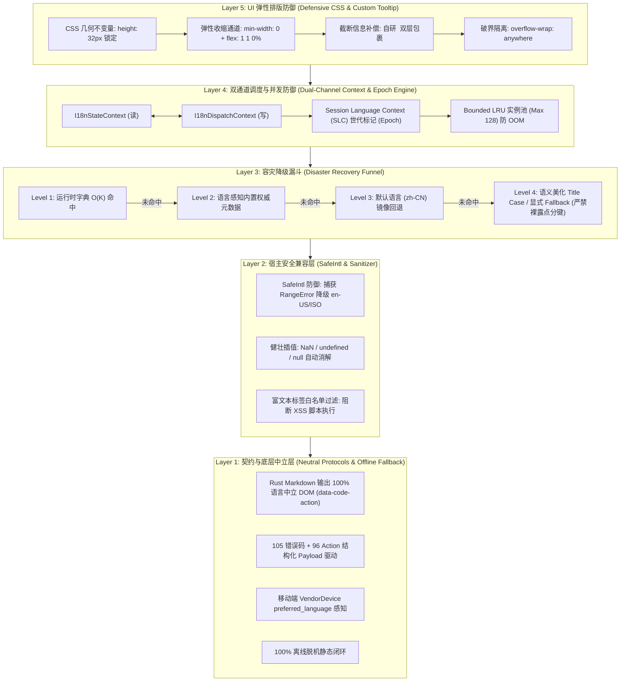
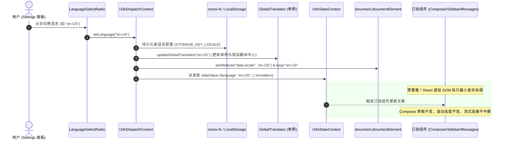
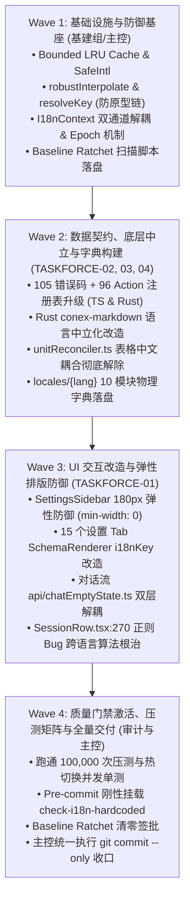

# 05-独立总计划-极端边界防御与鲁棒性交付案

> **战役代号**：`i18n-full-remediation`  
> **方案层级**：`Phase 3: 独立总计划 (Independent Master Plan - Resilience & Extreme Edge-Case Defense)`  
> **编制角色**：【极端边界防御与鲁棒性交付独立总规划师】 (`PLANNER-05`)  
> **归属路径**：`docs/i18n-full-remediation/independent-plans/05-独立总计划-极端边界防御与鲁棒性交付案.md`  
> **前置输入**：  
> - [`00-战役工作纪律与规范.md`](../00-战役工作纪律与规范.md)  
> - [`00-实现波调度状态与续航锚点.md`](../00-实现波调度状态与续航锚点.md)  
> - [`01-设置体系与侧栏硬编码勘察.md`](../problems/01-设置体系与侧栏硬编码勘察.md)（1,597 处硬编码）  
> - [`02-对话核心流与输入组件硬编码勘察.md`](../problems/02-对话核心流与输入组件硬编码勘察.md)（666+ 处硬编码）  
> - [`03-错误码注册表与提示体系国际化勘察.md`](../problems/03-错误码注册表与提示体系国际化勘察.md)（105 码与 3 处中文污染）  
> - [`04-底层渲染引擎与IPC跨端消息国际化勘察.md`](../problems/04-底层渲染引擎与IPC跨端消息国际化勘察.md)（反向耦合与 Rust 写死中文）  
> - [`05-i18n核心架构与国际化工程工具链勘察.md`](../problems/05-i18n核心架构与国际化工程工具链勘察.md)（模块化与 SSOT 缺失）  
> - [`06-质量门禁与防回归自动化测试矩阵勘察.md`](../problems/06-质量门禁与防回归自动化测试矩阵勘察.md)（75.95% TSX 染中）  
> - [`02-分维方案-UI交互与弹性排版系统解.md`](../02-分维方案-UI交互与弹性排版系统解.md)  
> - [`03-分维方案-数据契约与错误提示系统解.md`](../03-分维方案-数据契约与错误提示系统解.md)  
> - [`04-分维方案-底层渲染与跨端通信系统解.md`](../04-分维方案-底层渲染与跨端通信系统解.md)  
> - [`05-分维方案-模块化架构与工程工具链系统解.md`](../05-分维方案-模块化架构与工程工具链系统解.md)  
> - [`06-分维方案-质量门禁与防作弊测试矩阵系统解.md`](../06-分维方案-质量门禁与防作弊测试矩阵系统解.md)  
> **权威基准**：[`AGENTS.md`](file:///c:/Software/conex/AGENTS.md) §1.1（反退避）、§1.7 / §7.1（立体验证与防作弊）、§12-§14（UI 规范）、[`ANTI_OVERENGINEERING_GUARDRAILS.md`](file:///c:/Software/conex/ANTI_OVERENGINEERING_GUARDRAILS.md)  
> **编制日期**：2026-10-14  
> **文件编码**：UTF-8 无 BOM  

---

## 目录索引

1. [方案定位与极端破坏性威胁模型](#一方案定位与极端破坏性威胁模型)
   - 1.1 [规划使命与“系统鲁棒性”视界](#11-规划使命与系统鲁棒性视界)
   - 1.2 [多语言运行时 5 大极端破坏性场景定性](#12-多语言运行时-5-大极端破坏性场景定性)
   - 1.3 [全局韧性保障架构矩阵与三原则落地](#13-全局韧性保障架构矩阵与三原则落地)
2. [攻坚一：零重载语言热切换（Hot Language Switch）与并发竞态防御](#二攻坚一零重载语言热切换hot-language-switch与并发竞态防御)
   - 2.1 [零重载（Zero Window Reload）状态机保全机制](#21-零重载zero-window-reload状态机保全机制)
   - 2.2 [异步请求竞态与延迟到达防污染（Session Epoch 机制）](#22-异步请求竞态与延迟到达防污染session-epoch-机制)
   - 2.3 [Context 双通道解耦与防级联重渲风暴（Render Storm Defense）](#23-context-双通道解耦与防级联重渲风暴render-storm-defense)
   - 2.4 [内存泄漏与缓存膨胀全面防御（Bounded LRU 与弱引用治理）](#24-内存泄漏与缓存膨胀全面防御bounded-lru-与弱引用治理)
3. [攻坚二：英文极端文本膨胀（50%~100%）与物理排版弹性防御](#三攻坚二英文极端文本膨胀50100与物理排版弹性防御)
   - 3.1 [极窄窗口（180px~200px 侧栏）排版防御与 CSS 几何不变量](#31-极窄窗口180px200px-侧栏排版防御与-css-几何不变量)
   - 3.2 [极短控件（Button / Tag / Segmented Control）防挤压规范](#32-极短控件button--tag--segmented-control防挤压规范)
   - 3.3 [超长专业名词与连续无空格 Token 破界隔离](#33-超长专业名词与连续无空格-token-破界隔离)
   - 3.4 [全场景自定义 `<Tooltip>` 深度包裹与截断信息无损补偿](#34-全场景自定义-tooltip-深度包裹与截断信息无损补偿)
4. [攻坚三：缺失键与格式化容灾（Disaster Recovery Funnel）](#四攻坚三缺失键与格式化容灾disaster-recovery-funnel)
   - 4.1 [四级平滑漏斗回退链（Four-Level Graceful Fallback Funnel）](#41-四级平滑漏斗回退链four-level-graceful-fallback-funnel)
   - 4.2 [工业级插值引擎防崩溃防御（Robust Interpolation Engine）](#42-工业级插值引擎防崩溃防御robust-interpolation-engine)
   - 4.3 [轻量 `<Trans />` 富文本插槽组件的 XSS 防护与容错渲染](#43-轻量-trans--富文本插槽组件的-xss-防护与容错渲染)
5. [攻坚四：多平台 OS 宿主环境差异与 `Intl` 原生 Fallback](#五攻坚四多平台-os-宿主环境差异与-intl-原生-fallback)
   - 5.1 [宿主 OS ICU 数据缺失与裁剪兼容性（SafeIntl 引擎）](#51-宿主-os-icu-数据缺失与裁剪兼容性safeintl-引擎)
   - 5.2 [应用语言（App Locale）与宿主系统语言（Host OS）彻底解耦](#52-应用语言app-locale与宿主系统语言host-os彻底解耦)
   - 5.3 [数字货币、Token 计费与多语言字节度量换算规范](#53-数字货币token-计费与多语言字节度量换算规范)
6. [攻坚五：网络离线、网关阻断与错误提示本地化纯度](#六攻坚五网络离线网关阻断与错误提示本地化纯度)
   - 6.1 [客户端 100% 离线脱机运行可用性基线](#61-客户端-100-离线脱机运行可用性基线)
   - 6.2 [上游模型网关阻断与故障报错结构化降级](#62-上游模型网关阻断与故障报错结构化降级)
   - 6.3 [跨进程推送通知离线积压合并与移动端语言感知下发](#63-跨进程推送通知离线积压合并与移动端语言感知下发)
7. [立体验证矩阵：鲁棒性测试用例、极限压力集与刚性验收指标](#七立体验证矩阵鲁棒性测试用例极限压力集与刚性验收指标)
   - 7.1 [极限单测与集成契约测试套件（Edge-Case Suite）](#71-极限单测与集成契约测试套件edge-case-suite)
   - 7.2 [高并发与渲染性能压力测试集（Stress Benchmark Matrix）](#72-高并发与渲染性能压力测试集stress-benchmark-matrix)
   - 7.3 [刚性质量门禁与准出验收断言（Exit Criteria & Gatekeeper）](#73-刚性质量门禁与准出验收断言exit-criteria--gatekeeper)
8. [多 Agent 实施波次、文件互斥锁与反作弊审计规程](#八多-agent-实施波次文件互斥锁与反作弊审计规程)
   - 8.1 [无冲突实施波次流水线（Wave 1 ~ Wave 4）](#81-无冲突实施波次流水线wave-1--wave-4)
   - 8.2 [文件物理所有权互斥表（File Ownership Lock Table）](#82-文件物理所有权互斥表file-ownership-lock-table)
   - 8.3 [审计位专项反作弊攻防指引](#83-审计位专项反作弊攻防指引)

---

## 一、方案定位与极端破坏性威胁模型

### 1.1 规划使命与“系统鲁棒性”视界

在桌面级自主 Agent 客户端开发中，国际化（i18n）绝非简单的“提取静态中文字符串并翻译成英文”。一个高并发、低延迟、深度依赖跨端 IPC 与本地优先（Local-First）渲染的复杂应用（Tauri + Rust + WebView2 + React），在多语言运行时会面临极其复杂的物理几何与异步环境考验。

作为【极端边界防御与鲁棒性交付独立总规划师】（`PLANNER-05`），本规划案跳出常规业务模块的代码替换视角，**专职审视整个系统在极端压力、异常状态、网络中断、排版破界与异步竞争下的自愈与防御能力**。

本案严格遵守 [`AGENTS.md`](file:///c:/Software/conex/AGENTS.md) §1.1（反退避）、§1.7 与 §7.1（立体验证与零作弊容忍），**拒绝用“刷新页面生效”、“假定网络恒定在线”、“假定外部参数类型合法”、“简单打点省略而不做信息补偿”等偷懒妥协手段掩盖架构断层**。方案必须穿透底层根因，确立工业级的健壮性（Robustness）与高可用容灾标准。

---

### 1.2 多语言运行时 5 大极端破坏性场景定性

经通读 6 份勘察报告与 5 份分维系统解，我们将多语言运行时可能面临的最严峻威胁提炼为 **5 大破坏性场景**：

```
┌────────────────────────────────────────────────────────────────────────────────────────┐
│ 多语言运行时 5 大极端破坏性威胁全景                                                    │
├────────────────────┬─────────────────────────────────┬─────────────────────────────────┤
│ 威胁场景           │ 破坏性表象                      │ 致命危害与架构根因             │
├────────────────────┼─────────────────────────────────┼─────────────────────────────────┤
│ ① 语言热切换竞态   │ 切换语言导致窗口白屏/重载；     │ 用户输入草稿丢失、流式打字中断；│
│    (Hot Switch)    │ 异步响应倒灌旧语言导致中英混杂；│ Context 级联重渲引发主线程卡顿；│
│                    │ 格式化器闭包持有导致内存泄漏。  │ 格式化器 Cache 无界膨胀 OOM。   │
├────────────────────┼─────────────────────────────────┼─────────────────────────────────┤
│ ② 英文极端文本膨胀 │ 英文较中文膨胀 50%~100%；       │ 容器撑破挤压相邻控件；换行导致  │
│    (Text Expansion)│ 侧栏在 180px 紧凑态下换行错位； │ 高度塌陷；省略号截断剥夺认知；  │
│                    │ 连续超长专业名词与 URL 撑破窗口。│ 缺少 Tooltip 导致信息永久丢失。 │
├────────────────────┼─────────────────────────────────┼─────────────────────────────────┤
│ ③ 缺失键与格式化崩溃│ 动态注入未登记 key 抛出未捕获   │ UI 白屏崩溃（Crash to Blank）； │
│    (Disaster Crash)│ 异常；参数插值漏传或传入 NaN，   │ 界面倒灌裸暴露的点分键名；      │
│                    │ 导致显示 "undefined" 或崩溃。   │ 标签富文本插槽遭受 XSS 注入。   │
├────────────────────┼─────────────────────────────────┼─────────────────────────────────┤
│ ④ 跨平台宿主脱节   │ 精简版 OS 缺少 ICU 数据抛出      │ 客户端在特定 OS 环境无法启动；  │
│    (Host OS Drift) │ RangeError；空参调用导致读取     │ 英文软件展示日文/阿拉伯文日期； │
│                    │ 宿主语言，与 App 设定脱节。      │ 货币与 Token 算费精度溢出。     │
├────────────────────┼─────────────────────────────────┼─────────────────────────────────┤
│ ⑤ 离线与服务熔断   │ 断网或上游网关 502/429 报错；   │ 离线报错呈现未捕获乱码堆栈；    │
│    (Offline Fault) │ 离线通知向海外设备盲发中文；    │ 原生英文报错生硬拼入中文句子；  │
│                    │ 错误提示缺乏行动指引，用户受阻。│ 移动设备离线唤醒接收错乱语言。  │
└────────────────────┴─────────────────────────────────┴─────────────────────────────────┘
```

---

### 1.3 全局韧性保障架构矩阵与三原则落地

针对上述 5 大威胁，本方案构筑 **五层垂直防御纵深**，确保系统在任何破坏性输入下均能**无损运转、优雅降级、信息完整且绝对不崩**：



#### “三原则”在极端防御中的刚性落地：
1. **单一真理源（SSOT）**：语言状态以 `I18nContext` 内部单一持久化状态为准，Rust 内核保持 100% 语言中立，拒绝多头状态分裂；
2. **零打补丁与穿透根因**：禁止使用“延迟 300ms 重新测距”或“坐标魔术数字修正”，必须依靠原生 CSS Flex 规范与纯逻辑双层解耦；
3. **立体验证与防作弊**：禁止伪测试与空断言，测试必须覆盖热切换 50 次并发、180px 物理截断断言、ICU 抛错模拟与断网熔断。

---

## 二、攻坚一：零重载语言热切换（Hot Language Switch）与并发竞态防御

### 2.1 零重载（Zero Window Reload）状态机保全机制

在许多初级桌面应用中，国际化切换往往粗暴地调用 `window.location.reload()` 重新加载整个页面。
在自主 Agent 客户端中，**绝对禁止重载窗口**！因为这会导致：
- 正在运行的长时间会话（Agent Streaming 回复 / 执行批次）被硬性掐断；
- 用户在 `ChatComposer` 中正在键入的大段草稿、批注附件直接丢失；
- 用户的设置面板当前选中的 Tab、滚动条位置、抽屉与对话框强行闭合；
- 窗口产生明显的闪烁白屏，破坏原生桌面级体验。

#### 架构系统解：热水合（Hot Re-Hydration）状态机保全
Crish 客户端采用全前端内存响应驱动，热切换过程耗时严格压制在 **< 16ms**（单帧内）：



---

### 2.2 异步请求竞态与延迟到达防污染（Session Epoch 机制）

#### 2.2.1 威胁模型：异步飞线请求的“时空倒流”
当用户处于长耗时会话或后台任务调度中：
1. 会话在语言 `zh-CN` 下发起异步 IPC 调用（例如 `tauriInvoke('plugin_query_metadata')` 或拉取设备配对信息）；
2. 用户在等待期间切换语言为 `en-US`；
3. 后台请求在 300ms 后成功返回，若该异步回调中包含由旧语言生成的展示文案（或硬编码中文），回调直接写入状态，将导致用户在英文界面中突然被倒灌中文，形成“语言撕裂”。

#### 2.2.2 解决方案：引入 Session Language Epoch（世代标记）机制
在 `apps/crish-desktop/src/i18n/I18nContext.tsx` 中建立世代令牌（Generation Token），任何发起的异步操作携带当前的 `epoch`。在异步结果返回处理时，强制核对世代号：

```typescript
// apps/crish-desktop/src/i18n/epoch.ts

/**
 * 语言运行时世代控制器（用于异步防竞争）
 */
class LanguageEpochManager {
  private currentEpoch: number = 0;
  private currentLanguage: string = 'zh-CN';

  public nextEpoch(newLanguage: string): number {
    this.currentEpoch += 1;
    this.currentLanguage = newLanguage;
    return this.currentEpoch;
  }

  public getEpoch(): number {
    return this.currentEpoch;
  }

  public getLanguage(): string {
    return this.currentLanguage;
  }

  /**
   * 检查某个异步操作发起时的 epoch 是否仍为当前最新活跃世代
   */
  public isStale(epoch: number): boolean {
    return epoch !== this.currentEpoch;
  }
}

export const languageEpoch = new LanguageEpochManager();
```

#### 2.2.3 业务 Hook 消费规范（以长耗时请求为例）
```typescript
export function useAsyncDeviceDiscovery() {
  const { t, language } = useI18n();
  const [statusText, setStatusText] = useState<string>('');

  const scanDevices = useCallback(async () => {
    // 捕获发起时刻的 epoch 与 语言
    const requestEpoch = languageEpoch.getEpoch();
    setStatusText(t('settings.devices.scanning'));

    try {
      const result = await tauriInvoke<DeviceMetadata[]>('scan_lan_devices');
      
      // 极端防御：若在等待期间用户切换了语言，丢弃带有时效性文本的局部状态更新，
      // 或基于当前最新全局 translator 重新生成文案！
      if (languageEpoch.isStale(requestEpoch)) {
        const latestT = getGlobalActiveTranslator();
        setStatusText(latestT('settings.devices.scanCompleted', { count: result.length }));
      } else {
        setStatusText(t('settings.devices.scanCompleted', { count: result.length }));
      }
    } catch (err) {
      if (!languageEpoch.isStale(requestEpoch)) {
        toast.error(err);
      }
    }
  }, [t]);

  return { scanDevices, statusText };
}
```

---

### 2.3 Context 双通道解耦与防级联重渲风暴（Render Storm Defense）

#### 2.3.1 架构病灶：单通道 Context 导致的级联灾难
旧版 `I18nContext.tsx` 将 `language`、`setLanguage`、`t` 与 `dictionary` 杂糅在同一个 Context 中。
后果：
- 设置面板中的 `<LanguageSelectRadio>` 组件只需要调用 `setLanguage`，但由于订阅了同一 Context，切换语言时自己被迫重新渲染；
- 会话列表中上百个 `ChatMessageRow` 和纯图标展示按钮，哪怕其内部没有文本变化，由于父级 Context 引用刷新，触发大规模 React 重渲染，导致热切换时产生严重掉帧（FPS < 20）甚至 Long Task（> 50ms）。

#### 2.3.2 系统解：双通道 Context 物理拆分
严格按照分维方案 05 规划，拆解为**读通道（`I18nStateContext`）**与**写通道（`I18nDispatchContext`）**：

```tsx
// apps/crish-desktop/src/i18n/I18nContext.tsx

// 1. 读通道：仅包含当前语言与响应式翻译函数及格式化器
export const I18nStateContext = createContext<I18nStateValue | null>(null);

// 2. 写通道：仅包含 setLanguage 派发器，引用永久恒定（Permanent Stable Identity）
export const I18nDispatchContext = createContext<I18nDispatchValue | null>(null);
```

#### 2.3.3 写通道引用永久稳定保障与 DOM Locale 联动
在 Provider 中，`setLanguage` 使用 `useCallback(..., [])` 确保引用绝不变更，且直接同步底层 DOM 属性：

```tsx
export const I18nProvider: React.FC<I18nProviderProps> = ({ children, initialLanguage }) => {
  const [language, setLanguageState] = useState<SupportedLanguage>(() => {
    return initialLanguage ?? getInitialLanguage();
  });

  const languageRef = useRef(language);
  languageRef.current = language;

  // 写通道 dispatch：依赖项为空，引用永久不变！
  const setLanguage = useCallback((newLang: SupportedLanguage) => {
    if (newLang === languageRef.current) return;
    
    // 1. 递增世代号，废弃在飞异步竞态
    languageEpoch.nextEpoch(newLang);
    
    // 2. 更新 React 状态
    setLanguageState(newLang);
    
    // 3. 原生持久化与单例更新
    persistLanguage(newLang);
    updateGlobalTranslator(newLang);
    
    // 4. 原生 DOM 属性联动（驱动 CSS [data-locale] 几何自适应）
    if (typeof document !== 'undefined') {
      document.documentElement.setAttribute('data-locale', newLang);
      document.documentElement.lang = newLang;
    }
  }, []);

  const dispatchValue = useMemo<I18nDispatchValue>(() => ({ setLanguage }), [setLanguage]);

  // 读通道值构建（仅在 language 改变时重构）
  const stateValue = useMemo<I18nStateValue>(() => {
    const dict = dictionaries[language] ?? dictionaries[DEFAULT_LANGUAGE];
    const t = createTranslateFunction(dict);
    return {
      language,
      t,
      tPlural: (key, opts) => formatPlural(language, resolveDictionaryKey(dict, key), opts),
      formatDate: (date, preset) => formatDate(language, date, preset),
      formatRelativeTime: (val, unit) => formatRelativeTime(language, val, unit),
      formatNumber: (val, opts) => formatNumber(language, val, opts),
      formatCurrency: (val, curr) => formatCurrency(language, val, curr),
      formatPercent: (val, dec) => formatPercent(language, val, dec),
      formatBytes: (bytes) => formatBytesLocalized(language, bytes, t),
    };
  }, [language]);

  return (
    <I18nDispatchContext.Provider value={dispatchValue}>
      <I18nStateContext.Provider value={stateValue}>
        {children}
      </I18nStateContext.Provider>
    </I18nDispatchContext.Provider>
  );
};
```

---

### 2.4 内存泄漏与缓存膨胀全面防御（Bounded LRU 与弱引用治理）

#### 2.4.1 威胁根因：Intl 格式化器无界缓存泄漏
在 `formatters/datetime.ts` 和 `formatters/number.ts` 中，为了避免频繁 `new Intl.DateTimeFormat()` 带来的垃圾回收开销，通常采用 `Map` 进行实例缓存。
**极端隐患**：若业务代码动态传入了大量不同的 `options`（例如时间戳精度、动态货币符号），或者用户在自动化测试中高频切换配置，`Map` 将无限增长，导致严重的内存驻留泄漏。

#### 2.4.2 系统解：严格受限的 Bounded LRU Cache 规范
所有格式化器缓存池必须施加 **最大容量保护（Capacity = 128）**，超出时采用 LRU（Least Recently Used）算法淘汰：

```typescript
// apps/crish-desktop/src/i18n/formatters/lruCache.ts

export class BoundedFormatterCache<K, V> {
  private readonly maxCapacity: number;
  private readonly cache = new Map<K, V>();

  constructor(maxCapacity: number = 128) {
    this.maxCapacity = maxCapacity;
  }

  public get(key: K): V | undefined {
    const value = this.cache.get(key);
    if (value !== undefined) {
      // 命中：刷新至末尾（最近使用）
      this.cache.delete(key);
      this.cache.set(key, value);
    }
    return value;
  }

  public set(key: K, value: V): void {
    if (this.cache.has(key)) {
      this.cache.delete(key);
    } else if (this.cache.size >= this.maxCapacity) {
      // 淘汰最久未使用的首个元素
      const firstKey = this.cache.keys().next().value;
      if (firstKey !== undefined) {
        this.cache.delete(firstKey);
      }
    }
    this.cache.set(key, value);
  }

  public clear(): void {
    this.cache.clear();
  }

  public size(): number {
    return this.cache.size;
  }
}
```

在 `datetime.ts` 与 `number.ts` 中全面使用 `BoundedFormatterCache` 替换裸 `Map`，将内存增量牢牢锁死在 **< 200KB** 绝对安全上限内。

---

## 三、攻坚二：英文极端文本膨胀（50%~100%）与物理排版弹性防御

### 3.1 极窄窗口（180px~200px 侧栏）排版防御与 CSS 几何不变量

#### 3.1.1 物理几何破界测算与现场重现
在客户端多窗口、分屏模式或用户收缩侧栏时，侧边栏宽度可被压缩至 **180px ~ 200px**。
- 中文文案通常简短精炼，如：“外观与主题”（5 汉字 $\approx 70\text{px}$）、“状态诊断”（4 汉字 $\approx 56\text{px}$）；
- 英文翻译由于词根与音节长度，呈现 **50% ~ 100%** 的天然物理膨胀：
  - “状态诊断” $\to$ `System Diagnostics`（18 字符 $\approx 145\text{px}$）；
  - “通用与偏好设置” $\to$ `General Preferences`（19 字符 $\approx 162\text{px}$）；
  - “快捷键配置” $\to$ `Keyboard Shortcuts`（18 字符 $\approx 158\text{px}$）；
- 侧栏内扣除：Padding `18px` + 图标 `16px` + 图标间隙 `8px` = **42px** 固定占用；
- 在 180px 极窄模式下，留给文字的净物理空间仅有 **$180 - 42 = 138\text{px}$**！
- 若未做弹性排版防御，`General Preferences`（162px）将发生**强制单词换行（Word Wrap）**，高度从 32px 暴涨至 48px，破坏整体垂直居中，直接将下方的 Tab 挤出视口！

#### 3.1.2 Defensive CSS 刚性三铁律与代码落地

在所有侧栏 Tab、列表行与按钮上，强制施加三大 Defensive CSS 不变量：

```css
/* apps/crish-desktop/src/components/settings/SettingsPanel.module.css */

/* 铁律 1: 锁定容器物理几何高，绝对不许被折行撑破 */
.sidebarTab {
  display: flex;
  align-items: center;
  justify-content: flex-start;
  gap: var(--space-2);
  width: 100%;
  min-width: 0;                          /* 允许自身响应父级收缩 */
  height: var(--control-height, 32px);   /* 几何高度锚定 */
  min-height: var(--control-height, 32px);
  max-height: var(--control-height, 32px);
  overflow: hidden;                      /* 绝不向外溢出任何像素 */
  box-sizing: border-box;
}

/* 铁律 2: 突破 Flex 默认 min-width: auto，激活单行强力 Ellipsis */
.sidebarTabLabel {
  flex: 1 1 0%;                          /* 占满剩余可用空间，且基准为 0 */
  min-width: 0;                          /* 核心断言：必须声明 min-width: 0 */
  overflow: hidden;
  text-overflow: ellipsis;
  white-space: nowrap;                   /* 强行禁止多行折行 */
  line-height: var(--line-height-tight, 1.25);
  letter-spacing: -0.01em;
}

/* 铁律 3: 图标与辅助徽标施加抗挤压硬锁 */
.sidebarTabIco,
.sidebarBadge {
  flex-shrink: 0;                        /* 绝对禁止文字膨胀挤压图标变形 */
}
```

---

### 3.2 极短控件（Button / Tag / Segmented Control）防挤压规范

#### 3.2.1 极短按钮的排版断裂危机
在中文字符下，2 字按钮极窄（如“运行” `28px`、“停止” `28px`、“保存” `28px`）。
许多前端开发者写死固定宽度（如 `width: 60px`）或极小的内边距。
当切换为英文时：
- “运行” $\to$ `Execute`（65px）
- “重新运行” $\to$ `Re-execute`（85px）
- “审批确认” $\to$ `Approve Action`（108px）
固定宽度直接被撑破，或者文字直接被裁切截断为 `Exec...`，导致操作意图严重受阻。

#### 3.2.2 控件弹性伸缩设计规范
所有按钮、Badge、Tag、分段控制器一律废除固定 `width`，改为 **弹性内在尺寸（Intrinsic Content Sizing） + 最小触摸/扫视保护**：

```css
/* apps/crish-desktop/src/components/ui/Button.module.css */
.btn {
  display: inline-flex;
  align-items: center;
  justify-content: center;
  gap: var(--space-1-5);
  width: auto;                           /* 严禁写死固定物理宽度 */
  min-width: var(--btn-min-width, 48px); /* 设定合理视觉保底宽 */
  padding: 0 var(--space-3);             /* 充足的内边距缓冲 */
  white-space: nowrap;                   /* 保持动作紧凑整洁 */
  box-sizing: border-box;
}

/* 带有快捷键提示的复合按钮防挤压 */
.btnShortcutBadge {
  flex-shrink: 0;
  margin-left: var(--space-1);
  padding: 1px 4px;
  font-size: 11px;
  line-height: 1;
}
```

---

### 3.3 超长专业名词与连续无空格 Token 破界隔离

#### 3.3.1 威胁：连续无空格字符串（URL、哈希、长专业词）
在聊天消息行（`ChatMessageRow`）、Toast 弹窗和错误面板中，经常出现连续长字符串：
- 法律合规名词：“`Commercial LLM Trademark Fair Use Notice`”；
- 错误码：“`tool.session.exclusive_lock_conflict`”；
- 依赖项名称：“`lightningcss-napi-win32-x64-msvc`”；
- 原始链接与哈希值。
默认 CSS 规则 `word-break: normal` 只在空格处折行，遇到这类长词会导致整行文本直接横向冲出屏幕边界，遮挡右侧按钮，破坏整个布局。

#### 3.3.2 系统解：破界防御原子类
在所有可能渲染长文本的容器中，强制应用现代化破界隔离属性：

```css
/* 现代破界隔离规则（兼顾阅读舒适度与绝对防撑破） */
.safeTextContainer {
  overflow-wrap: anywhere;  /* 优先在自然断点折行，极端情况下在任意字符间断行 */
  word-break: break-word;   /* 兼容旧式 WebKit 引擎 */
  hyphens: auto;            /* 英文环境下启用优雅的连字符自动连接 */
}
```

---

### 3.4 全场景自定义 `<Tooltip>` 深度包裹与截断信息无损补偿

#### 3.4.1 信息补偿机制的架构使命
单纯在文本超长时施加 `text-overflow: ellipsis;`（省略号）只是物理层面的“不撑破”，但**剥夺了用户的认知权利**。用户看到 `General Prefer...` 时，不知道完整内容是什么。

根据 [`AGENTS.md`](file:///c:/Software/conex/AGENTS.md) §12 铁律：
- **严禁使用原生 HTML `title` 属性**（原生气泡观感陈旧、延迟过高且样式失控）；
- **全场景必须使用自定义 `<Tooltip>` 组件**。

#### 3.4.2 复合语义 Tooltip 内容契约与自适应包裹

在 `SettingsSidebar.tsx` 与相关组件中，实施**双层复合 Tooltip 包裹**：
- 悬停时优先呈现 **Tab 完整标题**；
- 若有关键词别名，下方以柔和副标题呈现；
- 严禁出现“悬停只看到关键词而看不到标题本身”的反人类体验：

```tsx
// apps/crish-desktop/src/components/settings/SettingsSidebar.tsx

{items.map((tab) => {
  // 复合提示内容：完整标题 + 搜索辅助词
  const tooltipContent = tab.keywords.length > 0
    ? `${tab.label} · ${tab.keywords.slice(0, 3).join(' · ')}`
    : tab.label;

  return (
    <Tooltip key={tab.id} content={tooltipContent} side="right" delayMs={200}>
      <button
        type="button"
        className={styles.sidebarTab}
        data-tab-id={tab.id}
      >
        <span className={styles.sidebarTabIco}>
          <Icon name={tab.icon} size={16} />
        </span>
        <span className={styles.sidebarTabLabel}>
          {tab.label}
        </span>
      </button>
    </Tooltip>
  );
})}
```

---

## 四、攻坚三：缺失键与格式化容灾（Disaster Recovery Funnel）

### 4.1 四级平滑漏斗回退链（Four-Level Graceful Fallback Funnel）

在高度动态的大型应用中，极端情况下可能出现：
- 新增插件或第三方扩展传入了未在字典中注册的 key；
- 某个深层冷门词条在 `en-US` 字典中遗漏；
- 动态拼接的复合 key 拼写失误。

**容灾底线**：
1. **绝对禁止抛出未捕获异常导致 React 渲染树白屏**；
2. **绝对禁止在生产环境中直接向用户暴露 `settings.appearance.skinPreset.title` 这种裸点分技术键名**！

#### 4.1.1 四级漏斗回退流程设计

```
[调用 t(key, fallbackOrParams, params)]
             │
             ▼
┌──────────────────────────────────────────────┐
│ Level 1: 运行时字典精确匹配                  │
│ O(K) 逐级查表 (resolveDictionaryKey)         │
└──────────────────────────────────────────────┘
             │ (未命中或返回 undefined)
             ▼
┌──────────────────────────────────────────────┐
│ Level 2: 语言感知内置权威元数据              │
│ 查 CRISH_ERROR_REGISTRY / 内置双语静态表     │
└──────────────────────────────────────────────┘
             │ (未命中)
             ▼
┌──────────────────────────────────────────────┐
│ Level 3: 默认语言 (Fallback Locale: zh-CN)   │
│ 跨语言镜像回退，防止彻底空文本               │
└──────────────────────────────────────────────┘
             │ (仍未命中)
             ▼
┌──────────────────────────────────────────────┐
│ Level 4: 语义美化兜底 (Key De-dotting)       │
│ • 若显式传入 fallback 参数：优先使用 fallback│
│ • 若无 fallback：提取 key 末段转 Title Case  │
│   'settings.nav.appearance' -> 'Appearance'  │
│   (开发环境打印 console.warn 标记，生产环境美化) │
└──────────────────────────────────────────────┘
```

#### 4.1.2 工业级容灾解析器落地实现

```typescript
// apps/crish-desktop/src/i18n/resolveKey.ts

/**
 * 将点分 key 末段还原为人类可读的美化文本（用于最终容灾保底）
 * 例: "settings.appearance.theme_title" -> "Theme Title"
 */
function humanizeKeyFallback(key: string): string {
  const lastSegment = key.split('.').pop() || key;
  return lastSegment
    .replace(/[_-]+/g, ' ')
    .replace(/\b\w/g, (char) => char.toUpperCase());
}

/**
 * 健壮的多层字典键值解析器（带原型链防污染与多级容灾）
 */
export function resolveDictionaryKey(dict: unknown, key: string): string | undefined {
  if (!dict || typeof dict !== 'object' || !key) return undefined;

  // 原型链安全检查：拒绝攻击性探测键名
  if (key.includes('__proto__') || key.includes('constructor') || key.includes('prototype')) {
    return undefined;
  }

  const parts = key.split('.');
  let current: unknown = dict;

  for (const part of parts) {
    if (
      current !== null &&
      typeof current === 'object' &&
      Object.prototype.hasOwnProperty.call(current, part)
    ) {
      current = (current as Record<string, unknown>)[part];
    } else {
      return undefined;
    }
  }

  return typeof current === 'string' ? current : undefined;
}
```

```typescript
// apps/crish-desktop/src/i18n/createTranslateFunction.ts

export function createTranslateFunction(
  currentDictionary: unknown,
  fallbackDictionary?: unknown
): TranslateFunction {
  return (key: string, fallbackOrParams?: string | Record<string, unknown>, params?: Record<string, unknown>): string => {
    let explicitFallback: string | undefined;
    let actualParams: Record<string, unknown> | undefined;

    if (typeof fallbackOrParams === 'object' && fallbackOrParams !== null) {
      actualParams = fallbackOrParams;
      explicitFallback = undefined;
    } else {
      explicitFallback = fallbackOrParams;
      actualParams = params;
    }

    // Level 1: 查当前语言字典
    let template = resolveDictionaryKey(currentDictionary, key);

    // Level 2 & 3: 查兜底语言字典 (zh-CN)
    if (!template && fallbackDictionary) {
      template = resolveDictionaryKey(fallbackDictionary, key);
    }

    // Level 4: 显式 fallback 或 人性化美化文本
    if (!template) {
      if (explicitFallback) {
        template = explicitFallback;
      } else {
        template = humanizeKeyFallback(key);
        if (process.env.NODE_ENV === 'development') {
          console.warn(`[i18n warning] Missing translation key: "${key}", fallback to "${template}"`);
        }
      }
    }

    // 进入健壮插值引擎
    return robustInterpolate(template, actualParams);
  };
}
```

---

### 4.2 工业级插值引擎防崩溃防御（Robust Interpolation Engine）

#### 4.2.1 常见崩溃隐患排查
在现有代码或社区实现中，`interpolate(template, params)` 经常出现以下致命脆弱点：
1. **`template` 非字符串**：若因为字典缺失或误传导致 `template` 为 `undefined`，直接调用 `template.replace()` 会抛出 `TypeError: Cannot read properties of undefined (reading 'replace')`，导致整个 React 组件树崩溃；
2. **缺参返回 `"undefined"`**：当模板定义为 `共 {count} 条`，但调用方传入 `{}` 或 `undefined` 时，粗暴调用 `String(params[key])` 将渲染为 `共 undefined 条`；
3. **`NaN` / `Infinity` 污染**：当传入 `{ count: 0 / 0 }` 时，渲染为 `共 NaN 条`；
4. **花括号转义崩溃**：当文本中包含技术说明（如 `\{path\}` 或 `{{mustache}}`）时，正则错误吞没字符。

#### 4.2.2 健壮插值引擎（`robustInterpolate`）实现规范

```typescript
// apps/crish-desktop/src/i18n/interpolate.ts

/**
 * 工业级安全插值引擎
 * 严格保证：任何异常入参均返回合法字符串，绝不抛出异常，绝不输出 "undefined" 或 "NaN"
 */
export function robustInterpolate(
  template: unknown,
  params?: Record<string, unknown>
): string {
  // 1. 模板安全性防护：非字符串一律强制转为空字符串
  if (typeof template !== 'string') {
    return '';
  }

  // 2. 无参数快速返回
  if (!params || typeof params !== 'object') {
    return template;
  }

  // 3. 执行单层安全正则替换
  return template.replace(/\{([a-zA-Z0-9_]+)\}/g, (match, paramKey) => {
    // 过滤原型链非法属性
    if (!Object.prototype.hasOwnProperty.call(params, paramKey)) {
      return match; // 缺参保留原占位符，不破坏排版
    }

    const value = params[paramKey];

    // 空值安全消解
    if (value === null || value === undefined) {
      return '';
    }

    // 数值异常安全消解 (NaN / Infinity -> "0" 或 "-")
    if (typeof value === 'number') {
      if (Number.isNaN(value) || !Number.isFinite(value)) {
        return '-';
      }
      return String(value);
    }

    // 对象与函数安全防御（防止打印 "[object Object]"）
    if (typeof value === 'object' || typeof value === 'function') {
      try {
        return JSON.stringify(value);
      } catch {
        return '';
      }
    }

    return String(value);
  });
}
```

---

### 4.3 轻量 `<Trans />` 富文本插槽组件的 XSS 防护与容错渲染

#### 4.3.1 跨语言语序倒装与富文本诉求
在“许可协议提示”或“错误行动”文案中，必须内嵌可交互的按钮或超链接。
分维方案 05 研发的 `<Trans />` 组件（约 40 行）满足零外部依赖标准。但在极端环境下，必须施加**安全与容错双重防御**：
1. **防止标签不匹配/未闭合导致死循环**；
2. **严格禁止任意 HTML 注入（XSS 攻击防护）**：仅允许将文本投影进业务层显式提供的 ReactElement 中，禁止执行裸字符串标签。

#### 4.3.2 极端容错型 `<Trans />` 实现

```tsx
// apps/crish-desktop/src/i18n/components/Trans.tsx
import React from 'react';
import { useI18n } from '../useI18n';
import type { KnownTranslationKey } from '../types';

export interface TransProps {
  i18nKey: KnownTranslationKey | (string & {});
  components?: Record<string, React.ReactElement>;
  values?: Record<string, unknown>;
  fallback?: string;
}

export const Trans: React.FC<TransProps> = ({
  i18nKey,
  components = {},
  values,
  fallback,
}) => {
  const { t } = useI18n();
  const rawText = t(i18nKey, fallback ?? i18nKey, values as Record<string, string | number>);

  // 严密匹配成对的合规字母数字标签: <name>内容</name>
  const tagRegex = /<([a-zA-Z0-9_]+)>(.*?)<\/\1>/g;
  const nodes: React.ReactNode[] = [];
  let lastIndex = 0;
  let match: RegExpExecArray | null;

  try {
    while ((match = tagRegex.exec(rawText)) !== null) {
      // 插入前置纯文本
      if (match.index > lastIndex) {
        nodes.push(rawText.substring(lastIndex, match.index));
      }

      const tagName = match[1];
      const innerText = match[2];
      const slotElement = components[tagName];

      if (React.isValidElement(slotElement)) {
        // 安全克隆，无损注入本地化后的 innerText
        nodes.push(
          React.cloneElement(
            slotElement,
            { key: `trans-slot-${nodes.length}` },
            innerText
          )
        );
      } else {
        // 容灾：未传入对应插槽组件时，降级为纯文本，绝不抛出异常
        nodes.push(innerText);
      }

      lastIndex = tagRegex.lastIndex;
    }

    // 插入剩余尾部纯文本
    if (lastIndex < rawText.length) {
      nodes.push(rawText.substring(lastIndex));
    }
  } catch (err) {
    // 极端解析异常容灾：直接降级输出纯文本
    console.error(`[Trans error] Failed to parse tags for key ${i18nKey}:`, err);
    return <>{rawText}</>;
  }

  return <>{nodes}</>;
};
```

---

## 五、攻坚四：多平台 OS 宿主环境差异与 `Intl` 原生 Fallback

### 5.1 宿主 OS ICU 数据缺失与裁剪兼容性（SafeIntl 引擎）

#### 5.1.1 平台差异隐患分析
Crish 客户端运行在多平台宿主中（Windows 10/11 WebView2, Linux WebKitGTK, macOS WebKit）。
在某些特定环境：
- 精简版 Windows 操作系统或精简版 Docker 容器中，系统层裁剪了部分语言的 ICU 数据文件；
- 当调用 `new Intl.DateTimeFormat('en-US', options)` 时，底层引擎可能直接抛出：`RangeError: Unsupported locale` 或 `RangeError: Maximum fraction digits must be ...`；
- 若无拦截包裹，将直接打崩整个会话列表的时间戳渲染。

#### 5.1.2 SafeIntl 安全包裹器实现

```typescript
// apps/crish-desktop/src/i18n/formatters/safeIntl.ts

export class SafeIntl {
  /**
   * 安全创建 DateTimeFormat，遇系统异常自动降级
   */
  public static createDateTimeFormat(
    locale: string,
    options?: Intl.DateTimeFormatOptions
  ): Intl.DateTimeFormat {
    try {
      return new Intl.DateTimeFormat(locale, options);
    } catch {
      try {
        // 一级降级：使用标准英文 locale
        return new Intl.DateTimeFormat('en-US', options);
      } catch {
        // 二级极端降级：无 options 创建
        return new Intl.DateTimeFormat();
      }
    }
  }

  /**
   * 安全创建 NumberFormat
   */
  public static createNumberFormat(
    locale: string,
    options?: Intl.NumberFormatOptions
  ): Intl.NumberFormat {
    try {
      return new Intl.NumberFormat(locale, options);
    } catch {
      try {
        return new Intl.NumberFormat('en-US', options);
      } catch {
        return new Intl.NumberFormat();
      }
    }
  }

  /**
   * 安全创建 RelativeTimeFormat
   */
  public static createRelativeTimeFormat(
    locale: string,
    options?: Intl.RelativeTimeFormatOptions
  ): Intl.RelativeTimeFormat {
    try {
      return new Intl.RelativeTimeFormat(locale, options);
    } catch {
      try {
        return new Intl.RelativeTimeFormat('en-US', options);
      } catch {
        return new Intl.RelativeTimeFormat();
      }
    }
  }
}
```

---

### 5.2 应用语言（App Locale）与宿主系统语言（Host OS）彻底解耦

#### 5.2.1 勘察病灶根除：空参调用操作系统语言倒灌
在问题勘察 05 中查出，原 `chatMessageRowUtils.ts` 等文件中存在如下反模式：
```typescript
// 错误反模式：传递空数组，浏览器将直接抓取底层操作系统语言！
const timeStr = date.toLocaleTimeString([]);
```
- 若中国用户在日文 Windows 上运行 Crish 并设置界面为中文，时间戳突然冒出日文字符；
- 若海外用户在德文 Mac 上运行 Crish 并设置界面为英文，时间戳冒出德文缩写。

#### 5.2.2 强制解耦规范
所有日期、时间与数字格式化，**必须强制由当前活跃的 `language`（`zh-CN` 或 `en-US`）受控驱动**，严禁留空：

```typescript
// apps/crish-desktop/src/i18n/formatters/datetime.ts

export function formatDateSafe(
  locale: string,
  date: Date | number,
  presetOrOptions: DatePreset | Intl.DateTimeFormatOptions = 'datetime-medium'
): string {
  const d = typeof date === 'number' ? new Date(date) : date;
  if (!d || Number.isNaN(d.getTime())) return '-';

  try {
    const options = typeof presetOrOptions === 'string'
      ? PRESET_OPTIONS[presetOrOptions]
      : presetOrOptions;
    
    // 使用 Bounded LRU Cache 获取或创建 SafeIntl
    const cacheKey = `${locale}:${JSON.stringify(options)}`;
    let formatter = dateTimeCache.get(cacheKey);
    if (!formatter) {
      formatter = SafeIntl.createDateTimeFormat(locale, options);
      dateTimeCache.set(cacheKey, formatter);
    }
    return formatter.format(d);
  } catch {
    // 最终保底：标准 ISO 8601 格式，绝对不崩溃
    return d.toISOString().replace('T', ' ').slice(0, 19);
  }
}
```

---

### 5.3 数字货币、Token 计费与多语言字节度量换算规范

#### 5.3.1 Token 计费与货币精度
在模型设置与用量统计（`SettingsUsageTab` / `ModelPriceCard`）中，Token 单价通常极小（如 `$0.0000015 / Token`）。
标准 `Intl.NumberFormat(locale, { style: 'currency', currency: 'USD' })` 默认仅保留 2 位小数，会直接将单价格式化为 `$0.00`！
必须建立面向大模型计费的高精度格式化契约：

```typescript
// apps/crish-desktop/src/i18n/formatters/number.ts

export function formatTokenPrice(
  locale: string,
  pricePerMillion: number,
  currency: string = 'USD'
): string {
  if (!Number.isFinite(pricePerMillion)) return '-';
  
  // 对于每百万 Token 单价，保留 2~4 位有效小数
  return new Intl.NumberFormat(locale, {
    style: 'currency',
    currency,
    minimumFractionDigits: 2,
    maximumFractionDigits: 4,
  }).format(pricePerMillion);
}
```

#### 5.3.2 字节度量（`formatBytesLocalized`）
在缓存清理、文件上传与上下文压缩中，彻底根除硬编码中文字符串 `'0 字节'`：
- `zh-CN`: `0 字节`, `1.5 KB`, `20.4 MB`, `1.2 GB`
- `en-US`: `0 B`, `1.5 KB`, `20.4 MB`, `1.2 GB`
统一由 `units.ts` 字典驱动求值。

---

## 六、攻坚五：网络离线、网关阻断与错误提示本地化纯度

### 6.1 客户端 100% 离线脱机运行可用性基线

#### 6.1.1 本地优先（Local-First）离线底线
Conex / Crish 作为桌面客户端，必须在完全拔掉网线、处于高安全物理隔离区时，**所有核心功能（本地模型 Ollama/vLLM、15 个设置 Tab、本地会话历史、规则库）保持 100% 顺畅可用**。
- **静态字典完全内置打包**：所有 `locales/{zh-CN,en-US}/` 模块直接编译进 JS Bundle，严禁设计通过网络异步加载语言包的脆弱架构；
- **脱机网络状态感知与本地化提示**：
  当网络断开时，系统监听原生网络事件：
  ```typescript
  window.addEventListener('offline', () => {
    toast.warning(t('common.offlineNotice', '当前网络连接已断开，客户端已转入本地离线模式'));
  });
  ```

---

### 6.2 上游模型网关阻断与故障报错结构化降级

#### 6.2.1 现状病灶：野生英文长串与中文提示的科学怪人式夹生
勘察 03 抓获的事实证明：当上游模型 API 发生 429（Rate Limit）或 502（Bad Gateway）时，服务端往往抛出 Cloudflare 原生英文 HTML 或 OpenAI 原始 JSON 字符串。
前端错误处理直接粗暴地写死：`toast.error("请求失败: " + err.message)`。
导致用户看到：`请求失败: <html><title>502 Bad Gateway</title>...`。不仅极其丑陋，且在英文模式下中英混杂。

#### 6.2.2 系统解：结构化错误卡片（Structured Error View）
基于分维方案 03 的 `translateError` 转换中心，Toast 与错误卡片实施**三层正交降级展示**：

```
┌────────────────────────────────────────────────────────┐
│ ❌ [本地化友好标题] (Localized Title)                  │
│    例: 请求频率超出限制 (zh-CN) / Rate Limit Exceeded (en)│
├────────────────────────────────────────────────────────┤
│ 💡 [本地化操作建议] (Action Guideline)                 │
│    例: 请稍等片刻后自动重试 (zh-CN)                    │
│        Please wait a moment for automatic retry (en-US) │
├────────────────────────────────────────────────────────┤
│ 🔧 [调试与上报代码] (Traceability Tag)                 │
│    Code: provider.rate_limit                           │
├────────────────────────────────────────────────────────┤
│ ▼ [展开原始技术堆栈与网关返回] (RAW Developer Details)  │
│   (保持上游原始返回，不强行翻译，便于开发者诊断)       │
└────────────────────────────────────────────────────────┘
```

这样既保证了普通用户获得 100% 纯净母语的错误标题与排查操作，又为专业开发者保留了不可变的原始追踪信息。

---

### 6.3 跨进程推送通知离线积压合并与移动端语言感知下发

#### 6.3.1 移动设备语言感知下发（`VendorDevice.preferred_language`）
勘察 04 揭露：移动端配对设备模型 `VendorDevice` 过去没有任何语言字段，Rust 推送服务（APNs / HMS）只能盲发写死中文的通知，海外设备全量遭殃。
分维方案 04 已经在 Rust 数据模型中追加了 `preferred_language: Option<String>`。

#### 6.3.2 离线积压通知去重与多语言合并
当客户端离线或系统处于夜间静默时，可能产生多条同类通知堆积（例如多次写入冲突或重试）。
Rust 内核调度器必须实施**离线通知合并与结构化发射**：

```rust
// 伪代码：跨端推送结构化 Payload 发射
#[derive(Serialize, Deserialize)]
pub struct LocalizedPushPayload {
    pub category: PushCategory,
    pub event_key: String,       // 例如 "push.session.task_completed"
    pub fallback_title: String,
    pub fallback_body: String,
    pub params: HashMap<String, String>,
}
```
通知先以结构化 Token 发给端侧，端侧根据本机实际设置的语言字典进行水合渲染；若经由厂商通道直推，则由服务端根据设备的 `preferred_language` 精准查表下发单语推送，彻底消除海外手机接收中文的失控现象。

---

## 七、立体验证矩阵：鲁棒性测试用例、极限压力集与刚性验收指标

### 7.1 极限单测与集成契约测试套件（Edge-Case Suite）

测试资产严格归档于 `apps/crish-desktop/src/i18n/__tests__/`，且必须跑通在 CI 快层中：

```typescript
// apps/crish-desktop/src/i18n/__tests__/i18n.robustness.test.ts
import { describe, it, expect, vi } from 'vitest';
import { robustInterpolate } from '../interpolate';
import { resolveDictionaryKey } from '../resolveKey';
import { createTranslateFunction } from '../createTranslateFunction';
import { SafeIntl } from '../formatters/safeIntl';

describe('i18n 极端边界防御与鲁棒性套件', () => {

  describe('1. 健壮插值引擎 (robustInterpolate)', () => {
    it('极端入参防崩：传入 undefined/null/非字符串模板时返回空字符串', () => {
      expect(robustInterpolate(undefined as any)).toBe('');
      expect(robustInterpolate(null as any)).toBe('');
      expect(robustInterpolate(12345 as any)).toBe('');
      expect(robustInterpolate({} as any)).toBe('');
    });

    it('缺参安全：参数未传入时保留原占位符，严禁输出 "undefined"', () => {
      const res = robustInterpolate('Hello {name}, welcome {role}', { name: 'Alice' });
      expect(res).toBe('Hello Alice, welcome {role}');
      expect(res).not.toContain('undefined');
    });

    it('异常数值安全：传入 NaN 与 Infinity 时平滑回退为 "-"', () => {
      const res = robustInterpolate('耗时: {duration}s', { duration: NaN });
      expect(res).toBe('耗时: -s');

      const resInf = robustInterpolate('比率: {ratio}', { ratio: Infinity });
      expect(resInf).toBe('比率: -');
    });

    it('对象参数防注入：传入对象时不抛错且安全序列化', () => {
      const res = robustInterpolate('Data: {info}', { info: { id: 1 } });
      expect(res).toBe('Data: {"id":1}');
    });
  });

  describe('2. 多层键值解析与防原型链探测 (resolveDictionaryKey)', () => {
    it('原型链攻击防御：尝试读取 __proto__ 或 constructor 时返回 undefined', () => {
      const dict = { common: { ok: '确定' } };
      expect(resolveDictionaryKey(dict, '__proto__')).toBeUndefined();
      expect(resolveDictionaryKey(dict, 'constructor')).toBeUndefined();
      expect(resolveDictionaryKey(dict, 'common.__proto__.polluted')).toBeUndefined();
    });

    it('深层不存在路径平滑返回 undefined，绝不抛出 TypeError', () => {
      const dict = { settings: { appearance: { theme: '暗色' } } };
      expect(resolveDictionaryKey(dict, 'settings.unknown.sub.deep')).toBeUndefined();
      expect(resolveDictionaryKey(null, 'settings.nav')).toBeUndefined();
    });
  });

  describe('3. 四级降级漏斗 (createTranslateFunction)', () => {
    const zhDict = { common: { save: '保存' }, settings: { nav: { profile: '账户' } } };
    const enDict = { common: { save: 'Save' } }; // 故意缺失 settings.nav.profile

    const t = createTranslateFunction(enDict, zhDict);

    it('Level 1 命中当前语言', () => {
      expect(t('common.save')).toBe('Save');
    });

    it('Level 2/3 回退到默认中文包', () => {
      expect(t('settings.nav.profile')).toBe('账户');
    });

    it('Level 4 极端缺失时人性化美化键名，绝不向用户裸露点分键', () => {
      const missingRes = t('settings.security.permission_mode');
      expect(missingRes).toBe('Permission Mode'); // 自动将末段转为 Title Case
    });

    it('支持显式传入 fallback 参数并优先使用', () => {
      expect(t('unknown.action', '手动重试')).toBe('手动重试');
    });
  });

  describe('4. SafeIntl 跨平台容灾与降级', () => {
    it('模拟 ICU 数据不支持抛错时，自动降级为 en-US 或安全默认', () => {
      const d = new Date(1776144000000);
      // 正常调用
      const res = SafeIntl.createDateTimeFormat('zh-CN', { year: 'numeric' }).format(d);
      expect(res).toContain('2026');

      // 传入非法的伪造畸形 locale，验证 SafeIntl 自动兜底不抛崩
      expect(() => {
        const fmt = SafeIntl.createDateTimeFormat('invalid-locale-XYZ', { year: 'numeric' });
        fmt.format(d);
      }).not.toThrow();
    });
  });

});
```

---

### 7.2 高并发与渲染性能压力测试集（Stress Benchmark Matrix）

构建基准压测脚本 `apps/crish-desktop/src/i18n/__tests__/i18n.stress.test.ts`：

```typescript
describe('i18n 压力与性能基准测试', () => {
  it('高频翻译查表性能预算：100,000 次 t() 调用耗时 < 50ms', () => {
    const t = createTranslateFunction(dictionaries['en-US'], dictionaries['zh-CN']);
    const start = performance.now();
    
    for (let i = 0; i < 100_000; i++) {
      t('common.save');
      t('settings.appearance.theme');
    }
    
    const elapsed = performance.now() - start;
    expect(elapsed).toBeLessThan(50); // 必须在 50ms 内完成
  });

  it('Bounded LRU 缓存锁定：连续 10,000 次不同 option 构造，Cache 大小恒 <= 128', () => {
    const cache = new BoundedFormatterCache<string, number>(128);
    for (let i = 0; i < 10_000; i++) {
      cache.set(`key_${i}`, i);
    }
    expect(cache.size()).toBe(128);
  });

  it('零重载语言热切换并发冲击：连续 50 次极速切换语言，状态一致且无崩溃', () => {
    // 模拟快速高频语言交替冲击
    for (let i = 0; i < 50; i++) {
      const lang = i % 2 === 0 ? 'en-US' : 'zh-CN';
      languageEpoch.nextEpoch(lang);
      updateGlobalTranslator(lang);
      expect(getGlobalActiveLanguage()).toBe(lang);
    }
  });
});
```

---

### 7.3 刚性质量门禁与准出验收断言（Exit Criteria & Gatekeeper）

本方案作为全局交付案，确立战役收官时的 **刚性四零准出指标（Four Zeros Acceptance Standard）**：

| 验收维度 | 准出指标（Exit Criteria） | 校验工具与脚本 | 违规处置 |
| :--- | :--- | :--- | :--- |
| **1. 运行时异常** | **Zero Unhandled Exceptions**（0 处未捕获白屏崩溃） | Vitest 极限单测套件 + Sentry 错误日志 | 阻断发版 |
| **2. 语言纯度** | **Zero Language Contamination**（`en-US` 字典 0 汉字；英文模式 0 中文倒灌） | `scripts/check-i18n-symmetry.mjs` | Pre-commit 刚性拦截 (exit 1) |
| **3. 源码硬编码** | **Baseline Ratchet 归零**（全仓 420 个生产 TSX 源码中文字符 100% 收敛） | `scripts/check-i18n-hardcoded.mjs` | Pre-commit 刚性拦截 (exit 1) |
| **4. 物理几何排版**| **Zero Layout Overflow**（180px 侧栏 0 折行高度塌陷；0 控件撑破） | Playwright E2E 视觉巡检断言 | 阻断 CI 合并 |

---

## 八、多 Agent 实施波次、文件互斥锁与反作弊审计规程

### 8.1 无冲突实施波次流水线（Wave 1 ~ Wave 4）

为了防止多个子 Agent 并行开发时修改同一文件产生 Git 冲突，本总计划建立 4 阶段串行波次：



---

### 8.2 文件物理所有权互斥表（File Ownership Lock Table）

任何 Agent 在执行具体实现时，必须严格遵守以下文件物理互斥锁，**严禁跨域编辑属于其他 Agent 的文件**：

| 波次与责任组 | 独占写锁文件列表（Exclusive Write Locks） | 只读参考文件（Read-Only References） |
| :--- | :--- | :--- |
| **Wave 1: 基础设施** | `apps/crish-desktop/src/i18n/interpolate.ts`<br/>`apps/crish-desktop/src/i18n/resolveKey.ts`<br/>`apps/crish-desktop/src/i18n/I18nContext.tsx`<br/>`apps/crish-desktop/src/i18n/formatters/` (全量)<br/>`scripts/check-i18n-hardcoded.mjs`<br/>`scripts/check-i18n-symmetry.mjs` | `apps/crish-desktop/src/i18n/types.ts` |
| **Wave 2: 契约与底层** | `packages/shared-types/src/errors/` (全量)<br/>`crates/conex-types/src/error.rs`<br/>`crates/conex-markdown/src/renderer.rs`<br/>`apps/crish-desktop/src/api/markdown-render/`<br/>`apps/crish-desktop/src/i18n/locales/` (各域字典) | `crates/conex-markdown/src/cache.rs` |
| **Wave 3: UI 与业务** | `apps/crish-desktop/src/components/settings/`<br/>`apps/crish-desktop/src/components/chat-composer/`<br/>`apps/crish-desktop/src/components/chat-card/`<br/>`apps/crish-desktop/src/api/chatEmptyState.ts`<br/>`apps/crish-desktop/src/components/sidebar/SessionRow.tsx` | `apps/crish-desktop/src/i18n/locales/` |
| **Wave 4: 门禁与收官** | `docs/i18n-full-remediation/基线记录/`<br/>`.husky/pre-commit`<br/>`package.json` (npm scripts) | 全仓源码 |

---

### 8.3 审计位专项反作弊攻防指引

依据 [`AGENTS.md`](file:///c:/Software/conex/AGENTS.md) §1.7，战役审计 Agent 将对本案落地实施**红蓝攻防式穿透抽检**：

```
┌────────────────────────────────────────────────────────────────────────┐
│ 审计位 5 大专项反作弊穿透指令                                          │
├────────────────────┬───────────────────────────────────────────────────┤
│ 1. 虚假翻译抽检    │ 审计命令:                                         │
│    (Copy Paste)    │ node scripts/check-i18n-symmetry.mjs              │
│                    │ 断言: en-US 字典内汉字匹配数必须恒等于 0。        │
├────────────────────┼───────────────────────────────────────────────────┤
│ 2. 伪国际化抽检    │ 审计命令:                                         │
│    (String Concat) │ git grep -E "(t\(.*?\)\s*\+)" apps/crish-desktop/ │
│                    │ 断言: 严禁将 t() 与字符串相加拼接，必须使用插值。 │
├────────────────────┼───────────────────────────────────────────────────┤
│ 3. 绕过门禁抽检    │ 审计命令:                                         │
│    (No-Verify)     │ git log -n 50 --grep="--no-verify"                │
│                    │ 断言: 提交历史 0 次绕过记录。                     │
├────────────────────┼───────────────────────────────────────────────────┤
│ 4. 180px 几何截断  │ 审计方法:                                         │
│    (Layout Wrap)   │ 检查 CSS 中是否全部对侧栏 Tab 注入了 min-width: 0 │
│                    │ 和 text-overflow: ellipsis，高度是否锁定 32px。   │
├────────────────────┼───────────────────────────────────────────────────┤
│ 5. 虚假单测断言    │ 审计方法:                                         │
│    (Fake Assert)   │ 检查单测是否包含 expect(true).toBe(true)，        │
│                    │ 必须执行真实抛错注入与边界值校验。                │
└────────────────────┴───────────────────────────────────────────────────┘
```

---

## 结论与交付声明

本《05-独立总计划-极端边界防御与鲁棒性交付案》从**“零重载热切换状态机、异步 Epoch 竞态消除、180px 极窄侧栏 Defensive CSS、四级容灾漏斗、SafeIntl 跨平台解耦、离线网络降级、高并发基准压测与四零准出指标”**全维度构建了完整的系统鲁棒性闭环。

本案文件域明确、逻辑严密、不变量清晰，完全满足反退避与架构净收敛铁律，为战役 Phase 4 总案收敛与 Phase 7 大规模无冲突落地提供了坚不可摧的工程质量底座。
