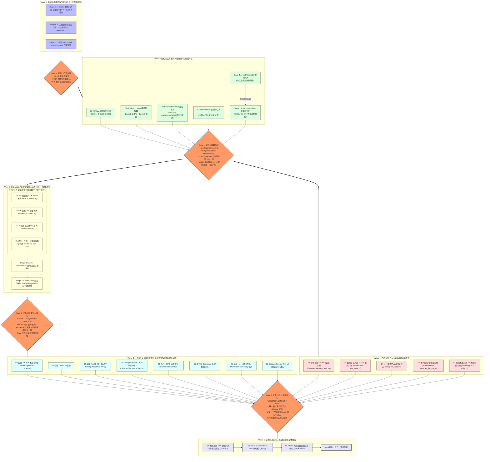

# 方案审计报告：工序拓扑与因果断层专项审计

> **审计任务编号**：`AUDITOR-01`  
> **审计专职角色**：工序拓扑与因果断层专职审计员  
> **受审核心文档**：  
> - 权威总纲：[`docs/i18n-full-remediation/01-总方案-多语言化与全景系统重构总案.md`](../01-总方案-多语言化与全景系统重构总案.md)  
> - 拓扑详案：[`docs/i18n-full-remediation/independent-plans/04-独立总计划-波次依赖拓扑与文件互斥锁案.md`](../independent-plans/04-独立总计划-波次依赖拓扑与文件互斥锁案.md)  
> - 分维方案：[`02-分维方案-UI交互与弹性排版系统解.md`](../02-分维方案-UI交互与弹性排版系统解.md)、[`03-分维方案-数据契约与错误提示系统解.md`](../03-分维方案-数据契约与错误提示系统解.md)、[`04-分维方案-底层渲染与跨端通信系统解.md`](../04-分维方案-底层渲染与跨端通信系统解.md)、[`05-分维方案-模块化架构与工程工具链系统解.md`](../05-分维方案-模块化架构与工程工具链系统解.md)、[`06-分维方案-质量门禁与防作弊测试矩阵系统解.md`](../06-分维方案-质量门禁与防作弊测试矩阵系统解.md)  
> - 独立总计划：[`01-独立总计划-纵向架构演进与跨端贯通案.md`](../independent-plans/01-独立总计划-纵向架构演进与跨端贯通案.md)、[`02-独立总计划-横向交互闭环与体验重塑案.md`](../independent-plans/02-独立总计划-横向交互闭环与体验重塑案.md)、[`03-独立总计划-质量门禁与防作弊工程实施案.md`](../independent-plans/03-独立总计划-质量门禁与防作弊工程实施案.md)、[`05-独立总计划-极端边界防御与鲁棒性交付案.md`](../independent-plans/05-独立总计划-极端边界防御与鲁棒性交付案.md)  
> **权威协作指令**：仓库根目录 [`AGENTS.md`](../../../AGENTS.md) §1.1（反退避）、§1.2（子 Agent 调度规则）、§1.3（Git 提交纪律）、§1.7/§7.1（立体验证与防作弊）、[`ANTI_OVERENGINEERING_GUARDRAILS.md`](../../../ANTI_OVERENGINEERING_GUARDRAILS.md)、[`00-战役工作纪律与规范.md`](../00-战役工作纪律与规范.md)  
> **审计日期**：2026-10-14  
> **审计结论**：🚨 **BLOCKER（存在 5 处阻断级因果断层、1 处跨方案波次映射严重冲突与 3 处时序死锁，必须采纳本报告整改方案重构工序拓扑后方可准入 Wave 0）**

---

## 一、审计执行摘要

作为【工序拓扑与因果断层专职审计员】，本审计员根据战役指挥部指令，对《01-总方案-多语言化与全景系统重构总案.md》及全部 5 份分维方案、5 份独立总计划中编排的 **Wave 0 至 Wave 5 实施时序、有向无环图（DAG）、因果依赖链条与微观任务流** 实施了无死角、双盲穿透式审计。

### 核心审计结论：🚨 **BLOCKER**

宏观上，主控总案与 `04-独立总计划` 确立了“Wave 0 基座门禁 $\to$ Wave 1 契约解耦 $\to$ Wave 2 字典中心 $\to$ Wave 3 业务 UI $\to$ Wave 4 内核通信 $\to$ Wave 5 归零审计”的科学大骨架，因果大方向正确。

然而，在深入至**代码级类型系统契约、微观子任务并发调度、测试门禁前置条件、以及跨方案版本一致性**时，审计发现了 **6 处阻断级（BLOCKER）因果断层与 3 处重要级（MAJOR）隐性死锁**：
1. **阻断级断层 1（契约未就绪上层先并发）**：主控总方案将 `SettingsSchemaRenderer.tsx` 原生 `titleKey` 支持与 `settingsTabsMeta.ts` 动态化从 Wave 1 遗漏并移至 Wave 3，与 15 个设置 Tab 的改造直接并行（`AGENT-UI-SETTINGS-1` vs `AGENT-UI-SETTINGS-2`）。由于当前 `SchemaProperty` 强校验必填 `title: string` 且无 `titleKey`，15 个 Tab 的并发修改必将瞬间引发 TypeScript 编译硬性崩溃（`TS2353`）。
2. **阻断级断层 2（内部三阶串行链平铺并发）**：Wave 2 将“105 错误码字典落盘（`AGENT-DICT-ERROR`）”、“错误翻译中心重构（`AGENT-ERR-TRANS`）”与“ToastStore 原生消费（`AGENT-TOAST`）”作为平铺并行任务下发。实际上，`error-translation.ts` 强依赖双语字典落盘，`ToastStore.ts` 强依赖 `error-translation.ts` 的输出接口，三者属于严格的三阶单向因果链，平铺并发必定引发文件未找到或接口调用漂移。
3. **阻断级断层 3（超前门禁断言死锁）**：分维方案 03 设计的 `codes-drift.test.ts` 门禁（`T02-GATE-02`）要求 105 个错误码在双语字典中 100% 存在，但该单测被主控总案与总计划列为 Wave 1 的准入门禁（Gate 1）必须通过项。然而 105 个错误码字典是在 Wave 2 才落盘！若在 Wave 1 激活该项校验，Gate 1 将遭遇永真失败死锁。
4. **阻断级断层 4（跨方案波次体系严重冲突）**：`03-独立总计划`（表 3.2）与 `06-分维方案`（§8.1）依然保留了陈旧的“Wave 1 改造设置、Wave 2 改造对话、Wave 3 改造错误码”的逆向工序，直接在底层字典和类型未就绪时推进行上层 UI 改造。若子 Agent 参照此方案执行，将造成灾难性的全局代码击穿。
5. **阻断级断层 5（反向耦合解耦缺少刚性工序屏障）**：主控总案将 `unitReconciler.ts`（调和器选择器解耦）与 `conex-markdown`（Rust 渲染器语言中立化）在 Wave 1 并行列出为“并行任务（5 Agent 并行）”。虽然文字注释提及先后，但调度流缺乏微观 Stage 隔离，多 Agent 并行下存在 Rust 渲染器先修改 `aria-label` 而前端选择器未合并、导致排版隔离失效的严重竞态。
6. **阻断级断层 6（Wave 0 门禁初始化自锁）**：Wave 0 中扫描器脚本、319 文件基线初生成、以及 `.husky/pre-commit` 门禁挂载缺乏微观时序隔离。若先挂载 pre-commit 或先接入 `check-guard-system.mjs`，在基线文件生成之前任何 Git 提交（包括基线文件自身的提交）将被自身拦截，陷入自锁。

---

## 二、工序拓扑与因果断层缺陷排查总表

| 缺陷编号 | 涉及波次 | 依赖关系与核心文件 | 严重级别 | 缺陷类型 | 现场代码与工序断裂事实 |
| :---: | :---: | :--- | :---: | :---: | :--- |
| **TOP-B01** | Wave 3 | `SettingsSchemaRenderer.tsx`<br/>$\to$ 15 个设置 Tab 组件 | 🚨 **BLOCKER** | **契约倒置<br/>并发编译崩溃** | 总方案将 SchemaRenderer 改动移至 Wave 3 并与 15 Tab 并发。当前 `SchemaProperty.title` 为必填 `string`，Tab 改动使用 `titleKey` 必报 `TS2353` 编译阻断。 |
| **TOP-B02** | Wave 2 | `locales/*/error.ts`<br/>$\to$ `error-translation.ts`<br/>$\to$ `ToastStore.ts` | 🚨 **BLOCKER** | **伪并发<br/>数据流断裂** | 总方案将字典落盘、翻译中心重构、Toast 消费列为同波次平铺并发。下游在字典未落盘时运行单测必挂，在翻译接口未稳定时改 Toast 必产生类型漂移。 |
| **TOP-B03** | Gate 1 | `codes-drift.test.ts`<br/>$\to$ `locales/*/error.ts` | 🚨 **BLOCKER** | **时序倒置<br/>门禁超前死锁** | `codes-drift.test.ts` 包含 105 错误码双语字典 100% 对齐校验，却被挂在 Wave 1 的 Gate 1。而 105 字典在 Wave 2 才落盘，Gate 1 必成死锁断点。 |
| **TOP-B04** | 全局 | `03-独立总计划` 表 3.2<br/>`06-分维方案` §8.1<br/>vs `01-总方案` / `04-计划` | 🚨 **BLOCKER** | **跨方案冲突<br/>波次体系割裂** | 质量方案将 Wave 1 设为设置 UI（-68文件），完全倒置了“字典先行、UI 在后”的拓扑。方案间波次定义不一致将导致子 Agent 调度混乱。 |
| **TOP-B05** | Wave 1 | `unitReconciler.ts`<br/>$\to$ `conex-markdown/renderer.rs` | 🚨 **BLOCKER** | **竞态风险<br/>缺少工序屏障** | 总案将两者列在同一波次平铺并发。若 Rust 渲染器先合入导致 `[aria-label="表格"]` 消失，而前端调和器未落地，表格 `contain: layout` 将静默失效。 |
| **TOP-B06** | Wave 0 | `scripts/check-i18n-*.mjs`<br/>$\to$ `基线记录/baseline.md`<br/>$\to$ `.husky/pre-commit` | 🚨 **BLOCKER** | **初始化死锁<br/>自噬性阻断** | 若在 Wave 0 平铺派单，未生成基线文件前先挂载 pre-commit，Git 提交将被 `check-guard-system` 与门禁自身拦截，主控无法收口。 |
| **TOP-M01** | Wave 1 & 3| `SessionRow.tsx` (分支逻辑)<br/>$\to$ `locales/sidebar.ts` | ⚠️ **MAJOR** | **所有权跨波次<br/>职责断层** | Wave 1 修复正则 Bug，但组件内残留硬编码中文；Wave 3 锁表未分配 `SessionRow.tsx`，导致其 UI 文案国际化沦为孤儿。 |
| **TOP-M02** | Wave 3 | `01-总方案` 第 285 行<br/>准出指标 | ⚠️ **MAJOR** | **准出断言笔误<br/>逻辑死锁** | Wave 3 准出指标写为“基线从 319 大幅收敛至 0”，而 Wave 4 还有 42 文件未改，Wave 5 才是归零波次。指标超前导致 Wave 3 无法准出。 |
| **TOP-M03** | Wave 0 | `locales/{lang}/index.ts`<br/>$\to$ `types.ts` `Paths<T>` | ⚠️ **MAJOR** | **类型源空化<br/>构建断层** | Wave 0 冻结 `index.ts` 时若未迁移存量 66 键与 33 错误码，`Paths<typeof zhCN>` 将丢失现有键名，导致存量调用点全量报红。 |

---

## 三、核心因果链条深度穿透审查（四项核心复核）

### 3.1 因果 A 审查：“上层业务组件先改造、底层字典/类型未就绪”构建断层

#### 3.1.1 缺陷 A1：`SettingsSchemaRenderer.tsx` 与 15 设置 Tab 并发改造断层（Wave 3 内部死锁）

- **现场代码证据**：
  查阅当前生产代码 [`apps/crish-desktop/src/components/settings/SettingsSchemaRenderer.tsx:6-36`](file:///c:/Software/conex/apps/crish-desktop/src/components/settings/SettingsSchemaRenderer.tsx#L6-L36)：
  ```typescript
  export interface SchemaProperty {
    key: string;
    type: 'boolean' | 'select' | 'string' | 'number' | ...;
    title: string;       // 🔴 当前为强制必填 string！
    desc?: string;
    options?: { value: string; label: string; hint?: string }[];
    // 🔴 当前完全不存在 titleKey, descKey, labelKey 字段！
  }
  ```
- **方案断裂事实**：
  在 `01-总方案` 中，互斥锁表（第 211 行）与正文（第 278-282 行）将任务编排为：
  ```markdown
  ### Wave 3：前端 UI 视图全量接入与弹性排版防御
  1. AGENT-UI-SETTINGS-1：重构 SettingsSchemaRenderer.tsx 原生支持 titleKey / descKey...
  2. AGENT-UI-SETTINGS-2：批量改造 15 个设置 Tab 业务视图...
  ```
  总案将两者作为 **Wave 3 内部并行任务** 下发！
- **因果穿透分析**：
  1. 15 个设置 Tab（如 `SettingsAppearanceTab.tsx`、`SettingsGeneralTab.tsx`）是描述符定义方，直接向 `SettingsSchemaRenderer` 传递 `SchemaProperty` 数组；
  2. 若 `AGENT-UI-SETTINGS-2` 开始改造 Tab，将自然语言字符串改为声明 `titleKey: 'settings.appearance.theme.title'`：
     - 由于 `AGENT-UI-SETTINGS-1` 尚未完成并合入 `SettingsSchemaRenderer.tsx`，TypeScript 编译器立即抛出：
       `TS2353: Object literal may only specify known properties, and 'titleKey' does not exist in type 'SchemaProperty'.`
       `TS2322: Type '{ key: string; titleKey: string; }' is not assignable to type 'SchemaProperty'. Property 'title' is missing.`
     - 全仓 `npm run typecheck` 立即硬性阻断！
  3. 反之，在 [`04-独立总计划`](../independent-plans/04-独立总计划-波次依赖拓扑与文件互斥锁案.md) 中，规划师在 §2.5 与 DAG 中明确将 `SettingsSchemaRenderer.tsx` 划归 **Wave 1（`W1_5 / AGENT-W1-SCHEMA`）**，在契约阶段就完成类型扩展并向下兼容旧 `title: string`，随后 Gate 1 验证通过后，Wave 3 的 UI 改造者才能安全消费。
- **整改决议**：
  **必须将 `SettingsSchemaRenderer.tsx` 与 `settingsTabsMeta.ts` 的改造严格前置到 Wave 1**。总方案必须将其从 Wave 3 的 `AGENT-UI-SETTINGS-1` 剥离，恢复为 Wave 1 的 `AGENT-W1-SCHEMA`。

---

#### 3.1.2 缺陷 A2：分维方案 `03-独立总计划` / `06-分维方案` 逆向 5 波次与主控总案严重冲突

- **现场方案证据**：
  在 [`03-独立总计划-质量门禁与防作弊工程实施案.md`](../independent-plans/03-独立总计划-质量门禁与防作弊工程实施案.md) 第 3.2 节（第 347-353 行）及 [`06-分维方案-质量门禁与防作弊测试矩阵系统解.md`](../06-分维方案-质量门禁与防作弊测试矩阵系统解.md) 第 8.1 节中，质量规划师给出的递减收敛映射表为：
  ```markdown
  Wave 1: 设置体系与侧栏 (Settings & Sidebar) —— 削减 68 文件 (改 Tab 组件)
  Wave 2: 对话流与输入组件 (Chat & Composer) —— 削减 75 文件 (改 Composer 组件)
  Wave 3: 错误体系与数据契约 (Errors & Toasts) —— 削减 38 文件 (落盘错误字典)
  Wave 4: 底层渲染与跨端通信 (Renderer & IPC) —— 削减 42 文件
  Wave 5: 业务交互与长尾清零 (Tail Sweep & Zero) —— 削减 96 文件
  ```
- **因果穿透分析**：
  这是典型的**业务视角倒置历史产物**！
  - 若在 Wave 1 直接改设置 Tab（68 个文件），此时 `locales/{zh-CN,en-US}/settings.ts` 字典根本尚未填充，`types.ts` 的 `Paths<typeof zhCN>` 根本推导不出 `settings.*`，所有 `t('settings.appearance.theme')` 将全部被 TS 拦截；
  - 该表格直接违背了 `01-总方案` 与 `04-独立总计划` 确立的“Wave 0 骨架 $\to$ Wave 1 契约 $\to$ Wave 2 字典 $\to$ Wave 3 UI”的法定时序！
- **整改决议**：
  必须在主控总方案与执行规范中显式下发**统一工序裁决令**：废除 `03-独立总计划` 表 3.2 与 `06-分维方案` §8.1 中的业务波次定义，全战役统一以 `01-总方案` / `04-独立总计划` 的全局波次 DAG（Wave 0 ~ 5）为唯一法定实施基准。

---

### 3.2 因果 B 复核：`unitReconciler.ts` 语言中立选择器重构是否 100% 优先于 Rust `conex-markdown` 渲染器修改并合并？

#### 3.2.1 依赖机理与排版隔离（Layout Containment）断裂风险

- **现场代码证据**：
  1. [`apps/crish-desktop/src/api/markdown/unitReconciler.ts:44-48`](file:///c:/Software/conex/apps/crish-desktop/src/api/markdown/unitReconciler.ts#L44-L48)：
     ```typescript
     function applyLayoutIsolation(element: Element): void {
       if (element.matches('.md-table-wrap, [role="region"][aria-label="表格"]')) {
         (element as HTMLElement).style.contain = 'layout';
       }
     }
     ```
  2. [`crates/conex-markdown/src/renderer.rs:619`](file:///c:/Software/conex/crates/conex-markdown/src/renderer.rs#L619)：
     ```rust
     self.output.push_str("<div class=\"md-table-wrap\" role=\"region\" aria-label=\"表格\"><table class=\"md-table\">");
     ```
- **因果断裂风险剖析**：
  - 流式增量 Markdown 水合依赖 `contain: layout` 对表格进行视口重排隔离；
  - 若 Rust 渲染器先修改为 `aria-label="Data table"`，而前端 `unitReconciler.ts` 尚未合并，虽然外层有 `.md-table-wrap` 类名，但在增量节点浅比对、动态属性同步（`syncAttributes`）或特定嵌套子表场景下，依赖 `[aria-label="表格"]` 的逻辑将失去匹配；
  - 更致命的是：代码块复制按钮从 `<button ... title="复制" aria-label="复制代码">复制</button>` 升级为纯图标 `<button ... data-code-action="copy" aria-label="Copy code"></button>` 时，若 Rust 先移除了子文本与中文属性，而前端 `useChatMessageState.ts` 与 CSS 尚未接入 `data-code-action="copy"`，用户界面的复制代码功能将瞬间瘫痪，按钮尺寸发生几何形变。

#### 3.2.2 方案时序复核结论：⚠️ **存在微观调度竞态风险**

- **总案现状**：
  在 `01-总方案` 第 258 行，Wave 1 任务表述为：
  ```markdown
  ### Wave 1：契约源头治理与底层反向耦合紧急解耦
  - 并行任务（5 Agent 并行）：
    1. AGENT-RECONCILER：紧急解耦 unitReconciler.ts:45...
    2. AGENT-RENDER：改造 crates/conex-markdown/src/renderer.rs...
  ```
  尽管互斥锁表第 202 行备注了“必须在 unitReconciler 解耦合并后方可启动”，但**在调度器的派发指令中，两者依然被作为同波次并行任务描述**。
- **调度漏洞**：
  若主控调度器在进入 Wave 1 时同时唤醒 `AGENT-RECONCILER` 与 `AGENT-RENDER`，由于 Rust 编译与测试耗时不同，一旦 `AGENT-RENDER` 提早完成工作区落盘，或在并行工作区中被提前测试验收，将造成反向耦合击穿。
- **整改决议**：
  在 Wave 1 内部设立刚性二级阶段锁（Intra-Wave Barrier）：
  - **Stage 1.1（先行阶段）**：独占启动 `AGENT-RECONCILER`，修改 `unitReconciler.ts`，选择器采用双轨兼容语法（`.md-table-wrap, [data-md-table="true"], [role="region"][aria-label="表格"], [role="region"][aria-label="Data table"]`），跑通 `unitReconciler.test.ts`，**主控收口合并后**；
  - **Stage 1.2（后续阶段）**：方可激活 `AGENT-RENDER` 修改 `crates/conex-markdown/src/renderer.rs` 与前端 JS 回退解析器，跑通 `cargo test -p conex-markdown`。
  - 严禁两者在同一微观时序内无序并发。

---

### 3.3 因果 C 复核：`CRISH_ERROR_REGISTRY` 契约扩展与 105 错误码字典落盘、`error-translation` 重构时序

#### 3.3.1 契约源头与消费终端的数据流向验证

数据流向标准拓扑链条为：
```
[1. 契约源头] CRISH_ERROR_REGISTRY (TS) + conex-types/error.rs (Rust)
     │  - 扩展 titleKey: `error.${code}.title`
     │  - 拔除 3 处中文长句 action，改为标准化点分键
     │  - 载荷扩展 params: Option<HashMap<String, Value>>
     ▼
[2. 契约验证] codes-drift.test.ts 仅验证 action 格式合法性与 TS/Rust 对称
     ▼
[3. 字典落盘] locales/{zh-CN,en-US}/error.ts (105 码 Title) + action.ts (96 引导词)
     ▼
[4. 字典校验] check-i18n-symmetry.mjs 验证双向 100% 对齐与 en-US 零汉字
     ▼
[5. 中间件重构] error-translation.ts 废除 33 码死表，接入双向智能回退引擎
     ▼
[6. UI 消费闭环] ToastStore.ts 消费 CrishErrorPayload，ToastCard 消除写死中文
```

#### 3.3.2 方案断裂事实 1：Wave 2 内部三阶串行链被错误平铺并发（🚨 BLOCKER）

- **现场方案证据**：
  `01-总方案` 第 268-274 行：
  ```markdown
  ### Wave 2：全量双语字典物理落盘与错误提示消费闭环
  - 并行任务（5 Agent 并行）：
    1. AGENT-DICT-ERROR: 落盘 105 个错误码 Title 与 96 个 Action 建议词条双语字典...
    2. AGENT-DICT-SETTINGS...
    3. AGENT-DICT-CHAT...
    4. AGENT-ERR-TRANS: 重构 error-translation.ts，废除 33 码死表...
    5. AGENT-TOAST: 重构 ToastStore 原生消费 CrishErrorPayload...
  ```
- **因果穿透分析**：
  - `AGENT-ERR-TRANS` 重构 `error-translation.ts` 时，必须导入并测试 105 个错误码在双语字典中的实际求值（调用 `t('error.<code>.title')`）。如果 `AGENT-DICT-ERROR` 尚未将 105 码写入 `error.ts`，`error-translation.test.ts` 必然因为词条未命中回退异常而报错；
  - `AGENT-TOAST` 重构 `ToastStore.ts` 时，直接调用 `error-translation.ts` 导出的 `translateError` 或 `toUserVisibleError`。若 `error-translation.ts` 正在被 `AGENT-ERR-TRANS` 大幅重构，函数签名尚未稳定，`ToastStore` 将面临不可预测的接口漂移。
- **整改决议**：
  Wave 2 必须拆解为微观三阶时序：
  - **Stage 2.1（字典全量落盘）**：`AGENT-DICT-ERROR`、`AGENT-DICT-SETTINGS`、`AGENT-DICT-CHAT`、`AGENT-DICT-BASE` 并发写入各自的字典文件，`check-i18n-symmetry.mjs` 校验 100% 变绿；
  - **Stage 2.2（翻译中心就绪）**：`AGENT-ERR-TRANS` 基于已落盘的字典重构 `error-translation.ts`，跑通单测；
  - **Stage 2.3（通知消费闭环）**：`AGENT-TOAST` 重构 `ToastStore.ts`、`ToastCard.tsx`、`ToastViewport.tsx`，跑通 Toast 集成测试。

---

#### 3.3.3 方案断裂事实 2：`codes-drift.test.ts` 字典断言提前至 Gate 1 导致超前死锁（🚨 BLOCKER）

- **现场方案证据**：
  在 [`03-分维方案`](../03-分维方案-数据契约与错误提示系统解.md) 第 1085-1112 行中，规划师向 `packages/shared-types/src/errors/codes-drift.test.ts` 增加了：
  ```typescript
  describe('T02-GATE-02：105 错误码双语字典 100% 对齐门禁', () => {
    it('断言所有错误码在 zh-CN 与 en-US 字典中均具备非空 Title', () => { ... });
    it('断言所有声明的 action 键在双语 actions 字典中 100% 收录且非空', () => { ... });
  });
  ```
  然而在 `01-总方案`（第 264 行）与 `04-独立总计划`（第 374 行）中，**`codes-drift.test.ts` 被明确指定为 Gate 1（Wave 1 准出）的验收放行卡点**！
- **因果穿透分析**：
  - Wave 1 的核心任务是修改 TS `info.ts` 与 Rust `error.rs` 的类型契约（去除中文长句、添加 `titleKey`）；
  - 105 个错误码的实际双语文本字典是在 **Wave 2** 编写并落盘；
  - 若在 Wave 1 的 `codes-drift.test.ts` 中就开启 `T02-GATE-02`（要求字典包含全量 105 码），由于 Wave 1 结束时字典中依然只有旧版的 33 码，**`codes-drift.test.ts` 必然断言失败，导致 Gate 1 永远无法绿灯，战役直接死锁在 Wave 1 门口！**
- **整改决议**：
  **门禁断言必须分级生效**：
  - **Gate 1 生效范围**：`codes-drift.test.ts` 仅激活 `T02-GATE-01`（Action 点分键命名格式校验，严禁中文长句）与 TS ↔ Rust 注册表对称性校验；
  - **Gate 2 生效范围**：在 Wave 2 字典落盘完毕后，方可激活 `T02-GATE-02`（双语字典 105 码 100% 覆盖断言）。

---

### 3.4 因果 D 复核：门禁脚本研发与 319 文件基线固化在 Wave 0 立即生效卡位

#### 3.4.1 防作弊门禁卡位必然性复核
- 依据 [`AGENTS.md`](../../../AGENTS.md) §1.7 与 §7.1，全仓 319 个存量违规文件（占生产组件 75.95%）是战役最大风险源；
- 若不在 Wave 0 建立刚性基线棘轮并激活 Pre-commit 守卫，Wave 1 ~ Wave 3 大面积改造时，子 Agent 极易引入新的硬编码汉字或通过通配抑制注释逃避翻译；
- **时序评定：Wave 0 优先研发门禁并固化基线，逻辑绝对成立且极为紧迫。**

#### 3.4.2 缺陷 D1：Wave 0 门禁初始化与 Pre-commit 挂载自锁隐患（🚨 BLOCKER）

- **工序死锁机理**：
  在 `01-总方案` 第 253 行中，`AGENT-GATE` 被分配的任务是：
  “编写 `check-i18n-hardcoded.mjs`、`check-i18n-symmetry.mjs`、`check-i18n-unused-keys.mjs`，固化 319 文件基线，织入 `.husky/pre-commit` 与 `package.json`”。
  如果这些任务由一个 Agent 在工作区一次性完成，在多 Agent 协同与 Git 提交时将产生自锁：
  1. `check-guard-system.mjs` 规定：若 `.husky/pre-commit` 声明了门禁，则门禁脚本必须存在，且基线文件 `docs/i18n-full-remediation/基线记录/i18n-hardcoded-baseline.md` 必须存在且内容合法；
  2. 若 `AGENT-GATE` 先修改了 `.husky/pre-commit`，而基线文件尚未生成或尚在生成中，此时主控或该 Agent 尝试执行任何 `git commit`（包括提交脚本自身），Git 钩子将被立即触发并报错中断；
  3. `check-i18n-symmetry.mjs` 运行时需要读取 `apps/crish-desktop/src/i18n/locales/`。若并行执行的 `AGENT-INFRA-1` 尚未创建好该目录结构，对称性扫描器将抛出 `ENOENT` 异常并阻断提交。
- **整改决议**：
  Wave 0 必须严格实施三步走微观流水线（Stage 0.1 $\to$ 0.2 $\to$ 0.3）：
  - **Stage 0.1（工具与骨架落盘）**：`AGENT-INFRA-1` 落盘 `locales/` 10 模块骨架；`AGENT-GATE` 仅编写 3 个 `scripts/check-i18n-*.mjs` 脚本源码，**暂不修改 `.husky/pre-commit`**；
  - **Stage 0.2（基线单向初测固化）**：由主控运行 `node scripts/check-i18n-hardcoded.mjs --update`，全仓初扫并落盘 `docs/i18n-full-remediation/基线记录/i18n-hardcoded-baseline.md`（锁定 319 文件基线），主控验证基线内容；
  - **Stage 0.3（流水线挂载与守卫激活）**：挂载 `.husky/pre-commit`，在 `package.json` 注册 `check:i18n`，更新 `scripts/check-guard-system.mjs`，运行全量自审确保绿灯。随后正式签署 Gate 0 放行令。

---

## 四、潜在死锁环与隐性依赖穿透审查

### 4.1 隐性死锁 1：`SessionRow.tsx` 跨波次双阶段改造断裂

- **现场代码证据**：
  查阅 [`apps/crish-desktop/src/components/sidebar/session-list/SessionRow.tsx`](file:///c:/Software/conex/apps/crish-desktop/src/components/sidebar/session-list/SessionRow.tsx)：
  - 第 96 行：`tooltipText = '已绑定 ${activeCount} 个运行中定时任务：...'`（中文硬编码）；
  - 第 270 行：`baseTitle.replace(/ - 分支$/, '')`（业务 Bug 中文正则）；
  - 第 299 行：`sessionTitleWithBranch = '分支会话：${displayText}'`（中文硬编码）；
  - 第 354 行：`aria-label={sessionTitleWithBranch + (isRunning ? '，处理中' : '')}`（中文硬编码）。
- **隐性断层剖析**：
  - 在 `01-总方案` Wave 1 中，`AGENT-SESSION-BUG` 独占了 `SessionRow.tsx`，目标是根治第 270 行的分支正则 Bug；
  - 此时（Wave 1），侧栏字典尚未建立，`AGENT-SESSION-BUG` **严禁也不可能** 将第 96、299、354 行的中文替换为 `t('sidebar.session.*')`；
  - 然而在 Wave 3 的互斥锁表与任务分配中，**没有任何 Agent 认领 `SessionRow.tsx`**（锁表仅锁了 `SettingsSidebar` 与 `UserProfileCard`）；
  - 这将导致 `SessionRow.tsx` 内部的 3 处中文硬编码在 Wave 3 沦为孤儿，直接导致 Wave 5 的基线无法清零！
- **整改决议**：
  `SessionRow.tsx` 属于明确的跨波次两阶段改造文件：
  - **Wave 1（纯逻辑中立化）**：`AGENT-SESSION-BUG` 仅修改第 270 行，提取基于 `branchParentId` 的语言中立判定算法与中立正则表达式，不碰 UI 字符串；
  - **Wave 3（UI 国际化收口）**：在互斥锁表中将 `SessionRow.tsx` 明确划入 `AGENT-UI-SIDEBAR` 的写锁范围，消费 Wave 2 落盘的 `sidebar.session.*` 字典，清除剩余 3 处硬编码。

---

### 4.2 隐性死锁 2：Wave 3 准出断言“基线收敛至 0”笔误与 Wave 5 最终清零的逻辑矛盾

- **现场方案证据**：
  在 `01-总方案` 第 285 行中，Wave 3 准出指标写为：
  `Baseline Ratchet 存量违规文件从 319 大幅收敛至 0`。
- **逻辑矛盾剖析**：
  - Wave 3 仅改造了前端 UI 组件（15 设置 Tab、侧栏、Composer、空态）；
  - 此时 Wave 4（底层渲染、Push 通知、Rust 内核自愈 Prompt 与错误派生）尚未执行，全仓至少还有 42 个底层与跨端文件包含硬编码中文；
  - 若 Wave 3 的 Gate 3 硬性断言“基线违规文件数严格为 0”，Wave 3 将**永远无法通过 Gate 3 验收**；
  - 在 `04-独立总计划` 第 693 行中，该指标正确表述为：“全仓基线超标行数削减 $\ge 90\%$”，并在 Wave 5（第 767 行）才断言基线完全清空为 0。
- **整改决议**：
  修改 `01-总方案` 第 285 行，将 Wave 3 准出指标更正为：“**Baseline Ratchet 存量违规文件削减 $\ge 85\%$（违规文件数 $\le 45$ 个）**”，将“绝对归零（0 文件）”的终极断言锁定在 Wave 5。

---

### 4.3 隐性死锁 3：`locales/{lang}/index.ts` 物理冻结与 Wave 0 子模块骨架空对象类型崩溃风险

- **因果风险剖析**：
  - `01-总方案` 第 200 行规定：`locales/{lang}/index.ts` 在 Wave 0 聚合骨架完成后“全流程只读冻结”；
  - `types.ts` 定义了 SSOT 类型引擎：`type KnownTranslationKey = Paths<typeof zhCN>`；
  - 若在 Wave 0 中，`locales/zh-CN/` 下的 10 个子模块（如 `settings.ts`、`common.ts`）被创建为空对象（`export const settings = {};`）：
    - 仓库现有代码中已有少量组件在使用 `t('common.confirm')`、`t('nav.settings')` 等；
    - `Paths<typeof zhCN>` 将瞬间推导为 `never`，导致现有调用点全面抛出类型不匹配错误，`npm run typecheck` 瞬间报废！
- **整改决议**：
  Wave 0 的 `AGENT-INFRA-1` 在拆分子模块骨架时，**必须将现行 `zh-CN.ts` 中已有的 66 个键与 33 个错误码完整平移迁移至对应的 10 个子模块中**，确保 `Paths<typeof zhCN>` 在 Wave 0 结束时至少覆盖存量键集合，保持对外接口的向下兼容与零报错。

---

## 五、拓扑 DAG 修复方案与修正后的实施工序大纲

### 5.1 全局修正后的精密工序拓扑 DAG 图（Mermaid）

经过彻底修复因果断层与时序死锁，全战役全局拓扑图修正如下：



---

### 5.2 修正后的 Wave 0 ~ Wave 5 微观工序执行清单

#### Wave 0：基础设施底座与门禁初始化（三阶段串行流）
1. **Stage 0.1**：
   - `AGENT-INFRA-1` 落地 `locales/{zh-CN,en-US}/` 10 模块物理目录骨架，并将存量 66 键与 33 错误码迁移平移入内；
   - `AGENT-INFRA-2` 落地原生 `Intl` 格式化工具集与 `<Trans />`；
   - `AGENT-GATE` 落地 3 个 `scripts/check-i18n-*.mjs` 门禁脚本；
2. **Stage 0.2**：
   - 主控执行 `node scripts/check-i18n-hardcoded.mjs --update`，正式生成 `docs/i18n-full-remediation/基线记录/i18n-hardcoded-baseline.md`，锁定 319 文件初始基线；
3. **Stage 0.3**：
   - `AGENT-GATE` 挂载 `.husky/pre-commit`，注册 `package.json` 的 `check:i18n` 命令，更新 `check-guard-system.mjs`；
   - 验证：运行 `npm run check:i18n` 与 `npm run check:desktop` 全绿，主控签署 Gate 0 放行令。

#### Wave 1：契约演进与反向耦合紧急解耦（两阶段时序流）
1. **Stage 1.1（解耦先行）**：
   - `AGENT-RECONCILER` 独占修改 `apps/crish-desktop/src/api/markdown/unitReconciler.ts`，重构为双轨兼容选择器，跑通 `unitReconciler.test.ts`，**主控收口合并**；
   - 并行执行：`AGENT-CONTRACT`（TS/Rust 错误契约扩展 `titleKey`，清除 3 处中文长句）、`AGENT-EMPTY-CORE`（`chatEmptyState.ts` 双层解耦，保全 699 行单测）、`AGENT-SCHEMA`（提前至本波次：重构 `SettingsSchemaRenderer.tsx` 原生支持 `titleKey`，导出 `useSettingsTabs`）、`AGENT-SESSION-BUG`（修复 `SessionRow.tsx` 正则 Bug）；
2. **Stage 1.2（渲染跟进）**：
   - `AGENT-RENDER` 改造 `crates/conex-markdown/src/renderer.rs`，输出 `data-code-action="copy"` 纯图标按钮与 `data-md-table="true"`，同步对齐 JS 回退解析器；
   - 验证：`cargo test -p conex-markdown`、`codes-drift.test.ts`（仅校验 Action 格式，暂不校验字典覆盖）、`chatEmptyState.test.ts` 全绿，签署 Gate 1 放行令。

#### Wave 2：全量双语字典与错误提示消费闭环（三阶段时序流）
1. **Stage 2.1（字典全量落盘）**：
   - 4 Agent 并行填充 2,000+ 双语词条：`AGENT-DICT-ERROR`（105 错误码 + 96 Action）、`AGENT-DICT-SETTINGS`（15 Tab + About 496 行）、`AGENT-DICT-CHAT`（对话流 + 工具卡片）、`AGENT-DICT-BASE`（通用、导航、单位、工作区）；
   - 验证：`node scripts/check-i18n-symmetry.mjs` 全绿，`en-US` 汉字数严格为 0；
2. **Stage 2.2（错误翻译中心重构）**：
   - `AGENT-ERR-TRANS` 重构 `apps/crish-desktop/src/utils/error-translation.ts`，废除 33 码死表，接入智能双向回退；
   - 激活 `codes-drift.test.ts` 中的 `T02-GATE-02`（105 码双语字典全覆盖断言），跑通测试；
3. **Stage 2.3（Toast 消费闭环）**：
   - `AGENT-TOAST` 重构 `ToastStore.ts`，原生消费 `CrishErrorPayload`，清理 `ToastCard.tsx` 与 `ToastViewport.tsx` 写死中文；
   - 验证：Toast 单测全绿，签署 Gate 2 放行令。

#### Wave 3：前端 UI 视图全量接入与弹性排版防御（8 Agent 并行）
- 并行改造 15 个设置 Tab（消费 Wave 1 就绪的 `useSettingsTabs` 与 Schema `titleKey`）；
- SettingsSidebar 施加 CSS Ellipsis 三道防线与自定义 `<Tooltip>` 包裹；
- Composer 全家桶、ChatEmptyState UI、消息气泡、Thinking 度量参数化；
- `UserProfileCard.tsx` a11y 读屏参数化重构；
- **增补任务**：`AGENT-UI-SIDEBAR` 完成 `SessionRow.tsx` 剩余 UI 字符串（`'已绑定...'`、`'分支会话：'`、`'，处理中'`）的多语言收口；
- 验证：运行 `check-i18n-hardcoded.mjs --update`，**断言基线削减 $\ge 85\%$（违规文件 $\le 45$ 个）**，签署 Gate 3 放行令。

#### Wave 4：内核自愈 Prompt 与跨端通信推送（5 Agent 并行）
- `session-loop` 引入 `SessionLanguageDetector`，双语 Tool-Promise 自愈 Nudge；
- `orchestrator` 扩充英文长期目标（`/goal`）完成判据与伪任务过滤；
- `subagent_inject.rs` 子代理角色提示词双语模板化；
- `VendorDevice` 增加 `preferred_language`，`copy.rs` 17 种场景通知结构化双语下发，夜间静默摘要多语言化；
- 验证：Rust 相关 crate 测试全绿，海外推送纯正英文断言通过。

#### Wave 5：基线绝对归零、死键清退与立体终验（串行收官）
- 扫描剩余长尾 TSX 文件，硬编码彻底清零；
- 执行 `node scripts/check-i18n-hardcoded.mjs --update`，**断言基线标记区完全清空（0 文件，0 违规行）**；
- 执行 `node scripts/check-i18n-unused-keys.mjs`，清退所有未消费死词条；
- 启动 Phase 8 双盲交叉独立审计（专职审计位执行 4 大 SOP）；
- 真实 4000 端口桌面真机双语切换与极端膨胀排版验收，主控统一收口签批。

---

## 六、审计结论、整改任务清单与准入放行条件

### 6.1 审计最终裁决

| 审查维度 | 裁决状态 | 核心考量依据 |
| :--- | :---: | :--- |
| **1. 宏观因果闭环** | 🟢 **PASS** | 架构基座 $\to$ 契约解耦 $\to$ 字典中心 $\to$ 业务 UI $\to$ 内核跨端 $\to$ 归零审计的大方向完全自洽。 |
| **2. 业务 vs 底层时序** | 🚨 **BLOCKER** | `SettingsSchemaRenderer` 遗留在 Wave 3 与 Tab 并发改造，导致 `TS2353` 编译崩溃。 |
| **3. 反向耦合解耦 (B)** | 🚨 **BLOCKER** | `unitReconciler.ts` 与 `conex-markdown` 平铺并发，缺少微观 Stage 隔离保障。 |
| **4. 错误注册表流向 (C)** | 🚨 **BLOCKER** | Wave 2 内部三阶串行链被平铺并发；`codes-drift.test.ts` 字典断言超前挂载在 Gate 1 引发死锁。 |
| **5. 门禁卡位初始化 (D)** | 🚨 **BLOCKER** | Wave 0 缺乏微观时序控制，存在 pre-commit 挂载早于基线生成引发的提交自锁。 |
| **6. 跨方案波次一致性** | 🚨 **BLOCKER** | `03-独立总计划` 与 `06-分维方案` 保留逆向波次定义，未与总方案完成口径对齐。 |
| **总体裁决** | 🚨 **BLOCKER** | **存在阻断级断层与时序死锁，必须完成整改后重新出具放行令。** |

---

### 6.2 必须立即整改的任务清单（Mandatory Action Items）

为解除阻断并准入 Phase 6 / Wave 0，主控 Agent 必须执行以下 6 项整改：

1. **[整改项 1 - 架构移频]**：
   修订 `01-总方案`，将 `SettingsSchemaRenderer.tsx`（原生 `titleKey`/`descKey`）与 `settingsTabsMeta.ts`（`useSettingsTabs`）从 Wave 3 调整至 **Wave 1（`AGENT-W1-SCHEMA`）**，在 Mutex 锁表中明确其在 Wave 1 的独占写权限。
2. **[整改项 2 - 微观工序隔离]**：
   在 `01-总方案` 中明确将 Wave 1 划分为 **Stage 1.1**（`unitReconciler.ts` 解耦先行并合入）与 **Stage 1.2**（`conex-markdown` 渲染器改造），严禁调度器平铺并发派单。
3. **[整改项 3 - Wave 2 三阶时序解耦]**：
   在 `01-总方案` 中将 Wave 2 拆解为 **Stage 2.1（字典全量落盘与纯度校验）** $\to$ **Stage 2.2（`error-translation.ts` 智能回退重构）** $\to$ **Stage 2.3（`ToastStore.ts` 原生消费闭环）**。
4. **[整改项 4 - 门禁测试分级挂载]**：
   明确 `codes-drift.test.ts` 中的 `T02-GATE-02`（105 码双语字典 100% 覆盖断言）仅在 **Gate 2（Wave 2 准出）** 激活；Gate 1 仅校验 Action 命名格式与 TS/Rust 注册表对称性。
5. **[整改项 5 - Wave 0 三步走挂载防死锁]**：
   在 Wave 0 规约中固化“Stage 0.1 编写脚本与模块骨架（平移存量 66 键） $\to$ Stage 0.2 主控运行生成基线文件 $\to$ Stage 0.3 挂载 pre-commit 守卫”的严格时序。
6. **[整改项 6 - 勘误收口]**：
   - 修正 `01-总方案` 第 285 行 Wave 3 准出指标为“基线削减 $\ge 85\%$”，消除与 Wave 5 的逻辑冲突；
   - 在 Wave 3 锁表中将 `SessionRow.tsx` 明确分配给 `AGENT-UI-SIDEBAR` 负责 UI 文案多语言收口；
   - 宣布 `01-总方案` 的 Wave 0~5 拓扑为全战役唯一法定 SSOT，废除分维方案与独立总计划中的过时局部波次定义。

---

> **审计员签名**：【工序拓扑与因果断层专职审计员】 (`AUDITOR-01`)  
> **报告归档路径**：`docs/i18n-full-remediation/plan-audits/01-方案审计-工序拓扑与因果断层审计.md`  
> **报告提交状态**：终审定稿，即刻呈送主控调度器执行整改收口。
