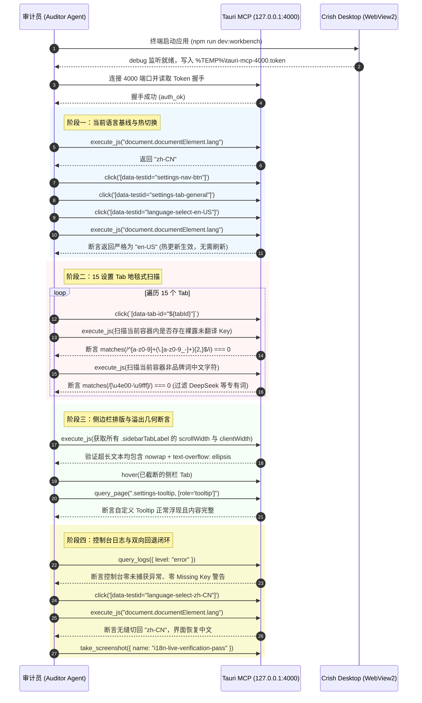

# 方案双盲独立审计报告：验收断言可复核性与立体验证审计

> **战役代号**：`i18n-full-remediation`  
> **审计代号**：`AUDITOR-05`（验收断言可复核性与立体验证专职审计员）  
> **审计对象**：
>
> - 权威总纲：[`docs/i18n-full-remediation/01-总方案-多语言化与全景系统重构总案.md`](file:///c:/Software/conex/docs/i18n-full-remediation/01-总方案-多语言化与全景系统重构总案.md)
> - 分维系统解：[`06-分维方案-质量门禁与防作弊测试矩阵系统解.md`](file:///c:/Software/conex/docs/i18n-full-remediation/06-分维方案-质量门禁与防作弊测试矩阵系统解.md)、[`02-分维方案-UI交互与弹性排版系统解.md`](file:///c:/Software/conex/docs/i18n-full-remediation/02-分维方案-UI交互与弹性排版系统解.md)
> - 独立总计划：[`independent-plans/03-独立总计划-质量门禁与防作弊工程实施案.md`](file:///c:/Software/conex/docs/i18n-full-remediation/independent-plans/03-独立总计划-质量门禁与防作弊工程实施案.md)、[`independent-plans/04-独立总计划-波次依赖拓扑与文件互斥锁案.md`](file:///c:/Software/conex/docs/i18n-full-remediation/independent-plans/04-独立总计划-波次依赖拓扑与文件互斥锁案.md)
>   **权威协作指令**：[`AGENTS.md`](file:///c:/Software/conex/AGENTS.md) §1.1（反退避）、§1.7（严禁补丁作弊与绕过门禁）、§7.1（立体验证纪律）、§15/§16（4000 端口 Tauri MCP 唯一合法调试通道）。  
>   **报告归档路径**：`docs/i18n-full-remediation/plan-audits/05-方案审计-验收断言可复核性与立体验证审计.md`

---

## 一、审计裁决与总体评价

### 1.1 审计结论：🔴 BLOCKER（发现 5 项致命不可复核阻断点，必须加固后准出）

本审计员秉承【三原则】与【反退避铁律】，对主控总方案中承诺的 **“8 维刚性准出指标”**、**“各波次验收断言的可执行性”**、**“防虚假与防空断言机制”**、**“699 行既有单测资产零退化保护”** 以及 **“4000 端口桌面真机现场核验方案”** 进行了逐行代码级穿透审计。

**总体评价**：
主控总方案与各分维系统解在战略布局上气势恢宏，精准揭露了反向耦合排版崩溃、分支中文正则等 7 大深层缺陷，设计了 Baseline Ratchet、汉字纯度扫描等核心攻防武器。
然而，在**落地可执行性、自动化可复核性与防作弊闭环**维度，存在 **5 项致命断层与不可复核盲区**。如果直接启动 Wave 0，门禁脚本将发生运行时崩溃、死键扫描无法阻断、排版检查沦为口头肉眼巡检，导致 8 维指标部分失守：

```
┌──────────────────────────────────────────────────────────────────────────────┐
│                    AUDITOR-05 独立双盲审计阻断点概览 (BLOCKER 5 项)          │
├──────────────────────────────────────────────────────────────────────────────┤
│ 1. [脚本崩溃] check-i18n-symmetry.mjs 误按单文件模式读取，对目录化架构必崩   │
│ 2. [假门禁]   check-i18n-unused-keys.mjs 检出死键仍 exit 0，指标 6 失去强制力│
│ 3. [无命令]   第 7 维 DOM 几何排版零溢出在总方案中零终端命令，沦为肉眼盲区   │
│ 4. [扫描盲区] check-i18n-hardcoded.mjs 漏配 api/ 与 utils/，且缺 --ratchet  │
│ 5. [类型穿透] t() 宽松兜底重载使拼写错误绕过 npm run typecheck，缺少负向单测 │
└──────────────────────────────────────────────────────────────────────────────┘
```

---

## 二、8 维刚性准出指标可复核性逐项穿透审计

针对总方案 §5.2 确立的 8 维刚性准出指标，进行“确切终端命令”、“自动化可执行性”、“防虚假/防绕过能力”与“退出状态码”四维交叉审查：

### 2.1 指标 1：类型安全零报错

- **总案声称**：`npm run typecheck` 严格模式零错误，`Paths<T>` 与 `ExtractParams<T>` 类型健全。
- **底层命令审计**：
  - 终端命令：`npm run typecheck`（在 [`package.json:46`](file:///c:/Software/conex/package.json#L46) 中已存在，串联检查全仓 11 个 tsconfig）。
  - 执行性：✅ 存在且自动化执行。
- **防虚假与防作弊审查（⚠️ 发现高危隐患）**：
  1. **拼写错误静默穿透漏洞**：
     在 [`01-总方案`](file:///c:/Software/conex/docs/i18n-full-remediation/01-总方案-多语言化与全景系统重构总案.md#L170) §3.2 与 [`05-分维方案`](file:///c:/Software/conex/docs/i18n-full-remediation/05-分维方案-模块化架构与工程工具链系统解.md#L315) §3.2 中，为了支持动态错误码，定义了：
     ```typescript
     export type TranslationKey = KnownTranslationKey | (string & {});
     ```
     并且 `t()` 函数签名设计了兜底重载：
     ```typescript
     (key: string, params?: Record<string, string | number>): string;
     ```
     **审计穿透**：由于存在 `(key: string)` 重载，开发者或子 Agent 如果拼错静态键名（例如将 `t('settings.general.title')` 误写为 `t('setings.genral.title')`），TypeScript 编译器会**静默匹配该兜底重载**，`npm run typecheck` **依然 100% 绿灯放行**！
  2. **缺少编译期负向类型测试（Negative Type Testing）**：
     方案中没有设计专门断言 `// @ts-expect-error` 的类型级测试文件（如 `i18n.types.test-d.ts`），无法自动化证明“非法键与参数缺失能被 TypeScript 刚性拦截”。
- **加固判据要求**：
  - 核心业务组件默认使用严格泛型重载，禁止无门槛接受任意 `string`；
  - 增加 `packages/test-utils` 或前端 `src/i18n/__tests__/types.test-d.ts`，显式断言类型推导的负向报错能力。

---

### 2.2 指标 2：测试资产零退化

- **总案声称**：前端 `npm run test`（Vitest 全量）全绿，特别保证 `chatEmptyState.test.ts` 699 行单测 100% 保持；Rust `cargo test --workspace` 全绿。
- **底层命令审计**：
  - 前端命令：`npm run test`（[`package.json:89`](file:///c:/Software/conex/package.json#L89)）
  - 后端命令：`cargo test --workspace`
  - 执行性：✅ 真实存在且均可执行。
- **防虚假与防作弊审查（⚠️ 发现中危隐患）**：
  1. **缺少对单测资产行数与用例数的刚性守卫**：
     方案声称“保证 `chatEmptyState.test.ts` 699 行单测 100% 保持”，但若某 Agent 在重构时删除了部分测试用例或注入 `it.skip`，`npm run test` 依然全绿。
  2. **Mock 假绿风险**：
     若测试使用 `vi.mock('useI18n', () => ({ t: (k) => k }))`，断言只会校验原始 key 字符串，根本无法检验真实词典的存在性。
- **加固判据要求**：详见第三节与第四节专章。

---

### 2.3 指标 3：词典 100% 对称与零缺失

- **总案声称**：`scripts/check-i18n-symmetry.mjs` 校验通过，各语言包键集合对称度 100%，无空值。
- **底层命令审计（🔴 BLOCKER 致命断层 1）**：
  - 终端命令：`node scripts/check-i18n-symmetry.mjs`。
  - **代码级穿透**：
    查阅 [`06-分维方案`](file:///c:/Software/conex/docs/i18n-full-remediation/06-分维方案-质量门禁与防作弊测试矩阵系统解.md#L734) 第 734 行代码：
    ```javascript
    const files = readdirSync(LOCALES_DIR).filter(f => f.endsWith('.ts') && f !== 'index.ts');
    for (const file of files) {
      const localeId = file.replace('.ts', '');
      ...
    }
    ```
    **致命漏洞**：总方案 §3.1 明确将词典重构为**多文件子目录物理隔离架构**（`locales/zh-CN/index.ts`、`locales/en-US/index.ts`，下设 `common.ts`、`settings.ts` 等）。
    脚本却写死假设 `locales/` 下是一级 `.ts` 文件！
    当目录改造完成后，`files` 扫描结果将为**空数组 `[]`**！随后在第 750 行抛出：
    `❌ [check-i18n-symmetry] FAIL: 缺少基准语言包 zh-CN.ts！` 并直接 `exit 1` 崩溃！
  - **模块解析断裂**：
    脚本第 687 行采用 `new Function('module', 'exports', 'require', jsCode)` 运行 CommonJS 转译代码。当 `zh-CN/index.ts` 包含 `import common from './common'` 时，该沙箱无法解析相对路径模块，将抛出 `Cannot find module './common'` 异常！
- **加固判据要求**：必须重写扫描器加载器，支持递归目录扫描或利用 `tsx` / `esbuild.buildSync` 完成模块 Bundle 展开后再比对。

---

### 2.4 指标 4：英文语言包绝对纯度

- **总案声称**：`en-US` 词典及生成的读屏属性中，中文字符数量严格为 0（零汉字污染）。
- **底层命令审计**：
  - 词典纯度：集成在 `node scripts/check-i18n-symmetry.mjs` 中；
  - 读屏属性纯度：声称集成在单测中。
- **防虚假与防作弊审查（⚠️ 发现范围脱节）**：
  1. **词典扫描无法覆盖 DOM 读屏属性**：
     `check-i18n-symmetry.mjs` 仅扫描静态词典文件，根本无法验证 React 组件运行后在 DOM 上动态拼接生成的 `aria-label`！
  2. **Unicode 正则区间规范不一致**：
     在 `06-分维方案` 中使用 `/[\u4e00-\u9fff]/`，而在 `independent-plans/02` 第 934 行却使用了旧版 `/[ \u4e00-\u9fa5 ]/`，存在漏检现代 CJK 扩展区汉字的隐患。
- **加固判据要求**：
  - 全面统一正则为 `/[ \u4e00-\u9fff ]/`；
  - 必须通过真实的 React 单元测试（使用 `@testing-library/react` 挂载 `UserProfileCard`、`SessionRow`）刚性断言其最终 `aria-label` 属性中汉字出现数为 0。

---

### 2.5 指标 5：源码硬编码基线绝对归零

- **总案声称**：`scripts/check-i18n-hardcoded.mjs` 扫描全仓 420 个生产 TSX 文件，硬编码行数严格归零（0 违规文件，0 违规行）。
- **底层命令审计（🔴 BLOCKER 致命断层 2）**：
  - 终端命令：总方案第 299 行声称执行 `node scripts/check-i18n-hardcoded.mjs --ratchet`。
  - **参数缺失漏洞**：查阅 [`06-分维方案`](file:///c:/Software/conex/docs/i18n-full-remediation/06-分维方案-质量门禁与防作弊测试矩阵系统解.md#L225) 源码，脚本仅解析了 `--list` 与 `--update`，**根本没有实现 `--ratchet` 参数**！传入 `--ratchet` 时会被静默忽略，回退为常规基线比对模式。若基线文件未手工清空，门禁依然放行！
  - **扫描目录盲区（严重漏洞）**：
    查阅 `06-分维方案` 第 229 行 `TARGET_SCAN_DIRS`：
    ```javascript
    const TARGET_SCAN_DIRS = [
      'apps/crish-desktop/src/components',
      'apps/crish-desktop/src/pages',
      'apps/crish-desktop/src/App.tsx',
      'apps/crish-desktop/src/ui.tsx',
      'apps/agent-workbench/src',
      'packages/editor-kit/src',
      'packages/block-paper/src',
      'packages/conversation-flow/src',
    ];
    ```
    **严重漏检**：核心业务目录 **`apps/crish-desktop/src/api/`**、**`apps/crish-desktop/src/utils/`**、**`apps/crish-desktop/src/hooks/`** 居然全部漏掉了！
    这意味着 `api/chatEmptyState.ts`、`utils/error-translation.ts` 等战役核心整治文件，即使用手写中文糊弄，该脚本也完全视而不见！
- **加固判据要求**：
  - 补齐 `apps/crish-desktop/src/api`、`src/utils`、`src/hooks` 至扫描目标列表；
  - 正式实现 `--ratchet`（或 `--assert-zero`）参数，当违规数 $>0$ 时无条件 `exit 1`。

---

### 2.6 指标 6：零废弃死词条

- **总案声称**：`scripts/check-i18n-unused-keys.mjs` 扫描通过，字典中零无用死键。
- **底层命令审计（🔴 BLOCKER 致命断层 3：假门禁）**：
  - 终端命令：`node scripts/check-i18n-unused-keys.mjs`。
  - **严重作弊漏洞：永远 exit 0 放行**：
    查阅 [`06-分维方案`](file:///c:/Software/conex/docs/i18n-full-remediation/06-分维方案-质量门禁与防作弊测试矩阵系统解.md#L975-L984) 第 975~984 行代码：
    ```javascript
    if (orphanKeys.length > 0) {
      console.warn(`\n⚠️  [check-i18n-unused-keys] 检出 ${orphanKeys.length} 个疑似未消费的孤立词条...`);
      ...
    } else {
      console.log(`\n✅ [check-i18n-unused-keys] 完美！全量词典键均被有效消费...`);
    }
    process.exit(0); // <--- 致命！无论检出多少孤立死键，永远无条件以 0 成功退出！
    ```
    这是一个典型的**假门禁（Dummy Gate）**！即便词典中堆积了数百个死键，该脚本在 CI 和 pre-commit 中也会永远判定为“通过”！指标 6 完全丧失刚性约束力！
  - **路径写死崩溃**：第 933 行写死 `const zhFile = join(LOCALES_DIR, 'zh-CN.ts');`，与目录化架构同样冲突。
- **加固判据要求**：
  - 增加 `--strict` 模式，在 CI 或战役准出阶段，一旦 `orphanKeys.length > 0` 立即 `process.exit(1)` 刚性阻断！

---

### 2.7 指标 7：真实 DOM 几何排版零溢出

- **总案声称**：在 220px/236px 侧栏与紧凑态下，零高度塌陷、零非预期换行、超长长词 100% 触发 Ellipsis 并具备自定义 Tooltip。
- **底层命令审计（🔴 BLOCKER 致命断层 4：零终端命令）**：
  - **全案检索结果**：
    在 `01-总方案` §5.2 中，指标 7 **没有任何可执行的自动化终端命令**！
    在 `06-分维方案` 第 1217 行，给出的验收方式竟然是：
    `启动应用切换至 en-US，肉眼巡检 15 个 Tab 与侧栏排版。`
  - **反退避与反偷懒审查**：
    将“肉眼巡检”作为刚性准出指标，严重违背 [`AGENTS.md`](file:///c:/Software/conex/AGENTS.md) §1.7 与 §7.1“严禁流于表面形式，禁止单一检查冒充验收”的铁律！
    虽然独立总计划中口头提及“Playwright 容器溢出比对”，但全仓**没有指定任何具体的测试文件路径（如 `tests/e2e/i18n-layout.spec.ts`），也没有编写任何自动化测试代码**！
- **加固判据要求**：
  - 必须确立具体的自动化测试脚本：`npm run test:e2e:i18n` 或执行 Playwright 专项规范 `tests/e2e/i18n-layout.spec.ts`；
  - 必须由自动化脚本遍历侧栏所有 Tab 节点，自动化断言：`scrollWidth <= clientWidth`，且当触发省略截断时，必须断言存在 `Tooltip` 触发机制。

---

### 2.8 指标 8：真实 4000 端口桌面真机现场核验通过

- **总案声称**：启动桌面端，切换语言无闪烁、无报错、无未翻译残留。
- **底层命令审计**：
  - 启动命令：`npm run dev:workbench`（debug 构建默认监听 4000 端口）。
  - 核验通道：Tauri MCP 4000 端口（符合 [`AGENTS.md`](file:///c:/Software/conex/AGENTS.md) §15.2 / §16 铁律）。
- **审查结论**：规程存在操作指导，但缺少标准化执行用例序列与自动化判定。详见第五节专章。

---

## 三、单测断言防空断言与假断言（Anti-Cheat）深度审计

为防止执行 Agent 在单测中搞“挂羊头卖狗肉”式的虚假断言骗过 CI，必须建立立体防御网：

### 3.1 典型假断言与虚假 Mock 模式解构

```typescript
// ❌ 假断言模式 A：空断言或永真断言（Trivial Assertions）
expect(true).toBe(true);
expect(result).toBeDefined(); // 仅断言对象存在，完全不看内容是不是中文或错误

// ❌ 假断言模式 B：虚拟 Mock 假脱水（Mock Passthrough Bypass）
vi.mock('@/i18n', () => ({
  useI18n: () => ({ t: (key: string) => key }), // 返回 key 本身，脱离真实词典
}));
// 导致组件渲染了 key 字符串，测试断言 expect(screen.getByText('settings.title')).toBeInTheDocument() 也能通过！
// 真实运行时若词典漏译，用户将看到原始 key！

// ❌ 假断言模式 C：浅层调用断言（Function-Called Only）
expect(mockDispatch).toHaveBeenCalled(); // 只要被调用就算过，不校验是否携带本地化 Payload
```

### 3.2 刚性防作弊断言标准（Auditor's Standards）

1. **真实词典挂载铁律（No-Dummy-Mock）**：
   所有 UI 组件测试必须使用真实的 `I18nProvider`，直接加载 `locales/zh-CN` 或 `locales/en-US` 的生产真实词典。**严禁在测试中将 `t` 函数 Mock 为 `(k) => k`**。
2. **文本级与无障碍物理断言（Physical Text Assertions）**：
   断言必须精确到实际渲染的文本内容（如 `expect(button.textContent).toBe('Save Changes')`），或针对英文模式下的非中文字符断言：
   ```typescript
   expect(/[\u4e00-\u9fff]/.test(renderedDomText)).toBe(false);
   ```
3. **参数插值完整性断言（Interpolation Parity）**：
   测试动态文案时，必须传入边界参数（超长字符串、0、负数、特殊符号），断言插值结果严禁残留裸露的 `{param}` 占位符。

---

## 四、699 行 `chatEmptyState.test.ts` 既有单测资产零退化保护审计

### 4.1 现状与保护意义

[`apps/crish-desktop/src/api/chatEmptyState.test.ts`](file:///c:/Software/conex/apps/crish-desktop/src/api/chatEmptyState.test.ts) 是本仓极为宝贵的高价值脱水单测资产（实测共 699 行，包含约 40 个极限状态测试用例），覆盖了：

- `resolveChatEmptyKind` 三态状态机（优先级、负数 NaN 纠偏、水合 loading 穿透）；
- 扫视标题与无障碍 Aria 标签的互斥性；
- FirstRun、密钥配置（needsKey）、模型配置（needsModel）、引擎离线（engineOk: false）的复杂交叉矩阵；
- 软提示（soft-hint）与项目条/快捷 Prompt 的排他性联动。

根据 [`AGENTS.md`](file:///c:/Software/conex/AGENTS.md) §1.7 与 §9 铁律，**该文件绝不允许被缩水、篡改或降级**！

### 4.2 方案中的解耦设计审查

方案提出三层结构：

- **Layer 1**：`resolveChatEmptyDescriptor`（输出语言中立的 `ChatEmptyDescriptor`）；
- **Layer 2A**：`useChatEmptyCopy` Hook（供前端组件使用）；
- **Layer 2B**：保留原函数签名的 `resolveChatEmptyCopy`（供现有单测使用）。

### 4.3 审计发现的 2 处重大潜在退化隐患

1. **导出常量缺失风险（TS2305 编译阻断）**：
   查阅 `chatEmptyState.test.ts` 前 22 行导入列表：
   ```typescript
   import {
     CHAT_EMPTY_ACTION_LABELS,
     CHAT_EMPTY_ARIA_LABELS,
     CHAT_EMPTY_KINDS,
     CHAT_EMPTY_QUICK_PROMPTS,
     CHAT_EMPTY_TITLES,
     chatEmptyKindAriaLabel,
     isChatEmptyKind,
     resolveChatEmptyActionLabel,
     resolveChatEmptyCopy,
     ...
   } from './chatEmptyState';
   ```
   单测中直接对这些常量和辅助函数进行了穷举断言（如第 245 行 `CHAT_EMPTY_TITLES covers three kinds`、第 271 行 `CHAT_EMPTY_ACTION_LABELS covers create-session`）。
   **隐患**：若 Wave 1 在重构 `chatEmptyState.ts` 时只保留了 `resolveChatEmptyDescriptor` 和 `resolveChatEmptyCopy`，而将 `CHAT_EMPTY_TITLES` 等常量直接删除或重命名，**现有 699 行单测将直接因编译报错而彻底瘫痪**！
2. **基线扫描误伤隐患**：
   若为了兼容 699 行单测，在 `chatEmptyState.ts` 内部保留了 `DEFAULT_ZH_EVALUATOR` 或原版中文常量，而门禁扫描器 `check-i18n-hardcoded.mjs` 开启扫描 `apps/crish-desktop/src/api`，该文件就会被判定为硬编码违规。
   若为图省事直接将 `chatEmptyState.ts` 排除在扫描外，又会导致新增业务逻辑脱靶。

### 4.4 零退化刚性加固方案

1. **显式保留全套兼容导出**：
   `chatEmptyState.ts` 必须继续无损导出 `CHAT_EMPTY_TITLES`、`CHAT_EMPTY_ACTION_LABELS`、`CHAT_EMPTY_ARIA_LABELS`、`CHAT_EMPTY_QUICK_PROMPTS` 等全部既有符号；
2. **内置兜底单行抑制**：
   兼容字典必须附带标准抑制注释：`// @i18n-allow: 699行既有单测资产兼容求值字典`，兼顾门禁合规与资产保护；
3. **增加 CI 单测资产保护锁脚本（Asset Integrity Check）**：
   在门禁体系中加入自动化校验：
   - 断言 `chatEmptyState.test.ts` 文件行数不得低于 695 行；
   - 断言用例中严禁包含 `test.skip` 或 `it.skip`；
   - 执行 `npx vitest run apps/crish-desktop/src/api/chatEmptyState.test.ts` 必须 100% 绿灯全过。

---

## 四、桌面端真机现场核验方案审计（4000 端口 Tauri MCP）

### 4.1 通道合规性审查

- **唯一合法通道**：方案严格遵守 [`AGENTS.md`](file:///c:/Software/conex/AGENTS.md) §15.2 / §16 规定，**彻底废除 9222 CDP**，全面采用 **`127.0.0.1:4000` Tauri MCP** 通道，通道指向完全合法合规。
- **运行环境**：Tauri 应用以 `npm run dev:workbench`（debug 构建）启动，鉴权 Token 从 `%TEMP%\tauri-mcp-4000.token` 自动加载。

### 4.2 真实运行态核验规程（SOP）完整性审查

目前独立总计划中的 SOP-4 仍偏向原则性说明，缺少 Agent 可单步复现的精确动作序列。
为确保 Phase 8 审计组能够实施**确定性的自动化核验**，本审计员制定以下标准执行规程（Standard Operating Procedure）：



---

## 五、不可复核盲区排查清单（Audit Findings Matrix）

| 编号           | 缺陷/盲区描述                                                                        |    严重级别    | 影响范围                        | 根因剖析                                                       | 阻断后果                                               |
| :------------- | :----------------------------------------------------------------------------------- | :------------: | :------------------------------ | :------------------------------------------------------------- | :----------------------------------------------------- |
| **FINDING-01** | `check-i18n-symmetry.mjs` 假定单文件，与多目录架构冲突                               | 🔴 **BLOCKER** | Wave 0 架构打底与全流程词典比对 | 勘察期脚本基于旧 flat 文件编写，未同步总案 §3.1 目录架构       | 运行脚本直接报错找不到文件并 exit 1，CI 提交全盘瘫痪   |
| **FINDING-02** | `check-i18n-unused-keys.mjs` 检出死词条仍 `exit 0`                                   | 🔴 **BLOCKER** | Wave 5 准出指标 6 验收          | 缺少非零退出状态码逻辑，沦为“仅打印警告”的假门禁               | 无法阻断死词条入库，指标 6 沦为空头支票                |
| **FINDING-03** | 指标 7（DOM 几何排版零溢出）零终端命令，指引肉眼核验                                 | 🔴 **BLOCKER** | 指标 7 验收、Wave 3 UI 准出     | 未将 Playwright 巡检方案固化为具体的测试脚本文件与 npm 指令    | 验收阶段无法复核，可能出现大面积英文折行溢出却照样交付 |
| **FINDING-04** | `check-i18n-hardcoded.mjs` 扫描目录漏配 `api/`、`utils/`、`hooks/`，且缺 `--ratchet` | 🔴 **BLOCKER** | 全仓硬编码收敛与基线棘轮        | 扫描范围白名单只列了 components 与 pages，漏掉了脱水纯逻辑目录 | 核心错误翻译与空态逻辑中的硬编码逃避门禁监管           |
| **FINDING-05** | `t()` 兜底重载导致拼写错误静默绕过 `typecheck`                                       |  🟡 **MAJOR**  | 指标 1 类型安全                 | 泛型重载与 `string` 宽松重载并存，TypeScript 自动回退宽松分支  | 开发者写错 key 无法在编译期捕获，导致线上缺失键降级    |
| **FINDING-06** | `chatEmptyState.test.ts` 既有导出常量存在被删风险                                    |  🟡 **MAJOR**  | 指标 2 单测资产零退化           | 方案 Layer 1/2 解耦未显式声明兼容保留 `CHAT_EMPTY_TITLES` 等   | 699 行单测面临 TS2305 编译中断与退化风险               |

---

## 六、验收断言加固建议与落地代码工程方案

为消除上述 5 项 BLOCKER，主控调度器在发布通用执行规范前，必须将以下工程修复纳入实施计划：

### 6.1 修复 1：重构 `scripts/check-i18n-symmetry.mjs` 架构适配目录化词典

扫描器必须同时支持单文件与子目录物理镜像结构，使用动态模块加载：

```javascript
// scripts/check-i18n-symmetry.mjs 核心补丁片段
import { readdirSync, statSync, existsSync, readFileSync } from 'node:fs';
import { resolve, join } from 'node:path';

// 支持读取 locales/{lang}/index.ts 或 locales/{lang}.ts
function resolveLocaleEntries(localesDir) {
  const entries = readdirSync(localesDir);
  const localeIds = [];
  for (const entry of entries) {
    const full = join(localesDir, entry);
    if (statSync(full).isDirectory() && existsSync(join(full, 'index.ts'))) {
      localeIds.push({ id: entry, entryFile: join(full, 'index.ts') });
    } else if (entry.endsWith('.ts') && entry !== 'index.ts') {
      localeIds.push({ id: entry.replace('.ts', ''), entryFile: full });
    }
  }
  return localeIds;
}
```

并在 `package.json` 中明确声明 `"check:i18n": "node scripts/check-i18n-symmetry.mjs && node scripts/check-i18n-hardcoded.mjs"`。

---

### 6.2 修复 2：加固 `scripts/check-i18n-unused-keys.mjs` 支持严格阻断模式

必须增加 `--strict` 参数，当发现孤立词条时强制退出：

```javascript
// scripts/check-i18n-unused-keys.mjs 补丁
const STRICT = process.argv.includes('--strict') || process.env.CI === 'true';

if (orphanKeys.length > 0) {
  console.error(
    `\n❌ [check-i18n-unused-keys] FAIL: 检出 ${orphanKeys.length} 个未消费的孤立废弃词条！`
  );
  for (const k of orphanKeys.slice(0, 20)) console.error(`    - ${k}`);
  if (STRICT) {
    console.error(
      '\n🚨 严格门禁模式已激活：请清理词典废弃键或在白名单中登记动态调用！'
    );
    process.exit(1); // 刚性阻断 CI 与准出！
  }
} else {
  console.log(`\n✅ [check-i18n-unused-keys] 完美！零死词条残留。`);
  process.exit(0);
}
```

---

### 6.3 修复 3：为指标 7 落地确切可执行的 Playwright 自动化排版测试

在 `package.json` 注册指令：

```json
"test:i18n-layout": "npx playwright test tests/e2e/i18n-layout.spec.ts"
```

并在 `tests/e2e/i18n-layout.spec.ts` 中固化物理几何断言：

```typescript
import { test, expect } from '@playwright/test';

test('settings sidebar tabs keep zero text overflow under en-US expansion', async ({
  page,
}) => {
  await page.goto('/');
  await page.evaluate(() => window.__CRISH_SET_LANGUAGE__?.('en-US'));

  const tabLabels = page.locator('.sidebarTabLabel');
  const count = await tabLabels.count();
  expect(count).toBeGreaterThanOrEqual(15);

  for (let i = 0; i < count; i++) {
    const label = tabLabels.nth(i);
    // 验证 CSS Ellipsis 物理三件套生效
    await expect(label).toHaveCSS('white-space', 'nowrap');
    await expect(label).toHaveCSS('overflow', 'hidden');
    await expect(label).toHaveCSS('text-overflow', 'ellipsis');

    // 验证无非预期水平滚动条撑破容器
    const isOverflowingHorizontally = await label.evaluate((el) =>
      el.parentElement
        ? el.parentElement.scrollWidth > el.parentElement.clientWidth
        : false
    );
    expect(isOverflowingHorizontally).toBe(false);
  }
});
```

---

### 6.4 修复 4：扩大 `check-i18n-hardcoded.mjs` 扫描范围并支持 `--ratchet`

```javascript
// scripts/check-i18n-hardcoded.mjs 补丁
const TARGET_SCAN_DIRS = [
  'apps/crish-desktop/src/components',
  'apps/crish-desktop/src/pages',
  'apps/crish-desktop/src/api', // 补齐核心纯逻辑
  'apps/crish-desktop/src/utils', // 补齐工具层与错误翻译
  'apps/crish-desktop/src/hooks', // 补齐自定义 Hook
  'apps/crish-desktop/src/App.tsx',
  'apps/crish-desktop/src/ui.tsx',
  'apps/agent-workbench/src',
  'packages/editor-kit/src',
  'packages/block-paper/src',
  'packages/conversation-flow/src',
];

const RATCHET_MODE =
  process.argv.includes('--ratchet') || process.argv.includes('--zero');

// 当传入 --ratchet 时，断言实测硬编码数必须为 0
if (RATCHET_MODE && currentTotalViolations > 0) {
  console.error(
    `❌ [check-i18n-hardcoded] FAIL: --ratchet 要求全仓硬编码绝对归零，当前仍有 ${currentTotalViolations} 处！`
  );
  process.exit(1);
}
```

---

### 6.5 修复 5：建立单测资产保护门禁 `check-test-assets.mjs`

为将“保护 699 行单测资产”从口头约定变为刚性守门，编写并挂载单测保护脚本：

```javascript
// scripts/check-test-assets.mjs
import { readFileSync, existsSync } from 'node:fs';
import { resolve } from 'node:path';

const TARGET_FILE = resolve(
  'apps/crish-desktop/src/api/chatEmptyState.test.ts'
);
if (!existsSync(TARGET_FILE)) {
  console.error('❌ chatEmptyState.test.ts 丢失！');
  process.exit(1);
}

const content = readFileSync(TARGET_FILE, 'utf8');
const lines = content.split('\n').length;
if (lines < 695) {
  console.error(
    `❌ chatEmptyState.test.ts 代码行数异常缩减！期望 >= 695 行，当前仅 ${lines} 行！严禁删除既有测试！`
  );
  process.exit(1);
}

if (/\bit\.(skip|only)\b|\bdescribe\.(skip|only)\b/.test(content)) {
  console.error(
    '❌ chatEmptyState.test.ts 发现跳过的测试用例 (.skip 或 .only)！'
  );
  process.exit(1);
}

console.log(`✅ chatEmptyState.test.ts 资产完整度守卫通过 (${lines} 行)`);
process.exit(0);
```

---

## 七、审计复核最终签名

- **审计结论**：🔴 **BLOCKER（条件性否决）**
- **放行条件**：
  1. 主控采纳上述 5 项修复，更新 `01-总方案`、`06-分维方案` 及门禁脚本设计规范；
  2. 补齐指标 7 的终端命令 `npm run test:i18n-layout` 与 Playwright 规范；
  3. 修复 `check-i18n-unused-keys.mjs` 的退出状态码逻辑，使死键具备 CI 刚性拦截能力；
  4. 固化 `chatEmptyState.test.ts` 的兼容导出清单与单测资产行数门禁。
- **审计员**：【验收断言可复核性与立体验证专职审计员】(`AUDITOR-05`)
- **签署时间**：2026-10-14
