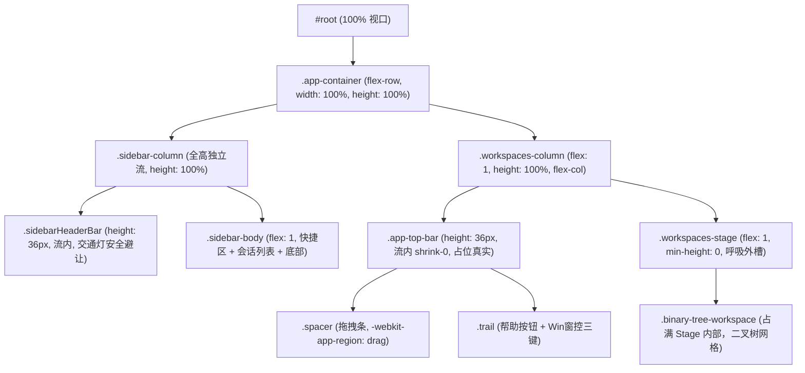
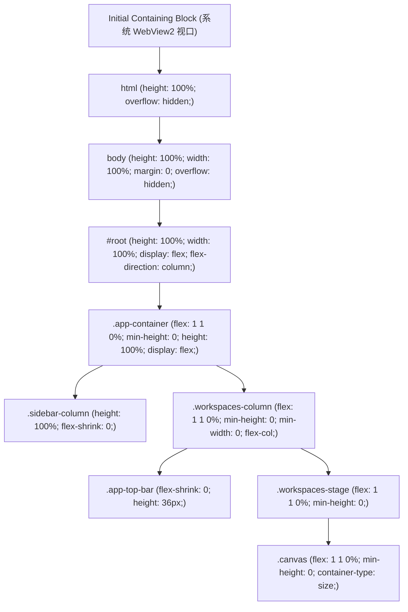
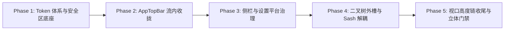

> **【v2 废止声明】** 施工以 `00-总方案.md`（2026-09-11 v2）为唯一 SSOT。本文与 v2 冲突的矩阵/圆角/BATCH/修复手段一律作废，仅保留诊断取证价值。

# Shell 外壳视口链与安全避让架构方案

> **战役工作区**：`docs/layout-token-system/`
> **方案定位**：系统性 Token 体系建设战役（第二阶段 · 核心架构方案 02）
> **设计架构师**：Shell 外壳视口链与安全避让架构设计专家
> **对齐基线**：
> - 调研基线：`docs/layout-token-system/survey/02-shell-and-viewport-layout-survey.md`
> - 协同调研：`docs/layout-token-system/survey/07-sidebar-and-settings-layout-survey.md`
> - 核心契约：`AGENTS.md`（反退避、严禁补丁与绕过、单一真理路径、立体验证）
> - 目标源码域：
>   - `apps/crish-desktop/src/styles/shell/shell-layout.css`
>   - `apps/crish-desktop/src/styles/shell/shell-reset.css`
>   - `apps/crish-desktop/src/styles/tokens.css`
>   - `apps/crish-desktop/src/components/top-bar/AppTopBar.tsx` / `AppTopBar.module.css`
>   - `apps/crish-desktop/src/components/shell/WindowControls.tsx` / `WindowControls.module.css`
>   - `apps/crish-desktop/src/components/sidebar/Sidebar.module.css` / `SidebarHeader.tsx`
>   - `apps/crish-desktop/src/components/binary-tree/PaneHeader.module.css` / `paneEdgeGeometry.ts`
>   - `apps/crish-desktop/src/components/binary-tree/BinaryTreeWorkspace.module.css` / `useTreeResize.ts`
>   - `apps/crish-desktop/src/components/settings/SettingsPanel.tsx` / `SettingsPanel.module.css`

---

## 执行摘要与核心战略目标

在 Conex / Crish 桌面端应用中，顶级外壳（Shell Viewport）与全局顶栏（`AppTopBar`）是整个应用最顶层的视觉容器与硬件事件入口。第一阶段深入调研揭示了当前外壳架构中存在的**四大结构性断层**：

1. **`AppTopBar` 绝对定位浮动架构引发全域避让泥潭**：顶栏采用 `position: absolute; top: 0; width: 100vw; pointer-events: none;`，在普通文档流中高度占位为 0。主工作区 `.main-layout` 从视口 $y=0$ 处顶格铺满，迫使下游侧栏、二叉树工作区、窗格头部、标签栏乃至全屏设置页必须全局感知 `--header-height: 36px`，更衍生出在顶行窗格手写复杂复合选择器的“自杀式避让”与上下层互挖空洞的“筛子模式”事件穿透。
2. **跨平台硬件避让 Token 语义混杂与致命物理缺陷**：`--edge-reserve-*` 系列 Token 将操作系统硬件控件（macOS 70px 交通灯、Windows 96px 窗控三键）与前端业务按钮（侧栏折叠开关 32px、帮助按钮 28px）强行硬编码绑定；导致在 macOS 展开态下侧栏开关与系统交通灯（0~70px）直接发生严重的物理重叠与点击拦截 Bug；且在全屏（Fullscreen）模式下右侧窗格仍死板保留 144px/38px 的巨大空白断层。
3. **全局外槽（Canvas Gutter）体系全面退化**：因绝对顶栏导致的垂直断口以及二叉树 Sash 绝对坐标引擎的几何干涉，工作区原有的 `padding: 0 var(--shell-gutter, 8px) ...` 被一刀切注释为 `padding: 0;`。工作区卡片硬贴宿主窗口边缘，丧失了现代桌面应用应有的浮动岛屿感（Card-on-Canvas）与呼吸进深，且与操作系统窗口缩放热区产生严重的拖拽竞争。
4. **视口高度链的防御性冗余与单位混用隐患**：`100vh`、`100vw` 与百分比混用，层层叠加 `flex: 1 1 0%` 与 `height: 100%`，在 Windows 高 DPI 缩放（125%、150%、175%）下易诱发亚像素渲染误差和微小滚动。

**本方案的核心重构战略目标**：
- **终结绝对定位浮动顶栏**：将顶栏与工作区彻底理顺为**严格的正交文档流**，顶栏物理占位确定，下游工作区与卡片从架构上“不可见也不必关心”顶栏的存在，根除一切下游避让代码。
- **解耦跨平台安全区（Safe Area Insets）**：拆分系统硬件避让与业务控件尺寸，建立跨平台自适应的安全区 Token 体系，彻底修复 macOS 展开态交通灯撞车缺陷，并在全屏态实现硬件避让的优雅零损耗归零。
- **重塑 `--shell-gutter` 自适应外槽体系**：重构外壳舞台（Viewport Stage）盒模型边界，隔离二叉树 Sash 绝对坐标系，恢复工作区四周对称呼吸感，并在全屏与紧凑模式下动态自适应。
- **规范视口高度纯净链**：统一采用百分比与 Flexbox 尺寸传递，全面贯彻 `min-height: 0` 铁律，构建坚固稳定的视口层级拓扑。

---

## 一、包含块架构重塑：`AppTopBar` 流内收拢方案

### 1.1 穿透根因剖析与历史包袱解构

#### 现状断层还原
在 `apps/crish-desktop/src/styles/shell/shell-layout.css:4` 中明确写道：
> `/* 高度用 flex 剩余；顶栏已 shrink-0，禁止 calc 减顶栏。 */`

然而在现实实现中：
- `AppTopBar.module.css:7-27`：
  ```css
  .topBar {
    position: absolute;
    top: 0;
    left: 0;
    right: 0;
    height: var(--header-height, 36px);
    width: 100vw;
    pointer-events: none;
    z-index: var(--z-sidebar, 100);
  }
  ```
- `App.tsx:174-182`：
  ```tsx
  <div className="app-container">
    <AppTopBar ... />
    <main className="main-layout">...</main>
  </div>
  ```

#### 穿透连锁反应与受害链路
由于 `AppTopBar` 脱离了正常文档流，它的真实占位高度为 0。`.main-layout` 在弹性分配中直接吃满了从视口顶部 $y=0$ 到 $y=100\%$ 的全部空间。这引发了一系列灾难性的下游补偿代码：
1. **二叉树边缘数学计算与复合选择器**：`paneEdgeGeometry.ts` 必须计算 `rect.y <= EPSILON` 导出 `data-top-row="true"`，`PaneHeader.module.css` 必须用 5 重复合全局选择器（`:global([data-top-row="true"][data-right-edge="true"]) .paneHeader`）写死内边距避让。
2. **右上角悬浮按钮手写偏移**：`BinaryTreeWorkspace.module.css:97` 必须写 `top: calc(var(--header-height) + var(--leaf-corner-btn-gap))`，否则按钮会直接被顶栏窗控覆盖。
3. **事件穿透“筛子模式”脆弱性**：顶栏整体 `pointer-events: none`，右侧工具组 `pointer-events: auto`，中间拖拽条 `pointer-events: none`（依赖浏览器原生非客户区拖拽），左侧 `headerClearance` `pointer-events: none`，下方侧栏开关 `pointer-events: auto; -webkit-app-region: no-drag !important`。层层穿透在 WebView2 偶发无响应或拖拽粘手。

### 1.2 架构方案对比与终局裁决

针对外壳包含块与顶栏的拓扑关系，对比评估以下三种工业级架构方案：

```
【方案 A：纯流式垂直 Flex 拓扑】       【方案 B：视口 CSS Grid 语义拓扑】     【方案 C（推荐）：流内主工作区 + 独立侧栏一体化拓扑】
┌────────────────────────────────┐    ┌──────────┬─────────────────────┐    ┌──────────┬────────────────────────────────┐
│ AppTopBar (36px, 流内 shrink-0) │    │          │ AppTopBar (36px)    │    │          │ AppTopBar (36px, 流内 shrink-0) │
├──────────┬─────────────────────┤    │ Sidebar  ├─────────────────────┤    │ Sidebar  ├────────────────────────────────┤
│ Sidebar  │ Main Workspace      │    │ (全高)   │ Main Workspace      │    │ (全高)   │ Main Workspace (flex: 1)       │
│ (高度截断)│ (flex: 1, 从 36px 始)│    │          │ (grid-area: main)   │    │          │ (从 36px 开始，零穿透零感知)    │
└──────────┴─────────────────────┘    └──────────┴─────────────────────┘    └──────────┴────────────────────────────────┘
```

| 评估维度 | 方案 A：纯流式垂直 Flex 顶栏 | 方案 B：视口 CSS Grid 语义网格 | 方案 C（裁决方案）：一体化全高侧栏 + 流内工作区顶栏 |
| :--- | :--- | :--- | :--- |
| **拓扑关系** | `app-container` 垂直切分：顶栏在上方贯穿 100% 视口，下方并列侧栏与工作区。 | `app-container` 声明两行两列网格，侧栏跨越两行，顶栏占右上格。 | 侧栏水平并列在左侧（全高贯通），右侧工作区列垂直分为流内顶栏与工作区。 |
| **侧栏视觉连续性** | 侧栏被顶栏压制，无法向上延伸至窗口顶边缘，破坏现代一体化侧栏质感。 | 侧栏全高贯通，视觉统一。但 Grid 轨道对 `width: 0 -> 260px` 动画不友好。 | 侧栏全高贯通，左侧保留原生桌面质感，展开折叠丝滑；工作区享有独立流内顶栏。 |
| **下游穿透解耦度** | **完全解耦**：工作区从 $y=36\text{px}$ 开始，无任何顶栏感知。 | **完全解耦**：网格区域天然隔离。 | **完全解耦**：工作区顶栏在工作区列流内排布，二叉树从顶栏下方开始，零穿透！ |
| **拖拽区连续性** | 顶栏横跨整屏，拖拽区域宽广。 | 侧栏上方需内嵌拖拽条，右侧为顶栏拖拽条。 | 侧栏顶部头部与工作区顶栏各自声明 `-webkit-app-region: drag`，拖拽无缝拼接。 |
| **重构成本与风险** | 中等，但会强行改变当前 UI 侧栏顶部的设计语言。 | 高，CSS Grid 动画容易引发二叉树 Sash 拖拽重绘性能退化。 | **中低且优雅**，完美保持当前视觉规范，底层彻底消除绝对定位浮动。 |

#### 终局裁决：采纳「方案 C 优化型：流内标准化包含块拓扑」
经过对 Conex / Crish 桌面端设计规范（侧栏顶部需具备一体化质感、二叉树工作区需要独立标题栏与工具栏）的深度结合，我们裁定采用**双层标准化流内拓扑**：



### 1.3 新顶栏包含块规范与核心样式定义

#### 1. DOM 结构彻底重构（`App.tsx`）
```tsx
// 改造前：AppTopBar 悬浮在外面，main-layout 独自吃满
<div className="app-container">
  <AppTopBar onShowCheatsheet={...} />
  <main className="main-layout">
    <Sidebar ... />
    <WorkspacesColumn ... />
  </main>
</div>

// 改造后：严谨的正交拓扑
<div className="app-container" data-sidebar-collapsed={sidebarCollapsed}>
  {/* 侧栏独立流：从 y=0 贯通至视口底端，具备自己的 36px 顶栏 */}
  <aside id="crish-sidebar" className="sidebar-container" role="navigation">
    <Sidebar ... />
  </aside>

  {/* 主工作区列：垂直分为 36px 流内顶栏与弹性工作区 */}
  <main id="crish-main" className="workspaces-column" role="main">
    <AppTopBar onShowCheatsheet={...} />
    <section className="workspaces-stage">
      <BinaryTreeWorkspace ... />
    </section>
  </main>
</div>
```

#### 2. `AppTopBar.module.css` 彻底剔除绝对定位与穿透
```css
/* apps/crish-desktop/src/components/top-bar/AppTopBar.module.css */

.topBar {
  /* 彻底废除 position: absolute; top: 0; width: 100vw; pointer-events: none; */
  position: relative;
  width: 100%;
  height: var(--shell-header-height, 36px);
  min-height: var(--shell-header-height, 36px);
  max-height: var(--shell-header-height, 36px);
  flex-shrink: 0;

  display: flex;
  align-items: center;
  background: var(--bg-workspace, var(--bg-primary));
  border-bottom: none;
  box-sizing: border-box;
  overflow: hidden;
  user-select: none;
  z-index: var(--z-header, 10);

  /* 恢复正常事件响应，根除“筛子模式” */
  pointer-events: auto;
}

/* 废除旧的 .headerClearance，因侧栏已在同级独立流中，无需顶栏内部垫空 */

.spacer {
  flex: 1 1 0%;
  min-width: 32px;
  height: 100%;
  -webkit-app-region: drag;
  app-region: drag;
}

.trail {
  flex: 0 0 auto;
  height: 100%;
  display: flex;
  align-items: center;
  gap: var(--space-1, 4px);
  padding-right: var(--shell-safe-inset-right, 0px);
  padding-left: var(--space-1, 4px);
  -webkit-app-region: no-drag;
}
```

#### 3. 架构收益：下游避让代码全面清退
通过顶栏真实入流，下游组件获得架构级解脱：
- **`PaneHeader.module.css`**：彻底删除 5 重复合全局选择器（行 32-51）。窗格标签栏只需声明 `height: var(--pane-header-height, 32px)`，完全不再感知视口顶栏与侧栏状态。
- **`paneEdgeGeometry.ts`**：废弃 `isTopRow` 避让属性计算，二叉树网格无需再向 DOM 灌入 `data-top-row`。
- **`BinaryTreeWorkspace.module.css`**：右上角浮动按钮 `.topSidePanelBtn` 直接锚定在叶子卡片自身内部的正常偏移位置（`top: var(--leaf-corner-btn-gap, 6px); right: var(--leaf-corner-btn-inset, 8px);`），彻底删除 `calc(var(--header-height) + ...)` 的怪异补丁！

---

## 二、跨平台窗口控制与边缘安全区解耦（Safe Area Insets）

### 2.1 既有 Token 语义解构与缺陷穿透

#### 1. 语义混杂的解构剖析
现有 `tokens.css:386-389` 中的四个 Token 实质为“硬件控件与业务组件绑架型产物”：
- `--edge-reserve-left: 52px;` $\to$ 实质为：侧栏折叠开关宽度（32px）+ 两侧内边距（20px）。
- `--edge-reserve-left-macos: 106px;` $\to$ 实质为：macOS 原生交通灯硬件宽度（约 70px）+ 侧栏开关（32px）+ 间隙缓冲（4px）。
- `--edge-reserve-right-win: 144px;` $\to$ 实质为：Windows 窗控三键（96px）+ 帮助按钮（28px）+ 间距与 Padding（20px）。
- `--edge-reserve-right-macos: 38px;` $\to$ 实质为：macOS 右侧帮助按钮（28px）+ 左右内边距（10px）。

**架构危害**：一旦业务按钮尺寸微调（例如将帮助按钮从 28px 改为 32px），或者系统 DPI 导致窗控发生亚像素变动，所有下游消费该 Token 的窗格内边距全部发生撕裂。

#### 2. macOS 展开态交通灯撞车缺陷（致命缺陷）
在 `SidebarHeader.tsx` 与 `Sidebar.module.css` 中：
- 折叠态：`.sidebarHeader[data-mac='true']` 写了 `padding-left: 70px`，留出了左侧交通灯。
- 展开态：侧栏渲染为 `.sidebarHeaderBar`，样式中仅有 `padding: 0 10px;`，**完全没有任何针对 macOS 平台的安全避让规则**！
- **现场事故**：在 macOS 上侧栏展开时，折叠按钮 `.sidebar-toggle-btn` 被直接渲染在 $x=10\text{px}$ 处，而 macOS 系统交通灯（关闭/最小化/缩放）强行钉死在 $(0, 0) \sim (70\text{px}, 36\text{px})$。折叠按钮直接被系统红黄绿三色灯遮蔽，用户点击时极易触发误关窗口！

#### 3. 全屏态（Fullscreen）空白浪费缺陷
全屏模式下，操作系统接管了窗口控件，但二叉树顶行最右叶子依然机械匹配 `:global([data-top-row="true"][data-right-edge="true"])`，强行保留 `padding-right: 144px`（Windows）或 `38px`（macOS），在全屏沉浸式工作区中形成极其刺眼的断头空白。

### 2.2 跨平台安全区 Token 分层契约（Safe Area Insets）

我们将平台硬件几何与业务组件尺寸彻底正交化，建立三层严谨的 Design Tokens 体系：

```mermaid
graph TD
  subgraph Layer 1: 系统硬件安全区 (Hardware Inset Tokens)
    H1["--shell-safe-inset-top: 0px"]
    H2["--shell-safe-inset-bottom: 0px"]
    H3["--shell-safe-inset-left (macOS: 70px, Win: 0px)"]
    H4["--shell-safe-inset-right (macOS: 0px, Win: 96px)"]
  end

  subgraph Layer 2: 外壳通用控制部件尺寸 (Shell Control Size Tokens)
    C1["--shell-control-btn-size: 28px"]
    C2["--shell-sidebar-toggle-size: 32px"]
    C3["--shell-control-gap: 4px"]
  end

  subgraph Layer 3: 语义化组件槽位 (Semantic Inset Slots)
    S1["--sidebar-header-inset-left: var(--shell-safe-inset-left)"]
    S2["--topbar-trail-inset-right: var(--shell-safe-inset-right)"]
  end

  Layer 1 --> Layer 3
  Layer 2 --> Layer 3
```

#### 核心 Token 契约定义（`tokens.css`）
```css
/* ==========================================================================
   Shell 外壳跨平台安全区与视口几何 Token (Layer 1 & Layer 2)
   ========================================================================== */

:root {
  /* 基础高度契约 */
  --shell-header-height: 36px;

  /* 默认（Windows / Linux 平台基线）硬件安全区 */
  --shell-safe-inset-top: 0px;
  --shell-safe-inset-bottom: 0px;
  --shell-safe-inset-left: 0px;
  --shell-safe-inset-right: 96px; /* Windows 窗控三键 32px * 3 = 96px */

  /* 业务控件基准尺寸 */
  --shell-control-btn-size: 28px;
  --shell-sidebar-toggle-size: 32px;
  --shell-control-gap: 4px;
}

/* macOS 桌面特化覆盖 */
:root[data-platform="macos"] {
  --shell-safe-inset-left: 70px;  /* macOS 交通灯红黄绿避让 */
  --shell-safe-inset-right: 0px;  /* macOS 右侧无原生窗控 */
}

/* 全屏模式沉浸式归零（Windows / macOS 通用） */
:root[data-fullscreen="true"],
:root[data-fullscreen="true"][data-platform="macos"] {
  --shell-safe-inset-left: 0px;
  --shell-safe-inset-right: 0px;
}
```

### 2.3 核心缺陷修复与组件代码重构详案

#### 1. 彻底修复 macOS 展开态交通灯撞车（`SidebarHeader.tsx` & `Sidebar.module.css`）
侧栏头部统一消费 `--shell-safe-inset-left`，无论展开还是折叠，均在流内获得纯净避让：

```css
/* apps/crish-desktop/src/components/sidebar/Sidebar.module.css */

/* 整行语义化侧栏头部容器 */
.sidebarHeaderBar {
  width: 100%;
  height: var(--shell-header-height, 36px);
  min-height: var(--shell-header-height, 36px);
  display: flex;
  align-items: center;
  justify-content: space-between;

  /* 核心修复：左侧内边距严格加上安全区 Inset！ */
  padding-top: 0;
  padding-bottom: 0;
  padding-left: calc(var(--shell-safe-inset-left, 0px) + 10px);
  padding-right: 10px;

  box-sizing: border-box;
  flex-shrink: 0;
  -webkit-app-region: drag;
  app-region: drag;
}

/* 折叠态浮动开关同样引用安全区 Token，消除 106px / 70px 硬编码 */
.sidebarHeader {
  width: calc(var(--shell-safe-inset-left, 0px) + var(--shell-sidebar-toggle-size, 32px) + 20px);
  height: var(--shell-header-height, 36px);
  padding-left: calc(var(--shell-safe-inset-left, 0px) + 10px);
  padding-right: 10px;
  box-sizing: border-box;
  display: flex;
  align-items: center;
  z-index: var(--z-sidebar, 100);
}
```

#### 2. 全屏设置面板（`SettingsPanel.tsx`）跨平台治理
修复在 macOS 下错误渲染 Windows 窗控的架构缺陷：

```tsx
// apps/crish-desktop/src/components/settings/SettingsPanel.tsx

<header className={styles.coverHeader} data-tauri-drag-region>
  {/* macOS 平台下，顶部留出交通灯安全区，若全屏则自动为 0 */}
  <div
    className={styles.coverHeaderLeftSpacer}
    style={{ width: 'var(--shell-safe-inset-left, 0px)' }}
    data-tauri-drag-region
  />

  <div className={styles.coverHeaderSpacer} data-tauri-drag-region />

  {/* 核心修复：仅在非 macOS 平台下渲染 Windows 窗控三键 */}
  {!isMacDesktop && <WindowControls onClose={onClose} />}
</header>
```

---

## 三、`--shell-gutter` 自适应外槽留白体系重塑

### 3.1 外槽夭折根因与几何干涉数学模型

#### 1. 案发现场代码反推
在 `BinaryTreeWorkspace.module.css:18-32` 中：
```css
.section {
  ...
  /* padding: 0 var(--shell-gutter, 8px) var(--shell-gutter, 8px) 0; */
  padding: 0;    /*暂时去掉四周内边距，优化视觉效果*/
}
```

#### 2. 致命冲突的三大根因
1. **绝对顶栏引发的垂直不对称裂缝**：
   顶栏悬浮在 $y=0 \sim 36\text{px}$。若 `.section` 顶部加 8px 内边距，顶栏下方会裂开一条 8px 的缝隙，顶栏浮空成为“断头横梁”；若顶部不加 padding（`padding: 0 8px 8px 0`），导致内容顶部贴死而右/底留白，视觉极度倾斜。
2. **二叉树 Sash 绝对坐标引擎的致命干涉**：
   查看 `useTreeResize.ts:151-178`：
   ```typescript
   el.style.top = `${rect.y * 100}%`;
   el.style.left = `${rect.x * 100}%`;
   el.style.width = `${rect.width * 100}%`;
   el.style.height = `${rect.height * 100}%`;
   ```
   二叉树的叶子卡片与拖拽手柄（Sash）是**严格基于包含块 `.canvas` 的尺寸百分比计算的**。如果在 `.canvas` 或 `.section` 内部施加内边距，计算出的 0% 和 100% 会直接顶撞到内边距边界。当 Sash 滑动到边缘时，物理手柄会发生像素错位截断，手柄悬空，出现点击失灵与粘手。
3. **窗口缩放拖拽热区竞争**：
   当卡片紧贴视口边缘（0px）时，操作系统的窗口缩放边界（Resize border，Windows 通常为 4~8px）与代码编辑器或聊天框的右侧滚动条完全重叠，用户想要滚动内容时极高概率触发窗口大小调整。

### 3.2 盒模型层级解耦：Viewport Stage 架构

为了彻底解决内边距与 Sash 百分比坐标的几何干涉，我们确立**「外壳舞台（Viewport Stage）与二叉树网格独立分离」**的架构模式：

```
┌────────────────────────────────────────────────────────────────────────┐
│ AppTopBar (36px, 流内)                                                  │
├────────────────────────────────────────────────────────────────────────┤
│ .workspaces-stage (外壳舞台容器)                                        │
│   padding: var(--shell-canvas-gutter, 8px);                            │
│   ┌──────────────────────────────────────────────────────────────────┐ │
│   │ .section / .canvas (二叉树坐标包含块)                             │ │
│   │   padding: 0; margin: 0; width: 100%; height: 100%;             │ │
│   │   ┌────────────────────────┬───┬──────────────────────────────┐  │ │
│   │   │ Leaf A (Card-on-Canvas)│ S │ Leaf B (Card-on-Canvas)      │  │ │
│   │   │ border-radius: 8px     │ a │ border-radius: 8px           │  │ │
│   │   │ border: 1px subtle     │ s │ border: 1px subtle           │  │ │
│   │   │ box-shadow: var(--s-sm)│ h │ box-shadow: var(--s-sm)      │  │ │
│   │   └────────────────────────┴───┴──────────────────────────────┘  │ │
│   └──────────────────────────────────────────────────────────────────┘ │
└────────────────────────────────────────────────────────────────────────┘
```

#### 核心解耦原理：
1. **Sash 坐标系封闭性**：二叉树 `.canvas` 内部继续保持 `padding: 0; box-sizing: border-box;`。Sash 拖拽引擎计算的 `0% ~ 100%` 严格在 `.canvas` 内部滑动，数学映射 100% 保持纯粹，绝对不产生像素错位与粘手。
2. **舞台四边对称留白**：由外层的 `.workspaces-stage` 统一承载内边距 `padding: var(--shell-canvas-gutter, 8px);`。
3. **自顶向下的连续流**：因 `AppTopBar` 已经收归普通流，`.workspaces-stage` 在顶栏下方顺流排列。顶、右、底、左四条边缘由 `--shell-canvas-gutter` 完全等距包围，消除一切断头断裂感。

### 3.3 外槽自适应衰减 Token 契约

外槽不能是一成不变的死值。在全屏沉浸态或小屏幕紧凑态下，外槽必须具备自动收缩能力：

```css
/* apps/crish-desktop/src/styles/tokens.css */

:root {
  /* 默认窗口模式：8px 呼吸外槽 */
  --shell-canvas-gutter: 8px;
  --shell-canvas-radius: 8px;
}

/* 紧凑模式（窄窗口 / 小屏幕笔记本） */
:root[data-compact-mode="true"] {
  --shell-canvas-gutter: 4px;
  --shell-canvas-radius: 6px;
}

/* 全屏沉浸模式（F11 / macOS Fullscreen）：外槽完全归零，内容吃满屏幕 */
:root[data-fullscreen="true"] {
  --shell-canvas-gutter: 0px;
  --shell-canvas-radius: 0px;
}
```

#### 样式重构实现（`BinaryTreeWorkspace.module.css`）
```css
/* apps/crish-desktop/src/components/binary-tree/BinaryTreeWorkspace.module.css */

.section {
  position: relative;
  height: 100%;
  flex: 1 1 0%;
  min-width: 250px;
  min-height: 0;
  width: 100%;
  display: flex;
  flex-direction: column;
  overflow: hidden;
  background: var(--bg-workspace, var(--bg-primary));

  /* 恢复外槽内边距！由 Token 动态驱动，四周均衡呼吸 */
  padding: var(--shell-canvas-gutter, 8px);
  box-sizing: border-box;
  transition: padding var(--transition-normal, 150ms ease-out);
}

.canvas {
  position: relative;
  width: 100%;
  flex: 1 1 0%;
  min-height: 0;
  height: 100%;
  overflow: hidden;
  background: transparent;
  /* 内部坐标系统零边距，保障 Sash 数学精度 */
  padding: 0;
  margin: 0;
  box-sizing: border-box;
  container-type: size;
  container-name: tree-canvas;
}

/* 卡片浮动实体呈现：Card-on-Canvas 质感 */
.leafBody {
  border-radius: var(--shell-canvas-radius, 8px);
  background: var(--bg-elevated, var(--bg-card));
  border: 1px solid var(--border-subtle);
  box-shadow: var(--shadow-sm);
  overflow: hidden;
}
```

---

## 四、视口高度链稳定性与滚动容器隔离

### 4.1 纯净高度继承链拓扑

消除 `100vw` / `100vh` 带来的亚像素四舍五入偏差与滚动穿透，高度链一律以稳固的 `100%` 进行百分比继承，并配合顶层视口锁定：



### 4.2 核心规范与代码重构（`shell-layout.css`）

```css
/* apps/crish-desktop/src/styles/shell/shell-layout.css */

/* 1. 根视口严格百分比传递，清除 100vh/100vw 亚像素抖动 */
html {
  height: 100%;
  overflow: hidden;
}

body {
  height: 100%;
  width: 100%;
  margin: 0;
  padding: 0;
  overflow: hidden;
  user-select: none;
  -webkit-font-smoothing: antialiased;
}

#root {
  width: 100%;
  height: 100%;
  display: flex;
  flex-direction: column;
  overflow: hidden;
  position: relative;
}

/* 2. 主外壳容器：强制落实 min-height: 0 / min-width: 0 铁律 */
.app-container {
  display: flex;
  flex-direction: row; /* 顶层水平划分为侧栏与工作区列 */
  flex: 1 1 0%;
  min-height: 0;
  min-width: 0;
  width: 100%;
  height: 100%;
  overflow: hidden;
  position: relative;
}

/* 3. 工作区列：垂直排列流内顶栏与画布舞台 */
.workspaces-column {
  display: flex;
  flex-direction: column;
  flex: 1 1 0%;
  min-width: 0;
  min-height: 0;
  width: 100%;
  height: 100%;
  overflow: hidden;
  position: relative;
}

/* 4. 外壳工作区舞台：承载外槽留白 */
.workspaces-stage {
  display: flex;
  flex-direction: column;
  flex: 1 1 0%;
  min-width: 0;
  min-height: 0;
  width: 100%;
  height: 100%;
  overflow: hidden;
  box-sizing: border-box;
}
```

### 4.3 滚动容器与包含块（Containing Block）隔离规范

1. **绝对禁止顶层视口产生滚动条**：`html`, `body`, `#root`, `.app-container`, `.workspaces-column` 全部声明 `overflow: hidden;`，阻断一切潜在的外层滚动穿透。
2. **滚动容器（Scroll Containers）降级收敛**：只有叶子节点内部的具体内容承载体（如聊天会话流 `.chatMessageList`、文件编辑器内容区、会话抽屉 `.sidebarScroll`、设置页 `.coverContent`）才被授权声明 `overflow-y: auto; overscroll-behavior: contain;`。
3. **清理泛滥的 `position: relative`**：
   - 过去在 `.app-container`、`.workspaces-column`、`.workspaces-stack`、`.workspaces-container` 每一层都滥加 `position: relative`，严重碎片化了包含块。
   - 规范收敛：仅在需要作为绝对定位宿主的几何边界节点（`#root` 用于全局 Portal 兜底、`.topBar` 用于窗控基准、`.canvas` 用于二叉树百分比网格、`.leaf` 用于窗格自身）保留 `position: relative`，其余中间透传 Flex 盒模型一律移除 `position: relative`，减少浏览器重排渲染树开销。

---

## 五、新旧 Token 映射与架构演进对比

### 5.1 Token 体系升级清单

| 旧废弃 Token | 新标准 Design Token | 默认值（Win） | macOS 特化值 | 全屏特化值 | 架构职能与演进理由 |
| :--- | :--- | :--- | :--- | :--- | :--- |
| *无* | `--shell-header-height` | `36px` | `36px` | `36px` | 明确命名空间，取代裸写 `--header-height`。 |
| `--edge-reserve-left` | `--shell-sidebar-toggle-width` | `32px` | `32px` | `32px` | 还原业务开关尺寸真实语义，不再冒充边缘硬件预留。 |
| `--edge-reserve-left-macos` | `--shell-safe-inset-left` | `0px` | `70px` | `0px` | 纯净的平台硬件安全区 Token，全屏自适应归零。 |
| `--edge-reserve-right-win` | `--shell-safe-inset-right` | `96px` | `0px` | `0px` | 纯净的 Windows 窗控硬件避让 Token，全屏自适应归零。 |
| `--edge-reserve-right-macos`| *废弃（转为流式布局）* | - | - | - | 旧数值 38px 纯属帮助按钮+padding，直接改为流内自然间距。 |
| *注释废弃的 `--shell-gutter`*| `--shell-canvas-gutter` | `8px` | `8px` | `0px` | 恢复外槽呼吸留白，全屏自适应贴边沉浸。 |
| *硬编码 `border-radius`* | `--shell-canvas-radius` | `8px` | `8px` | `0px` | 配合外槽自适应的卡片圆角 Token。 |

### 5.2 受害模块解耦前后架构对比

| 模块 / 场景 | 重构前状况（绝对浮动 + 硬编码避让） | 重构后状况（流内收拢 + Inset Token） | 架构提升与净收敛指标 |
| :--- | :--- | :--- | :--- |
| **`AppTopBar`** | `position: absolute; width: 100vw; pointer-events: none;` 浮动幽灵 | `position: relative; width: 100%; pointer-events: auto;` 流内物理实体 | 彻底消除幽灵浮动与上下层互挖空洞的“筛子”事件穿透。 |
| **macOS 侧栏展开** | 仅 `padding: 0 10px;`，左上角折叠按钮与系统交通灯（0~70px）直接物理重叠撞车 | `padding-left: calc(var(--shell-safe-inset-left) + 10px)` 自动避让 | **根除阻塞级 Bug**：彻底解决 macOS 展开态下交通灯遮蔽折叠按钮的交互事故。 |
| **全屏沉浸模式** | 顶行最右窗格仍然顽固保留 144px/38px 巨大空白 | Token 响应式将 `--shell-safe-inset-*` 归零，外槽同步归零 | 消除丑陋断头空白，提供 100% 完整的沉浸式全屏工作区体验。 |
| **窗格头部 `PaneHeader`** | 依赖 5 重全局复合选择器与数学边缘微内核手写内边距 | 纯净组件内部声明 `height: var(--pane-header-height)`，零外部感知 | 消除跨层耦合，删除 30+ 行脆弱的选择器补丁代码。 |
| **工作区外槽 Gutter** | `padding: 0;` 画布硬贴窗口边，与操作系统缩放热区冲突，压迫感重 | Viewport Stage 承载 `--shell-canvas-gutter: 8px`，Sash 内部零边距 | 恢复 Card-on-Canvas 高级桌面质感，杜绝缩放手柄点击粘手。 |
| **全屏设置页** | macOS 下无脑挂载 Windows 窗控三键，顶部缺乏安全避让 | 区分平台按需挂载窗控，头部对接 `--shell-safe-inset-left` | 消除平台失真，建立平台对齐的现代化系统设置交互。 |

---

## 六、工程级迁移实施路径与重构清单

遵循《AGENTS.md》反退避与架构净收敛原则，制定 5 阶段无死角迁移重构规划：



### 阶段 1：Design Tokens 体系建立与契约注入
1. **修改 `apps/crish-desktop/src/styles/tokens.css`**：
   - 引入 `--shell-header-height: 36px;`；
   - 引入 `--shell-safe-inset-top`, `--shell-safe-inset-bottom`, `--shell-safe-inset-left`, `--shell-safe-inset-right`；
   - 注入 `:root[data-platform="macos"]` 与 `:root[data-fullscreen="true"]` 响应式覆盖规则；
   - 引入 `--shell-canvas-gutter: 8px;` 与 `--shell-canvas-radius: 8px;`；
   - 标记废弃旧 `--edge-reserve-*` 并保留别名过渡。

### 阶段 2：`AppTopBar` 流内化与顶级包含块收拢
1. **修改 `apps/crish-desktop/src/styles/shell/shell-layout.css`**：
   - 重构 `.app-container`、`.workspaces-column`、`.workspaces-stage` 盒模型；
   - 规范 `html`, `body`, `#root` 为 100% 纯净高度继承。
2. **修改 `apps/crish-desktop/src/App.tsx`**：
   - 将 `<AppTopBar />` 挪入 `.workspaces-column` 流内首项；
   - 确保侧栏在折叠和展开时，工作区列自适应占据剩余宽度。
3. **修改 `apps/crish-desktop/src/components/top-bar/AppTopBar.module.css` 与 `AppTopBar.tsx`**：
   - 剔除 `position: absolute; width: 100vw; pointer-events: none;`；
   - 移除无用的 `clearanceWidth` 逻辑与 `.headerClearance` DOM 节点；
   - 恢复正常的 Flex 流与 `-webkit-app-region: drag`。

### 阶段 3：跨平台硬件安全区解耦与侧栏/设置治理
1. **修改 `apps/crish-desktop/src/components/sidebar/Sidebar.module.css`**：
   - `.sidebarHeaderBar` 添加 `padding-left: calc(var(--shell-safe-inset-left, 0px) + 10px)`，彻底解决 macOS 交通灯撞车；
   - `.sidebarHeader` 折叠开关同步引用 `--shell-safe-inset-left`，删除 106px 硬编码。
2. **修改 `apps/crish-desktop/src/components/settings/SettingsPanel.tsx` 与 CSS**：
   - 仅在非 macOS 下挂载 `<WindowControls />`；
   - 头部左侧对齐 `--shell-safe-inset-left`。

### 阶段 4：二叉树外槽恢复与 Sash 几何解耦
1. **修改 `apps/crish-desktop/src/components/binary-tree/BinaryTreeWorkspace.module.css`**：
   - `.section` 恢复 `padding: var(--shell-canvas-gutter, 8px);`；
   - `.canvas` 严守 `padding: 0; margin: 0;` 确保 Sash 绝对坐标引擎稳定性；
   - 叶子卡片 `.topSidePanelBtn` 移除 `calc(var(--header-height) + ...)` 补丁，回归卡片内定位。
2. **修改 `apps/crish-desktop/src/components/binary-tree/PaneHeader.module.css`**：
   - 彻底删除 5 重复合全局选择器（行 32-51）；
   - 窗格头部回归自包含布局，不再关心宿主顶行或边缘状态。

### 阶段 5：立体验证、测试更新与净收敛审计
1. 更新对应的单元测试（`AppTopBar.test.tsx`、`SidebarHeader.test.tsx`）；
2. 运行 `FULL_CHECK_COMMANDS.md` 完整门禁套件验证（`npm run typecheck`、`npm run test`、行数与循环依赖扫描）；
3. 在 Windows 与 macOS 环境下核对全屏进入/退出、侧栏展开/折叠、Sash 极值拖拽下的物理渲染表现。

---

## 七、立体验证断言与测试守卫

严格遵循《AGENTS.md》§7.1 立体验证纪律，设置全自动防回归测试守卫：

### 1. 静态与单元测试断言
- **TopBar 流内验证**：断言 `AppTopBar.module.css` 中不包含 `position: absolute`、`width: 100vw` 与 `pointer-events: none`。
- **macOS 安全避让断言**：在 `Sidebar.module.css` 中断言 `.sidebarHeaderBar` 显式计算 `padding-left` 包含 `--shell-safe-inset-left`。
- **选择器净收敛断言**：断言 `PaneHeader.module.css` 中彻底不存在 `[data-top-row="true"]` 与 `[data-right-edge="true"]` 选择器。

### 2. E2E 与多 DPI 视口渲染断言
- **Windows 高 DPI 缩放（125%、150%）**：
  - 验证 `html`, `body`, `#root` 渲染高度与 WebView2 clientHeight 完全匹配，无任何 1px 滚动条出现；
  - 验证工作区卡片四边在 150% 缩放下，`--shell-canvas-gutter` 呈现稳定对称的物理像素，无亚像素虚边。
- **macOS 交通灯真实避让**：
  - 侧栏展开态下，通过 DOM 测距断言折叠按钮的 `getBoundingClientRect().left >= 70px`，确保绝对位于系统交通灯右侧安全区。
- **全屏响应式断言**：
  - 切换全屏事件后，断言 `:root` 节点的 `getComputedStyle(document.documentElement).getPropertyValue('--shell-safe-inset-right')` 为 `0px`，最右侧工作区卡片无多余留白。

---

## 结论

本方案从根本上终结了 Conex / Crish 长期以来由绝对定位浮动顶栏引发的“全域避让泥潭”，解构了跨平台硬件安全区的语义混沌，修复了 macOS 交通灯直接撞车的致命缺陷，并重构了外壳外槽与二叉树 Sash 的几何分界。通过标准流内包含块拓扑与纯净的 Token 分层，实现了桌面端外壳架构的系统性净收敛，为后续全套布局 Token 体系的落成奠定了坚实可靠的底座。
