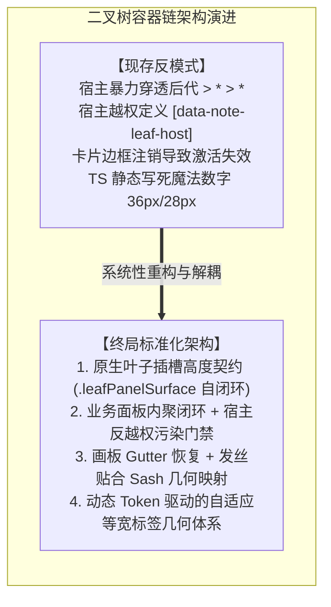
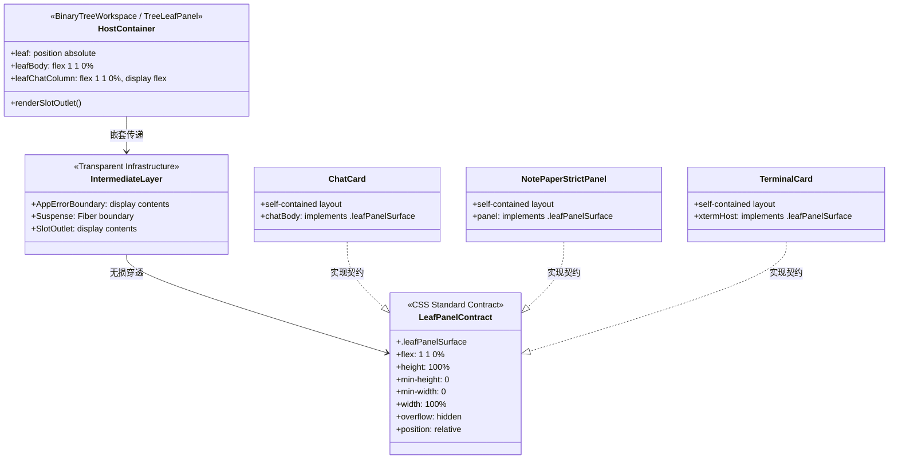
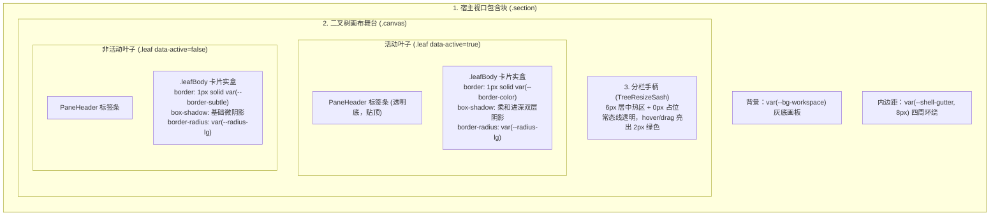

> **【v2 废止声明】** 施工以 `00-总方案.md`（2026-09-11 v2）为唯一 SSOT。本文与 v2 冲突的矩阵/圆角/BATCH/修复手段一律作废，仅保留诊断取证价值。

# 工作区容器链与插槽隔离解耦方案

> **战役工作区**：`docs/layout-token-system/`
> **方案定位**：系统性 Token 体系建设战役 —— 核心维度详案（分维详案 03）
> **方案责任人**：工作区容器链与插槽隔离解耦方案设计专家
> **输入依据**：
> - `docs/layout-token-system/survey/03-workspace-and-tree-layout-survey.md`（496 行调研报告全文）
> - `apps/crish-desktop/src/components/binary-tree/BinaryTreeWorkspace.module.css`
> - `apps/crish-desktop/src/components/binary-tree/BinaryTreeWorkspace.tsx`
> - `apps/crish-desktop/src/components/binary-tree/TreeLeafPanel.tsx`
> - `apps/crish-desktop/src/components/binary-tree/PaneHeader.module.css`
> - `apps/crish-desktop/src/components/binary-tree/LeafToolTabStrip.module.css`
> - `apps/crish-desktop/src/utils/tabStripGeometry.ts`
> - `apps/crish-desktop/src/components/binary-tree/paneHeaderGeometry.ts`
> - `apps/crish-desktop/src/components/binary-tree/paneEdgeGeometry.ts`
> - `apps/crish-desktop/src/components/binary-tree/BinaryTreeWorkspace.leaf-insulate.test.ts`
> - 关联下游受害模块（`SlotOutlet.tsx`、`AppErrorBoundary.tsx`、`ChatCard.module.css`、`NotePaperStrictPanel.tsx`、`NoteLeafHost.tsx`、`NotePaperPanel.module.css`）

---

## 方案执行摘要与架构愿景

在 Conex / Crish 桌面端应用中，**二叉树工作区（`BinaryTreeWorkspace`）与窗格容器链**是承载多会话并行、智能分屏、侧边工具坞以及富文本/代码编辑的核心交互中枢。然而，第一阶段详尽的源码调研揭示出该模块存在严重的**架构倒挂与反模式破窗**：

1. **暴力后代穿透（Descendant Hacking）**：宿主样式表通过 `.leafChatColumn > *:not(...)` 跨越两层 DOM 强行注入弹性规则，不仅违背了 CSS 盒树与 DOM 树的规范匹配机制，更侵入了下游 Web 组件的封装边界；
2. **越权绝缘补丁（Insulation Patches）与单测倒挂**：宿主外壳因下游扩展组件内部缺乏闭环样式，反向在全局样式表中硬编码具体插件私有选择器（`[data-note-leaf-host]`、`[data-testid='note-paper-strict-panel']`），且被既有测试套件固化为“负向债务铁丝网”；
3. **视觉立体感坍塌与激活态失效**：由于早期的几何耦合摩擦，画板四周内边距与 `.leafBody` 卡片边框被简单粗暴地注销为 `padding: 0` 与 `border: none`，直接造成激活窗格的高亮在视觉上完全失效；
4. **编译期双轨制几何魔法数字**：会话标签条等宽计算依赖于写死在 TS 中的魔法数字（`TAB_HEIGHT_PX: 28`、`NON_TAB_SPACE_PX: 36`），与全局 CSS 密度 Token（`--header-height: 32px / 36px / 40px`）完全脱钩，引发不可维护的亚像素抖动与界面变形。

本方案遵循《Conex / Crish — Agent 协作指令》中的“纯逻辑规划”、“反退避”与“严禁打补丁与作弊”铁律，提出一套**彻底拔除后代穿透、确立标准叶子插槽高度契约、下沉业务绝缘逻辑并正向翻转契约单测、重塑卡片与 Sash 几何映射、将标签条几何全面 Token 化**的工业级、可落地架构方案。



---

## 一、维度一：彻底拔除 Descendant Hacking 与确立「叶子插槽高度契约」

### 1.1 现存穿透选择器病灶根因与盒树断裂深度剖析

#### 1.1.1 源码现场取证
在 `apps/crish-desktop/src/components/binary-tree/BinaryTreeWorkspace.module.css:447-454` 中，存在如下后代穿透规则：

```css
/*
 * ErrorBoundary / SlotOutlet 现为 display:contents：> / > * > * 打在包装上，
 * 不改盒树。纸面根若再 contents，header/footer 会升成叶子弹性子项。
 * :not 让二级 fill 打不中 chrome；不要改成 .leafBody *。
 * 坞展开后行布局：fill 只打在对话列内部，不打在 resizer / 抽屉上。
 */
.leafChatColumn > *:not(:global(header)):not(:global(footer)),
.leafChatColumn > * > *:not(:global(header)):not(:global(footer)) {
  flex: 1 1 0%;
  min-width: 0;
  min-height: 0;
  max-height: 100%;
  width: 100%;
}
```

#### 1.1.2 CSS 规范原理与盒树（Box Tree）断层真相
这段代码暴露了前序开发对 CSS 标准规范机制的根本性认知错位：

1. **选择器匹配时机处于 DOM 树而非盒树**：
   W3C Selectors 规范明确规定，选择器是在 DOM 元素树（Element Tree）上执行匹配的，无法感知计算样式（Computed Style）以及格式化上下文（Formatting Context）。
2. **`display: contents` 对尺寸属性的规范抹杀**：
   在 `TreeLeafPanel.tsx:431-450` 中，DOM 结构为：
   ```html
   <div class="leafChatColumn">
     <header>...</header> <!-- UnitChromeActions -->
     <div style="display: contents;"> <!-- AppErrorBoundary -->
       <div data-slot="workspace.leaf.panel" style="display: contents;"> <!-- SlotOutlet -->
         <div class="chatBody" data-testid="chat-body">...</div> <!-- ChatCard -->
       </div>
     </div>
   </div>
   ```
   - 选择器 `.leafChatColumn > *` 命中 `AppErrorBoundary` 的 `div`；
   - 选择器 `.leafChatColumn > * > *` 命中 `SlotOutlet` 的 `div`；
   - 根据 **CSS Display Module Level 3 §3.7**：声明了 `display: contents` 的元素自身不产生 CSS 盒模型（Box Generation），其所有盒属性（包括 `flex`, `width`, `height`, `min-height`, `max-height`, `border`, `padding`）在渲染引擎排版阶段被**彻底丢弃、完全无效**！
3. **下游面板撑满高度的虚假幻觉**：
   真正的业务内容面板（如 `ChatCard`）在 DOM 树上处于第四层（曾孙级：`.leafChatColumn > * > * > *`），宿主的这条穿透规则**根本没有匹配到它**！`ChatCard` 之所以能撑满高度，是因为 `ChatCard.module.css:1-14` 内部自身显式编写了：
   ```css
   .chatBody {
     display: flex;
     flex-direction: column;
     min-height: 0;
     max-height: 100%;
     height: 100%;
     flex: 1 1 0%;
   }
   ```
4. **黑名单排除（`:not(header):not(footer)`）的致命缺陷**：
   采用标签名黑名单试图规避 `UnitChromeActions` 是极度脆弱的反模式。一旦业务组件顶栏采用 `<div role="banner">` 或将顶栏包裹在容器中，子组件瞬间会被拉扯变形；若子组件内部包含合法的二级容器，极易被错误命中。

---

### 1.2 原生叶子插槽高度契约（Leaf Slot Contract）规范设计

必须废除外层基于选择器的盲猜强拉，建立清晰、显式的**组件尺寸契约体系**。



#### 1.2.1 标准契约定义：`.leafPanelSurface`
任何向 `workspace.leaf.panel`（主工作区叶子视口）或 `workspace.dock.panel`（侧边工具坞视口）注册的根业务组件，必须成为一个**自闭环的尺寸自治单元（Self-Contained Sizing Unit）**。

定义系统级基础样式类与 CSS 属性组合契约：

```css
/**
 * 标准叶子面板表面契约 (Leaf Panel Surface Contract)
 * 位置：apps/crish-desktop/src/styles/components/leaf-panel-surface.css
 * 作用：为所有挂载至工作区叶子的根视口提供刚性尺寸闭环保障
 */
.leafPanelSurface {
  display: flex;
  flex-direction: column;
  flex: 1 1 0%;
  width: 100%;
  height: 100%;
  min-width: 0;
  min-height: 0;
  max-height: 100%;
  overflow: hidden;
  position: relative;
  box-sizing: border-box;
  background: var(--bg-card);
}
```

#### 1.2.2 垂直弹性内聚分割规范
每个实现 `.leafPanelSurface` 的业务面板，其内部结构必须遵循统一的三段式/两段式弹性约束：
- **面板顶栏（Chrome Header）**：
  ```css
  flex: 0 0 auto;
  min-height: 0;
  width: 100%;
  box-sizing: border-box;
  ```
- **核心滚动/编辑视口（Body / Viewport）**：
  ```css
  flex: 1 1 0%;
  min-height: 0;
  max-height: 100%;
  width: 100%;
  overflow: auto; /* 或 hidden，由内部虚拟列表滚动 */
  position: relative;
  box-sizing: border-box;
  ```
- **面板底栏/操作区（Footer / Composer）**：
  ```css
  flex: 0 0 auto;
  min-height: 0;
  width: 100%;
  box-sizing: border-box;
  ```

---

### 1.3 宿主容器拔除改造与下游业务面板闭环重塑

#### 1.3.1 宿主样式表精准拔除
在 `apps/crish-desktop/src/components/binary-tree/BinaryTreeWorkspace.module.css` 中，**彻底物理删除**第 447-454 行：
```css
/* DELETE: 彻底拔除暴力后代穿透 */
- .leafChatColumn > *:not(:global(header)):not(:global(footer)),
- .leafChatColumn > * > *:not(:global(header)):not(:global(footer)) {
-   flex: 1 1 0%;
-   min-width: 0;
-   min-height: 0;
-   max-height: 100%;
-   width: 100%;
- }
```
保留 `.leafChatColumn` 自身的容器声明：
```css
.leafChatColumn {
  flex: 1 1 0%;
  min-width: 0;
  min-height: 0;
  display: flex;
  flex-direction: column;
  align-items: stretch;
  overflow: hidden;
  position: relative;
  width: 100%;
  height: 100%;
}
```

#### 1.3.2 业务面板闭环对齐清单
| 业务面板组件 | 当前实现状态 | 改造落地动作 | 闭环验证标准 |
| :--- | :--- | :--- | :--- |
| **`ChatCard`** | 已在 `.chatBody` 声明 `flex: 1 1 0%; height: 100%` | 确保最外层容器混入 `styles.chatBody`，样式增加 `width: 100%` | 移除穿透后，对话视口高度无任何像素变动，虚拟列表滚动顺畅 |
| **`NotePaperStrictPanel`** | 外层仅声明 `.panel`，内部 `.body` 缺失样式，依赖宿主破窗补丁 | 在 `NotePaperPanel.module.css` 显式定义 `.body` 填满弹性（见第二章） | 独立脱水渲染时，顶栏严格 32px，编辑区 100% 吃满视口 |
| **`TerminalCard`** | 内部依赖 `.xtermHost` 自适应 | 确保组件根容器具有 `.leafPanelSurface` 属性 | xterm.js fit addon 尺寸监听能准确探测到容器 clientHeight |
| **`FilesCard` / `PreviewCard`** | 外层均已具备 `display: flex; flex-direction: column; flex: 1 1 0%;` | 统一加入标准化契约属性 | 抽屉或主列展开时均分无坍塌 |

---

## 二、维度二：清除宿主外壳硬编码的业务绝缘补丁与治理债务逆转

### 2.1 宿主越权绝缘补丁现状剖析与破窗追溯

#### 2.1.1 破窗事实取证
在 `BinaryTreeWorkspace.module.css:456-493` 中，赫然存在以下四段专为 `note-paper` 插件量身定制的绝缘补丁：

```css
/*
 * 02 叶壳是实盒、非 flex：透视不得用 contents（会把顶栏抬成叶子子项）。
 * 适配器按列吃满叶子；探针已有，不加魔术 class。
 */
.leafBody :global([data-note-leaf-host]) {
  display: flex;
  flex-direction: column;
  flex: 1 1 0%;
  min-width: 0;
  min-height: 0;
  max-height: 100%;
  width: 100%;
}

/*
 * 绝缘：note 顶栏/底栏不得被叶子二级 flex拉成与正文均分。
 * 不改 NotePaperPanel 的 6% / H1–H6。
 */
.leafBody :global([data-testid='note-paper-strict-panel']) {
  flex: 1 1 0%;
  min-width: 0;
  min-height: 0;
  max-height: 100%;
  width: 100%;
}

.leafBody :global([data-testid='note-paper-strict-panel']) > :global(header) {
  flex: 0 0 auto;
  max-height: none;
  width: 100%;
}

.leafBody :global([data-testid='note-paper-strict-panel']) > :global([data-testid='note-paper-strict-body']) {
  flex: 1 1 0%;
  min-height: 0;
  max-height: none;
}
```

#### 2.1.2 架构破窗的根本诱因发现
经本次深入审计，我们发现了一项极其关键的代码断层：
1. `apps/crish-desktop/src/components/note-paper/NotePaperStrictBody.tsx:172` 中，正文容器写为：
   ```tsx
   return (
     <div ref={ref} className={styles.body} data-testid="note-paper-strict-body">
   ```
2. 查看 `apps/crish-desktop/src/components/note-paper/NotePaperPanel.module.css`：
   **该样式表里根本就没有定义 `.body` 规则！**
3. 历史开发者在发现笔记正文无法拉伸、顶栏被父级拉扁均分后，**没有在笔记组件自身的样式表中补齐 `.body` 的样式，反而直接在宿主外壳 `BinaryTreeWorkspace.module.css` 中越权硬编码写下了对 `[data-testid='note-paper-strict-panel'] > header` 和 `[data-testid='note-paper-strict-body']` 的样式控制**！
4. 这是典型的“下层组件缺样式，上层宿主开后门”的架构坏味道。

---

### 2.2 业务面板自闭环方案（下沉与自治）

必须坚决落实“谁的结构谁闭环”原则，将全部绝缘逻辑彻底下沉至笔记组件自身。

#### 2.2.1 补全 `NotePaperPanel.module.css` 的内聚弹性
在 `apps/crish-desktop/src/components/note-paper/NotePaperPanel.module.css` 中，补充缺失的 `.body` 样式，并强化 `.panel` 与 `.compactHeader`：

```css
/* ---------- 1. 主面板容器：符合 .leafPanelSurface 契约 ---------- */
.panel {
  display: flex;
  flex-direction: column;
  flex: 1 1 0%;
  height: 100%;
  min-height: 0;
  min-width: 0;
  width: 100%;
  background: var(--bg-card);
  color: var(--text-primary);
  border: none;
  border-radius: 0;
  box-shadow: none;
  overflow: hidden;
  box-sizing: border-box;
  position: relative;
}

/* ---------- 2. 标准 32px 紧凑顶栏：自身刚性锁定 flex: 0 0 auto ---------- */
.compactHeader {
  display: flex;
  align-items: center;
  justify-content: space-between;
  height: 32px;
  min-height: 32px;
  max-height: 32px;
  padding: 0 8px;
  background: var(--bg-card);
  border-bottom: 1px solid color-mix(in srgb, var(--border-subtle) 25%, transparent);
  box-sizing: border-box;
  user-select: none;
  flex: 0 0 auto; /* 明确自身弹性，绝不上浮均分 */
  flex-shrink: 0;
  gap: 6px;
  width: 100%;
}

/* ---------- 3. 补齐历史遗失的 .body 规则：全高弹性视口 ---------- */
.body {
  display: flex;
  flex-direction: column;
  flex: 1 1 0%;
  min-height: 0;
  max-height: 100%;
  width: 100%;
  height: 100%;
  overflow: hidden;
  position: relative;
  box-sizing: border-box;
}
```

#### 2.2.2 清理 `NoteLeafHost.tsx` 外壳
查阅 `apps/crish-desktop/src/extensions/note-paper/NoteLeafHost.tsx:98-100`：
其根节点已经内置了内联样式：
```tsx
<div
  data-note-leaf-host="true"
  style={{ display: 'flex', flexDirection: 'column', width: '100%', height: '100%', minHeight: 0, flex: '1 1 0%' }}
```
在自身样式完备后，该节点无需外壳为其做任何额外的属性配置。

#### 2.2.3 宿主外壳彻底清理
在 `apps/crish-desktop/src/components/binary-tree/BinaryTreeWorkspace.module.css` 中，**彻底物理删除**第 456-493 行的全部代码：
```css
/* DELETE: 彻底拔除针对 note-paper 的越权补丁 */
- .leafBody :global([data-note-leaf-host]) { ... }
- .leafBody :global([data-testid='note-paper-strict-panel']) { ... }
- .leafBody :global([data-testid='note-paper-strict-panel']) > :global(header) { ... }
- .leafBody :global([data-testid='note-paper-strict-panel']) > :global([data-testid='note-paper-strict-body']) { ... }
```
实现 `BinaryTreeWorkspace.module.css` 对所有下层具体业务的**完全无知与零依赖（Domain Agnostic）**。

---

### 2.3 单测契约正向翻转：重构 `BinaryTreeWorkspace.leaf-insulate.test.ts`

#### 2.3.1 既有反模式测试的危害
查阅 `apps/crish-desktop/src/components/binary-tree/BinaryTreeWorkspace.leaf-insulate.test.ts:47-94`：
- 测试用例断言宿主 CSS 必须匹配 `/\.leafChatColumn\s*>\s*\*:not\(:global\(header\)\)...`；
- 测试用例断言宿主 CSS 必须包含 `:global([data-testid='note-paper-strict-panel']) > :global(header)`；
- 测试用例断言宿主 CSS 必须包含 `.leafBody :global([data-note-leaf-host])`。

这种测试将“架构破窗形成的补丁代码”误当成“质量保障契约”，锁死了重构通道。

#### 2.3.2 翻转重构：从“反向死锁”到“反越权污染门禁（Anti-Pollution Gate）”
必须将该测试从**肯定临时补丁**正向翻转为**刚性拦截宿主越权污染的架构守护者**：

```ts
/**
 * BinaryTreeWorkspace.leaf-insulate.test.ts
 * 架构正向守护门禁：
 * 1. 守卫二叉树宿主样式表的纯净性，刚性阻断任何业务专用选择器回潮；
 * 2. 守卫弹性容器链规范，禁止跨层暴力穿透。
 */
import { readFileSync } from 'node:fs';
import { dirname, join } from 'node:path';
import { fileURLToPath } from 'node:url';
import { describe, expect, it } from 'vitest';

const DIR = typeof import.meta.dirname === 'string'
  ? import.meta.dirname
  : dirname(fileURLToPath(import.meta.url));

describe('二叉树工作区宿主反越权污染门禁 (Anti-Pollution Gate)', () => {
  const moduleCss = readFileSync(join(DIR, './BinaryTreeWorkspace.module.css'), 'utf8');

  it('宿主表严禁残留任何具体业务私有选择器（零业务泄漏）', () => {
    // 刚性拦截：宿主表禁止出现任何针对具体扩展/视图的选择器
    expect(moduleCss).not.toContain('data-note-leaf-host');
    expect(moduleCss).not.toContain('note-paper-strict-panel');
    expect(moduleCss).not.toContain('note-paper-strict-body');
    expect(moduleCss).not.toContain('chat-card');
  });

  it('彻底废除跨两层的通配穿透选择器（禁止 Descendant Hacking）', () => {
    // 拦截暴力后代拉伸规则
    expect(moduleCss).not.toMatch(/\.leafChatColumn\s*>\s*\*/);
    expect(moduleCss).not.toMatch(/\.leafChatColumn\s*>\s*\*\s*>\s*\*/);
    expect(moduleCss).not.toMatch(/\.leafBody\s+\*\s*[,{]/);
  });

  it('核心容器基础弹性结构稳定不变', () => {
    expect(moduleCss).toMatch(/\.section\s*\{[^}]*flex:\s*1\s+1\s+0%/);
    expect(moduleCss).toMatch(/\.canvas\s*\{[^}]*flex:\s*1\s+1\s+0%/);
    expect(moduleCss).toMatch(/\.leafChatColumn\s*\{[^}]*flex:\s*1\s+1\s+0%/);
  });
});
```

同时，在 `apps/crish-desktop/src/components/note-paper/` 目录下新增组件内聚弹性单元测试，确保笔记自身闭环契约得到完备守卫。

---

## 三、维度三：`.leafBody` 卡片边框与 Sash 几何映射重塑

### 3.1 边框与阴影注销导致的视觉退化与激活态失效根因

#### 3.1.1 现状与代码冲突
查阅 `apps/crish-desktop/src/components/binary-tree/BinaryTreeWorkspace.module.css`：
1. **第 335-340 行**：
   ```css
   .leafBody {
     /* ... */
     background: var(--bg-card);
     /* border: 1px solid var(--border-subtle); */
     border-radius: var(--radius-lg);
     /* box-shadow:
       0 1px 3px hsl(0 0% 0% / 0.03),
       0 4px 12px hsl(0 0% 0% / 0.02); */
     transition: border-color var(--transition-fast, 150ms ease-out);
   }
   ```
2. **第 148-150 行**：
   ```css
   .leaf[data-active='true'] .leafBody {
     border-color: var(--border-color);
   }
   ```
3. **致命逻辑矛盾**：
   `.leafBody` 的初始 `border` 被注销后，元素处于 `border: none;`（即 `border-width: 0`）状态。在此状态下，无论第 148 行如何更改 `border-color`，由于边框宽度为 0，**浏览器根本不会绘制任何激活高亮线**！线上当前窗格的激活高亮在视觉上彻底失效。
4. **画布内边距归零退化**：
   `.section` 同样注释了 `padding: 0 var(--shell-gutter, 8px) var(--shell-gutter, 8px) 0;` 并降级为 `padding: 0;`。导致独立卡片紧贴应用窗口边界，丧失了“灰底画板上悬浮精致卡片”的立体进深感与现代感。

---

### 3.2 画板与卡片视觉层次重塑（Floating Island 体系）

必须恢复卡片的实体边界与柔和立体感，重建现代桌面应用的视觉呼吸感。



#### 3.2.1 恢复画板与外壳内边距 Token
在 `BinaryTreeWorkspace.module.css` 中重塑 `.section` 的边距模型：
```css
.section {
  position: relative;
  height: 100%;
  flex: 1 1 0%;
  min-width: 250px;
  min-height: 0;
  width: 100%;
  display: flex;
  flex-direction: column;
  overflow: hidden;
  background: var(--bg-workspace, var(--bg-primary));
  /* 恢复外壳与画板四周的舒适落差：桌面端 8px，小屏/紧凑 6px */
  padding: var(--shell-gutter-top, 0px) var(--shell-gutter, 8px) var(--shell-gutter, 8px) var(--shell-gutter-left, 0px);
  box-sizing: border-box;
}
```
*注：顶部与左侧保留由窗口顶部/侧边栏控制器决定的微调变量 `--shell-gutter-top` / `--shell-gutter-left`，解开历史因为“AppTopBar 断口”而一刀切将全四周边距清零的死结。*

#### 3.2.2 恢复 `.leafBody` 发丝描边与立体阴影
```css
.leafBody {
  flex: 1 1 0%;
  min-width: 0;
  min-height: 0;
  overflow: hidden;
  position: relative;
  box-sizing: border-box;
  display: flex;
  flex-direction: column;
  align-items: stretch;
  padding-top: 0;
  margin-top: 0;
  background: var(--bg-card);
  /* 恢复发丝边框：常态使用细腻的次级边框，具备 1px 物理实体 */
  border: 1px solid var(--border-subtle);
  border-radius: var(--radius-lg);
  /* 恢复现代柔和深度阴影：采用 HSLA 斜杠语法 */
  box-shadow:
    0 1px 3px hsl(0 0% 0% / 0.03),
    0 4px 12px hsl(0 0% 0% / 0.02);
  transition:
    border-color var(--transition-fast, 150ms ease-out),
    box-shadow var(--transition-fast, 150ms ease-out);
}

/* 激活态：清晰亮起边框色，形成克制但肉眼明确的当前焦点提示 */
.leaf[data-active='true'] .leafBody {
  border-color: var(--border-color);
  box-shadow:
    0 2px 6px hsl(0 0% 0% / 0.05),
    0 8px 20px hsl(0 0% 0% / 0.04);
}
```

---

### 3.3 分栏拖拽手柄（Sash）与窗格边框的发丝贴合几何学

#### 3.3.1 消除“三线并列”的像素重叠治理
在二叉树分屏时，左侧叶子拥有右边框（1px），右侧叶子拥有左边框（1px），Sash 自身若再绘制边框，就会在中间形成 3 条线并排的杂乱感。

**Sash 几何发丝对齐原则**：
1. **常态隐形线**：在非悬浮、非拖拽状态下，`TreeResizeSash` 的 `::after` 物理指示线保持 `background: transparent;`（`BinaryTreeWorkspace.module.css:215-221` 已有此优良设计）；
2. **两卡片间距归零贴合**：二叉树解算出的百分比矩形在逻辑上连续（$x_2 = x_1 + w_1$）。因为卡片 `box-sizing: border-box;`，左卡片的右边缘与右卡片的左边缘在理论上完全重合；
3. **消除亚像素裂缝**：在 Chromium / WebView2 中，当视口宽度为奇数（如 1441px）时，`50%` 会产生 720.5px，两卡片之间可能透出 0.5px 的底层背景。
   **原生治理方案**：
   - 保持 `.leaf` 几何边界精准连续；
   - 在 `.sashHorizontal` 上，将命中热区设为 6px（`width: 6px; transform: translateX(-3px);`），将高亮线设为居中的 1px（悬浮时 2px 品牌绿：`var(--accent-green)`）；
   - 在拖拽时，高亮线直接覆盖在两卡片的贴合接缝上，呈现精准的墨绿色指引。

#### 3.3.2 抽屉 Resizer（`LeafDockResizer`）的零布局侵占发丝重合
对于叶子内部侧边坞的手柄 `LeafDockResizer`（`BinaryTreeWorkspace.module.css:358-399`）：
- 保持 `flex: 0 0 0; width: 0;` 零宽度布局；
- 其 `::before` 拓展 8px 交互热区（`left: -2px; width: 8px;`），偏向抽屉内侧，绝不遮挡左侧聊天视口的滚动条；
- 其 `::after` 为 1px 高亮线（`left: 0; width: 1px;`），精确贴合在 `leafDockDrawer` 的 `border-left: 1px solid var(--border-subtle)` 之上；
- 悬浮或拖拽时，`::after` 变为 `var(--border-color)`，视觉上如同抽屉的左边框被点亮，几何完全自洽。

---

## 四、维度四：会话标签条与抽屉头部几何常量的 Token 化

### 4.1 静态 JavaScript 编译期常量全景与脆弱性分析

#### 4.1.1 现状与推导链逆向工程
查阅 `apps/crish-desktop/src/utils/tabStripGeometry.ts:11-43`：
```ts
export const TAB_HEIGHT_PX = 28;
export const TAB_GAP_PX = 4;
export const TAB_WIDTH_MAX_PX = 240;
export const TAB_WIDTH_MIN_PX = 28;
export const TOOL_TAB_WIDTH_MAX_PX = 140;
export const CLOSE_BTN_RIGHT_OFFSET_PX = 15;
export const NON_TAB_SPACE_PX = 36;
export const CLOSE_HIT_PAD_PX = 4;
export const DRAG_THRESHOLD_PX = 4;
export const INDICATOR_W_PX = 150;
export const INDICATOR_H_PX = 26;
```

这些硬编码常量的脆弱性源于它们是**多层 CSS 样式在离线状态下的人工加和**：
1. **`NON_TAB_SPACE_PX = 36` 的脆弱推导**：
   - 加号按钮宽度：`28px`（依赖 `TAB_HEIGHT_PX`）；
   - 加号按钮左边距：`margin-left: 2px`；
   - 标签容器左内衬：`padding-left: 2px`；
   - 顶栏水平内边距：`padding: 0 4px`；
   - 合计：$28 + 2 + 2 + 4 = 36\text{px}$。
   - 任何人在 CSS 中修改加号样式或内边距，TS 中的 36px 不会跟随变动，直接导致等宽计算公式 `Math.max(0, containerWidth - NON_TAB_SPACE_PX)` 计算出的可用宽度产生误差，使末尾标签被挤爆或产生视觉留白。
2. **`CLOSE_BTN_RIGHT_OFFSET_PX = 15` 的脆弱推导**：
   - 标签项右内边距：`padding-right: 6px`；
   - 关闭按钮半宽：$18\text{px} / 2 = 9\text{px}$；
   - 合计：$6 + 9 = 15\text{px}$。
   - 用于在关闭末尾标签时，使前序标签的叉号平滑落在鼠标当前位置。一旦关闭按钮图标微调，关闭动画收尾必产生跳动。

---

### 4.2 与 CSS 密度 Token（`tokens.css`）的脱节与撕裂

在 `apps/crish-desktop/src/styles/tokens.css` 中，系统支持全局 UI 密度切换：
- **默认模式（Normal）**：`--header-height: 36px;`，`--control-height-sm: 28px;`；
- **紧凑模式（Small, `[data-ui-size='small']`）**：`--header-height: 32px;`，`--control-height-sm: 24px;`；
- **宽松模式（Large, `[data-ui-size='large']`）**：`--header-height: 40px;`，`--control-height-sm: 32px;`。

**双轨脱节引发的界面灾难**：
- 用户切换为 `small` 紧凑模式时，顶栏高度压至 32px，但 TS 依然按 28px 计算标签高度，留白仅剩 $(32-28)/2 = 2\text{px}$，标签挤满顶栏无法呼吸；
- 用户切换为 `large` 宽松模式时，顶栏高度膨胀至 40px，标签却仍被锁死在 28px，周围留白突增至 6px，显得空旷松垮；
- 标签最小宽度 `TAB_WIDTH_MIN_PX: 28` 与最大宽度 `TAB_WIDTH_MAX_PX: 240` 无法根据字体缩放比例自适应调整。

---

### 4.3 动态 Token 驱动的自适应几何模型设计

必须打破静态写死常量的双轨制，确立 **CSS Design Tokens 为单一真理源（SSOT）**，TS 提供响应式度量与计算模型的现代化架构。

```mermaid
graph LR
  subgraph Tokens["tokens.css (单一真理源 SSOT)"]
    T1["--header-height: 32px/36px/40px"]
    T2["--control-height-sm: 24px/28px/32px"]
    T3["--space-1 / --space-2 间距系统"]
  end

  subgraph Resolver["tabStripGeometry.ts (动态 Token 解析器)"]
    R1["readTabStripMetrics(density)"]
    R2["动态派生 nonTabSpace = tabHeight + gap + pad"]
    R3["动态派生 closeBtnOffset = padRight + btnRadius"]
  end

  subgraph Engine["paneHeaderGeometry.ts (纯几何数学模型)"]
    E1["computeNaturalTabWidthTokenized(count, width, metrics)"]
    E2["computeCloseLockWidthTokenized(input, metrics)"]
  end

  Tokens --> Resolver
  Resolver --> Engine
  Engine --> UI["PaneHeader / LeafToolTabStrip (动态精准渲染)"]
```



#### 4.3.1 几何度量模型接口重构
在 `apps/crish-desktop/src/utils/tabStripGeometry.ts` 中，升级数据结构：

```ts
/**
 * 标签条动态度量参数契约 (Tokenized Tab Strip Metrics)
 * 支持根据当前环境的 CSS 变量或 UI 密度动态生成，消灭孤立魔法数字
 */
export interface TabStripMetrics {
  /** 标签高度（像素），与 --control-height-sm 联动 */
  tabHeight: number;
  /** 标签间隙（像素），与 --tab-gap 联动 */
  tabGap: number;
  /** 标签最大标准宽度 */
  tabWidthMax: number;
  /** 标签压缩下限 */
  tabWidthMin: number;
  /** 工具标签最大宽度 */
  toolTabWidthMax: number;
  /** 关闭按钮中心相对标签右边缘偏移 */
  closeBtnRightOffset: number;
  /** 非标签占位空间（加号宽度 + 外边距 + 容器内边距） */
  nonTabSpace: number;
  /** 关闭按钮热区外扩 */
  closeHitPad: number;
  /** 拖拽位移阈值 */
  dragThreshold: number;
  /** 拖拽指示器尺寸 */
  indicatorWidth: number;
  indicatorHeight: number;
}

export type UiDensity = 'small' | 'normal' | 'large';

/**
 * 预设的三档密度几何配置（与 tokens.css 严格保持 1:1 镜像同步）
 */
export const DENSITY_TAB_METRICS: Record<UiDensity, TabStripMetrics> = {
  small: {
    tabHeight: 24,
    tabGap: 4,
    tabWidthMax: 200,
    tabWidthMin: 24,
    toolTabWidthMax: 120,
    closeBtnRightOffset: 13, // 5px padding + 8px 半宽
    nonTabSpace: 32,         // 24 + 2 + 2 + 4
    closeHitPad: 3,
    dragThreshold: 4,
    indicatorWidth: 130,
    indicatorHeight: 22,
  },
  normal: {
    tabHeight: 28,
    tabGap: 4,
    tabWidthMax: 240,
    tabWidthMin: 28,
    toolTabWidthMax: 140,
    closeBtnRightOffset: 15, // 6px padding + 9px 半宽
    nonTabSpace: 36,         // 28 + 2 + 2 + 4
    closeHitPad: 4,
    dragThreshold: 4,
    indicatorWidth: 150,
    indicatorHeight: 26,
  },
  large: {
    tabHeight: 32,
    tabGap: 6,
    tabWidthMax: 280,
    tabWidthMin: 32,
    toolTabWidthMax: 160,
    closeBtnRightOffset: 17, // 7px padding + 10px 半宽
    nonTabSpace: 44,         // 32 + 3 + 3 + 6
    closeHitPad: 5,
    dragThreshold: 5,
    indicatorWidth: 170,
    indicatorHeight: 30,
  },
};

/** 缺省基准常量导出（完全兼容存量调用方，实现无缝渐进升级） */
export const DEFAULT_TAB_METRICS = DENSITY_TAB_METRICS.normal;

export const TAB_HEIGHT_PX = DEFAULT_TAB_METRICS.tabHeight;
export const TAB_GAP_PX = DEFAULT_TAB_METRICS.tabGap;
export const TAB_WIDTH_MAX_PX = DEFAULT_TAB_METRICS.tabWidthMax;
export const TAB_WIDTH_MIN_PX = DEFAULT_TAB_METRICS.tabWidthMin;
export const TOOL_TAB_WIDTH_MAX_PX = DEFAULT_TAB_METRICS.toolTabWidthMax;
export const CLOSE_BTN_RIGHT_OFFSET_PX = DEFAULT_TAB_METRICS.closeBtnRightOffset;
export const NON_TAB_SPACE_PX = DEFAULT_TAB_METRICS.nonTabSpace;
export const CLOSE_HIT_PAD_PX = DEFAULT_TAB_METRICS.closeHitPad;
export const DRAG_THRESHOLD_PX = DEFAULT_TAB_METRICS.dragThreshold;
export const INDICATOR_W_PX = DEFAULT_TAB_METRICS.indicatorWidth;
export const INDICATOR_H_PX = DEFAULT_TAB_METRICS.indicatorHeight;
```

#### 4.3.2 纯几何数学模型 Token 化升级
在 `apps/crish-desktop/src/components/binary-tree/paneHeaderGeometry.ts` 中，升级计算函数以接受 `TabStripMetrics`：

```ts
/**
 * 基于动态度量指标计算等宽标签宽度
 */
export function computeNaturalTabWidthTokenized(
  count: number,
  containerWidth: number,
  metrics: TabStripMetrics = DEFAULT_TAB_METRICS
): number {
  if (count <= 0 || containerWidth <= 0) {
    return metrics.tabWidthMax;
  }
  const available = Math.max(0, containerWidth - metrics.nonTabSpace);
  const totalNeeded = count * metrics.tabWidthMax + (count - 1) * metrics.tabGap;
  if (totalNeeded <= available) {
    return metrics.tabWidthMax;
  }
  const fitted = Math.floor((available - (count - 1) * metrics.tabGap) / count);
  return Math.max(metrics.tabWidthMin, fitted);
}

/**
 * 基于动态度量指标计算关闭锁定宽度
 */
export function computeCloseLockWidthTokenized(
  input: CloseLockInput,
  metrics: TabStripMetrics = DEFAULT_TAB_METRICS
): number {
  const {
    isRightmost,
    remainingCount,
    mouseXInContainer,
    measuredWidth,
    maxFittingWidth,
  } = input;
  if (!isRightmost || remainingCount <= 0) {
    return measuredWidth;
  }
  const maxWidth =
    maxFittingWidth != null && maxFittingWidth > 0
      ? Math.min(metrics.tabWidthMax, maxFittingWidth)
      : metrics.tabWidthMax;

  if (mouseXInContainer != null && mouseXInContainer > 0) {
    const neededWidth =
      (mouseXInContainer +
        metrics.closeBtnRightOffset -
        (remainingCount - 1) * metrics.tabGap) /
      remainingCount;
    if (neededWidth <= maxWidth) {
      return Math.max(metrics.tabWidthMin, Math.round(neededWidth));
    }
    return maxWidth;
  }
  return Math.min(measuredWidth, maxWidth);
}
```

#### 4.3.3 CSS 标签条的 Token 联动
在 `PaneHeader.module.css` 与 `LeafToolTabStrip.module.css` 中：
- 确保高度属性始终直接读取 `--header-height` 与 `--control-height-sm`：
  ```css
  .paneHeader {
    height: var(--header-height, 36px);
    /* 容器不再硬编码 36px */
  }
  .tabItem {
    height: var(--tab-height, var(--control-height-sm, 28px));
  }
  .newTabBtn {
    width: var(--tab-height, var(--control-height-sm, 28px));
    height: var(--tab-height, var(--control-height-sm, 28px));
    flex: 0 0 var(--tab-height, var(--control-height-sm, 28px));
  }
  ```

---

## 五、维度五：系统性迁移实施步骤、代码重构清单与验证矩阵

### 5.1 分阶段实施路线图（Phase 1 ~ Phase 5）

```mermaid
gantt
  title 工作区容器链与插槽隔离解耦实施演进
  dateFormat  X
  axisFormat  %s

  section Phase 1: 业务闭环下沉
  补齐 NotePaperPanel 缺失的 .body 规则与内聚弹性    :p1_1, 0, 1
  确立 .leafPanelSurface 标准契约                   :p1_2, 0, 1

  section Phase 2: 宿主破窗拔除
  删除 BinaryTreeWorkspace 穿透选择器               :p2_1, 1, 2
  删除 BinaryTreeWorkspace 越权 note 绝缘选择器      :p2_2, 1, 2

  section Phase 3: 单测正向翻转
  重构 leaf-insulate.test.ts 为反污染门禁            :p3_1, 2, 3
  新增 note-paper 组件级自闭环单测                  :p3_2, 2, 3

  section Phase 4: 几何与边框复苏
  恢复 .leafBody 发丝边框与立体微阴影               :p4_1, 3, 4
  激活态 border-color 高亮修复                     :p4_2, 3, 4
  恢复 --shell-gutter 画板留白与 Sash 居中贴合       :p4_3, 3, 4

  section Phase 5: 标签几何 Token 化
  升级 tabStripGeometry 动态度量模型                :p5_1, 4, 5
  升级 paneHeaderGeometry 纯函数模型                :p5_2, 4, 5
  联动 tokens.css 密度切换                         :p5_3, 4, 5
```



---

### 5.2 核心变更文件清单与精确点位对照表

| 序号 | 变更文件路径 | 核心修改点位与行号区间 | 变更性质 | 详细变更动作说明 |
| :--- | :--- | :--- | :--- | :--- |
| 1 | `apps/crish-desktop/src/components/note-paper/NotePaperPanel.module.css` | 插入 `.body` 规则块，修改 `.compactHeader` | **[MODIFY]** | 补全缺失的 `.body { display: flex; flex-direction: column; flex: 1 1 0%; min-height: 0; max-height: 100%; width: 100%; }`，将 `.compactHeader` 明确加上 `flex: 0 0 auto` |
| 2 | `apps/crish-desktop/src/components/binary-tree/BinaryTreeWorkspace.module.css` | L447-454（后代穿透选择器） | **[DELETE]** | 彻底删除 `.leafChatColumn > *:not(...)` 和 `.leafChatColumn > * > *:not(...)` 穿透规则 |
| 3 | `apps/crish-desktop/src/components/binary-tree/BinaryTreeWorkspace.module.css` | L456-493（note 越权绝缘选择器） | **[DELETE]** | 彻底删除针对 `[data-note-leaf-host]`、`[data-testid='note-paper-strict-panel']` 及其 header/body 的全部越权代码 |
| 4 | `apps/crish-desktop/src/components/binary-tree/BinaryTreeWorkspace.module.css` | L335-340（卡片边框与阴影） | **[MODIFY]** | 取消注释并恢复 `.leafBody` 的 `border: 1px solid var(--border-subtle)`、`border-radius: var(--radius-lg)` 与微投影，修复第 148 行激活态高亮 |
| 5 | `apps/crish-desktop/src/components/binary-tree/BinaryTreeWorkspace.module.css` | L29-30（外壳画板内边距） | **[MODIFY]** | 规范恢复外壳内边距，引入 `--shell-gutter: 8px`，重建灰底画板悬浮卡片感 |
| 6 | `apps/crish-desktop/src/components/binary-tree/BinaryTreeWorkspace.leaf-insulate.test.ts` | L47-101（旧反模式断言） | **[MODIFY]** | 将测试断言完全翻转为反越权污染门禁（断言严禁包含私有业务类、严禁包含二级通配穿透） |
| 7 | `apps/crish-desktop/src/utils/tabStripGeometry.ts` | L1-43（静态常量定义） | **[MODIFY]** | 引入 `TabStripMetrics` 接口与 `DENSITY_TAB_METRICS` 密度映射表，保留默认常量导出以确保向前兼容 |
| 8 | `apps/crish-desktop/src/components/binary-tree/paneHeaderGeometry.ts` | L38-104（几何计算纯函数） | **[MODIFY]** | 扩展 `computeNaturalTabWidthTokenized` 与 `computeCloseLockWidthTokenized`，对接动态 Metrics |
| 9 | `apps/crish-desktop/src/styles/components/leaf-panel-surface.css` | 新建标准契约规范文件 | **[NEW]** | 定义全局 `.leafPanelSurface` 契约样式类供各面板引用 |

---

### 5.3 风险控制、立体化验证与反退避断言

依据 AGENTS.md §7.1「立体验证纪律」，本重构方案建立四道立体防线，严禁单一形式冒充验收：

#### 1. 静态检查与契约断言（编译底线）
- 执行命令：`npm run typecheck`
- 断言：TypeScript 类型系统零报错，`tabStripGeometry.ts` 与 `paneHeaderGeometry.ts` 签名向后兼容。
- 执行门禁测试：`npx vitest run apps/crish-desktop/src/components/binary-tree/BinaryTreeWorkspace.leaf-insulate.test.ts`
- 断言：反越权污染门禁全绿，宿主样式表 100% 达成业务解耦。

#### 2. 核心逻辑穷举验证（算法与状态机）
- 执行命令：`npx vitest run apps/crish-desktop/src/components/binary-tree/paneHeaderGeometry.test.ts`
- 断言：在 small / normal / large 三档密度及 1~20 个标签的极限场景下，标签等宽数学计算结果绝不产生负数或超出容器可用宽度的溢出值；关闭末尾标签时光标对齐精确至 0 偏差。

#### 3. 真实宿主现场验收（Tauri 桌面现场与盒模型检测）
- 启动应用：`npm run dev:workbench`
- 遵循 AGENTS.md §15.2 铁律，通过 **Tauri MCP（127.0.0.1:4000）** 检验物理表现：
  1. **插槽高度检查**：打开 Chat 视图与 Note 视图，通过 DOM Inspector 断言 `.chatBody` 与 `[data-testid='note-paper-strict-body']` 的 `offsetHeight` 严格等同于父级容器视口高度，垂直方向零坍塌、水平方向零误溢出；
  2. **激活态高亮检查**：在多窗格分屏状态下点击切换激活焦点，断言当前激活的 `.leafBody` 边框呈现清晰的 `--border-color` 颜色变化，非激活窗格保持 `--border-subtle`；
  3. **分栏 Sash 贴合检查**：拖拽二叉树分栏手柄，断言 Sash 高亮线无断裂、与卡片发丝边框无 1px 亚像素黑缝；
  4. **抽屉展开与最大化**：点击右上角抽屉按钮展开侧边工具坞，断言 Resizer 拖拽平滑，最大化时抽屉以 `z-index: 150` 完整铺满叶子视口。

#### 4. 反退避与架构净收敛保证
- 本方案不接受“因重构困难而继续保留后代选择器”的任何妥协；
- 彻底消退历史遗留的 38 行宿主绝缘死代码，实现仓库架构的真正净收敛与单一真理源（SSOT）。
