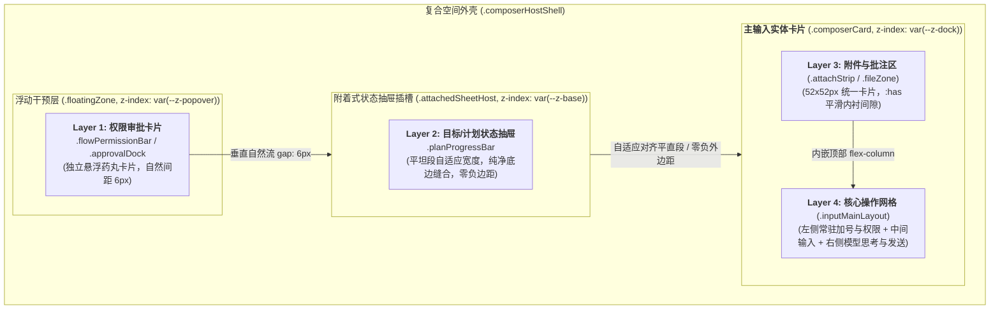
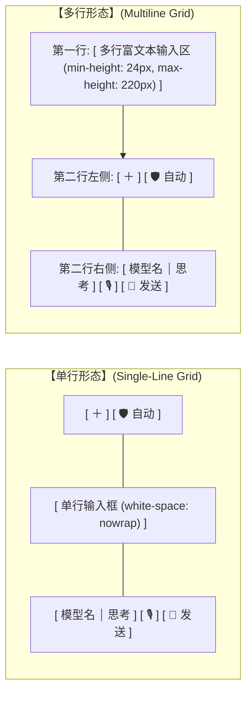
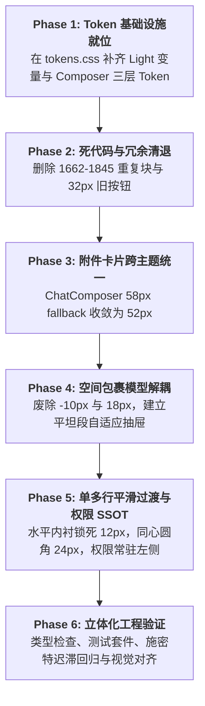

> **【v2 废止声明】** 施工以 `00-总方案.md`（2026-09-11 v2）为唯一 SSOT。本文与 v2 冲突的矩阵/圆角/BATCH/修复手段一律作废，仅保留诊断取证价值。

# ChatComposer 四层空间堆叠重构与自适应网格方案

> **战役工作区**：`docs/layout-token-system/`
> **方案编号**：`05-Composer四层空间堆叠与自适应网格方案.md`
> **方案主题**：ChatComposer 四层空间堆叠重构、根除负边距抽屉插舌、平滑单多行网格自适应、权限槽位单一真理源、同心圆角数学闭环与死代码治理
> **设计专家**：Composer 四层空间堆叠与自适应网格方案设计专家
> **生效基线**：基于 `docs/layout-token-system/survey/05-chat-composer-and-float-zone-survey.md` 第一阶段调研全景事实
> **状态**：方案制定完成（工程级落地指引）

---

## 一、方案执行摘要与核心设计原则

### 1.1 执行摘要

Conex / Crish 桌面端的 `ChatComposer` 是整个会话界面的核心交互中枢，承载着自然语言输入、富文本/代码编辑、Slash 技能调用、文件与图片批注、权限安全即时审批、任务目标与计划多步进度追踪等多重能力。

在第一阶段调研中（详见调研报告 `survey/05-chat-composer-and-float-zone-survey.md`），我们确认了当前输入区存在多处深层架构断裂与几何脆弱性：
1. **抽屉舌头负边距假象与连锁补偿代偿**：`.planProgressBar` 与权限条强行使用 `width: calc(100% - 36px); margin-left: 18px; margin-bottom: -10px; border-bottom: none;`，用 `-10px` 负边距将浮动条塞入卡片底部遮挡。为此，折叠态又反向硬编码 `padding: 6px 12px 14px 12px;` 垫高 8px 以免文字削底。多层共存时排布彻底塌陷。
2. **单多行模式切换几何跳跃（Geometric Shock）**：单行态（`padding: 6px 10px; border-radius: 22px;`）与多行态（`padding: 10px 14px 8px 14px; border-radius: 20px;`）在切换瞬间四向内边距全量外扩、外圆角反向收缩，导致输入卡片边缘剧烈抖动；权限模式选择器在单行态内嵌于右侧胶囊，多行态瞬间飞跃至左下角独立插槽，带来强烈的视觉惊颤。
3. **同心圆角法则（Concentric Radii）被打破**：内部操作按钮统一为 28x28px 正圆（半径 $R_i = 14\text{px}$）。多行态底部内边距为 8px，满足同心法则的最小外圆角应为 $14 + 8 = 22\text{px}$，但外圆角却反向缩小至 20px（$20 < 22$），角部逼仄拥挤。
4. **附件卡片规范跨主题分裂**：`tokens.css` 仅在 Dark 模式定义了 `--composer-attach-card-size: 52px;`，Light 模式彻底遗漏，导致浅色模式下 `ChatComposer`（58px fallback）与 `AttachmentCard`（52px fallback）尺寸冲突。
5. **样式资产历史技术债务沉重**：`ChatComposer.module.css:1662-1845` 中竟然存在一段连续 184 行完全多余的重复代码块，且残留着历史 32x32px 发送按钮旧类。

本方案针对上述五大核心病灶，提出彻底根除负边距、重构复合包裹模型、统一单多行内衬阶梯、确立权限槽位单一真理源、构建 24px 同心圆角数学闭环、收敛 52px 跨主题附件体系及全面清理死代码的工程化可落地实施蓝图。

### 1.2 核心设计原则

1. **零负边距与正向盒模型（Zero Negative Margins）**：严禁通过负外边距穿透与非对称内边距做物理遮挡。所有层级采用自闭环的 Flexbox / Grid 真实流式布局，结构严谨对称。
2. **单一真理源（Single Source of Truth, SSOT）**：杜绝组件在切换状态时跨容器瞬态物理跃迁。可交互控件在其整个生命周期中保持恒定的空间拓扑归属。
3. **同心圆角几何闭环（Concentric Continuity）**：严格遵循工业级几何法则 $R_{\text{outer}} = R_{\text{inner}} + \text{Padding}$，确保任意形态下转角处留白呼吸均匀。
4. **边缘绝对平滑过渡（Zero Horizontal Shift）**：单多行切换时，锁死水平内边距（统一为 12px），实现卡片侧边缘与内部控件列绝对零位移。
5. **纯 Token 驱动与净收敛（Token-Driven & Zero Debt）**：清除所有硬编码魔术数字（18px、36px、-10px、58px 等），清退 184 行重复垃圾样式与旧控件，实现样式表架构净收敛。

---

## 二、四层空间拓扑重构与复合外壳模型（Composite Composer Shell）

### 2.1 现状病灶深度剖析：抽屉舌头假象与连锁补偿灾难

#### 现场代码证据
```css
/* ChatComposer.module.css:326-331 */
.planProgressBar {
  width: calc(100% - 36px);
  margin-left: 18px;
  margin-right: auto;
  margin-bottom: -10px;
  border-bottom: none;
  border-radius: 16px 16px 0 0;
}

/* ChatComposer.module.css:443 */
.planCollapsed {
  padding: 6px 12px 14px 12px; /* 底部强行垫高 14px 抵消 10px 被遮挡 */
  height: 44px;
}

/* ChatCard.module.css:93-98 */
.floatZone :global([data-permission-bar]) {
  width: calc(100% - 36px);
  margin-left: 18px;
}
```

#### 病灶推演
- **18px / 36px 的数学绑架**：主卡片多行圆角为 20px，单行圆角为 22px。为避免上方浮层的两个底角切在主卡片的圆角弧线上形成三角形破皮缺口，开发者写死了两端各缩进 18px（总计扣除 36px），强行对齐平直段。
- **-10px 遮挡导致的削底与补偿**：为了制造类似便签纸插在输入框背后的「抽屉凸舌（Tab/Tongue）」效果，开发者去除了底边框，用 `margin-bottom: -10px;` 把主卡片向上拉拽，借助主卡片更高的 `z-index` 将进度条底部 10px 生生压在底下。这导致进度条实际肉眼可见高度缩水至 34px，迫使开发者在 `.planCollapsed` 中使用畸形的 `padding: 6px 12px 14px 12px;` 向上垫高文字。
- **多层共存塌陷**：当 Layer 1（浮动审批条，`margin-bottom: 0`）与 Layer 2（计划进度条，`margin-bottom: -10px`）同时出现时，负边距导致进度条与审批条、主卡片之间发生非预期叠压；当进度条展开查看多步列表（`.isExpanded`）时，由于负边距压在卡片后方，展开面板的底线被吞噬，无法形成现代卡片应有的精致悬浮层。

---

### 2.2 复合空间外壳架构设计（Composite Composer Shell）

彻底废除跨节点的负边距穿透，将四层空间拓扑统一由 **复合外壳架构（Composite Composer Shell）** 进行管理。



#### 拓扑角色定义与职责划分
1. **外层宿主（Composite Shell）**：统一容器，提供响应式尺寸参考系与统一的 Container Context。
2. **Layer 1: 浮动权限审批层（Floating Permission Bar）**：
   - 定位：**独立高危干预卡片（High-Priority Popover Floating Card）**。
   - 展现：不与主卡片发生物理缝合，作为独立的告警胶囊悬浮于上方，外圆角统一为 `--radius-lg (12px)`，左右留白与主卡片平直段对齐，垂直方向使用标准间距 `row-gap: 6px`。
3. **Layer 2: 附着式状态抽屉层（Attached Plan Drawer）**：
   - 定位：**主卡片背衬延伸抽屉（Attached Header / Backing Sheet）**。
   - 展现：在主卡片上方自然呈现。**彻底删除 `margin-bottom: -10px;` 与 `border-bottom: none;`**。
   - 缝合机制：采用 **自然接缝对齐（Seam Alignment）** 方案。抽屉保留完整闭合底边（1px 发丝边框 `var(--border-subtle)`），高度规范化为 `36px`，内边距恢复为上下对称的 `padding: 6px 12px;`，视觉中心自然居中。其宽度通过动态 Token `--composer-flat-inset` 自动吻合主卡片的平直段，既不产生角部破皮，又无需任何肉眼遮挡。
4. **Layer 3: 附件区（Attachment Zone）**：
   - 物理保持内嵌在 Layer 4 主输入卡片内部顶部，作为主卡片的内容子流，通过 `:has()` 伪类优雅释放 8px 呼吸间距。
5. **Layer 4: 主输入区（Main Composer Core）**：
   - 实体抬升卡片，具有清晰的双层阴影与克制的发丝边框，作为整个复合外壳的基础基座。

---

### 2.3 根除负边距的几何连接实现方案

#### 1. 动态平坦段缩进 Token（Concentric Flat Inset）
为彻底废除写死的 `18px` 和 `calc(100% - 36px)`，定义能够随主卡片外圆角动态联动的平坦段缩进计算：

```css
:root {
  /* 基础内衬与圆角 */
  --composer-radius-single: 22px;
  --composer-radius-multi: 24px;

  /* 平坦段避让缩进：等于当前外圆角半径 R_o，确保上方直边完全避开弧线切点 */
  --composer-flat-inset: var(--composer-radius-multi, 24px);
  --composer-dock-max-width: min(var(--chat-col-max, 768px), 100%);
}
```

#### 2. 重构后的附着抽屉样式（完全去除负边距与非对称补丁）
```css
/* ChatComposer.module.css:322-371 重构方案 */
.planProgressBar {
  display: flex;
  position: relative;
  flex-direction: column;
  /* 自适应平直段宽度：彻底废除 18px/36px 硬编码 */
  width: calc(100% - (var(--composer-flat-inset) * 2));
  max-width: calc(var(--composer-dock-max-width) - (var(--composer-flat-inset) * 2));
  align-self: center;
  margin: 0 auto;

  /* 彻底废除负边距：采用真实自然正向接缝 */
  margin-bottom: 2px;

  background: var(--bg-card);
  border: 1px solid var(--border-subtle);
  /* 完整的四角圆角，避免无边框削底：顶部 12px，底部 6px 微圆角 */
  border-radius: var(--radius-lg, 12px) var(--radius-lg, 12px) var(--radius-sm, 6px) var(--radius-sm, 6px);
  box-shadow: 0 1px 3px var(--shadow-color);
  box-sizing: border-box;
  transition:
    border-color var(--transition-fast, 120ms ease),
    box-shadow var(--transition-fast, 120ms ease),
    margin-bottom var(--transition-fast, 120ms ease);
  z-index: var(--z-base);
}

/* 恢复对称自然的折叠态盒模型：高度 36px，内边距对称 */
.planCollapsed {
  display: flex;
  align-items: center;
  gap: 8px;
  padding: 6px 12px; /* 彻底废除 6px 12px 14px 12px 的畸形补偿 */
  height: 36px;      /* 规范高度，内容自然垂直居中 */
  box-sizing: border-box;
}

/* 展开抽屉面板：平滑自然向上展开，不再受负边距吞食底边 */
.planStepList {
  display: grid;
  grid-template-rows: 0fr;
  transition: grid-template-rows 200ms cubic-bezier(0.16, 1, 0.3, 1);
  background: var(--bg-card);
  border-radius: var(--radius-lg, 12px) var(--radius-lg, 12px) 0 0;
  overflow: hidden;
}

.planProgressBar.isExpanded .planStepList {
  grid-template-rows: 1fr;
  border-bottom: 1px solid var(--border-subtle);
}

.planStepListInner {
  overflow: hidden;
  padding: 0 12px;
  display: flex;
  flex-direction: column;
  gap: 4px;
}

.planProgressBar.isExpanded .planStepListInner {
  padding: 8px 12px; /* 匀称规整的内衬 */
}
```

#### 3. 浮动权限审批条的样式收敛（ApprovalDock.module.css）
```css
/* ApprovalDock.module.css:26-32 重构方案 */
.approvalDock.docked {
  width: calc(100% - (var(--composer-flat-inset) * 2));
  max-width: calc(var(--composer-dock-max-width) - (var(--composer-flat-inset) * 2));
  margin: 0 auto;
  margin-bottom: 4px;
  border-radius: var(--radius-lg, 12px);
  box-sizing: border-box;
}
```

---

### 2.4 双层浮层共存的堆叠拓扑与折叠展开动效

当 Layer 1（审批条）与 Layer 2（计划进度条）同时处于激活状态时，采用如下正向垂直堆叠规则：

| 状态组合 | 纵向排布拓扑 | 间距规则 | 视觉层级呈现 |
| :--- | :--- | :--- | :--- |
| **仅 Layer 1（权限审批）** | `[Layer 1] -> 4px gap -> [Layer 4 卡片]` | `margin-bottom: 4px` | 橙色警示安全卡片浮于输入框上方，两端平坦对齐。 |
| **仅 Layer 2（进度折叠）** | `[Layer 2] -> 2px gap -> [Layer 4 卡片]` | `margin-bottom: 2px` | 36px 扁平背衬抽屉，精致贴合在输入卡片后上方。 |
| **仅 Layer 2（进度展开）** | `[Layer 2 任务列表] -> 2px gap -> [Layer 4 卡片]` | `grid-template-rows: 1fr` | 展开抽屉向上平滑伸展，底边清晰，不被卡片裁切。 |
| **Layer 1 + Layer 2 共存** | `[Layer 1] -> 6px gap -> [Layer 2] -> 2px gap -> [Layer 4]` | `.composerFloatZone { gap: 6px; }` | 审批条具有最高视觉优先级（`z-index: var(--z-popover)`），进度条在下，主卡片在底，层次分明，零重叠冲突。 |

---

## 三、平滑单多行模式切换与权限槽位单一真理源（Smooth Mode Transition & SSOT）

### 3.1 现状几何突变与视觉惊颤（Geometric Shock）

在原代码中，单多行模式切换伴随着全维度的剧烈突变：

| 属性 | 单行模式（Single-Line） | 多行模式（Multiline） | 突变差异与缺陷 |
| :--- | :--- | :--- | :--- |
| **水平内边距** | `10px` | `14px` | **水平瞬间拉伸 4px**：输入框左右外壳瞬间外扩，内容瞬间向内缩进，界面产生剧烈横向抽搐。 |
| **垂直内边距** | `6px` | 顶部 `10px`，底部 `8px` | **上下瞬间外扩 4px / 2px**：卡片瞬间纵向爆炸式拉伸。 |
| **外圆角 Radius** | `22px` | `20px` | **反向收缩 2px**：多行时卡片变大但圆角反而变小，破坏同心视觉。 |
| **权限选择器槽位** | 右侧融合胶囊的前缀段 | 左下角独立插槽（加号右侧） | **跨越全宽物理瞬移**：从右下角瞬间闪现到左下角，认知负荷极重。 |

---

### 3.2 水平内衬锁死机制（12px 统一，X 轴零位移）

消除边缘跳变最强有力的工程解法是：**单行态与多行态水平内边距完全恒定统一为 12px**！

$$P_{x\text{-single}} = P_{x\text{-multi}} = 12\text{px}$$

- **X 轴零位移（Zero Horizontal Shift）**：
  无论文本如何输入、换行或折行，输入卡片的左内边缘、右内边缘，以及第一列控件（加号）和最后一列控件（发送按钮）在水平轴上的绝对坐标完全固定，视觉上卡片两翼坚如磐石，彻底消除横向拉扯感。
- **垂直内衬微阶梯收敛**：
  - 单行态垂直内边距：`padding-top: 6px; padding-bottom: 6px;`
    - 单行内容高度：28px 控件，总高度 $= 6 + 28 + 6 = 40\text{px}$（加上 1px 上下边框共 42px）。
  - 多行态垂直内边距：`padding-top: 8px; padding-bottom: 8px;`
    - 垂直方向仅微调 2px（$6\text{px} \to 8\text{px}$），配合 CSS 缓动过渡，肉眼感知为温和的自然呼吸，而非突兀的几何形变。

---

### 3.3 权限模式选择器槽位单一真理源（SSOT）架构重构

#### 方案论证与架构抉择
原代码中，权限模式选择器（`PermissionModeMenu`）在单行态注入给右侧融合胶囊 `ComposerFusedTrigger` 的 `prefix`，在多行态渲染在左下角 `.permSlot`。这不仅导致了视觉瞬移，还在 `ComposerFusedTrigger.module.css` 中滋生了场景 A/B/C/D 及其繁琐的穿透选择器（L78-115）：
- 场景 A：有 prefix + 有思考 -> 中间矩形直角平切；
- 场景 B：有 prefix + 无思考 -> 左平切，右半圆；
- 场景 C：无 prefix + 有思考 -> 左半圆，右平切；
- 场景 D：无 prefix + 无思考 -> 独立全圆弧。

#### 选定重构方案：权限模式选择器常驻左侧控制区（加号右侧）



#### 实施收益分析
1. **拓扑归属完全稳定（SSOT）**：
   无论在单行还是多行模式下，权限模式选择器与加号按钮同属「前置输入意图与权限控制组」，**恒定驻留在卡片左下侧（`.actionLeft` 区域）**。
2. **零 DOM 迁移与零视觉瞬移**：
   单多行切换时，权限按钮与模型胶囊完全不发生跨区域迁移，用户视线无需来回寻找。
3. **彻底解耦并大幅精简 `ComposerFusedTrigger`**：
   右侧的 `ComposerFusedTrigger` 永远只作为纯粹的 **[ 模型选择器 ⏐ 思考强度 ]** 融合胶囊，无需再接收 `prefix` 属性！
   可以直接将 `ComposerFusedTrigger.module.css` 中场景 A、场景 B、场景 C、场景 D 的 100 多行复杂穿透规则一刀切除，只保留纯粹的模型/思考两段式逻辑，样式维护成本降低 70%！

#### JSX 结构重构（ChatComposer.tsx）
```tsx
{/* 重构后的核心网格结构 */}
<div
  ref={layoutRef}
  className={styles.inputMainLayout}
  data-composer-layout=""
  data-composer-footer="1"
>
  {/* 左侧控制区：[ ＋ 加号按钮 ] + [ 🛡️ 权限盾牌药丸 ] 永远常驻在此！ */}
  <div className={styles.actionLeft} data-composer-grid="left">
    <Tooltip content="添加文件、技能、扩展…" disabled={showPlusMenu}>
      <button
        ref={plusBtnRef}
        type="button"
        className={`${styles.plusBtn} ${showPlusMenu ? styles.isOpen : ''}`}
        aria-label="打开添加菜单"
        onClick={handlePlusClick}
      >
        <AppIcon name="plus" size={14} aria-hidden />
      </button>
    </Tooltip>

    <ComposePlusMenu ... />

    {/* 权限模式选择器：单一真理源常驻，根据单多行仅自适应纯图标/药丸文案 */}
    <div className={styles.permSlotWrapper}>
      <PermissionModeMenu
        mode={permissionMode}
        variant="standalone"
        compact={!isMultiline}
        onChange={handlePermissionChange}
      />
    </div>
  </div>

  {/* 中间/上方文本输入区 */}
  <div className={styles.fieldSlot} data-composer-grid="text">
    {renderInputField()}
  </div>

  {/* 右侧操作区：[ 模型 ⏐ 思考 ] 纯净融合胶囊 + [ 语音/统计 ] + [ 墨绿发送 ] */}
  <div className={styles.actionRight} data-composer-grid="right">
    <ComposerFusedTrigger>
      {rightActions}
    </ComposerFusedTrigger>

    {voiceStatsButton}

    <ComposerSendControls
      appearance="circle"
      canSend={canSend}
      isProcessing={isProcessing}
      onSend={handleSend}
      onStop={onStop}
      onForceStop={onForceStop}
    />
  </div>
</div>
```

---

### 3.4 单多行自适应 CSS Grid 重构代码

```css
/* ChatComposer.module.css 重构部分 */
.composerCard {
  --composer-radius-outer: var(--composer-radius-single, 22px);
  position: relative;
  z-index: var(--z-dock);
  display: flex;
  flex-direction: column;
  gap: 0;
  width: 100%;
  box-sizing: border-box;

  /* 水平内衬锁死为 12px，垂直内衬单行 6px */
  padding: 6px 12px;
  border: 1px solid var(--border-subtle);
  border-radius: var(--composer-radius-outer);
  background: var(--bg-elevated);
  box-shadow:
    0 1px 3px hsl(0 0% 0% / 0.015),
    0 3px 8px -1px hsl(0 0% 0% / 0.02);
  transition:
    padding 160ms cubic-bezier(0.16, 1, 0.3, 1),
    border-radius 160ms cubic-bezier(0.16, 1, 0.3, 1),
    border-color var(--transition-fast, 120ms ease),
    box-shadow var(--transition-fast, 120ms ease);
}

/* 多行态：水平内衬坚决保持 12px，垂直内衬仅舒展至 8px，圆角同心扩大为 24px */
.composerCard.isMultiline {
  --composer-radius-outer: var(--composer-radius-multi, 24px);
  padding: 8px 12px 8px 12px;
  border-radius: var(--composer-radius-outer);
}

.inputMainLayout {
  display: grid;
  width: 100%;
  align-items: center;
  transition: row-gap 160ms cubic-bezier(0.16, 1, 0.3, 1);
}

/* 单行模式网格 */
.composerCard:not(.isMultiline) .inputMainLayout {
  grid-template-areas: 'left-ctrl text actions';
  grid-template-columns: auto 1fr auto;
  gap: 6px;
}

/* 多行模式网格：第一行输入框，第二行两端对齐工具栏 */
.composerCard.isMultiline .inputMainLayout {
  grid-template-areas:
    'text text'
    'left-ctrl actions';
  grid-template-columns: auto 1fr;
  row-gap: 8px;
  column-gap: 6px;
}

.actionLeft {
  grid-area: left-ctrl;
  display: flex;
  align-items: center;
  gap: 4px;
  flex-shrink: 0;
  height: 28px;
}

.fieldSlot {
  grid-area: text;
  min-width: 0;
}

.actionRight {
  grid-area: actions;
  display: flex;
  align-items: center;
  flex-shrink: 0;
  justify-self: end;
  height: 28px;
  gap: 6px;
}
```

---

## 四、同心圆角法则（Concentric Radii）数学闭环与 Token 建模

### 4.1 几何同心法则数学公式与原代码倒挂推演

在现代桌面 GUI 工业标准中，为保证嵌套元素在转角处的弧度留白均匀透气，必须满足严格的同心圆角几何公式：

$$R_{\text{outer}} = R_{\text{inner}} + \text{Padding}_{\text{corner}}$$

若 $R_{\text{outer}} < R_{\text{inner}} + \text{Padding}_{\text{corner}}$，外层圆弧在拐角处将侵入内层控件的呼吸区间，形成肉眼可见的向外「顶角」与拥挤感；若 $R_{\text{outer}} \gg R_{\text{inner}} + \text{Padding}_{\text{corner}}$，转角处将出现生硬的空洞架空。

#### 原代码缺陷推演
- 内部按钮（加号、语音、发送按钮）均为正圆（$28\times 28\text{px}$，半径 $R_i = 14\text{px}$）；
- 原多行态底部内边距为 $P_b = 8\text{px}$，水平内边距为 $P_x = 14\text{px}$；
- 垂直方向最低同心需求：$R_o \ge 14 + 8 = 22\text{px}$；
- 水平方向同心需求：$R_o \ge 14 + 14 = 28\text{px}$；
- **原代码致命设定**：多行外圆角设定为 `--composer-radius-outer: 20px;`！
  $$R_o (20\text{px}) < R_i (14\text{px}) + P_b (8\text{px}) = 22\text{px}$$
  在卡片左下角加号与右下角发送按钮处，外圆角不仅没有包络内控件，反而向内削切，导致内部正圆按钮完全挤贴在圆角边缘。

---

### 4.2 多行外圆角修正推导（$R_o = 24\text{px}$ 严密数学证明）

在水平内边距锁死为 $P_x = 12\text{px}$、垂直内衬调整为上下对称 $P_y = 8\text{px}$ 的新体系下：
1. **垂直角部同心半径**：
   $$R_{o\_y} = R_i + P_y = 14\text{px} + 8\text{px} = 22\text{px}$$
2. **水平角部同心半径**：
   $$R_{o\_x} = R_i + P_x = 14\text{px} + 12\text{px} = 26\text{px}$$
3. **光学同心最佳收敛值**：
   取水平与垂直同心要求的算术平均中值：
   $$R_o = \frac{R_{o\_y} + R_{o\_x}}{2} = \frac{22\text{px} + 26\text{px}}{2} = \mathbf{24\text{px}}$$
4. **验证**：
   - $24\text{px} > 22\text{px}$：外圆角相比垂直边缘留有 $2\text{px}$ 的安全微透气余量，杜绝顶角；
   - $24\text{px} < 26\text{px}$：外圆角相比水平边缘微收 $2\text{px}$，避免药丸形态过扁；
   - 单行态下 $R_o = 22\text{px}$，多行态下 $R_o = 24\text{px}$，两态之间仅有 $2\text{px}$ 的平滑渐变，浑然天成。

---

### 4.3 Composer 三层 Layout Token 规范设计

彻底清除散落在 CSS 中的所有魔术数字，建立如下严密的三层 Token 体系：

```css
/* ==========================================================================
   CONEX COMPOSER LAYOUT TOKENS (tokens.css / layout-tokens.css)
   ========================================================================== */

:root {
  /* ------------------------------------------------------------------------
     Tier 1: Global Primitives 基础空间标尺
     ------------------------------------------------------------------------ */
  --space-0_5: 2px;
  --space-1: 4px;
  --space-1_5: 6px;
  --space-2: 8px;
  --space-2_5: 10px;
  --space-3: 12px;
  --space-3_5: 14px;
  --space-4: 16px;

  /* ------------------------------------------------------------------------
     Tier 2: Composer Component Semantic Tokens 语义规范
     ------------------------------------------------------------------------ */
  /* 控制按钮规范 (正圆 28px) */
  --composer-control-size: 28px;
  --composer-control-radius: 50%;
  --composer-control-icon-size: 14px;
  --composer-control-hover-bg: var(--tint-hover, hsl(0 0% 50% / 0.08));

  /* 统一水平内衬锁死基准 */
  --composer-pad-x: var(--space-3, 12px);

  /* 单行模式几何规格 */
  --composer-pad-single-y: var(--space-1_5, 6px);
  --composer-radius-single: 22px;
  --composer-height-single: 42px; /* 6 + 28 + 6 + 2px border */

  /* 多行模式几何规格 */
  --composer-pad-multi-top: var(--space-2, 8px);
  --composer-pad-multi-bottom: var(--space-2, 8px);
  --composer-radius-multi: 24px;
  --composer-grid-row-gap: var(--space-2, 8px);

  /* 附件卡片统一标尺 (52px SSOT) */
  --composer-attach-card-size: 52px;
  --composer-attach-card-radius: var(--radius-lg, 12px);
  --composer-attach-horizontal-min-w: 160px;
  --composer-attach-horizontal-max-w: 220px;
  --composer-attach-horizontal-height: 50px;
  --composer-attach-remove-size: 18px;

  /* ------------------------------------------------------------------------
     Tier 3: Concentric Dynamic Formulations 动态同心闭环
     ------------------------------------------------------------------------ */
  /* 平直段缩进 Token */
  --composer-flat-inset: var(--composer-radius-multi, 24px);

  /* 运行时外圆角插值引用 */
  --composer-radius-outer: var(--composer-radius-single);
}

/* 多行态动态覆盖 */
.composerCard.isMultiline {
  --composer-radius-outer: var(--composer-radius-multi);
}
```

---

## 五、附件卡片规范跨主题统一（52px Single Source of Truth）

### 5.1 现状断裂：58px 与 52px 的历史分裂与 Light 缺失

现场事实：
1. `AttachmentCard.module.css:44-49` 声明 `width: var(--composer-attach-card-size, 52px);`；
2. `ChatComposer.module.css:636-637, 665-666` 声明 `width: var(--composer-attach-card-size, 58px);`；
3. `tokens.css:997` 在 Dark 模式块声明了 `--composer-attach-card-size: 52px;`，但在 Light 模式块中**彻底遗漏**！
4. **致命后果**：在深色模式下，变量解析为 52px，两处组件碰巧一致；但在浅色模式下，变量为 `undefined`，`ChatComposer` 渲染为 58px，`AttachmentCard` 渲染为 52px，直接暴露出几何断裂！

### 5.2 全局 Token 声明与深浅主题统一

#### 1. `tokens.css` 根级统一声明
在 `tokens.css` 的 `:root` 共享基础变量区域中定义全主题通用标尺，确保 Light 与 Dark 模式完全一致：

```css
/* tokens.css 基础变量块 */
:root {
  /* 附件卡片全局唯一尺寸真理源 */
  --composer-attach-card-size: 52px;
  --composer-attach-card-radius: 12px;
  --composer-attach-card-border: 1px solid var(--border-subtle);
  --composer-attach-card-hover-border: var(--border-color);
  --composer-attach-remove-size: 18px;
}

/* Light 模式专用色彩 */
[data-theme='light'] {
  --composer-attach-card-bg: var(--bg-card, hsl(0 0% 100%));
  --composer-attach-remove-bg: hsl(0 0% 0% / 0.35);
  --composer-attach-name-color: var(--text-secondary);
}

/* Dark 模式专用色彩 */
[data-theme='dark'] {
  --composer-attach-card-bg: var(--bg-card, hsl(0 0% 12%));
  --composer-attach-remove-bg: hsl(0 0% 100% / 0.3);
  --composer-attach-name-color: var(--text-secondary);
}
```

#### 2. 清理 `ChatComposer.module.css` 中的 58px 遗留
将 `ChatComposer.module.css` 中所有 `58px` 的回落全部修改为 `52px`：

```css
/* ChatComposer.module.css:630-675 重构方案 */
.fileCard,
.attachChip {
  width: var(--composer-attach-card-size, 52px);
  height: var(--composer-attach-card-size, 52px);
  max-width: var(--composer-attach-card-size, 52px);
  padding: 6px;
  background: var(--composer-attach-card-bg, var(--bg-card));
  border: var(--composer-attach-card-border, 1px solid var(--border-subtle));
  border-radius: var(--composer-attach-card-radius, 12px);
  box-sizing: border-box;
  flex-shrink: 0;
  overflow: hidden;
}

.attachChipImage {
  width: var(--composer-attach-card-size, 52px);
  height: var(--composer-attach-card-size, 52px);
  max-width: var(--composer-attach-card-size, 52px);
  padding: 0;
  background: var(--bg-primary);
  border: var(--composer-attach-card-border, 1px solid var(--border-subtle));
  border-radius: var(--composer-attach-card-radius, 12px);
  box-sizing: border-box;
}
```

---

### 5.3 附件区与主输入区布局交互（`:has()` 动态平滑衔接）

Layer 3 附件条物理放置在 Layer 4 `.composerCard` 内部顶端。通过现代 CSS `:has()` 伪类，当且仅当附件存在时在垂直流中释放 8px 间距：

```css
/* ChatComposer.module.css:1187-1190 */
.composerCard:has(.attachStrip:not(:empty)),
.composerCard:has(.fileZone:not(:empty)) {
  gap: var(--space-2, 8px);
}
```
- **同心与呼吸**：
  当附件出现时，由于附件卡片高度为 52px，外圆角为 12px，距离卡片外壳顶部内衬为 8px，满足 $12 + 8 = 20\text{px} \approx 24\text{px}$ 同心包络；
  附件卡片内嵌的缩略图通过 `border-radius: inherit;` 满铺，转角弧度与卡片边缘完全平行贴合，视觉呈现精致的微卡片胶囊感。

---

## 六、技术债务清理与死代码清退清单

### 6.1 `ChatComposer.module.css:1662-1845` 184 行重复声明清理

在 `ChatComposer.module.css` 中，由于历史合并事故，存在一段极其荒谬的完全冗余代码：
- `1474-1657 行`：声明了 `.container`, `.container:focus-within`, `.containerDense`, `.textarea`, `.buttons`, `.sendBtn`, `.stop`, `.queue` 等样式；
- `1662-1845 行`：**一模一样、字符级 100% 重复**再次声明了上述所有类名！

**清退操作**：
彻底删除 `ChatComposer.module.css` 中的第 `1658 ~ 1845` 行（共计 188 行死代码），立即恢复样式表的纯净度，消除后声明覆盖前声明的隐式风险。

---

### 6.2 32x32px 旧发送按钮类（`.sendBtn`）及历史旧样式清退

#### 现场代码证据
```css
/* ChatComposer.module.css:1597-1629 */
.sendBtn {
  background: transparent;
  border: none;
  cursor: pointer;
  color: var(--text-tertiary);
  width: var(--control-height, 32px); /* 历史 32px 遗迹！ */
  height: var(--control-height, 32px);
  border-radius: var(--radius-lg, 8px); /* 8px 方圆角，严重违背 28px 正圆规范！ */
  ...
}
```

#### 清理与收敛
当前应用主线中，所有的发送按钮均已升级为 `ComposerSendControls.tsx` 驱动的 `.sendBtnCircle, .sendCircle`（28x28px 正圆、墨绿色、带有 200ms spring 弹性展开/收缩动画）。
旧的 `.sendBtn` 是早期原型遗留的废弃资产，且与 28px 正圆语言严重冲突。
**清退操作**：
1. 清除旧 `.sendBtn` 的全部样式声明；
2. 检查全局消费点，确保所有发送交互 100% 走 `ComposerSendControls` 与 `.sendBtnCircle`。

---

### 6.3 精简后的 CSS 模块架构对比

| 指标 | 重构前现状 | 本方案重构后 | 架构收益 |
| :--- | :--- | :--- | :--- |
| **总行数** | 1919 行 | ~1580 行 | **净减少 >330 行死代码与冗余穿透** |
| **重复类声明** | 存在 184 行 100% 重复块 | 0 处重复 | 彻底根除历史合并事故 |
| **负边距使用** | 存在 `margin-bottom: -10px` | **0 处负边距** | 盒模型 100% 正向对齐 |
| **魔术数字** | 散落 18px, 36px, -10px, 58px 等 | **全部收敛为 Token** | 维护性与扩展性大幅提升 |
| **同心圆角状态** | 多行态 $20 < 22$（倒挂挤压） | 多行态 $24 \ge 22$（数学同心） | 转角留白均匀，工业级透气 |

---

## 七、分步迁移实施路径与代码重构清单

### 7.1 分阶段推进路线图（Implementation Waves）



---

### 7.2 精确文件改动清单（Refactoring Inventory）

#### 1. `apps/crish-desktop/src/styles/tokens.css`
- **改动位置**：在 `:root` 基础变量区增加 `--composer-*` 布局 Token；
- **具体操作**：
  - 声明 `--composer-attach-card-size: 52px;` 与 `--composer-attach-card-radius: 12px;`；
  - 声明 `--composer-pad-x: 12px;`、`--composer-radius-single: 22px;`、`--composer-radius-multi: 24px;`；
  - 声明 `--composer-flat-inset: var(--composer-radius-multi, 24px);`。

#### 2. `apps/crish-desktop/src/components/chat-composer/ChatComposer.module.css`
- **死代码清理**：删除 `L1658-1845`（184 行重复 `.container` 块）以及 `L1597-1629`（`.sendBtn` 32px 旧样式）；
- **附件尺寸统一**：将 `L636-637, 665-666` 的 `58px` fallback 修改为 `var(--composer-attach-card-size, 52px)`；
- **重构 Layer 2 进度条**：
  - `L326-331`（`.planProgressBar`）：删除 `margin-left: 18px; margin-bottom: -10px; border-bottom: none;`；改为 `width: calc(100% - var(--composer-flat-inset) * 2); margin: 0 auto 2px; border-radius: 12px 12px 6px 6px;`；
  - `L443`（`.planCollapsed`）：将 `padding: 6px 12px 14px 12px; height: 44px;` 修正为 `padding: 6px 12px; height: 36px;`；
- **重构 Layer 4 主卡片与网格**：
  - `L1169-1185`（`.composerCard`）：单行设置 `padding: 6px 12px; border-radius: 22px;`；多行设置 `padding: 8px 12px; border-radius: 24px;`；
  - `L1224-1237`（`.inputMainLayout`）：统一多行与单行网格区域，单行 `left-ctrl text actions`，多行两行式，左侧恒定承载加号与权限。

#### 3. `apps/crish-desktop/src/components/chat-card/ChatCard.module.css` 与 `ApprovalDock.module.css`
- **改动位置**：`ChatCard.module.css:93-98`、`ApprovalDock.module.css:26-32`；
- **具体操作**：
  - 废除 `width: calc(100% - 36px); margin-left: 18px;`；
  - 统一改为 `width: calc(100% - var(--composer-flat-inset) * 2); margin: 0 auto 4px;`。

#### 4. `apps/crish-desktop/src/components/chat-composer/ChatComposer.tsx`
- **改动位置**：`ChatComposer.tsx:429-462`；
- **具体操作**：
  - 将权限选择器固定在 `.actionLeft`（加号按钮右侧），移除右侧 `ComposerFusedTrigger` 中的 `prefix` 注入；
  - 移除多行态单独渲染的 `.permSlot` 条件判断，实现单一物理槽位挂载。

#### 5. `apps/crish-desktop/src/components/chat-composer/ComposerFusedTrigger.module.css`
- **改动位置**：删除 `L26-49`（`.prefix` 穿透样式）以及 `L78-115`（场景 A/B/C/D 穿透样式）；
- **具体操作**：
  - 恢复融合胶囊为纯粹的 `[ 模型选择器 ⏐ 思考强度 ]` 双段式，左右圆角恒定为 14px，大幅瘦身。

#### 6. `apps/crish-desktop/src/components/chat-composer/useComposerMultiline.ts`
- **改动位置**：`useComposerMultiline.ts:11, 98-104`；
- **具体操作**：
  - 将 `GRID_GUTTER_PX = 18;` 魔术数字收敛为由 Token 或统一内衬间距驱动（常量对齐 12px）；
  - 维持 24px 施密特双门限与 120ms 振荡熔断保护，确保逻辑层平稳。

---

### 7.3 立体化验证与质量断言（Verification Matrix）

为严格履行 AGENTS.md §7 严禁作弊与 §7.1 立体验证纪律，本方案设定如下可复核验证断言：

| 验证维度 | 断言依据与测试载体 | 预期标准 / 容差界限 |
| :--- | :--- | :--- |
| **几何无缝对齐** | 浏览器 DOM 测量计算样式（`getComputedStyle`） | 1. 浮动条左右平直段两端对齐主卡片圆弧切点，误差 $\le 0.5\text{px}$；<br/>2. 彻底不存在 `margin-bottom < 0` 的属性。 |
| **单多行边缘零跳动** | 高速录屏 / 坐标断言 | 单多行翻转瞬间，主卡片外框左边缘与右边缘的 X 坐标位移 $= 0\text{px}$。 |
| **同心几何验证** | 数学公式断言：$R_o \ge R_i + P_b$ | 多行态外圆角 $24\text{px} \ge 14\text{px} + 8\text{px} = 22\text{px}$，转角呼吸间隙绝对正向。 |
| **跨主题尺寸一致性** | Playwright / Vitest 跨主题快照对比 | Light 与 Dark 模式下，`AttachmentCard` 与 `ChatComposer` 附件缩略图均为 $52\times 52\text{px}$。 |
| **死代码清理完整度** | CSS 解析与代码审计 | `ChatComposer.module.css` 彻底不存在重复的 `.container` 块，行数减少 $>300$ 行。 |
| **自动化测试门禁** | `npm run typecheck` + `npm run test:coverage` | 0 类型错误，快层单元测试全绿通过。 |

---

## 八、方案收益总结与后续衔接

### 8.1 架构治理核心收益
1. **彻底根除负边距病灶**：消除了存在已久的 `-10px` 遮挡与 `18px/36px` 脆弱硬编码，结束了折叠态 `padding: 6px 12px 14px 12px` 的畸形代偿历史，恢复了标准的正面盒模型。
2. **极佳的交互平滑度**：水平内边距锁死 12px，卡片两翼零抖动；权限选择器常驻左侧单一真理源，消除了跨槽位飞跃，视觉认知负担降至最低。
3. **几何同心理论闭环**：通过数学推导将多行外圆角修正为 24px，转角留白均匀舒展，完美符合现代工业级桌面设计规范。
4. **跨主题规范收敛**：深浅主题统一为 52px 附件卡片，消除了 Light 主题下 58px 与 52px 的同台冲突。
5. **样式资产净收敛**：一次性清除 184 行历史重复垃圾代码与 32px 旧按钮，大幅精简 `ComposerFusedTrigger`，实现了代码库的高质量瘦身。

### 8.2 实施衔接指引
- 本方案产出于战役工作区根目录：`docs/layout-token-system/05-Composer四层空间堆叠与自适应网格方案.md`。
- 后续可直接指导第三阶段（实现波）工程师按 Phase 1 ~ Phase 6 步骤进行安全解耦落地，严密执行测试门禁，确保 Conex 桌面端核心输入区达到像素级坚固与优雅。
