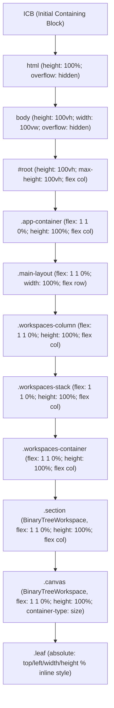

# Shell 外壳与视口包含块层级关系调研报告

> **战役工作区**：`docs/layout-token-system/`
> **调研阶段**：第一阶段详细调研（详细调研团队）
> **调研员**：Shell 外壳与视口包含块层级关系调研员
> **目标组件与样式域**：
> - `apps/crish-desktop/src/App.module.css`
> - `apps/crish-desktop/src/index.css`
> - `apps/crish-desktop/src/styles/shell/shell-reset.css`
> - `apps/crish-desktop/src/styles/shell/shell-layout.css`
> - `apps/crish-desktop/src/components/top-bar/AppTopBar.module.css`
> - `apps/crish-desktop/src/components/top-bar/AppTopBar.tsx`
> - `apps/crish-desktop/src/components/shell/WindowControls.module.css`
> - 关联下游受害模块（`BinaryTreeWorkspace`、`PaneHeader`、`Sidebar`、`SettingsPanel`、`LeafToolTabStrip` 等）

---

## 调研综述与执行摘要

本调研深入分析了 Conex / Crish 桌面端应用顶层外壳（Shell）、HTML/Body、全局顶栏（`AppTopBar`）及主工作区容器之间的视口高度链、包含块边界、内外边距与硬件窗口避让逻辑。

经代码全景穿透，当前系统的外壳层存在 **三大核心架构断层** 与 **一个关键设计真空**：
1. **视口高度链的双重保底冗余与单位混用**：`html` 使用 `100%`，`body` 与 `#root` 强锁 `100vh`，各级主容器在声明 `flex: 1 1 0%` 的同时全量补充 `height: 100%`，并在几乎每一层强行注入 `position: relative; overflow: hidden;`，形成多层绝对定位包含块的防御性堆叠，且面临 DPI 缩放下的亚像素抖动风险。
2. **`AppTopBar` 脱离普通流引发的全域避让泥潭**：顶栏实际采用 `position: absolute; top: 0; width: 100vw; pointer-events: none;`，高度在文档流中为 0，与样式规范注释中声称的「顶栏已 shrink-0，高度用 flex 剩余」彻底相悖。这直接导致下游组件（侧栏、二叉树工作区、窗格标签栏、浮动按钮、设置页）必须全链路感知 `--header-height: 36px`，并通过极其复杂的四层复合属性选择器在第一行（`isTopRow`）手写内边距避让。
3. **跨平台硬件避让 Token 语义混杂与状态爆炸**：`--edge-reserve-*` 系列 Token 将操作系统原生控件（macOS 交通灯、Windows 窗控三键）与前端自建业务按钮（侧栏折叠开关、帮助按钮）硬性糅合；且在 TypeScript、CSS 模块与全局样式之间存在多处硬编码数值（如 `106px`、`70px`、`52px`、`38px`）；更存在 macOS 展开态交通灯与侧栏开关撞车、Settings 全屏面板无条件挂载 Windows 窗控等显著设计缺陷。
4. **全局内外槽（Canvas Gutter）的设计真空与全面退化**：由于顶栏绝对定位导致的视觉断口，以及二叉树 Sash 绝对坐标系统的几何冲突，工作区原先尝试的 `padding: 0 var(--shell-gutter, 8px) ...` 被迫注释废弃，导致整个桌面端画布硬贴宿主边缘，现代桌面应用应有的浮动层次与呼吸感完全丧失。

---

## 一、视口高度链与包含块稳定性调研

### 1.1 视口高度继承链拓扑

从操作系统 WebView2 视口到最底层的二叉树叶子工作区，CSS 高度传递形成了如下的连续继承链：



### 1.2 关键代码事实与文件锚点

1. **根部基础重置与视口锁死**：
   - `apps/crish-desktop/src/styles/shell/shell-layout.css:6-9`：
     ```css
     html {
       height: 100%;
       overflow: hidden;
     }
     ```
   - `apps/crish-desktop/src/styles/shell/shell-reset.css:26-36`：
     ```css
     body {
       font-family: var(--font-sans);
       ...
       overflow: hidden;
       height: 100vh;
       width: 100vw;
       user-select: none;
     }
     ```
   - `apps/crish-desktop/src/styles/shell/shell-layout.css:11-19`：
     ```css
     #root {
       width: 100%;
       height: 100vh;
       max-height: 100vh;
       display: flex;
       flex-direction: column;
       overflow: hidden;
       position: relative;
     }
     ```

2. **应用外壳与主布局弹性分配**：
   - `apps/crish-desktop/src/styles/shell/shell-layout.css:21-41`：
     ```css
     .app-container {
       display: flex;
       flex-direction: column;
       flex: 1 1 0%;
       min-height: 0;
       width: 100%;
       height: 100%;
       overflow: hidden;
       position: relative;
     }

     .main-layout {
       display: flex;
       flex-direction: row;
       flex: 1 1 0%;
       min-width: 0;
       min-height: 0;
       width: 100%;
       overflow: hidden;
       position: relative;
     }
     ```

3. **工作区列与多层包裹容器**：
   - `apps/crish-desktop/src/styles/shell/shell-layout.css:43-54`：
     ```css
     .workspaces-column,
     .workspaces-stack,
     .workspaces-container {
       display: flex;
       flex-direction: column;
       flex: 1 1 0%;
       min-width: 0;
       min-height: 0;
       width: 100%;
       height: 100%;
       overflow: hidden;
     }
     ```

4. **二叉树画布与容器查询**：
   - `apps/crish-desktop/src/components/binary-tree/BinaryTreeWorkspace.module.css:18-48`：
     ```css
     .section {
       position: relative;
       height: 100%;
       flex: 1 1 0%;
       min-width: 250px;
       min-height: 0;
       width: 100%;
       display: flex;
       flex-direction: column;
       overflow: hidden;
       background: var(--bg-workspace, var(--bg-primary));
       padding: 0;
       box-sizing: border-box;
     }

     .canvas {
       position: relative;
       width: 100%;
       flex: 1 1 0%;
       min-height: 0;
       height: 100%;
       overflow: hidden;
       background: transparent;
       border: none;
       border-radius: 0;
       box-shadow: none;
       box-sizing: border-box;
       container-type: size;
       container-name: tree-canvas;
     }
     ```

### 1.3 核心问题深度剖析

#### 问题 1：`100vh`、`100vw` 与百分比混用产生的宿主失配
- **现象**：`html` 设置 `height: 100%`，但 `body` 采用 `height: 100vh; width: 100vw;`，`#root` 又声明 `height: 100vh; max-height: 100vh;`。
- **成因与风险**：
  - 在 CSS 规范中，`100vw` 会将经典滚动条（Classic Scrollbar）的宽度计算在内。虽然 `body` 设置了 `overflow: hidden`，但在某些特定 DPI 缩放（如 Windows 125%、175%）下，`100vw` 与 `100vh` 换算为物理像素时容易出现小数（如 `853.33px`），引发亚像素渲染四舍五入偏差，可能诱发 1px 的不可见滚动或者边缘抗锯齿黑线。
  - 在 Tauri 桌面环境中，外层窗口可能在无边框（decorations: false）与标准边框之间切换，`100vh` 计算的是 Viewport 理论高度，在部分多屏幕跨 DPI 拖拽的瞬间，`100vh` 与父级物理 clientHeight 存在微小更新延迟，引发闪烁。

#### 问题 2：`flex: 1 1 0%` 与 `height: 100%` 的双重防御性冗余
- **现象**：在 `.app-container`、`.workspaces-column`、`.workspaces-stack`、`.workspaces-container`、`.section` 以及 `.canvas` 中，无一例外地同时存在 `flex: 1 1 0%` 与 `height: 100%`（且通常伴随 `min-height: 0`）。
- **根因分析**：
  - 这是典型的“代码防御过度”。维护者担心某一处 Flex 属性在子节点中塌陷，因此在每一层都写了 `height: 100%`。
  - 根据 W3C CSS Flexible Box Layout Module 规范，当父容器尺寸由 flex 分配时，子元素设置 `height: 100%` 在部分旧引擎中可能被视为循环依赖或导致 flex item 的 min-height 覆盖。虽然当前 Blink/WebKit 现代版本能正确识别，但造成样式表冗余度极高，增加了布局计算重排（Reflow）的开销。

#### 问题 3：定位包含块（Containing Block）层层嵌套的坐标陷阱
- **现象**：从 `#root` 开始，`.app-container`、`.main-layout`、`.section`、`.canvas` 全部都声明了 `position: relative`。
- **影响**：
  - 这种设计将所有的绝对定位子元素硬性封闭在其直接父级之内。
  - 当子组件（如 Toast、全局浮窗、快捷键面板或工具拖拽预览）想要逃逸出局部容器时，必须依赖 React Portal 强行挂载到 `document.body` 或专用 root。
  - 更重要的是，这彻底切断了绝对定位元素直接参考视口外壳（Shell Viewport）的可能性。

---

## 二、`AppTopBar` 绝对定位浮动架构的影响

### 2.1 虚假声明与现实断层的戏剧性对比

在布局样式总表 `apps/crish-desktop/src/styles/shell/shell-layout.css` 的顶部，有一条极其醒目的注释：

> **`apps/crish-desktop/src/styles/shell/shell-layout.css:4`**：
> `/* 高度用 flex 剩余；顶栏已 shrink-0，禁止 calc 减顶栏。 */`

**然而，代码的实际情况完全推翻了这条注释！**

让我们查看顶栏实际的样式定义与 DOM 结构：
- **`apps/crish-desktop/src/components/top-bar/AppTopBar.module.css:7-27`**：
  ```css
  .topBar {
    position: absolute;
    top: 0;
    left: 0;
    right: 0;
    height: var(--header-height, 36px);
    min-height: var(--header-height, 36px);
    max-height: var(--header-height, 36px);
    width: 100vw;
    display: flex;
    align-items: center;
    background: transparent;
    border-bottom: none;
    box-sizing: border-box;
    overflow: hidden;
    user-select: none;
    -webkit-app-region: no-drag;
    app-region: no-drag;
    z-index: var(--z-sidebar, 100);
    pointer-events: none;
  }
  ```
- **`apps/crish-desktop/src/App.tsx:159-182`**：
  ```tsx
  <div className={`app-container ${appModeClass}`} ...>
    <a href="#crish-main" className={styles.skipLink}>跳转到主要内容</a>
    <AppTopBar onShowCheatsheet={() => setShowCheatsheet(true)} />
    <main id="crish-main" className="main-layout" aria-label="主工作区">
  ```

### 2.2 绝对定位浮动架构对文档流的破坏

1. **流内高度归零**：
   - 因为 `AppTopBar` 声明为 `position: absolute; top: 0; left: 0; right: 0;`，它**完全脱离了正常文档流**！
   - 在 `.app-container`（Flex 列布局）中，参与空间计算的普通流元素实际上只有 `<main className="main-layout">`。
   - 结果：`.main-layout` 的 `flex: 1 1 0%` 毫无阻挡地吃满了整个 `.app-container`（即视口 y=0 到 y=100% 的全部高度）。
   - **`AppTopBar` 并没有占用任何物理高度，它如同一层幽灵薄膜悬浮在整个桌面端视口的正上方（0 ~ 36px 区域）！**

2. **为什么当初要设计成绝对定位？**
   - 查看 `AppTopBar.module.css:1-5` 注释可知设计意图：
     > `* AppTopBar — 36px 单层顶栏，与工作区外壳共用同一块灰底。`
     > `* 视觉规格对齐参考里的 .tree-pane-header：透明分界、无下边框，`
     > `* 顶栏与下方画布是一整片连续的「大矩形」，卡片浮在其上。`
   - 设计师希望让应用呈现“一整片连续的大矩形画板”，侧栏和工作区的卡片浮在其上，为了消除传统桌面顶栏（Titlebar）与下方内容之间生硬的横向物理分割线，直接将顶栏做成了透明浮层。

### 2.3 下游受害组件的全域连锁避让清单

因为顶栏脱离了普通文档流，导致视口内所有从 y=0 开始渲染的下游组件，只要不想让自己的可交互内容被顶栏遮挡，就**必须手动引入 `--header-height` 进行自杀式避让**。

| 受害模块 / 文件 | 代码位置 | 避让机制与具体代码 | 架构负面效应 |
| :--- | :--- | :--- | :--- |
| **侧栏头部**<br>`Sidebar.module.css` | `Sidebar.module.css:33-50` | `.sidebarHeader { position: absolute; top: 0; left: 0; width: 52px; height: var(--header-height, 36px); z-index: 101; }` | 展开/折叠按钮独立悬浮于 y=0 顶部，与顶栏重叠；被迫声明 `z-index: 101` 压过顶栏的 100。 |
| **侧栏整行头部栏**<br>`Sidebar.module.css` | `Sidebar.module.css:53-65` | `.sidebarHeaderBar { width: 100%; height: var(--header-height, 36px); ... }` | 展开时用于在侧栏内部硬撑出一个 36px 的空白带，把真实列表内容下推。 |
| **折叠态开关**<br>`SidebarHeader.tsx` | `SidebarHeader.tsx:41-57` | `<div className={`${styles.sidebarHeader} ...` data-mac={isMacDesktop ? 'true' : 'false'}>` | 侧栏折叠后，在主布局左上角悬浮一个绝对定位的 52px（macOS 106px）按钮。 |
| **二叉树窗格头部**<br>`PaneHeader.module.css` | `PaneHeader.module.css:13-30` | `.paneHeader { height: var(--header-height); min-height: var(--header-height); max-height: var(--header-height); }` | 窗格标签栏被迫将自身高度与全局顶栏高度强行绑定为同源数值（36px）。 |
| **工具窗格标签栏**<br>`LeafToolTabStrip.module.css` | `LeafToolTabStrip.module.css:12-30` | `.container { height: var(--header-height); min-height: var(--header-height); flex: 0 0 var(--header-height); }` | 右侧工具栏的标签条高度也被迫写死为 `--header-height`，无法独立收缩。 |
| **工具窗格空态启动中心**<br>`LeafToolTabStrip.module.css` | `LeafToolTabStrip.module.css:389-403` | `.launcherHubWrapper { position: absolute; top: var(--header-height); left: 0; right: 0; bottom: 0; }` | 标签为空时的启动面板，必须手写 `top: var(--header-height)` 避开顶部标签行。 |
| **二叉树叶右上浮动按钮**<br>`BinaryTreeWorkspace.module.css` | `BinaryTreeWorkspace.module.css:95-102` | `.topSidePanelBtn { position: absolute; top: calc(var(--header-height) + var(--leaf-corner-btn-gap)); right: var(--leaf-corner-btn-inset); }` | 为避免与顶栏撞车，右上角折叠按钮必须手写 `calc(var(--header-height) + 5px)`！ |
| **全屏设置覆盖层**<br>`SettingsPanel.module.css` | `SettingsPanel.module.css:37-50` | `.coverHeader { height: var(--header-height, 36px); min-height: var(--header-height, 36px); -webkit-app-region: drag; }` | 设置页覆盖全屏（`z-index: 1000`）盖住顶栏后，必须在内部重新绘制一个 36px 的拖拽顶栏并重复挂载窗控。 |

### 2.4 事件穿透机制的脆弱“筛子”模式

为了让处于下方的侧栏开关、窗格标签能够被用户点击，`AppTopBar` 引入了 CSS 事件穿透设计：
- `AppTopBar.module.css:26`：`.topBar` 设置 `pointer-events: none;`；
- `AppTopBar.module.css:54`：右侧功能组 `.trail` 设置 `pointer-events: auto;`；
- `AppTopBar.module.css:35-43`：中间拖拽区 `.spacer` 声明 `-webkit-app-region: drag; pointer-events: none;`；
- `AppTopBar.tsx:41-48`：左侧留白区 `.headerClearance` 设置 `pointer-events: none;`，让位给下方的侧栏开关；
- 下方的侧栏开关 `Sidebar.module.css:46-48` 则声明 `pointer-events: auto; -webkit-app-region: no-drag !important;`。

**隐患评估**：
这种上下两层通过 `pointer-events: none` 互挖空洞、互相穿透的“筛子模式”，在底层由原生 WebView2 / WebKit 处理鼠标命中测试（Hit-testing）和系统窗口拖拽（NC Hit-test）时极为脆弱。一旦下方某个动态子元素（如下拉菜单、提示气泡 Tooltip）意外冒泡或修改了 `pointer-events`，就会导致窗口无法拖拽，或者反之导致顶栏按钮无法点击。

---

## 三、跨平台窗口控制与边缘预留调研

### 3.1 平台预留 Token 现状

在 `apps/crish-desktop/src/styles/tokens.css:386-389` 中定义了四个核心几何 Token：

```css
/* apps/crish-desktop/src/styles/tokens.css:386-389 */
--edge-reserve-left: 52px;
--edge-reserve-left-macos: 106px;
--edge-reserve-right-win: 144px;
--edge-reserve-right-macos: 38px;
```

#### Token 真实物理意义还原表：

| Token 名称 | 数值 | 真实物理构成与设计初衷 | 存在的问题 |
| :--- | :--- | :--- | :--- |
| `--edge-reserve-left` | `52px` | Windows / Linux 平台下侧栏折叠状态下的悬浮开关宽度（按钮 32px + 左右边距 20px = 52px）。 | 命名为“左边缘预留”，实质是业务侧栏开关宽度，语义概念错位。 |
| `--edge-reserve-left-macos` | `106px` | macOS 交通灯占用（约 70px）+ 侧栏折叠开关（32px）+ 间隙安全缓冲（4px）= 106px。 | 将系统原生硬件避让与应用业务按钮尺寸绑定在单一数值中。 |
| `--edge-reserve-right-win` | `144px` | Windows 窗控三键（3 × 32px = 96px）+ 帮助按钮（28px）+ 间距与右侧内边距（约 20px）≈ 144px。 | 复合了系统窗控三键与业务帮助按钮，且在不同系统 DPI 下窗控尺寸可能缩放。 |
| `--edge-reserve-right-macos` | `38px` | macOS 下右侧无窗控三键，仅保留帮助按钮（28px）+ 左右 padding（10px）= 38px。 | 纯业务按钮宽度，却冠以“macOS 右侧硬件预留”之名。 |

### 3.2 边缘预留传递逻辑与状态组合爆炸

在二叉树工作区中，顶行窗格必须感知自己是否撞上了左侧或右侧的系统硬件控制区。为此，系统建立了一套从数学微内核到复合 CSS 选择器的复杂传递链路：

#### 链路 1：数学边缘检测微内核
`apps/crish-desktop/src/components/binary-tree/paneEdgeGeometry.ts:36-58`：
```typescript
export function computePaneEdges(rect: PaneRect): PaneEdgeFlags {
  if (rect.width <= EPSILON || rect.height <= EPSILON) {
    return { isTopRow: false, isLeftEdge: false, isRightEdge: false, isBottomRow: false };
  }
  const isTopRow = rect.y <= EPSILON;
  const isLeftEdge = rect.x <= EPSILON;
  const isRightEdge = rect.x + rect.width >= RIGHT_BOTTOM_THRESHOLD;
  const isBottomRow = rect.y + rect.height >= RIGHT_BOTTOM_THRESHOLD;
  return { isTopRow, isLeftEdge, isRightEdge, isBottomRow };
}
```
通过归一化矩形（0~1）判断窗格是否触达四周物理边缘，并在 `TreeLeafPanel.tsx:402-405` 将布尔值序列化为 DOM 属性：
`data-top-row`、`data-left-edge`、`data-right-edge`、`data-bottom-row`。

#### 链路 2：五重复合属性选择器
在 `apps/crish-desktop/src/components/binary-tree/PaneHeader.module.css:32-51`，根据上述属性注入了极度复杂的避让规则：

```css
/* 顶行最左叶子：侧栏收起时让出悬浮按钮空间（macOS 106px，Win 52px） */
:global([data-top-row="true"][data-left-edge="true"]) .paneHeader {
  padding-left: 0px;
}
:global([data-sidebar-collapsed="true"]) :global([data-top-row="true"][data-left-edge="true"]) .paneHeader {
  padding-left: var(--edge-reserve-left);
}
:global([data-platform="macos"]:not([data-fullscreen="true"])) :global([data-sidebar-collapsed="true"]) :global([data-top-row="true"][data-left-edge="true"]) .paneHeader {
  padding-left: var(--edge-reserve-left-macos);
}

/* 顶行最右叶子：Windows 让出窗口控制三键空间，macOS 让出帮助按钮 */
:global([data-top-row="true"][data-right-edge="true"]) .paneHeader {
  padding-right: var(--edge-reserve-right-win);
}
:global([data-platform="macos"]) :global([data-top-row="true"][data-right-edge="true"]) .paneHeader {
  padding-right: var(--edge-reserve-right-macos);
}
```

### 3.3 调研发现的致命断层与逻辑盲区

#### 断层 1：macOS 侧栏展开态下，交通灯与侧栏开关直接撞车
- **代码对比**：
  - 折叠态：`SidebarHeader.tsx:41-44` 给折叠开关注入 `data-mac={isMacDesktop}`，并在 `Sidebar.module.css:83-86` 声明：
    ```css
    .sidebarHeader[data-mac='true'] {
      width: 106px;
      padding-left: 70px; /* 让出 macOS 交通灯 */
    }
    ```
  - 展开态：`SidebarHeader.tsx:88-92` 渲染的是 `<header className={styles.sidebarHeaderBar}>`。
    查看 `Sidebar.module.css:53-65`，`.sidebarHeaderBar` **根本没有 `data-mac` 样式，其 padding 仅为 `padding: 0 10px;`**！
  - **严重后果**：在 macOS 上，一旦用户展开侧栏，侧栏左上角的折叠按钮就会直接被固定在 (0, 0) ~ (70px, 36px) 的 macOS 系统原生交通灯盖住，造成无法点击或误触发系统关闭/最小化！

#### 断层 2：Token 引用失效与硬编码散落
- 在 `AppTopBar.tsx:32` 中：
  ```typescript
  const clearanceWidth = isMacDesktop ? 106 : 52;
  ```
  在 TS 代码中直接硬编码了 `106` 和 `52`，而不是读取 CSS Token。
- 在 `Sidebar.module.css:83-86` 中：
  ```css
  .sidebarHeader[data-mac='true'] {
    width: 106px;
    padding-left: 70px;
  }
  ```
  这里硬编码了 `106px` 和 `70px`，完全没有引用 `--edge-reserve-left-macos`！

#### 断层 3：全屏态（Fullscreen）逻辑的单边缺失
- 在 `PaneHeader.module.css:40` 中，左侧避让 macOS 交通灯时正确排除了全屏态（`:not([data-fullscreen="true"])`，因为全屏时 macOS 交通灯会自动收起）。
- 但是在右侧避让规则（行 48）以及 Windows 规则中，**完全没有考虑全屏态**。在 Windows 按 F11 进入全屏或 macOS 全屏时，顶行最右窗格仍然顽固地保留着 `144px` 或 `38px` 的巨大空白，产生极为丑陋的断层。

#### 断层 4：全屏设置面板（SettingsPanel）无视平台差异
- 查看 `apps/crish-desktop/src/components/settings/SettingsPanel.tsx:288-290`：
  ```tsx
  <header className={styles.coverHeader} data-tauri-drag-region>
    <div className={styles.coverHeaderSpacer} data-tauri-drag-region />
    <WindowControls onClose={onClose} />
  </header>
  ```
- `SettingsPanel` 内部甚至没有判断 `isMacDesktop`，在 macOS 下打开设置页时，右上角仍然无条件渲染了 Windows 风格的最小化/最大化/关闭三键！

---

## 四、全局内外边距真空与外槽（Gutter）体系缺失

### 4.1 边距夭折案发现场：`BinaryTreeWorkspace.module.css`

在工作区最外层容器中，存在一段被注释掉的代码，生动记录了布局边距规范流产的历史事实：

> **`apps/crish-desktop/src/components/binary-tree/BinaryTreeWorkspace.module.css:14-32`**：
> ```css
> /*
>  * 外壳「大矩形」：铺满的灰底画板。
>  * 叶子卡片「小矩形」浮在它上面，靠这里的内边距留出四周落差。
>  * 顶部不留内边距——上方 AppTopBar 已经形成断口，再留会显得头重。
>  */
> .section {
>   position: relative;
>   height: 100%;
>   flex: 1 1 0%;
>   min-width: 250px;
>   min-height: 0;
>   width: 100%;
>   display: flex;
>   flex-direction: column;
>   overflow: hidden;
>   background: var(--bg-workspace, var(--bg-primary));
>   /* padding: 0 var(--shell-gutter, 8px) var(--shell-gutter, 8px) 0; */
>   padding: 0;    /*暂时去掉四周内边距，优化视觉效果*/
>   box-sizing: border-box;
> }
> ```

### 4.2 为什么外槽（Gutter）规范当初会被迫废弃？

通过反推几何关系，当初尝试添加 `padding: 0 8px 8px 0` 之所以失败，是由底层几何架构缺陷决定的：

1. **绝对浮动顶栏造成的垂直不对称断层**：
   - 注释坦白指出了死结：“顶部不留内边距——上方 AppTopBar 已经形成断口，再留会显得头重”。
   - 因为顶栏悬浮在 y=0~36px，如果 `.section` 顶部加 `8px` padding，顶栏（36px）与卡片之间就会裂开一个 8px 的缝隙，使顶栏悬空成为“断头路”；如果顶部不加 padding，变成 `padding: 0 8px 8px 0`，导致卡片顶部 0px、右边 8px、底边 8px、左边 0px，视觉严重失衡。
2. **二叉树 Sash 绝对坐标引擎的致命干涉**：
   - 检查 `apps/crish-desktop/src/hooks/useTreeResize.ts:151-178`：
     ```typescript
     el.style.top = `${rect.y * 100}%`;
     el.style.left = `${rect.x * 100}%`;
     el.style.width = `${rect.width * 100}%`;
     el.style.height = `${rect.height * 100}%`;
     ```
   - 二叉树的所有叶子和拖拽手柄（Sash）都是严格基于包含块 `.canvas` 的百分比来直接写 inline style 的！
   - 一旦在 `.section` 或 `.canvas` 施加了 padding，Sash 在滑动到边界时，其像素坐标与计算出来的边界产生错位，手柄会撞到内边距边缘，出现点击失灵、截断甚至拖拽粘手。
3. **侧栏开合引发的水平动态挤压**：
   - 侧栏在展开（260px）和折叠（0px）之间切换时，如果主工作区左侧有槽位，会与侧栏本身的右边框发丝线（`1px solid var(--border-color)`）产生视觉撞色；如果没有槽位，折叠时卡片直接硬撞视口左边缘。

### 4.3 缺乏外边距规范导致的现实恶果

1. **画布硬贴边，呼吸感完全丧失**：
   - 当前桌面端工作区卡片四边全部紧紧贴死视口边缘，尤其在 Windows 普通窗口模式下，卡片的外边框与操作系统窗口的边框直接贴合，没有任何内退缓冲，完全丧失了现代设计语言（如 macOS 窗口风格、Fluent Design）所强调的“浮动岛屿感（Card-on-Canvas）”。
2. **交互边缘效应与系统手势误触**：
   - 紧贴窗口边缘的元素（如代码块横向滚动条、消息列表滚动条、窗格右下角缩放手柄）与操作系统本身的窗口拖拽热区（Resize border，通常 4~8px）重叠，用户试图拖动滚动条时经常误触窗口大小调整。
3. **全局缺乏外边距 Token 定义**：
   - 在 `tokens.css` 中搜寻，目前完全不存在 `--canvas-gutter`、`--shell-margin-*` 等视口外边距 Token。
   - 各级组件遇到留白需求时，各自为战（例如 `padding: 0 10px`、`padding: 0 4px`、`margin-right: 2px`），导致全软件的水平与垂直对齐线支离破碎。

---

## 五、综合诊断结论与重构演进蓝图

### 5.1 核心问题诊断汇总矩阵

| 架构维度 | 现状代码与事实 | 根因分类 | 严重级别 | 对 Token 体系建设的阻碍 |
| :--- | :--- | :--- | :--- | :--- |
| **视口高度链** | `100vh` + `flex: 1` + `height: 100%` 层层防御堆叠 | 架构冗余 / 单位混用 | **中** | 基础容器高度不纯粹，包含块层级过多，影响未来响应式与弹性外槽布局。 |
| **顶栏架构** | `position: absolute; width: 100vw; pointer-events: none;` | 概念失真 / 破坏普通文档流 | **高（阻断级）** | 导致下游所有组件必须手写 `--header-height` 避让，是全域布局耦合的万恶之源。 |
| **跨平台预留** | `--edge-reserve-*` 混杂系统与业务逻辑，散落 TS/CSS 硬编码 | 职责混淆 / 状态爆炸 | **高（阻断级）** | 无法抽象出跨平台的纯净几何 Token，且 macOS 展开态存在严重撞车 Bug。 |
| **外槽边距** | 工作区 `padding: 0` 彻底贴边，缺乏统一 Gutter Token | 体系缺失 / 规避冲突退避 | **高** | 视觉压迫感重，无法构建层次分明的现代桌面 Token 规范。 |

### 5.2 推荐演进方案与 Token 分层架构设计

为了支撑系统性 Token 体系建设，必须将外壳层与视口层从当前的“绝对悬浮+全域避让”泥潭中解脱出来，建议推进以下架构改造：

```mermaid
graph TD
  subgraph Layer 1: 视口与物理安全区 (Physical Safety Layer)
    T1["--safe-area-top / --safe-area-bottom"]
    T2["--window-control-width-left (macOS 交通灯: 70px)"]
    T3["--window-control-width-right (Win 窗控: 96px)"]
  end

  subgraph Layer 2: 外壳画布与全局槽位 (Shell Canvas & Gutter Layer)
    G1["--shell-header-height (36px / 32px / 40px)"]
    G2["--shell-canvas-gutter (8px / 12px / 0px 全屏)"]
    G3["--shell-sidebar-width (260px)"]
  end

  subgraph Layer 3: 组件语义槽位与呼吸内边距 (Semantic Inset Layer)
    S1["--pane-header-height: var(--shell-header-height)"]
    S2["--canvas-inset-top / right / bottom / left"]
  end

  Layer 1 --> Layer 2
  Layer 2 --> Layer 3
```

#### 关键演进原则：
1. **顶栏回归普通流或建立标准化包含块**：
   - 彻底将 `AppTopBar` 规范化为 Flex 流式组件（占据真实高度），或者将其封装为一个标准的安全区提供者（SafeAreaProvider），工作区不再需要感知和避让顶栏。
2. **拆分硬件窗控与业务按钮 Token**：
   - 将 `--edge-reserve-*` 解耦为纯粹的系统控件尺寸：`--sys-win-controls-width: 96px`、`--sys-mac-traffic-lights-width: 70px`；
   - 业务按钮（侧栏折叠开关 32px、帮助按钮 28px）作为普通 Flex 元素流式排布，禁止硬编码相加。
3. **建立 Canvas Gutter（外槽）自适应 Token 契约**：
   - 定义 `--shell-gutter: 8px`；
   - 在全屏模式（`data-fullscreen="true"`）下自动衰减为 `0px`（沉浸贴边）；
   - 在普通窗口模式下，二叉树 `.canvas` 内部预留 `--shell-gutter`，卡片采用发丝线加轻阴影浮于画布之上，重新唤醒桌面端呼吸感。
