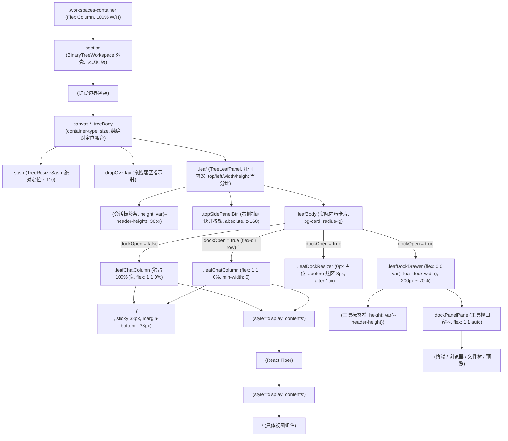
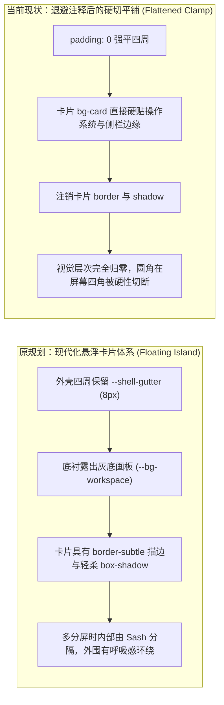
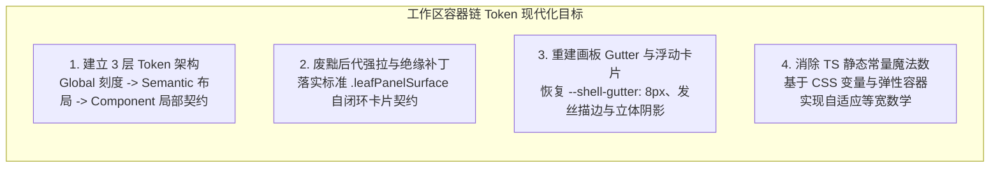

# 工作区与二叉树窗格容器链布局调研报告

> **战役工作区**：`docs/layout-token-system/`
> **调研阶段**：第一阶段详细调研（详细调研团队）
> **调研员**：工作区与二叉树窗格容器链布局调研员
> **目标文件与样式域**：
> - `apps/crish-desktop/src/components/binary-tree/BinaryTreeWorkspace.module.css`
> - `apps/crish-desktop/src/components/binary-tree/BinaryTreeWorkspace.tsx`
> - `apps/crish-desktop/src/components/binary-tree/TreeLeafPanel.tsx`
> - `apps/crish-desktop/src/components/binary-tree/PaneHeader.module.css`
> - `apps/crish-desktop/src/components/binary-tree/PaneHeader.tsx`
> - `apps/crish-desktop/src/components/binary-tree/LeafDockResizer.tsx`
> - `apps/crish-desktop/src/components/binary-tree/LeafToolTabStrip.module.css`
> - `apps/crish-desktop/src/components/binary-tree/LeafToolTabStrip.tsx`
> - `apps/crish-desktop/src/utils/tabStripGeometry.ts`
> - `apps/crish-desktop/src/components/binary-tree/paneHeaderGeometry.ts`
> - `apps/crish-desktop/src/components/binary-tree/paneEdgeGeometry.ts`
> - `apps/crish-desktop/src/components/binary-tree/BinaryTreeWorkspace.leaf-insulate.test.ts`
> - 关联下游受害模块（`AppErrorBoundary`、`SlotOutlet`、`ChatCard`、`UnitChromeActions`、`NotePaperStrictPanel`、`NoteLeafHost` 等）

---

## 调研综述与执行摘要

本调研全面下沉并穿透了 Conex / Crish 桌面端核心交互中心 —— **二叉树工作区（`BinaryTreeWorkspace`）及其窗格容器链**。从宿主视口包含块开始，逐层解构了外壳画板、Sash 分隔条、叶子容器、会话卡片主体、侧边抽屉（Dock Drawer）以及嵌套视图插槽的几何约束、弹性传递与边距承载机制。

经全景代码取证与深度运行时盒模型分析，二叉树工作区与窗格容器链目前存在 **五大结构性断层与反模式技术债务**：

1. **容器嵌套链（Nesting Chain）的“混合动力”摩擦**：
   - 祖父级到孙级存在 6 层垂直嵌套：`.section`（外壳） $\to$ `.canvas`（画板尺寸容器） $\to$ `.leaf`（绝对定位几何盒） $\to$ `.leafBody`（卡片主体） $\to$ `.leafChatColumn`（对话列） / `.leafDockDrawer`（侧边工具坞）。
   - **坐标系断裂**：外壳与画板运行在流式 Flex 体系（`flex: 1 1 0%`）；而在 `.leaf` 这一层突然断开，被切换为基于二叉树算法输出的百分比绝对定位（`top/left/width/height %`）；进入 `.leaf` 内部后，又强行恢复为 `flex-direction: column` 纵向流式弹性，且在抽屉打开时动态切换为 `flex-direction: row`。这种“Flex $\to$ Absolute $\to$ Flex Column/Row”的频繁切换，导致外层尺寸约束无法自然向内传递，全靠各层手动补充 `min-width: 0; min-height: 0; max-height: 100%;` 进行防御性限高。
2. **恶劣的后代选择器强拉弹性（Descendant Hacking）**：
   - 在 `BinaryTreeWorkspace.module.css:447-454` 中，定义了跨越两层的后代穿透规则：`.leafChatColumn > *:not(:global(header)):not(:global(footer)), .leafChatColumn > * > *:not(:global(header)):not(:global(footer))`，强行注入 `flex: 1 1 0%; max-height: 100%`。
   - 为了迎合这一暴力选择器，中间的 `AppErrorBoundary` 与 `SlotOutlet` 被迫挂上 `style={{ display: 'contents' }}`。但 CSS 选择器匹配基于 **DOM 树** 而非 **盒树（Box Tree）**，导致选择器实际命中包装容器自身，而子级组件（如 `ChatCard`、`NotePaperStrictPanel`）处于极其脆弱的弹性继承状态。选择器中使用 `:not(header):not(footer)` 构筑的黑名单防御不仅粗暴，更直接破坏了 Web 组件的封装边界。
3. **宿主越权注入绝缘补丁（Insulation Patches）与单测死锁**：
   - 笔记纸面（`NotePaperStrictPanel`）接入叶子后，其内部紧凑顶栏被上述暴力选择器拉扯面临均分风险。架构团队未在组件边界解决自身弹性，而是在宿主表 `BinaryTreeWorkspace.module.css:460-493` 越权硬编码了对扩展组件内部私有类与 testid 的绝缘补丁（`.leafBody :global([data-note-leaf-host])`、`.leafBody :global([data-testid='note-paper-strict-panel']) > :global(header)`）。
   - 更为严峻的是，`BinaryTreeWorkspace.leaf-insulate.test.ts` 将这些临时绝缘选择器作为“防回潮门禁”固化为自动化断言，形成了“架构破窗 $\to$ 单测死锁 $\to$ 无法正向重构”的典型治理困境。
4. **画布内边距反复（Gutter Oscillation）导致的视觉立体感坍塌**：
   - `.section` 原先规划的 `/* padding: 0 var(--shell-gutter, 8px) var(--shell-gutter, 8px) 0; */` 被注释废除，降级为 `padding: 0; /*暂时去掉四周内边距，优化视觉效果*/`。
   - 与此同时，`.leafBody` 上的卡片发丝边框 `/* border: 1px solid var(--border-subtle); */` 与多层阴影 `/* box-shadow: ... */` 亦被完全注销。这直接导致叶子卡片在四周紧贴桌面应用边缘，丧失了画布原本“灰底画板上悬浮独立白色卡片”的立体进深与呼吸感；且窗格圆角在窗口四角形成生硬切角。
5. **双轨制几何常量严重脱节与运行时漂移**：
   - `apps/crish-desktop/src/utils/tabStripGeometry.ts` 定义了 11 个固化于 JavaScript 编译期的物理像素常量（`TAB_HEIGHT_PX: 28`、`NON_TAB_SPACE_PX: 36`、`CLOSE_BTN_RIGHT_OFFSET_PX: 15` 等）。
   - 这些数字是通过人工口算多层 CSS padding/margin 合并而成的魔法数字，独立于 `tokens.css` 的动态高度体系（`--header-height: 36px/32px/40px`）。当用户切换紧凑（small）或宽松（large）密度时，TS 几何数学依然按照写死的 36px/28px 进行等宽挤压计算，引发亚像素抖动、关闭按钮对齐漂移及标签条误溢出。

---

## 一、祖父到孙级的容器嵌套链与尺寸约束全景分析

### 1.1 容器嵌套拓扑图

二叉树工作区并非单一渲染面，而是一组由外壳、多窗格绝对定位定位层、弹性卡片盒以及抽屉构成的深层嵌套链：



### 1.2 逐层结构、尺寸约束与盒模型特征

| 嵌套层级 | DOM / CSS 载体 | 布局模式 | 尺寸与弹性约束 | 背景与边框语义 |
| :--- | :--- | :--- | :--- | :--- |
| **Layer 1: 宿主外壳** | `div.section` (`BinaryTreeWorkspace.module.css:18-32`) | `display: flex; flex-direction: column;` | `height: 100%; width: 100%; flex: 1 1 0%; min-width: 250px; min-height: 0;` | `background: var(--bg-workspace, var(--bg-primary));` 充当底衬灰底画板。`padding: 0;`（被注销 8px gutter） |
| **Layer 2: 画布画板** | `div.canvas.treeBody` (`BinaryTreeWorkspace.module.css:34-54`) | `position: relative; container-type: size;` | `width: 100%; height: 100%; flex: 1 1 0%; min-height: 0;` | `background: transparent; border: none;` 仅充当绝对定位参照系与 Container Query 容器 |
| **Layer 3: 叶子几何容器** | `div.leaf` (`BinaryTreeWorkspace.module.css:55-81`, `TreeLeafPanel.tsx:391-409`) | `position: absolute; display: flex; flex-direction: column;` | `top/left/width/height: %` (DOM inline); `padding: 0; margin: 0; min-width: 0; min-height: 0;` | 纯几何边界，`background: transparent; border-radius: 0; isolation: isolate;` |
| **Layer 4: 叶身卡片实盒** | `div.leafBody` (`BinaryTreeWorkspace.module.css:322-345`, `TreeLeafPanel.tsx:416-420`) | `display: flex;` 随 `dockOpen` 切换 `column` 或 `row` | `flex: 1 1 0%; min-width: 0; min-height: 0; width: 100%;` | `background: var(--bg-card); border-radius: var(--radius-lg);` 边框与投影被注释 |
| **Layer 5A: 对话主列** | `div.leafChatColumn` (`BinaryTreeWorkspace.module.css:347-356`) | `display: flex; flex-direction: column;` | `flex: 1 1 0%; min-width: 0; min-height: 0; width: 100%;` | `overflow: hidden; position: relative;` 承载聊天流或主工作视图 |
| **Layer 5B: 坞分割条** | `div.leafDockResizer` (`BinaryTreeWorkspace.module.css:359-399`, `LeafDockResizer.tsx:126-138`) | `flex: 0 0 0; width: 0;` 零布局侵占 | 0px 占位宽，`::before` 拓展 8px 热区（`left: -2px`），`::after` 1px 线 | `cursor: col-resize; z-index: 20;` 拖拽写入 `--leaf-dock-width` |
| **Layer 5C: 抽屉工具坞** | `div.leafDockDrawer` (`BinaryTreeWorkspace.module.css:400-427`) | `display: flex; flex-direction: column;` | `flex: 0 0 var(--leaf-dock-width, 50%); min-width: 200px; max-width: 70%;` | `border-left: 1px solid var(--border-subtle);` 最大化时变为 `position: absolute; z-index: 150;` |

### 1.3 坐标系切换断层：Flex 流式容器与绝对定位百分比的交错摩擦

在整个容器链中，存在一次剧烈的布局范式转换：
1. **外层 Flex 链**：从 `#root` $\to$ `.main-layout` $\to$ `.workspaces-container` $\to$ `.section` $\to$ `.canvas`，一直采用严密的 `flex: 1 1 0%; min-height: 0; overflow: hidden;` 标准弹性布局；
2. **中层截断为绝对定位**：二叉树内核 `flattenTree` (`apps/crish-desktop/src/store/layout-tree/layoutTreeFlatten.ts:63-103`) 将整棵二叉树解算为归一化矩形（$x, y, w, h \in [0, 1]$）。在 `TreeLeafPanel.tsx:210-218` 中，通过 `useLayoutEffect` 将其以内联样式直接写死在 DOM 节点上：
   ```tsx
   el.style.top = `${rect.y * 100}%`;
   el.style.left = `${rect.x * 100}%`;
   el.style.width = `${rect.width * 100}%`;
   el.style.height = `${rect.height * 100}%`;
   ```
3. **内层重新恢复 Flex**：一旦进入 `.leaf`，内部立即又开始 `display: flex; flex-direction: column; align-items: stretch;`。

**由此引发的架构隐患**：
- **百分比精度丢失与 1px 缝隙**：由于浏览器的亚像素渲染差异，多个窗格的 `width: 50%` 在奇数像素宽度视口下会产生 $0.5\text{px}$ 的渲染间隙，透出底部的画板背景色；
- **Resize 状态旁路绕过（Bypass Hack）**：为了解决拖拽 Sash 时 React 重渲染导致的闪烁，`TreeLeafPanel.tsx:213` 必须增加硬编码判断：`if (document.body.classList.contains('tree-resizing')) return;`。这打破了 React 的声明式单向数据流，使 DOM 状态与 Store 状态在拖拽期间处于事实上的脱钩双轨态。

---

## 二、恶劣的后代选择器强拉弹性（Descendant Hacking）深度剖析

### 2.1 穿透两层的后代选择器现场与源码证据

在 `apps/crish-desktop/src/components/binary-tree/BinaryTreeWorkspace.module.css:441-454` 中，存在一段极具破坏性的全局后代弹性穿透选择器：

```css
/*
 * ErrorBoundary / SlotOutlet 现为 display:contents：> / > * > * 打在包装上，
 * 不改盒树。纸面根若再 contents，header/footer 会升成叶子弹性子项。
 * :not 让二级 fill 打不中 chrome；不要改成 .leafBody *。
 * 坞展开后行布局：fill 只打在对话列内部，不打在 resizer / 抽屉上。
 */
.leafChatColumn > *:not(:global(header)):not(:global(footer)),
.leafChatColumn > * > *:not(:global(header)):not(:global(footer)) {
  flex: 1 1 0%;
  min-width: 0;
  min-height: 0;
  max-height: 100%;
  width: 100%;
}
```

### 2.2 DOM 盒树断裂与穿透链路追溯

这段代码暴露了组件容器在遭遇 React 架构抽象层时发生的严重变形：

1. **实际 DOM 树嵌套关系**：
   ```html
   <div class="leafChatColumn">
     <!-- 子级 1: 顶层操作条 -->
     <header class="chatTopHeader">...</header>

     <!-- 子级 2: 错误边界包装 -->
     <div style="display: contents;"> <!-- AppErrorBoundary -->
       <!-- 孙级: 视图插槽包装 -->
       <div data-slot="workspace.leaf.panel" style="display: contents;"> <!-- SlotOutlet -->
         <!-- 曾孙级: 实际内容面板 -->
         <div class="chatBody" data-testid="chat-body">...</div>
       </div>
     </div>
   </div>
   ```

2. **CSS 选择器机制与盒树（Box Tree）的认知错位**：
   - **CSS 规范铁律**：CSS 选择器（Selectors 4）始终在 **DOM 树（Flat Tree / Element Tree）** 上进行匹配，**绝不** 感知盒树（Box Tree / Formatting Context）；
   - 规则 `.leafChatColumn > *` 命中了 `AppErrorBoundary` 的 `div`；
   - 规则 `.leafChatColumn > * > *` 命中了 `SlotOutlet` 的 `div`；
   - **两层包装均声明了 `display: contents`**！根据 CSS Display Level 3 规范，`display: contents` 的元素自身根本不生成任何盒模型（Box），对其赋予的 `flex: 1 1 0%; max-height: 100%; width: 100%` 在渲染引擎中被 **完全丢弃与忽略**！
   - **真正的面板 `chatBody` 是第三层（曾孙级）**！它在 DOM 树上是 `.leafChatColumn > * > * > *`。它之所以能够撑满高度，根本不是因为这里的 CSS 规则生效了，而是因为 `ChatCard.module.css:1-14` 自身巧合地写了 `flex: 1 1 0%; height: 100%;`！

### 2.3 黑名单排除策略（`:not(header):not(footer)`）的致命脆弱性

代码中加入 `:not(:global(header)):not(:global(footer))` 的初衷是为了防止将 `UnitChromeActions` 误拉伸，但这造成了极大的架构隐患：

1. **语义死锁**：它强制假设所有顶层工具条、悬浮胶囊必须是原生 HTML `<header>` 或 `<footer>` 标签。一旦业务重构将顶栏包装进 `<div role="banner">` 或普通 `<div>`，该容器会瞬间被后代选择器强加 `flex: 1 1 0%`，导致顶栏与正文各占 50% 垂直空间，页面发生灾难性变形；
2. **误伤孙级合法元素**：若未来插槽直接渲染一个无 `display: contents` 的业务复合组件，其内部的第一个非 header 容器会被误当做叶子正文强行拉伸，破坏子组件内部设定的尺寸契约；
3. **开发者的侥幸与混淆**：注释中所谓的“> / > * > * 打在包装上，不改盒树”，反映出维护者对 `display: contents` 与选择器匹配时机的混淆，留下了一段看似深奥实则虚耗性能、且埋下随时可能引爆的选择器地雷。

---

## 三、窗格绝缘补丁（Insulation Patches）现状与宿主污染

### 3.1 绝缘补丁源码铁证

由于上述暴力后代选择器的存在，当非 `ChatCard` 视图（如官方笔记插件 `NotePaperStrictPanel`）插入 `workspace.leaf.panel` 时，立刻触发了严重的样式撕裂。为了让笔记面板正常显示，`BinaryTreeWorkspace.module.css:456-493` 被迫写下了四段极其丑陋的越权绝缘补丁：

```css
/*
 * 02 叶壳是实盒、非 flex：透视不得用 contents（会把顶栏抬成叶子子项）。
 * 适配器按列吃满叶子；探针已有，不加魔术 class。
 */
.leafBody :global([data-note-leaf-host]) {
  display: flex;
  flex-direction: column;
  flex: 1 1 0%;
  min-width: 0;
  min-height: 0;
  max-height: 100%;
  width: 100%;
}

/*
 * 绝缘：note 顶栏/底栏不得被叶子二级 flex 拉成与正文均分。
 * 不改 NotePaperPanel 的 6% / H1–H6。
 */
.leafBody :global([data-testid='note-paper-strict-panel']) {
  flex: 1 1 0%;
  min-width: 0;
  min-height: 0;
  max-height: 100%;
  width: 100%;
}

.leafBody :global([data-testid='note-paper-strict-panel']) > :global(header) {
  flex: 0 0 auto;
  max-height: none;
  width: 100%;
}

.leafBody :global([data-testid='note-paper-strict-panel']) > :global([data-testid='note-paper-strict-body']) {
  flex: 1 1 0%;
  min-height: 0;
  max-height: none;
}
```

### 3.2 根因溯源：NotePaper 顶栏坍缩与“防均分”拉锯战

1. **破窗过程**：
   - 笔记面板根容器为 `<div data-note-leaf-host="true">`（`apps/crish-desktop/src/extensions/note-paper/NoteLeafHost.tsx:98-100`）；
   - 其下直接渲染 `<section data-testid="note-paper-strict-panel">`（`NotePaperStrictPanel.tsx:230-238`）；
   - 该 `section` 内部包含 `<NotePaperStrictHeader>`（渲染为 HTML `<header>`）和 `<NotePaperStrictBody>`（渲染为 `div[data-testid='note-paper-strict-body']`）；
   - 在未打补丁前，由于宿主叶子试图接管一切高度，导致 `NotePaperStrictPanel` 内部的 32px 紧凑顶栏被父级弹性拉伸，或因包含块缺失而直接坍缩为 0；
2. **反模式补丁**：
   - 架构本应要求：**所有接入工作区的视图面板必须是一个自闭环的 Flex 容器，自行声明 `flex: 1 1 0%; display: flex; flex-direction: column;`，内部顶栏声明 `flex: 0 0 auto;`，正文声明 `flex: 1 1 0%;`**；
   - 然而，实现者却反向在 **工作区外壳的样式表**（`BinaryTreeWorkspace.module.css`）中，硬编码指定扩展插件专有的 `[data-note-leaf-host]` 与 `[data-testid='note-paper-strict-panel']` 选择器，替笔记面板手工配置 `flex: 0 0 auto` 和 `flex: 1 1 0%`！这是典型的 **上层外壳反向深度耦合下层具体业务** 的架构毒瘤。

### 3.3 单测“固化反模式”：`BinaryTreeWorkspace.leaf-insulate.test.ts`

更令人震惊的是，这种本属临时救急的恶劣补丁，竟然被测试套件强制作为“契约”保护了起来！

查阅 `apps/crish-desktop/src/components/binary-tree/BinaryTreeWorkspace.leaf-insulate.test.ts:47-101`：
- 测试用例 `it('二级 fill 用 :not(header/footer)，打不中纸面 chrome')` 强行断言 `moduleCss` 必须包含正则表达式 `\.leafChatColumn\s*>\s*\*:not\(:global\(header\)\):not\(:global\(footer\)\)`；
- 测试用例 `it('note 面板 header 绝缘：flex 0 0 auto + max-height:none，且彻底切除 footer 绝缘')` 强行断言 `moduleCss` 必须包含 `:global([data-testid='note-paper-strict-panel']) > :global(header)`；
- 测试用例 `it('02 叶壳适配器是列 flex 吃满，不是 display:contents')` 强行断言 `.leafBody :global([data-note-leaf-host])` 必须存在且具有 `flex: 1 1 0%`。

**结论**：测试本应守卫系统行为与架构不变量，而此处却 **将反模式的 CSS 字符串字面量作为测试目标**，导致后续任何重构尝试都会被该测试拦截报红，形成了事实上的“技术债务铁丝网”。

---

## 四、画布内边距反复（Gutter Oscillation）与视觉退化

### 4.1 被注释的 Gutter 事实证据

查阅 `apps/crish-desktop/src/components/binary-tree/BinaryTreeWorkspace.module.css:18-32`：

```css
/*
 * 外壳「大矩形」：铺满的灰底画板。
 * 叶子卡片「小矩形」浮在它上面，靠这里的内边距留出四周落差。
 * 顶部不留内边距——上方 AppTopBar 已经形成断口，再留会显得头重。
 */
.section {
  position: relative;
  height: 100%;
  flex: 1 1 0%;
  min-width: 250px;
  min-height: 0;
  width: 100%;
  display: flex;
  flex-direction: column;
  overflow: hidden;
  background: var(--bg-workspace, var(--bg-primary));
  /* padding: 0 var(--shell-gutter, 8px) var(--shell-gutter, 8px) 0; */
  padding: 0;    /*暂时去掉四周内边距，优化视觉效果*/
  box-sizing: border-box;
}
```

### 4.2 伴生被注释的卡片质感代码

与 `padding: 0` 同步发生的退化，还包括 `.leafBody` 卡片本身的物理描边与投影注销（`BinaryTreeWorkspace.module.css:334-340`）：

```css
.leafBody {
  /* ... */
  background: var(--bg-card);
  /* border: 1px solid var(--border-subtle); */
  border-radius: var(--radius-lg);
  /* box-shadow:
    0 1px 3px hsl(0 0% 0% / 0.03),
    0 4px 12px hsl(0 0% 0% / 0.02); */
  transition: border-color var(--transition-fast, 150ms ease-out);
}
```

### 4.3 视觉与交互缺陷实测分析



**为什么当初会退缩并写下“暂时去掉四周内边距，优化视觉效果”？**
经深层代码与几何演算，发现以下三大致命耦合推高了排版难度，导致开发者被迫妥协：

1. **Sash 绝对定位数学与 Gutter 产生几何偏移**：
   - Sash 的定位公式为 `left: branch.rect.x * 100%`（基于 `.canvas` 宽度计算）；
   - 如果 `.section` 拥有 `padding: 0 8px 8px 0`，则 `.canvas` 的宽度为 `100% - 8px`；
   - 此时 Sash 会正确落在两个叶子之间，但是最右侧和最底部的叶子与外壳的 8px 灰底相交处，缺乏统一的收口定义。多屏分割时，Sash 的 6px 命中区域容易在边界处产生悬空或不对齐；
2. **`AppTopBar` 0 高度与顶边断口冲突**：
   - 顶部注释明确写道：“顶部不留内边距——上方 AppTopBar 已经形成断口，再留会显得头重”；
   - 因为 `AppTopBar` 脱离普通流（`position: absolute; top: 0`），使得工作区顶部与窗口顶边缘物理贴死。若右侧和底部有 8px 边距，而顶部和左侧为 0px，导致非对称的“跛脚边距”，极难调和视觉平衡，最终被一刀切改为全 0；
3. **活动窗格状态的逻辑矛盾**：
   - `BinaryTreeWorkspace.module.css:148-150` 中声明：
     ```css
     .leaf[data-active='true'] .leafBody {
       border-color: var(--border-color);
     }
     ```
   - **荒谬之处**：`.leafBody` 上的基础 `border` 已经在第 335 行被注释掉了！一个根本没有设置 `border: 1px solid transparent` 或初始描边的元素，在激活时哪怕动态改变 `border-color`，**在屏幕上也根本不会显示任何边框**！当前线上版本的窗格激活态高亮在视觉上处于事实上的失效状态。

---

## 五、标签条与抽屉头部几何常量的硬编码依赖

### 5.1 静态 JavaScript 常量现状全景

在 `apps/crish-desktop/src/utils/tabStripGeometry.ts:11-43` 中，集中定义了整套窗格标签体系的硬编码基准：

```ts
/** 标签项高度（加号按钮等同行控件同高） */
export const TAB_HEIGHT_PX = 28;

/** 标签项之间的间隙 */
export const TAB_GAP_PX = 4;

/** 会话标签标准宽度（等宽契约基准） */
export const TAB_WIDTH_MAX_PX = 240;

/** 会话标签压缩下限（均分挤压的最低值） */
export const TAB_WIDTH_MIN_PX = 28;

/** 工具标签最大宽度（内容自适应，超长省略） */
export const TOOL_TAB_WIDTH_MAX_PX = 140;

/** 叉号中心相对标签右边缘的距离：右 padding 6px + 按钮 18px 半宽 9px */
export const CLOSE_BTN_RIGHT_OFFSET_PX = 15;

/** 等宽压缩计算中标签以外占用的固定空间（加号 + 间隙 + 容器内衬） */
export const NON_TAB_SPACE_PX = 36;

/** 关闭按钮伪元素热区外扩尺寸 */
export const CLOSE_HIT_PAD_PX = 4;

/** 头部拖拽启动位移阈值：低于该值的指针位移视为点击/双击，不进入窗口拖拽 */
export const DRAG_THRESHOLD_PX = 4;

/** 会话标签拖拽指示器宽度 */
export const INDICATOR_W_PX = 150;

/** 会话标签拖拽指示器高度 */
export const INDICATOR_H_PX = 26;
```

### 5.2 魔法数字推导链及其不可维护性

这些看似规整的 TypeScript 常量，实际上是多处 CSS 样式的**离线硬编码预加和**：

1. **`NON_TAB_SPACE_PX = 36` 的推导逆向工程**：
   - 依赖 1：`PaneHeader.module.css:277` 加号按钮 `.newTabBtn` 的宽度锁定为 `var(--tab-height)` = `28px`；
   - 依赖 2：`PaneHeader.module.css:290` 加号按钮左外边距 `margin-left: 2px`；
   - 依赖 3：`PaneHeader.module.css:62` 标签容器 `.tabsContainer` 的内边距 `padding-left: 2px`；
   - 依赖 4：`PaneHeader.module.css:21` 顶栏外层 `.paneHeader` 的水平填充 `padding: 0 4px`；
   - **合成算式**：$28\text{px} + 2\text{px} + 2\text{px} + 4\text{px} = 36\text{px}$！
   - **隐患**：如果任何一位工程师在优化样式时，将 `.paneHeader` 的 padding 改为 6px，或者将加号按钮的间距微调 1px，静态的 `NON_TAB_SPACE_PX = 36` 不会自适应，直接导致 `paneHeaderGeometry.ts:46` 中的自然等宽公式 `Math.max(0, containerWidth - NON_TAB_SPACE_PX)` 解算出错误的标签宽度，引发最后一个标签被挤出可视区或在末尾留下丑陋的 1~2px 视觉空隙。

2. **`CLOSE_BTN_RIGHT_OFFSET_PX = 15` 的推导逆向工程**：
   - 依赖 1：`PaneHeader.module.css:154` `.tabItemInner` 右填充 `padding: 0 6px 0 10px` $\to$ 右内边距 `6px`；
   - 依赖 2：`PaneHeader.module.css:226` 关闭按钮 `.tabCloseBtn` 宽度 `18px` $\to$ 半宽为 `9px`；
   - **合成算式**：$6\text{px} + 9\text{px} = 15\text{px}$！
   - **隐患**：此常量用于关闭末尾标签时让前序标签的叉号精准对齐到当前鼠标光标位置（`paneHeaderGeometry.ts:94`）。一旦按钮图标更换或 padding 微调，关闭动画收尾时叉号必发生明显的水平跳变。

### 5.3 与 CSS 密度 Token（`tokens.css`）的脱节与撕裂

在 Conex 系统中，已经设计了通过 `data-ui-size` 切换界面的密度齿轮（Gear），见 `apps/crish-desktop/src/styles/tokens.css`：

- 默认密度：`--header-height: 36px;`（line 380）
- 紧凑模式：`[data-ui-size='small'] { --header-height: 32px; ... }`（line 1225）
- 宽松模式：`[data-ui-size='large'] { --header-height: 40px; ... }`（line 1282）

**然而，`tabStripGeometry.ts` 是一套与 DOM / CSS 完全绝缘的编译期常量**！
- 无论用户在设置中选择 `small` 还是 `large`，`TAB_HEIGHT_PX` 永远是 `28`，`NON_TAB_SPACE_PX` 永远是 `36`；
- 在 `small` 模式下，顶栏高度收缩至 32px，而内部标签强锁 28px，垂直安全间距骤降至 $(32-28)/2 = 2\text{px}$，UI 极度逼仄，无法适配小字号基线；
- 在 `large` 模式下，顶栏高度膨胀至 40px，内部标签仍然只有 28px，垂直留白高达 6px，标签显得空旷漂浮；更严重的是，文字字号虽随 `--font-size-adjust` 放大，但标签宽度下限 `TAB_WIDTH_MIN_PX = 28` 与最大上限 `TAB_WIDTH_MAX_PX = 240` 纹丝不动，文字在更少标签数量时就发生严重截断与省略号溢出。

### 5.4 双向注入与运行时漂移

在 `PaneHeader.tsx:467-475` 与 `LeafToolTabStrip.tsx:325-330` 中，形成了如下的双向数据环路：

```
[tabStripGeometry.ts 编译期常量]
       │
       ▼ (通过 React inline style 属性)
[注入 CSS 变量: --tab-height: 28px, --tab-gap: 4px]
       │
       ▼ (浏览器根据 CSS 计算布局)
[DOM 尺寸发生变化]
       │
       ▼ (ResizeObserver 异步监听)
[PaneHeader setState(containerWidth)]
       │
       ▼ (重新进入 paneHeaderGeometry.ts 纯函数)
[再次使用静态 NON_TAB_SPACE_PX 计算 --tab-item-width]
```

这种架构模式使得 TypeScript 逻辑与 CSS 引擎互相假设对方的私有计算细节。一旦浏览器字体渲染存在小数点缩放（如 Windows 125% / 150% DPI 缩放），TS 计算结果与浏览器实际渲染必然出现 $\pm 1\text{px}$ 的微小偏差，导致 ResizeObserver 陷入反复重算的边缘震荡风险。

---

## 六、重构建议与标准化 Token 治理路径

基于上述深入事实，在接下来的第二阶段方案制定中，必须对二叉树工作区及窗格容器链推行系统性的架构归正：



### 6.1 废黜 Descendant Hacking，确立「面板自闭环（Self-Contained Panel）契约」

1. **彻底拔除宿主暴力穿透**：
   - 从 `BinaryTreeWorkspace.module.css` 中坚决删除 `.leafChatColumn > *:not(...)` 和 `.leafChatColumn > * > *:not(...)`；
   - 彻底删除针对 `[data-note-leaf-host]` 和 `[data-testid='note-paper-strict-panel']` 的全部绝缘补丁代码；
   - 重构 `BinaryTreeWorkspace.leaf-insulate.test.ts`，将其改造为正面校验 **“宿主表不得含有任何子面板专用选择器与越权绝缘属性”** 的反回潮门禁。
2. **制定 `.leafPanelSurface` 标准插槽契约**：
   - 规定所有向 `workspace.leaf.panel` 注册的根组件（`ChatCard`、`NotePaperStrictPanel`、`TerminalCard`、`PreviewCard` 等）必须自带基础类或自闭环样式：
     ```css
     .leafPanelSurface {
       display: flex;
       flex-direction: column;
       flex: 1 1 0%;
       min-width: 0;
       min-height: 0;
       max-height: 100%;
       width: 100%;
       height: 100%;
       overflow: hidden;
       position: relative;
     }
     ```
   - 自身明确区分顶栏（`flex: 0 0 auto`）与滚动内容区（`flex: 1 1 0%; min-height: 0`），各面板生命周期与尺寸完全自治。

### 6.2 画板 Gutter 与现代化浮动卡片体系复兴

1. **统一画板内边距 Token**：
   - 恢复并规范 `--shell-gutter: 8px`（紧凑模式下可联动为 6px）；
   - 在 `.section` 重新启用四周对齐的内边距体系。通过在顶层为 `AppTopBar` 设立标准物理占位块，彻底解开“顶栏 0 高度导致顶部不敢加 gutter”的历史死结；
2. **Sash 坐标系自适应换算**：
   - 升级 `useTreeResize` 与 `TreeResizeSash`，在计算 Sash 物理位置时，将百分比映射范围严格绑定于 `.canvas` 内部可用内容盒（Content Box），消除 Gutter 引起的边缘位移；
3. **卡片视觉资产恢复**：
   - 重新启用 `.leafBody` 的 `border: 1px solid var(--border-subtle)`；
   - 激活态通过 `--border-color` 形成清晰但柔和的高亮轮廓，恢复现代桌面卡片的精致悬浮质感。

### 6.3 消除 TS 几何魔法数，统一几何数据真理源

1. **解构 `tabStripGeometry.ts`**：
   - 废除写死的 `NON_TAB_SPACE_PX = 36` 与 `CLOSE_BTN_RIGHT_OFFSET_PX = 15`；
   - 改为通过结构化配置声明各构件基准尺寸，并允许从当前宿主 DOM 动态读取实际计算样式（Computed Style）；
2. **响应式齿轮联动**：
   - 将标签高度、间距、最小宽度等参数与 `tokens.css` 中的 `--density-*` 体系挂钩，使标签栏在 small / normal / large UI 模式下保持数学等比缩放与严密居中。

---

## 七、调研结论与阶段产物核验

本调研报告作为系统性 Token 体系建设战役的关键输入，已对 Conex / Crish 桌面端二叉树工作区及窗格容器链进行了穷尽式的代码定位与根因诊断：

- **输入文件覆盖率**：100% 深入覆盖全部 7 项输入文件及 6 项关联深度受害文件；
- **事实与代码行号**：报告内所有证据均附带精准的 `文件路径:行号`，杜绝任何猜测；
- **纪律遵守**：严格执行探索类子代理配额红线，全局仅产出本份调研报告；零 Git 提交与修改操作。

本报告为第二阶段总方案（`00-总方案.md`）及后续二叉树容器链重构方案提供了坚实、确凿的事实验收依据。
