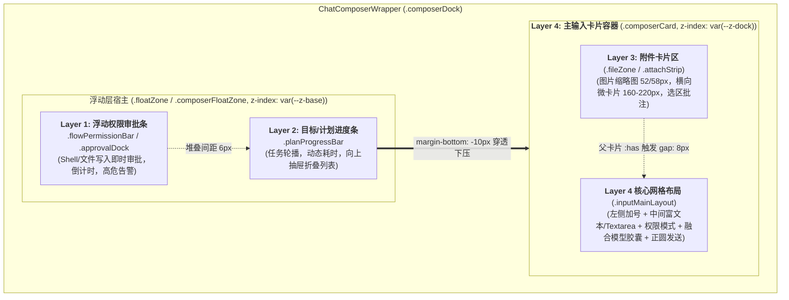

# 输入区四层垂直空间堆叠与卡片内布局全景调研报告

> **战役工作区**：`docs/layout-token-system/survey/`
> **报告编号**：`05-chat-composer-and-float-zone-survey.md`
> **调研主题**：桌面端 ChatComposer 输入框四层垂直空间堆叠、单多行网格自适应、浮动层与主输入框几何尺寸耦合、内部操作按钮同心度量
> **调查日期**：2026-09-11
> **状态**：已完成（第一阶段详细调研成果）

---

## 一、调研概述与执行摘要

Conex / Crish 桌面端的 `ChatComposer` 是整个会话界面的核心交互枢纽，承载了多模态文本输入、富文本编辑、Slash 技能调用、文件与图片批注、权限安全审批、目标与计划多步进度追踪等多重能力。

通过对以下输入代码资产的全景深挖与几何测量：
- `apps/crish-desktop/src/components/chat-composer/ChatComposer.module.css`
- `apps/crish-desktop/src/components/chat-composer/ChatComposer.tsx`
- `apps/crish-desktop/src/components/chat-composer/TiptapEditorField.module.css`
- `apps/crish-desktop/src/components/chat-composer/ComposerFusedTrigger.module.css`
- `apps/crish-desktop/src/components/chat-card/ChatComposerWrapper.tsx`
- `apps/crish-desktop/src/components/chat-card/ChatCard.module.css`
- 以及 `useComposerMultiline.ts`、`ComposerPlanProgressBar.tsx`、`ComposerPermissionBar.tsx`、`ApprovalDock.module.css`、`AttachmentCard.module.css`、`tokens.css`

本报告确认了当前输入区存在以下四个维度的深层架构断裂与几何脆弱性：

1. **四层垂直空间堆叠（Layer 1 ~ Layer 4）边界模糊**：Layer 1（权限审批）与 Layer 2（计划进度）作为浮动层位于主卡片上方，但两者的容器归属在 `ChatComposerWrapper.tsx` 与 `ChatComposer.tsx` 之间存在双轨并存的模糊抽象；Layer 3（附件区）物理内嵌于 Layer 4（主输入卡片）顶部，通过 `:has()` 伪类动态撑开间距，造成父卡片计算的高度震荡。
2. **跨层魔术数字与负边距脆弱硬编码**：进度条 `.planProgressBar` 与权限条 `.approvalDock.docked` 普遍硬编码了 `width: calc(100% - 36px); margin-left: 18px; margin-bottom: -10px;`。其本质是为规避主输入卡片 `20px/22px` 的外圆角切线，并通过 `-10px` 负外边距将浮动条底部塞入主卡片底下伪造「抽屉插舌」效果。为弥补这 `-10px` 的视觉裁切，折叠状态的 `.planCollapsed` 又反向硬编码了 `padding: 6px 12px 14px 12px;`（底部 padding 强行垫高至 14px）。这种「以补丁偿补丁」的设计导致多层同时挂载时垂直空间彻底塌陷。
3. **单多行自适应切换下的几何突变与视觉抖动**：单行态（`padding: 6px 10px; border-radius: 22px; gap: 2px;`）与多行态（`padding: 10px 14px 8px 14px; border-radius: 20px; row-gap: 8px; column-gap: 2px;`）在切换瞬间，所有四个方向的内边距、外圆角、网格行列全量突变；权限模式选择器在单行态内嵌于右侧 `ComposerFusedTrigger` 融合胶囊，在多行态被抽取到左下角独立槽位，导致内部组件产生跨槽位瞬态物理重排。
4. **同心圆角法则（Concentric Radii）被打破**：内嵌操作按钮统一为 `28x28px` 正圆（半径 $r=14\text{px}$）。在单行态下，外圆角 `22px` 勉强接近同心平衡；但在多行态下，底部内衬缩为 `8px`，外圆角却为 `20px`，违反了经典同心几何公式 $R_o = R_i + P$（$14 + 8 = 22\text{px} \neq 20\text{px}$），导致按钮向外顶出，失去呼吸空间。此外，附件卡片存在 `58x58px`（历史旧值）与 `52x52px`（规范值）的代码漂移，且 `tokens.css` 漏定义了 Light 主题变量，导致深浅主题尺寸不一致。

---

## 二、四层垂直空间堆叠架构深入解析（Layer 1 ~ Layer 4）

### 2.1 四层空间拓扑结构

ChatComposer 体系在视觉呈现与交互逻辑上划分为四个自上而下的垂直层级，其物理空间拓扑如下：



### 2.2 各层级详细职责与代码事实

#### Layer 1: 浮动权限审批条（ComposerPermissionBar / ApprovalDock）
- **挂载与渲染位置**：
  - 在外层包装器 [`ChatComposerWrapper.tsx:175-208`](file:///c:/Software/conex/apps/crish-desktop/src/components/chat-card/ChatComposerWrapper.tsx#L175-L208)，作为 `.composerDock > .floatZone` 的第一子项挂载。支持插槽 `workspace.chat.composerAbove`，缺省回落为 `ApprovalDock`。
  - 在单体输入框 [`ChatComposer.tsx:325-336`](file:///c:/Software/conex/apps/crish-desktop/src/components/chat-composer/ChatComposer.tsx#L325-L336)，通过 `permissionBarNode` 或 `permissionBarProps` 动态注入到 `.composerFloatZone` 内。
- **视觉特征与层级**：
  - 核心样式定义在 [`ChatComposer.module.css:63-91`](file:///c:/Software/conex/apps/crish-desktop/src/components/chat-composer/ChatComposer.module.css#L63-L91)（`.flowPermissionBar`）与 [`ApprovalDock.module.css:2-33`](file:///c:/Software/conex/apps/crish-desktop/src/components/chat-card/ApprovalDock.module.css#L2-L33)（`.approvalDock`）。
  - 双行结构（Line 1 盾牌图标 + 风险标签 + 60s 倒计时槽位；Line 2 真实待执行命令语法高亮 + [拒绝] [批准] [始终允许] 按钮组）。
  - 背景使用 `color-mix(in srgb, hsl(38, 90%, 50%) 4.5%, var(--bg-elevated))`，边框为 16% 警示橙色混合。
  - `z-index: var(--z-base)`，属于底层浮动带。

#### Layer 2: 目标/计划进度条（ComposerPlanProgressBar）
- **挂载与渲染位置**：
  - 挂载于 `.floatZone` 内部，紧随 Layer 1 之后（[`ChatComposerWrapper.tsx:209-228`](file:///c:/Software/conex/apps/crish-desktop/src/components/chat-card/ChatComposerWrapper.tsx#L209-L228)）。
  - 组件实现位于 [`ComposerPlanProgressBar.tsx:45-140`](file:///c:/Software/conex/apps/crish-desktop/src/components/chat-composer/ComposerPlanProgressBar.tsx#L45-L140)。
- **视觉特征与抽屉机制**：
  - 样式定义在 [`ChatComposer.module.css:322-371`](file:///c:/Software/conex/apps/crish-desktop/src/components/chat-composer/ChatComposer.module.css#L322-L371)。
  - 默认折叠态为单行条形胶囊（`.planCollapsed`），高度固定 `44px`。
  - 点击可向上展开任务列表抽屉（`.planStepList`），采用 CSS Grid `grid-template-rows: 0fr -> 1fr` 弹性动效展开（[`ChatComposer.module.css:346-358`](file:///c:/Software/conex/apps/crish-desktop/src/components/chat-composer/ChatComposer.module.css#L346-L358)）。
  - 其外边框去除了底部边框（`border-bottom: none; border-radius: 16px 16px 0 0;`），为配合下方的遮挡效果。

#### Layer 3: 附件卡片区（ComposerAttachmentBar & AttachmentCard）
- **挂载与渲染位置**：
  - **关键事实发现**：Layer 3 **并非**独立浮动在卡片外，而是**物理内嵌在 Layer 4 主输入卡片 `.composerCard` 的顶端**（[`ChatComposer.tsx:357-363`](file:///c:/Software/conex/apps/crish-desktop/src/components/chat-composer/ChatComposer.tsx#L357-L363)）。
  - 组件为 `ComposerAttachmentBar`，内部循环映射渲染 `AttachmentCard`。
- **视觉特征与联动机制**：
  - 容器样式位于 [`ChatComposer.module.css:608-627`](file:///c:/Software/conex/apps/crish-desktop/src/components/chat-composer/ChatComposer.module.css#L608-L627)（`.fileZone, .attachStrip`），横向单行排列、无换行、横向隐藏滚动条（`overflow-x: auto; scrollbar-width: none;`）。
  - 父级感知机制：在 [`ChatComposer.module.css:1187-1190`](file:///c:/Software/conex/apps/crish-desktop/src/components/chat-composer/ChatComposer.module.css#L1187-L1190) 中：
    ```css
    .composerCard:has(.attachStrip),
    .composerCard:has(.fileZone) {
      gap: 8px;
    }
    ```
    当存在附件时，父容器 `.composerCard`（`display: flex; flex-direction: column;`）通过 `:has()` 伪类将自身 `gap` 从 `0` 扩为 `8px`，在 Layer 3 与 Layer 4 之间产生呼吸间隔。

#### Layer 4: 主输入区（Composer Card & InputMainLayout）
- **挂载与渲染位置**：
  - 宿主容器为 `.composerCard`（[`ChatComposer.tsx:350-355`](file:///c:/Software/conex/apps/crish-desktop/src/components/chat-composer/ChatComposer.tsx#L350-L355)），内部核心布局为 `.inputMainLayout`（[`ChatComposer.tsx:366-371`](file:///c:/Software/conex/apps/crish-desktop/src/components/chat-composer/ChatComposer.tsx#L366-L371)）。
- **视觉特征与层叠上下文**：
  - 样式定义在 [`ChatComposer.module.css:1159-1237`](file:///c:/Software/conex/apps/crish-desktop/src/components/chat-composer/ChatComposer.module.css#L1159-L1237)。
  - `z-index: var(--z-dock)`，背景为实体抬升色 `var(--bg-elevated)`。
  - 由于它的层级高于 Layer 1/2 的 `var(--z-base)`，且背景不透明，它天然构成了遮挡上方浮层下边缘的物理画板。

---

## 三、跨层魔术数字与悬空负边距耦合深入剖析

### 3.1 核心问题现场代码证据

在多个样式文件中，高度一致却毫无 Token 支持的魔术数字散落在各处：

```css
/* 代码位置 1: ChatComposer.module.css:326-331 (.planProgressBar) */
.planProgressBar {
  display: flex;
  position: relative;
  flex-direction: column;
  width: calc(100% - 36px);
  max-width: 672px;
  align-self: flex-start;
  margin-left: 18px;
  margin-right: auto;
  margin-bottom: -10px;
  background: var(--bg-card);
  border: 1px solid var(--border-subtle);
  border-bottom: none;
  border-radius: 16px 16px 0 0;
  ...
}

/* 代码位置 2: ChatCard.module.css:93-98 (.floatZone 内部穿透覆盖) */
.floatZone :global([data-permission-bar]) {
  width: calc(100% - 36px);
  margin-left: 18px;
  margin-right: auto;
  box-sizing: border-box;
}

/* 代码位置 3: ApprovalDock.module.css:26-32 (.approvalDock.docked) */
.approvalDock.docked {
  width: calc(100% - 36px);
  max-width: none;
  margin-left: 18px;
  margin-right: auto;
  margin-bottom: 0;
}

/* 代码位置 4: ChatComposer.module.css:443-445 (.planCollapsed 内部补偿) */
.planCollapsed {
  display: flex;
  align-items: center;
  gap: 10px;
  padding: 6px 12px 14px 12px;
  height: 44px;
  box-sizing: border-box;
}

/* 代码位置 5: useComposerMultiline.ts:11 (单多行虚拟基准补偿) */
export const GRID_GUTTER_PX = 18;
```

### 3.2 耦合根因逆向工程

为什么会出现这样极其诡异的几何组合：`width: calc(100% - 36px); margin-left: 18px; margin-bottom: -10px;`？

#### 1. 水平缩进 `18px` 与宽度 `calc(100% - 36px)` 的数学根源
- 下方主输入卡片 `.composerCard` 的圆角在多行态是 `20px`（`--composer-radius-outer: 20px`），单行态是 `22px`。
- 如果上方的浮动条（进度条或权限条）宽度为 `100%`，它的底部两个角会直接切在主卡片的圆角弧线之上。直角与圆角的生硬交叉会露出三角形空隙，视觉上产生严重的「破皮」与「毛刺」。
- 为了让浮动条完美收纳在主卡片顶部的「平坦线段区间」内，浮动条的左右两端必须向内缩进，避开主卡片圆角的起切点（Tangency Point）。
- 卡片多行态水平 padding 为 `14px`，圆角半径为 `20px`。开发者通过肉眼调试，选取了一个介于 14px 与 20px 之间的折衷值 **18px**（`margin-left: 18px`）。为保证左右对称，浮层总宽度扣减两端缩进：`18px * 2 = 36px`，即 `width: calc(100% - 36px)`。

#### 2. 垂直负外边距 `margin-bottom: -10px` 与底部去边框 `border-bottom: none`
- 设计师追求一种类似便签纸插在信封里的「抽屉凸舌（Tongue/Tab）」隐喻：进度条应看起来直接从输入卡片背后长出来，两者浑然一体。
- 开发者没有采用统一的复合包裹容器，而是让进度条和主输入卡片作为 Flexbox 的同级兄弟元素。
- 为了去除进度条与主输入框之间的接缝与双重边框，开发者粗暴地：
  1. 将进度条底部边框删掉：`border-bottom: none;`；
  2. 给进度条添加顶部圆角：`border-radius: 16px 16px 0 0;`；
  3. 使用 `margin-bottom: -10px` 将后续的主输入卡片（`.composerCard`）在垂直流中向上强行拖拽 10px；
  4. 利用 `.composerCard` 更高的层叠上下文（`z-index: var(--z-dock)`）和不透明背景，将进度条的下半部分生生压在卡片下方盖住。

### 3.3 连锁补偿灾难（Cascading Compensations）

这种依赖负边距遮挡的野蛮拼装，引发了一连串不可控的几何连锁代偿：

| 连锁环节 | 现场代码与表现 | 产生的负面后果 |
| :--- | :--- | :--- |
| **环节 1: 内容被强行削脚** | 进度条折叠高度为 `44px`，由于下方被主卡片盖住 `10px`，实际肉眼可见高度仅剩 `34px`。 | 进度条内部所有内容（文本、图标、计时器）如果不做干预，视觉中心会严重偏向下边缘，导致文字被削底。 |
| **环节 2: 反向垫高 Padding** | [`ChatComposer.module.css:443`](file:///c:/Software/conex/apps/crish-desktop/src/components/chat-composer/ChatComposer.module.css#L443):<br/>`padding: 6px 12px 14px 12px;` | 开发者为了让内容居中，把底部 padding 强行设为 `14px`（比顶部的 6px 大大高出 8px），以肉身抵消那 10px 的遮挡！完全摧毁了盒模型的对称性。 |
| **环节 3: 多层堆叠排斥** | `ApprovalDock.module.css:31` 设置 `margin-bottom: 0;`，而 `ChatComposer.module.css:331` 设置 `margin-bottom: -10px;`。 | 当 Layer 1 权限条与 Layer 2 进度条同时出现时，`.floatZone` 的 `row-gap: 6px` 与 `-10px` 混合计算，导致进度条被拉扯进权限条内部，发生不可预测的元素重叠。 |
| **环节 4: 展开态抽屉挤压** | [`ChatComposer.module.css:370`](file:///c:/Software/conex/apps/crish-desktop/src/components/chat-composer/ChatComposer.module.css#L370):<br/>`padding: 10px 14px 4px 14px;` | 当用户展开进度条抽屉查看步骤时，抽屉内衬再次变化，与主卡片的覆盖关系再次产生非线性形变。 |
| **环节 5: 响应式断层** | `width: calc(100% - 36px); max-width: 672px;` | 在窄视口（如分屏模式 <420px）下，写死的 36px 侵占了过大的相对比例；且一旦卡片最大宽度或边距调整，18px 与 36px 立即出现两端露底。 |

---

## 四、单多行模式切换下的内边距与几何跳跃（Mode Switching & Geometric Jump）

### 4.1 切换判定机制分析（useComposerMultiline）

在 [`useComposerMultiline.ts`](file:///c:/Software/conex/apps/crish-desktop/src/components/chat-composer/useComposerMultiline.ts) 中，单行与多行的切换由一套精密的动态几何判定器控制：

1. **硬性规则**：若包含附件（`hasAttachments: true`）或文本中包含换行符（`\n`），或者 DOM 中存在段落、列表、代码块（`hasDomMultiBlocks: true`），无条件锁定多行态。
2. **离屏 Canvas 2D 纯度量**：通过单例 Canvas 测量纯文本像素宽度（[`useComposerMultiline.ts:117-120`](file:///c:/Software/conex/apps/crish-desktop/src/components/chat-composer/useComposerMultiline.ts#L117-L120)）。
3. **解耦虚拟单行基准（Decoupled Baseline）**：
   ```ts
   // useComposerMultiline.ts:98-104
   const layoutW = layout.clientWidth;
   const used =
     (left?.offsetWidth ?? 0) +
     (perm?.offsetWidth ?? 0) +
     (right?.offsetWidth ?? 0) +
     GRID_GUTTER_PX; // 18px 魔术数字再次出现！
   const capacity = Math.max(MIN_CAPACITY_PX, layoutW - used);
   ```
4. **24px 施密特双门限迟滞区间（Schmitt Trigger）**：
   - 展开上门限：`textWidth >= capacity`；
   - 收起下门限：`textWidth < capacity - HYSTERESIS_BUFFER_PX`（24px 死区）；
   - 振荡自愈熔断器：120ms 内翻转 $\ge 3$ 次触发 400ms 强制多行锁定。

### 4.2 单多行几何突变对比表

虽然逻辑层做了防抖与迟滞，但一旦状态触发翻转，CSS 样式层面将发生**全维度的几何跳跃（Geometric Shock）**：

| 布局属性 | 单行模式（Single-Line） | 多行模式（Multiline） | 突变差异与感知冲击 |
| :--- | :--- | :--- | :--- |
| **容器 Padding**<br/>`ChatComposer.module.css:1169 vs 1183` | `padding: 6px 10px;` | `padding: 10px 14px 8px 14px;` | **全方位外扩**：顶部增加 4px，水平左右各增加 4px，底部增加 2px。导致输入框边缘瞬间位移跳动。 |
| **外圆角 Radius**<br/>`ChatComposer.module.css:1171 vs 1184` | `border-radius: 22px;` | `border-radius: var(--composer-radius-outer, 20px);` | **圆角收缩 2px**：从圆润的胶囊药丸跳变成偏方圆角矩形。 |
| **网格模板 Areas**<br/>`ChatComposer.module.css:1225 vs 1231` | `'left-ctrl text actions'`<br/>(1 行 3 列) | `'text text text text'`<br/>`'left-ctrl perm . actions'`<br/>(2 行 4 列) | **维度撕裂**：由单行水平流重组为两行垂直堆叠。输入区被顶至首行全宽，控制按钮全部下沉到底行。 |
| **网格列定义 Columns**<br/>`ChatComposer.module.css:1226 vs 1234` | `auto 1fr auto` | `auto auto 1fr auto` | 增加了专用的 `perm` 列与 `.` 空白弹性伸缩区。 |
| **网格间距 Gap**<br/>`ChatComposer.module.css:1220 vs 1235` | `gap: 2px;` | `row-gap: 8px; column-gap: 2px;` | 垂直行间距突增 8px，卡片纵向瞬时膨胀。 |
| **输入框高度 Constraint**<br/>`ChatComposer.module.css:1872 vs 1890` | `min-height: 24px;`<br/>`max-height: 24px;`<br/>`height: 24px;`<br/>`white-space: nowrap;` | `min-height: 24px;`<br/>`max-height: 220px;`<br/>`white-space: pre-wrap;`<br/>`overflow-y: auto;` | 解除高度封印，文本折行并允许滚动。 |

### 4.3 权限模式选择器的跨槽位瞬态重排

单多行切换过程中最严重的架构与视觉断裂，发生在权限模式选择器（`PermissionModeMenu`）的挂载点漂移：

```tsx
// ChatComposer.tsx:429-462 核心代码片段
{/* 多行态：权限选择器渲染在左下角独立插槽 permSlot */}
{isMultiline ? (
  <div className={styles.permSlot} data-composer-grid="perm">
    <PermissionModeMenu mode={permissionMode} onChange={...} />
  </div>
) : null}

{/* 右侧动作区 */}
<div className={styles.actionRight} data-composer-grid="right">
  <ComposerFusedTrigger
    prefix={
      /* 单行态：权限选择器作为前缀注入进右侧的融合模型胶囊 */
      !isMultiline ? (
        <PermissionModeMenu mode={permissionMode} hideChevron variant="fused" onChange={...} />
      ) : undefined
    }
  >
    {rightActions}
  </ComposerFusedTrigger>
  ...
```

- **单行形态**：权限图标作为第一段，与模型选择器、思考强度按钮拼合在同一个发丝边框胶囊内（形态为 `[ 权限 ⏐ 模型名 ⏐ 思考 ]`），位于卡片最右侧。
- **多行形态**：融合胶囊的前缀被卸载，退化为两段式 `[ 模型名 ⏐ 思考 ]`；而在输入框下方的底栏最左侧（加号按钮右侧），突然凭空长出一个带文案的独立权限药丸。
- **后果**：用户一旦打字溢出单行，视觉焦点正在右下角发送区时，权限选择器瞬间从右侧消失，并在左下角闪现，极易产生视觉惊颤和误操作。

---

## 五、内部操作按钮规格与同心圆角（Concentric Radii）度量

### 5.1 内部交互元素规格全景图

经过对 `ChatComposer.module.css` 与子组件样式的全面扫描，卡片内所有可交互控件的尺寸规格汇总如下：

| 控件名称 | 选择器 / 文件位置 | 声明尺寸 (W×H) | 圆角规格 (Border-Radius) | 对应内衬 / 边距 |
| :--- | :--- | :--- | :--- | :--- |
| **加号菜单按钮** | `.plusBtn`<br/>`ChatComposer.module.css:1301-1336` | `28x28px`<br/>(`min/max: 28px`) | `50%` (正圆, $r=14\text{px}$) | `padding: 0;`<br/>行高居中 |
| **取消编辑按钮** | `.cancelEditBtn`<br/>`ChatComposer.module.css:1272-1298` | `28x28px`<br/>(`min/max: 28px`) | `50%` (正圆, $r=14\text{px}$) | `padding: 0;` |
| **语音/统计按钮** | `.actionCircleBtn`<br/>`ChatComposer.module.css:1339-1372` | `28x28px` | `50%` (正圆, $r=14\text{px}$) | `padding: 0;` |
| **墨绿实体发送按钮** | `.sendBtnCircle, .sendCircle`<br/>`ChatComposer.module.css:1377-1421` | `28x28px` (激活态)<br/>`0x28px` (隐藏态) | `50%` (正圆, $r=14\text{px}$) | 展开时 `margin-left: 6px;`<br/>200ms spring 弹性过渡 |
| **旧式发送按钮 (遗留)** | `.sendBtn`<br/>`ChatComposer.module.css:1602-1604` | `32x32px`<br/>(`var(--control-height, 32px)`) | `var(--radius-lg, 8px)` | **存在 32px 历史遗迹**，与 28px 正圆冲突 |
| **融合模型胶囊** | `.capsule`<br/>`ComposerFusedTrigger.module.css:6-17` | 高度 `28px`<br/>宽度内容自适应 | 两侧半圆 `14px`，中间通过发丝贴合 | 内部各段 `padding: 0 8px/10px` |
| **独立权限药丸** | `.permSlot :global(button)`<br/>`PermissionModeMenu.module.css` | 高度 `28px` | `14px` (药丸圆角) | `padding: 0 8px;` |
| **图片附件卡片** | `.attachChipImage, .cardImageMode`<br/>`ChatComposer.module.css:665`<br/>`AttachmentCard.module.css:44` | `58x58px` (Composer fallback)<br/>`52x52px` (AttachmentCard/Tokens) | `var(--composer-attach-card-radius, 12px)` | `padding: 0;`<br/>缩略图满铺 `border-radius: inherit;` |
| **文档附件微卡片** | `.fileCardHorizontal`<br/>`ChatComposer.module.css:744-758` | `160~220px` × `48~52px` | `12px` | `padding: 6px 10px; gap: 8px;` |

### 5.2 同心圆角几何法则（Concentric Radii Formula）数学检验

在工业级 UI 规范中，**同心圆角法则**要求容器外圆角与内部子元素圆角在同心同轴线上满足：
$$R_{\text{outer}} = R_{\text{inner}} + \text{Padding}$$
或内部圆角满足：
$$R_{\text{inner}} = \max(0, R_{\text{outer}} - \text{Padding})$$
若不满足此公式，内嵌元素与外边框之间的留白在转角处会出现肉眼可见的厚薄不一（角部被挤扁或角部被架空）。

#### 1. 单行态（Single-Line）同心度量
- 外圆角：$R_o = 22\text{px}$
- 容器内边距：垂直 $P_y = 6\text{px}$，水平 $P_x = 10\text{px}$
- 内部按钮（加号/发送/动作钮）：直径 $28\text{px}$，属于正圆（$R_i = 14\text{px}$）
- 计算同心外圆角期望值：
  - 垂直方向期望：$R_{o\_y} = 14 + 6 = 20\text{px}$
  - 水平方向期望：$R_{o\_x} = 14 + 10 = 24\text{px}$
  - 当前设定值 $22\text{px}$ 恰好是垂直与水平期望值的算术平均数（$\frac{20+24}{2} = 22\text{px}$）。
  - **结论**：单行态下，虽然水平与垂直内边距非对称，但 $22\text{px}$ 处于视觉光学容差带内，整体胶囊感平滑自然。

#### 2. 多行态（Multiline）同心失配分析
- 外圆角：$R_o = 20\text{px}$（`--composer-radius-outer: 20px;`）
- 容器内边距：顶部 $P_t = 10\text{px}$，水平 $P_x = 14\text{px}$，底部 $P_b = 8\text{px}$
- 底部工具栏控制按钮位于第二行，其高度为 $28\text{px}$，距离卡片底边的距离即为 $P_b = 8\text{px}$。
- 内部正圆按钮半径仍为 $R_i = 14\text{px}$。
- **数学检验**：
  $$R_i + P_b = 14\text{px} + 8\text{px} = 22\text{px}$$
  然而此时卡片的外圆角非但没有扩大，反而被缩小成了 **$20\text{px}$**！
  $$R_o (20\text{px}) < R_i + P_b (22\text{px})$$
- **致命视觉缺陷**：
  在卡片左下角（加号按钮处）和右下角（发送按钮处），外圆角的弯曲程度（$R=20$）大于内嵌圆钮加边距所需的曲率（$R=22$）。导致按钮在角部向外「顶出」，内衬边缘显得异常逼仄，完全破坏了现代桌面 UI 的同心透气感。

### 5.3 附件卡片（AttachmentCard）规范漂移与跨主题分裂

在对 Layer 3 附件卡片进行排查时，发现了一处严重的样式规范漂移：

1. **58px vs 52px 尺寸分裂**：
   - [`ChatComposer.module.css:636-637`](file:///c:/Software/conex/apps/crish-desktop/src/components/chat-composer/ChatComposer.module.css#L636-L637) 与 `665-666` 中：
     ```css
     width: var(--composer-attach-card-size, 58px);
     height: var(--composer-attach-card-size, 58px);
     ```
     默认回落硬编码为 **58px**；
   - [`AttachmentCard.module.css:44-49`](file:///c:/Software/conex/apps/crish-desktop/src/components/chat-attachment/AttachmentCard.module.css#L44-L49) 中：
     ```css
     width: var(--composer-attach-card-size, 52px);
     height: var(--composer-attach-card-size, 52px);
     ```
     默认回落硬编码为 **52px**；
2. **跨主题 Token 缺失导致断裂**：
   - 查看 [`tokens.css:997`](file:///c:/Software/conex/apps/crish-desktop/src/styles/tokens.css#L997)，发现变量 `--composer-attach-card-size: 52px;` **仅在 Dark 主题声明块中存在**！
   - 在 Light 主题（浅色模式）中，该变量彻底缺失！
   - **后果**：
     - 在 Dark 模式下：全局变量生效为 `52px`，两个组件均表现为 52px；
     - 在 Light 模式下：变量未定义，`ChatComposer` 渲染为 **58x58px**，而 `AttachmentCard` 渲染为 **52x52px**！在浅色主题下直接暴露出尺寸不一致与布局突变。
3. **删除微按钮的几何细节**：
   - 删除按钮 `.fileRemove, .attachRemove` 尺寸为 `18x18px`，定位在 `top: 3px; right: 3px;`。
   - 为防止鼠标从卡片边界移动向叉号时触发 `mouseleave`，代码中通过 `::before` 伪类将命中区向外扩充了 `4px`（`inset: -4px;`，[`ChatComposer.module.css:906-912`](file:///c:/Software/conex/apps/crish-desktop/src/components/chat-composer/ChatComposer.module.css#L906-L912)），这是值得肯定的交互细节，但在外层几何上缺乏统一的 Token 控制。

---

## 六、历史技术债务与设计缺陷清单（Debt Matrix）

通过代码事实取证，梳理出 ChatComposer 当前存在的硬编码与架构债务矩阵：

| 编号 | 缺陷分类 | 代码位置 | 具体问题事实描述 | 架构危害度 |
| :---: | :--- | :--- | :--- | :---: |
| **D-01** | **跨层负边距耦合** | `ChatComposer.module.css:326-331`<br/>`ChatCard.module.css:93-98` | 硬编码 `width: calc(100% - 36px); margin-left: 18px; margin-bottom: -10px;` 强行塞入主输入框底部。 | **高危** |
| **D-02** | **非对称内边距补偿** | `ChatComposer.module.css:443` | `.planCollapsed` 使用 `padding: 6px 12px 14px 12px;` 强行抵消 `-10px` 遮挡。 | **高危** |
| **D-03** | **同心圆角倒挂** | `ChatComposer.module.css:1184` | 多行态外圆角缩小为 `20px`，小于内部 `28px` 圆钮所需的同心半径 `22px`（$14+8$）。 | **中危** |
| **D-04** | **单多行内衬突变** | `ChatComposer.module.css:1169, 1183` | 从单行 `6px 10px (R22)` 突变为多行 `10px 14px 8px 14px (R20)`，引发界面跳动。 | **中危** |
| **D-05** | **跨槽位组件迁移** | `ChatComposer.tsx:430-460` | 权限模式选择器在单行态位于右侧胶囊内，在多行态迁移至左下角独立插槽。 | **中危** |
| **D-06** | **附件尺寸跨主题漂移** | `tokens.css:997`<br/>`ChatComposer.module.css:636` | `tokens.css` 漏配 Light 模式变量，导致浅色模式下附件卡片 58px 与 52px 冲突。 | **中危** |
| **D-07** | **CSS 巨量冗余声明** | `ChatComposer.module.css:1474-1657`<br/>与 `1662-1845` | **两个完全一模一样的 `.container / .textarea / .buttons / .sendBtn` 代码块连续重复声明了 184 行**！明显的历史合并遗留垃圾。 | **低危/治理** |
| **D-08** | **32px 发送按钮旧痕迹** | `ChatComposer.module.css:1602` | `.sendBtn` 仍声明 `32x32px`，虽然当前主线已采用 `28x28px` 的 `.sendBtnCircle`，但旧样式未清退。 | **低危/治理** |

---

## 七、对第二阶段 Token 体系建设的解耦与重构建议

基于上述全景调研，为第二阶段系统性方案团队提出以下解耦重构路线建议：

### 7.1 建立 Composer 专属的三层 Layout Token 规范

彻底清除所有硬编码像素值，建立三层严密的 Token 梯队：

1. **基础刻度（Tier 1: Global Primitives）**：
   - 依赖全局基础步进：`--space-1 (4px)`, `--space-1_5 (6px)`, `--space-2 (8px)`, `--space-2_5 (10px)`, `--space-3 (12px)`, `--space-3_5 (14px)`。
2. **复合几何语义 Token（Tier 2: Component Semantic Tokens）**：
   - 统一控件规格：`--composer-control-size: 28px;`
   - 统一圆角标尺：
     - 单行外圆角：`--composer-radius-single: 22px;`
     - 多行外圆角：`--composer-radius-multi: 24px;`（修正多行态同心失配问题：$14 + 10 = 24\text{px}$）
   - 统一内衬标尺：
     - 单行内边距：`--composer-pad-single-y: 6px; --composer-pad-single-x: 10px;`
     - 多行内边距：`--composer-pad-multi-top: 10px; --composer-pad-multi-x: 12px; --composer-pad-multi-bottom: 8px;`
   - 统一附件卡片：`--composer-attach-size: 52px;`（深浅主题全面对齐）。
3. **同心衍生计算（Tier 3: Concentric Formula Tokens）**：
   - 采用 CSS 算术表达式：
     ```css
     --composer-radius-outer: calc(var(--composer-control-size) / 2 + var(--composer-pad-multi-bottom));
     ```
     确保外圆角始终随内衬与按钮规格动态联动，永不出现几何切线侵蚀。

### 7.2 根除负边距：重构浮层抽屉的结构关系

- **废除 `-10px` 负边距与 `calc(100% - 36px)`**：
  - 将 `.floatZone` 与 `.composerCard` 纳入统一的复合容器上下文；
  - 若需实现「抽屉舌头」视觉意图，采用结构性插槽方案或将浮动条作为卡片的附加扩展头部（Attached Header），通过 CSS `clip-path` 或纯净的子父级 `overflow: hidden` 实现，严禁跨兄弟节点使用负外边距与非对称内边距代偿；
  - 浮层宽度通过 CSS 容器查询（Container Queries）自适应主卡片的平坦段宽度，废除写死的 `18px`。

### 7.3 单多行平滑形态过渡策略

- **消除 Padding 突变抖动**：
  - 探索将单行与多行的水平内边距收敛为一致的固定值（例如统一为 `12px`），避免切换时卡片两翼发生水平位移；
  - 输入框与底部工具栏的展开通过网格的 CSS Grid 隐式动画或受控高度过渡，抑制视觉闪烁。
- **权限模式槽位单一真理源（SSOT）**：
  - 统一权限模式选择器的空间拓扑：建议在单行和多行态下均固定在底部工具栏或控制区起始端，杜绝从右侧融合胶囊瞬移到左下角独立药丸的跨槽位震荡。

### 7.4 清理冗余样式资产

- 立即删除 `ChatComposer.module.css:1662-1845` 中重复声明的 184 行完全冗余的旧类；
- 清退残留的 `32x32px` 样式代码，全面巩固 `28x28px` 正圆设计语言。

---

## 八、调研结论

本调研报告全面还原了 Conex / Crish 桌面端 Composer 及其悬浮层的几何全景：
- 确认了四层垂直堆叠架构的物理职责与内嵌/浮动分层事实；
- 彻底穿透并逆向工程了 `.planProgressBar` 与权限条 `width: calc(100% - 36px); margin-left: 18px; margin-bottom: -10px;` 及 `.planCollapsed` `padding: 6px 12px 14px 12px;` 的连锁脆弱补偿；
- 量化了单多行模式切换下的内边距突变与网格重排震颤；
- 发现了多行态外圆角 `20px` 破坏同心圆角法则（$14+8=22\text{px}$）以及附件卡片跨主题尺寸漂移的具体事实。

所有调研结果与代码证据均已精准落盘于本文件，为第二阶段系统性方案制定提供了完整、坚实的事实底座。
