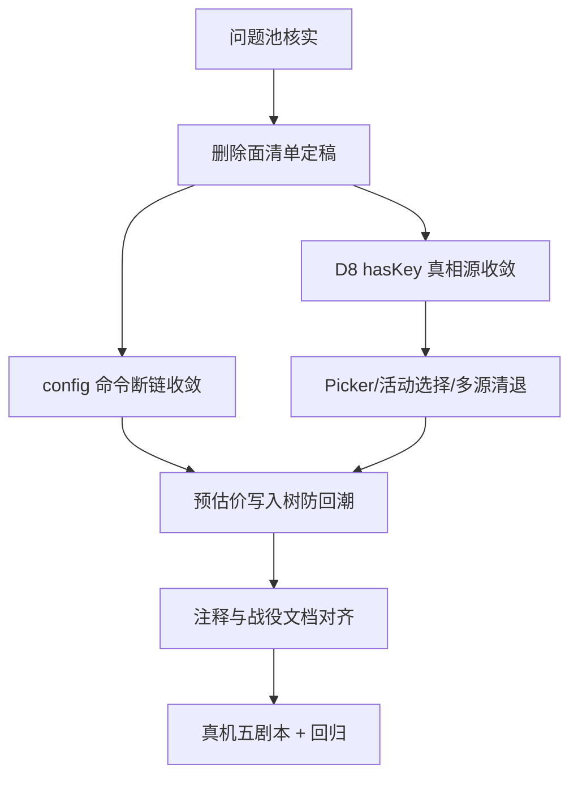

# 消费面遗留多轨清退 · 总修复方案（种子）

> 战役：`docs/legacy-consumer-debt-clearing/`
> 承接：`docs/provider-single-track-convergence/`（架构骨架已立）；本战役只清消费面遗留多轨与失真登记。
> 规则：只含逻辑执行顺序；问题同权；删除面必须写明。定稿前以 `independent-plans/` 交叉评审结果替换本种子。

## 1. 目标与不可变条件

用户在设置中保存的配置，必须是对话选择器显示、持久介质保存和内核实际出站使用的同一份配置。完成定义是完整产品链存活。

1. 单一写者：`ModelsStore` + `models.yaml`（已立，不得回退）。
2. `hasKey` 等凭据状态唯一真源 = 统一树 `credentialStates`；LS 档案不得再作真相源。
3. 活动选择、最近使用、默认模型候选序：身份一律 `(providerId, modelId)`；禁止裸 `modelId`、substring、AppSettings 兜底参与决议。
4. 出厂字典只做预填参考，禁止把预估价写入用户树。
5. 退役命令零调用；注释不得声称未接线链路已通。
6. 不留无删除日期的 fallback；不新建并行路径。

## 2. 依赖拓扑（草案）

## 3. 维度划分（待评审后锁定）

| 维度 | 概念 | 路径现状 → 目标 | 删除面（草案） |
|---|---|---|---|
| D1 | 引擎配置读写 | `config_get/update` + 统一树 settings 投影 → 1 条 | 断链调用与 `ENGINE_API_DEBT` 条目；死封装 |
| D2 | 凭据 hasKey | LS 档案 + credentialStates → 1 条 | 岛内 16 + 岛外 3 写口；`saveProfiles` 回写 |
| D3 | 选择与身份 | LS profiles / AppSettings / 裸 recent / 树 activeModel → 树 activeModel + 二元组 | `loadProfiles` 消费链、多源候选、旧 LS 键读口 |
| D4 | 预估价边界 | 字典直写草稿 pricing → 仅 UI 提示 | 预估写入树路径；必要的字典策略 |
| D5 | 注释与登记 | 失真/过时注释 → 与代码一致 | A/B/C 类矛盾注释；R-10 自认债务项 |
| D6 | 真机验收 | 部分剧本 → 全剧本物证 | 无代码删除；产出 `execution/` 证据 |

## 4. 完成判定

- P1–P6 每条有：修复文件、测试（含负向）、真机或门禁证据。
- D8 WARN 清零；`command-contract-drift` 债务棘轮清零。
- 无新增 TODO/临时标记；每轮至少一项负产出（主控 v3 §四.3）。

## 5. 执行记录

见 `00-执行记录.md`（开工后追加）。
