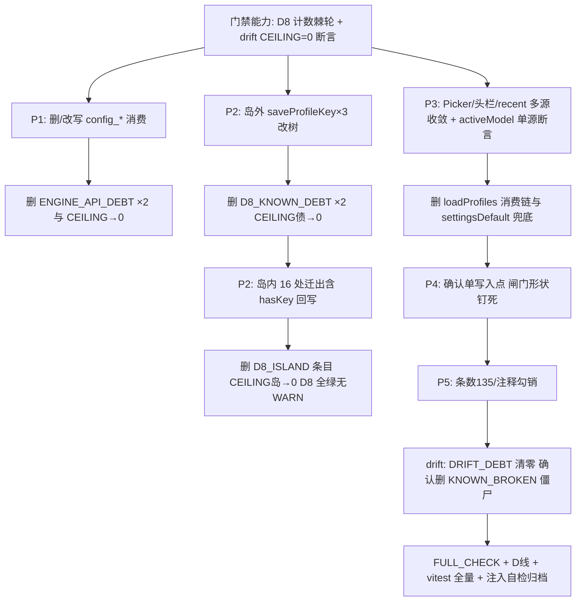

# 05 · 门禁棘轮与测试资产驱动方案

> **视角**：门禁 / 棘轮 / 测试驱动（方案位 05）。  
> **约束锚点**（以仓库实测为准，2026-09-16）：  
> - `scripts/check-provider-single-track.mjs` → **exit=0**，D1–D12 全 ok，仅 **D8 两条 WARN**（岛内 16 处写口 / 岛外已知债务 3 处）；`D8_SETITEM_FILES` 实测 **33** 项（GUIDE 文案写 32，属口径滞后）。  
> - `command-contract-drift.test.ts` → **7/7 绿**（含断言一零断链、断言二零幽灵、债务棘轮）；`ENGINE_API_DEBT_CEILING=2`、`DRIFT_DEBT_CEILING=1`；`KNOWN_BROKEN` 仍留 `catalog_get`/`catalog_refresh`（当前 `broken` 集已不含它们，条目为**僵尸候选**）。  
> - 四方命令注册实测 **135**（D11 ok；`FULL_CHECK_COMMANDS.md` / `GUIDE_TEXT.D11` 仍写 142 → P5-B 文档滞后）。  
> - `pricingCatalogSingleSource.test.ts` / `catalogWriteGate.test.ts` / `manualAddAutofill.test.ts` 已钉「预估价≠声明」三面；`rustProfileStore.test.ts` + `rustProfileStore.applyTree.test.ts` 已钉树写 CAS 与 `config_secret_*` wire。  
> - 问题池：`surveys/01-问题池.md` P1–P6。  
>  
> **总原则**：门禁只断言「缺陷不复发」，不断言期望实现（D 线脚本头注释）；**改门禁 ≠ 修缺陷**——每个 WARN / 债务条目必须绑定生产收敛路径，收敛后才能删棘轮；**本方案只写文档，不改代码、不改门禁、不删测试**。

---

## 1. 目标与不可变条件（门禁面）

对齐总方案 §1 完成定义，落到刚性红绿：

| # | 不变条件 | 门禁载体 | 当前态 | 目标态（刚性） |
|---|---|---|---|---|
| C1 | 退役命令 `config_get`/`config_update` 零前端消费 | `command-contract-drift` 断言一 + `ENGINE_API_DEBT` 棘轮 | 豁免中（目标 0） | 债务表空 + 上限 0 + 再出现即断言一红 |
| C2 | `hasKey` 唯一真源 = 树 `credentialStates`；旧 LS 档案写口岛外 0、岛内 0 | D8 孤岛（WARN → 硬红） | 两条 WARN | D8 零 WARN 且岛内命中即 FAIL |
| C3 | 活动选择 / 身份 = 树 `activeModel` + `modelRefKey` 二元组 | D5 已建 + 新增消费面负向（见 §3.5） | 身份键已绿；选择多源未钉 | 「读 LS active / 裸 id / AppSettings 兜底」即红 |
| C4 | 出厂字典只做预填参考；**预估价 ≠ 用户声明** | `manualAddAutofill.test` + `catalogWriteGate.test` + `pricingCatalogSingleSource.test` | 已有正负向 | 再增「静态写入路径」负向 + 闸门不可被绕过 |
| C5 | 四方 135 对齐、零断链、零幽灵 | D11 + drift 断言一/二 | 绿 | 条数注释/文档同步到 135；债务棘轮清零 |
| C6 | 注释不得声称未接线链路已通 | P5 类（部分可静态测） | 未建门禁 | 可测子集进 D 线或独立轻量断言；其余人工清单 |

**反作弊**：任何「把 WARN 改成 ignore」「把断链加进豁免表」「删负向断言」的行为 = 门禁退化；drift 已有「豁免表自洽 / 引擎豁免债务自证」断言，扩展方案见 §3.2。

---

## 2. 缺陷 → 回归断言映射（自检：每条生产缺陷有红绿设计）

> 路径数 = 本方案点名的**生产/测试/门禁文件**条数（供主控派发估量）；同文件多处只计 1。

### 2.1 P1 · `config_get` / `config_update` 真断链

| 项 | 内容 |
|---|---|
| 生产位 | `engineConfigIO.ts`（`loadEngineConfig` / `updateEngineConfig` 恒走 `transport.request` 且命令已退役） |
| 现有断言 | drift **断言一**（当前因 `ENGINE_API_EXEMPTIONS` + `transport.*` 形态而绿）；**引擎豁免债务自证**；**债务棘轮**（`ENGINE_API_DEBT.length ≤ 2`） |
| 缺口 | 收敛后**没有**「表必须为空」的终态断言；生产侧无「调用即抛/删除函数」的单测 |
| 新增回归断言设计 | ① **终态**：`ENGINE_API_DEBT_CEILING → 0` 且 `ENGINE_API_DEBT.length === 0`（`toBe(0)` 而非 `≤`）；② **生产收敛配套**：`loadEngineConfig`/`updateEngineConfig` 删除或改经 REST HTTP 面后，新增（或改写）`engineConfig.test.ts`：**负向** `expect(SRC).not.toMatch(/transport\.(request|send|call)\s*\(\s*'config_get'/)` 等 2 条；③ 若保留函数壳但内部改树读写：正向断言调用 `modelsCatalogStore`/`settings_*` 单一合法面；④ **自证加固**：断言一保持「仅 `transport.*` 形态可豁免」——收敛后调用名消失，豁免自然冗余 →「豁免表自洽：冗余必须删」已覆盖（drift 已有 `redundant` 断言） |
| 生产收敛（否则=作弊） | 路线 R1-04：① 删前端死调用与无调用方函数；或 ② 改经引擎 REST `GET/PUT /v1/settings`；或 ③ 并入统一树 settings 投影。**禁止**把 `config_get` 挪进 `JUSTIFIED_EXEMPTIONS` |
| 路径数 | 生产 1–2 + 测试 1–2 + drift 表 1 ≈ **4–5** |

### 2.2 P2 · D8 旧 LS 档案真相源（`hasKey` 双轨）

| 项 | 内容 |
|---|---|
| 生产位 | 岛内 `api/provider-profiles/*`（`profileKeySecret` 等 16 处写口）、`providerProfiles.ts`、`oauthTokenManager.ts`；岛外 `useModelProfilesState.ts:299/:343`、`useFirstRunWizard.ts:224`（`saveProfileKey`） |
| 现有断言 | D8：岛外**新增**硬 FAIL；岛内 / 岛外已知债务 **WARN**（目标 0）；`D8_SETITEM_FILES` 棘轮 |
| 缺口 | WARN **不阻断 exit**——收敛不完整也可「绿跑」；无「`saveProfiles` 回写 `p.hasKey`」的专用负向；无「UI 读 `credentialStates` 而非 LS `p.hasKey`」正向 |
| 新增回归断言设计 | ① **WARN 升级阶梯**（见 §4）：存量数写入 `D8_ISLAND_COUNT_CEILING` / `D8_DEBT_COUNT_CEILING`，超上限或**上升**即 `fail`（棘轮只降）；② **零回写负向**：`profileKeySecret`/`profileStorePersistence` 源码断言——`saveProfiles` 参数列表不得出现对 `hasKey` 的**唯一真相**语义（收敛后：`setProfileKey` 不再 `saveProfiles` 回写，或回写仅作镜像且以 `configSecretHas`/树为准的单测钉死）；③ **消费面**：`useModelProfilesState` / FirstRunWizard 保存密钥后，断言刷新读取来自 `readModelsYamlIpc().credentialStates[p].hasKey === true`（mock 树回执），而非 `loadProfiles()`；④ 现有 `providerProfiles.test.ts`「setProfileKey 后 LS 无明文」保留为 DPAPI 行为锁，**不替代**单源断言 |
| 生产收敛 | 路线 A（问题池倾向）：岛外 3 处改调统一密钥写入（树+DPAPI）；岛内删 `p.hasKey` 回写 / 或降为只读迁移边界；`D8_KNOWN_DEBT` 两条删除后债务命中 → 硬红 |
| 路径数 | 生产 ~6 + 测试 ~4 + 门禁 1 ≈ **11** |

### 2.3 P3 · 活动选择 / Picker 多源

| 项 | 内容 |
|---|---|
| 生产位 | ① `modelCatalogIpc.ts` `loadProfiles`+`foldProfilesByDisplayName`；② `ChatHeaderControls.tsx` `appSettings.defaultModel`；③ recent 身份（`engineConfigIO` 已迁 `modelRefKey`，问题池「裸 id」需以现行代码复核）；④ `profileActiveSelection` LS `crish_active_*` 与树 `activeModel` 双轨；⑤ 陈旧 LS 键 |
| 现有断言 | `useChatModelPicker.test` / `ModelBadgePickerMenu.test` 源码负向 `loadProfiles`；`ChatHeaderControls.catalog.test` 部分形状；D5 身份键 |
| 缺口 | Picker **列表源**仍可静默走 LS；头栏 `settingsDefault` 兜底未钉死禁止；**activeModel 单源**（树 vs LS）无「生产禁止 `setActiveModelId` 参与渲染决议」的刚性断言 |
| 新增回归断言设计 | ① **activeModel 单源**：生产扫描（同 D5 风格，stripComments）——渲染决议链（`ChatHeaderControls` / picker / `ComposerFusedTrigger`）禁止出现 `settingsDefault`/`appSettings.defaultModel` 兜底参与 `resolveHeader*` 入参（正则或 AST 钉 `settingsDefault:` 消失）；② `getActiveModelId()` 仅允许出现在**迁移/兼容读**白名单，出现在**列表折叠**路径 → 红；③ 正向：`resolveHeaderModelFromCatalog` 在树有 `activeModel` 时与 LS 冲突 → **跟树**（新增单测）；④ `modelCatalogIpc` 列表函数源码 `not.toMatch(/loadProfiles\(/)`（对齐既有 picker 负向，补到 ipc 面）；⑤ recent：若仍有裸 id 写入路径 → `engineConfig.test` 增「仅 `modelRefKey` 形态落 LS」负向 |
| 生产收敛 | 列表与选择改树；删 `foldProfilesByDisplayName` 生产消费链（纯函数测试可保留至删除清单确认）；LS active 降为一次性导入 |
| 路径数 | 生产 ~5 + 测试 ~4 + 可能 D 线扩展 1 ≈ **10** |

### 2.4 P4 · 预估价写入用户配置树

| 项 | 内容 |
|---|---|
| 生产位 | `manualAddAutofill` → `addDraftToModelInput` 闸门；字典 `modelsAutofillBaselineData.json`；写口 `catalogWriteGate` |
| 现有断言 | `manualAddAutofill.test.ts`：参考价不置 `pricingExplicit`、补丁无 `pricing`；`catalogWriteGate.test.ts`：落树/镜像无 `pricing`、显式声明可落、编辑不覆盖；`pricingCatalogSingleSource`：字典只读、未收录≠0 |
| 缺口 | **无「绕过闸门」的静态负向**（如第二处 `delete`/`pricing` 合并点）；61KB 字典仍在（D6 只扫退役别名）；无「树中不得出现与出厂字典同值且无 `pricingExplicit` 痕迹」的集成级抽查（可选） |
| 新增回归断言设计 | ① **闸门单点**：`catalogWriteGate.ts` 源码必须仍含 `pricingExplicit !== true → delete … pricing`（防闸门被静默删）；② **唯一写入点**：生产 `modelsDraftMap`/`addModel` 补丁构造路径 grep——除 `addDraftToModelInput` 外禁止拼 `pricing:` 到 ModelSpec（测试文件除外）；③ 已有正负向**保持红绿可变异**：自检清单「撤掉 `delete declared.pricing` → 测试必须红」写入执行记录；④ 可选：对 `modelsDraftMap.test` 增「无 explicit 不透传 pricing」 |
| 生产收敛 | 若仍有第二条写入路径（问题池 05 期 3）→ 收敛到闸门；字典策略不扩写入 |
| 路径数 | 生产 2 + 测试 2–3 ≈ **4–5** |

### 2.5 P5 · 注释 / 文档与实现矛盾（可测子集）

| 类 | 可门禁化？ | 断言设计 |
|---|---|---|
| A 类（仍写已退役命令为现役） | 部分 | 对 `bootstrap-full.ts` / `thinkingGear.ts` / `engineConfigIO` 头注释做**过时词面**扫描：注释含 `config_get` 且同文件生产已删调用 → 警告或 FAIL（需定清单，避免误伤历史叙述）；优先人工 + 执行记录勾销 |
| B 类（条数 95/142） | 是 | D11/GUIDE/`FULL_CHECK_COMMANDS` 中 `142` → 实测 **135**；加一条**文档条数 = 解析条数**软断言（D11 已有四方位对齐，可对 FULL_CHECK 文本做可选 lint） |
| C 类自认债务注释 | 否 | 删除面清单人工勾销 |
| D 类战役文档滞后 | 否 | `docs/provider-single-track-convergence/04-…` 等仅文档层 |

### 2.6 P6 · 端到端验收

不属本方案门禁主链；验收物证走 4000 Tauri MCP 五剧本归档（`execution/`），门禁只保「单测/脚本全绿 + D 线 exit=0」。

---

## 3. 门禁扩展设计（只设计，不落地改脚本）

### 3.1 D8：WARN → 棘轮硬红（P2 主闸）

现状（脚本 L711–808）：

- `outside` 非空 → **FAIL**（已刚性）；
- `islandHits` / `debtHits` → **WARN**（软）；
- `D8_SETITEM_FILES` 新增未登记 → FAIL。

设计增量：

```text
D8_ISLAND_COUNT_CEILING = 16   // 与岛上实际写口同步，只降不升
D8_DEBT_COUNT_CEILING   = 3    // D8_KNOWN_DEBT 命中数

if (islandHits.length > D8_ISLAND_COUNT_CEILING) fail(...)
if (debtHits.length  > D8_DEBT_COUNT_CEILING)   fail(...)
if (CEILING > 0 && 实际 < CEILING) console.warn('可下调 CEILING')  // 或直接 require CEILING === 实际
```

**清零步骤**（与生产收敛绑定，禁止只改常量）：

1. 岛外 3 处改单轨密钥写 → 删 `D8_KNOWN_DEBT` 两条 → 债务命中 0 → `D8_DEBT_COUNT_CEILING=0`，此后任何 debt 命中即 FAIL。  
2. 岛内 16 处逐项迁出（`oauthTokenManager` 为**活链路**，脚本注释已更正，迁移时保留 OAuth 回写语义、改落树/显式豁免边界）→ 删 `D8_ISLAND` 路径条目 → `D8_ISLAND_COUNT_CEILING=0` → 任意岛内命中 FAIL。  
3. `profileKeySecret` 去 `saveProfiles(p.hasKey)` 回写后，加 §2.2② 负向。  
4. `D8_SETITEM_FILES`：迁移后不再 `setItem` 的文件从白名单删除（白名单只减不增，与棘轮同向）。

**注入自检**（设计要求，执行时记入记录）：在生产临时加 `saveProfileKey(...)` 于岛外 → 必须 FAIL；把 CEILING 误调高 → 必须被「只降」规则拦住（若实现为显式改常量，靠 code review + 本方案删除面清单）。

### 3.2 drift：`ENGINE_API_DEBT` / `KNOWN_BROKEN` / 豁免

| 条目 | 现状 | 终态设计 |
|---|---|---|
| `ENGINE_API_DEBT` ×2 | CEILING=2，仅 transport 形态生效 | 收敛后删两条 → **`CEILING=0` + `length === 0`** |
| `KNOWN_BROKEN` ×2 | `broken` 已不含 catalog_* → **僵尸** | 主控确认后**删除条目**（僵尸不影响绿，但会污染 unexpected 过滤语义） |
| `DRIFT_DEBT` ×1 | `core_read_run_events` | 接线或四方退役后删条 → `DRIFT_DEBT_CEILING=0` |
| `JUSTIFIED_EXEMPTIONS` ×1 | `workbench_window_ready`（loader.js 域外） | loader 迁入扫描面后删 |
| 豁免自证 / 表自洽 / 冗余必删 | 已有 | **保留，禁止弱化**；收敛后冗余豁免自动变红逼删 |

**退役命令负向断言**（D1 已有 7 个标识符）：

- 补充：`config_get`/`config_update` 收敛进 D1 或 drift「再出现」路径——优先 **drift 断言一无豁免**；D1 可增 TS 侧词边界（注意 D1 已扫 `config_get(` 为 rust kind，TS 需 `kind:'ts'` 新条目，避免双扫描重复门禁——若 drift 已覆盖前端调用字面量，**不重复造**，D1 只守 Rust）。  
- 现有 D11⑤「委托存在性」保持：不得在 D 线重建同向扫描。

### 3.3 「预估价≠声明」刚性化

保持三文件分工，**不新建平行门禁**：

| 断言 | 文件 | 角色 |
|---|---|---|
| 参考价不进补丁 | `manualAddAutofill.test.ts` | 单元负向 |
| 落树/镜像无 pricing | `catalogWriteGate.test.ts` | 链路负向 |
| 字典只读 / 未收录≠0 | `pricingCatalogSingleSource.test.ts` | 真源 |

增量仅两处：① `catalogWriteGate.ts` 闸门形状正则（源码存活）；② 第二写入点静态负向（§2.4②）。二者可并入既有文件，避免新 describe 文件膨胀。

### 3.4 「activeModel 单源」刚性化

- **写侧**：`setActiveModelId` 已在 `D8_SYMBOLS`（写 LS 即计 D8）——岛内收敛后写口归零。  
- **读侧决议**：新增形状断言（建议落点：`ChatHeaderControls.catalog.test.tsx` 源码 describe 扩展 + `modelsCatalogSelectors` 正向单测）：  
  - 树 `activeModel` 与 LS 不一致 → 显示跟树；  
  - `settingsDefault` 不进入 header 决议（或仅 telemetry，不进标签）。  
- **禁重复**：不建第三套「选择扫描门禁」贴在 D 线，复用测试文件源码形状模式（仓库已有 `SRC.not.toMatch` 惯例）。

### 3.5 FULL_CHECK_COMMANDS 同步

- D11 行「当前各 142」→ **135**（与脚本 GUIDE 同步改，属文档正确性，主控提交时带）。  
- D8 行「当前 32」→ **33**（或写「见脚本 `D8_SETITEM_FILES.size`」防再漂）。  
- 收敛后 D8 描述去掉「仅 WARN」表述 → 写清 CEILING。

---

## 4. 棘轮清零总序（逻辑依赖，无波次名）



顺序理由：**先加硬断言能力（防收敛期回潮）→ 再改生产 → 再删棘轮**；禁止「先删棘轮再改生产」。

每步验收：

| 步 | 绿条件 |
|---|---|
| 任意中间态 | D 线 exit=0；无**新增** WARN/债务；vitest 相关文件绿 |
| P1 完 | drift 7 断言绿且 `ENGINE_API_DEBT.length===0` |
| P2 完 | D 线 **零 WARN**；CEILING 全 0 |
| P3 完 | 单源断言绿；`loadProfiles` 消费链负向绿 |
| P4 完 | 三测试 + 闸门形状绿；变异自检（拆闸门）变红记录在案 |
| 收口 | `FULL_CHECK_COMMANDS.md` 快/中/Rust/结构性全过 |

---

## 5. 删除面（主控确认清单；**本方案不执行删除**）

### 5.1 应删棘轮 / 豁免条目（生产收敛后，按序）

| # | 条目 | 位置（约） | 删除前置条件 | 目标 |
|---|---|---|---|---|
| R1 | `ENGINE_API_DEBT` ×2 | `command-contract-drift.test.ts` | P1 消费面清零 | 表空 + CEILING 0 |
| R2 | `KNOWN_BROKEN` ×2 | 同上 | 确认 `broken` 已无 catalog_*（实测绿） | 可删僵尸；或保留至主控裁定 |
| R3 | `DRIFT_DEBT` ×1 + CEILING | 同上 | 接线或四方退役 `core_read_run_events` | 表空 + CEILING 0 |
| R4 | `JUSTIFIED_EXEMPTIONS` ×1 | 同上 | `workbench_window_ready` 进扫描面 | 表空 |
| R5 | `D8_KNOWN_DEBT` ×2 | `check-provider-single-track.mjs` | 岛外 3 写口迁单轨 | Map 空 |
| R6 | `D8_ISLAND` 三路径 | 同上 | 岛内写口归零（含 oauth 活链路改道） | 路径清空 |
| R7 | `D8_SETITEM_FILES` 中迁出文件 | 同上 | 该文件不再 `setItem` | 只减不增 |
| R8 | D1 若曾加 `config_get` 前端条目 | 同上 | 仅当选择 D1 覆盖（优先不加，靠 drift） | 维持 D11⑤ 委托 |

### 5.2 陪葬死层测试清单（**列给主控确认，禁止子 Agent 自行删除**）

> 判据：测试**唯一**覆盖将被删除的 LS 档案岛 / 断链封装 / 双轨选择；删除生产层后测试无法表达有效行为。  
> 处置三档：① **整文件删**；② **删 describe/it 块，保留仍有效的 DPAPI/树断言**；③ **改写为树单源断言（优先）**。

| # | 测试资产 | 关联生产删除 | 建议档 | 说明 |
|---|---|---|---|---|
| T1 | `api/providerProfiles.test.ts`（约 41+ `it`，大量 `saveProfiles`/`setActiveModelId`/`loadProfiles` LS 语义） | P2/P3 LS 档案岛与 LS active | **②/③** | 不可整删：含 pure helpers、DPAPI 无明文、激活优先级——**按 describe 拆**；LS 持久化语义块迁走后可删 |
| T2 | `modelCatalog.test.ts` 中 `saveProfiles` 夹具与「扫描上送」里 catalog_* 旧史 describe（L504+） | 扫描路径若去 LS | **②** | 已有退役命令负向；夹具可改树 |
| T3 | `FirstRunWizard.test.ts` 种子 `saveProfiles(getDefaultProviderProfiles())` 块 | 首启改树 | **③** | 改 mock 统一树 |
| T4 | `useModelProfilesState.test.tsx` / `.invalidation` 中 `saveProfileKey`/`loadProfiles` mock | 岛外 3 处改单轨 | **③** | mock 改为树+secret API |
| T5 | `bootstrap-full.test.ts` 无 `loadProfiles/saveProfiles` 负向 | 启动已禁 LS 回落 | **保留** | 防回潮，**不删** |
| T6 | `profileValidation.test.ts` / `foldProfilesByDisplayName` 纯函数用例 | 若删纯函数 | **① 若函数删** | 与 T1 pure helpers 重叠——主控定 SSOT |
| T7 | `migrateLegacyProfiles*.test.ts` | 一次性迁移是否保留 | **保留至迁移退役窗口** | 读侧迁移允许，过期再议 |
| T8 | `modelCatalog.test` / `providerProfiles.test` 中仅断言 `p.hasKey` LS 回写的用例 | `saveProfiles` 去 hasKey | **②** | 换成 `credentialStates` 断言 |
| T9 | `ChatHeaderControls.catalog.test` 若 `setActiveModelId` 改 mock 树 | active 单源 | **③** | 正向应加强非整删 |
| T10 | `commandManifest.test` 对 catalog_* 豁免注释类 | R2 删 KNOWN_BROKEN | **②** | 同步注释，防「仍在红」误导 |

**铁律**：以上任一删除须主控在执行记录勾选；子 Agent **只列不删**（AGENTS §9 测试资产 + 任务书）。

### 5.3 生产删除 / 收敛面（问题池类型分类对齐）

| 类 | 对象 | 路径数（约） |
|---|---|---|
| 删调用/函数 | `loadEngineConfig`/`updateEngineConfig` 断链面（或改 REST） | 1–2 |
| 删回写 | `profileKeySecret.setProfileKey` → `saveProfiles` hasKey 唯一真相 | 1 |
| 删岛外写 | `useModelProfilesState` ×2、`useFirstRunWizard` ×1 → 单轨 | 2 文件 |
| 删岛内写 | D8_ISLAND 内 16 处写口（除保留的合法 setItem 白名单） | ~5 文件 |
| 删消费链 | `modelCatalogIpc` `loadProfiles`/`fold`；`ChatHeaderControls` `settingsDefault` 决议 | 2–3 |
| 删多源 | 陈旧 `crish_providers`/`conex_pi_providers`/`crish_model_meta` 决策参与（读侧导入除外） | 待复核 |
| 不删 | `oauthTokenManager` 活刷新语义；`config_secret_*`；树 CAS；D4/D5/D6/D7/D9/D10/D12 | — |

### 5.4 不删（防过度删除）

- 已绿 D 线断言与 drift 7 断言的**防弱化**部分。  
- `pricingCatalogSingleSource` / `catalogWriteGate` / `manualAddAutofill` / `rustProfileStore*` 现有正负向。  
- D11⑤ 与 D10「只守存在性、不重复扫描」模式。

---

## 6. 验证命令（执行时用；本任务不跑改码后的全量）

| 阶段 | 命令 |
|---|---|
| D 线 | `node scripts/check-provider-single-track.mjs` |
| 指引 | `node scripts/check-provider-single-track.mjs --guide D8` |
| 命令断链 | `npx vitest run src/api/transport/command-contract-drift.test.ts`（cwd=`apps/crish-desktop`） |
| 价格/闸门 | `npx vitest run src/api/pricingCatalogSingleSource.test.ts src/components/settings-models/manualAddAutofill.test.ts src/components/settings-models/catalogWriteGate.test.ts` |
| 树写/密钥 | `npx vitest run src/api/provider-profiles/rustProfileStore.test.ts src/api/provider-profiles/rustProfileStore.applyTree.test.ts` |
| 快层收口 | `npm run typecheck` + `npm run test:coverage -- --project=unit` + `npm run test` |
| 清单 | `FULL_CHECK_COMMANDS.md` 结构性检查表全项 |

---

## 7. 诚实待确认（主控裁定）

1. **P1 路线**：删死调用 vs 改 REST `/v1/settings` vs 并入统一树——影响 `ENGINE_API_DEBT` 删除时机与是否动 Rust 注册。  
2. **`KNOWN_BROKEN` 僵尸**：实测 drift 已绿且 broken 不含 catalog_*——删或留待历史注释同步（R2）。  
3. **`core_read_run_events`**（R3）与 `workbench_window_ready`（R4）是否划入本战役或仍归 F-03/loader 边界。  
4. **D8 白名单 33 vs 文档 32**：以脚本 `size` 为准，FULL_CHECK 文案是否允许写「动态」。  
5. **T1 `providerProfiles.test` 拆分粒度**：整文件 vs 按 describe——避免误删 pure/DPAPI 资产。  
6. **`oauthTokenManager`** 迁移：改写树镜像的具体字段契约（树无 `oauthToken` 字段时如何表达 hasKey）。  
7. **P3 recent「裸 id」**：现行 `engineConfigIO` 已是 `modelRefKey` 迁移逻辑——问题池该行是否已被 R 族部分修复，需复核后再定是否还有写入负向。  
8. **A 类注释词面扫描**是否入 D 线（误报风险）或仅人工。  
9. **activeModel 单源**与引擎在线 hint 的优先级（现状 `resolveHeaderModelFromCatalog` 有 engineModel 参数）——单源指**持久选择真源**为树，运行时 hint 是否允许覆盖显示需产品语义确认。

---

## 8. 自检对照（任务书）

| 要求 | 状态 |
|---|---|
| 每个生产缺陷有回归断言设计 | §2.1–2.5（P1–P5；P6 注明非本链） |
| 删除面含棘轮清零步骤 | §4 总序 + §5.1 R1–R8 + D8 CEILING 清零 |
| 路径数 | §2 各表「路径数」；删除面 §5.3 |
| 诚实待确认 | §7 九条 |
| 不改代码/门禁/git/不删测试/唯一文档/无波次名 | 遵守 |
| 生产收敛防「只改门禁」 | 每条缺陷表「生产收敛」列 + §4「先能力后生产后删棘轮」 |

---

*方案位 05 · 门禁棘轮与测试驱动 · 只读勘察 + 本文档落盘。*
