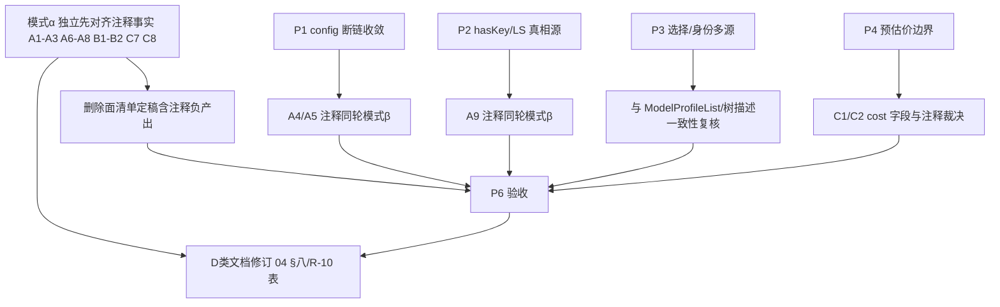

# 06 · 注释失真与结构净收敛方案

> 视角：失真登记与结构净收敛（P5 注释债主线）。
> 上游：`surveys/01-问题池.md` P5；`docs/provider-single-track-convergence/04-端到端系统性收敛方案.md` §9.4 R-10；`00-总方案.md` D5 / 不变量 5。
> 规则：只写逻辑顺序与文件域处置；问题同权；不写波次名；不改代码、不 git。
> 代码亲读锚点（2026-09-17 工作区）：`bootstrap-full.ts`、`thinkingGear.ts`、`engineConfigIO.ts`、`profileStoreActivation.ts`、`commandManifest.ts`、`skillsApi.ts`、`browserImportLib.ts`、`editSession/registry.ts`、`telemetryAccess.ts`、`sessionEventUsage.ts`、`ModelProfileList.tsx`、`profileCatalog.ts`（见 §7 待确认）。

---

## 1. 问题与不变量

### 1.1 问题

A 类**矛盾注释会骗实现者**：注释声称链路已通 / 仍走退役命令 / 仍降级静态表，与代码事实相反。后续实现者（人或 Agent）若以注释为真源，会：
- 按已退役命令名继续接线（`catalog_get` / `config_get` / `config_update` / 旧 `config_profile_apply`）；
- 以为存在静默 fallback（静态表 / 恒不抛）而放弃 fail-closed 断言；
- 把自认债务注释（C 类「未接线 / S7 删除 / 后续收口」）当无限期延期授权。

### 1.2 本方案锚定的不变量（不得违反）

1. **注释不得声称未接线链路已通**（04 §六.6；`protocol.rs:295` 为历史反例）。
2. **注释与代码事实必须同轮对齐**：改路径的同一提交域内，必须同轮改注释（禁止「先改代码、注释下轮再说」）。
3. **未接线标记二选一**：要么接线（真消费），要么删除标记与死封装；**禁止**以注释形式无限期留存（R-10）。
4. **退役命令名不得出现在生产注释的「现行路径」描述里**（历史备注可保留，须显式写「已退役」）。
5. **条数 / 棘轮数字注释与断言值同步**；禁止陈旧条数（B 类）。
6. **每轮至少一项负产出**（主控 v3 §四.3）：本方案的负产出 = 失真注释删除、死注释副本删除、过时文档章节修订、未接线标记移除。

---

## 2. 分类与处置总表（P5 全清单 · 无遗漏）

### 2.1 A 类 · 矛盾注释（会骗实现者）— 必须改写或删除

| 编号 | 位置（亲读） | 注释声称 | 代码事实 | 处置 | 路径数 |
|---|---|---|---|---|---|
| A1 | `bootstrap-full.ts:14-16` | 「catalog_get 接线」「invoke 失败内部降级静态表 / 提供方默认，恒不抛」 | 实调 `fetchCatalogSnapshot` + `fetchDescribeEffortsSnapshot` → `workbench_read_capability_dictionary`；两者均已 fail-closed（失败返回 false + 告警，**非**恒不抛、**无**静态表降级） | **改写**：改为能力字典读面 + fail-closed 语义；删除「静态表降级」「恒不抛」 | 1 文件 / 3 行注释块 |
| A2 | `thinkingGear.ts:123` | 段标题「catalog_get 快照档位存储」 | 段内缓存由 `applyCatalogEfforts` 注入，来源 = `workbench_read_capability_dictionary`（`:216-217`）；文件头 `:4-6` 已正确 | **改写**段标题为能力字典；与文件头统一 | 1 文件 / 1 行 |
| A3 | `thinkingGear.ts:129` | 「单源 = Rust catalog_get 档位字段」 | 同上；`fetchDescribeEffortsSnapshot` 只 invoke `workbench_read_capability_dictionary` | **改写**同 A2 | 1 文件 / 1 行 |
| A4 | `engineConfigIO.ts:167-170` | 「config_get，T-F 06 接线…经 transport.request('config_get') 同一通道」— **给断链背书** | `config_get`/`config_update` 已退役（`command_manifest.rs` 记载）；`transport.request` 恒走 Tauri invoke ⇒ 调用恒抛 / 静默 null；`ENGINE_API_DEBT` 登记目标=0 | **与 P1 同轮**：路径收敛时**同轮改写**注释（删除封装 → 删注释；改 REST → 写 REST 事实） | 1 文件 / 1 注释块；耦合 P1 |
| A5 | `engineConfigIO.ts:192-208`（函数头语义） | 隐含 `config_update` 可用（实现仍 `transport.request('config_update')`） | 同 A4 断链 | **与 P1 同轮**：改路径同轮改注释 | 1 文件；耦合 P1 |
| A6 | `profileStoreActivation.ts:39` | 「同步走 config_profile_apply」 | 实调 `configProfileApply()`（`rustProfileStore.ts` 门面）→ **内部已走统一树** `applyViaUnifiedTree`；旧 Tauri 命令 `config_profile_apply` 已退役 | **改写**：写「经 configProfileApply 门面 → 统一树 CAS」；旧命令名仅可作「已退役」历史注 | 1 文件 / 1 行 |
| A7 | `profileStoreActivation.ts:112` | 「密钥由 Rust 从 DPAPI 槽读取（config_profile_apply）」 | 同 A6；凭据经 `config_secret_*`，选择经统一树 | **改写**同 A6 | 1 文件 / 1 行 |
| A8 | `profileStoreActivation.ts:139` | 「config_secret_set / config_profile_apply 回执写回树镜像」 | `config_profile_apply` 退役；`config_secret_set` 仍在 | **改写**：删除退役命令名或标注已退役 | 1 文件 / 1 行 |
| A9 | `profileStoreActivation.ts:127-129` | 「身份合一…从 live catalog 兜底 baseUrl」— 描述与 P2 迁移态可能漂移 | 仍 `loadProfiles()` + `getLiveProvider` 双源 | **与 P2 同轮**：hasKey/LS 收敛时同步改写为单一真源描述 | 1 文件；耦合 P2 |

**A 类路径数合计**：5 个代码文件，约 10 个独立注释块；其中 A4/A5 必须与 P1 同轮，A9 与 P2 同轮，其余可独立先行（对齐事实，不改行为）。

### 2.2 B 类 · 过时条数 / 过时数字 — 改写或与断言同步

| 编号 | 位置 | 注释声称 | 事实 | 处置 | 路径数 |
|---|---|---|---|---|---|
| B1 | `commandManifest.ts:183` | 「95 = 注册面 91 + 登记先行 4 镜像」 | 同文件 `:48` 写「135 = 注册面 135 全实装」；四方实测 135 条（问题池约束锚点） | **改写**：删除「95=…」残句或改为与 `:48` / `command_manifest.rs` 同一口径的当前数字 | 1 文件 / 1 行 |
| B2 | `commandManifest.ts:88`（邻近） | 「与 Rust command_manifest.rs 95/91 镜像」 | 条数已演进为 135 | **改写**同 B1（若亲读确认仍存；B1/B2 可合并一次扫） | 1 文件 / 1 行 |
| B3 | `commandManifest.ts` 测试侧注释历史行（`commandManifest.test.ts` 内条数演进史注） | 保留为历史演进说明 | 非失真（是 changelog 式注释） | **不动**；验证依据：注释已标明历史步骤而非现行事实 | 0（豁免） |

**B 类路径数**：1 代码文件（`commandManifest.ts`）2 行；测试文件豁免。

### 2.3 C 类 · 自认债务注释（R-10）— 接线或删除，禁止留存

规则（04 §9.4 R-10）：**每条要么接线、要么删除，不得以注释形式留存**。

| 编号 | 位置（问题池 / R-10） | 标记内容 | 处置裁决（本方案） | 与 P1–P4/P6 耦合 | 路径数 |
|---|---|---|---|---|---|
| C1 | `sessionEventUsage.ts:27` | 「遗留 JS 浮点（δ 后不再写入；S7 删除）」— 字段 `cost: number` | **两段式**：① 核实 `cost` 是否仍被 `mergeTokenUsageDelta` 读入（`telemetryAccess.ts:139` 仍 `cur.cost + …`）→ 若 UI/存储仍读，**本轮改写为准确描述**；② 真正删字段（S7）属费用账收敛，**不在本方案单独拍板删字段**，登记为「待费用账 owner 确认后删」——**注释不得留「S7 删除」悬空**，改为「遗留字段，删除窗口=<待确认>」或本轮直接参与删除面 | 与 P4（费用/预估价边界同属账面语义）并行不阻塞；**诚实待确认 §7.1** | 1 文件 / 1 行注释（字段删除另计） |
| C2 | `telemetryAccess.ts:104` | 同 C1（`TokenUsageDelta.cost`） | 同 C1，**同一裁决、同一轮改写**，禁止只改一处 | 同 C1 | 1 文件 / 1 行 |
| C3 | `browserImportLib.ts:12` | 「origins 数（localStorage 采集未接线，恒 0）」 | `parseStorageStatePreview` **实际**读 `origins` 数组长度（`:39`）— 若上游命令恒不返回 origins，则「恒 0」可能为真 | **二选一**：① 接线 origins 采集 → 删注释；② 确认产品不要 origins → **删字段** `origins` 与注释（负产出） | 1 文件；**先核实上游 wire**（§7.2） |
| C4 | `editSession/registry.ts:85` | 「baseRev 未知（未接线真实 rev）→ 占位 0」 | commit 在 `baseRev===undefined` 时 `committedRev=0` | **二选一**：① 调用方必须传真实 baseRev → 类型收紧 + 删占位分支与注释；② 确认「内存态可无 rev」→ 改写注释为**正式契约**（非「未接线」措辞） | 1 文件；测试 `registry.test.ts:103` 同步 |
| C5 | `skillsApi.ts:87` | 「T03.7 后无引擎通道，恒 0/0（保留签名兼容调用方）」 | `syncSkillsToDaemon` 返回 `{ok:0,fail:0}` | **优先删除死封装**：查调用方；零调用 → **物理删除函数**（负产出）；仍有调用 → 调用方一并删或改写为显式 no-op 契约 | 1 文件 + 调用方扫描；**先查引用**（§7.3） |
| C6 | `skillsApi.ts:251` | 「skills（L4）层集中资产待技能注入后续收口轮迁入 skillFormatter.ts」 | 模板就地定义于本文件 | **二选一**：① 本轮迁入 `src/prompts/skills/skillFormatter.ts` → 删注释；② 不迁 → **删「后续收口轮」措辞**，改写为「就地定义，迁移不承诺」 | 1 文件（或 1 迁移 + 1 删） |
| C7 | `providerCatalog.ts:103`「未接线」 | 问题池点名 | **全仓无此文件**；最接近 = `profileCatalog.ts:103`「原生 Anthropic Messages API 未接线」 | **按 profileCatalog 处置**：① 若 Anthropic 原生协议在统一树 `protocol` 字段已有 → 删「未接线」；② 若确实未支持 → 改写为产品现状描述（非「未接线」悬空） | 1 文件；**路径名勘误见 §7.4** |
| C8 | R-10 · `commandManifest.ts:275`（R-10 记 :281，行号已漂） | 「登记先行命令 registered=false——尚未接线，调用即显式 missing」 | **机制描述**：登记先行是合法契约（registered=false） | **改写为中性机制说明**（「registered=false 即不可调用」）；若当前清单 **0 条**登记先行 → 注释改为「当前快照无登记先行条目」或删例句 | 1 文件 / 1 注释；与四方 135 对齐 |
| C9 | R-10 · `commandManifest.ts`「06 遗留⑨」（R-10 记 :228） | 战役遗留编号 | 亲读 `:228` 现为 D4a 子代理注释，**「06 遗留⑨」未命中** | **待确认**：可能已清或行号漂移 → 扫描 `commandManifest.ts` 全文；命中则删编号残留（§7.5） | 0–1 文件 |
| C10 | R-10 · `ModelProfileList.tsx:14`、`:195`「S7 前 / 凭据壳」 | 旧凭据壳名单 | 亲读现文件：`:14-16` 已写「名单只来自统一树 providers…credentialStates…不读旧档案」；**「S7 前/凭据壳」句未命中**；`:195` 区域为 Props 定义，无该注释 | **已清零**（相对 R-10 登记时点）→ 本方案**登记为已处置**，不重复改 | 0（验证保留） |

**C 类路径数合计（本方案执行面）**：`sessionEventUsage.ts`、`telemetryAccess.ts`、`browserImportLib.ts`、`editSession/registry.ts`、`skillsApi.ts`、`profileCatalog.ts`、`commandManifest.ts` ≈ **7 文件**；其中 C10 已清、C9 待扫描。

### 2.4 D 类 · 战役文档滞后 — 修订（文档删除面）

| 编号 | 位置 | 滞后内容 | 处置 |
|---|---|---|---|
| D1 | `docs/provider-single-track-convergence/04-…md` §八 `:258` | 「波次二待派发」 | **修订**：按 00-执行记录 / 当前事实改为已派发/已完成状态；禁止波次名在本战役新文档使用，此处只**改事实句** |
| D2 | 同文件 §九 / R-10 表 | ModelProfileList 两条 S7 注释已清、commandManifest 行号漂移 | **修订 R-10 表**：勾销已清项、更正行号与文件名（providerCatalog→profileCatalog） |
| D3 | `docs/legacy-consumer-debt-clearing/00-总方案.md` §2 依赖拓扑 | 「注释与战役文档对齐」位于 G 收尾节点 | **本方案与该拓扑关系见 §4**：允许「事实对齐注释」提前并行，但**验收勾销**仍在收尾 |

D 类路径数：2 个既有 md 文件修订 + 本方案 1 文件。

---

## 3. 清理规程（注释-代码一致性）

### 3.1 单条处置算法（对每条 A/B/C/D）

```
输入：注释条目 e，其声称的事实 F(e)
1. 亲读代码 → 得事实 F(code)
2. 若 F(e) == F(code) → 保留（登记「一致」）
3. 若 e 描述已退役/不存在的路径 → A 类：改写为 F(code)，或删除 e
4. 若 e 是「未接线 / 后续 / S7 删除」悬空标记 → C 类：
   a. 能在本轮接线 → 接线并删标记
   b. 不能接线 → 删除标记（及对应死字段/死封装），或改写为正式契约（禁止悬空）
5. 若 e 含数字/条数 → 与测试断言、Rust 真源三方对齐（B 类）
6. 若 e 在文档 → 按当前执行记录修订（D 类）
禁止：只改代码不改注释；只改注释不跑相关测试。
```

### 3.2 与执行顺序的耦合铁律（先对齐事实 vs 同轮改注释）

| 模式 | 适用 | 动作顺序 |
|---|---|---|
| **模式 α · 先对齐事实（可独立先行）** | 注释错误但代码行为已是目标态（A1–A3、A6–A8、B1–B2、C7、C8） | 1) 亲读确认代码真源 2) 只改注释 3) 不动行为；可与任何 P 并行 |
| **模式 β · 改路径时强制同轮改注释** | 代码行为还要改（A4/A5↔P1，A9↔P2，C1/C2↔费用账，C4/C5/C6 视接线裁决） | 同一任务单元内：路径改动 + 注释改动 + 相关测试，**一次交付**；禁止拆轮 |
| **模式 γ · 文档滞后修订** | D 类 | 对应路径收敛完成后的**同一收口点**改文档，或路径定稿即改（禁止文档长期落后于 P1–P4 完成态） |

### 3.3 防回潮断言（轻量，防新增失真）

- **断言 N1**：`check-provider-single-track.mjs` 已 stripComments 的扫描面外，**新增只读检查**（或独立 script）：生产 `*.ts/tsx` 中禁止出现现行语境的裸退役命令名 `catalog_get` / `catalog_refresh` /（P1 收敛后的）`config_get` / `config_update`，除非同一注释行含「已退役 / retired」。
- **断言 N2**：禁止新增注释匹配 `/未接线|S\d+ 删除|后续收口轮/` 且无 owner/expiry（与 `ENGINE_API_DEBT` 模式对齐）；存量以本方案清零为棘轮。
- **断言 N3**：`commandManifest` / `command_manifest.rs` / 测试 `toHaveLength` 的条数数字三方一致（B 类防回潮，可并入既有 `commandManifest.test.ts`）。
- 落点归属：门禁细节由主控在总方案合并时定；本方案只锁定**必须有防回潮检查**的事实。

---

## 4. 与 P1–P4 / P6 的执行耦合（嵌入顺序）



| 耦合点 | 规则 |
|---|---|
| **P1 前** | 先跑模式 α：清 A1–A3（catalog_get/静态表谎言），避免实现者按假 fallback 接 P1 读写面 |
| **P1 中** | A4/A5 **强制同轮**（删或改 `loadEngineConfig`/`updateEngineConfig` 路径的同一交付内改注释）；`ENGINE_API_DEBT` 两行随路径清零删除 |
| **P2 中** | A9 + profileStore 内一切「config_profile_apply 现役」表述同轮改写；`credentialStates` 描述唯一化 |
| **P3 中** | R-1…R-9 改源后，扫描设置页/picker 相关注释是否仍写 LS/AppSettings 真相源（ModelProfileList 已对齐，作样板） |
| **P4 中** | C1/C2 与预估价/费用账同轮裁决字段存废，禁止只改预估价路径留下悬空 S7 注释 |
| **P6 验收** | 增加「注释一致性」检查：N1–N3 过 + P5 清单逐条勾销表全绿，才算 P5 完成 |
| **文档** | D1/D2 在 P1–P4 任一收口点即可改；**最迟** P6 归档前必须与执行记录一致 |

---

## 5. 本方案要删掉什么 / 收敛什么（删除面）

### 5.1 注释删除（负产出 · 未接线标记移除）

1. A1「静态表降级 / 恒不抛」错误语义整块删除重写。
2. A2/A3「catalog_get」字样删除（保留能力字典真源名）。
3. A4/A5 给断链背书的「T-F 06 接线 config_get」叙述：随 P1 路径删除或改写。
4. A6–A8 退役命令 `config_profile_apply` 作**现役**的表述删除。
5. B1/B2 陈旧条数「95/91」删除，换现行口径。
6. C 类悬空标记：`S7 删除`（C1/C2）、`未接线`（C3/C7）、`未接线真实 rev 占位`（C4，若改契约）、`恒 0/0 保留签名`（C5，若删函数）、`后续收口轮迁入`（C6）、`06 遗留⑨`（C9，若命中）、登记先行「尚未接线」例句（C8 中性化）。
7. R-10 中 ModelProfileList 两条：**已在现码消失**，删除面 = 0（登记已清，不重复删）。

### 5.2 死封装 / 死注释副本（代码层删除，随接线裁决）

1. `skillsApi.ts` `syncSkillsToDaemon` 死函数（零调用时物理删）— **待引用扫描**。
2. `browserImportLib` `origins` 字段若确认无 wire 来源 — 删字段与注释。
3. `editSession` 占位 `committedRev=0` 分支若类型可强制 baseRev — 删占位逻辑与测试。
4. 测试内死注释副本：如 `modelCatalog.test.ts` 中对已修断链的过时 describe 标题（「DEEPCHECK-02 P0 断链修复」）— 仅在与现行断言矛盾时改写；**不删测试断言本体**（测试资产保护铁律）。

### 5.3 文档删除 / 修订面

1. `04-…md` §八「波次二待派发」→ 按事实修订（D1）。
2. `04-…md` R-10 表过时行号与已清项勾销（D2）。
3. 问题池 P5 表若执行后追加勾销列（只加不删文档层，README 规则）。

### 5.4 验证依据（无可删项时）

ModelProfileList R-10 两条：亲读 `ModelProfileList.tsx:14-16` 已描述统一树真源，全文无「S7 前/凭据壳」；`:195` 无对应注释。**无可删** — 主控可豁免该项删除义务。

---

## 6. 路径数汇总

| 块 | 代码文件数 | 文档 | 主要文件 |
|---|---:|---:|---|
| A 类注释改写 | 5 | 0 | bootstrap-full、thinkingGear、engineConfigIO、profileStoreActivation（+P2 联动） |
| B 类条数 | 1 | 0 | commandManifest.ts |
| C 类 R-10 | 7（含待确认） | 0 | sessionEventUsage、telemetryAccess、browserImportLib、editSession/registry、skillsApi、profileCatalog、commandManifest |
| D 类文档 | 0 | 2+ | 04-…md（§八 + R-10 表）、总方案勾销 |
| 防回潮断言 | +0–1 script/test 增强 | 0 | 候选：check-provider-single-track 或 commandManifest.test |
| **合计（去重）** | **≈10 个 ts/tsx 文件** | **2 md + 本方案** | 与 P1/P2 重叠文件在同轮交付，不双开 |

路径数（执行任务单元，去重后逻辑单元）：

1. 独立注释对齐（模式 α）：bootstrap-full、thinkingGear、commandManifest、profileCatalog ≈ **4 文件**
2. 耦合 P1：engineConfigIO（+ENGINE_API_DEBT 注释）≈ **1 文件（P1 域内）**
3. 耦合 P2：profileStoreActivation ≈ **1 文件（P2 域内）**
4. C 类清理批：sessionEventUsage、telemetryAccess、browserImportLib、editSession/registry、skillsApi ≈ **5 文件**
5. 文档：04 §八 + R-10 表 ≈ **1 文件 2 处**
6. 断言：**+1 检查点**（并入既有门禁或新小 script）

---

## 7. 诚实待确认（不编造）

1. **§7.1 `cost` 浮点字段是否仍被消费**：`telemetryAccess.mergeTokenUsageDelta` 仍写 `cost`；`sessionEventUsage.UsageDeltaState.cost` 仍必填。C1/C2 的「直接删字段」需费用账 owner 确认 UI/持久化无读方；本方案先**强制改掉「S7 删除」悬空措辞**。
2. **§7.2 browserImport origins wire**：`parseStorageStatePreview` 会数 origins；问题池写「未接线恒 0」— 需核对 Rust/browser 命令 export 载荷是否包含 origins，才能定「删字段」vs「删注释」。
3. **§7.3 `syncSkillsToDaemon` 引用集**：需全仓调用方扫描；方案默认「零引用则删」，未跑扫描前不宣称已删。
4. **§7.4 `providerCatalog.ts:103` 文件不存在**：按 `profileCatalog.ts:103`（Anthropic 未接线）处置；若主控另有所指文件，以主控勘误为准。
5. **§7.5 `commandManifest.ts:228`「06 遗留⑨」与 `:281` 行号**：亲读行号已漂，「06 遗留⑨」正文未命中；执行前全文 grep 再勾销。
6. **§7.6 C8 登记先行机制存废**：`registered=false` 是契约还是历史残留，取决于当前 manifest 是否仍有 false 条目——亲读内置快照 `entry(...)` 均默认 registered=true；若全 true，注释例句应中性化或删例。
7. **不改代码边界**：本方案只写文档；上述删字段/删函数均为**提案**，落地归实现任务单元（模式 β 同轮）。

---

## 8. 完成判定（P5 勾销）

- [ ] A1–A9 逐条：注释与亲读代码事实一致（或随 P1/P2 死亡）。
- [ ] B1/B2 条数与 135 口径、测试断言一致。
- [ ] C1–C9：零「未接线 / S7 删除 / 后续收口轮」悬空；C10 维持已清。
- [ ] D1/D2：04 §八不再写「波次二待派发」；R-10 表与实况一致。
- [ ] N1–N3 防回潮存在且绿。
- [ ] 负产出 ≥1：本方案删除面（§5.1/5.2/5.3）实际落地项 ≥1 条并记录。
- [ ] 真机/门禁：不因注释修改引入行为变化（模式 α 零行为 diff；模式 β 测试全绿）。

---

_方案 06 · 失真登记与结构净收敛 · 供主控交叉评审合并入 `00-总方案.md`。_
