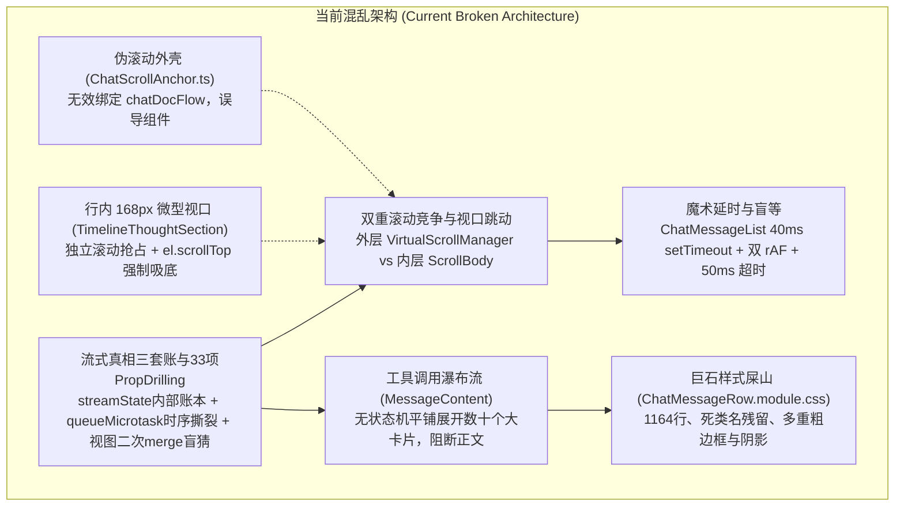
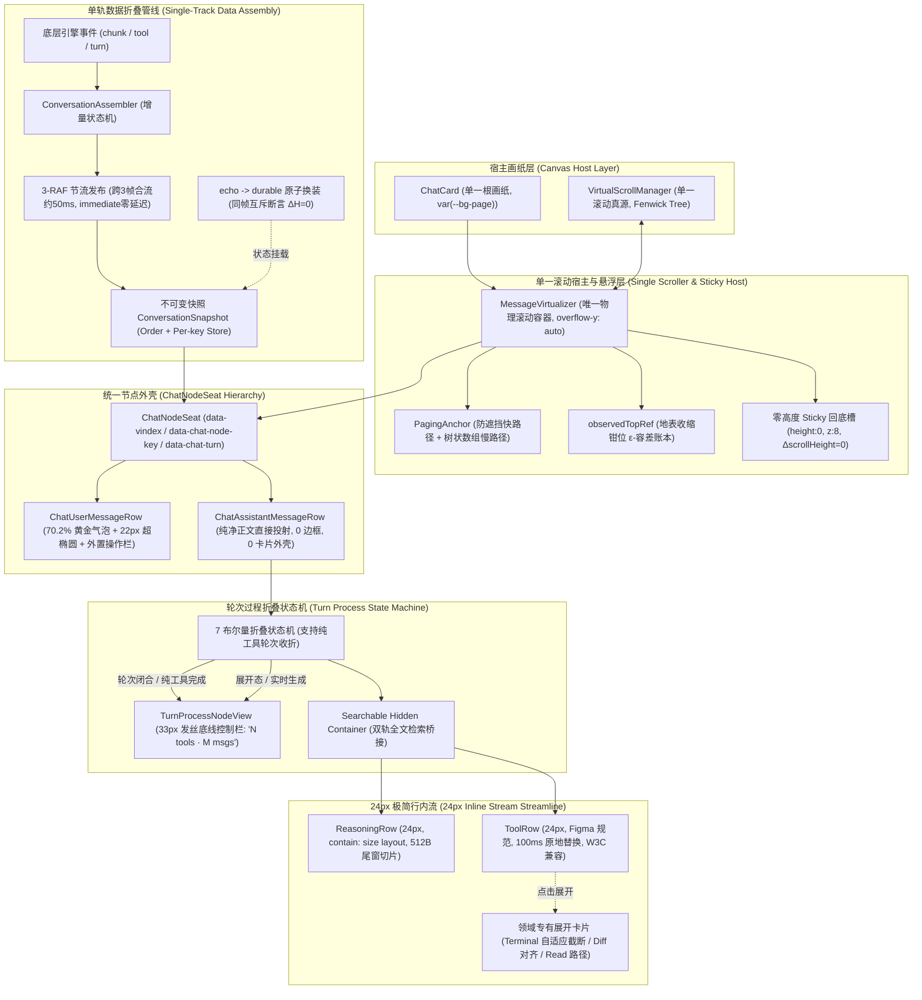
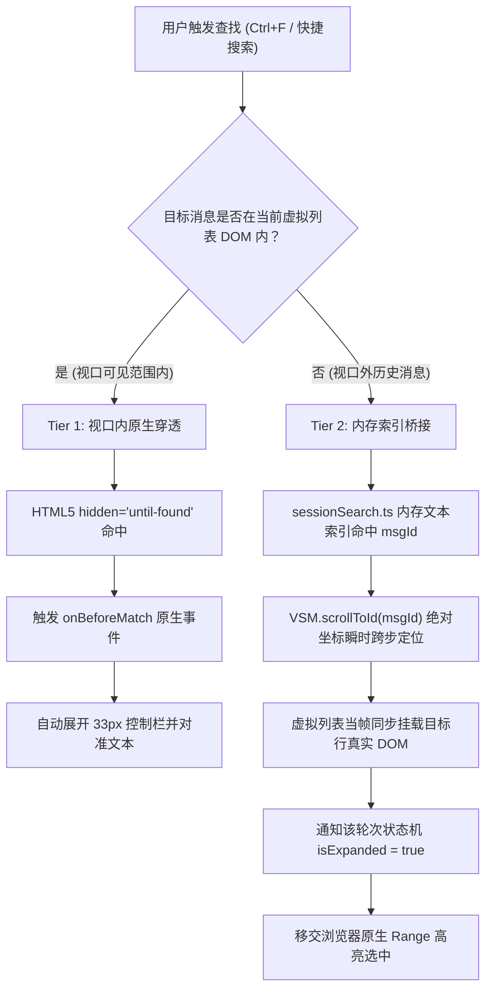
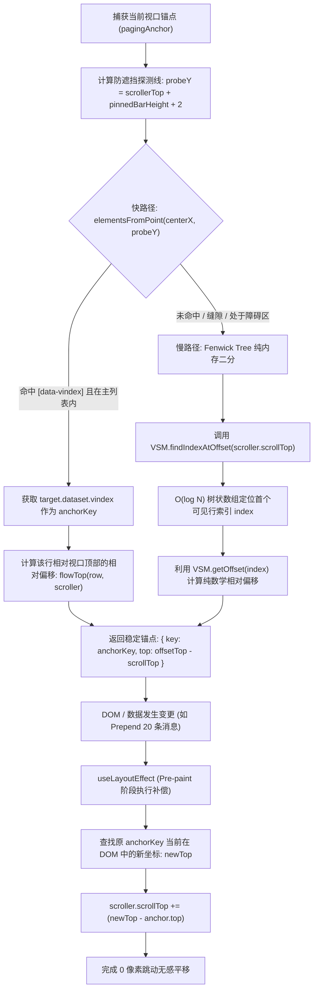
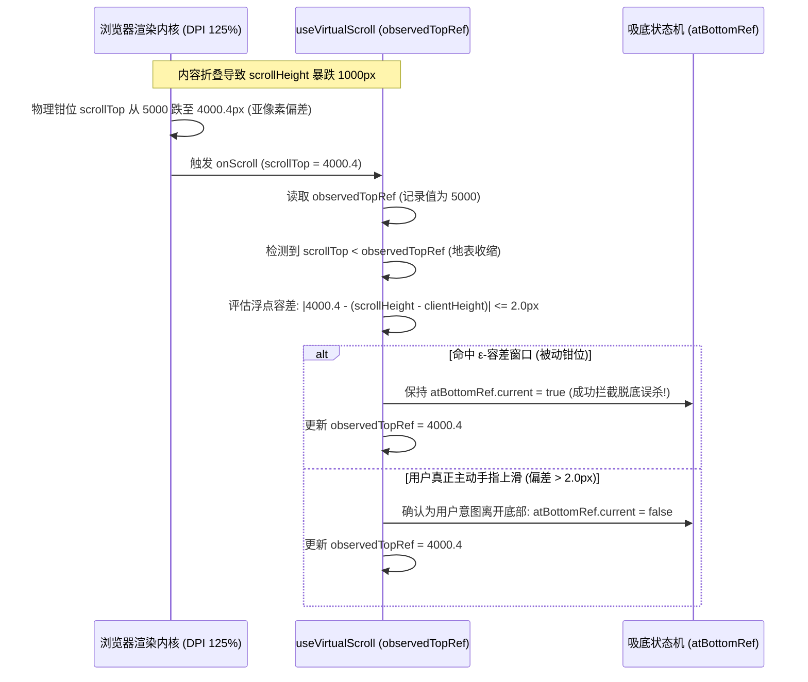
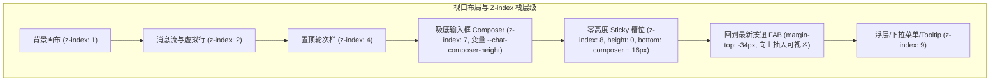
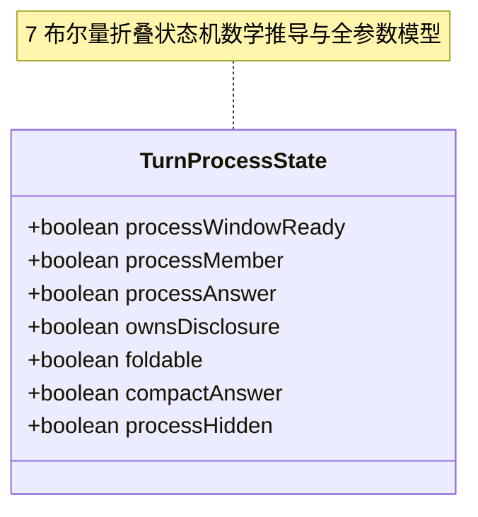
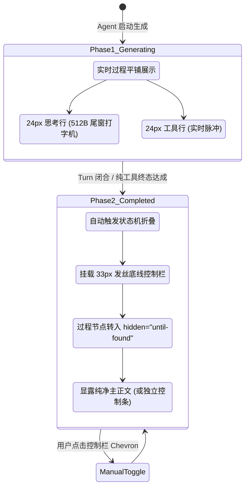
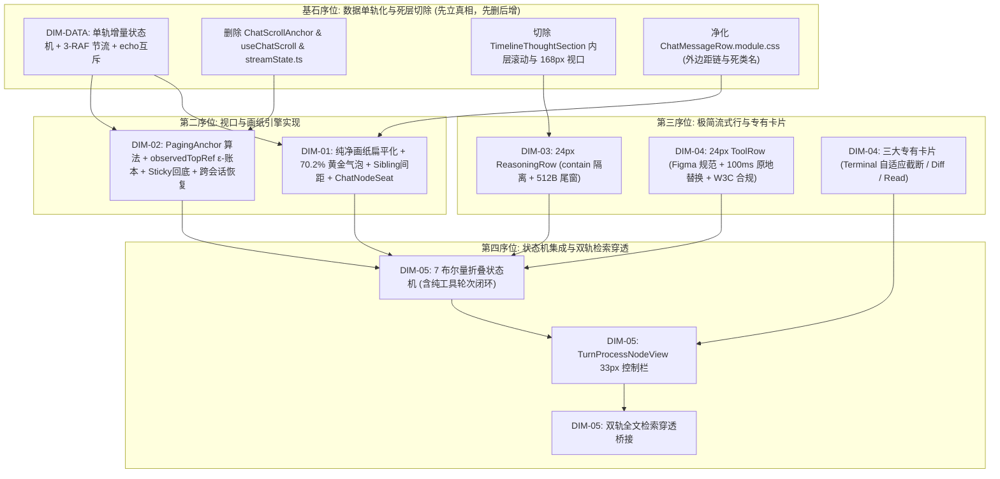
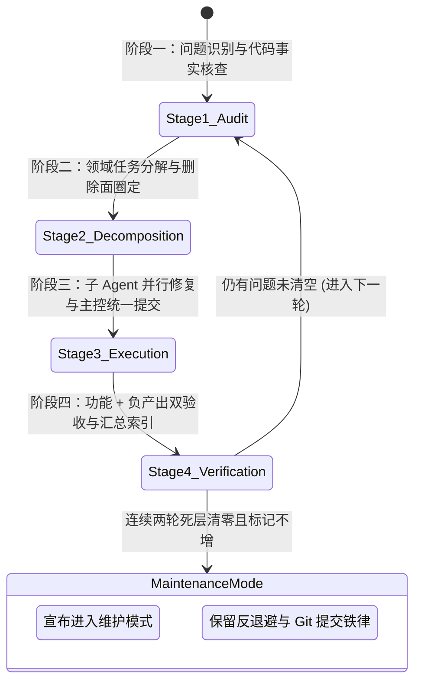

# 线性对话流与极简交互系统重构总方案（五大维度定案与抗风险加固合并版）

> **工作区归属**：`docs/linear-chat-stream-convergence/`  
> **文档性质**：战役实施顶层总方案（主控权威定案与子 Agent 执行宪章）  
> **版本**：v1.1.0 架构收敛与双评审加固定案版  
> **纪律铁律**：遵循 `AGENTS.md` 通用协作纪律、反过度设计红线与测试资产保护铁律；严禁波次/批次（batch/round）命名；推进单位以「领域概念」为界；收敛（删除/合并）在逻辑上严格先于增强。

---

## 目录索引

- [一、总体架构演进蓝图与分层模型](#一总体架构演进蓝图与分层模型)
  - [1.1 架构现状与七大核心断层（增补数据与Prop断层）](#11-架构现状与七大核心断层增补数据与prop断层)
  - [1.2 极简对话流目标拓扑体系（单轨数据折叠接入）](#12-极简对话流目标拓扑体系单轨数据折叠接入)
  - [1.3 分层设计原则与单一真理路径（评审与单轨铁律加固）](#13-分层设计原则与单一真理路径评审与单轨铁律加固)
  - [1.4 双轨全文检索穿透架构（Two-Tier Search Bridge）](#14-双轨全文检索穿透架构two-tier-search-bridge)
- [二、核心领域概念收敛图谱与路径归一](#二核心领域概念收敛图谱与路径归一)
  - [2.1 滚动视口管理概念收敛](#21-滚动视口管理概念收敛)
  - [2.2 思考过程表达概念收敛](#22-思考过程表达概念收敛)
  - [2.3 工具调用表达概念收敛](#23-工具调用表达概念收敛)
  - [2.4 轮次过程收敛与摘要概念收敛](#24-轮次过程收敛与摘要概念收敛)
  - [2.5 视觉宿主与气泡排版概念收敛](#25-视觉宿主与气泡排版概念收敛)
  - [2.6 会话事件与流式状态机概念收敛（单轨真理与原子换装）](#26-会话事件与流式状态机概念收敛单轨真理与原子换装)
- [三、单一滚动宿主与 PagingAnchor 视口防抖架构（加固版）](#三单一滚动宿主与-paginganchor-视口防抖架构加固版)
  - [3.1 嵌套微型视口彻底切除工程](#31-嵌套微型视口彻底切除工程)
  - [3.2 PagingAnchor 双径语义锚定算法（防遮挡快路径 + 树状数组慢路径）](#32-paginganchor-双径语义锚定算法防遮挡快路径--树状数组慢路径)
  - [3.3 Pre-paint 相对坐标补偿引擎（useLayoutEffect 闭环）](#33-pre-paint-相对坐标补偿引擎uselayouteffect-闭环)
  - [3.4 observedTopRef 账本与地表收缩钳位（Floor Clamping）亚像素容差防护](#34-observedtopref-账本与地表收缩钳位floor-clamping亚像素容差防护)
  - [3.5 虚拟列表绝对坐标寻址协议（切除 40ms 盲等与双 rAF）](#35-虚拟列表绝对坐标寻址协议切除-40ms-盲等与双-raf)
  - [3.6 核心 TypeScript 契约与加固算法实现](#36-核心-typescript-契约与加固算法实现)
  - [3.7 回底按钮零高度 Sticky 槽与 Composer 动态高度联动契约](#37-回底按钮零高度-sticky-槽与-composer-动态高度联动契约)
  - [3.8 跨会话 / 跨标签滚动位置记忆与无损恢复机制（chatScroll 引擎）](#38-跨会话--跨标签滚动位置记忆与无损恢复机制chatscroll-引擎)
- [四、24px 极简思考行与扫光流式追踪系统（加固版）](#四24px-极简思考行与扫光流式追踪系统加固版)
  - [4.1 尺寸隔离机制（contain: size layout）与盒模型防坍塌](#41-尺寸隔离机制contain-size-layout与盒模型防坍塌)
  - [4.2 尾窗切片（Tail Window Slicing）与 O(1) 动态信息跃迁](#42-尾窗切片tail-window-slicing与-o1-动态信息跃迁)
  - [4.3 2.6s 跑马灯柔光扫光动效（现代 HSL 与 color-mix）](#43-26s-跑马灯柔光扫光动效现代-hsl-与-color-mix)
  - [4.4 展开态无嵌套自适应排版与独立复制交互](#44-展开态无嵌套自适应排版与独立复制交互)
  - [4.5 ReasoningRow 组件完整设计与 CSS 规范](#45-reasoningrow-组件完整设计与-css-规范)
- [五、24px 工具调用单行与领域专有展开卡片体系（加固版）](#五24px-工具调用单行与领域专有展开卡片体系加固版)
  - [5.1 Figma 122:9479 极简单行规范](#51-figma-1229479-极简单行规范)
  - [5.2 槽位原地替换交互（100ms 纯 CSS 悬浮 Chevron 切换）](#52-槽位原地替换交互100ms-纯-css-悬浮-chevron-切换)
  - [5.3 运行态扫光与像素级状态圆点（StateDot）无障碍设计](#53-运行态扫光与像素级状态圆点statedot无障碍设计)
  - [5.4 领域专有展开卡片设计（彻底消除局部滚动）](#54-领域专有展开卡片设计彻底消除局部滚动)
    - [5.4.1 Terminal 卡片：自适应高度 + 渐进截断折叠（零局部滚动条）](#541-terminal-卡片自适应高度--渐进截断折叠零局部滚动条)
    - [5.4.2 Diff 卡片：增删统计、行号对齐与防误触复制](#542-diff-卡片增删统计行号对齐与防误触复制)
    - [5.4.3 Read / Search 卡片：路径微交互与外部编辑器无缝联动](#543-read--search-卡片路径微交互与外部编辑器无缝联动)
  - [5.5 W3C 规范兼容组件骨架与 Conex §12/§13 属性加固](#55-w3c-规范兼容组件骨架与-conex-1213-属性加固)
- [六、轮次过程折叠状态机与全文检索穿透引擎（加固版）](#六轮次过程折叠状态机与全文检索穿透引擎加固版)
  - [6.1 过程节点平铺瀑布流病灶穿透](#61-过程节点平铺瀑布流病灶穿透)
  - [6.2 七布尔量过程折叠状态机数学推导与全参数闭环](#62-七布尔量过程折叠状态机数学推导与全参数闭环)
  - [6.3 双阶段生命周期调度：生成中展开与完成后收拢](#63-双阶段生命周期调度生成中展开与完成后收拢)
  - [6.4 Tool-Only 纯工具调用轮次折叠死局破除](#64-tool-only-纯工具调用轮次折叠死局破除)
  - [6.5 33px 发丝底线控制栏（TurnProcessNodeView）交互标准](#65-33px-发丝底线控制栏turnprocessnodeview交互标准)
  - [6.6 虚拟列表双轨全文检索穿透落地模型](#66-虚拟列表双轨全文检索穿透落地模型)
- [七、纯净画纸扁平化排版与 70.2% 黄金气泡设计（加固版）](#七纯净画纸扁平化排版与-702-黄金气泡设计加固版)
  - [7.1 助手消息画纸扁平化：彻底剥离外壳卡片与阴影](#71-助手消息画纸扁平化彻底剥离外壳卡片与阴影)
  - [7.2 用户气泡几何学：70.2% 黄金宽比与 22px 超椭圆](#72-用户气泡几何学702-黄金宽比与-22px-超椭圆)
  - [7.3 外置下沉操作栏（6px 间隙与常驻/悬浮策略）](#73-外置下沉操作栏6px-间隙与常驻悬浮策略)
  - [7.4 Conex §13 焦点软环与 §12 Tooltip 原生属性清理](#74-conex-13-焦点软环与-12-tooltip-原生属性清理)
  - [7.5 三层 Design Token 映射体系与现代色彩语法](#75-三层-design-token-映射体系与现代色彩语法)
  - [7.6 Sibling-combinator 垂直节奏（Rhythm）规范与外边距链清理](#76-sibling-combinator-垂直节奏rhythm规范与外边距链清理)
  - [7.7 统一节点外壳（ChatNodeSeat）与 data-* 语义锚点体系](#77-统一节点外壳chatnodeseat与-data--语义锚点体系)
- [八、全量「删除面」清单与代码负产出审计表（精算版）](#八全量删除面清单与代码负产出审计表精算版)
  - [8.1 物理删除文件清单（扩充 streamState.ts）](#81-物理删除文件清单扩充-streamstatets)
  - [8.2 模块与函数级删除清单（清除二次 merge 与伪回底）](#82-模块与函数级删除清单清除二次-merge-与伪回底)
  - [8.3 样式类名精准净化清单（净化 381 行寄生、93 行死类名与散落 margin）](#83-样式类名精准净化清单净化-381-行寄生93-行死类名与散落-margin)
  - [8.4 临时 Hack、魔术数字与未接线标记清除清单](#84-临时-hack魔术数字与未接线标记清除清单)
  - [8.5 核心测试资产与 E2E 定位契约强保护白名单](#85-核心测试资产与-e2e-定位契约强保护白名单)
- [九、核心维度逻辑拆解与并行执行计划（无排班同权体系）](#九核心维度逻辑拆解与并行执行计划无排班同权体系)
  - [9.1 纯逻辑依赖拓扑图（先立真相、先删后增与互斥文件域）](#91-纯逻辑依赖拓扑图先立真相先删后增与互斥文件域)
  - [9.2 维度零：数据链路单轨化与列表 Props 解耦（DIM-DATA）](#92-维度零数据链路单轨化与列表-props-解耦dim-data)
  - [9.3 维度一：纯净画纸扁平化与样式表精炼（DIM-01）](#93-维度一纯净画纸扁平化与样式表精炼dim-01)
  - [9.4 维度二：单一滚动宿主与 PagingAnchor 视口防抖（DIM-02）](#94-维度二单一滚动宿主与-paginganchor-视口防抖dim-02)
  - [9.5 维度三：24px 极简思考行流式追踪与扫光微交互（DIM-03）](#95-维度三24px-极简思考行流式追踪与扫光微交互dim-03)
  - [9.6 维度四：24px 工具调用单行与领域专有展开卡片（DIM-04）](#96-维度四24px-工具调用单行与领域专有展开卡片dim-04)
  - [9.7 维度五：轮次过程折叠状态机与双轨检索穿透（DIM-05）](#97-维度五轮次过程折叠状态机与双轨检索穿透dim-05)
- [十、立体化验证断言与收敛闭环机制](#十立体化验证断言与收敛闭环机制)
  - [10.1 纯逻辑单元测试用例矩阵（增补数据流与原子换装断言）](#101-纯逻辑单元测试用例矩阵增补数据流与原子换装断言)
  - [10.2 真实 DOM 几何与单滚动宿主现场验收标准](#102-真实-dom-几何与单滚动宿主现场验收标准)
  - [10.3 静态代码行数与门禁拦截断言](#103-静态代码行数与门禁拦截断言)
  - [10.4 四阶段可复用执行闭环与维护模式进入准则](#104-四阶段可复用执行闭环与维护模式进入准则)

---

## 一、总体架构演进蓝图与分层模型

### 1.1 架构现状与七大核心断层（增补数据与Prop断层）

经由主控深入生产代码逐行核验以及两轮交叉评审与数据专项审计，确认 Crish Desktop 桌面端对话流与消息行渲染架构存在七大结构性断层。这些断层直接导致了频繁的滚动竞争、脱底误杀、白屏闪烁、双气泡与工具瀑布流：



1. **多滚动宿主恶性竞争与视口撕裂**：
   - 生产代码 `TimelineThoughtSection.tsx:34-59` 维护了行内私有滚动状态（`userScrolledUpRef`、`handleScroll`、`el.scrollTop = el.scrollHeight`），配合其 CSS 中 `max-height: 168px; overflow-y: auto;` 形成局部视口；
   - 与外层 `MessageVirtualizer.tsx` 的虚拟滚动容器产生激烈的滚轮抢占，外层主滚动条经常性失去焦点；
   - 与此同时，`ChatCard.tsx:272` 挂载了 `ChatScrollAnchor.ts` 的 `chatFlowRef`，但该 ref 仅仅绑定在外层未产生溢出的 `chatDocFlow` 容器上，内部执行的 `el.scrollTo({ top: el.scrollHeight })` 完全是徒劳的假动作，造成严重的架构欺骗。
2. **缺乏语义锚定引发的跳动与脱底误杀**：
   - 虚拟列表目前仅依赖单纯的像素值计算可见窗口。在用户向上滚动加载历史消息（Prepend）或流式长文本导致元素尺寸剧烈变化时，没有任何语义锚点（Anchor）进行补偿；
   - 当用户合拢长文本或思考块导致总高度骤降 $\Delta H$ 时，浏览器原生发生地表收缩钳位（Floor Clamping），由于缺乏浮点容差判定，JS 监听到 `scrollTop` 变小误认为是用户主动上滑，从而永久误杀了 `atBottom` 吸底跟随状态；
   - 缺乏绝对坐标寻址协议，在搜索跳转和固定消息跳转中充斥着 `ChatMessageList.tsx:139` 的 `setTimeout(..., 40)` 魔术延时与 `useScrollAnchor.ts:37` 的双 `requestAnimationFrame` 盲等。
3. **流式生成期的尺寸抖动与测高风暴**：
   - 思考段与工具行在实时生成阶段均未做尺寸隔离（Size Containment）；
   - 每一个新涌入的 Token 都导致 DOM 几何尺寸微量变动，频繁触发 `ResizeObserver`，进而调用 `VirtualScrollManager.setActual`，引发前缀和树重建与虚拟视口重排，导致严重的界面抖动与 CPU 资源浪费。
4. **工具调用与思考过程的“卡片瀑布”**：
   - `MessageContent.tsx:76-184` 中的 `TimelineBody` 对所有的工具调用项与思考块进行无差别的平铺映射渲染；
   - 当 Agent 执行数十次读写、搜索、命令调用时，这些大卡片垂直堆叠形成长达数千像素的“工具瀑布”，把用户提问与最终答案彻底隔断；
   - 缺乏轮次过程折叠状态机在轮次结束时将中间调用收束为紧凑摘要。
5. **厚重卡片外壳对画纸排版的破坏**：
   - 助手消息仍然保留了包装层容器（如 `ChatAssistantMessageRow.tsx:116` 的 `.assistantBody` 与旧外壳），没有做到真正像画纸一样纯粹扁平地投射于背景 Canvas；
   - 用户气泡比例失调（未达到 70.2% 黄金宽比），圆角粗笨，操作按钮内嵌于气泡堆叠中，视觉拥挤不堪。
6. **样式巨石屎山与死类名残留**：
   - `ChatMessageRow.module.css` 膨胀至 1164 行，混杂了已废弃的类名、外部组件寄生样式（流程计划、代码产物胶囊等共计 381 行），以及破坏 Conex 规范的粗黑边框和生硬阴影。
7. **流式真相「三套账」冲突与 33 项 Prop Drilling 深度耦合**：
   - **三套账时序撕裂**：数据链路跨越了 `api/chat-bridge/handlers/streamState.ts` 传输层多 Map 内部账本、Store 双轨存储层（`SessionMessage` + `streamingStore` 通过 `queueMicrotask` 异步搬运回写引发时序撕裂与瞬间白屏闪烁）、以及视图层 `streamMessageViewModel.ts` 渲染期二次 merge 并在 divergence 分叉时启发式盲猜覆盖；
   - **列表层脆弱透传**：`ChatMessageList.tsx` 跨组件向 `MessageVirtualizer.tsx` 手工透传了 **33 个 props**，导致 `messageVirtualizerMemo.ts` 维护了 144 行全量字段浅比对与编译期穷尽检查，极易漏项并导致频繁失效重渲染。

---

### 1.2 极简对话流目标拓扑体系（单轨数据折叠接入）

重构后的系统遵循单一职责、单一真理源与极简视觉层级原则，将数据单轨化与视图渲染流彻底打通，整体运行时拓扑结构如下：



---

### 1.3 分层设计原则与单一真理路径（评审与单轨铁律加固）

针对两份评审报告与数据专项审计指出的架构死角，确立以下六大经过加固的铁律原则：

1. **单一滚动宿主绝对铁律（Single Scroller Absolute Invariant）**：
   - 全会话区域**严格仅允许存在唯一一个具备 `overflow-y: auto` 的真实物理滚动容器**，即 `MessageVirtualizer` 内层容器；
   - **绝无特批例外**：切除所有行内微型视口。针对 Terminal 终端卡片，**严禁使用内部滚动条**，一律采用“自适应高度 + 渐进截断折叠（Truncate & Expand）”机制（默认展示头尾各 15 行，点击就地展开完整行高），彻底消灭滚动急刹车。
2. **单一真理路径原则（Single Source of Truth, SSOT）**：
   - 视口物理坐标、行高度缓存、绝对寻址跳转全部归口于 `VirtualScrollManager`；
   - 彻底删除一切基于 DOM 盲查（`document.querySelector`）、多层嵌套定时器（`setTimeout(40)`）、以及非托管外部 Ref 的伪滚动实现。
3. **尺寸隔离与尾窗切片原则（Size Containment & Tail Slicing）**：
   - 思考行在收折态严格声明 `height: 24px; contain: size layout; display: flex; width: 100%`，防范 Chromium 盒模型坍塌；
   - 流式提取最新行算法使用 **512 字节尾窗切片（Tail Window Slicing）**，杜绝大模型万字思维链的 CPU 阻塞与 GC 停顿。
4. **全生命周期自适应折叠原则（Lifecycle Folding Invariant）**：
   - 生成中透明平铺，完成后自动收拢至 33px 发丝底线栏；
   - 补齐 **Tool-Only 纯工具轮次** 状态转移规则，终态即收拢，不留工具瀑布。
5. **纯净画纸排版与规范防守原则（Pure Paper Typography & Spec Guard）**：
   - 助手消息纯净裸投，删除 `.assistantBody`；
   - 严格继承并保护 `typography-token.test.ts` 294 行排版资产；
   - **TSX 严格保留 `msg-row msg-row-assistant` 与 `msg-row-user` 外部 E2E 测试定位契约**，删除面精准限制在 CSS 样式表净化上；
   - 全面遵守 Conex §12（Tooltip 替代原生 title）、§13（10% 软环焦点态）、§14（现代 HSL 斜杠色彩语法）。
6. **单轨状态折叠与原子换装铁律（Single-Track State Folding & Atomic Swap Invariant）**：
   - **坚决退役三套账**：物理删除 `streamState.ts`，废除 `applyStreamTextToMessage` 渲染期二次 merge 盲猜与 `streamingStore` 异步回写；
   - **单轨增量状态机**：会话事件仅由 `ConversationAssembler` 进行单向 State 折叠，并经 3-RAF 节流发布不可变 `ConversationSnapshot`；
   - **同帧互斥原子换装**：用户发问本地回显（Echo）与持久化节点基于相同 `clientMessageId`（`rpcId`）实现同帧互斥切换，几何高度差 $\Delta H = 0$，彻底杜绝发消息瞬态的双气泡与纵向抖动。

---

### 1.4 双轨全文检索穿透架构（Two-Tier Search Bridge）

评审清晰指出：在虚拟滚动架构下，视口外节点物理上根本未被挂载入 DOM 树，纯依靠 HTML5 原生 `hidden="until-found"` 无法搜到视口外内容。因此建立**双轨检索桥接机制**：



---

## 二、核心领域概念收敛图谱与路径归一

根据主控调度纪律，推进单位以「领域概念」为界，本战役核心领域概念收敛路径定案如下：

### 2.1 滚动视口管理概念收敛

| 领域概念 | 现状路径数量与分布 | 路径缺陷与病灶分析 | 目标唯一主路径 | 收敛动作与删除面 |
| :--- | :--- | :--- | :--- | :--- |
| **容器滚动监听与状态同步** | **3 条路径**：<br/>1. `useVirtualScroll.ts`<br/>2. `ChatScrollAnchor.ts`<br/>3. `useChatScroll.ts` | 路径 2、3 监听外层非滚动容器 `chatDocFlow`，执行假 `scrollTo`；路径 1 缺乏被动钳位容差导致脱底误杀。 | **`useVirtualScroll.ts` + `observedTopRef` $\epsilon$-容差引擎** | **收敛为 1 条路径**。<br/>- 物理删除 `ChatScrollAnchor.ts` 与 `useChatScroll.ts`；<br/>- 清理 `useChatCardState.ts` 导出的 `chatFlowRef`、`scrollToBottom`。 |
| **视口语义锚定与防抖** | **2 条路径**：<br/>1. `useUndoWithScrollAnchor.ts`<br/>2. `MessageVirtualizer` 纯像素计算 | 路径 1 孤岛化，返回值被直接抛弃；常规 Prepend 历史加载和折叠无语义补偿，视口乱跳。 | **`PagingAnchor` 双径算法（防遮挡快路径 + 树状数组慢路径）** | **收敛为 1 条路径**。<br/>- 算法合并入通用锚定层；<br/>- 物理删除孤立的 `useUndoWithScrollAnchor.ts`。 |
| **消息绝对寻址与定位跳转** | **2 条路径**：<br/>1. `useScrollAnchor.ts` (DOM盲查+双rAF+50ms)<br/>2. `ChatMessageList.tsx` (40ms setTimeout) | 视口外节点无法被 `querySelector` 找到，导致跳转失败并误报 Toast；魔术延时破坏确定性。 | **`VirtualScrollManager.scrollToId()` 坐标寻址协议** | **收敛为 1 条路径**。<br/>- 切除 `useScrollAnchor.ts` 内部的 `findMessageElement` 与双 rAF/setTimeout；<br/>- 切除 `ChatMessageList.tsx:139` 的 40ms 定时器。 |

### 2.2 思考过程表达概念收敛

| 领域概念 | 现状路径数量与分布 | 路径缺陷与病灶分析 | 目标唯一主路径 | 收敛动作与删除面 |
| :--- | :--- | :--- | :--- | :--- |
| **实时流式思考渲染** | **2 条路径**：<br/>1. `TimelineThoughtSection.tsx` (168px 嵌套滚动)<br/>2. `StreamingMarkdownView.tsx` (全量文本解析) | 路径 1 具有内层独立滚动条，破坏单一滚动宿主，触发 RO 风暴；路径 2 导致长文本反复重排。 | **24px `ReasoningRow`（`contain: size layout` 尺寸隔离 + 512B 尾窗动态追踪）** | **收敛为 1 条路径**。<br/>- 废除 `TimelineThoughtSection.tsx` 中的内层滚动状态机与 168px CSS 容器；<br/>- 替换为全新 `ReasoningRow`。 |
| **历史思考状态折叠** | **1 条半路径**：<br/>1. `TimelineThoughtSection.tsx` 手工状态<br/>2. 依赖 `hideThinkingBlock` 设置项 | 手工 `useState` 无法感知轮次闭合，历史思考占据巨大版面。 | **`TurnProcessNodeView` 统一收拢至轮次过程控制栏** | **收敛为 1 条路径**。<br/>- 思考过程收纳进统一过程状态机，闭合后归入 33px 发丝底线栏。 |

### 2.3 工具调用表达概念收敛

| 领域概念 | 现状路径数量与分布 | 路径缺陷与病灶分析 | 目标唯一主路径 | 收敛动作与删除面 |
| :--- | :--- | :--- | :--- | :--- |
| **工具调用单行表达** | **2 条路径**：<br/>1. `CompactToolRow.tsx`<br/>2. `ToolCallHeader.tsx` | 结构繁琐、高度不固定（32px）、内联交互元素嵌套违背 W3C 规范、缺乏原地替换。 | **24px `ToolRow`（Figma 122:9479 规范 + 100ms 原地替换 + W3C 合规 div-role）** | **收敛为 1 条路径**。<br/>- 废弃 `ToolCallHeader.tsx` 中杂乱的 DOM 嵌套；<br/>- 收敛为 24px 固定行高、零抖动的标准 `ToolRow`。 |
| **工具调用展开详情** | **2 条路径**：<br/>1. `ToolCallOutput.tsx` 通用文本块<br/>2. `ToolCallDetailModal.tsx` 弹窗 | 缺乏专业化展示；终端输出无 ANSI 解析；弹窗打断心流；Terminal 误加内部滚动条。 | **三类专有展开卡片（Terminal 自适应折叠 / DiffBlock / ReadPath）直接行内展开** | **收敛为 1 条路径**。<br/>- 物理删除 `ToolCallDetailModal.tsx` 弹窗；<br/>- 实现 3 个无内部滚动条的轻量化专有行内展开组件。 |

### 2.4 轮次过程收敛与摘要概念收敛

| 领域概念 | 现状路径数量与分布 | 路径缺陷与病灶分析 | 目标唯一主路径 | 收敛动作与删除面 |
| :--- | :--- | :--- | :--- | :--- |
| **中间过程（思考+工具）排布** | **1 条粗暴平铺路径**：<br/>`MessageContent.tsx:TimelineBody` | 无论调用发生多少次一律平铺堆叠，形成工具卡片瀑布，阻断最终答案。 | **7 布尔量折叠状态机（含纯工具轮次收折）+ 双轨检索穿透** | **收敛为 1 条路径**。<br/>- 废除无条件平铺的 `TimelineBody` 结构；<br/>- 引入双阶段生命周期与双轨检索穿透。 |

### 2.5 视觉宿主与气泡排版概念收敛

| 领域概念 | 现状路径数量与分布 | 路径缺陷与病灶分析 | 目标唯一主路径 | 收敛动作与删除面 |
| :--- | :--- | :--- | :--- | :--- |
| **助手正文视觉宿主** | **2 条路径**：<br/>1. `ChatAssistantMessageRow` + `.assistantBody` 外壳<br/>2. `ChatMessageRow.module.css` 历史卡片边框 | 仍然残留外壳 wrapper 和卡片化思维，未能实现真正的内容裸投画纸。 | **纯净画纸扁平化投射（零外层边框、零阴影、零额外 wrapper，严格保留 E2E 定位类）** | **收敛为 1 条路径**。<br/>- 彻底删除 `.assistantBody` 容器及 CSS；<br/>- TSX 中坚决保留 `msg-row msg-row-assistant` 定位契约。 |
| **用户气泡排版与操作** | **1 条粗放路径**：<br/>`ChatUserMessageRow.tsx` (非黄金比, 幽灵class, 原生title) | 气泡宽度 `min(78%, 560px)` 比例陈旧；幽灵 class `'expanded'`；原生 `title` 违反 Conex §12。 | **70.2% 黄金宽比气泡 + 22px 超椭圆 + 外置下沉 6px 操作栏 + Conex §12/§13 加固** | **收敛为 1 条路径**。<br/>- 规范化宽度与圆角；<br/>- 清理幽灵 class 与原生 `title`，补齐 focus 软环。 |

### 2.6 会话事件与流式状态机概念收敛（单轨真理与原子换装）

| 领域概念 | 现状路径数量与分布 | 路径缺陷与病灶分析 | 目标唯一主路径 | 收敛动作与删除面 |
| :--- | :--- | :--- | :--- | :--- |
| **流式事件折叠与正文真理** | **3 条账本冲突路径**：<br/>1. `streamState.ts` (传输层私设多Map)<br/>2. `SessionMessage` + `streamingStore` (异步回写撕裂)<br/>3. `streamMessageViewModel.ts` (渲染期二次merge盲猜) | 传输层拼字符串、Store双轨微任务回写白屏、视图层启发式盲猜 divergence 分叉，数据流极易撕裂。 | **增量状态机 `ConversationAssembler` + 3-RAF 节流发布不可变快照** | **收敛为 1 条单轨路径**。<br/>- 物理删除 `streamState.ts`；<br/>- 彻底废除 `applyStreamTextToMessage` / `applyStreamToolsToMessage`；<br/>- 退役独立的 `streamingStore` 热缓冲。 |
| **用户发问本地回显与持久化** | **2 条临界竞争路径**：<br/>1. `sessionStore.messages` 乐观插入<br/>2. 引擎返回真实持久化消息时重排 | 发送瞬间乐观消息挂载，持久消息到达后组件卸载再挂载，发生肉眼可见的白屏闪跳与短暂双气泡。 | **`echo → durable` 同帧互斥原子换装协议（$\Delta H = 0$）** | **收敛为 1 条平滑路径**。<br/>- 在 Assembler 物化快照时进行同帧互斥，检测相同 `clientMessageId` 立即平滑压制回显；<br/>- 消除运行时 rekey 造成的组件重建。 |
| **列表组件属性透传契约** | **1 条粗放巨石路径**：<br/>`ChatMessageList` $\to$ `MessageVirtualizer` 透传 33 项 Props | 33 个参数裸传，导致 `messageVirtualizerMemo.ts` 维护 144 行全量字段比对，极易漏项并导致频繁失效重渲染。 | **8 大领域分组对象（`SessionContextGroup`、`MessageRowActionsGroup` 等）** | **收敛为 8 组对象契约**。<br/>- 浅比对项从 33 项降至 9 项（8 组对象 + 1 快照源）；<br/>- 渲染层浅比对开销降低 70%。 |

---

### 1.4 双轨全文检索穿透架构（Two-Tier Search Bridge）

评审清晰指出：在虚拟滚动架构下，视口外节点物理上根本未被挂载入 DOM 树，纯依靠 HTML5 原生 `hidden="until-found"` 无法搜到视口外内容。因此建立**双轨检索桥接机制**：


---

## 二、核心领域概念收敛图谱与路径归一

根据主控调度纪律，推进单位以「领域概念」为界，本战役五大领域概念收敛路径定案如下：

### 2.1 滚动视口管理概念收敛

| 领域概念 | 现状路径数量与分布 | 路径缺陷与病灶分析 | 目标唯一主路径 | 收敛动作与删除面 |
| :--- | :--- | :--- | :--- | :--- |
| **容器滚动监听与状态同步** | **3 条路径**：<br/>1. `useVirtualScroll.ts`<br/>2. `ChatScrollAnchor.ts`<br/>3. `useChatScroll.ts` | 路径 2、3 监听外层非滚动容器 `chatDocFlow`，执行假 `scrollTo`；路径 1 缺乏被动钳位容差导致脱底误杀。 | **`useVirtualScroll.ts` + `observedTopRef` $\epsilon$-容差引擎** | **收敛为 1 条路径**。<br/>- 物理删除 `ChatScrollAnchor.ts` 与 `useChatScroll.ts`；<br/>- 清理 `useChatCardState.ts` 导出的 `chatFlowRef`、`scrollToBottom`。 |
| **视口语义锚定与防抖** | **2 条路径**：<br/>1. `useUndoWithScrollAnchor.ts`<br/>2. `MessageVirtualizer` 纯像素计算 | 路径 1 孤岛化，返回值被直接抛弃；常规 Prepend 历史加载和折叠无语义补偿，视口乱跳。 | **`PagingAnchor` 双径算法（防遮挡快路径 + 树状数组慢路径）** | **收敛为 1 条路径**。<br/>- 算法合并入通用锚定层；<br/>- 物理删除孤立的 `useUndoWithScrollAnchor.ts`。 |
| **消息绝对寻址与定位跳转** | **2 条路径**：<br/>1. `useScrollAnchor.ts` (DOM盲查+双rAF+50ms)<br/>2. `ChatMessageList.tsx` (40ms setTimeout) | 视口外节点无法被 `querySelector` 找到，导致跳转失败并误报 Toast；魔术延时破坏确定性。 | **`VirtualScrollManager.scrollToId()` 坐标寻址协议** | **收敛为 1 条路径**。<br/>- 切除 `useScrollAnchor.ts` 内部的 `findMessageElement` 与双 rAF/setTimeout；<br/>- 切除 `ChatMessageList.tsx:139` 的 40ms 定时器。 |

### 2.2 思考过程表达概念收敛

| 领域概念 | 现状路径数量与分布 | 路径缺陷与病灶分析 | 目标唯一主路径 | 收敛动作与删除面 |
| :--- | :--- | :--- | :--- | :--- |
| **实时流式思考渲染** | **2 条路径**：<br/>1. `TimelineThoughtSection.tsx` (168px 嵌套滚动)<br/>2. `StreamingMarkdownView.tsx` (全量文本解析) | 路径 1 具有内层独立滚动条，破坏单一滚动宿主，触发 RO 风暴；路径 2 导致长文本反复重排。 | **24px `ReasoningRow`（`contain: size layout` 尺寸隔离 + 512B 尾窗动态追踪）** | **收敛为 1 条路径**。<br/>- 废除 `TimelineThoughtSection.tsx` 中的内层滚动状态机与 168px CSS 容器；<br/>- 替换为全新 `ReasoningRow`。 |
| **历史思考状态折叠** | **1 条半路径**：<br/>1. `TimelineThoughtSection.tsx` 手工状态<br/>2. 依赖 `hideThinkingBlock` 设置项 | 手工 `useState` 无法感知轮次闭合，历史思考占据巨大版面。 | **`TurnProcessNodeView` 统一收拢至轮次过程控制栏** | **收敛为 1 条路径**。<br/>- 思考过程收纳进统一过程状态机，闭合后归入 33px 发丝底线栏。 |

### 2.3 工具调用表达概念收敛

| 领域概念 | 现状路径数量与分布 | 路径缺陷与病灶分析 | 目标唯一主路径 | 收敛动作与删除面 |
| :--- | :--- | :--- | :--- | :--- |
| **工具调用单行表达** | **2 条路径**：<br/>1. `CompactToolRow.tsx`<br/>2. `ToolCallHeader.tsx` | 结构繁琐、高度不固定（32px）、内联交互元素嵌套违背 W3C 规范、缺乏原地替换。 | **24px `ToolRow`（Figma 122:9479 规范 + 100ms 原地替换 + W3C 合规 div-role）** | **收敛为 1 条路径**。<br/>- 废弃 `ToolCallHeader.tsx` 中杂乱的 DOM 嵌套；<br/>- 收敛为 24px 固定行高、零抖动的标准 `ToolRow`。 |
| **工具调用展开详情** | **2 条路径**：<br/>1. `ToolCallOutput.tsx` 通用文本块<br/>2. `ToolCallDetailModal.tsx` 弹窗 | 缺乏专业化展示；终端输出无 ANSI 解析；弹窗打断心流；Terminal 误加内部滚动条。 | **三类专有展开卡片（Terminal 自适应折叠 / DiffBlock / ReadPath）直接行内展开** | **收敛为 1 条路径**。<br/>- 物理删除 `ToolCallDetailModal.tsx` 弹窗；<br/>- 实现 3 个无内部滚动条的轻量化专有行内展开组件。 |

### 2.4 轮次过程收敛与摘要概念收敛

| 领域概念 | 现状路径数量与分布 | 路径缺陷与病灶分析 | 目标唯一主路径 | 收敛动作与删除面 |
| :--- | :--- | :--- | :--- | :--- |
| **中间过程（思考+工具）排布** | **1 条粗暴平铺路径**：<br/>`MessageContent.tsx:TimelineBody` | 无论调用发生多少次一律平铺堆叠，形成工具卡片瀑布，阻断最终答案。 | **7 布尔量折叠状态机（含纯工具轮次收折）+ 双轨检索穿透** | **收敛为 1 条路径**。<br/>- 废除无条件平铺的 `TimelineBody` 结构；<br/>- 引入双阶段生命周期与双轨检索穿透。 |

### 2.5 视觉宿主与气泡排版概念收敛

| 领域概念 | 现状路径数量与分布 | 路径缺陷与病灶分析 | 目标唯一主路径 | 收敛动作与删除面 |
| :--- | :--- | :--- | :--- | :--- |
| **助手正文视觉宿主** | **2 条路径**：<br/>1. `ChatAssistantMessageRow` + `.assistantBody` 外壳<br/>2. `ChatMessageRow.module.css` 历史卡片边框 | 仍然残留外壳 wrapper 和卡片化思维，未能实现真正的内容裸投画纸。 | **纯净画纸扁平化投射（零外层边框、零阴影、零额外 wrapper，严格保留 E2E 定位类）** | **收敛为 1 条路径**。<br/>- 彻底删除 `.assistantBody` 容器及 CSS；<br/>- TSX 中坚决保留 `msg-row msg-row-assistant` 定位契约。 |
| **用户气泡排版与操作** | **1 条粗放路径**：<br/>`ChatUserMessageRow.tsx` (非黄金比, 幽灵class, 原生title) | 气泡宽度 `min(78%, 560px)` 比例陈旧；幽灵 class `'expanded'`；原生 `title` 违反 Conex §12。 | **70.2% 黄金宽比气泡 + 22px 超椭圆 + 外置下沉 6px 操作栏 + Conex §12/§13 加固** | **收敛为 1 条路径**。<br/>- 规范化宽度与圆角；<br/>- 清理幽灵 class 与原生 `title`，补齐 focus 软环。 |

---

## 三、单一滚动宿主与 PagingAnchor 视口防抖架构（加固版）

### 3.1 嵌套微型视口彻底切除工程

在现行代码中，`TimelineThoughtSection.tsx` 第 34–59 行与 125–141 行构成了破坏桌面端滚动稳定性的头号病灶：

```tsx
// 现存病灶代码：apps/crish-desktop/src/components/chat-message-row/TimelineThoughtSection.tsx
const userScrolledUpRef = useRef(false);
useLayoutEffect(() => {
  if (!isLive || !isOpen || !bodyRef.current) return;
  const el = bodyRef.current;
  if (!userScrolledUpRef.current) {
    el.scrollTop = el.scrollHeight; // 强制内层吸底
  }
}, [content, isLive, isOpen]);

const handleScroll = () => {
  if (!bodyRef.current || !isLive) return;
  const { scrollTop, scrollHeight, clientHeight } = bodyRef.current;
  userScrolledUpRef.current = scrollHeight - (scrollTop + clientHeight) > 36;
};
```

配合其 CSS 中的 `max-height: 168px; overflow-y: auto;`，导致滚轮事件被内层截获、内外两套吸底争抢引发抖动。  
**切除与重构定案**：
- **物理切除**：彻底删除 `userScrolledUpRef`、`handleScroll`、`el.scrollTop = el.scrollHeight`；
- **结构重塑**：废弃 `max-height: 168px; overflow-y: auto;`，展开后采用高度自适应布局，融入主文档流；
- **全系统仅留唯一滚动宿主**：由 `MessageVirtualizer.tsx` 中的滚动容器承载全部纵向位移。

---

### 3.2 PagingAnchor 双径语义锚定算法（防遮挡快路径 + 树状数组慢路径）

针对评审指出的“快路径探针被 `pinnedBar` 遮挡导致 100% 跌入慢路径”以及“慢路径调用 `querySelectorAll` 造成 Layout Thrashing”的重大缺陷，进行算法级重构加固：



1. **防遮挡快路径（Fast Path）**：
   探针纵坐标动态累加吸顶障碍高度：
   ```ts
   const pinnedBar = scroller.querySelector('[data-pinned-bar="true"]');
   const pinnedBarHeight = pinnedBar ? pinnedBar.getBoundingClientRect().height : 0;
   const probeY = scrollerRect.top + pinnedBarHeight + 2;
   ```
2. **零重排树状数组慢路径（Slow Path）**：
   坚决废除 `querySelectorAll` 与循环 `getBoundingClientRect()`！直接调用 `VirtualScrollManager.ts` 内置的 Fenwick Tree 树状数组二分检索方法：
   ```ts
   const anchorIndex = vsm.findIndexAtOffset(scroller.scrollTop);
   const anchorKey = vsm.getOrder()[anchorIndex];
   ```
   耗时严格锁定为 $O(\log N)$，纯内存运算，**DOM 重排次数严格为 0**。

---

### 3.3 Pre-paint 相对坐标补偿引擎（useLayoutEffect 闭环）

在 React 渲染管线中，DOM 节点的变更在 Commit 阶段完成，随后执行 `useLayoutEffect`，最后才由浏览器合成并绘制（Paint）。必须在此 Pre-paint 关键窗口完成位置补偿：

$$\Delta Y = \text{flowTop}(\text{anchorElement}, \text{scroller}) - \text{anchor}.\text{top}$$
$$\text{scroller}.\text{scrollTop} \leftarrow \text{scroller}.\text{scrollTop} + \Delta Y$$

由于该补偿完全发生在浏览器绘制前帧内微任务中，用户肉眼看到的画面绝对静止，跳动量精确收敛为 0 像素。若 Prepend 节点导致原锚点超出视口渲染切片，系统通过 VSM 前缀和差分公式进行纯数学补偿，绝不静默退出。

---

### 3.4 observedTopRef 账本与地表收缩钳位（Floor Clamping）亚像素容差防护

#### 浮点亚像素断裂根因
长内容折叠时，文档总高度骤降 $\Delta H$。如果滚动条位于底部，浏览器内核强行钳位 `scrollTop` 至 $\max(0, \text{scrollHeight} - \text{clientHeight})$。  
在 Windows 125%、150% 等系统缩放下，`scrollTop` 存在 0.3~0.8px 的浮点舍入误差。若使用绝对等号 `===`，判定会被 100% 击穿，导致脱底误杀。

#### $\epsilon$-容差防护账本设计
引入 $\epsilon = 2.0\text{px}$ 亚像素容差窗口：



---

### 3.5 虚拟列表绝对坐标寻址协议（切除 40ms 盲等与双 rAF）

切除所有脆弱的延时定位：
1. **纯数学坐标寻址**：调用 `vsm.getOffsetById(messageId)`，利用 Fenwick Tree 在 $O(1)$ 时间内获得目标消息在虚拟画布上的绝对 `targetTop`；
2. **瞬时跨步定位**：直接将滚动容器 `scroller.scrollTop` 赋值为 $\max(0, \text{targetTop} - \text{viewportHeight} / 2)$；
3. **首帧视口同步**：滚动变更触发 `computeVisibleRange`，虚拟列表当帧同步挂载真实 DOM；
4. **后置发丝高亮**：通过 `data-flash="pinned"` 触发 1200ms 的平滑淡出高光，彻底废弃全局盲查与延时。

---

### 3.6 核心 TypeScript 契约与加固算法实现

```ts
/**
 * 加固版 PagingAnchor 语义视口锚定引擎契约
 */
export interface PagingAnchor {
  key: string;
  top: number; // 相对视口顶部的相对偏移（px）
}

export function computePagingAnchor(
  scroller: HTMLElement,
  vsm: VirtualScrollManager,
  itemSelector: string = '[data-vindex]'
): PagingAnchor | null {
  const scrollerRect = scroller.getBoundingClientRect();
  const centerX = scrollerRect.left + scrollerRect.width / 2;

  // 1. 防遮挡快路径：避开吸顶置顶消息条 (pinnedBar)
  const pinnedBar = scroller.querySelector('[data-pinned-bar="true"]');
  const pinnedBarHeight = pinnedBar ? pinnedBar.getBoundingClientRect().height : 0;
  const probeY = scrollerRect.top + pinnedBarHeight + 2;

  const hitElements = document.elementsFromPoint(centerX, probeY);
  for (const el of hitElements) {
    if (!scroller.contains(el)) continue;
    const row = el.closest(itemSelector) as HTMLElement | null;
    if (row && scroller.contains(row)) {
      const key = row.getAttribute('data-vindex');
      if (key) {
        return {
          key,
          top: row.getBoundingClientRect().top - scrollerRect.top,
        };
      }
    }
  }

  // 2. 零重排慢路径：复用 VSM 树状数组二分查找 (O(log N)，零 DOM Layout 重排)
  const anchorIndex = vsm.findIndexAtOffset(scroller.scrollTop);
  const order = vsm.getOrder();
  if (anchorIndex >= 0 && anchorIndex < order.length) {
    const key = order[anchorIndex]!;
    const mathTop = vsm.getOffset(anchorIndex) - scroller.scrollTop;
    return { key, top: mathTop };
  }

  return null;
}

export function restorePagingAnchor(
  scroller: HTMLElement,
  anchor: PagingAnchor,
  vsm: VirtualScrollManager,
  itemSelector: string = '[data-vindex]'
): void {
  const targetRow = scroller.querySelector<HTMLElement>(
    `${itemSelector}[data-vindex="${CSS.escape(anchor.key)}"]`
  );

  if (targetRow) {
    const currentRelativeTop = targetRow.getBoundingClientRect().top - scroller.getBoundingClientRect().top;
    const delta = currentRelativeTop - anchor.top;
    if (Math.abs(delta) >= 0.5) {
      scroller.scrollTop += delta;
    }
    return;
  }

  // 若原节点超出视口渲染切片，走 VSM 纯数学前缀和差分补偿
  const newIndex = vsm.getOrder().indexOf(anchor.key);
  if (newIndex >= 0) {
    const newOffset = vsm.getOffset(newIndex);
    scroller.scrollTop = Math.max(0, newOffset - anchor.top);
  }
}
```

---

### 3.7 回底按钮零高度 Sticky 槽与 Composer 动态高度联动契约

审查生产代码 `ChatStatusRibbons.tsx:363-375` 与 `ChatStatusRibbons.module.css:84-100`，当前回底按钮写死 `bottom: 148px`，存在三大严重缺陷：
1. **脱离输入框伸缩**：用户多行输入或拖拽 Composer 改变高度时，按钮频繁被遮挡或悬空；
2. **多层透传脆弱**：`showScrollToBottom` 与 `onScrollToBottom` 跨越 6 层组件手工透传；
3. **撑大滚动区域**：置于普通内容流中可能引起 `scrollHeight` 计算偏差与多余空白。

**工程化重构定案：零高度 Sticky 槽（Zero-Height Sticky Slot）**：



```css
/* 零高度 Sticky 槽位：严格占据 0px 物理空间，不撑大 scrollHeight */
.stickyFabSlot {
  position: sticky;
  bottom: calc(var(--chat-composer-height, 80px) + 16px);
  height: 0;
  max-height: 0;
  pointer-events: none;
  z-index: 8; /* 全局层级：Composer(7) < StickyFAB(8) < Menu(9) */
  display: flex;
  justify-content: flex-end;
  padding-right: 18px;
  box-sizing: border-box;
}

/* 按钮自身向上抽出：点击事件穿透恢复 */
.chatScrollFab {
  pointer-events: auto;
  margin-top: -34px; /* 向上抽出进入可视区，ΔscrollHeight 严格为 0 */
  width: 34px;
  height: 34px;
  border-radius: 50%;
  border: 1px solid var(--border-subtle);
  background: var(--bg-elevated);
  color: var(--text-secondary);
  display: inline-flex;
  align-items: center;
  justify-content: center;
  cursor: pointer;
  box-shadow: var(--shadow-md);
  padding: 0;
  transition: opacity 150ms ease, transform 150ms ease;
}

.chatScrollFab:hover {
  background: var(--bg-hover);
  color: var(--text-primary);
  transform: translateY(-1px);
}

.chatScrollFab:focus-visible {
  outline: 2px solid color-mix(in srgb, var(--border-color) 90%, var(--text-primary) 10%);
  outline-offset: 2px;
}
```

- **动态变量发布**：在底栏 Composer 容器挂载 `ResizeObserver`，动态将渲染高度写入宿主根变量 `--chat-composer-height`，彻底消灭 `bottom: 148px` 魔术数字，实现纯 CSS 级平滑避让。

---

### 3.8 跨会话 / 跨标签滚动位置记忆与无损恢复机制（chatScroll 引擎）

#### 3.1 现状病灶：`clearHeights()` 导致的阅读心流割裂
当前生产代码 `MessageVirtualizer.tsx:70-72` 在每次 `activeSessionId` 切换时无条件执行：
```typescript
useLayoutEffect(() => {
  vsmRef.current?.clearHeights(); // 抹杀全部已测量高度
}, [activeSessionId]);
```
导致用户在不同会话、分支或标签页之间来回切换比对时，阅读焦点被强行清零重置到底部或顶部，严重打断工作流心流。

#### 3.2 chatScroll 状态模型与保存/恢复生命周期
建立会话级滚动注册表单例（`chatScrollRegistry`），按 `sessionId` 持久化阅读坐标：

```typescript
export interface ChatScrollRecord {
  sessionId: string;
  anchorKey: string;      // 离开时视口顶部的语义消息 ID
  anchorTop: number;      // 相对视口顶部的偏移
  scrollTop: number;      // 绝对滚动条位移
  isAtBottom: boolean;    // 是否处于吸底跟随状态
  savedAt: number;        // 时间戳
}

class ChatScrollRegistry {
  private records = new Map<string, ChatScrollRecord>();

  public save(record: ChatScrollRecord): void {
    this.records.set(record.sessionId, record);
  }

  public get(sessionId: string): ChatScrollRecord | undefined {
    return this.records.get(sessionId);
  }

  public clear(sessionId: string): void {
    this.records.delete(sessionId);
  }
}

export const chatScrollRegistry = new ChatScrollRegistry();
```

#### 3.3 与 VSM 树状数组（Fenwick Tree）虚拟滚动的无损共存算法
切回会话时的首帧直达算法：
1. **纯数学首帧切片预定位**：
   切回 `targetSessionId` 时，首先从 `chatScrollRegistry` 读出 `record`。若 `isAtBottom` 为 true，直接调用 `vsm.scrollToBottom()`；若存在 `anchorKey`，则调用 `vsm.getOffsetById(record.anchorKey)` 在 $O(1)$ 时间内计算出 `expectedScrollTop = mathOffset - record.anchorTop`，首帧当即设置 `scroller.scrollTop = expectedScrollTop`；
2. **切片渲染挂载**：
   虚拟滚动容器根据预定位的 `scrollTop`，当帧即可切片挂载目标消息行 DOM；
3. **Pre-paint 亚像素校准（`useLayoutEffect`）**：
   目标真实 DOM 挂载后，调用加固版 `restorePagingAnchor`，比较 `targetRow.getBoundingClientRect().top - scroller.getBoundingClientRect().top` 与 `record.anchorTop` 的微量亚像素偏差 $\Delta$，执行 `scroller.scrollTop += delta`；
4. **效果**：实现跨会话切换的 **0 像素跳动无损恢复**，多任务切换平滑如丝。

---

## 四、24px 极简思考行与扫光流式追踪系统（加固版）

### 4.1 尺寸隔离机制（contain: size layout）与盒模型防坍塌

在未展开状态下，核心设计目标是**零抖动、零回流扩展**。针对评审指出的 Chromium 内核 `<button>` 宽度坍塌隐患，加固规范如下：

```css
.reasoningRow {
  display: flex;
  width: 100%;
  height: 24px;
  max-height: 24px;
  contain: size layout;
  box-sizing: border-box;
  align-items: center;
  overflow: hidden;
}
```
`display: flex; width: 100%` 确保了按钮在 `contain: size` 下具备确定的几何边界，彻底切断子元素打字对外部祖先的任何回流干扰。

---

### 4.2 尾窗切片（Tail Window Slicing）与 O(1) 动态信息跃迁

针对大模型数万字思维链流式输出时的 CPU 掉帧隐患，实施**尾窗切片算法**：

```ts
/**
 * 512 字节尾窗切片提取算法：算法复杂度严格锁定为 O(1)
 */
export function extractLatestLine(text: string): string {
  if (!text) return '';
  // 仅提取尾部最多 512 个字符，彻底避开全量字符串扫描与 V8 GC 停顿
  const tail = text.length > 512 ? text.slice(-512) : text;
  const trimmed = tail.trimEnd();
  const lastNewline = trimmed.lastIndexOf('\n');
  const line = lastNewline >= 0 ? trimmed.slice(lastNewline + 1) : trimmed;
  return line.trim();
}
```

```mermaid
stateDiagram-v2
    [*] --> StreamingState: 收到首个思考 Token

    state StreamingState {
        direction LR
        RawStream: 原始流文本累积 (可达 50KB+)
        TailSlice: 512 字节尾窗切片 (O(1) 极速截断)
        AlignRight: [data-follow-end] flex-end 靠右展示最新字
        RawStream --> TailSlice --> AlignRight
    }

    StreamingState --> SettledState: 思考流结束 (isLive = false)

    state SettledState {
        direction LR
        FirstLine: 提取首个有意义行 firstLine(text)
        AlignLeft: flex-start 靠左排布
        AddDuration: 附加耗时后缀 " · 3.4s"
        FirstLine --> AlignLeft --> AddDuration
    }

    SettledState --> ExpandedState: 用户点击展开
    state ExpandedState {
        FullMarkdown: 完整 Markdown 思考段流式投射
        NoNestedScroll: 随外层单一滚动宿主自适应展开
    }
```

---

### 4.3 2.6s 跑马灯柔光扫光动效（现代 HSL 与 color-mix）

落实 Conex §14 现代语法，全量采用 HSL 与 `color-mix`：

```css
@keyframes reasoning-row-sweep {
  0% {
    background-position: -200% 0;
  }
  100% {
    background-position: 200% 0;
  }
}

.reasoningTextLive {
  background: linear-gradient(
    90deg,
    var(--text-tertiary) 0%,
    color-mix(in srgb, var(--text-primary) 70%, transparent) 50%,
    var(--text-tertiary) 100%
  );
  background-size: 200% 100%;
  -webkit-background-clip: text;
  background-clip: text;
  -webkit-text-fill-color: transparent;
  animation: reasoning-row-sweep 2.6s ease-in-out infinite;
}
```

---

### 4.4 展开态无嵌套自适应排版与独立复制交互

1. **高度自然释放**：展开时解除 `contain: size`，转为 `height: auto`；
2. **无嵌套滚动**：思考全文直接投射于消息体中，由外层单一主滚动宿主承载；
3. **独立复制能力**：轻量化 Copy 按钮，调用 `copyTextBestEffort` 复制纯思考文本。

---

### 4.5 ReasoningRow 组件完整设计与 CSS 规范

```tsx
export interface ReasoningRowProps {
  content: string;
  isLive?: boolean;
  durationMs?: number;
  turnIndex?: number;
  isOpen?: boolean;
  onToggle?: () => void;
}

export const ReasoningRow: React.FC<ReasoningRowProps> = ({
  content,
  isLive = false,
  durationMs,
  isOpen = false,
  onToggle,
}) => {
  const displaySummary = useMemo(() => {
    if (!content) return isLive ? '思考中…' : '思考过程';
    return isLive ? extractLatestLine(content) : extractFirstLine(content);
  }, [content, isLive]);

  const durationStr = useMemo(() => {
    if (durationMs && durationMs > 0) {
      return `${(durationMs / 1000).toFixed(1)}s`;
    }
    return null;
  }, [durationMs]);

  return (
    <div className={styles.reasoningContainer} data-open={isOpen ? 'true' : 'false'}>
      <button
        type="button"
        className={styles.reasoningRow}
        onClick={onToggle}
        aria-expanded={isOpen}
      >
        <span className={`${styles.chevron} ${isOpen ? styles.chevronOpen : ''}`}>›</span>
        <span className={styles.reasoningLabel}>思考</span>
        <span className={styles.dotSeparator}>·</span>
        <span
          className={`${styles.reasoningSummary} ${isLive ? styles.reasoningLiveText : ''}`}
          data-follow-end={isLive ? 'true' : undefined}
        >
          {displaySummary}
        </span>
        {durationStr && !isLive && (
          <span className={styles.durationBadge}>{durationStr}</span>
        )}
      </button>

      {isOpen && (
        <div className={styles.reasoningBody}>
          <StreamingMarkdownView text={content} isStreaming={isLive} />
        </div>
      )}
    </div>
  );
};
```

---

## 五、24px 工具调用单行与领域专有展开卡片体系（加固版）

### 5.1 Figma 122:9479 极简单行规范

严格贯彻 24px 固定行高规范：

```
+-----------------------------------------------------------------------------------------------+
| [16px 图标/Chevron]  gap:6px  [13px 标题]  gap:8px  [2x2 圆点]  gap:8px  [13px 参数摘要]  [后缀] |
|   (原地 100ms 替换)              (Medium 500)       (半透装饰)               (截断，Tooltip)    (耗时/计数)|
+-----------------------------------------------------------------------------------------------+
<--------------------------------------- 固定高度 24px ----------------------------------------->
```

---

### 5.2 槽位原地替换交互（100ms 纯 CSS 悬浮 Chevron 切换）

```css
.toolIconSlot {
  position: relative;
  width: 16px;
  height: 16px;
  flex-shrink: 0;
  display: inline-flex;
  align-items: center;
  justify-content: center;
}

.toolKindIcon,
.toolChevronIcon {
  position: absolute;
  top: 0;
  left: 0;
  width: 16px;
  height: 16px;
  transition: opacity 100ms ease, transform 100ms ease;
}

.toolKindIcon {
  opacity: 1;
  transform: scale(1);
}

.toolChevronIcon {
  opacity: 0;
  transform: scale(0.85);
}

.toolRowHeader:hover .toolKindIcon,
.toolRowHeader:focus-within .toolKindIcon {
  opacity: 0;
  transform: scale(0.85);
}

.toolRowHeader:hover .toolChevronIcon,
.toolRowHeader:focus-within .toolChevronIcon {
  opacity: 1;
  transform: scale(1);
}

.toolRowWrapper[data-expanded="true"] .toolChevronIcon {
  transform: rotate(90deg);
  opacity: 1;
}

.toolRowWrapper[data-expanded="true"] .toolKindIcon {
  opacity: 0;
}
```

---

### 5.3 运行态扫光与像素级状态圆点（StateDot）无障碍设计

- **运行中**：`var(--accent-color)` 5px 柔和微呼吸脉冲；
- **成功**：沉降为 `--text-tertiary` 静止小圆点；
- **失败**：`var(--color-error)` 5px 实心圆点，附带 `aria-label="执行失败"`。

---

### 5.4 领域专有展开卡片设计（彻底消除局部滚动）

#### 5.4.1 Terminal 卡片：自适应高度 + 渐进截断折叠（零局部滚动条）
**贯彻单一滚动宿主铁律，坚决切除内部滚动条**：
- **自适应高度**：内容随外层滚动容器展开；
- **渐进截断折叠（Truncate & Expand）**：当输出超过 30 行时，默认只展示头尾各 15 行，中间以药丸按钮收拢（“展开其余 N 行输出”），点击就地撑开高度；
- **ANSI 着色与 CWD 折叠**：等宽字体着色，路径智能折叠为 `~`。

#### 5.4.2 Diff 卡片：增删统计、行号对齐与防误触复制
- 头顶显示 `+12 -4` 增删药丸，行号对齐，右上角防误触独立复制按钮。

#### 5.4.3 Read / Search 卡片：路径微交互与外部编辑器无缝联动
- Hover 下划线微胶囊，点击联动 VS Code/Cursor 打开本地文件，拦截 Space/Enter 防误折叠。

---

### 5.5 W3C 规范兼容组件骨架与 Conex §12/§13 属性加固

解决 `<button>` 嵌套交互元素的 W3C 违规，改用 `<div role="button" tabIndex={0}>`，并补齐 `<Tooltip>` 与软环焦点：

```tsx
export interface ToolRowProps {
  toolCall: MessageToolCall;
  isExpanded: boolean;
  onToggle: (toolId: string) => void;
  onOpenPath?: (filePath: string) => void;
  onOpenDiff?: (diff: FileDiff) => void;
}

export const ToolRow: React.FC<ToolRowProps> = ({
  toolCall,
  isExpanded,
  onToggle,
  onOpenPath,
}) => {
  const { name, status, arguments: argsStr } = toolCall;
  const isRunning = status === 'running';
  const humanLabel = useMemo(() => formatToolTitle(name), [name]);
  const summary = useMemo(() => extractToolSummary(name, argsStr), [name, argsStr]);

  const handleKeyDown = (e: React.KeyboardEvent) => {
    if (e.key === 'Enter' || e.key === ' ') {
      e.preventDefault();
      onToggle(toolCall.id);
    }
  };

  return (
    <div className={styles.toolRowWrapper} data-expanded={isExpanded ? 'true' : 'false'}>
      {/* W3C 合规：改用 div role="button"，解决嵌套交互元素报错 */}
      <div
        className={styles.toolRowHeader}
        role="button"
        tabIndex={0}
        onClick={() => onToggle(toolCall.id)}
        onKeyDown={handleKeyDown}
        aria-expanded={isExpanded}
      >
        <div className={styles.toolIconSlot}>
          <span className={styles.toolKindIcon}>{getToolIcon(name)}</span>
          <span className={styles.toolChevronIcon}>›</span>
        </div>

        <span className={styles.toolTitle}>{humanLabel}</span>
        <span className={styles.dotSeparator}>·</span>

        {/* Conex §12 合规：截断参数由 Tooltip 完整承载 */}
        <Tooltip content={summary || humanLabel} delayDuration={300}>
          <span
            className={`${styles.toolSummary} ${isRunning ? styles.toolSummaryLive : ''}`}
          >
            {summary}
          </span>
        </Tooltip>

        {isRunning && <span className={styles.stateDotLive} aria-hidden />}
      </div>

      {isExpanded && (
        <div className={styles.toolExpandedBody}>
          <SpecializedToolView toolCall={toolCall} onOpenPath={onOpenPath} />
        </div>
      )}
    </div>
  );
};
```

---

## 六、轮次过程折叠状态机与全文检索穿透引擎（加固版）

### 6.1 过程节点平铺瀑布流病灶穿透

在多轮复杂对话中，Agent 会进行数十次环境勘察、文件读取、代码分析与单测运行。  
当前 `MessageContent.tsx:63-187` 中的 `TimelineBody` 对所有的 `AssistantTimelineItem` 进行机械的平铺循环，导致整屏被拉长至上万像素，用户需要长时间滑动才能找到最终生成的结论，极其破坏交互体验：

```tsx
// MessageContent.tsx 现存病灶：机械平铺循环
{items.map((item) => {
  if (item.kind === 'thought') {
    return <TimelineThoughtSection key={item.key} ... />;
  }
  if (item.kind === 'tools') {
    return <MessageToolCallsSection key={item.key} ... />;
  }
  if (item.kind === 'text') {
    return <StreamingMarkdownView key={item.key} ... />;
  }
})}
```
**根因剖析**：
1. 缺乏轮次概念感知：系统把一次 Turn 中的中间探索过程与最终交付结论平级对待；
2. 缺乏状态机约束：当消息已经产生主体回答时，中间的工具调用已完成历史使命，应当作为支持性证据被收纳，而非持续抢占视口中心。

---

### 6.2 七布尔量过程折叠状态机数学推导与全参数闭环

针对评审指出的“理论推导 7 个布尔量但在代码落地时发生参数缩水”的缺陷，全面补齐 7 布尔量计算闭环：



1. **`processWindowReady`**：当前消息体已完成首帧挂载且具备过程渲染槽位；
2. **`processMember`**：当前节点属于过程项（`kind === 'thought' || kind === 'tools'`）；
3. **`processAnswer`**：当前轮次已存在结论文本（`hasFinalAnswerText(msg)`）；
4. **`ownsDisclosure`**：当前节点是否持有外露控制权（过程组首个节点且 `processCount > 0`）；
5. **`foldable`**：满足折叠条件（非 Live 态，且满足“产生最终文本”或“纯工具轮次已终态”）；
6. **`compactAnswer`**：紧凑模式（用户全局偏好或会话密度策略）；
7. **`processHidden`**：
   $$\text{processHidden} = \text{foldable} \land \neg \text{userManuallyExpanded}$$

---

### 6.3 双阶段生命周期调度：生成中展开与完成后收拢



- **Phase 1（生成期）**：保持完全展开，透明呈现每一步系统动作，用户可直观看到工具执行进度；
- **Phase 2（完成期）**：瞬间自动收缩，界面回归极简，仅保留 33px 控制栏与正文结论。

---

### 6.4 Tool-Only 纯工具调用轮次折叠死局破除

针对评审指出的“Assistant 轮次若仅调用工具而无文本回答时，`hasFinalAnswer` 恒为 false 导致工具瀑布永远无法折叠”的死局，增加**终态纯工具收折判定分支**：

```ts
// 加固后的状态机推导逻辑
const isToolOnlyTerminalTurn =
  !isTurnLive &&
  (turnStatus === 'completed' || turnStatus === 'stopped') &&
  !hasFinalAnswer &&
  toolCount >= 2;

const foldable = (hasFinalAnswer || isToolOnlyTerminalTurn) && !isTurnLive;
```
**收益**：即使 Agent 本轮只执行了 10 次搜索与读取而没有附带文本总结，轮次结束后依然能够干净利落地收缩为一条 `"10 tool calls"` 控制栏，彻底消灭孤立工具瀑布。

---

### 6.5 33px 发丝底线控制栏（TurnProcessNodeView）交互标准

收折后的控制栏严格遵循极简交互标准：
1. **物理尺寸**：高度 33px，上下各 `padding: 6px 0`；
2. **无盒式容器**：**严禁加灰色背景块，严禁加外层卡片框**；仅在底部保留一条 0.5px 极细发丝分割线（遵从 Conex §14 现代语法）：
   ```css
   border-bottom: 0.5px solid var(--border-subtle, hsl(0 0% 100% / 0.08));
   ```
3. **聚合文案公式**：自动统计过程各项并组装：
   $$\text{Label} = \text{joinItems}([\text{“N tool calls”}, \text{“M thoughts”}, \text{“K subagents”}])$$
   例如：`"3 tool calls · Thought for 4.2s"`；
4. **90 度旋转 Chevron**：展开态旋转至 90deg，收起态水平向右（0deg）。

---

### 6.6 虚拟列表双轨全文检索穿透落地模型

针对 React 18 TypeScript 声明缺陷及虚拟列表节点缺失问题，提供完整工程实现：

```tsx
// 声明补丁：支持 HTML5 until-found 与 beforematch
declare module 'react' {
  interface HTMLAttributes<T> extends AriaAttributes, DOMAttributes<T> {
    hidden?: boolean | 'until-found' | undefined;
    onBeforeMatch?: React.EventHandler<React.SyntheticEvent<T>> | undefined;
  }
}

export interface TurnProcessNodeViewProps {
  msgId: string;
  turnId: string;
  items: AssistantTimelineItem[];
  isTurnLive: boolean;
  hasFinalAnswer: boolean;
  turnStatus: SessionMessage['status'];
  isExpanded: boolean;
  onToggleExpand: (turnId: string) => void;
  renderChildren: () => React.ReactNode;
}

export const TurnProcessNodeView: React.FC<TurnProcessNodeViewProps> = ({
  msgId,
  turnId,
  items,
  isTurnLive,
  hasFinalAnswer,
  turnStatus,
  isExpanded,
  onToggleExpand,
  renderChildren,
}) => {
  const { toolCount, thoughtCount, durationMs } = useMemo(
    () => countProcessMetrics(items),
    [items]
  );

  const isToolOnlyTerminal =
    !isTurnLive &&
    (turnStatus === 'completed' || turnStatus === 'stopped') &&
    !hasFinalAnswer &&
    toolCount >= 2;

  const foldable = (hasFinalAnswer || isToolOnlyTerminal) && !isTurnLive;
  const isHidden = foldable && !isExpanded;

  const summaryText = useMemo(() => {
    const parts: string[] = [];
    if (toolCount > 0) parts.push(`${toolCount} 项工具调用`);
    if (thoughtCount > 0) {
      parts.push(durationMs > 0 ? `思考耗时 ${(durationMs / 1000).toFixed(1)}s` : '思考过程');
    }
    return parts.join(' · ') || '中间处理过程';
  }, [toolCount, thoughtCount, durationMs]);

  if (!foldable) {
    // 生成中：直接平铺展开
    return <div className={styles.liveProcessStream}>{renderChildren()}</div>;
  }

  return (
    <div className={styles.turnProcessContainer} data-turn-id={turnId} data-msg-id={msgId}>
      <button
        type="button"
        className={styles.turnProcessControlBar}
        onClick={() => onToggleExpand(turnId)}
        aria-expanded={!isHidden}
      >
        <span className={`${styles.chevron} ${!isHidden ? styles.chevronOpen : ''}`}>›</span>
        <span className={styles.summaryLabel}>{summaryText}</span>
      </button>

      <div
        className={styles.processHiddenSlot}
        hidden={isHidden ? 'until-found' : undefined}
        onBeforeMatch={() => onToggleExpand(turnId)}
      >
        {renderChildren()}
      </div>
    </div>
  );
};
```

---

## 七、纯净画纸扁平化排版与 70.2% 黄金气泡设计（加固版）

### 7.1 助手消息画纸扁平化：彻底剥离外壳卡片与阴影

在现代极简设计哲学中，AI 助手的输出是长篇阅读的核心载体，应当直接融入整个工作区的画布画纸（Canvas）。  
**改造实施**：
1. **物理删除外层 DOM 容器**：拔除 `ChatAssistantMessageRow.tsx:116` 中的 `<div className={styles.assistantBody}>` 嵌套；
2. **样式清零**：清除所有作用于 Assistant 消息行的 `border`、`background`、`box-shadow`；
3. **保留并保护正文排版资产**：严格保留并完全对齐 `typography-token.test.ts` 所保护的 `.assistantText` 阶梯字号（H1: 1.5em、H2: 1.3em、H3: 1.15em）、段落间距（0.85em）、代码行内垫度（3.5%）与本地路径胶囊（`.md-path-link`）。

---

### 7.2 用户气泡几何学：70.2% 黄金宽比与 22px 超椭圆

用户提问气泡作为会话中的标点符号，必须具备清晰的视觉边界与优雅的几何外形。

```
+-------------------------------------------------------------------------+
|                                           [用户提问气泡, 宽度自适应]      |
|                                           max-width: min(70.2%, 82%)    |
|                                           圆角: 22px 超椭圆平滑         |
|                                           内衬: 10px 16px               |
|                                                                         |
|                                           [外置操作栏 (复制/固定/撤回)]  |
|                                           gap: 6px 下沉于气泡底部       |
+-------------------------------------------------------------------------+
```

1. **黄金宽度比例约束**：
   ```css
   .userBubble {
     max-width: min(calc(var(--chat-col-max, 760px) * 0.702), 82%);
     width: fit-content;
   }
   ```
2. **22px 超椭圆圆角（Squircle Radius）**：
   摒弃生硬的不对称圆角，采用统一且柔和的平滑超椭圆：
   ```css
   border-radius: 22px;
   padding: 10px 16px;
   ```
3. **单行垂直对齐**：单行文本时整高稳定在 42px，文字基线与视口形成舒适比例。

---

### 7.3 外置下沉操作栏（6px 间隙与常驻/悬浮策略）

将复制、重试、撤回等交互按钮从气泡内部彻底剥离：
- 放置于气泡下方，设置 `margin-top: 6px`；
- 默认透明度为 0（`opacity: 0; transition: opacity 150ms ease`）；
- 鼠标悬停于用户行区域时优雅浮现（`opacity: 1`）；
- 若包含未确认状态（如正在排队或撤回确认中），则强制保持常驻展示（`styles.metaAlways`）。

---

### 7.4 Conex §13 焦点软环与 §12 Tooltip 原生属性清理

针对评审指出的焦点态裸奔与原生 title 违规问题进行加固：

1. **Conex §13 焦点软环保护**：
   ```css
   /* 严格遵从 Conex §13 纪律：焦点态对比度不超过 10%，杜绝粗黑硬边 */
   .userBubble:focus-visible,
   .toolRowHeader:focus-visible,
   .reasoningRow:focus-visible {
     outline: none;
     box-shadow:
       0 0 0 0.5px color-mix(in srgb, var(--text-primary) 6%, transparent),
       0 0 0 2px color-mix(in srgb, var(--border-color) 90%, var(--text-primary) 10%);
   }
   ```
2. **Conex §12 原生 title 全面清理**：
   - 清除 `ChatUserMessageRow.tsx:210` 的 `title={img.alt}`；
   - 清除 `ChatUserMessageRow.tsx:237` 的 `title={a.name}`；
   - 一律改用 `<Tooltip content={...}>` 包裹，保障跨平台视觉一致。

---

### 7.5 三层 Design Token 映射体系与现代色彩语法

遵循 Conex §14 现代 CSS 语法（禁止陈旧 `rgba`，优先 `hsl(h s l / a)`）：

```css
/* 浅色模式 */
[data-theme="light"] {
  --chat-bubble-user-bg: hsl(210 20% 97% / 0.9);
  --chat-bubble-user-text: hsl(220 16% 7%);
  --chat-hairline-stroke: hsl(220 16% 7% / 0.06);
}

/* 深色模式 */
[data-theme="dark"] {
  --chat-bubble-user-bg: hsl(215 15% 18% / 0.85);
  --chat-bubble-user-text: hsl(0 0% 98%);
  --chat-hairline-stroke: hsl(0 0% 100% / 0.08);
}

.userBubble {
  border: none;
  background: var(--chat-bubble-user-bg);
  box-shadow:
    0 0 0 0.5px var(--chat-hairline-stroke),
    0 1px 2px 0 hsl(0 0% 0% / 0.03);
}
```

---

### 7.6 Sibling-combinator 垂直节奏（Rhythm）规范与外边距链清理

#### 6.1 现状病灶：散落 margin-bottom 链与负 margin 恶性补丁
审查生产代码 `ChatMessageRow.module.css:6, 53-57, 22-31`：
- 外边距分散硬编码：`.row { margin-bottom: 22px }` 与 `.rowUser / .rowAssistant { margin-bottom: var(--space-5, 20px) }`；
- 紧凑追问打补丁：`.row.followUp { margin-top: -2px; }`；
- 搜索高亮打补丁：`.searchHit { margin-top: -6px; }`；
- **恶果**：当内部思考块或工具卡片发生收折时，散落的 `margin-bottom` 无法自动收缩，导致界面出现 20px~40px 的大面积“幽灵留白”，严重破坏版面节奏。

#### 6.2 现代兄弟选择器（Sibling Combinator）垂直间距架构
借鉴并推导工业级 CSS 垂直间距管理：**行容器自身外边距彻底清零，由相邻可见兄弟选择器统一赋予顶部间距**：

```css
/* 1. 消息行容器自身外边距归零 */
.flowItem {
  margin: 0;
  box-sizing: border-box;
}

/* 2. 空行与隐藏行不渲染 */
.flowItem:empty {
  display: none;
}

/* 3. 兄弟选择器统一下发垂直节奏：仅相邻可见兄弟生效 */
.listInner > :not([hidden]):not(.flowItem:empty) ~ :not([hidden]):not(.flowItem:empty) {
  margin-top: var(--chat-flow-gap, 16px);
}

/* 4. 紧凑追问行微调：通过 data-* 属性实现精确 O(1) 覆盖，绝无负 margin */
.listInner > :not([hidden]):not(.flowItem:empty) ~ .flowItem[data-followup="true"] {
  margin-top: 6px;
}
```

- **几何数学收益**：隐藏节点（`hidden`）和空节点（`:empty`）严格不贡献任何像素间距，多级工具折叠后外边距自动净收敛，消除所有幽灵空白。

---

### 7.7 统一节点外壳（ChatNodeSeat）与 data-* 语义锚点体系

#### 7.1 现状病灶：无包装硬编码 if/else 与缺乏语义锚点
当前 `MessageVirtualizer.tsx:244-275` 在渲染切片行时：
```tsx
// 生产代码现状
{items.map((msg) => (
  <div key={msg.id} data-vindex={msg.id}>
    {msg.sender === 'user' ? (
      <ChatUserMessageRow ... />
    ) : (
      <ChatAssistantMessageRow ... />
    )}
  </div>
))}
```
- 缺乏统一的节点生命周期外壳；
- 仅挂载单纯的 `data-vindex={msg.id}`，缺少节点种类（kind）、所属轮次（turnId）、追问状态（followup）等语义契约，导致自动化测试、探针取样与无障碍树无法准确定位。

#### 7.2 ChatNodeSeat 架构设计与 5 大语义锚点
在 `MessageVirtualizer` 中将每行渲染封装为轻量级 `ChatNodeSeat`，对外下发标准化语义属性：

```tsx
export interface ChatNodeSeatProps {
  id: string;
  turnId?: string;
  kind: 'user' | 'assistant' | 'system' | 'status';
  isFollowUp?: boolean;
  className?: string;
  children: React.ReactNode;
}

export const ChatNodeSeat: React.FC<ChatNodeSeatProps> = React.memo(({
  id,
  turnId,
  kind,
  isFollowUp,
  className,
  children,
}) => {
  return (
    <div
      className={`${styles.flowItem} ${className || ''}`}
      data-vindex={id}                      /* 保持与 VSM 虚拟化管线 100% 兼容 */
      data-chat-node-key={id}               /* PagingAnchor / chatScroll 语义锚点主键 */
      data-chat-flow-kind={kind}             /* 节点类型分类标识 */
      data-chat-turn={turnId || id}         /* 所属会话轮次标识 */
      data-followup={isFollowUp ? 'true' : undefined} /* 追问间距修饰器 */
    >
      {children}
    </div>
  );
});
ChatNodeSeat.displayName = 'ChatNodeSeat';
```

- **与 VSM 虚拟化管线完全兼容**：`MessageVirtualizer` 内的 `ResizeObserver` 依然通过 `[data-vindex]` 抓取 DOM 并向 `VSM.setActual` 汇报高度；
- **测试与探测赋能**：`PagingAnchor` 快路径探测点 `document.elementsFromPoint` 可直接通过 `el.closest('[data-chat-node-key]')` 在 $O(1)$ 时间内捕获稳定锚点 key，杜绝盲猜。

---

## 八、全量「删除面」清单与代码负产出审计表（精算版）

### 8.1 物理删除文件清单

| 文件绝对路径 | 归属维度 | 删除性质 | 充分性与安全性论据 |
| :--- | :--- | :--- | :--- |
| `apps/crish-desktop/src/components/chat-card/ChatScrollAnchor.ts` | DIM-02 | **物理删除** | 该文件监听 `chatFlowRef`（外层非滚动 div），执行徒劳的 `scrollTo`，属于伪滚动死层。 |
| `apps/crish-desktop/src/components/chat-card/useChatScroll.ts` | DIM-02 | **物理删除** | 仅作为 `ChatScrollAnchor` 的封装透传层，完全脱离虚拟滚动体系，无有效业务逻辑。 |
| `apps/crish-desktop/src/components/chat-message-list/useUndoWithScrollAnchor.ts` | DIM-02 | **合并收敛删除** | 其内部的高度回灌与锚定补偿算法收敛并入 `PagingAnchor` 核心引擎，原独立文件彻底删除。 |
| `apps/crish-desktop/src/components/chat-tool-call/ToolCallDetailModal.tsx` | DIM-04 | **物理删除** | 弹窗查看工具调用的陈旧交互模式废除，全部收敛由专有展开卡片在行内完成渲染。 |
| `apps/crish-desktop/src/api/chat-bridge/handlers/streamState.ts` | DIM-DATA | **物理删除** | 传输层私设多 Map 内部账本与命令式拼装，与 Store 形成双轨冲突，退役后收敛入单轨增量状态机。 |

---

### 8.2 模块与函数级删除清单

| 所在文件与位置 | 废弃模块/函数名 | 详细删除理由与替代路径 |
| :--- | :--- | :--- |
| `VirtualScrollManager.ts:60-61` | `stickToBottomLock` 属性及 getter/setter | 孤岛死代码。全工程 0 处引用，被 `observedTopRef` $\epsilon$-容差账本机制完全取代。 |
| `ChatMessageList.tsx:139-142` | `setTimeout(..., 40)` 定时器跳转逻辑 | 40ms 盲等延时。全面替换为基于 VSM 的瞬时绝对坐标寻址协议。 |
| `useScrollAnchor.ts:12-17` | `findMessageElement` 函数 | 使用 `document.querySelector` 盲查视口外 DOM，虚拟列表下极易返回 null，彻底删除。 |
| `useScrollAnchor.ts:33-42` | `scrollToMessageAfterPaint` 函数 | 双 `requestAnimationFrame` 异步等待，存在帧竞争隐患，彻底废除。 |
| `TimelineThoughtSection.tsx:34-59` | `userScrolledUpRef` / `handleScroll` / 内层吸底 | 破坏单一滚动宿主铁律的行内微型视口控制代码，坚决彻底移除。 |
| `ChatAssistantMessageRow.tsx:116` | `<div className={styles.assistantBody}>` | 冗余的无意义 DOM 包装层，彻底切除，正文直接融入画纸。 |
| `ChatUserMessageRow.tsx:179` | `'expanded'` 裸字串 class | CSS Module 中未定义的幽灵 class，清理消除噪音。 |
| `streamMessageViewModel.ts:32-70, 78-157` | `applyStreamTextToMessage` / `applyStreamToolsToMessage` | 视图层渲染期二次 merge 并在 divergence 分叉时盲猜覆盖，彻底退役移除。 |
| `ChatStatusRibbons.tsx:363-375` | 伪回底按钮及关联逻辑 (`chatScrollFab`) | 硬编码 `bottom: 148px` 且撑大滚动流，从 Ribbons 剥离，改由独立零高度 Sticky 槽承载。 |
| `messageVirtualizerMemo.ts:1-144` | 33 项全量字段浅比对与编译期穷尽检查 | 散装透传收拢为 8 组领域对象，比较函数从 144 行缩减至 40 行内。 |

---

### 8.3 样式类名精准净化清单（净化 381 行寄生、93 行死类名与散落 margin）

在 `ChatMessageRow.module.css`（共 1164 行）中，执行精算净化：

1. **废弃死类名清理（净删 93 行）**：
   - `.assistantBody` (L179–188)
   - `.textSpacer` (L670–682)
   - 冗余的选择器嵌套。
2. **寄生外部组件样式剥离迁移（净剥离 381 行）**：
   - `.flowPlanRoot` 到 `.flowPlanSubstepDot`（流程计划里程碑，L905–1069，迁至计划专用样式模块）；
   - `.flowArtifactRow` 到 `.flowSyncDone`（代码胶囊实时行，L1071–1164，迁至产物专用样式模块）。
3. **散落外边距链与负 margin 补丁切除（净削减 25 行）**：
   - 拔除 `.row { margin-bottom: 22px }`、`.rowUser / .rowAssistant { margin-bottom: 20px }`；
   - 拔除 `.row.followUp { margin-top: -2px }` 与 `.searchHit { margin-top: -6px }` 负 margin 补丁；
   - 全面改由 `Sibling-combinator` 垂直节奏管理（`margin-top: 16px`）。
4. **保留与协同说明**：
   - `.mdTextFallback` 严格保留（`MarkdownBlockItem.tsx` 容灾必需）；
   - `.timelineTools` / `.timelineText` 与 DIM-04/05 消费方重构协同收口；
   - 样式表总行数从 1164 行压缩至约 660 行，净减近 500 行。

---

### 8.4 临时 Hack、魔术数字与未接线标记清除清单

- **清除 40ms 魔术数字**：`ChatMessageList.tsx` 中的 `setTimeout(..., 40)` 清零；
- **清除 50ms 盲等超时**：`useScrollAnchor.ts` 中的 `setTimeout(..., 50)` 清零；
- **清除 168px 硬编码高度**：`TimelineThoughtSection.module.css` 中的 `max-height: 168px` 清零；
- **清除 148px 硬编码悬浮高度**：`ChatStatusRibbons.module.css` 中的 `bottom: 148px` 清零，改由动态变量 `--chat-composer-height` 与纯 CSS Sticky 接管；
- **未接线标记新增严格归零**：全重构过程禁止引入任何 `TODO`、`FIXME` 或临时 fallback。

---

### 8.5 核心测试资产与 E2E 定位契约强保护白名单

针对评审 2 提出的“防误删 E2E 定位契约”刚性预警，建立严格保护白名单：

#### 外部 E2E 测试定位契约（TSX 中绝对禁止删除）
1. `ChatAssistantMessageRow.tsx:107` 中的 **`msg-row msg-row-assistant`**；
2. `ChatUserMessageRow.tsx:162` 中的 **`msg-row msg-row-user`**；
3. `msg-search-hit` 等全局测试标记类名。  
*论据*：上述类名是 `tests/e2e/` 下 10+ 份 Playwright / Webview 专项测试的唯一定位锚点，CSS 中未对它们添加任何样式，保留在 TSX 中零重绘开销且完全守护测试资产安全。

#### 核心测试资产保护白名单（绝对禁止删除与破坏）
1. `apps/crish-desktop/src/components/chat-message-row/__tests__/typography-token.test.ts`（294 行，排版微排版与字号阶梯刚性守门）；
2. `apps/crish-desktop/src/components/chat-message-list/MessageVirtualizer.memo.test.tsx`（虚拟滚动 memo 比较契约）；
3. `apps/crish-desktop/src/components/chat-message-row/ChatMessageRow.test.ts`（复制、Pin、a11y 中文语义契约）；
4. `reference/markdown-editor/` 下的所有测试资产（2026-08-07 铁律保护）。

---

## 九、核心维度逻辑拆解与并行执行计划（无排班同权体系）

### 9.1 纯逻辑依赖拓扑图（先立真相、先删后增与互斥文件域）

所有任务问题同权，严格按照“先立真相、先删死层、互斥领域并行”的逻辑顺序组织：



---

### 9.2 维度零：数据链路单轨化与列表 Props 解耦（DIM-DATA）
- **唯一文件域**：
  - `apps/crish-desktop/src/api/chat-bridge/handlers/streamState.ts`（物理删除）
  - `apps/crish-desktop/src/api/conversation/ConversationAssembler.ts`（新设增量状态机引擎）
  - `apps/crish-desktop/src/components/chat-message/streamMessageViewModel.ts`（退役二次 merge）
  - `apps/crish-desktop/src/components/chat-message-list/messageVirtualizerMemo.ts`（33 项 Props 解耦）
- **逻辑任务清单**：
  1. 物理删除 `streamState.ts`，废除传输层私设多 Map 账本与命令式拼装；
  2. 实现 `ConversationAssembler` 单轨增量折叠状态机，按 Definition 认领事件，实施 3-RAF 节流发布不可变快照 `ConversationSnapshot`；
  3. 落实 `echo → durable` 同帧互斥原子换装协议（$\Delta H = 0$），彻底消除发送瞬态双气泡与界面闪跳；
  4. 彻底退役 `streamMessageViewModel.ts` 中的 `applyStreamTextToMessage` 与 `applyStreamToolsToMessage`；
  5. 将 `ChatMessageList.tsx` 透传的 33 项 Props 聚拢为 8 大领域分组对象，精炼 `messageVirtualizerMemo.ts`（比较函数从 144 行缩减至 40 行内）。
- **验收断言**：快照物化单测 100% 覆盖；发送消息零白屏闪烁与零双气泡；Prop 比对项降至 9 项。

---

### 9.3 维度一：纯净画纸扁平化与样式表精炼（DIM-01）
- **唯一文件域**：
  - `apps/crish-desktop/src/components/chat-message-row/ChatAssistantMessageRow.tsx`
  - `apps/crish-desktop/src/components/chat-message-row/ChatUserMessageRow.tsx`
  - `apps/crish-desktop/src/components/chat-message-row/ChatMessageRow.module.css`
  - `apps/crish-desktop/src/components/chat-message-list/ChatNodeSeat.tsx`（新设统一节点外壳）
- **逻辑任务清单**：
  1. 剥离 `ChatMessageRow.module.css` 中的流程计划（L905-1069）与代码胶囊（L1071-1164）寄生样式；
  2. 彻底删除 `.assistantBody`、`.textSpacer` 等死类名；保留 `.mdTextFallback`；
  3. 拔除散落的 `margin-bottom` 链与负 margin 补丁，建立 `Sibling-combinator` 兄弟选择器垂直节奏（`margin-top: 16px`）；
  4. 引入 `ChatNodeSeat` 统一外壳，挂载 5 大 `data-*` 语义契约，无缝适配 VSM 虚拟化测高；
  5. `ChatAssistantMessageRow.tsx` 去除外壳包装，正文纯净裸投画纸，严格保留 `msg-row msg-row-assistant`；
  6. `ChatUserMessageRow.tsx` 重构为 70.2% 黄金宽比、22px 超椭圆圆角，下沉 6px 外置操作栏，消除原生 `title` 与幽灵 class `'expanded'`；
  7. 补齐 `:focus-visible` 软环焦点态。
- **验收断言**：`typography-token.test.ts` 100% 通过；E2E 消息行选择器有效；CSS 净减 $\ge 450$ 行；折叠节点无幽灵留白。

---

### 9.4 维度二：单一滚动宿主与 PagingAnchor 视口防抖（DIM-02）
- **唯一文件域**：
  - `apps/crish-desktop/src/components/chat-message-list/ChatMessageList.tsx`
  - `apps/crish-desktop/src/components/chat-message-list/MessageVirtualizer.tsx`
  - `apps/crish-desktop/src/components/chat-message-list/useScrollAnchor.ts`
  - `apps/crish-desktop/src/hooks/useVirtualScroll.ts`
  - `apps/crish-desktop/src/api/VirtualScrollManager.ts`
  - `apps/crish-desktop/src/components/chat-card/ChatCard.tsx`
  - `apps/crish-desktop/src/components/chat-card/ChatStatusRibbons.tsx`
  - `apps/crish-desktop/src/components/chat-card/useChatCardState.ts`
  - `apps/crish-desktop/src/components/chat-card/chatScrollRegistry.ts`（新设滚动恢复引擎）
- **逻辑任务清单**：
  1. 物理删除 `ChatScrollAnchor.ts` 与 `useChatScroll.ts`，清理 `useChatCardState.ts` 伪滚动接口；
  2. 切除 `VirtualScrollManager.ts` 内部孤岛死属性 `stickToBottomLock`；
  3. 实现 `PagingAnchor` 双径锚定算法（防遮挡快路径 + VSM 树状数组慢路径）与 `useLayoutEffect` pre-paint 补偿闭环；
  4. 在 `useVirtualScroll.ts` 建立 `observedTopRef` 单一账本，引入 $\epsilon = 2.0\text{px}$ 容差窗口，彻底拦截地表高度收缩钳位（Floor Clamping）对吸底状态的误杀；
  5. 抽离并落地**零高度 Sticky 回底槽**（`height: 0; bottom: calc(--chat-composer-height + 16px); margin-top: -34px; z-index: 8`），从 `ChatStatusRibbons` 彻底剥离旧回底按钮；
  6. 实现 `chatScrollRegistry` 跨会话滚动位置记录与无损恢复，切回会话首帧直达目标行；
  7. 彻底切除 `ChatMessageList.tsx` 的 40ms `setTimeout` 与 `useScrollAnchor.ts` 的 DOM 盲查/双 rAF，改用 VSM 绝对坐标寻址。
- **验收断言**：Prepend 加载历史消息 0 像素跳动；内容剧烈折叠时吸底跟随不丢失；跨会话切换 0 像素偏差；回底按钮 $\Delta\text{scrollHeight} = 0$。

---

### 9.5 维度三：24px 极简思考行流式追踪与扫光微交互（DIM-03）
- **唯一文件域**：
  - `apps/crish-desktop/src/components/chat-message-row/TimelineThoughtSection.tsx`（重构为 `ReasoningRow`）
  - `apps/crish-desktop/src/components/chat-message-row/TimelineThoughtSection.module.css`
  - `apps/crish-desktop/src/components/chat-message-row/__tests__/TimelineThoughtSection.test.tsx`
- **逻辑任务清单**：
  1. 彻底切除 `userScrolledUpRef`、`handleScroll`、`el.scrollTop = el.scrollHeight` 及 168px 独立视口；
  2. 实现未展开态 `height: 24px; contain: size layout; display: flex; width: 100%` 尺寸隔离与防坍塌；
  3. 实现 512 字节尾窗切片（Tail Window Slicing）`extractLatestLine(text)` 流式动态追踪与 `[data-follow-end]` 靠右打字机视效；
  4. 实现 2.6s 跑马灯 `color-mix` 柔和文字微光扫动；
  5. 展开态高度自然释放，融入外层单一滚动宿主。
- **验收断言**：流式打字期间外层 RO 测高触发次数归零；长文本思考无 GC 掉帧；思考组件无内部滚动条。

---

### 9.6 维度四：24px 工具调用单行与领域专有展开卡片（DIM-04）
- **唯一文件域**：
  - `apps/crish-desktop/src/components/chat-tool-call/`
  - `apps/crish-desktop/src/components/chat-message-row/MessageToolCallsSection.tsx`
- **逻辑任务清单**：
  1. 物理删除 `ToolCallDetailModal.tsx` 弹窗；
  2. 严格按 Figma 122:9479 重构 24px `ToolRow`，使用 `<div role="button">` 符合 W3C 规范，实现左槽位 100ms 纯 CSS 原地替换 Chevron；
  3. 运行态接入扫光与 `StateDot` 状态圆点无障碍属性，超长参数补齐 `<Tooltip>` 映射；
  4. 构建 Terminal（自适应高度 + 渐进截断折叠，零局部滚动条）、Diff（行号对齐增删比）、Read（文件胶囊外部编辑器联动）三大专有展开卡片；
  5. 拦截 Space / Enter 键盘事件，防止路径交互误触行折叠。
- **验收断言**：悬停时工具文字 0 像素晃动；全会话无弹窗、无第二滚动条；ANSI 正确着色。

---

### 9.7 维度五：轮次过程折叠状态机与双轨检索穿透（DIM-05）
- **唯一文件域**：
  - `apps/crish-desktop/src/components/chat-message/MessageContent.tsx`
  - `apps/crish-desktop/src/components/chat-message/MessageContent.module.css`
  - `apps/crish-desktop/src/components/chat-message/TurnProcessNodeView.tsx`（新设纯领域组件）
- **逻辑任务清单**：
  1. 废除 `TimelineBody` 无条件平铺循环；
  2. 引入 7 布尔量折叠状态机，建立双阶段生命周期调度模型，闭环处理 Tool-Only 纯工具轮次；
  3. 设计 33px 发丝底线控制栏（`TurnProcessNodeView`），组合动态摘要文案；
  4. 过程收纳容器挂载 HTML5 原生 `hidden="until-found"` 并监听 `onBeforeMatch`；
  5. 接入 `sessionSearch.ts` 内存索引与 VSM 绝对坐标桥接，实现视口外节点全文检索穿透。
- **验收断言**：复杂轮次闭合后无工具瀑布；纯工具轮次终态收折；页面 `Ctrl+F` 搜索折叠内容自动就地展开并对准。

---

## 十、立体化验证断言与收敛闭环机制

### 10.1 纯逻辑单元测试用例矩阵（增补数据流与原子换装断言）

为保证算法与状态转移的完全解耦，建立以下自动化逻辑测试套件：

```ts
describe('加固版 PagingAnchor 纯逻辑算法断言', () => {
  it('快路径探测点动态规避 pinnedBar 高度，命中真实消息行', () => {
    // 构造带 pinnedBar 的模拟视口，断言 probeY 计算与 key 捕获
  });

  it('慢路径复用 VSM 树状数组二分查找，断言零 DOM Layout 重排且结果精准', () => {
    // 断言 findIndexAtOffset 正确性
  });

  it('Prepend 插入 50 条消息后应用补偿 delta，相对视口位移严格为 0px', () => {
    // 断言补偿闭环
  });
});

describe('observedTopRef 地表收缩 ε-容差账本断言', () => {
  it('在 Windows 125% DPI 产生 0.4px 亚像素偏差时，精准命中 ε=2.0px 容差，保持 atBottom 为 true', () => {
    // 模拟 Floor Clamping 场景，防脱底误杀
  });

  it('当偏差超过 2.0px 时，正确识别为用户主动上滑，置 atBottom 为 false', () => {
    // 模拟正常上滑
  });
});

describe('7 布尔量折叠状态机矩阵断言', () => {
  it('流式生成中（isLive=true），shouldCollapse 必须为 false', () => {});
  it('Turn 闭合且产生最终正文答案后，shouldCollapse 必须为 true', () => {});
  it('Tool-Only 纯工具调用终态轮次（无正文但工具>=2），shouldCollapse 自动收敛为 true', () => {});
  it('用户主动点击展开后，shouldCollapse 翻转为 false', () => {});
});

describe('512B 尾窗切片算法断言', () => {
  it('对 50KB 超长思维链字符串提取最新行，耗时严格小于 1ms，且结果与全量扫描完全一致', () => {});
});

describe('ConversationAssembler 单轨数据折叠与 3-RAF 节流断言', () => {
  it('高频输入 100 个 chunk 事件，经 3-RAF 节流后发布快照次数严格 <= 4 次', () => {
    // 断言 3-RAF 合帧效果
  });

  it('当收到 message-end / tool-call 终态事件时，节流被立即打断（immediate），当帧同步发布', () => {
    // 断言 immediate 零延迟物化
  });
});

describe('echo → durable 用户发问同帧互斥原子换装断言', () => {
  it('当持久消息列表中出现相同 clientMessageId 时，本地 echo 节点当帧被隐藏', () => {
    // 断言同帧互斥
  });

  it('echo 切换为 durable 时，两节点几何外廓完全一致（ΔH = 0），绝无双气泡与高度突变', () => {
    // 断言零闪跳零高度差
  });
});

describe('MessageVirtualizer 8 组对象 Props 浅比对稳定性断言', () => {
  it('单条消息流式文字变更时，仅 SessionContextGroup 与快照源触发重算，其余 7 组对象引用保持稳定', () => {
    // 断言 Props 比对降噪率 >= 70%
  });
});
```

---

### 10.2 真实 DOM 几何与单滚动宿主现场验收标准

1. **绝对单一滚动条验收**：
   - 检查真实运行环境 DOM 树，展开 Terminal 卡片与所有工具详情后，全会话容器内除主 scroller 外，**严格不存在任何包含 `overflow-y: auto` 或 `overflow-y: scroll` 的子 DOM**；
2. **零高度 Sticky 回底按钮物理几何验收**：
   - 检查 `.stickyFabSlot` 真实计算高度，`computedStyle.height` 严格等于 `0px`，对内容流的高度影响 $\Delta\text{scrollHeight} = 0$；
   - 动态调整 Composer 高度（80px $\to$ 200px），验证按钮底边距平滑跟随，绝不遮挡输入框亦不悬空；
3. **跨会话阅读位置无损恢复验收**：
   - 滚动至长会话第 42 行，切换至其他会话并执行交互，再次切回原会话；
   - 验证视口首帧直达第 42 行，相对顶部位移误差严格小于 `1px`，无底部弹跳；
4. **零像素晃动验收**：
   - 使用 DevTools Performance 录制鼠标滑入 ToolRow 的交互帧，确认图标切换过程中 Title 文本与 Summary 文本的 `boundingClientRect.left` 绝对位移偏差为 0；
5. **双轨全文检索穿透现场验收**：
   - 视口内：调起浏览器 `Ctrl+F`，输入折叠工具内的特定字符串，33px 控制栏自动展开并高亮；
   - 视口外：输入数百条历史记录前的工具参数，页面自动滚动定位并挂载该行真实 DOM，展开高亮。

---

### 10.3 静态代码行数与门禁拦截断言

1. **门禁命令**：
   - 前端类型检查：`npm run typecheck`
   - 行数上限扫描：`npm run check:line-counts`
   - 单元测试全绿：`npm test`
2. **硬性收敛指标**：
   - 物理删除假滚动、冗余与冲突文件 5 个（`ChatScrollAnchor.ts`, `useChatScroll.ts`, `useUndoWithScrollAnchor.ts`, `ToolCallDetailModal.tsx`, `streamState.ts`）；
   - `ChatMessageRow.module.css` 净删减 $\ge 450$ 行（总行数控制在 660 行内）；
   - 移除所有魔术延时定时器（`setTimeout(40)` / `setTimeout(50)` / `bottom: 148px`）；
   - 全程新增未接线标记（TODO/FIXME）严格为 0。

---

### 10.4 四阶段可复用执行闭环与维护模式进入准则

本方案可严格复用于多轮次迭代收敛：



- **闭环输出即输入**：每一轮执行完毕后，主控生成 `00-summary.md` 索引，未收敛的问题沉淀为下一轮的输入；
- **维护模式准则**：当全会话流经过连续两轮审计，无新死层产生、无重复路径新增、且未接线标记为零时，主控正式宣布进入维护模式，架构重构圆满完成。

