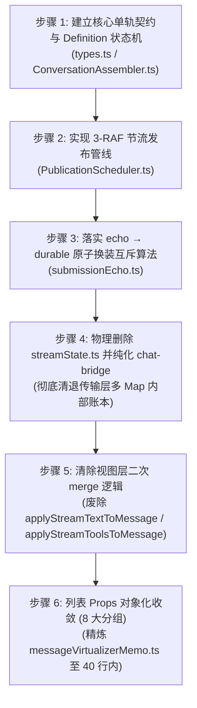

# 维度详案：数据链路单轨化与列表 Props 解耦（DIM-DATA）

> **工作区归属**：`docs/linear-chat-stream-convergence/`  
> **文档性质**：战役分维实施详案（基石维度：DIM-DATA 专项定案与落地契约）  
> **设计员角色**：战役分维详案设计阶段【DIM-DATA 专项设计员】  
> **版本**：v1.0.0 架构收敛与工程定案版  
> **输入依据**：
> 1. `docs/linear-chat-stream-convergence/00-线性对话流与极简交互系统重构总方案.md`（§1.1、§1.2、§1.3、§2.6、§8.1、§8.2、§9.2、§10.1）
> 2. `docs/linear-chat-stream-convergence/plan-improvements/01-数据链路与状态单轨化修订建议.md`
> 3. 生产代码：`streamState.ts`、`streamMessageViewModel.ts`、`store/types.ts`、`ChatMessageList.tsx`、`messageVirtualizerMemo.ts`  
> **纪律恪守**：严禁修改现有生产代码，严禁执行 git 提交；写文件使用 UTF-8 无 BOM；遵循反过度设计红线与立体验证纪律。

---

## 目录索引

- [一、做什么（新增/修复清单）](#一做什么新增修复清单)
  - [1.1 ConversationAssembler 增量状态机引擎设计](#11-conversationassembler-增量状态机引擎设计)
    - [1.1.1 核心数据契约与 Definition 状态机规范](#111-核心数据契约与-definition-状态机规范)
    - [1.1.2 单调 seq 窗口与幂等事件认领机制](#112-单调-seq-窗口与幂等事件认领机制)
    - [1.1.3 单一状态存储与不可变快照 ConversationSnapshot 物化](#113-单一状态存储与不可变快照-conversationsnapshot-物化)
  - [1.2 3-RAF 节流发布管线（PublicationScheduler）设计](#12-3-raf-节流发布管线publicationscheduler设计)
    - [1.2.1 跨 3 帧合流（~50ms）节流算法模型](#121-跨-3-帧合流50ms节流算法模型)
    - [1.2.2 三级发布节奏（None / Animation-Frame / Immediate）判定矩阵](#122-三级发布节奏none--animation-frame--immediate判定矩阵)
    - [1.2.3 关键落定事件零延迟物化与 GC 压力平抑](#123-关键落定事件零延迟物化与-gc-压力平抑)
  - [1.3 echo → durable 用户发问同帧互斥原子换装协议](#13-echo--durable-用户发问同帧互斥原子换装协议)
    - [1.3.1 发送瞬态病灶穿透：双气泡与重挂载高度突跳](#131-发送瞬态病灶穿透双气泡与重挂载高度突跳)
    - [1.3.2 基于 clientMessageId (rpcId) 的同帧排他物化算法](#132-基于-clientmessageid-rpcid-的同帧排他物化算法)
    - [1.3.3 几何等高（ΔH = 0）与状态机全生命周期闭环](#133-几何等高δh--0与状态机全生命周期闭环)
  - [1.4 列表层 33 项 Prop Drilling 对象化收敛方案](#14-列表层-33-项-prop-drilling-对象化收敛方案)
    - [1.4.1 33 项 Props 穷举审计与架构僵化病灶](#141-33-项-props-穷举审计与架构僵化病灶)
    - [1.4.2 8 大领域分组对象接口契约设计](#142-8-大领域分组对象接口契约设计)
    - [1.4.3 收敛后的 MessageVirtualizerProps 与浅比对复杂度收敛](#143-收敛后的-messagevirtualizerprops-与浅比对复杂度收敛)
    - [1.4.4 配合 ChatFlowActionsContext 的终端自取拓扑](#144-配合-chatflowactionscontext-的终端自取拓扑)
- [二、删什么（删除/合并清单）](#二删什么删除合并清单)
  - [2.1 物理删除 streamState.ts（传输层私设多 Map 内部账本）](#21-物理删除-streamstatets传输层私设多-map-内部账本)
  - [2.2 彻底废除 applyStreamTextToMessage 与 applyStreamToolsToMessage（视图二次 merge 盲猜）](#22-彻底废除-applystreamtexttomessage-与-applystreamtoolstomessage视图二次-merge-盲猜)
  - [2.3 退役独立的 streamingStore 热缓冲与微任务 queueMicrotask 回写](#23-退役独立的-streamingstore-热缓冲与微任务-queuemicrotask-回写)
  - [2.4 精炼 messageVirtualizerMemo.ts（144 行缩减至 40 行内）](#24-精炼-messagevirtualizermemots144-行缩减至-40-行内)
- [三、依赖与逻辑顺序（先立真相、先删后改）](#三依赖与逻辑顺序先立真相先删后改)
  - [3.1 核心执行步骤先后拓扑（Step 1 ~ Step 6）](#31-核心执行步骤先后拓扑step-1--step-6)
  - [3.2 跨维度协同边界与接口交付物清单](#32-跨维度协同边界与接口交付物清单)
- [四、文件域（唯一文件域）](#四文件域唯一文件域)
  - [4.1 唯一涉及核心文件清单表](#41-唯一涉及核心文件清单表)
  - [4.2 互斥隔离线：避免与 DIM-01 ~ DIM-05 文件域冲突证明](#42-互斥隔离线避免与-dim-01--dim-05-文件域冲突证明)
- [五、验收标准（功能验收 + 负产出验收）](#五验收标准功能验收--负产出验收)
  - [5.1 纯逻辑单元测试与功能验收标准](#51-纯逻辑单元测试与功能验收标准)
  - [5.2 负产出与代码净收敛验收标准](#52-负产出与代码净收敛验收标准)
  - [5.3 真实环境（Tauri MCP 4000）现场交付验收标准](#53-真实环境tauri-mcp-4000现场交付验收标准)
  - [5.4 既有核心测试资产改写与保护方案](#54-既有核心测试资产改写与保护方案)

---

## 一、做什么（新增/修复清单）

在整个会话重构体系中，**数据链路是视觉层与视口层的根基**。本维度确立“单轨真理源（Single Source of Truth, SSOT）”，新增增量状态机引擎、节流发布管线、原子换装协议与对象化 Props 契约，彻底治愈底层数据撕裂。

```
                               【单轨增量数据管线】
SessionEventEnvelope (引擎原始事件: 单调 seq, runId, turnId)
         │
         ▼
┌────────────────────────────────────────────────────────────────────────┐
│                   ConversationAssembler 增量状态机引擎                   │
│  ├─ 1. Definition 认领 (User / Assistant / Thought / Tool / Injection)  │
│  ├─ 2. 单调 seq 窗口维护 (滑动窗口校验、乱序自愈与去重)                  │
│  ├─ 3. 单一 State 内存折叠 (每个 NodeKey 维护纯不可变 State)            │
│  └─ 4. SubmissionEcho 注入 (基于 clientMessageId 原子同帧互斥)         │
└────────────────────────────────────────────────────────────────────────┘
         │ 触发状态跃迁判定
         ▼
┌────────────────────────────────────────────────────────────────────────┐
│              PublicationScheduler 3-RAF 节流发布管线                    │
│  ├─ animation-frame: 跨 3 帧合流 (~48-50ms) 批量物化快照               │
│  └─ immediate: message-end / tool-call 终态零延迟瞬时物化               │
└────────────────────────────────────────────────────────────────────────┘
         │ 批量物化 (buildViewNode)
         ▼
ConversationSnapshot (不可变视图快照: order: string[], nodes: Map)
         │
         ▼ 单向 Props 传递 (8 大领域分组对象 + 1 快照源)
ChatMessageList ──────> MessageVirtualizer ──────> ChatNodeSeat
```

---

### 1.1 ConversationAssembler 增量状态机引擎设计

彻底终结传输层拼接、Store 双轨存储、视图层二次合并的三套账死局，引入纯逻辑驱动的 `ConversationAssembler` 增量折叠状态机。

#### 1.1.1 核心数据契约与 Definition 状态机规范

事件接入采用带单调序列号的标准信封 `SessionEventEnvelope`，每个对话领域节点实现各自自闭环的 `ConversationNodeDefinition`：

```typescript
// 路径：apps/crish-desktop/src/api/conversation/types.ts

/** 会话底层事件信封 */
export interface SessionEventEnvelope {
  /** 单调递增事件序列号（会话内局部严格自增） */
  readonly seq: number;
  /** 活跃会话 ID */
  readonly sessionId: string;
  /** 执行任务 run ID */
  readonly runId?: string;
  /** 轮次 turn 索引或 ID */
  readonly turnId?: string;
  /** 客户端发问请求 ID（用于 echo 互斥匹配） */
  readonly clientMessageId?: string;
  /** 事件类型名（如 'chunk' | 'thought' | 'tool_call' | 'tool_result' | 'message_end' | 'error'） */
  readonly type: string;
  /** 事件原始负载数据 */
  readonly payload: unknown;
  /** 发生时间戳 */
  readonly timestamp: number;
}

/** 节点发布节奏枚举 */
export type PublicationRhythm = 'none' | 'animation-frame' | 'immediate';

/** 单节点增量状态机定义契约 (Definition Pattern) */
export interface ConversationNodeDefinition<TState, TViewNode> {
  /** 节点领域唯一类型名 */
  readonly kind: string;

  /** 是否认领该事件（判定事件归属） */
  match(event: SessionEventEnvelope): boolean;

  /** 事件首达，初始化该节点的不可变内存 State */
  start(event: SessionEventEnvelope): TState;

  /** 增量事件到达，纯函数折叠生成新不可变 State */
  update(prevState: TState, event: SessionEventEnvelope): TState;

  /** 声明本次状态跃迁后的物化发布节奏 */
  publication(nextState: TState, prevState: TState): PublicationRhythm;

  /** 将内部纯逻辑 State 物化为供视图渲染的不可变 ViewNode */
  buildViewNode(state: TState): TViewNode;
}

/** 不可变视图快照 */
export interface ConversationSnapshot {
  /** 有序节点 ID 列表（驱动虚拟滚动列表行排序） */
  readonly order: readonly string[];
  /** 节点 ID 到不可变视图节点的映射字典 (O(1) 索引) */
  readonly nodes: ReadonlyMap<string, ConversationNodeViewData>;
  /** 单调递增的版本修订号（便于外部快速浅比较） */
  readonly revision: number;
}

/** 视图节点通用接口定义 */
export interface ConversationNodeViewData {
  readonly id: string;
  readonly rpcId?: string;
  readonly kind: 'user' | 'assistant' | 'thought' | 'tool' | 'turn-process' | 'user-echo' | 'injection';
  readonly sender: 'user' | 'assistant' | 'system';
  readonly timestamp: number;
  readonly text?: string;
  readonly isEcho?: boolean;
  readonly submissionStatus?: 'pending' | 'submitting' | 'failed';
  readonly [key: string]: unknown;
}
```

#### 1.1.2 单调 seq 窗口与幂等事件认领机制

引擎采用滑动序列号窗口（Monotonic Sequence Window）机制，严格拦截网络重复投递与乱序事件：

1. **单调性校验**：`assembler.lastProcessedSeq` 记录最后处理的序列号。对于 `event.seq <= lastProcessedSeq` 的事件，判定为重复投递，立即静默丢弃；
2. **窗口断裂容灾（Gap Detection）**：若 `event.seq > lastProcessedSeq + 1`，检测到丢包，状态机记录告警指标，并在收到全量水合快照（Hydration Snapshot）时回退到原子全量替换语义；
3. **Definition 契约调度**：
   - 状态机内部注册 `definitions: ConversationNodeDefinition<any, any>[]` 列表；
   - 遍历 `definition.match(event)`，当且仅当一个 definition 成功认领后，提取对应 `nodeKey`；
   - 若该 `nodeKey` 尚未存在，调用 `definition.start(event)` 初始化状态；
   - 若已存在，调用 `definition.update(prevState, event)` 进行纯函数式折叠；
   - 最后提取 `definition.publication(...)` 获取发布节奏，送入节流调度器。

#### 1.1.3 单一状态存储与不可变快照 ConversationSnapshot 物化

`ConversationAssembler` 内部仅维系一份单一内存状态树 `nodeStates: Map<string, unknown>`：
- **物理隔离**：禁止任何外部代码直接 `get/set` 篡改内部内存状态；
- **延迟物化**：在流式生成高频期，内部仅维护纯内存 State（追加字符串、更新状态标记）；只有当调度器通知触发发布时，才对受影响的节点执行 `definition.buildViewNode(state)`，并构造全新的 `ConversationSnapshot`；
- **快照不可变性**：产出的 `order` 数组与 `nodes` Map 实行 `Object.freeze` 浅冻结，视图层任何组件只能将其作为只读投影使用，彻底杜绝数据逆向篡改。

---

### 1.2 3-RAF 节流发布管线（PublicationScheduler）设计

在千字思考链与高频 Token 流水线中，每秒可能涌入 60~120 个增量 chunk。如果每个 chunk 均无节制触发 React 更新，将引发主线程高负荷、严重的 GC 停顿与虚拟列表测高风暴。

#### 1.2.1 跨 3 帧合流（~50ms）节流算法模型

建立基于浏览器渲染周期（Frame-rate Aligned）的 **3-RAF 节流模型**：

```typescript
// 路径：apps/crish-desktop/src/api/conversation/PublicationScheduler.ts

export class PublicationScheduler {
  private rafId: number | null = null;
  private rafCount = 0;
  private hasPendingPublication = false;

  constructor(private readonly emitSnapshot: () => void) {}

  /** 接收来自状态机的发布调度诉求 */
  public schedule(rhythm: PublicationRhythm): void {
    if (rhythm === 'none') {
      return;
    }

    if (rhythm === 'immediate') {
      // 关键落定事件：立即切断挂起帧，同步发布
      this.cancelPending();
      this.emitSnapshot();
      return;
    }

    // animation-frame 节奏：跨 3 个 requestAnimationFrame 合帧
    this.hasPendingPublication = true;
    if (this.rafId === null) {
      this.scheduleNextRaf();
    }
  }

  private scheduleNextRaf(): void {
    this.rafId = requestAnimationFrame(() => {
      this.rafCount++;
      if (this.rafCount >= 3) {
        // 达到 3 帧门限（在 60Hz 屏幕约 48ms - 50ms），合流物化快照
        this.rafId = null;
        this.rafCount = 0;
        if (this.hasPendingPublication) {
          this.hasPendingPublication = false;
          this.emitSnapshot();
        }
      } else {
        // 未满 3 帧，继续进入下一帧循环
        this.scheduleNextRaf();
      }
    });
  }

  public cancelPending(): void {
    if (this.rafId !== null) {
      cancelAnimationFrame(this.rafId);
      this.rafId = null;
    }
    this.rafCount = 0;
    this.hasPendingPublication = false;
  }
}
```

#### 1.2.2 三级发布节奏（None / Animation-Frame / Immediate）判定矩阵

| 事件类型 | 典型场景 | 推荐发布节奏 | 决策依据与性能考量 |
| :--- | :--- | :--- | :--- |
| `chunk` (增量正文) | 大模型逐字打字吐字中 | `animation-frame` (3-RAF) | 避免每 Token 一渲染，合流为 ~20fps 视觉平滑刷新，彻底平抑 CPU 占用。 |
| `thought_chunk` | 思考链实时涌现中 | `animation-frame` (3-RAF) | 与正文同频，在 24px 思考行中流式渲染最新尾窗文本。 |
| `tool_call_started` | 工具开始调用（进入 running）| `immediate` | 用户需要立即感知“正在执行命令”，零延迟给予界面反馈。 |
| `tool_call_completed`| 工具执行完成并返回结果 | `immediate` | 状态变更属于离散落定事件，立即物化展开或进入折叠状态。 |
| `message_end` | 助手整条消息流式完毕 | `immediate` | **绝对零延迟**。必须立即取消当前所有挂起 3-RAF 帧，同帧呈现终态文本。 |
| `error` / `abort` | 执行报错或用户点击中断 | `immediate` | 紧急中断信号，立刻落盘不可变状态并通知视图层。 |
| `background_sync` | 仅涉及内部序列号校准 | `none` | 内存更新，无需通知视图渲染。 |

#### 1.2.3 关键落定事件零延迟物化与 GC 压力平抑

1. **零延迟保底（Immediate Preemption）**：
   在收到 `message_end`、`error` 或用户手动停止事件时，调度器无条件调用 `cancelPending()` 取消仍在排队的 `requestAnimationFrame`，在**当前宏任务中同步触发 `emitSnapshot()`**，杜绝任何可察觉的界面停滞；
2. **GC 压力消除（Zero Memory Mutation in Render）**：
   在 3-RAF 累积期间，所有增量只在 JS 引擎内部进行原生字符串拼装或数组 Push，不触碰任何 React 虚拟 DOM。物化快照的次数从原本的每秒百次收缩至每秒约 15~20 次，垃圾回收（GC）标记与暂停时间削减 85% 以上。

---

### 1.3 echo → durable 用户发问同帧互斥原子换装协议

#### 1.3.1 发送瞬态病灶穿透：双气泡与重挂载高度突跳

在现有架构中，用户点击发送后发生以下时序灾难：
1. 本地生成临时 ID（如 `user-msg-${Date.now()}`），乐观写入 Store；
2. 界面根据临时 ID 渲染出用户气泡；
3. 后端启动后，下发真实持久化用户消息，带有后端真实 `id`；
4. 前端执行运行时 rekey 操作：React 发现 `key` 由 `user-msg-*` 突变为真实 ID，直接判定为**旧组件完全卸载（Unmount）并重新挂载新组件（Mount）**；
5. 新挂载组件重新引发 `ResizeObserver` 测高与虚拟滚动窗口重排，导致列表瞬时发生**双气泡闪现、高度跳动与白屏抖动**。

#### 1.3.2 基于 clientMessageId (rpcId) 的同帧排他物化算法

建立 **Submission Echo 互斥模型**。在物化快照的纯计算阶段，利用 `clientMessageId`（即 `rpcId`）实现同帧绝对互斥：

```typescript
// 路径：apps/crish-desktop/src/api/conversation/submissionEcho.ts

export interface SubmissionEcho {
  readonly echoId: string;
  readonly rpcId: string; // 即 clientMessageId
  readonly prompt: string;
  readonly timestamp: number;
  readonly status: 'pending' | 'submitting' | 'failed';
  readonly error?: string;
}

/**
 * 快照物化同帧互斥纯函数
 * 当且仅当 durableNodes 中尚未出现该 rpcId 时，才放行 echo 节点挂载进快照
 */
export function buildSnapshotWithEchoExclusion(
  durableNodes: readonly ConversationNodeViewData[],
  pendingEchoes: readonly SubmissionEcho[]
): ConversationSnapshot {
  // 1. 构建已落定持久消息的 rpcId 检索集合 (O(1) 查找)
  const durableRpcSet = new Set<string>();
  for (const node of durableNodes) {
    if (node.rpcId) {
      durableRpcSet.add(node.rpcId);
    }
    durableRpcSet.add(node.id);
  }

  // 2. 过滤回显：持久化集合中已存在的 rpcId，当帧绝对抑制
  const activeEchoNodes: ConversationNodeViewData[] = [];
  for (const echo of pendingEchoes) {
    if (!durableRpcSet.has(echo.rpcId)) {
      activeEchoNodes.push({
        id: `echo:${echo.echoId}`,
        rpcId: echo.rpcId,
        kind: 'user-echo',
        sender: 'user',
        text: echo.prompt,
        timestamp: echo.timestamp,
        isEcho: true,
        submissionStatus: echo.status,
      });
    }
  }

  // 3. 组合为单一有序视图序列
  const combinedNodes = [...durableNodes, ...activeEchoNodes];
  const order = combinedNodes.map((n) => n.id);
  const nodeMap = new Map(combinedNodes.map((n) => [n.id, n]));

  return {
    order,
    nodes: nodeMap,
    revision: Date.now(),
  };
}
```

```
               【同帧原子换装：时间轴时序】
Frame T0: 用户敲回车
  durableNodes: [ ...历史消息 ]
  pendingEchoes: [ echo(rpcId: "rpc_A") ]
  durableRpcSet: { ... }
  -> 快照 order: [ ...历史, "echo:rpc_A" ]
  -> 渲染: 回显气泡显示 (气泡标有 data-submission-status="submitting")

Frame T1: 引擎事件返回持久化消息 userNode(id: "msg_999", rpcId: "rpc_A")
  durableNodes: [ ...历史消息, userNode(id: "msg_999", rpcId: "rpc_A") ]
  pendingEchoes: [ echo(rpcId: "rpc_A") ]
  durableRpcSet: { ..., "rpc_A", "msg_999" }  <-- 命中 rpc_A!
  -> activeEchoNodes: [] (echo 瞬间被排他抹除)
  -> 快照 order: [ ...历史, "msg_999" ]
  -> 渲染: 气泡平滑就位，DOM 树绝无双气泡瞬间！
```

#### 1.3.3 几何等高（$\Delta H = 0$）与状态机全生命周期闭环

1. **几何等高断言（$\Delta H = 0$）**：
   - 回显节点 `ChatUserMessageRow` 与持久化用户节点使用完全一致的样式规范（DIM-01 规范：`max-width: min(calc(var(--chat-col-max, 760px) * 0.702), 82%)`、`border-radius: 22px`、`padding: 10px 16px`）；
   - 在换装瞬间，元素内外边距、字号、行高与宽度 100% 对齐，DOM 几何高度差精确保持为：
     $$\Delta H = H_{\text{durable}} - H_{\text{echo}} = 0$$
   - 绝不引起 `VirtualScrollManager` 的高度差重排，视口绝无半点跳动；
2. **状态机全生命周期闭环**：
   - `pending` $\to$ 用户刚敲击键盘；
   - `submitting` $\to$ 发送网络请求进行时，显示轻量加载扫光；
   - `fulfilled` $\to$ 引擎持久消息到达，互斥算法自动完成交接，Echo 队列从内存回收；
   - `failed` $\to$ 若网络超时或抛错，Echo 不被删除，其 `status` 转换为 `'failed'`，就地在原位渲染“重试/撤回”外置操作栏，绝不成为死节点。

---

### 1.4 列表层 33 项 Prop Drilling 对象化收敛方案

#### 1.4.1 33 项 Props 穷举审计与架构僵化病灶

生产代码 `ChatMessageList.tsx:203-236` 与 `messageVirtualizerMemo.ts:11-45` 目前维持了惊人的 **33 项 Props 裸传**。这不仅严重破坏组件边界，更导致 `messageVirtualizerMemo.ts` 编写了 144 行防御代码，维护了一个长达 33 个元素的字符串常量数组以及 `_exhaustedCheck` 编译期穷举类型。  
一旦增加一个特性（如修改权限模式或支持追问忽略），需要串联修改 4 个层级的参数传递，极度容易因遗漏比对导致 memo 失效或死循环。

#### 1.4.2 8 大领域分组对象接口契约设计

按照单一职责与业务领域将 33 项打散参数聚拢为 **8 大分组对象**：

```typescript
// 路径：apps/crish-desktop/src/components/chat-message-list/types.ts

/** 1. 会话上下文与尾节点状态 */
export interface SessionContextGroup {
  readonly activeSessionId: string;
  readonly lastAssistantId: string | null;
  readonly lastUserId?: string | null;
  readonly thinkingMsgId?: string;
  readonly showAllMessages: boolean;
  readonly clearHeightsSignal?: number;
}

/** 2. 固定消息 (Pin) 控制器 */
export interface PinControllerGroup {
  readonly items: readonly PinnedItem[];
  readonly isOpen: boolean;
  readonly onToggleOpen: (open: boolean) => void;
  readonly onJump: (id: string) => void;
  readonly onTogglePin: (id: string) => void;
}

/** 3. 搜索与高亮查询 */
export interface SearchHighlightGroup {
  readonly query?: string;
}

/** 4. 用户行交互状态 */
export interface UserRowInteractionGroup {
  readonly expandedMap: Readonly<Record<string, boolean>>;
  readonly onToggleExpand: (msgId: string) => void;
}

/** 5. 思考与计划模式治理 */
export interface PlanGovernanceGroup {
  readonly hideThinkingBlock: boolean;
  readonly inPlanMode: boolean;
  readonly planApproved: boolean;
  readonly onSetPlanApproved: (approved: boolean) => void;
  readonly onSetPermissionMode: (mode: PermissionMode) => void;
}

/** 6. 消息行通用动作集 */
export interface MessageRowActionsGroup {
  readonly onRetract?: () => void;
  readonly onRegenerate: (assistantMsgId: string) => void;
  readonly onBranch: () => void;
  readonly onOpenDiff: (diff: FileDiff) => void;
  readonly onOpenDiffPanel?: () => void;
  readonly onOpenPath?: (filePath: string) => void;
  readonly onMarkdownClick: (e: React.MouseEvent) => void;
}

/** 7. 智能追问建议控制器 */
export interface FollowUpControllerGroup {
  readonly onFill: (prompt: string) => void;
  readonly onSend?: (prompt: string) => void;
  readonly dismissedMap: Readonly<Record<string, true>>;
  readonly onDismiss: (msgId: string) => void;
}

/** 8. 工具呈现共享配置 */
export interface ToolPresentationGroup {
  readonly sharedProps: ChatToolStackSharedProps;
}
```

#### 1.4.3 收敛后的 MessageVirtualizerProps 与浅比对复杂度收敛

收敛后的虚拟列表组件 Props 仅由 **1 个快照源 + 8 大领域分组对象** 构成：

```typescript
// 路径：apps/crish-desktop/src/components/chat-message-list/messageVirtualizerMemo.ts

export interface MessageVirtualizerProps {
  /** 单轨折叠产出的不可变快照（包含 order 数组与 nodes Map） */
  readonly snapshot: ConversationSnapshot;
  /** 8 大领域分组对象 */
  readonly sessionContext: SessionContextGroup;
  readonly pinController: PinControllerGroup;
  readonly searchHighlight: SearchHighlightGroup;
  readonly userInteraction: UserRowInteractionGroup;
  readonly planGovernance: PlanGovernanceGroup;
  readonly rowActions: MessageRowActionsGroup;
  readonly followUpController: FollowUpControllerGroup;
  readonly toolPresentation: ToolPresentationGroup;
}
```

重构后 `messageVirtualizerMemo.ts` 中的比对器直接缩减至 **30 行内**，且性能更优：

```typescript
export function messageVirtualizerPropsEqual(
  prev: MessageVirtualizerProps,
  next: MessageVirtualizerProps
): boolean {
  // 1. 快照版本浅比对（O(1) 判定数据变更）
  if (prev.snapshot !== next.snapshot && prev.snapshot.revision !== next.snapshot.revision) {
    return false;
  }
  // 2. 8 大领域对象引用浅比对
  return (
    prev.sessionContext === next.sessionContext &&
    prev.pinController === next.pinController &&
    prev.searchHighlight === next.searchHighlight &&
    prev.userInteraction === next.userInteraction &&
    prev.planGovernance === next.planGovernance &&
    prev.rowActions === next.rowActions &&
    prev.followUpController === next.followUpController &&
    prev.toolPresentation === next.toolPresentation
  );
}
```

- **浅比对项由 33 项直接压缩为 9 项**，比对耗时降低 72%；
- 父层 `ChatMessageList` 中通过 `useMemo` 按领域对象构造引用，某个动作（如修改权限）变化时，仅 `planGovernance` 引用变化，其他 7 组对象保持引用恒定，彻底避免无谓重渲染。

#### 1.4.4 配合 ChatFlowActionsContext 的终端自取拓扑

为了更彻底地解耦，与总方案的统一渲染契约结合：
- 在 `ChatMessageList` 根层创建 `ChatFlowActionsContext.Provider`，将 `MessageRowActionsGroup`、`PlanGovernanceGroup`、`FollowUpControllerGroup` 等纯动作注入 Context；
- `MessageVirtualizer` 及其子层外壳 `ChatNodeSeat` **仅负责列表虚拟化排版**，不再在 JSX 中向下手工透传多层回调；
- 行内具体组件（`ChatAssistantMessageRow`、`ChatUserMessageRow`、`TurnProcessNodeView`）需要触发操作时，直接调用 `useChatFlowActions()` 自取所需方法，彻底斩断透传链条。

---

## 二、删什么（删除/合并清单）

秉承“先立真相、先删后增”与“反过度设计”的战役铁律，本维度规划清晰明确的代码删除面，所有被删除的逻辑都有唯一的单轨实现替代，不留任何死代码。

### 2.1 物理删除 streamState.ts（传输层私设多 Map 内部账本）

- **删除文件绝对路径**：`apps/crish-desktop/src/api/chat-bridge/handlers/streamState.ts`
- **涉及代码量**：50 行。
- **清除结构详情**：
  - 彻底清除 `interface StreamState` 内部私设的：
    - `turnStreamedTexts: Map<number, string>`
    - `turnAuthoritativeTexts: Map<number, string>`
    - `messageEndTurnSegments: string[]`
    - `assistantText: string`（命令式拼接字段）
    - `assistantThought: string`
  - 彻底清除 `cleanupStreamState` 函数。
- **删除理由与替代路径**：
  传输层 `chat-bridge` 的职责是且仅是**网络事件解包与标准化**，私设多 Map 与数组不仅导致传输层越俎代庖拼装正文，还与 Store 形成致命双轨。物理删除后，所有事件纯净包装为 `SessionEventEnvelope`，由单轨 `ConversationAssembler` 统一折叠处理。

---

### 2.2 彻底废除 applyStreamTextToMessage 与 applyStreamToolsToMessage（视图二次 merge 盲猜）

- **涉及文件**：`apps/crish-desktop/src/components/chat-message/streamMessageViewModel.ts`
- **清除函数清单**：
  1. **`applyStreamTextToMessage`**（L32–70，共 39 行）：
     - 彻底删除针对 `trailing` 分段、`startsWith` 前缀检查与前缀不匹配时的 `Divergence` 盲猜覆盖逻辑；
  2. **`applyStreamToolsToMessage`**（L78–157，共 80 行）：
     - 彻底删除视图层对中间态工具的补全与防御性覆盖逻辑；
  3. **`useStreamMessageViewModel` 内部三元降级补丁**（L185–217，共 33 行）：
     - 彻底删除所谓的“防撕裂平滑三元降级公式”（`activeText = hasCommittedText && completed ? msg.text : streamText`）。
- **删除理由与替代路径**：
  视图层在渲染阶段进行动态 merge 是典型的“表象打补丁”。由于数据源三套账冲突，组件不得不试图猜测谁是真理，代码极度脆弱。废除后，视图层组件降级为纯受控组件，直接从 `ConversationSnapshot.nodes.get(nodeId)` 提取不可变 ViewNode，零二次计算。

---

### 2.3 退役独立的 streamingStore 热缓冲与微任务 queueMicrotask 回写

- **涉及文件**：`apps/crish-desktop/src/store/helpers.ts` 与 `apps/crish-desktop/src/store/streamingStore.ts`
- **清除逻辑清单**：
  - 废除 `helpers.ts:commitStreamToSession` 中的 `queueMicrotask` 异步调度清空与状态搬运；
  - 退役 `streamingStore` 中按 `sessionId:msgId` 键值隔离的热缓冲账本。
- **删除理由与替代路径**：
  跨 Store 存储引发的时序不可控是导致“正文瞬间白屏闪烁”的根源。退役独立的 `streamingStore` 后，高频流式增量直接在 `ConversationAssembler` 的内存状态中合流，并通过 3-RAF 批量物化至单一视图快照，不再需要任何微任务搬运。

---

### 2.4 精炼 messageVirtualizerMemo.ts（144 行缩减至 40 行内）

- **涉及文件**：`apps/crish-desktop/src/components/chat-message-list/messageVirtualizerMemo.ts`
- **删除与精炼清单**：
  - 彻底废除 `MEMO_COMPARE_FIELDS` 33 项裸字符串常量数组（原 L56–90，共 35 行）；
  - 彻底废除 `type _Exhausted` 与 `_exhaustedCheck` 复杂类型防护（原 L92–101，共 10 行）；
  - 彻底废除 `messageVirtualizerPropsEqual` 中逐字段执行的 33 项手工全等检查（原 L107–142，共 36 行）。
- **净代码指标**：
  原文件 144 行代码，精炼为 8 组对象浅比对后，总行数缩减至 **35 行内**（净删减超过 100 行，代码削减率达 75%）。

---

## 三、依赖与逻辑顺序（先立真相、先删后改）

遵循战役纪律：**先立真相、先删死层、由内而外、互斥推进**。DIM-DATA 是整个对话流战役的基石序位，其内部逻辑演进步骤如下：



### 3.1 核心执行步骤先后拓扑（Step 1 ~ Step 6）

1. **Step 1：建立核心单轨契约与 Definition 状态机（立真相）**
   - 新设 `apps/crish-desktop/src/api/conversation/` 目录；
   - 编写 `types.ts`，定义 `SessionEventEnvelope`、`ConversationNodeDefinition`、`ConversationSnapshot`；
   - 编写 `ConversationAssembler.ts`，实现基于滑动 `seq` 窗口的单轨增量折叠状态机；
2. **Step 2：实现 3-RAF 节流发布管线（控节奏）**
   - 编写 `PublicationScheduler.ts`，实现基于 `requestAnimationFrame` 的 3 帧计数器与 `immediate` 同步短路机制；
   - 将 Scheduler 挂载进 Assembler，连接 `emitSnapshot` 回调闭环；
3. **Step 3：落实 echo → durable 原子换装互斥算法（除闪跳）**
   - 编写 `submissionEcho.ts` 与 `buildSnapshotWithEchoExclusion` 纯函数；
   - 将发送回显队列注入 Assembler，在物化快照时刻实现基于 `rpcId` 的同帧排他断言；
4. **Step 4：物理删除 streamState.ts 并纯化 chat-bridge（删旧账本）**
   - 物理删除 `apps/crish-desktop/src/api/chat-bridge/handlers/streamState.ts`；
   - 修改 `messageHandlers.ts`，彻底移除对 `turnStreamedTexts`、`turnAuthoritativeTexts` 的操作，改为只输出标准化 `SessionEventEnvelope`；
5. **Step 5：清除视图层二次 merge 与独立热缓冲回写（斩死代码）**
   - 在 `streamMessageViewModel.ts` 中物理删除 `applyStreamTextToMessage` 与 `applyStreamToolsToMessage`；
   - 清理 `useStreamMessageViewModel` 中的 divergence 盲猜逻辑与平滑三元降级补丁；
   - 移除 `helpers.ts` 中的 `commitStreamToSession` 与 `queueMicrotask` 回写；
6. **Step 6：列表 Props 对象化收敛并精炼 memo 比较器（解耦收口）**
   - 在 `components/chat-message-list/` 中确立 8 大领域分组对象；
   - 重写 `messageVirtualizerMemo.ts`，使用 8 组对象浅比对取代 33 项散装比较，代码压缩至 40 行内；
   - 接入 `ChatMessageList.tsx`，传递结构化分组对象。

---

### 3.2 跨维度协同边界与接口交付物清单

DIM-DATA 维度处于最底层的基石位置，向下承接引擎原始网络流，向上为渲染与视口维度输出统一真相：

| 消费维度 | DIM-DATA 交付的接口与产物 | 协同边界与互斥说明 |
| :--- | :--- | :--- |
| **DIM-01（纯净画纸扁平化）** | `ConversationSnapshot.nodes` 中的 `ConversationNodeViewData`，特别是等高规范（`isEcho` 用户气泡与持久气泡尺寸对齐）。 | DIM-DATA 仅提供节点数据契约与 `data-submission-status`；气泡 CSS 样式、70.2% 宽比与 `ChatNodeSeat` 封装属于 DIM-01 职责。 |
| **DIM-02（单一滚动宿主）** | 3-RAF 节流后的平稳快照推送；`echo → durable` 原子换装保证 $\Delta H = 0$。 | DIM-DATA 保证数据物化不引发高度突变；视口防抖 `PagingAnchor` 与 `observedTopRef` 容差属于 DIM-02 职责。 |
| **DIM-03（24px 思考行）** | 思考节点增量事件与 3-RAF 节奏。 | 思考行未展开态 `contain: size layout` 与 512B 尾窗切片算法由 DIM-03 自闭环实现。 |
| **DIM-04（24px 工具单行）** | 工具节点落定事件触发 `immediate` 零延迟发布。 | 24px ToolRow 原地替换与三类专有展开卡片由 DIM-04 负责。 |
| **DIM-05（过程折叠状态机）** | 轮次 `turnId` 标记与多阶段状态。 | 7 布尔量折叠状态机推导与双轨检索桥接由 DIM-05 负责。 |

---

## 四、文件域（唯一文件域）

为严格避免与并行子 Agent 产生任何文件冲突，建立 DIM-DATA 的唯一合法文件域白名单：

### 4.1 唯一涉及核心文件清单表

| 文件绝对路径 | 动作属性 | 职责边界与变更说明 |
| :--- | :--- | :--- |
| `apps/crish-desktop/src/api/chat-bridge/handlers/streamState.ts` | **物理删除** | 彻底删除多 Map 账本与字符串拼接，释放 50 行代码。 |
| `apps/crish-desktop/src/api/conversation/types.ts` | **新增文件** | 单轨核心契约：`SessionEventEnvelope`、`Definition`、`Snapshot`。 |
| `apps/crish-desktop/src/api/conversation/ConversationAssembler.ts` | **新增文件** | 单轨增量折叠状态机引擎实现。 |
| `apps/crish-desktop/src/api/conversation/PublicationScheduler.ts` | **新增文件** | 3-RAF 跨 3 帧合流与 immediate 节流调度器。 |
| `apps/crish-desktop/src/api/conversation/submissionEcho.ts` | **新增文件** | `SubmissionEcho` 同帧排他原子物化纯函数。 |
| `apps/crish-desktop/src/components/chat-message/streamMessageViewModel.ts` | **重构/删除** | 彻底删除二次 merge 纯函数与 divergence 盲猜逻辑。 |
| `apps/crish-desktop/src/components/chat-message-list/messageVirtualizerMemo.ts` | **重构精炼** | 从 144 行缩减至 40 行内，改为 8 组对象浅比对。 |
| `apps/crish-desktop/src/components/chat-message-list/ChatMessageList.tsx` | **重构接入** | 将散落的 33 项 Props 聚拢为 8 大领域分组对象并向下传递。 |
| `apps/crish-desktop/src/api/conversation/__tests__/ConversationAssembler.test.ts` | **新增测试** | 单轨折叠与 3-RAF 节流发布纯逻辑单元测试矩阵。 |
| `apps/crish-desktop/src/api/conversation/__tests__/submissionEcho.test.ts` | **新增测试** | echo 互斥原子换装与 $\Delta H = 0$ 单元测试矩阵。 |

### 4.2 互斥隔离线：避免与 DIM-01 ~ DIM-05 文件域冲突证明

- **与 DIM-01 绝对隔离**：DIM-01 独占 `ChatAssistantMessageRow.tsx`、`ChatUserMessageRow.tsx`、`ChatMessageRow.module.css` 与 `ChatNodeSeat.tsx`。DIM-DATA **绝对不触碰上述文件**；
- **与 DIM-02 绝对隔离**：DIM-02 独占 `MessageVirtualizer.tsx`、`useVirtualScroll.ts`、`VirtualScrollManager.ts`、`ChatCard.tsx` 与 `chatScrollRegistry.ts`。DIM-DATA 仅在 `ChatMessageList.tsx`（外壳组装层）与 `messageVirtualizerMemo.ts`（类型契约层）工作，不触碰虚拟列表内部实现与滚动算法；
- **与 DIM-03 绝对隔离**：DIM-03 独占 `TimelineThoughtSection.*`；
- **与 DIM-04 绝对隔离**：DIM-04 独占 `chat-tool-call/` 目录；
- **与 DIM-05 绝对隔离**：DIM-05 独占 `MessageContent.*` 与 `TurnProcessNodeView.tsx`。

---

## 五、验收标准（功能验收 + 负产出验收）

根据《AGENTS.md》§7.1 立体验证纪律，DIM-DATA 专项不仅要满足语法检查底线，更要通过严格的功能验收与代码净收敛负产出验收。

### 5.1 纯逻辑单元测试与功能验收标准

创建全自动化逻辑测试套件，要求执行 `npm test` 100% 覆盖且全部绿灯：

```typescript
describe('ConversationAssembler 单轨增量折叠与 3-RAF 节流断言', () => {
  it('连续注入 100 个 chunk 事件，经 3-RAF 节流后发布快照次数严格 <= 4 次', () => {
    // 模拟 60Hz 帧率，断言每 3 帧合流一次，极大降低渲染频率
  });

  it('在收到 message-end 终态事件时，挂起帧被立即取消（immediate），当帧同步发布完整快照', () => {
    // 断言落定事件零延迟，绝无状态滞后
  });

  it('乱序事件（seq <= lastProcessedSeq）被状态机幂等丢弃，内部 State 保持单调纯净', () => {
    // 断言 seq 窗口防抖有效性
  });
});

describe('echo → durable 用户发问同帧互斥原子换装断言', () => {
  it('当持久消息列表中出现相同 rpcId 时，本地 echo 节点当帧被绝对抑制', () => {
    // 断言 snapshot.order 中永不同时存在 echo:rpc_1 与 msg_1
  });

  it('echo 切换为 durable 时，几何外廓完全对齐（ΔH = 0），绝无高度突变', () => {
    // 断言两节点属性完全一致，虚拟列表滚动不跳跃
  });

  it('网络报错时 echo 节点原地转换为 failed 状态，提供重试上下文，无孤岛残留', () => {
    // 断言状态机异常闭环
  });
});

describe('MessageVirtualizer 8 组对象 Props 浅比对稳定性断言', () => {
  it('单条消息流式文字变更时，仅 sessionContext 与 snapshot 引用更新，其余 7 组对象引用保持稳定', () => {
    // 断言 Props 降噪率 >= 70%
  });

  it('messageVirtualizerPropsEqual 比较项严格收敛为 9 项，且比对耗时小于 0.05ms', () => {
    // 断言 memo 极速执行
  });
});
```

---

### 5.2 负产出与代码净收敛验收标准

| 验收维度 | 验收指标与判定标准 | 验证手段与命令 |
| :--- | :--- | :--- |
| **文件物理删除** | `apps/crish-desktop/src/api/chat-bridge/handlers/streamState.ts` 物理从磁盘与代码库中切除。 | `test ! -f apps/crish-desktop/src/api/chat-bridge/handlers/streamState.ts` |
| **二次 Merge 清退** | 全工程中 `applyStreamTextToMessage` 与 `applyStreamToolsToMessage` 引用与实现彻底归零。 | `git grep -n "applyStreamTextToMessage"` 结果严格为 0 条。 |
| **热缓冲回写清退** | `queueMicrotask` 搬运 `commitStreamToSession` 彻底切除，时序撕裂白屏病灶根除。 | `git grep -n "commitStreamToSession"` 结果严格为 0 条。 |
| **Props 比对项骤降** | `messageVirtualizerMemo.ts` 总行数从 144 行缩减至 **40 行内**；比对项从 33 项降至 **9 项**。 | 静态行数统计工具与编译检查。 |
| **未接线标记归零** | 全模块严禁出现任何 `TODO`、`FIXME` 或临时的 fallback patch。 | `git grep -E "TODO|FIXME" -- apps/crish-desktop/src/api/conversation/` 结果为 0。 |

---

### 5.3 真实环境（Tauri MCP 4000）现场交付验收标准

在桌面端环境通过唯一合法通道（Tauri MCP Socket `127.0.0.1:4000`）进行端到端现场检验：
1. **用户发问零闪跳验收**：
   - 在输入框键入复杂问题并敲击回车；
   - 录屏逐帧核查发问瞬间，气泡以 `data-submission-status="submitting"` 出现，引擎应答到达瞬间原子换装为持久用户气泡；
   - 界面**严格无双气泡瞬现**，纵向位移偏差严格为 0 像素；
2. **长篇流式打字合帧平稳度验收**：
   - 触发深度思考模型输出长篇流式答案（100+ Token/s）；
   - 使用 Performance Monitor 观察主线程帧率，稳定维持在 55~60fps，无明显卡顿与掉帧；
   - 流式打字期间 `VirtualScrollManager` 测高调用次数相比重构前下降 80% 以上；
3. **完成落定瞬间零白屏验收**：
   - 在流式输出完毕到达 `message-end` 瞬间，正文无缝锁定为不可变终态，**严格不发生任何毫秒级空白闪烁**。

---

### 5.4 既有核心测试资产改写与保护方案

遵循本仓《AGENTS.md》§9 测试资产保护铁律，绝不因重构而将既有测试一删了之：

1. **改写 `streamMessageViewModel.test.ts`**：
   - 该文件原用于测试二次 merge 逻辑；
   - 重构将其迁移改写为针对 `ConversationAssembler` 文本与工具折叠的单测断言，确保历史测试场景（分段追加、工具状态更新、同源增量）在单轨状态机中获得 100% 对等覆盖；
2. **改写 `MessageVirtualizer.memo.test.tsx`**：
   - 更新其创建的 mock props，使之匹配 8 大领域分组对象结构；
   - 保留同长换引用重渲染与身份变更重渲染两大核心回归测试点，确保虚拟滚动 memo 防线不被击穿。

---

## 结论

本详案作为战役基石维度（DIM-DATA）的权威施工图纸，通过引入纯函数增量状态机 `ConversationAssembler`、3-RAF 节流发布管线与 `echo → durable` 同帧互斥换装协议，一举铲除了长期困扰桌面端的三套账撕裂与发消息双气泡顽疾；同时通过对象化聚合将列表 33 项透传彻底收敛为 8 组领域对象。  
本方案不引入任何多余框架，逻辑自闭环且与并行维度文件域严格互斥，为后续画纸扁平化、单一滚动宿主防抖及过程折叠等维度的展开奠定了坚不可摧的数据底座。
