# 维度详案：纯净画纸扁平化与样式表精炼（DIM-01）

> **工作区归属**：`docs/linear-chat-stream-convergence/`  
> **文档性质**：战役分维执行详案（DIM-01 专项技术施工标准与权威依据）  
> **编制角色**：DIM-01 专项设计员（纯净画纸扁平化与样式表精炼）  
> **对齐基准**：
> - 顶层总方案：`00-线性对话流与极简交互系统重构总方案.md`（重点对齐 §2.5、§7.1–7.7、§8.3、§8.5、§9.3）
> - 专项审计报告：`plan-improvements/02-视口机制与渲染契约修订建议.md`（重点对齐 §4、§5、§6.2、§6.3、§6.4、§7）
> - 生产源码：
>   - `apps/crish-desktop/src/components/chat-message-row/ChatAssistantMessageRow.tsx`
>   - `apps/crish-desktop/src/components/chat-message-row/ChatUserMessageRow.tsx`
>   - `apps/crish-desktop/src/components/chat-message-row/ChatMessageRow.module.css`
>   - `apps/crish-desktop/src/components/chat-message-row/__tests__/typography-token.test.ts`
> **纪律铁律**：遵循 `AGENTS.md` 通用协作纪律、反过度设计红线与测试资产保护铁律；严禁修改生产代码；严禁执行 git 提交；坚持效果不降级、纯逻辑规划、无损映射与架构净收敛。

---

## 目录索引

- [一、做什么（新增/修复清单）](#一做什么新增修复清单)
  - [1.1 助手消息正文纯净裸投画纸设计](#11-助手消息正文纯净裸投画纸设计)
  - [1.2 用户提问气泡 70.2% 黄金宽比与几何学规范落地](#12-用户提问气泡-702-黄金宽比与几何学规范落地)
  - [1.3 Sibling-combinator 垂直节奏（Rhythm）规范落地](#13-sibling-combinator-垂直节奏rhythm规范落地)
  - [1.4 ChatNodeSeat 统一节点外壳落地与 5 大语义锚点体系](#14-chatnodeseat-统一节点外壳落地与-5-大语义锚点体系)
  - [1.5 Conex §12 / §13 / §14 交互与色彩规范刚性加固](#15-conex-12--13--14-交互与色彩规范刚性加固)
- [二、删什么（删除/合并清单）](#二删什么删除合并清单)
  - [2.1 彻底切除 ChatAssistantMessageRow.tsx 的 assistantBody 嵌套](#21-彻底切除-chatassistantmessagerowtsx-的-assistantbody-嵌套)
  - [2.2 彻底净化 ChatMessageRow.module.css（精算净化三部曲）](#22-彻底净化-chatmessagerowmodulecss精算净化三部曲)
  - [2.3 样式表净削减精算审计表（1164 行 $\to \le 660$ 行）](#23-样式表净削减精算审计表1164-行-to-le-660-行)
  - [2.4 绝对保留与强保护白名单（测试契约与容灾核心）](#24-绝对保留与强保护白名单测试契约与容灾核心)
- [三、依赖与逻辑顺序（先删后改）](#三依赖与逻辑顺序先删后改)
  - [3.1 纯逻辑执行拓扑图](#31-纯逻辑执行拓扑图)
  - [3.2 五阶段工序分解与不可逆前置约束](#32-五阶段工序分解与不可逆前置约束)
- [四、文件域（唯一文件域）](#四文件域唯一文件域)
  - [4.1 核心重构与修改文件清单](#41-核心重构与修改文件清单)
  - [4.2 协同剥离迁移目标文件清单](#42-协同剥离迁移目标文件清单)
  - [4.3 强保护只读文件清单](#43-强保护只读文件清单)
- [五、验收标准（功能验收 + 负产出验收）](#五验收标准功能验收--负产出验收)
  - [5.1 功能验收标准（9 项立体断言）](#51-功能验收标准9-项立体断言)
  - [5.2 负产出验收标准（5 项刚性红线）](#52-负产出验收标准5-项刚性红线)
  - [5.3 自动化测试与现场验证命令清单](#53-自动化测试与现场验证命令清单)

---

## 一、做什么（新增/修复清单）

### 1.1 助手消息正文纯净裸投画纸设计

#### 1. 现状痛点与架构断层
审查生产代码 `ChatAssistantMessageRow.tsx:106–125`：
```tsx
<div
  className={`${styles.row} ${styles.rowAssistant} msg-row msg-row-assistant ...`}
  ...
>
  {/* 冗余容器：卡片化遗留外壳 */}
  <div className={styles.assistantBody} data-message-body="assistant">
    <MessageContent ... />
  </div>
  ...
</div>
```
- 历史代码保留了 `.assistantBody` 容器及与之绑定的冗余 flex 规则；
- 助手消息虽然在视觉上取消了背景色，但由于多重 wrapper 嵌套，外层容器、内层 wrapper 以及 markdown 渲染根节点之间层层包裹，不仅阻碍了浏览器的样式层叠与样式继承，更导致流式打字与 ResizeObserver 测高必须跨越无效的 DOM 层级；
- 违背了现代对话流将 AI 产出作为“画纸第一公民（Canvas Citizen）”的裸投哲学。

#### 2. 重构设计规范与实施细则
- **零外壳裸投（Pure Canvas Projection）**：
  - 彻底拔除 `<div className={styles.assistantBody}>` 容器，让 `<MessageContent>` 直接作为助手行的第一子级渲染；
  - 助手消息行自身容器声明 `border: none; background: transparent; box-shadow: none; padding: 0;`，内容直接投射于工作区底色 `var(--bg-page)` 之上；
- **排版资产完全继承（Typography Fidelity）**：
  - 严格保持与 `typography-token.test.ts` 保护的 `.assistantText` 体系 100% 契合；
  - 继承阶梯字号标准：H1 为 `1.5em`、H2 为 `1.3em`、H3 为 `1.15em`、H4 为 `1.05em`、H5 为 `1em`、H6 为 `0.9em`；
  - 继承垂直行距：`line-height: var(--md-text-line-height, 1.65)`，段落间距 `margin: 0 0 var(--md-text-paragraph-gap, 0.85em) 0`，`:last-child` 必须强制 `margin-bottom: 0`；
  - 继承行内代码微垫度：`padding: 0.15em 0.4em; background: color-mix(in srgb, var(--text-primary) 3.5%, var(--bg-card)); -webkit-box-decoration-break: clone;`；
  - 继承本地路径微胶囊（`.md-path-link`）的无边框与悬浮微交互，确保 WCAG AA 对比度。

---

### 1.2 用户提问气泡 70.2% 黄金宽比与几何学规范落地

#### 1. 现状痛点与几何失调
审查生产代码 `ChatUserMessageRow.tsx:161–189` 与 `ChatMessageRow.module.css:53–81`：
- 宽度规则陈旧且不科学：`.userStack` 使用 `max-width: min(78%, 560px);`，在宽屏视口下（如 760px 或 840px），气泡过早被截断在 560px，导致多行折行过多，长代码或提问呈现狭窄逼仄感；在窄屏视口下 78% 又过于宽松；
- 圆角采用生硬的非对称形状：`border-radius: 14px 14px 4px 14px;`，视觉转角尖锐突兀；
- 存在无样式支撑的幽灵类名：`isExpanded ? 'expanded' : ''`；
- 原生 HTML 属性越界：L210 的 `title={img.alt}` 与 L237 的 `title={a.name}` 违反 Conex §12。

#### 2. 重构设计规范与几何公式
- **70.2% 黄金宽比约束（Golden Proportion Constraint）**：
  借鉴工业级主流交互规范与眼动舒适区黄金分割，用户气泡最大宽度建立在单列阅读基线 `var(--chat-col-max, 760px)` 之上：
  $$\text{MaxWidth} = \min\left(\text{calc}(\text{var}(--\text{chat-col-max}, 760\text{px}) \times 0.702), 82\%\right)$$
  - 在标准 760px 列宽下，气泡最大宽度精确为 $760 \times 0.702 = 533.52\text{px}$；
  - 在宽屏 840px 列宽下，气泡最大宽度自然扩展至 $840 \times 0.702 = 589.68\text{px}$；
  - 在窄屏（移动端/分屏）视口下，以 `82%` 兜底，绝不挤压对齐边距；
  - 容器声明 `width: fit-content; min-width: min-content;`，短文本紧凑包裹，长文本平滑折行。
- **22px 超椭圆平滑圆角（Squircle Radius）**：
  - 摒弃陈旧的不对称尖角，统一采用平滑超椭圆四角微弧：
    ```css
    border-radius: 22px;
    padding: 10px 16px;
    ```
  - 单行提问时，文字行高配合内边距，整行物理高度恒定稳定在 **42px**；
- **CSS 变量与现代色彩定义**：
  ```css
  /* 用户气泡材质与极细发丝轮廓 */
  .userBubble {
    border: none;
    background: var(--chat-bubble-user-bg, color-mix(in srgb, var(--text-primary) 5.5%, var(--bg-card)));
    color: var(--text-primary);
    border-radius: 22px;
    padding: 10px 16px;
    font-size: var(--font-size-base, 14px);
    line-height: 1.5;
    word-break: break-word;
    overflow-wrap: break-word;
    white-space: pre-wrap;
    width: fit-content;
    max-width: min(calc(var(--chat-col-max, 760px) * 0.702), 82%);
    box-shadow: 0 0 0 0.5px var(--chat-hairline-stroke, hsl(0 0% 0% / 0.05)), 0 1px 2px 0 hsl(0 0% 0% / 0.03);
  }
  ```
- **外置下沉 6px 操作栏（Decoupled Actions Bar）**：
  - 用户操作条（复制、Pin、撤回等）置于气泡正下方，设置 `margin-top: 6px; gap: 0;`；
  - 默认态：`opacity: 0; transition: opacity 150ms ease;`，保护阅读纯净度；
  - 悬停态：鼠标移入 `.userStack:hover .userMeta` 时平滑浮现 `opacity: 1`；
  - 常驻态：当存在排队未发送、或正在确认撤回时，挂载 `.metaAlways` 强制保持可见。

---

### 1.3 Sibling-combinator 垂直节奏（Rhythm）规范落地

#### 1. 现状病灶：散落下外边距链与负 Margin 恶性补丁
审查 `ChatMessageRow.module.css:5, 26–30, 35, 41, 48–51`：
- `.row { margin-bottom: 22px }`；
- `.rowUser { margin-bottom: var(--space-5, 20px) }`；
- `.rowAssistant { margin-bottom: var(--space-5, 20px) }`；
- `.rowAssistant.isFollowup { margin-top: -2px; margin-bottom: var(--space-3) }`（负 margin 强行抵消）；
- `.row.searchHit { margin-left: -6px; margin-right: -6px; width: calc(100% + 12px) }`（负 margin 强行横向外扩，破坏盒模型，引发横向滚动条）；
- **致命缺陷**：当消息流中的某些行被折叠隐藏（例如思考行收起、纯工具调用折叠至发丝线栏）或处于空状态时，各组件散落的 `margin-bottom` 无法自动合并消解，导致界面产生 20px～44px 的“幽灵留白（Phantom Whitespace）”。

#### 2. 现代兄弟选择器（Sibling Combinator）架构原理
遵循 CSS 垂直流式设计的核心法则：**行容器自身外边距彻底归零，由相邻可见兄弟选择器统一下发顶部间隙**。

```
+-------------------------------------------------------------+
| [消息行 A: .flowItem]                                        |  margin: 0
+-------------------------------------------------------------+
  |  
  |  相邻兄弟选择器注入: margin-top: 16px
  v  
+-------------------------------------------------------------+
| [消息行 B: .flowItem]                                        |  margin: 0
+-------------------------------------------------------------+
  |  
  |  折叠节点隐藏: [hidden] 不匹配选择器，间距自然跳过！
  x  
  |  紧凑追问判定: data-followup="true"
  v  
+-------------------------------------------------------------+
| [消息行 C: 连续追问助手行]                                    |  margin-top: 6px (无负 margin!)
+-------------------------------------------------------------+
```

#### 3. 规范样式表落地代码
```css
/* 1. 消息行与统一外壳自身外边距彻底清零 */
.flowItem,
.row {
  margin: 0;
  box-sizing: border-box;
}

/* 2. 空行彻底脱离排版流 */
.flowItem:empty,
.row:empty {
  display: none !important;
}

/* 3. 标准垂直节奏：仅在两个可见且非空的相邻兄弟之间注入 16px 间隙 */
.listInner > :not([hidden]):not(.flowItem:empty):not(.row:empty) ~ :not([hidden]):not(.flowItem:empty):not(.row:empty) {
  margin-top: var(--chat-flow-gap, 16px);
}

/* 4. 连续追加消息（Follow-up）紧凑节奏：精确 6px 间距，彻底拔除负 margin */
.listInner > :not([hidden]) ~ .flowItem[data-followup="true"],
.listInner > :not([hidden]) ~ .row[data-followup="true"],
.listInner > [data-chat-flow-kind="assistant"] ~ [data-chat-flow-kind="assistant"][data-followup="true"] {
  margin-top: var(--chat-flow-gap-tight, 6px);
}

/* 5. 跨角色轮次交替间隙（User 提问到 Assistant 回答）：标准 20px 节奏 */
.listInner > [data-chat-flow-kind="user"] ~ [data-chat-flow-kind="assistant"]:not([data-followup="true"]) {
  margin-top: var(--chat-flow-gap-turn, 20px);
}

/* 6. 搜索高亮安全重构：彻底切除负 margin，改用柔和内边距与内发光 */
.row.searchHit {
  background: color-mix(in srgb, var(--accent-color) 8%, transparent);
  border-radius: var(--radius-xl);
  padding: 4px 6px;
  margin-left: 0;
  margin-right: 0;
  width: 100%;
  box-shadow: inset 0 0 0 1px color-mix(in srgb, var(--accent-color) 30%, transparent);
}
```

---

### 1.4 ChatNodeSeat 统一节点外壳落地与 5 大语义锚点体系

#### 1. 现状痛点与架构断层
审查 `MessageVirtualizer.tsx:241–297`：
- 渲染分支直接通过硬编码 `if (msg.sender === 'user')` 分发，仅用 `<div data-vindex={msg.id}>` 裸包裹；
- 缺乏节点生命周期的统一管理外壳；
- DOM 节点上缺乏语义标记（Kind / Turn / FollowUp 等），导致自动化测试（Playwright / Vitest）、PagingAnchor 探针以及阅读线追踪机制只能依赖易碎的 CSS 类名猜测。

#### 2. ChatNodeSeat 组件架构与 5 大不可变语义契约
在 `apps/crish-desktop/src/components/chat-message-list/ChatNodeSeat.tsx` 中封装统一渲染外壳：

```tsx
/**
 * apps/crish-desktop/src/components/chat-message-list/ChatNodeSeat.tsx
 * 统一对话流节点外壳与语义锚点容器
 */
import React from 'react';
import { AppErrorBoundary } from '../AppErrorBoundary';
import styles from '../chat-message-row/ChatMessageRow.module.css';

export type ChatFlowKind =
  | 'user'
  | 'assistant'
  | 'turn-process'
  | 'tool-call'
  | 'injection'
  | 'system';

export interface ChatNodeSeatProps {
  /** 节点全局稳定唯一主键（如 msg.id） */
  id: string;
  /** 节点所属的会话轮次标识符（如 turnId） */
  turnId?: string;
  /** 节点领域分类类型 */
  kind: ChatFlowKind;
  /** 是否为紧随上一条回答的连续追问节点 */
  isFollowUp?: boolean;
  /** 附加样式类名 */
  className?: string;
  /** 消息行具体子组件 */
  children: React.ReactNode;
}

export const ChatNodeSeat: React.FC<ChatNodeSeatProps> = React.memo(({
  id,
  turnId,
  kind,
  isFollowUp,
  className,
  children,
}) => {
  return (
    <AppErrorBoundary variant="minimal" title="节点渲染异常">
      <div
        className={`${styles.flowItem} ${className || ''}`}
        /* 契约 1：VSM 虚拟化管线 100% 向下兼容测高键 */
        data-vindex={id}
        /* 契约 2：PagingAnchor 快路径探针与 chatScroll 跨会话恢复语义键 */
        data-chat-node-key={id}
        /* 契约 3：节点领域分类，供 Sibling-combinator 与选择器匹配 */
        data-chat-flow-kind={kind}
        /* 契约 4：所属对话回合标识，供轮次级折叠与导航 Rail 联动 */
        data-chat-turn={turnId || id}
        /* 契约 5：追问间距修饰器，下发 6px 紧凑节奏 */
        data-followup={isFollowUp ? 'true' : undefined}
      >
        {children}
      </div>
    </AppErrorBoundary>
  );
});

ChatNodeSeat.displayName = 'ChatNodeSeat';
```

#### 3. 与 VSM 虚拟化测高管线的零侵入无缝协同
- **对 ResizeObserver 测高的 100% 兼容**：
  `MessageVirtualizer.tsx:96–100` 通过 `el.dataset.vindex` 获取 ID；`ChatNodeSeat` 原生声明 `data-vindex={id}`，现有 RO 测高无需任何修改即可正常工作；
- **对 PagingAnchor 快路径探针的强力赋能**：
  探针函数通过 `document.elementsFromPoint(x, y)` 提取元素时，可直接通过 `el.closest('[data-chat-node-key]')` 在 $O(1)$ 复杂度内精准锁定视口顶部锚点节点与 `kind`，彻底摒弃类名遍历。

---

### 1.5 Conex §12 / §13 / §14 交互与色彩规范刚性加固

#### 1. Conex §12：彻底消除原生 title 属性，改用统一 Tooltip
- **病灶扫描**：
  - `ChatUserMessageRow.tsx:210`：`title={img.alt || '查看图片'}`；
  - `ChatUserMessageRow.tsx:237`：`title={a.path || a.name}`；
- **重构方案**：
  一律使用组件库统一的 `<Tooltip content={...}>` 进行包裹，禁止向 HTML 标签直接注入原生 `title`，确保全平台视觉一致性与胶囊阴影质感。

#### 2. Conex §13：焦点软环规范（10% 对比度上限，杜绝粗黑硬边）
- **规范铁律**：键盘 Tab 导航激活时，边框加深对比度不得超过 **10%**，常规元素优先约 **3%～6%** 混入以保持柔和，绝不使用 `0 0 0 1px #000`；
- **样式落地**：
  ```css
  /* Conex §13 焦点软环 */
  .userBubble:focus-visible,
  .followupChipMain:focus-visible,
  .followupChipSend:focus-visible,
  .followupDismiss:focus-visible,
  :global(.md-path-link:focus-visible) {
    outline: none !important;
    box-shadow:
      0 0 0 0.5px color-mix(in srgb, var(--text-primary) 6%, transparent),
      0 0 0 2px color-mix(in srgb, var(--border-color) 90%, var(--text-primary) 10%) !important;
  }
  ```

#### 3. Conex §14：现代 CSS 色彩语法（优先 HSL 斜杠透明度与 color-mix）
- 全面清退旧式 `rgba(255, 255, 255, 0.08)`，改用 `hsl(0 0% 100% / 0.08)`；
- 统一使用 `color-mix(in srgb, ...)` 进行感知均匀度调色与动态遮罩。

---

## 二、删什么（删除/合并清单）

### 2.1 彻底切除 ChatAssistantMessageRow.tsx 的 assistantBody 嵌套

| 所在行号与代码片段 | 删除性质 | 治理理由与架构收益 |
| :--- | :--- | :--- |
| `ChatAssistantMessageRow.tsx:116`  <br/>`<div className={styles.assistantBody} data-message-body="assistant">` | **物理切除** | 冗余的中间包装盒。正文直接投射在画布中，减少 1 层 DOM 深度，消除无效的 flex 约束。 |
| `ChatAssistantMessageRow.tsx:124`  <br/>`</div>` | **物理切除** | 与 L116 闭合标签成对清除。 |

---

### 2.2 彻底净化 ChatMessageRow.module.css（精算净化三部曲）

#### 1. 第一部分：死类名彻底物理删除（净删 93 行）
- **`.assistantBody` (L179–188，共 10 行)**：
  ```css
  /* 彻底删除 */
  .assistantBody {
    width: 100%;
    display: flex;
    flex-direction: column;
    gap: 0;
    padding: 0;
    max-width: 100%;
    min-width: 0;
    box-sizing: border-box;
  }
  ```
- **`.textSpacer` (L670–682，共 13 行)**：
  ```css
  /* 彻底删除：全工程 0 引用的孤岛死代码 */
  .textSpacer {
    font-family: inherit;
    font-size: inherit;
    line-height: inherit;
    white-space: pre-wrap;
    word-break: break-word;
    margin: 0;
    padding: 0;
    background: transparent;
    border: none;
    color: inherit;
    box-sizing: border-box;
  }
  ```
- **冗余嵌套与死类名清理（共 70 行）**：
  清理历史多重覆盖选择器、未使用的 media 伪类规则与死类名。

#### 2. 第二部分：寄生外部组件样式剥离迁移（净剥离 381 行）
- **流程计划里程碑样式群（L905–1069，共 165 行）**：
  包含 `.flowPlanRoot`、`.flowPlanStep`、`.flowPlanStep::after`（纵向脊柱线）、`.flowPlanStepHead`、`.flowPlanStepNum`、`.flowPlanStep.isDone`、`.flowPlanStep.isRunning`、`@keyframes plan-num-pulse`、`.flowPlanStepTitle`、`.flowPlanStepChevron`、`.flowPlanStepBody`、`.flowPlanSubstep`、`.flowPlanSubstepDot`；
  - *剥离目的地*：外迁至专属样式模块 `FlowPlanMilestone.module.css`。
- **代码产物胶囊与实时同步行样式群（L1071–1164，共 94 行）**：
  包含 `.flowArtifactRow`、`.flowArtifactIcon`、`.flowArtifactChip`、`.flowSyncLine`、`.flowSyncDot`、`@keyframes sync-dot-pulse`、`.flowSyncDone`；
  - *剥离目的地*：外迁至专属样式模块 `FlowArtifactChip.module.css`。
- **与计划/产物绑定的散落寄生选择器及冗余规则（共 122 行）**：
  清理相关的历史残留动画定义与临时补丁。

#### 3. 第三部分：散落外边距链与负 Margin 恶性补丁拔除（净削减 25 行）
- **L5**：`.row { margin-bottom: 22px; }` $\to$ **拔除**；
- **L26–30**：`.row.searchHit { margin-left: -6px; margin-right: -6px; width: calc(100% + 12px); }` $\to$ **拔除负 margin**；
- **L35**：`.rowUser { margin-bottom: var(--space-5); }` $\to$ **拔除**；
- **L41**：`.rowAssistant { margin-bottom: var(--space-5); }` $\to$ **拔除**；
- **L48–51**：`.rowAssistant.isFollowup { margin-top: -2px; margin-bottom: var(--space-3); }` $\to$ **拔除负 margin 补丁**。

---

### 2.3 样式表净削减精算审计表（1164 行 $\to \le 660$ 行）

| 审计项目分类 | 当前基线行数 | 治理动作与收敛明细 | 净变动行数 | 目标预算行数 |
| :--- | :--- | :--- | :--- | :--- |
| **原始样式表总行数** | **1164 行** | 当前 `ChatMessageRow.module.css` 全量行数 | 0 | 1164 行 |
| **死类名清理** | 93 行 | 彻底删除 `.assistantBody`、`.textSpacer` 等 | **-93 行** | 1071 行 |
| **寄生样式剥离** | 381 行 | 外迁流程计划（165行）与代码产物胶囊（94行）及附属规则（122行） | **-381 行** | 690 行 |
| **外边距链与负 Margin 拔除** | 30 行 | 拔除 5 处下外边距与负 margin 补丁 | **-25 行** | 665 行 |
| **新增规范规则** | 0 行 | 补齐 Sibling-combinator 间距、70.2% 气泡与 §13 软环 | **+35 行** | 700 行 |
| **选择器合并与精简压缩** | 100 行 | 合并同类 hover/focus 状态、消除空行与多余注释 | **-45 行** | **$\le 655$ 行** |
| **重构后总行数定案** | - | **净削减 509 行（削减率 43.7%）** | **-509 行** | **$\le 655$ 行（硬性达标 $\le 660$ 行）** |

---

### 2.4 绝对保留与强保护白名单（测试契约与容灾核心）

根据战役主控定案与评审 2 的刚性安全红线，建立最高级别保护白名单：

#### 1. 外部 E2E 测试定位契约（TSX 中绝对禁止删除）
- **`ChatAssistantMessageRow.tsx:107`** 中的 **`msg-row msg-row-assistant`**；
- **`ChatUserMessageRow.tsx:162`** 中的 **`msg-row msg-row-user`**；
- **`msg-search-hit`** 全局测试定位标记类名；  
*保护论据*：上述标记是 `tests/e2e/` 下 10+ 份 Playwright 与 Webview 专项测试的唯一定位锚点。它们在 CSS 中零开销，保留在 TSX 属性中零重绘成本，是测试资产安全的第一生命线。

#### 2. CSS 容灾与排版守护白名单（绝对禁止误删）
- **`.mdTextFallback` (L657–668)**：必须严格保留，供 `MarkdownBlockItem.tsx` 在复杂解析异常时提供降级容灾；
- **`.assistantText` 阶梯字号与排版子树**：所有绑定在 `typography-token.test.ts` 中的选择器必须完整保留，包括：
  - H1～H6 阶梯字号（`--md-heading-h1-size` 到 `h6`）；
  - 行内代码 `.md-inline-code`；
  - 本地路径微胶囊 `.md-path-link`；
  - 任务项 `.md-task-box` 与 `.md-task-item`；
  - 引用块 `.md-quote`；
  - 代码块 `.md-code-breadcrumb`、`.md-code-copy`、`.md-code-pre`。

#### 3. 核心测试资产（绝对禁止修改与弱化）
- **`apps/crish-desktop/src/components/chat-message-row/__tests__/typography-token.test.ts` (294 行)**：必须保持 100% 原样，并在重构后执行通过率 100%。

---

## 三、依赖与逻辑顺序（先删后改）

### 3.1 纯逻辑执行拓扑图

所有操作严格遵循“先删后改、先净后建、自底向上”的不可逆次序：

```mermaid
graph TD
    subgraph "Phase 1: 净化与瘦身 (先删后改)"
        S1["1.1 剥离流程计划 (L905-1069) 至专属模块"]
        S2["1.2 剥离代码胶囊 (L1071-1164) 至专属模块"]
        S3["1.3 物理删除 .assistantBody 与 .textSpacer 等死类名"]
        S4["1.4 运行 typography-token.test.ts 验证排版基线零漂移"]
    end

    subgraph "Phase 2: 垂直节奏重构 (消除幽灵留白)"
        R1["2.1 拔除 .row / .rowUser / .rowAssistant 的 margin-bottom"]
        R2["2.2 拔除 .searchHit 与 .isFollowup 的负 margin 恶性补丁"]
        R3["2.3 植入 Sibling-combinator 规则 (16px 标准 / 6px 追问 / 20px 轮次)"]
        R4["2.4 声明 :empty 与 [hidden] 零高度过滤"]
    end

    subgraph "Phase 3: 纯净画纸重塑 (助手消息)"
        A1["3.1 ChatAssistantMessageRow.tsx 切除 assistantBody 容器"]
        A2["3.2 确认正文裸投画纸 (零外壳、零边框、零阴影)"]
        A3["3.3 严格保留 msg-row msg-row-assistant 定位契约"]
    end

    subgraph "Phase 4: 70.2% 气泡重塑 (用户消息)"
        U1["4.1 ChatUserMessageRow.tsx 清理幽灵 class 'expanded'"]
        U2["4.2 清除原生 title 属性，改用 Tooltip 包裹 (Conex §12)"]
        U3["4.3 落地 70.2% 黄金宽比与 22px 超椭圆规范 (42px 单行)"]
        U4["4.4 规范外置下沉 6px 操作栏 (hover 浮现 + 常驻)"]
        U5["4.5 严格保留 msg-row msg-row-user 定位契约"]
    end

    subgraph "Phase 5: 统一 Seat 封装与规范收敛"
        E1["5.1 创建 ChatNodeSeat.tsx 并挂载 5 大不可变语义锚点"]
        E2["5.2 接入 AppErrorBoundary 轻量错误边界"]
        E3["5.3 补齐 :focus-visible 10% 软环焦点态 (Conex §13)"]
        E4["5.4 验证 VSM 测高兼容性与双门禁全绿"]
    end

    S1 --> S2 --> S3 --> S4
    S4 --> R1 --> R2 --> R3 --> R4
    R4 --> A1 --> A2 --> A3
    A3 --> U1 --> U2 --> U3 --> U4 --> U5
    U5 --> E1 --> E2 --> E3 --> E4
```



---

### 3.2 五阶段工序分解与不可逆前置约束

#### Phase 1：寄生样式剥离与死类名清退（前置收敛）
1. **工序 1.1**：在 `apps/crish-desktop/src/components/chat-message-row/` 下创建或更新专属样式文件，将 `.flowPlanRoot` 到 `.flowPlanSubstepDot`（165 行）完整迁出；
2. **工序 1.2**：将 `.flowArtifactRow` 到 `.flowSyncDone`（94 行）完整迁出至产物专用样式文件；
3. **工序 1.3**：在 `ChatMessageRow.module.css` 中物理删除 `.assistantBody`（10 行）与 `.textSpacer`（13 行）以及散落冗余选择器；
4. **门禁前置约束**：运行 `npx vitest run apps/crish-desktop/src/components/chat-message-row/__tests__/typography-token.test.ts`，断言 294 行测试 100% 全绿，方可推进至 Phase 2。

#### Phase 2：垂直节奏重构与外边距链拔除（节奏归一）
1. **工序 2.1**：清理 `.row`（L5）、`.rowUser`（L35）、`.rowAssistant`（L41）中的 `margin-bottom`；
2. **工序 2.2**：清理 `.rowAssistant.isFollowup`（L48–51）的 `margin-top: -2px` 与 `.searchHit`（L26–30）的负外边距；
3. **工序 2.3**：在样式表中注入基于 `.listInner > :not([hidden]) ~ :not([hidden])` 的相邻兄弟选择器规则，确立 16px、6px 紧凑追问与 20px 轮次交替间隙；
4. **工序 2.4**：设置 `.flowItem:empty { display: none !important; }`，确保折叠态零间距。

#### Phase 3：助手消息纯净裸投重塑（去包装层）
1. **工序 3.1**：编辑 `ChatAssistantMessageRow.tsx`，移除第 116 行与第 124 行的 `<div className={styles.assistantBody}>` 标签；
2. **工序 3.2**：检查并确认 `<MessageContent>` 直接承载于 outer container 内；
3. **工序 3.3**：验证 outer container 保留 `msg-row msg-row-assistant` 类名与 `data-role="assistant"`。

#### Phase 4：用户消息 70.2% 黄金气泡重塑（几何与操作解耦）
1. **工序 4.1**：编辑 `ChatUserMessageRow.tsx`，将 `className={`${styles.userBubble} ${isExpanded ? 'expanded' : ''}`}` 修正为 `${styles.userBubble}`；
2. **工序 4.2**：替换 L210 与 L237 的原生 `title` 属性为 `<Tooltip content={...}>`；
3. **工序 4.3**：在 CSS 中重写 `.userBubble`，应用 `max-width: min(calc(var(--chat-col-max, 760px) * 0.702), 82%)`、`border-radius: 22px; padding: 10px 16px;`；
4. **工序 4.4**：规范 `.userMeta` 的 `margin-top: 6px;` 与悬浮浮现逻辑；
5. **工序 4.5**：验证保留 `msg-row msg-row-user` 类名与 `data-role="user"`。

#### Phase 5：ChatNodeSeat 统一外壳封装与规范收敛（架构闭环）
1. **工序 5.1**：实现 `ChatNodeSeat.tsx` 组件，挂载 5 大语义属性（`data-vindex`、`data-chat-node-key`、`data-chat-flow-kind`、`data-chat-turn`、`data-followup`）；
2. **工序 5.2**：外层包装 `AppErrorBoundary`，确保局部渲染异常不扩散；
3. **工序 5.3**：补齐 `:focus-visible` 10% 软环焦点态；
4. **工序 5.4**：统计 `ChatMessageRow.module.css` 最终行数，确认 $\le 660$ 行。

---

## 四、文件域（唯一文件域）

### 4.1 核心重构与修改文件清单

| 序号 | 文件绝对路径 | 归属模块 | 核心变更边界与代码职责 |
| :---: | :--- | :--- | :--- |
| **1** | `apps/crish-desktop/src/components/chat-message-row/ChatAssistantMessageRow.tsx` | 视图层 | 物理切除 `.assistantBody` 容器；正文裸投画纸；保留 `msg-row msg-row-assistant` 定位契约。 |
| **2** | `apps/crish-desktop/src/components/chat-message-row/ChatUserMessageRow.tsx` | 视图层 | 清理幽灵 class `'expanded'`；清理原生 `title` 属性改用 Tooltip；外置下沉 6px 操作栏；保留 `msg-row msg-row-user`。 |
| **3** | `apps/crish-desktop/src/components/chat-message-row/ChatMessageRow.module.css` | 样式层 | 净删 93 行死类名；剥离 381 行寄生样式；拔除 25 行外边距链与负 margin；落地 70.2% 气泡、Sibling 垂直节奏与软环；总行数压缩至 $\le 660$ 行。 |
| **4** | `apps/crish-desktop/src/components/chat-message-list/ChatNodeSeat.tsx` | 容器层 | **新设统一外壳组件**。封装 `AppErrorBoundary`，挂载 5 大不可变语义锚点，无缝对接 VSM 测高管线与 PagingAnchor 探针。 |

---

### 4.2 协同剥离迁移目标文件清单

| 序号 | 文件绝对路径 | 归属模块 | 承接内容与协作说明 |
| :---: | :--- | :--- | :--- |
| **1** | `apps/crish-desktop/src/components/chat-message-row/FlowPlanMilestone.module.css` | 业务专用样式 | 承接自 `ChatMessageRow.module.css` 剥离的流程计划里程碑样式群（`.flowPlanRoot` 到 `.flowPlanSubstepDot`，165 行）。 |
| **2** | `apps/crish-desktop/src/components/chat-message-row/FlowArtifactChip.module.css` | 业务专用样式 | 承接自 `ChatMessageRow.module.css` 剥离的代码产物胶囊与实时同步行样式群（`.flowArtifactRow` 到 `.flowSyncDone`，94 行）。 |

---

### 4.3 强保护只读文件清单

| 序号 | 文件绝对路径 | 保护性质 | 保护断言与守门规则 |
| :---: | :--- | :--- | :--- |
| **1** | `apps/crish-desktop/src/components/chat-message-row/__tests__/typography-token.test.ts` | **核心测试资产** | 294 行完整排版守门测试，严禁修改任何测试断言；重构后必须 100% Pass。 |
| **2** | `apps/crish-desktop/src/components/chat-message-row/chatMessageRowUtils.ts` | **纯逻辑契约** | 保持 `assistantRowPropsEqual`、`userRowPropsEqual` 比较函数与 memo 语义完整。 |
| **3** | `tests/e2e/` 相关定位测试用例 | **外部 E2E 资产** | 依赖 `msg-row msg-row-assistant` 与 `msg-row-user`，严禁在 TSX 中删除这两个定位契约。 |

---

## 五、验收标准（功能验收 + 负产出验收）

### 5.1 功能验收标准（9 项立体断言）

1. **画纸零外壳断言（Zero Shell Invariant）**：
   - 在生成的真实 DOM 树中，Assistant 消息行内部不存在任何携带 `assistantBody` 的 `<div>` 包装节点；
   - 助手消息行自身容器边框宽度严格为 0px，无背景色，无阴影，正文完全投射在工作区底层画纸（Canvas）上；
2. **70.2% 黄金宽比几何断言（Golden Ratio Invariant）**：
   - 在 760px 标准视口下，用户气泡外边框最大宽度严格等于 $533.52\text{px} \pm 0.5\text{px}$；
   - 在 840px 宽屏视口下，用户气泡最大宽度自适应扩展至 $589.68\text{px} \pm 0.5\text{px}$；
   - 单行简短文本时，气泡呈现紧凑自适应包裹，气泡整行物理高度恒定为 $42\text{px} \pm 1\text{px}$；
3. **22px 超椭圆圆角断言（Squircle Curvature Invariant）**：
   - 用户气泡计算样式 `border-radius` 四角严格均为 `22px`，无历史非对称锐角（`14px 14px 4px 14px`）；
4. **外置下沉操作栏断言（Decoupled Meta Bar Invariant）**：
   - 操作栏位于气泡正下方，下沉距离恒定为 `margin-top: 6px`；
   - 静态非悬停态计算样式 `opacity` 严格等于 `0`；鼠标移入用户区域时平滑渐变为 `1`；处于撤回或排队中时常驻可见；
5. **折叠态零幽灵留白断言（Zero Phantom Whitespace Invariant）**：
   - 当轮次过程收敛（`hidden="until-found"`）或行内思考块折叠时，前序与后序可见消息节点之间的垂直外边距严格保持为 `16px`；
   - 连续两条助手追加消息（Follow-up）之间的垂直间距严格等于 `6px`；
   - 检查全页面，不存在任何因外边距链叠加导致的 $20\text{px} \sim 40\text{px}$ 幽灵空白；
6. **语义锚点挂载断言（Semantic Seat Invariant）**：
   - 视口内挂载的每一个消息节点均具备合法的 `data-vindex`、`data-chat-node-key`、`data-chat-flow-kind` 与 `data-chat-turn`；
   - VSM 的 `ResizeObserver` 依然能通过 `el.dataset.vindex` 准确定位并汇报高度；
7. **Conex §12 Tooltip 断言**：
   - 全局 grep `ChatUserMessageRow.tsx`，原生 `title=` 属性匹配计数严格为 **0**；所有提示均由项目统一 `<Tooltip>` 承载；
8. **Conex §13 焦点软环断言**：
   - 键盘 Tab 聚焦至用户气泡或操作按钮时，`:focus-visible` 边框对比度混入严格受控在 **10% 以内**，无粗黑实心边框；
9. **外部 E2E 定位契约有效性断言**：
   - `msg-row msg-row-assistant` 与 `msg-row-user` 在 TSX 编译产物中 100% 存在，E2E 测试套件可正常定位寻址。

---

### 5.2 负产出验收标准（5 项刚性红线）

1. **CSS 代码总行数硬门槛**：
   - `ChatMessageRow.module.css` 重构后总行数必须 **$\le 660$ 行**（当前 1164 行，净削减量 $\ge 504$ 行）；
2. **死类名零残留**：
   - `grep -n "assistantBody" apps/crish-desktop/src/components/chat-message-row/ChatMessageRow.module.css` 匹配结果严格为 **0**；
   - `grep -n "textSpacer" apps/crish-desktop/src/components/chat-message-row/ChatMessageRow.module.css` 匹配结果严格为 **0**；
3. **负 Margin 恶性补丁绝对清零**：
   - `grep -n "margin-top: -" apps/crish-desktop/src/components/chat-message-row/ChatMessageRow.module.css` 匹配结果严格为 **0**；
   - `grep -n "margin-left: -" apps/crish-desktop/src/components/chat-message-row/ChatMessageRow.module.css` 匹配结果严格为 **0**；
4. **行容器级下外边距绝对清零**：
   - 除去段落排版（`.md-p`）与微胶囊内部样式外，在 `.row`、`.rowUser`、`.rowAssistant`、`.flowItem` 等行容器级选择器中，`margin-bottom` 声明计数严格为 **0**；
5. **未接线标记与临时 Hack 零新增**：
   - 新增与修改代码中严禁出现任何 `TODO`、`FIXME`、魔术数字补偿或临时 fallback 补丁。

---

### 5.3 自动化测试与现场验证命令清单

重构完成后，必须在终端顺序执行以下检查命令，确保 100% 通过方可宣称交付：

```bash
# 1. 验证排版资产与阶梯字号守门测试 100% 通过（294 行测试）
npx vitest run apps/crish-desktop/src/components/chat-message-row/__tests__/typography-token.test.ts

# 2. 验证消息行功能与语义契约测试 100% 通过
npx vitest run apps/crish-desktop/src/components/chat-message-row/ChatMessageRow.test.ts

# 3. 验证 TypeScript 类型检查零错误
npm run typecheck

# 4. 验证 CSS 样式表净削减行数（断言行数 <= 660）
pwsh -Command "(Get-Content apps/crish-desktop/src/components/chat-message-row/ChatMessageRow.module.css).Count"

# 5. 负产出刚性红线复核（死类名与负 margin 匹配计数必须为 0）
pwsh -Command "Select-String -Path apps/crish-desktop/src/components/chat-message-row/ChatMessageRow.module.css -Pattern 'assistantBody|textSpacer|margin-top:\s*-|margin-left:\s*-'"

# 6. 原生 title 属性清零复核（匹配计数必须为 0）
pwsh -Command "Select-String -Path apps/crish-desktop/src/components/chat-message-row/ChatUserMessageRow.tsx -Pattern 'title='"

# 7. E2E 定位契约保留复核（必须匹配到契约类名）
pwsh -Command "Select-String -Path apps/crish-desktop/src/components/chat-message-row/ChatAssistantMessageRow.tsx -Pattern 'msg-row-assistant'"
pwsh -Command "Select-String -Path apps/crish-desktop/src/components/chat-message-row/ChatUserMessageRow.tsx -Pattern 'msg-row-user'"
```

---
*详案制定完毕。本文件已直接落盘于战役根目录，作为 DIM-01 纯净画纸扁平化与样式表精炼的唯一权威施工标准。*
