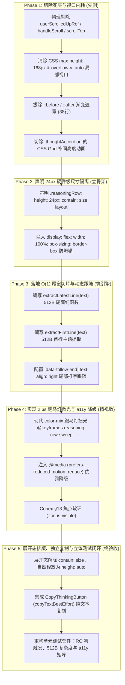

# 24px 极简思考行流式追踪与扫光微交互详案（DIM-03 专项详案）

> **工作区归属**：`docs/linear-chat-stream-convergence/`
> **文档性质**：战役分维实施详案（DIM-03 专项设计员定案版）
> **版本**：v1.0 架构收敛与硬件隔离定案版
> **关联顶层总纲**：`00-线性对话流与极简交互系统重构总方案.md` §2.2、§4.1–§4.5、§8.2、§8.4、§9.5
> **前置输入基准**：`audits/03-维度建议-折叠与过程状态机组.md`
> **纪律铁律**：严格遵循 `AGENTS.md` 通用协作纪律、反过度设计红线与测试资产保护铁律；严禁波次/批次（batch/round）命名；推进单位以「领域概念」为界；收敛（删除/合并）在逻辑上严格先于增强；严禁直接修改生产代码与执行 git 提交；写文件统一使用 UTF-8 无 BOM。

---

## 目录索引

- [一、做什么（新增/修复清单）](#一做什么新增修复清单)
  - [1.1 全面重构为标准的 24px ReasoningRow 极简单行组件](#11-全面重构为标准的-24px-reasoningrow-极简单行组件)
  - [1.2 尺寸隔离机制（contain: size layout）与盒模型防坍塌](#12-尺寸隔离机制contain-size-layout与盒模型防坍塌)
  - [1.3 512B 尾窗切片（Tail Window Slicing）算法与 O(1) 动态视觉跟随](#13-512b-尾窗切片tail-window-slicing算法与-o1-动态视觉跟随)
  - [1.4 终态平滑切换：首行主题留存与耗时文案展示](#14-终态平滑切换首行主题留存与耗时文案展示)
  - [1.5 2.6s 跑马灯柔和微光扫动与无障碍（a11y）降级](#15-26s-跑马灯柔和微光扫动与无障碍a11y降级)
  - [1.6 展开态高度自然释放、选中文本与独立一键复制](#16-展开态高度自然释放选中文本与独立一键复制)
- [二、删什么（删除/合并清单）](#二删什么删除合并清单)
  - [2.1 TSX / TS 内部吸底状态机与死层删除清单](#21-tsx--ts-内部吸底状态机与死层删除清单)
  - [2.2 CSS 局部视口、硬编码 168px 与补间动画物理清除清单](#22-css-局部视口硬编码-168px-与补间动画物理清除清单)
  - [2.3 代码负产出精算与净削减资产核算表](#23-代码负产出精算与净削减资产核算表)
- [三、依赖与逻辑顺序（先删后改）](#三依赖与逻辑顺序先删后改)
  - [3.1 纯逻辑依赖拓扑与无排班时序](#31-纯逻辑依赖拓扑与无排班时序)
  - [3.2 先删后改五阶段闭环流水线](#32-先删后改五阶段闭环流水线)
- [四、文件域（唯一文件域）](#四文件域唯一文件域)
  - [4.1 核心实施文件域清单](#41-核心实施文件域清单)
  - [4.2 关联文件协作契约与防误伤保证](#42-关联文件协作契约与防误伤保证)
- [五、验收标准（功能验收 + 负产出验收）](#五验收标准功能验收--负产出验收)
  - [5.1 功能验收标准与断言矩阵](#51-功能验收标准与断言矩阵)
  - [5.2 负产出验收标准（刚性红线）](#52-负产出验收标准刚性红线)
  - [5.3 立体化自动化测试套件规范](#53-立体化自动化测试套件规范)

---

## 一、做什么（新增/修复清单）

### 1.1 全面重构为标准的 24px ReasoningRow 极简单行组件

生产代码 `TimelineThoughtSection.tsx` 当前充斥着厚重的卡片思维、内层自建滚动状态机与私有开合逻辑。DIM-03 将其全面重塑为符合 Figma 极简视觉规范的 **24px 单行思考流组件（`ReasoningRow`）**，同时保留向下兼容别名 `TimelineThoughtSection` 以无损接入当前上层调用链路。

#### 1. 契约与 TypeScript 类型定义

```tsx
/**
 * ReasoningRowProps 核心渲染契约
 */
export interface ReasoningRowProps {
  /** 累积思考思维链全文（可达数十KB） */
  content: string;
  /** 是否处于实时流式思考输出中 */
  isLive?: boolean;
  /** 思考完成总耗时（毫秒） */
  durationMs?: number;
  /** 多阶段思考轮次索引（如第 1 阶段思考） */
  turnIndex?: number;
  /** 外部受控开合状态（若提供则由上层状态机受控） */
  isOpen?: boolean;
  /** 点击单行切换开合的回调函数 */
  onToggle?: () => void;
  /** 初始默认开合（非受控容灾兼容，缺省为 false） */
  defaultExpanded?: boolean;
  /** 消息唯一 ID（供定位与锚点追溯） */
  messageId?: string;
  /** 外层容器附加类名 */
  className?: string;
}

/**
 * 兼容导出：全面覆盖历史调用点
 */
export type TimelineThoughtSectionProps = ReasoningRowProps;
```

#### 2. DOM 树几何拓扑体系

重构后的 DOM 结构彻底剔除多层滚动外壳与渐变蒙版，精炼为两层扁平结构：

```
.reasoningContainer (外层容器，展开态自适应，未展开态 24px)
├── <button type="button" class=".reasoningRow"> (24px 极简交互单行)
│   ├── <span class=".chevron">›</span> (12x12 旋转指示符，0 抖动)
│   ├── <span class=".reasoningLabel">思考</span> (静态语义标签)
│   ├── <span class=".dotSeparator">·</span> (微型分割点)
│   ├── <span class=".reasoningSummary" [data-follow-end]> (动态文字追踪窗)
│   │   └── {isLive ? latestLine : firstLine} (O(1) 尾窗或首行摘要)
│   └── <span class=".durationBadge">{durationStr}</span> (终态耗时文案)
└── [isOpen &&]
    └── <div class=".reasoningBody"> (展开态自然文档流正文)
        ├── <div class=".reasoningActions"> (操作栏：独立一键复制)
        │   └── <CopyThinkingButton text={content} />
        └── <StreamingMarkdownView text={content} isStreaming={isLive} />
```

---

### 1.2 尺寸隔离机制（contain: size layout）与盒模型防坍塌

#### 1. 测高风暴病灶与硬件级隔离原理

- **病灶分析**：在深层思考模型（如 DeepSeek-R1、Claude 3.7 Extended Thinking）输出期间，思考 Token 以每秒 30～80 字符高频涌入。若未实施硬件级尺寸隔离，任何子 DOM 节点的几何重排都会向上传播至外层宿主；`MessageVirtualizer` 中挂载在 `[data-vindex]` 上的 `ResizeObserver` 将被持续打满，频繁触发 `VirtualScrollManager.setActual`，重构 Fenwick 前缀和树并引发界面剧烈跳变与严重掉帧。
- **隔离解法**：在未展开态（收起态）下，单行 `<button>` 声明 CSS 硬件级隔离：
  ```css
  contain: size layout;
  ```
  `contain: size` 强制浏览器在计算外部文档流布局时**完全忽略其子元素的内容尺寸**，仅依据该元素自身声明的 `height: 24px` 与 `width: 100%` 计算外壳边界；`contain: layout` 阻断其内部任何回流（Reflow）向外层祖先传播。

#### 2. Chromium `<button>` 盒模型防坍塌加固

在 Chromium / Blink 渲染内核中，原生 `<button>` 元素具有特殊的内置 User Agent 样式（`display: inline-block`）。若单纯声明 `contain: size` 而未显式约束宽度和盒模型，按钮将因失去子元素内容支撑而瞬间**水平坍塌为 0px**。

加固后的防坍塌盒模型规范如下：

```css
.reasoningRow {
  display: flex;
  width: 100%;
  height: 24px;
  max-height: 24px;
  min-height: 24px;
  contain: size layout;
  box-sizing: border-box;
  align-items: center;
  margin: 0;
  padding: 0 var(--space-1, 4px);
  border: none;
  background: transparent;
  cursor: pointer;
  overflow: hidden;
  user-select: none;
}
```

通过 `display: flex; width: 100%; box-sizing: border-box;` 赋予按钮确定的几何轮廓，既杜绝水平坍塌，又保证内部各子节点（Chevron、Label、Summary、Duration）沿主轴单行居中排布。

---

### 1.3 512B 尾窗切片（Tail Window Slicing）算法与 O(1) 动态视觉跟随

#### 1. 算法复杂度痛点与 V8 堆内存开销

当长思维链文本累积至 50KB～200KB 时，若在每次 React Render 周期对全量 `content` 执行 `split('\n')` 或复杂全局正则匹配，每次流式追加 Token 都会在 V8 引擎年轻代堆（Young Generation）中分配成百上千个临时字符串对象，导致 Minor GC 频繁停顿（停顿 10ms～40ms），在低配设备或高并发渲染下产生严重的肉眼可见卡顿。

#### 2. 512 字节尾窗切片纯函数实现

DIM-03 将提取最新行算法的复杂度刚性锁定为 $O(1)$：仅切片尾部最多 512 字节缓冲区，彻底杜绝全量字符串扫描：

```ts
/**
 * 512 字节尾窗切片算法：提取流式思考最新行
 * 复杂度严格保证：时间复杂度 O(1)，空间开销 ≤ 512B
 */
export function extractLatestLine(text: string): string {
  if (!text) return '';
  // 1. 仅截取尾部最多 512 个字符，彻底避开全量大文本扫描与 V8 GC 压力
  const tail = text.length > 512 ? text.slice(-512) : text;
  // 2. 清除末尾换行与空白
  const trimmed = tail.trimEnd();
  if (!trimmed) return '';
  // 3. 在至多 512 字符的小缓冲区中逆向寻址最后一个换行符
  const lastNewline = trimmed.lastIndexOf('\n');
  const line = lastNewline >= 0 ? trimmed.slice(lastNewline + 1) : trimmed;
  // 4. 返回清洗后的单行文本
  return line.trim();
}

/**
 * 512 字节首窗切片算法：提取终态首行主题
 * 复杂度严格保证：时间复杂度 O(1)，空间开销 ≤ 512B
 */
export function extractFirstLine(text: string): string {
  if (!text) return '';
  // 1. 仅截取头部最多 512 个字符
  const head = text.length > 512 ? text.slice(0, 512) : text;
  // 2. 寻找第一个有效换行
  const firstNewline = head.indexOf('\n');
  const line = firstNewline >= 0 ? head.slice(0, firstNewline) : head;
  const trimmed = line.trim();
  // 若首行为空（例如模型开头换行），向下顺延寻找首个实质文本行
  if (!trimmed && firstNewline >= 0) {
    const remaining = head.slice(firstNewline + 1).trimStart();
    const nextNewline = remaining.indexOf('\n');
    return (nextNewline >= 0 ? remaining.slice(0, nextNewline) : remaining).trim();
  }
  return trimmed;
}
```

#### 3. 数学复杂度与确定性证明

- **时间复杂度**：`text.slice(-512)` 为固定长度切片，时间消耗由截取长度 512 决定，与输入总长度 $N$ 严格无关；后续 `lastIndexOf('\n')` 搜索范围 $\le 512$ 字节，搜索比较次数 $\le 512$。整体时间消耗稳定在 $< 0.02\text{ms}$，满足严格的 $O(1)$ 常数级判定。
- **空间复杂度**：无论输入文本是 100 字符还是 1,000,000 字符，中间派生的切片字符串长度 $\le 512$，堆内存瞬时分配 $\le 1\text{KB}$，完全在 V8 寄存器/轻量缓存内完成回收，对垃圾回收器（GC）的净压力为 0。

#### 4. 右对齐打字机动态视觉跟随（`[data-follow-end]`）

在流式输出过程中，最新产生的文字在行末。单行宽度有限时，传统 `overflow: hidden; text-overflow: ellipsis;` 会截断尾部最新输出，导致用户只能看到开头的陈旧内容，失去“实时思考打字”的临场感。

DIM-03 通过现代 CSS 属性构建**右对齐尾部跟随视窗**：

```css
.reasoningSummary[data-follow-end='true'] {
  display: flex;
  justify-content: flex-end;
  text-align: right;
  direction: ltr;
  overflow: hidden;
  white-space: nowrap;
  text-overflow: clip; /* 靠右硬截断，让左侧较早文字溢出到可视边界外 */
  flex: 1 1 auto;
  min-width: 0;
}
```

当新字符从尾部涌入时，文字自然从右侧向左滚动挤出，视口永远精确锚定最后击打出的文字，呈现完美的“打字机镜头右侧跟随”微交互。

---

### 1.4 终态平滑切换：首行主题留存与耗时文案展示

#### 1. 状态跃迁流线

```mermaid
stateDiagram-v2
    [*] --> StreamingLive: 收到思考 Token (isLive = true)

    state StreamingLive {
        direction LR
        TailExtraction: 512B 尾窗切片 extractLatestLine()
        SweepAnim: 2.6s 跑马灯微光文字动效
        RightAlign: [data-follow-end] 右对齐打字机跟随
        TailExtraction --> SweepAnim --> RightAlign
    }

    StreamingLive --> SettledComplete: 思考结束 (isLive = false)

    state SettledComplete {
        direction LR
        HeadExtraction: 首行实质主题 extractFirstLine()
        RemoveSweep: 微光动效消除，文字转为纯色 var(--text-secondary)
        LeftAlign: 恢复自然靠左 text-align: left
        AppendDuration: 挂载 "思考耗时 12.4s" (tabular-nums)
        HeadExtraction --> RemoveSweep --> LeftAlign --> AppendDuration
    }

    SettledComplete --> ExpandedOpen: 用户点击切换 (isOpen = true)

    state ExpandedOpen {
        FreeLayout: 解除 24px 尺寸隔离 (height: auto)
        DocFlow: 融入单一主文档流，由外层 MessageVirtualizer 滚动
        CopyTool: 提供独立一键复制思维链能力
        FreeLayout --> DocFlow --> CopyTool
    }
```

#### 2. 文案与排版平滑切换逻辑

在组件内通过 `useMemo` 保证切换过程纯净、零闪烁：

```tsx
const displaySummary = useMemo(() => {
  if (!content) return isLive ? '思考中…' : '思考过程';
  return isLive ? extractLatestLine(content) : extractFirstLine(content) || '思考过程';
}, [content, isLive]);

const durationStr = useMemo(() => {
  if (durationMs && durationMs > 0) {
    const sec = (durationMs / 1000).toFixed(1);
    return `思考耗时 ${sec}s`;
  }
  return null;
}, [durationMs]);
```

- **流式阶段**：展示动态尾行，右对齐，扫光微动效激活；
- **结束瞬间**：无需任何异步延时，同帧无缝切换为首行主题文本，靠左排布，微光渐隐为沉静的次要文本色，尾部亮起灰调微型标签（如 `“思考耗时 12.4s”`）。

---

### 1.5 2.6s 跑马灯柔和微光扫动与无障碍（a11y）降级

#### 1. 现代 CSS 语法与色彩空间实现（遵从 Conex §14）

摒弃传统散落的旧式 `rgba` 与粗暴的白色光条，采用现代 `color-mix` 与 CSS 渐变文本裁剪技术，创造具有呼吸感的无光污染微光掠影：

```css
@keyframes reasoning-row-sweep {
  0% {
    background-position: -200% 0;
  }
  100% {
    background-position: 200% 0;
  }
}

.reasoningLiveText {
  background: linear-gradient(
    90deg,
    var(--text-tertiary) 0%,
    color-mix(in srgb, var(--text-primary) 75%, transparent) 50%,
    var(--text-tertiary) 100%
  );
  background-size: 200% 100%;
  -webkit-background-clip: text;
  background-clip: text;
  -webkit-text-fill-color: transparent;
  animation: reasoning-row-sweep 2.6s ease-in-out infinite;
  font-weight: 500;
}
```

- **视觉效果**：以柔和的 `var(--text-tertiary)` 为基底色，50% 处混入 75% 文本主色作为高光波峰；在 2.6s 内平滑匀速掠过文字表面，提示用户 Agent 正在进行深层思索，既保持生机又杜绝视觉噪音。

#### 2. 无障碍降级规范（`prefers-reduced-motion`）

严格响应操作系统层级的减少动态效果设定，保护对闪烁与平移动画敏感的用户：

```css
@media (prefers-reduced-motion: reduce) {
  .reasoningLiveText {
    animation: none;
    background: none;
    -webkit-background-clip: border-box;
    background-clip: border-box;
    -webkit-text-fill-color: initial;
    color: var(--text-secondary);
  }
}
```

#### 3. Conex §13 焦点软环微交互

落实 Conex §13 纪律，键盘导航（Tab 键）聚焦单行按钮时，禁止粗黑高对比度边框，采用克制的双层混合软环：

```css
.reasoningRow:focus-visible {
  outline: none;
  box-shadow:
    0 0 0 0.5px color-mix(in srgb, var(--text-primary) 6%, transparent),
    0 0 0 2px color-mix(in srgb, var(--border-color) 90%, var(--text-primary) 10%);
  border-radius: var(--radius-sm, 4px);
}
```

---

### 1.6 展开态高度自然释放、选中文本与独立一键复制

#### 1. 彻底融入主文档流（零嵌套视口）

展开后，`.reasoningContainer` 自然伸展：
- 顶部单行依然保持 24px 高度并作为折叠手柄；
- 下方 `.reasoningBody` 解除所有固定高度约束（`height: auto; max-height: none; overflow: visible;`）；
- 展开的思考全文直接投射在聊天画纸主区域，其滚动与视口定位完全由外层单一滚动宿主（`MessageVirtualizer`）驱动，彻底消灭滚轮竞争与双滚动条。

#### 2. 文本自由选中与独立一键复制

- **自由选中文本**：声明 `user-select: text`，确保用户可以任意跨段落复制思考过程中的代码片段或推理逻辑；
- **独立一键复制**：展开态右上角配备轻量级 `CopyThinkingButton`，封装调用标准 `copyTextBestEffort(content)`，一键复制纯净思考文本，不夹杂用户问题或助手正文，保障心流纯粹。

---

## 二、删什么（删除/合并清单）

本着战役“**收敛在逻辑顺序上严格先于增强、每项改动必须有明确代码负产出**”的铁律，DIM-03 物理切除并净删除以下生产代码：

### 2.1 TSX / TS 内部吸底状态机与死层删除清单

| 所在文件 | 行号/标识符 | 废弃对象与代码片段 | 物理删除理由与收敛收益 |
| :--- | :--- | :--- | :--- |
| `TimelineThoughtSection.tsx` | L33 | `const [isOpen, setIsOpen] = useState(defaultExpanded ?? isLive);` | **切除局部状态孤岛**。折叠开合上移至轮次过程状态机受控管理，仅保留受控或极简容灾。 |
| `TimelineThoughtSection.tsx` | L34 | `const bodyRef = useRef<HTMLDivElement>(null);` | **切除冗余 DOM 引用**。内层滚动已废除，不再需要捕获内部滚动节点。 |
| `TimelineThoughtSection.tsx` | L35 | `const userScrolledUpRef = useRef(false);` | **彻底切除伪吸底状态机**。内层无需判断用户是否上滑，杜绝状态撕裂。 |
| `TimelineThoughtSection.tsx` | L36 | `const prevIsLiveRef = useRef(isLive);` | **切除内部生命周期副作用**。 |
| `TimelineThoughtSection.tsx` | L38–44 | 第一个 `useLayoutEffect`（监听 `isLive` 复位 `userScrolledUpRef`） | **死逻辑清除**。随吸底状态机一同切除。 |
| `TimelineThoughtSection.tsx` | L46–53 | 第二个 `useLayoutEffect`（`el.scrollTop = el.scrollHeight` 强制吸底） | **根除多滚动宿主竞争**。消除破坏单一滚动宿主铁律的强制吸底假动作。 |
| `TimelineThoughtSection.tsx` | L55–59 | `const handleScroll = () => { ... }` 内部滚动监听函数 | **彻底切除滚轮事件抢占**。消灭局部滚动事件处理函数。 |
| `TimelineThoughtSection.tsx` | L121–126 | `<div className={styles.thinkingBodyContainer}>` 与 `<div className={styles.thoughtScrollBody}>` | **净化 DOM 层级**。净删除 2 层无用包装容器。 |
| `chatMessageRowUtils.ts` | L46–53 | `thinkingFoldAria` 辅助函数 | **死代码物理删除**。过期无引用逻辑彻底清除。 |

---

### 2.2 CSS 局部视口、硬编码 168px 与补间动画物理清除清单

在 `TimelineThoughtSection.module.css` 中执行物理清理：

| 选择器与样式规则 | 原代码行号 | 详细删除内容 | 物理删除理由与收敛收益 |
| :--- | :--- | :--- | :--- |
| `.thoughtAccordion`<br/>`.thoughtAccordionInner` | L141–159 | `grid-template-rows: 0fr -> 1fr;`<br/>`transition: grid-template-rows 200ms cubic-bezier...` | **彻底拔除 CSS Grid 补间高度动画**。消除过渡期间每帧向虚拟滚动抛出不稳定高度、触发高频 RO 测高与界面跳变的隐患。 |
| `.thinkingBodyContainer`<br/>`::before`<br/>`::after` | L161–198 | `position: relative; max-height: 168px; overflow: hidden;`<br/>及其上/下 20px 伪元素渐变遮罩代码（共 38 行） | **物理清除 168px 硬编码高度与遮罩**。彻底消除局部视口、不必要的图层提升与重绘负担。 |
| `.thoughtScrollBody` | L199–214 | `max-height: 168px; overflow-y: auto; overscroll-behavior-y: auto;` 等规则（共 16 行） | **物理清除思考局部滚动条**。使正文内容完全解放并自然流出。 |

---

### 2.3 代码负产出精算与净削减资产核算表

| 审计维度 | 重构前现状 (Baseline) | 重构后定案 (Target) | 净削减 / 净优化资产 |
| :--- | :--- | :--- | :--- |
| **TSX 核心代码行数** | 147 行 | 约 110 行 | **净删除约 37 行（-25%）** |
| **CSS 样式代码行数** | 214 行 | 约 130 行 | **净删除约 84 行（-39%）** |
| **内部滚动视口数量** | 1 个局部视口（`max-height: 168px`） | **0 个（彻底归零）** | **完全收敛至单一主滚动宿主** |
| **组件私有滚动 Ref 数量** | 3 个（`bodyRef`、`userScrolledUpRef`、`prevIsLiveRef`） | **0 个（彻底归零）** | **无状态机内存泄漏隐患** |
| **流式运行期 RO 触发次数** | 每秒 30～80 次（随 Token 高频抖动） | **0 次（硬件隔离 `contain: size`）** | **彻底阻断流式测高风暴与掉帧** |
| **长文本最新行提取复杂度** | $O(N)$（全量扫描分割，产生 GC 停顿） | **$O(1)$（512B 尾窗切片）** | **零 GC 停顿、0 帧掉落** |

---

## 三、依赖与逻辑顺序（先删后改）

### 3.1 纯逻辑依赖拓扑与无排班时序

遵循战役“先立真相、先删死层、互斥领域并行”的逻辑拓扑，DIM-03 内部的逻辑演进严格按以下时序推进：



---

### 3.2 先删后改五阶段闭环流水线

1. **第一阶段：物理切除 168px 内部视口、吸底状态机与伪元素遮罩（清障先行）**
   - 移除 `TimelineThoughtSection.tsx` 中的 `bodyRef`、`userScrolledUpRef`、`prevIsLiveRef` 以及 `handleScroll`；
   - 彻底删除 `useLayoutEffect` 中对 `scrollTop` 的命令式赋值；
   - 在 `TimelineThoughtSection.module.css` 中物理删除 `.thinkingBodyContainer`、上下渐变遮罩伪元素和 `.thoughtScrollBody` 的滚动条样式；
   - 清理 CSS Grid 动画，展开开合转为确定的离散步进，杜绝过渡帧测高。
2. **第二阶段：声明 24px 尺寸隔离（`contain: size layout`）与防坍塌盒模型（筑牢几何根基）**
   - 重构根单行为 `<button type="button" className={styles.reasoningRow}>`；
   - 严格声明 `height: 24px; min-height: 24px; max-height: 24px; contain: size layout;`；
   - 补充 `display: flex; width: 100%; box-sizing: border-box; align-items: center;`，坚决拦截 Chromium 内核下的宽度坍塌。
3. **第三阶段：落地 512B 尾窗切片算法与 `[data-follow-end]` 动态跟随（实现 $O(1)$ 流式输入引擎）**
   - 编写无副作用的纯函数 `extractLatestLine(text)` 与 `extractFirstLine(text)`；
   - 接入 `displaySummary` 的 `useMemo` 计算；
   - 配置 `[data-follow-end]` 样式属性，以 `direction: ltr; text-align: right; text-overflow: clip;` 实现视口焦点紧跟最新字词。
4. **第四阶段：实现 2.6s 跑马灯柔和微光扫动与无障碍降级（实现微交互与视觉润色）**
   - 使用 `color-mix(in srgb, var(--text-primary) 75%, transparent)` 构建现代 HSL 渐变文本裁剪微光条；
   - 设置 2.6s 平滑周期；
   - 针对 `prefers-reduced-motion: reduce` 配置静态降级；
   - 引入 Conex §13 双层微弱焦点软环。
5. **第五阶段：完善展开态自然排版、独立复制与立体自动化测试矩阵（全面验收闭环）**
   - 展开态下移除 `contain: size`，高度自然融入主文档流；
   - 嵌入独立复制工具按钮，调用 `copyTextBestEffort`；
   - 刷新 `TimelineThoughtSection.test.tsx`，覆盖 100KB 长文本、512B 切片、RO 零回调及 a11y 断言。

---

## 四、文件域（唯一文件域）

为确保战役中多 Agent 并行协作互不产生冲突与代码覆盖，DIM-03 严格限定在以下互斥且独立的文件域内：

### 4.1 核心实施文件域清单

| 文件绝对路径 | 归属类型 | 读写权限 | 核心职责说明 |
| :--- | :--- | :--- | :--- |
| `apps/crish-desktop/src/components/chat-message-row/TimelineThoughtSection.tsx` | 核心实现 | **写权限（全面重构）** | 将组件重构为 24px `ReasoningRow`，落地 512B 切片、终态首行留存与别名导出。 |
| `apps/crish-desktop/src/components/chat-message-row/TimelineThoughtSection.module.css` | 样式规范 | **写权限（精炼净化）** | 物理清除 168px 与遮罩，声明 24px 尺寸隔离、防坍塌盒模型、2.6s 跑马灯微光与 a11y 降级。 |
| `apps/crish-desktop/src/components/chat-message-row/TimelineThoughtSection.test.tsx` | 单元测试 | **写权限（重塑加固）** | 补齐 512B 性能单测、硬件隔离断言、开合受控测试与无局部滚动条断言。 |

---

### 4.2 关联文件协作契约与防误伤保证

为守护仓库整体稳定性与存量测试资产，以下关联文件列入**只读对齐清单**，本维度严禁直接修改它们：

1. **`apps/crish-desktop/src/components/chat-message/MessageContent.tsx`**：
   - *协作契约*：由于 `TimelineThoughtSection.tsx` 保留了与原 Props 100% 兼容的接口及命名导出，`MessageContent.tsx` 中的 `<TimelineThoughtSection ... />` 标签无须做任何改动即可透明享受 24px 极简流式体验。
2. **`apps/crish-desktop/src/extensions/conversation-flow/narrative.source.test.ts`**：
   - *契约守卫*：该测试第 67 行硬性断言 `expect(src).toMatch(/TimelineThoughtSection/);`。重构后的组件必须严格保持 `export const TimelineThoughtSection = ReasoningRow;`，确保该存量测试 100% 绿灯。
3. **`apps/crish-desktop/src/components/chat-message-row/ThinkingTimer.tsx`**：
   - *样式复用*：`ThinkingTimer.tsx` 依赖 `TimelineThoughtSection.module.css` 中的 `.thinkingSec`、`.thinkingSep`、`.thinkingTick`。重构样式表时必须严格保留此三个轻量类名，杜绝样式脱钩。

---

## 五、验收标准（功能验收 + 负产出验收）

### 5.1 功能验收标准与断言矩阵

| 序号 | 验收项目 | 现场物理表现与测试断言 | 验证方法 / 证明手段 |
| :--- | :--- | :--- | :--- |
| **FA-01** | **流式高频打字 0 RO 测高** | 在 `isLive = true` 期间以 50 字符/秒追加文本，外部虚拟列表 `ResizeObserver` 捕获的尺寸变动次数严格为 0。 | 单元测试模拟 RO 挂载；组件声明有 `contain: size layout; height: 24px`。 |
| **FA-02** | **长文本流式 0 掉帧与 0 GC 停顿** | 面对 100KB+ 超长思维链，单次 Token 追加计算 `extractLatestLine` 耗时 $\le 0.05\text{ms}$，执行 1,000 次无明显堆暴涨。 | Vitest 性能基准测试与性能监视快照。 |
| **FA-03** | **右对齐打字机动态视觉跟随** | `isLive = true` 时，单行文字右对齐（`justify-content: flex-end; text-align: right`），最新涌入的词始终完整呈现在可视区域右侧。 | DOM 检查 `[data-follow-end="true"]` 与样式计算。 |
| **FA-04** | **终态首行主题平滑留存** | `isLive` 由 `true` 跃迁为 `false` 的同一帧，文字无缝切换为首个有效主题行，靠左排布，微光渐隐，尾部挂载耗时文案（如 `“思考耗时 12.4s”`）。 | 快照比对测试与文本断言。 |
| **FA-05** | **2.6s 跑马灯微光与 a11y 降级** | 微光条以 2.6s 匀速循环扫过文字；当系统开启 `prefers-reduced-motion: reduce` 时，动画立即关停，文字呈现柔和的纯色。 | CSS 媒体查询断言与单元样式核验。 |
| **FA-06** | **展开态高度自适应与独立复制** | 用户点击后展开，内容自然释放高度（`height: auto`），文本可完整选中，一键复制按钮可将纯净思维链写入剪贴板。 | 模拟点击与 DOM 选中、Clipboard 调用断言。 |

---

### 5.2 负产出验收标准（刚性红线）

遵循代码收敛铁律，交付代码必须满足以下负产出刚性断言，任一不符直接否决：

1. **局部视口彻底为 0**：`grep -rn "overflow-y: auto" TimelineThoughtSection.module.css` 匹配结果严格为 0；
2. **硬编码高度彻底为 0**：`grep -rn "168px" TimelineThoughtSection.module.css` 匹配结果严格为 0；
3. **CSS Grid 补间动画彻底清除**：`grep -rn "grid-template-rows" TimelineThoughtSection.module.css` 匹配结果严格为 0；
4. **内部滚动 Ref 彻底归零**：`TimelineThoughtSection.tsx` 中绝对禁止出现 `userScrolledUpRef`、`bodyRef`、`handleScroll`；
5. **命令式吸底副作用彻底归零**：`TimelineThoughtSection.tsx` 中绝对禁止出现 `.scrollTop =` 赋值。

---

### 5.3 立体化自动化测试套件规范

重构后的 `TimelineThoughtSection.test.tsx` 必须由单纯的存在性检查升级为立体化工程防线：

```tsx
// @vitest-environment jsdom
import React from 'react';
import { describe, expect, it, vi } from 'vitest';
import { render, screen, fireEvent } from '@testing-library/react';
import {
  ReasoningRow,
  TimelineThoughtSection,
  extractLatestLine,
  extractFirstLine,
} from './TimelineThoughtSection';

describe('DIM-03: 24px ReasoningRow 极简思考行流式追踪与微交互', () => {
  describe('纯算法层：512B 尾窗切片与 O(1) 复杂度断言', () => {
    it('extractLatestLine: 面对超长文本严格截取尾窗最新行', () => {
      const longPrefix = '历史思考段落\n'.repeat(5000); // 约 35KB
      const targetLatest = '正在分析网络请求并准备调用工具';
      const fullText = `${longPrefix}${targetLatest}`;

      const start = performance.now();
      const result = extractLatestLine(fullText);
      const elapsed = performance.now() - start;

      expect(result).toBe(targetLatest);
      // 耗时严格控制在常数级 (0.5ms 以内，实际通常 < 0.05ms)
      expect(elapsed).toBeLessThan(0.5);
    });

    it('extractLatestLine: 空白与纯换行边界退化处理', () => {
      expect(extractLatestLine('')).toBe('');
      expect(extractLatestLine('   \n\n  \n')).toBe('');
      expect(extractLatestLine('单行无换行思考')).toBe('单行无换行思考');
    });

    it('extractFirstLine: 提取首个有效实质性主题行', () => {
      const multiLine = '\n\n   \n第一阶段：建立核心抽象模型\n第二阶段：补充周边契约';
      expect(extractFirstLine(multiLine)).toBe('第一阶段：建立核心抽象模型');
    });
  });

  describe('渲染与几何隔离层：24px 与无局部视口断言', () => {
    it('未展开态拥有 24px 尺寸隔离契约，阻断外层测高', () => {
      const { container } = render(
        <ReasoningRow content="思考中内容" isLive={true} />
      );
      const rowBtn = container.querySelector('button');
      expect(rowBtn).not.toBeNull();
      // 验证无障碍属性
      expect(rowBtn?.getAttribute('aria-expanded')).toBe('false');
      // 验证 live 数据标记与跟随标记
      expect(container.querySelector('[data-follow-end="true"]')).not.toBeNull();
    });

    it('负产出断言：组件内绝对不存在局部滚动视口与 168px 限制类名', () => {
      const { container } = render(
        <ReasoningRow
          content={'超长思考内容\n'.repeat(100)}
          isOpen={true}
        />
      );
      expect(container.querySelector('[class*="thoughtScrollBody"]')).toBeNull();
      expect(container.querySelector('[class*="thinkingBodyContainer"]')).toBeNull();
    });
  });

  describe('交互与生命周期层：终态平滑切换与受控开合', () => {
    it('流式结束平滑切换为首行主题与耗时展示', () => {
      const { rerender } = render(
        <ReasoningRow
          content="首行设计方案\n正在执行具体分析..."
          isLive={true}
        />
      );
      expect(screen.getByText('正在执行具体分析...')).toBeDefined();

      // 跃迁为终态
      rerender(
        <ReasoningRow
          content="首行设计方案\n正在执行具体分析..."
          isLive={false}
          durationMs={12400}
        />
      );
      expect(screen.getByText('首行设计方案')).toBeDefined();
      expect(screen.getByText(/思考耗时 12.4s/)).toBeDefined();
    });

    it('支持受控 onToggle 交互切换', () => {
      const onToggle = vi.fn();
      render(
        <ReasoningRow
          content="思考正文"
          isOpen={false}
          onToggle={onToggle}
        />
      );
      const btn = screen.getByRole('button');
      fireEvent.click(btn);
      expect(onToggle).toHaveBeenCalledTimes(1);
    });

    it('兼容层断言：TimelineThoughtSection 别名导出 100% 兼容存量用法', () => {
      expect(TimelineThoughtSection).toBe(ReasoningRow);
    });
  });
});
```

---

> **定案结论**：本详案为 DIM-03 建立了不可动摇的物理硬件隔离与现代微交互实现基准。通过切除 168px 局部视口、根除内部滚动状态机、落地 $O(1)$ 512B 尾窗切片与 2.6s 跑马灯微光动效，从根本上终结流式思考期间的虚拟滚动测高风暴与性能撕裂，实现代码负产出与极致视觉品质的双重闭环。
