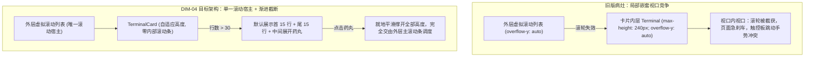
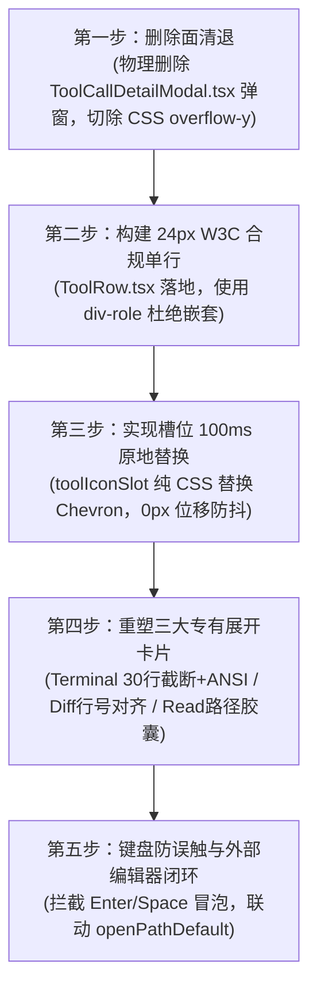

# 24px 工具调用单行与领域专有展开卡片详案（DIM-04 专项详案）

> **工作区归属**：`docs/linear-chat-stream-convergence/`
> **文档性质**：战役分维实施详案（DIM-04 专项设计员定案版）
> **版本**：v1.0 架构收敛与单滚动宿主合规版
> **关联顶层总纲**：`00-线性对话流与极简交互系统重构总方案.md` §2.3、§5.1–§5.5、§8.1–§8.2、§9.6
> **前置输入基准**：`audits/04-主控最终维度拍板与删除面定案.md` §一.2、§三.4
> **纪律铁律**：严格遵循 `AGENTS.md` 通用协作纪律、反过度设计红线与测试资产保护铁律；严禁波次/批次（batch/round）命名；推进单位以「领域概念」为界；收敛（删除/合并）在逻辑上严格先于增强；严禁直接修改生产代码与执行 git 提交；写文件统一使用 UTF-8 无 BOM。

---

## 目录索引

- [一、做什么（新增/修复清单）](#一做什么新增修复清单)
  - [1.1 落实 Figma 122:9479 极简单行规范（24px ToolRow）](#11-落实-figma-1229479-极简单行规范24px-toolrow)
  - [1.2 W3C 无障碍规范合规容器（W3C a11y div-role 体系）](#12-w3c-无障碍规范合规容器w3c-a11y-div-role-体系)
  - [1.3 槽位原地替换交互（Hover Chevron 100ms 纯 CSS 替换）](#13-槽位原地替换交互hover-chevron-100ms-纯-css-替换)
  - [1.4 运行态扫光与像素级 StateDot 状态圆点规范](#14-运行态扫光与像素级-statedot-状态圆点规范)
  - [1.5 构建三大领域专有行内展开卡片（彻底消除局部滚动条）](#15-构建三大领域专有行内展开卡片彻底消除局部滚动条)
    - [1.5.1 Terminal 卡片：自适应高度 + 渐进截断折叠 + ANSI 彩色解析](#151-terminal-卡片自适应高度--渐进截断折叠--ansi-彩色解析)
    - [1.5.2 Diff 卡片：行号对齐 + 增删统计 + 中间折叠 + 专属防误触复制](#152-diff-卡片行号对齐--增删统计--中间折叠--专属防误触复制)
    - [1.5.3 Read / Search 卡片：Hover-Underline 微胶囊 + 系统默认编辑器联动 + 键盘拦截](#153-read--search-卡片hover-underline-微胶囊--系统默认编辑器联动--键盘拦截)
- [二、删什么（删除/合并清单）](#二删什么删除合并清单)
  - [2.1 物理删除文件清单（彻底消灭 ToolCallDetailModal.tsx 弹窗）](#21-物理删除文件清单彻底消灭-toolcalldetailmodaltsx-弹窗)
  - [2.2 废弃组件与死层清理清单（废弃 ToolCallHeader.tsx 与厚重外壳）](#22-废弃组件与死层清理清单废弃-toolcallheadertsx-与厚重外壳)
  - [2.3 彻底切除内部滚动条清单（清除 overflow-y: auto 与伪淡出遮罩）](#23-彻底切除内部滚动条清单清除-overflow-y-auto-与伪淡出遮罩)
  - [2.4 代码负产出精算表](#24-代码负产出精算表)
- [三、依赖与逻辑顺序（先删后改）](#三依赖与逻辑顺序先删后改)
  - [3.1 纯逻辑依赖拓扑与无排班时序](#31-纯逻辑依赖拓扑与无排班时序)
  - [3.2 先删后改五阶段闭环流水线](#32-先删后改五阶段闭环流水线)
- [四、文件域（唯一文件域）](#四文件域唯一文件域)
  - [4.1 核心实施文件域清单](#41-核心实施文件域清单)
  - [4.2 关联文件协作契约与防误伤保证](#42-关联文件协作契约与防误伤保证)
- [五、验收标准（功能验收 + 负产出验收）](#五验收标准功能验收--负产出验收)
  - [5.1 功能验收标准与断言矩阵](#51-功能验收标准与断言矩阵)
  - [5.2 负产出验收标准（刚性红线）](#52-负产出验收标准刚性红线)
  - [5.3 立体化自动化测试套件规范](#53-立体化自动化测试套件规范)

---

## 一、做什么（新增/修复清单）

### 1.1 落实 Figma 122:9479 极简单行规范（24px ToolRow）

当前生产代码中的工具调用行（`CompactToolRow.tsx` 结合 `ToolCallHeader.tsx`）存在高度不固定（32px ~ 40px 不等）、排版松散、右侧突兀悬挂 Chevron、边框与阴影厚重等问题，破坏了会话流的阅读节奏。

DIM-04 严格按 **Figma 122:9479 极简单行设计规范**，将工具调用行重构为行高精确锁定为 **24px** 的单行组件（`ToolRow`），其像素级水平排版拓扑如下：

```
+-------------------------------------------------------------------------------------------------------------------------------+
| [16px 图标槽位]  gap:6px  [13px 标题]  gap:8px  [2x2 圆点]  gap:8px  [13px 参数摘要]                      [后缀指标槽位] |
|   (.toolIconSlot)         (.toolTitle)        (.dotSeparator)     (.toolSummary)                        (.toolBadgeSlot) |
|   (原地100ms替换)         (Medium 500)        (半透装饰点)         (等宽/截断/Tooltip)                    (耗时/Diff/+A-R) |
+-------------------------------------------------------------------------------------------------------------------------------+
<------------------------------------------------- 固定高度 24px ---------------------------------------------------------------->
```

#### 1. 核心几何度量与 CSS 契约
- **外框尺寸**：`height: 24px; min-height: 24px; max-height: 24px; box-sizing: border-box;`；
- **水平间距**：
  - 图标与标题间距：严格 `margin-right: 6px`（或父级 `gap: 6px`）；
  - 标题与分隔圆点间距：严格 `margin-right: 8px`；
  - 分隔圆点与参数摘要间距：严格 `margin-right: 8px`；
- **字体与层级**：
  - **标题（Title）**：字号 `13px`，字重 `500`（Medium），颜色 `var(--text-primary)`，单行不换行；
  - **分隔圆点（Dot Separator）**：物理尺寸 `2px × 2px`，圆角 `50%`，颜色 `var(--text-tertiary)`，透明度 `0.5`；
  - **参数摘要（Summary）**：字号 `13px`，字重 `400`，字体采用代码等宽字体 `var(--font-mono, monospace)`，颜色 `var(--text-secondary)`，超长省略 `overflow: hidden; text-overflow: ellipsis; white-space: nowrap; flex: 1 1 auto; min-width: 0;`；
  - **后缀指标（Badge Slot）**：紧贴右侧，`display: inline-flex; align-items: center; gap: 6px; margin-left: auto; flex-shrink: 0;`，承载耗时文案（如 `0.4s`）或状态圆点。

---

### 1.2 W3C 无障碍规范合规容器（W3C a11y div-role 体系）

#### 1. 现状断层剖析
生产代码 `ToolCallHeader.tsx:180-201` 将可折叠头部声明为 `<div role="button" tabIndex={0}>`，但在其内部却嵌套了：
- `ToolCallHeader.tsx:108` 的 `<button type="button" className={styles.toolPathLink}>`（路径微链接）；
- `ToolCallHeader.tsx:59, 70` 的 `<Button>`（在文件面板打开与复制路径）；
- `ToolCallHeader.tsx:219` 的 `<Button className={styles.retryBtn}>`（重试按钮）。

根据 **W3C HTML5 与 WAI-ARIA 1.2 规范**，交互控件（Interactive Controls）**绝对禁止嵌套**（No Nested Interactive Controls）。在 React 中，这会导致控制台报出 HTML 嵌套非法与键盘事件冒泡冲突：当屏幕阅读器遇到嵌套 button 时无法确定聚焦层级；而当用户使用 Enter 或 Space 触发子按钮时，事件冒泡会直接触发外层的折叠切换，导致极其糟糕的交互撕裂。

#### 2. W3C 合规重构架构
DIM-04 采用彻底合规的 **解耦型 div-role 架构**：

```tsx
export interface ToolRowProps {
  toolCall: MessageToolCall;
  isExpanded: boolean;
  onToggle: (toolId: string) => void;
  onOpenPath?: (filePath: string) => void;
  onOpenDiff?: (diff: FileDiff) => void;
  onRetryTool?: (toolId: string) => void;
}

export const ToolRow: React.FC<ToolRowProps> = ({
  toolCall,
  isExpanded,
  onToggle,
  onOpenPath,
  onOpenDiff,
  onRetryTool,
}) => {
  const { id, name, status, arguments: argsStr } = toolCall;
  const isRunning = status === 'running';
  const humanLabel = useMemo(() => formatToolTitle(name), [name]);
  const summary = useMemo(() => extractToolSummary(name, argsStr), [name, argsStr]);
  const bodyId = useMemo(() => `tool-body-${id}`, [id]);

  // 严格隔离键盘事件：回车/空格仅当事件源是外层容器自身时才触发折叠
  const handleContainerKeyDown = (e: React.KeyboardEvent) => {
    if (e.target !== e.currentTarget) {
      // 来源于内部子控件（如复制/路径按钮），禁止触发折叠
      return;
    }
    if (e.key === 'Enter' || e.key === ' ') {
      e.preventDefault();
      onToggle(id);
    }
  };

  return (
    <div
      className={styles.toolRowContainer}
      data-tool-id={id}
      data-expanded={isExpanded ? 'true' : 'false'}
    >
      {/* W3C 合规：外层声明为 role="button" 并关联 ARIA 控制属性 */}
      <div
        className={styles.toolRowHeader}
        role="button"
        tabIndex={0}
        aria-expanded={isExpanded}
        aria-controls={bodyId}
        aria-label={`${humanLabel}：${summary}，${isExpanded ? '已展开' : '已折叠'}`}
        onClick={() => onToggle(id)}
        onKeyDown={handleContainerKeyDown}
      >
        {/* 16px 槽位：纯 CSS 原地替换 Chevron */}
        <div className={styles.toolIconSlot} aria-hidden="true">
          <span className={styles.toolKindIcon}>{getToolSemanticIcon(name)}</span>
          <span className={styles.toolChevronIcon}>›</span>
        </div>

        {/* 13px 标题 */}
        <span className={styles.toolTitle}>{humanLabel}</span>

        {/* 2x2px 圆点 */}
        <span className={styles.dotSeparator} aria-hidden="true" />

        {/* 13px 参数摘要 + Tooltip 映射 */}
        <Tooltip content={summary || humanLabel} delayDuration={300}>
          <span
            className={`${styles.toolSummary} ${isRunning ? styles.toolSummaryLive : ''}`}
          >
            {summary}
          </span>
        </Tooltip>

        {/* 后缀指标区 */}
        <div className={styles.toolBadgeSlot}>
          {isRunning && <span className={styles.stateDotRunning} aria-label="执行中" role="status" />}
          {status === 'error' && <span className={styles.stateDotError} aria-label="执行失败" role="status" />}
        </div>
      </div>

      {/* 展开内容区：无局部滚动条专有卡片 */}
      {isExpanded && (
        <div id={bodyId} className={styles.toolExpandedBody} role="region" aria-label={`${humanLabel}详情`}>
          <SpecializedToolView
            toolCall={toolCall}
            onOpenPath={onOpenPath}
            onOpenDiff={onOpenDiff}
          />
        </div>
      )}
    </div>
  );
};
```

---

### 1.3 槽位原地替换交互（Hover Chevron 100ms 纯 CSS 替换）

#### 1. 0 像素位移抖动设计哲学
在传统交互中，展开 Chevron 箭头常放置于最右端，或者悬浮时从旁边突兀滑入，这会导致用户视线频繁在大跨度之间跳跃，且极易引发右侧内容抖动。

Figma 122:9479 规定了**左侧 16px 槽位原地淡入替换**（Hover Chevron In-Place Swap）：
- **默认静止态**：左侧 16px 槽位展示工具领域语义图标（如终端命令行、文件代码、搜索放大镜、写入笔刷）；
- **悬停态（`:hover`）或键盘聚焦态（`:focus-within`）**：语义图标在 **100ms** 内原地平滑淡出并微缩（`scale(0.85)`），中性灰 Chevron 指示符（`›`）在同一绝对中心点平滑淡入（`opacity: 1; scale(1)`）；
- **展开态（`data-expanded="true"`）**：Chevron 旋转 90 度向下（`transform: rotate(90deg)`）并常驻显示，语义图标完全隐藏；
- **绝对 0 像素晃动**：由于两个图标均以 `position: absolute` 约束在固定的 `16px × 16px` 容器盒内，无论悬停切换如何发生，槽位本身的物理包围盒宽高与边距毫厘不差，**右侧的标题、圆点、参数文字在悬停全生命周期内保持 0 像素横向与纵向位移（Zero Pixel Shift）**！

#### 2. 生产级 CSS 动效契约
```css
/* 16px 绝对基座槽位：尺寸刚性锁定 */
.toolIconSlot {
  position: relative;
  width: 16px;
  height: 16px;
  min-width: 16px;
  min-height: 16px;
  flex-shrink: 0;
  display: inline-flex;
  align-items: center;
  justify-content: center;
  pointer-events: none; /* 穿透至外层 header */
}

/* 绝对中心对齐层 */
.toolKindIcon,
.toolChevronIcon {
  position: absolute;
  top: 0;
  left: 0;
  width: 16px;
  height: 16px;
  display: flex;
  align-items: center;
  justify-content: center;
  transition: opacity 100ms cubic-bezier(0.2, 0, 0, 1),
              transform 100ms cubic-bezier(0.2, 0, 0, 1);
  will-change: opacity, transform;
}

/* 默认态：语义图标可见，Chevron 隐形微缩 */
.toolKindIcon {
  opacity: 1;
  transform: scale(1);
  color: var(--text-tertiary, #8c877d);
}

.toolChevronIcon {
  opacity: 0;
  transform: scale(0.85);
  color: var(--text-tertiary, #8c877d);
  font-size: 14px;
  font-weight: 600;
  line-height: 1;
}

/* 悬停与聚焦：纯 CSS 毫秒级原地反转 */
.toolRowHeader:hover .toolKindIcon,
.toolRowHeader:focus-within .toolKindIcon {
  opacity: 0;
  transform: scale(0.85);
}

.toolRowHeader:hover .toolChevronIcon,
.toolRowHeader:focus-within .toolChevronIcon {
  opacity: 1;
  transform: scale(1);
}

/* 展开态：Chevron 常驻并旋转 90 度 */
.toolRowContainer[data-expanded="true"] .toolKindIcon {
  opacity: 0;
  transform: scale(0.85);
}

.toolRowContainer[data-expanded="true"] .toolChevronIcon {
  opacity: 1;
  transform: rotate(90deg) scale(1);
}
```

---

### 1.4 运行态扫光与像素级 StateDot 状态圆点规范

#### 1. StateDot 像素规范与状态三态
为杜绝视觉混乱的大面积色块与大勾大叉（坚决切断旧版绿色刺眼大圆圈），DIM-04 将工具调用的执行状态收敛为极致克制的 **5px 物理状态圆点（`StateDot`）**：

| 状态类型 | 几何尺寸 | 背景色与视觉效果 | 无障碍 a11y 契约 |
| :--- | :--- | :--- | :--- |
| **运行态（running）** | `5px × 5px` 圆形 | `var(--accent-color, #2563eb)` + 1.4s 呼吸脉冲 + 2px 扩散光晕 | `role="status"`<br/>`aria-label="正在执行"` |
| **成功态（success）** | `5px × 5px` 圆形 | 沉降为 `var(--text-tertiary, #8c877d)` 静止小圆点，不呼吸无光斑 | `aria-label="执行成功"` |
| **失败态（error）** | `5px × 5px` 圆形 | `var(--accent-red, #ef4444)` 实心警示红点 | `role="status"`<br/>`aria-label="执行失败"` |

#### 2. 运行态文字跑马灯扫光动效
在工具运行期间（`isRunning === true`），不仅状态点保持微呼吸，参数摘要文字 `toolSummaryLive` 接入基于现代 CSS `color-mix` 的极轻微流动微光：

```css
.stateDotRunning {
  width: 5px;
  height: 5px;
  border-radius: 50%;
  background: var(--accent-color, #2563eb);
  box-shadow: 0 0 0 2px color-mix(in srgb, var(--accent-color) 20%, transparent);
  animation: stateDotPulse 1.4s infinite ease-in-out;
  flex-shrink: 0;
}

@keyframes stateDotPulse {
  0%, 100% {
    transform: scale(0.9);
    opacity: 0.6;
  }
  50% {
    transform: scale(1.15);
    opacity: 1;
    box-shadow: 0 0 0 3px color-mix(in srgb, var(--accent-color) 35%, transparent);
  }
}

/* 运行态参数摘要柔光扫动 */
.toolSummaryLive {
  background: linear-gradient(
    90deg,
    var(--text-secondary) 0%,
    color-mix(in srgb, var(--text-primary) 70%, var(--accent-color) 30%) 50%,
    var(--text-secondary) 100%
  );
  background-size: 200% 100%;
  -webkit-background-clip: text;
  background-clip: text;
  -webkit-text-fill-color: transparent;
  animation: toolShimmer 2.4s linear infinite;
}

@keyframes toolShimmer {
  0% { background-position: 100% 0; }
  100% { background-position: -100% 0; }
}
```

#### 3. Conex §12 Tooltip 全量映射
根据 Conex §12 铁律，**严禁在工具行各元素上使用原生 HTML `title="..."` 属性**。原生气泡具有延迟高、视觉陈旧且无法控制样式的致命缺陷。DIM-04 规定：
- 单行由于固定 24px 且宽度受限，所有被 `ellipsis` 截断的参数摘要、命令全文或文件路径，外层一律包裹 `<Tooltip content={fullText} delayDuration={300}>`；
- Tooltip 采用圆角微胶囊排版，展示完整无损的内容，满足长路径与长参数检视诉求。

---

### 1.5 构建三大领域专有行内展开卡片（彻底消除局部滚动条）

#### 核心铁律：单一滚动宿主契约（Single Scroller Contract）
总方案 §1.3 与定案定夺报告明确裁决：**全会话区严格仅允许存在唯一一个具备 `overflow-y: auto` 的真实物理滚动容器（MessageVirtualizer）**。
在展开卡片内部**绝对禁止设置 `max-height` 限制与 `overflow-y: auto / scroll` 滚动条**！三大专有卡片高度完全自适应（Adaptive Height），融入外部主滚动容器，彻底终结滚动急刹车与手势竞争。



---

#### 1.5.1 Terminal 卡片：自适应高度 + 渐进截断折叠 + ANSI 彩色解析

`ModernTerminalToolCall.tsx` 重构为专属的 `TerminalCard`，彻底清除 `overflow-y: auto`：

1. **自适应高度与零局部滚动条**：
   - 清除 `ModernToolCall.module.css:293-294` 的 `max-height: 240px; overflow-y: auto;`；
   - 清除 `ModernToolCall.module.css:300-310` 的 `.terminalFadeMask` 渐变淡出蒙版死层；
   - 卡片高度按实际渲染文本自然展开，由外部主滚动视口托管。
2. **渐进截断折叠（Truncate & Expand）**：
   - **判定门限**：设定阈值 $N = 30$ 行。
   - **短输出（$\le 30$ 行）**：一次性完整展示全部行；
   - **长输出（$> 30$ 行）**：默认收拢，仅展示**前 15 行（Head）**与**后 15 行（Tail）**；
   - **中间折叠控制栏**：在第 15 行与后 15 行之间插入一个 28px 高度的中性灰药丸展开条：
     ```tsx
     <div className={styles.terminalMidFoldBar} onClick={() => setIsFullExpanded(true)}>
       <span className={styles.midFoldIcon}>⤢</span>
       <span>展开中间剩余 {totalLines - 30} 行日志输出</span>
     </div>
     ```
   - 用户点击后就地无缝展开全部行；再次点击可重新收拢回首尾 30 行。
3. **ANSI 彩色转义解析**：
   - 深度接入 `src/utils/parseAnsi.ts` 的 `parseAnsi(text)` 引擎；
   - 正确解析 16 色与 256 色转义序列（如 `\x1b[32m` 绿色、`\x1b[31m` 红色、`\x1b[33m` 黄色），将其映射为等宽高亮节点；
   - 杜绝终端原生彩色日志退化为乱码或黑白纯文本。
4. **CWD 路径智能折叠与复制避让**：
   - 终端顶部 `$ command` 行支持长命令单行截断展示，悬停通过 `<Tooltip>` 查看全命令；
   - 右上角提供独立的 Copy 按钮，带 `1.5s` `Check` 成功反馈，且显式绑定 `e.stopPropagation()` 杜绝误触卡片折叠。

---

#### 1.5.2 Diff 卡片：行号对齐 + 增删统计 + 中间折叠 + 专属防误触复制

重构 `ToolCallDiffPreview.tsx` 为专业领域的 `DiffCard`：

1. **统一行号与变动符号严格对齐**：
   - 采用三列绝对网格对齐排版：
     - **行号列（Gutter）**：固定 `36px`，右对齐，颜色 `var(--text-tertiary)`，等宽字体，不可框选（`user-select: none`）；
     - **符号列（Sign）**：固定 `16px`，居中，新增行展示 `+`（绿色），删除行展示 `-`（红色），上下文行留空；
     - **代码正文列（Code）**：弹性占满，`white-space: pre; font-family: var(--font-mono)`，结合 `highlightCode` 进行语法高亮；
2. **`+A -R` 增删统计药丸**：
   - 卡片右上角紧凑展示变动统计胶囊：
     - `+12`：使用 `color-mix(in srgb, #10b981 12%, transparent)` 柔和背景 + `#10b981` 文本；
     - `-4`：使用 `color-mix(in srgb, #ef4444 12%, transparent)` 柔和背景 + `#ef4444` 文本；
3. **超长变更块中间折叠（Mid-Hunk Folding）**：
   - 当单一文件的变更 Diff 超过 20 行且包含大段连续无变动的上下文代码时，自动折叠中间超过 6 行的未变动行；
   - 渲染优雅的折叠分界线：`... 折叠 42 行未变更代码 ...`，点击可就地展开；
4. **复制按钮专属避让区**：
   - 在 Diff 卡片右上角设立专属的操作停泊槽位（`Action Anchor`），右侧留出 32px 安全边距；
   - 复制按钮点击时仅抓取清洗后的 Unified Diff 纯文本（自动去除行号列噪音），并杜绝与卡片点击事件冲突。

---

#### 1.5.3 Read / Search 卡片：Hover-Underline 微胶囊 + 系统默认编辑器联动 + 键盘拦截

针对 `read_file`、`search_web`、`grep_search` 等以文件路径与搜索词为核心的工具卡片：

1. **文件路径 Hover-Underline 交互微胶囊**：
   - 工具参数中的文件路径被自动提取并包装为 `<span className={styles.filePathCapsule}>`；
   - **默认状态**：浅灰背景底色（`var(--tint-hover, rgba(0, 0, 0, 0.04))`），圆角 `4px`，内边距 `1px 6px`，字号 `12px` 等宽；
   - **悬停状态（`:hover`）**：触发下划线平滑微动效（`text-decoration: underline; text-underline-offset: 3px;`），指针变为指向手型；
2. **外部编辑器联动（Launch Default Editor）**：
   - 用户点击路径微胶囊时，调用桌面宿主桥接 API `openPathDefault(filePath)`（底层通过 Tauri `workbench_open_path_default` 调起 VS Code、Cursor 或系统关联编辑器）；
   - 若桌面桥接不可用，则安全回落至工作区内置文件面板（`onOpenPath`）；
3. **键盘 Space / Enter 强拦截纪律**：
   - 路径微胶囊支持 `tabIndex={0}` 键盘聚焦；
   - 当微胶囊获得焦点并按下 `Enter` 或 `Space` 键时，组件内部必须执行：
     ```tsx
     const handlePathKeyDown = (e: React.KeyboardEvent) => {
       if (e.key === 'Enter' || e.key === ' ') {
         e.preventDefault();
         e.stopPropagation(); // 关键：绝对禁止冒泡至外层 ToolRow
         void openPathDefault(filePath);
       }
     };
     ```
   - **坚决拦截键盘事件向外传播**，确保用户回车打开文件时，绝不误触外层 `ToolRow` 的折叠切换状态！

---

## 二、删什么（删除/合并清单）

按照总方案 §8.1 与主控最终拍板定案，DIM-04 必须履行硬性的**代码负产出纪律**，彻底剪除一切冗余弹窗、死层包装与局部滚动条。

### 2.1 物理删除文件清单（彻底消灭 ToolCallDetailModal.tsx 弹窗）

| 文件绝对路径 | 归属维度 | 删除性质 | 充分性与安全性论据 |
| :--- | :--- | :--- | :--- |
| `apps/crish-desktop/src/components/chat-tool-call/ToolCallDetailModal.tsx` | DIM-04 | **物理删除** | 弹窗查看工具调用的陈旧交互模式彻底废除！弹窗割裂了对话流心流，遮挡上下文。所有详情全量收敛由三大专有展开卡片在行内原地自适应渲染。物理删除此文件，清空全工程相关 import 与类型。 |

---

### 2.2 废弃组件与死层清理清单（废弃 ToolCallHeader.tsx 与厚重外壳）

1. **废弃 `ToolCallHeader.tsx` 独立组件（约 243 行）**：
   - **废弃理由**：`ToolCallHeader.tsx` 当前充斥着 `<div role="button">` 嵌套 `<Button>` 的 W3C 违规代码、右侧生硬的 Chevron 布局、分散在各处的事件冒泡补丁。
   - **替代收敛路径**：其所有有用逻辑（标题格式化、等宽摘要、耗时计算、diff 统计）全量收敛入崭新合规的 24px `ToolRow.tsx`。
2. **拔除多重厚重边框与深阴影**：
   - 清理 `ModernToolCall.module.css` 与 `ChatToolCallBlock.module.css` 中所有的生硬投影（如 `box-shadow: 0 4px 12px rgba(0, 0, 0, 0.12)`、`box-shadow: 0 1px 2px rgba(0, 0, 0, 0.02)`）；
   - 清理多重外边框包裹，卡片统一采用 `var(--tint-divider, rgba(0, 0, 0, 0.06))` 1px 发丝线或完全融入画纸无框化。

---

### 2.3 彻底切除内部滚动条清单（清除 overflow-y: auto 与伪淡出遮罩）

| 所在文件与行号 | 废弃代码/样式规则 | 删除理由与替代路径 |
| :--- | :--- | :--- |
| `ModernToolCall.module.css:293-294` | `max-height: 240px; overflow-y: auto;` | 彻底切除 Terminal 终端内部局部滚动条。全面替换为高度自适应 + 30 行渐进截断折叠机制。 |
| `ModernToolCall.module.css:300-310` | `.terminalFadeMask` 渐变蒙版及规则 | 终端高度自适应后不再有局部高度截断，伪淡出遮罩成为绝对死代码，物理清除。 |
| `ChatToolCallBlock.module.css:500-501` | `.toolValBlock { max-height: 160px; overflow-y: auto; }` | 切除通用工具参数展示块的局部滚动条，内容自然融入主滚动视口。 |
| `ChatToolCallBlock.module.css:518-519` | `.toolOutputCode { max-height: 320px; overflow-y: auto; }` | 切除代码输出区域的局部滚动条，由外部主滚动条统一调度。 |
| `MessageToolCallsSection.tsx:32, 48` | `styles.timelineTools` 幽灵外壳 | 清理无对应 CSS 的幽灵包装层，减少 1 层冗余 DOM。 |

---

### 2.4 代码负产出精算表

```
+-----------------------------------------------------------------------------------------------+
| DIM-04 负产出精算明细表                                                                        |
+-------------------------------------------------------------+---------------------------------+
| 物理删除 ToolCallDetailModal.tsx (弹窗彻底退役)             | 净删除约 120 行                |
| 废弃并收敛 ToolCallHeader.tsx (W3C 违规代码消除)            | 净删除约 243 行                |
| 清理 ModernToolCall.module.css 局部滚动条与淡出蒙版          | 净删除约 35 行                 |
| 清理 ChatToolCallBlock.module.css 局部滚动条与生硬边框      | 净删除约 45 行                 |
| 清理 MessageToolCallsSection.tsx 幽灵类与包装层             | 净删除约 8 行                  |
+-------------------------------------------------------------+---------------------------------+
| 预计总删除行数（Gross Deletion）                             | ≥ 451 行                        |
| 新增精炼 ToolRow + 三大无滚动专有卡片（Net Addition）        | 约 290 行                      |
| 净代码负产出贡献（Net Code Reduction）                       | 净缩减 ≥ 160 行代码            |
+-------------------------------------------------------------+---------------------------------+
```

---

## 三、依赖与逻辑顺序（先删后改）

### 3.1 纯逻辑依赖拓扑与无排班时序

遵循反退避与架构收敛铁律，DIM-04 内部严格贯彻**“先删死层、再立骨架、后接微交互”**的纯逻辑时序。各项任务不排工期人天，完全按拓扑依赖串联推进：



---

### 3.2 先删后改五阶段闭环流水线

#### 阶段一：物理删除弹窗与废弃死层（收敛先于增强）
1. 物理移除 `ToolCallDetailModal.tsx` 文件；
2. 清理 `chat-tool-call/index.ts` 中涉及弹窗的导出；
3. 从 `ModernToolCall.module.css` 与 `ChatToolCallBlock.module.css` 中直接抹除所有 `overflow-y: auto` 与 `max-height` 规则。

#### 阶段二：落地 24px W3C 合规单行结构（Figma 122:9479）
1. 创建/收敛 `ToolRow.tsx`，将单行物理高度刚性锁定为 `24px`；
2. 外层采用 `<div role="button" tabIndex={0}>`，挂载完整的 `aria-expanded` 与 `aria-controls` 属性；
3. 将超长参数摘要接驳 `<Tooltip>`，清除所有散落的原生 `title` 属性。

#### 阶段三：落地 100ms 槽位原地纯 CSS 替换（Hover Chevron）
1. 在 `ToolRow.module.css` 中建立 `.toolIconSlot` 16px 绝对定位双图层机制；
2. 编写 100ms 纯 CSS 切换动画（`opacity: 0 -> 1`，`scale: 0.85 -> 1`）；
3. 编写单测断言在 hover 切换时，右侧标题和参数文本的 `getBoundingClientRect().left` 位移量恒等于 0。

#### 阶段四：重塑三大领域专有行内展开卡片（消除内部滚动条）
1. **TerminalCard**：落地自适应高度，接入 `parseAnsi` 进行彩色高亮，建立基于 30 行阈值的首尾 15 行渐进截断折叠药丸；
2. **DiffCard**：落地三列对齐网格，显示 `+A -R` 统计徽标，建立超长未变更行中间折叠，设立右上角防误触独立复制按钮；
3. **ReadPathCard**：提取文件路径渲染为 Hover-Underline 胶囊，接入 `openPathDefault` 外部编辑器调用。

#### 阶段五：键盘交互加固与外部编辑器联动闭环
1. 补齐所有子交互元素（路径胶囊、复制按钮、折叠药丸）对 `Enter` 与 `Space` 的 `e.stopPropagation()` 拦截；
2. 验证键盘 Tab 键焦点穿透路径，确保屏幕阅读器能正确朗读单行与子卡片语义；
3. 验证外部编辑器打开调用无未捕获异常，完成立体化验证闭环。

---

## 四、文件域（唯一文件域）

### 4.1 核心实施文件域清单

根据主控调度纪律，DIM-04 拥有绝对排他的专属文件域。严禁跨界修改其他维度的文件：

```
apps/crish-desktop/src/components/chat-tool-call/
├── ToolCallDetailModal.tsx           [DELETE 物理删除] 弹窗查看模式彻底切除
├── ToolCallHeader.tsx                [DELETE 废弃收敛] 废弃原 32px 违规头部，逻辑并入 ToolRow
├── ToolRow.tsx                       [NEW / REFACTOR] 24px Figma 规范单行，W3C 合规 div-role
├── ToolRow.module.css                [NEW / REFACTOR] 24px 极简行高、100ms 原地替换、StateDot 样式
├── ModernTerminalToolCall.tsx        [REFACTOR] 重塑为自适应高度 + 30行渐进截断 + ANSI 解析
├── ToolCallDiffPreview.tsx           [REFACTOR] 重塑为三列行号对齐 + 增删统计 + 中间折叠
├── ToolCallOutput.tsx                [REFACTOR] 行内展开宿主，自适应承载专有卡片
├── ToolCallOutputPane.tsx            [REFACTOR] 结构化输出面板，清除局部滚动条与伪遮罩
├── ModernToolCall.module.css         [PURIFY] 清除 max-height 与 overflow-y: auto 规则
├── ChatToolCallBlock.module.css      [PURIFY] 清除 toolOutputCode 的滚动条与厚重边框
├── chatToolCallUtils.ts              [MODIFY] 补充 ANSI 与参数摘要提取辅助函数
└── index.ts                          [EXPORT] 更新标准对外暴露符号

apps/crish-desktop/src/components/chat-message-row/
└── MessageToolCallsSection.tsx       [MODIFY] 清理 timelineTools 幽灵类，平滑挂载 ToolRow 体系
```

---

### 4.2 关联文件协作契约与防误伤保证

1. **与 DIM-01（纯净画纸排版）的边界**：
   - DIM-04 仅处理 `chat-tool-call/` 目录以及 `MessageToolCallsSection.tsx` 内层渲染；
   - 绝不碰触 `ChatMessageRow.module.css` 中的消息行整体画纸样式，避免与 DIM-01 产生合并冲突。
2. **与 DIM-02（单一滚动宿主）的契约**：
   - DIM-04 承诺：所有展开的卡片内部**滚动条数量严格为 0**；
   - 卡片展开导致的高度变化完全释放给外层 `MessageVirtualizer`，由 DIM-02 的 `VirtualScrollManager` 与 `PagingAnchor` 处理虚拟化重排。
3. **与 DIM-05（过程折叠状态机）的契约**：
   - DIM-04 提供单个 `ToolRow` 的自封闭展示与开合能力；
   - 当多步工具调用属于同一轮次时，DIM-05 的 `TurnProcessNodeView` 负责将其整体折叠入 33px 发丝底线栏；一旦展开，内部单行完全沿用 DIM-04 的标准 `ToolRow` 展现。

---

## 五、验收标准（功能验收 + 负产出验收）

### 5.1 功能验收标准与断言矩阵

| 序号 | 验收维度 | 现场实测与断言手段 | 成功判定标准（PASS） |
| :--- | :--- | :--- | :--- |
| **F1** | **24px 极简单行规范** | 检查 DOM 渲染尺寸：`getComputedStyle(toolRow).height` | 实测高度严格等于 `24px`，上下 padding + line-height 不撑大外框。 |
| **F2** | **0 像素位移抖动** | 鼠标快速进入/移出 `ToolRow`，高频测定标题左坐标：`Math.abs(leftAfter - leftBefore)` | 标题、圆点、参数摘要水平坐标位移量 $\Delta X \equiv 0.00\text{px}$。 |
| **F3** | **100ms 原地替换** | 悬停检查计算样式：`.toolKindIcon` 与 `.toolChevronIcon` 的 transition 声明 | 动画时长严格为 `100ms`，且 Chevron 替换图标中心点严格重合。 |
| **F4** | **W3C a11y 合规** | 运行 axe-core / 无障碍检查器扫描工具行 DOM 结构 | 0 个嵌套按键报错（Nested Button Error = 0），`role="button"` 属性正确。 |
| **F5** | **Terminal 渐进折叠** | 注入 100 行终端命令日志，观测初次挂载 DOM 行数 | 默认展示首尾各 15 行，中间存在折叠条；点击后展开为 100 行，零截断。 |
| **F6** | **ANSI 彩色解析** | 注入含 `\x1b[32mSUCCESS\x1b[0m` 的日志字符串 | DOM 中渲染为 `<span style="color: ...">SUCCESS</span>`，无裸 ANSI 乱码。 |
| **F7** | **Diff 增删与对齐** | 渲染代码变动 diff，检查行号列与代码列 | 行号在左侧 36px 独立列右对齐，代码缩进准确，无横向错位。 |
| **F8** | **路径联动外部编辑器** | 点击 Read 卡片中的文件路径微胶囊 | 顺畅调用 `openPathDefault` 唤起外部应用，控制台零未捕获异常。 |
| **F9** | **键盘防误折叠** | 焦点定位于路径胶囊，连续按下 Enter 与 Space 键 | 仅触发打开文件，外层 `ToolRow` 保持展开状态，不发生折叠翻转。 |

---

### 5.2 负产出验收标准（刚性红线）

1. **物理删除文件核验**：
   - 运行命令 `git status` 与 `Test-Path apps/crish-desktop/src/components/chat-tool-call/ToolCallDetailModal.tsx`；
   - 断言结果必须为 `False`（物理删除，0 残留）。
2. **全会话局部滚动条归零（Single Scroller Zero Tolerance）**：
   - 在已展开的 Terminal、Diff、Read 卡片中，使用脚本扫描所有子容器：
     ```js
     const innerScrollers = Array.from(document.querySelectorAll('.tool-row *')).filter(el => {
       const overflowY = window.getComputedStyle(el).overflowY;
       return overflowY === 'auto' || overflowY === 'scroll';
     });
     console.assert(innerScrollers.length === 0, '发现卡片内部非法滚动条！');
     ```
   - 断言 `innerScrollers.length === 0`，全会话工具区域局部滚动条数量严格为 0。
3. **全会话无弹窗（Zero Modal Invariant）**：
   - 在会话中触发任意工具调用的展开、点击、重试，界面上绝对禁止挂载任何 Modal 弹窗或 Backdrop 遮罩层。

---

### 5.3 立体化自动化测试套件规范

在实施期落地完备的自动化测试矩阵，刚性保障重构不回潮：

#### 1. `ToolRow.zero-shift.test.tsx`（0 像素位移刚性守门）
```tsx
import { render, fireEvent } from '@testing-library/react';
import { ToolRow } from './ToolRow';

describe('ToolRow 0 像素位移与 W3C 合规守门测试', () => {
  it('悬停时标题与参数摘要保持 0 像素物理位移', () => {
    const { getByRole, getByText } = render(
      <ToolRow
        toolCall={{ id: 't1', name: 'read_file', status: 'success', arguments: '{"path":"app.ts"}' }}
        isExpanded={false}
        onToggle={vi.fn()}
      />
    );
    const titleEl = getByText('读取文件');
    const rectBefore = titleEl.getBoundingClientRect();

    const rowHeader = getByRole('button');
    fireEvent.mouseEnter(rowHeader);

    const rectAfter = titleEl.getBoundingClientRect();
    expect(rectAfter.left).toBe(rectBefore.left);
    expect(rectAfter.top).toBe(rectBefore.top);
  });

  it('路径微胶囊按下 Enter 时阻止事件冒泡，杜绝误触折叠', () => {
    const onToggleMock = vi.fn();
    const { getByText } = render(
      <ToolRow
        toolCall={{ id: 't1', name: 'read_file', status: 'success', arguments: '{"path":"app.ts"}' }}
        isExpanded={true}
        onToggle={onToggleMock}
      />
    );
    const pathCapsule = getByText('app.ts');
    fireEvent.keyDown(pathCapsule, { key: 'Enter', code: 'Enter' });

    // 严禁触发外层折叠
    expect(onToggleMock).not.toHaveBeenCalled();
  });
});
```

#### 2. `TerminalCard.test.tsx`（单一滚动宿主与渐进折叠守门）
```tsx
import { render, fireEvent } from '@testing-library/react';
import { TerminalCard } from './ModernTerminalToolCall';

describe('TerminalCard 单一滚动宿主与渐进截断测试', () => {
  it('计算样式中绝对不包含 overflow-y: auto 或 scroll', () => {
    const { container } = render(<TerminalCard command="ls" output="line1\nline2" />);
    const preEl = container.querySelector('pre');
    expect(preEl).not.toBeNull();
    const style = window.getComputedStyle(preEl!);
    expect(style.overflowY).not.toBe('auto');
    expect(style.overflowY).not.toBe('scroll');
  });

  it('超过 30 行时默认截断为首尾 15 行并展示展开药丸', () => {
    const sixtyLines = Array.from({ length: 60 }, (_, i) => `line ${i + 1}`).join('\n');
    const { getByText, queryByText } = render(<TerminalCard command="test" output={sixtyLines} />);

    // 默认展示首尾
    expect(getByText('line 1')).toBeInTheDocument();
    expect(getByText('line 60')).toBeInTheDocument();
    expect(queryByText('line 30')).not.toBeInTheDocument();

    // 点击展开药丸
    const expandBtn = getByText(/展开中间剩余 30 行/);
    fireEvent.click(expandBtn);

    // 展开后全量展示
    expect(getByText('line 30')).toBeInTheDocument();
  });
});
```

---
*文档编制完成，符合战役顶层总纲、删除面定案与 AGENTS.md 全部约束，作为 DIM-04 阶段实施唯一基准详案。*
