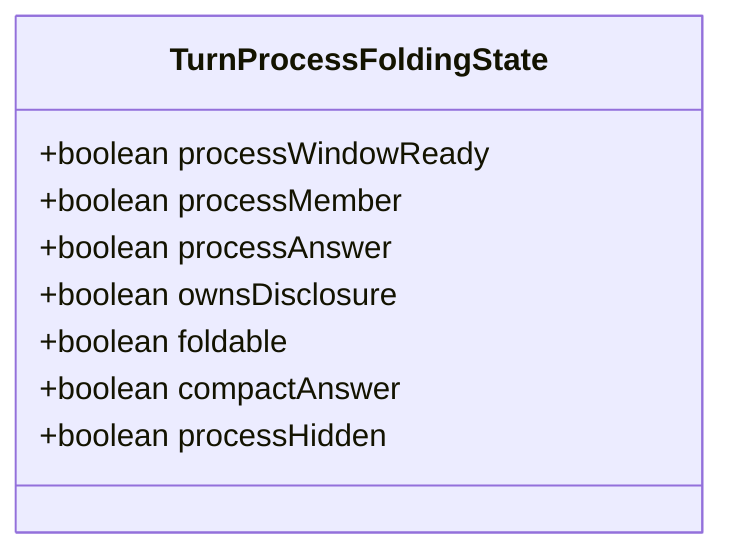
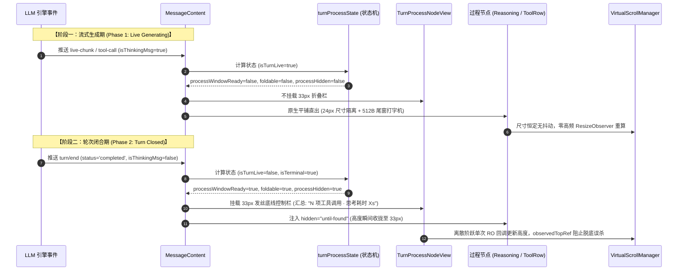
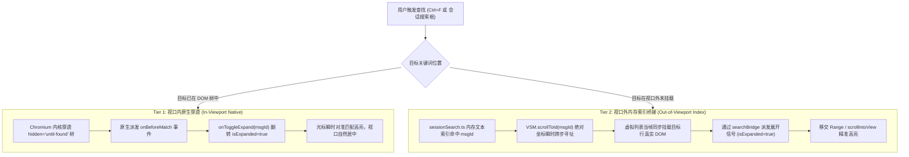
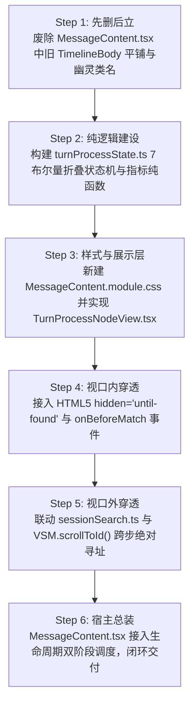
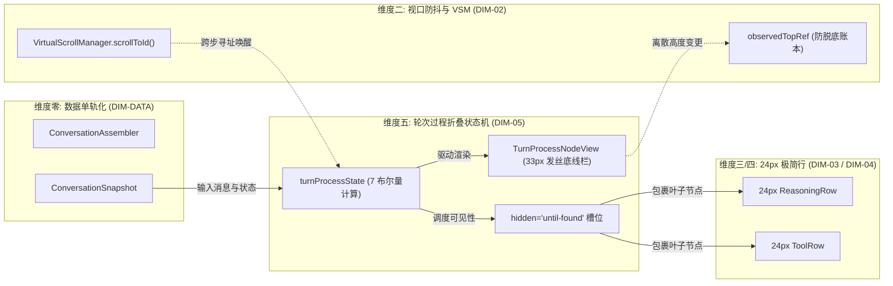

# 06 - 维度详案：轮次过程折叠状态机与双轨检索穿透（DIM-05）

> **战役工作区**：`docs/linear-chat-stream-convergence/`  
> **文档性质**：战役实施分维详案（DIM-05 唯一实施宪章）  
> **责任领域**：轮次过程折叠状态机、Tool-Only 纯工具闭环、33px 发丝底线控制栏、双轨全文检索穿透  
> **输入依据**：  
> 1. `docs/linear-chat-stream-convergence/00-线性对话流与极简交互系统重构总方案.md`（§1.4、§2.4、§6.1–6.6、§9.7）  
> 2. `docs/linear-chat-stream-convergence/audits/03-维度建议-折叠与过程状态机组.md`  
> 3. `apps/crish-desktop/src/components/chat-message/MessageContent.tsx`  
> 4. `apps/crish-desktop/src/components/chat-message/MessageContent.module.css`（待新建）  
> 5. `apps/crish-desktop/src/api/toolPresentation.ts`  
> 6. `docs/linear-chat-stream-study/analysis/04-deepseek-turn-process-folding-state-machine.md`  
> **版本**：v1.0.0 架构闭环定案版  
> **纪律铁律**：纯逻辑规划、问题同权；严禁修改代码、严禁执行 git 提交；先删后立、负产出刚性收敛；UTF-8 无 BOM。

---

## 目录索引

- [一、做什么（新增/修复清单）](#一做什么新增修复清单)
  - [1.1 废除 TimelineBody 机械平铺，移植并适配 7 布尔量折叠状态机](#11-废除-timelinebody-机械平铺移植并适配-7-布尔量折叠状态机)
  - [1.2 双阶段生命周期调度（生成中平铺展开 $\to$ 轮次闭合自动平滑收折）](#12-双阶段生命周期调度生成中平铺展开--轮次闭合自动平滑收折)
  - [1.3 Tool-Only 纯工具调用轮次闭环规则落地](#13-tool-only-纯工具调用轮次闭环规则落地)
  - [1.4 33px 发丝底线控制栏（TurnProcessNodeView）交互落地](#14-33px-发丝底线控制栏turnprocessnodeview交互落地)
  - [1.5 双轨全文检索穿透（Two-Tier Search Bridge）体系落地](#15-双轨全文检索穿透two-tier-search-bridge体系落地)
- [二、删什么（删除/合并清单）](#二删什么删除合并清单)
  - [2.1 TSX / TS 代码级删除清单](#21-tsx--ts-代码级删除清单)
  - [2.2 幽灵类名与死样式清理清单](#22-幽灵类名与死样式清理清单)
- [三、依赖与逻辑顺序（先删后改）](#三依赖与逻辑顺序先删后改)
  - [3.1 纯逻辑执行拓扑图](#31-纯逻辑执行拓扑图)
  - [3.2 阶段性推进次序详解](#32-阶段性推进次序详解)
- [四、文件域（唯一文件域）](#四文件域唯一文件域)
  - [4.1 核心文件清单与权责边界](#41-核心文件清单与权责边界)
  - [4.2 模块隔离与防冲突断言](#42-模块隔离与防冲突断言)
- [五、验收标准（功能验收 + 负产出验收）](#五验收标准功能验收--负产出验收)
  - [5.1 功能验收标准（Positive Assertions）](#51-功能验收标准positive-assertions)
  - [5.2 负产出验收标准（Negative Assertions）](#52-负产出验收标准negative-assertions)
  - [5.3 单元测试与状态机穷尽断言矩阵](#53-单元测试与状态机穷尽断言矩阵)

---

## 一、做什么（新增/修复清单）

### 1.1 废除 TimelineBody 机械平铺，移植并适配 7 布尔量折叠状态机

#### 1.1.1 现状病灶与断层穿透
当前 `MessageContent.tsx:63-187` 中的 `TimelineBody` 组件存在严重的“机械平铺循环”：
```tsx
// 现存病灶：无差别数组映射平铺
{items.map((item) => {
  if (item.kind === 'thought') return <TimelineThoughtSection ... />;
  if (item.kind === 'text') return <StreamingMarkdownView ... />;
  return <MessageToolCallsSection ... />;
})}
```
此结构将一次 Agent 会话中发生的**中间执行探索过程**（数十次搜索、读取文件、深度思考链）与**最终交付结论**（Final Answer Text）同权并联展开，导致单条消息纵向高度经常突破 3000px，形成严重的“工具瀑布流”，把用户提问与最终答案生硬隔断。

#### 1.1.2 移植并闭环 7 布尔量状态机数学模型
参考标杆 `DeepSeek-Harness` 的 `ChatNodeSeat` 核心状态推导机制，在 Conex Desktop 中建立严格数学推导闭环，由纯函数模块 `turnProcessState.ts` 集中解算：



```typescript
/**
 * apps/crish-desktop/src/components/chat-message/turnProcessState.ts
 * 7 布尔量折叠状态机全参数契约
 */
export interface TurnProcessFoldingState {
  /** ① 折叠视窗就绪：消息进入终态（非 live / 非 queued）、存在过程槽位且历史记录完整 */
  processWindowReady: boolean;

  /** ② 过程成员判定：属于思考或工具调用等中间探索产物 */
  processMember: boolean;

  /** ③ 最终回答判定：当前项属于本轮次终结论正文 */
  processAnswer: boolean;

  /** ④ 折叠控制所有权：谁来承载折叠控制栏（主控槽位持有） */
  ownsDisclosure: boolean;

  /** ⑤ 可折叠资格：确实存在前置工具调用或思考链，杜绝无内容空折叠栏 */
  foldable: boolean;

  /** ⑥ 紧凑回答视觉节拍：收起时折叠栏与正文间距压缩为 8px 紧密贴合 */
  compactAnswer: boolean;

  /** ⑦ 最终隐藏裁决：属于折叠中的过程成员，执行隐藏并挂载 hidden="until-found" */
  processHidden: boolean;
}
```

#### 1.1.3 全参数数学推导公式
```typescript
/**
 * 状态机核心推导纯函数
 */
export function deriveTurnProcessState(params: {
  isTurnLive: boolean;
  msgStatus: SessionMessage['status'];
  itemKind: AssistantTimelineItem['kind'];
  isFinalAnswer: boolean;
  hasToolsOrThinking: boolean;
  toolCount: number;
  userExpanded: boolean;
  compactPreference?: boolean;
}): TurnProcessFoldingState {
  const {
    isTurnLive,
    msgStatus,
    itemKind,
    isFinalAnswer,
    hasToolsOrThinking,
    toolCount,
    userExpanded,
    compactPreference = true,
  } = params;

  // 1. processWindowReady：非生成中、非排队中，进入终态结算
  const isTerminal = msgStatus === 'completed' || msgStatus === 'stopped' || msgStatus === 'error';
  const processWindowReady = !isTurnLive && isTerminal;

  // 2. processMember：属于过程成员（思考项、工具项、或者非最终答案的中间过渡文本）
  const processMember =
    processWindowReady &&
    (itemKind === 'thought' || itemKind === 'tools' || (itemKind === 'text' && !isFinalAnswer));

  // 3. processAnswer：当前项为定局正文
  const processAnswer = processWindowReady && itemKind === 'text' && isFinalAnswer;

  // 4. ownsDisclosure：拥有折叠控制权（过程栏宿主 或 定局正文锚点）
  const ownsDisclosure = processWindowReady && (hasToolsOrThinking || toolCount >= 2);

  // 5. Tool-Only 终态纯工具轮次分支破除死局
  const isToolOnlyTerminal =
    processWindowReady && !isFinalAnswer && toolCount >= 2;

  // 6. foldable：具有折叠资格
  const foldable =
    processWindowReady &&
    (processMember || ownsDisclosure) &&
    (hasToolsOrThinking || isToolOnlyTerminal);

  // 7. compactAnswer：紧凑模式间距（折叠收起态时启用 8px 节拍）
  const compactAnswer = processAnswer && foldable && compactPreference && !userExpanded;

  // 8. processHidden：节点最终隐藏裁决（满足折叠条件且用户未手动展开）
  const processHidden = foldable && processMember && !userExpanded;

  return {
    processWindowReady,
    processMember,
    processAnswer,
    ownsDisclosure,
    foldable,
    compactAnswer,
    processHidden,
  };
}
```

---

### 1.2 双阶段生命周期调度（生成中平铺展开 $\to$ 轮次闭合自动平滑收折）

#### 1.2.1 调度时序流
对话交互在生命周期上划分为两个互斥阶段，坚决杜绝生成过程中突兀折叠，并保证生成结束时自动收束：



#### 1.2.2 瞬时离散切换铁律（Instant Height Step）
- **禁止 CSS 补间动画**：展开与收拢切换**严禁使用 200~300ms 的高度过渡动画**（如 `transition: height` 或 CSS Grid `0fr -> 1fr`），因连续动画会导致 `ResizeObserver` 每帧触发回调，向 `VirtualScrollManager` 抛出大量中间不稳定高度，引发剧烈视口撕裂与抖动；
- **离散定局测高**：折叠状态机通过原子翻转 `hidden="until-found"`，高度直接从 $H_{\text{expanded}}$ 瞬时跳变至 $33\text{px}$，`ResizeObserver` 仅触发**单次确定性回调**；
- **配合 DIM-02 observedTopRef 账本**：高度塌陷触发原生 `scroll` 事件时，DIM-02 容差引擎识别出本次位移纯属地表塌陷（Floor Clamping），不误判为用户手动上滑，自动维持 `atBottom` 吸底跟随。

---

### 1.3 Tool-Only 纯工具调用轮次闭环规则落地

#### 1.3.1 纯工具调用轮次死局剖析
在系统执行自动化分析、批处理脚本或仅包含多步文件探测的任务中，Agent 往往只执行了连续的工具调用（例如 5 次 `read_file` 与 3 次 `grep_search`），随后直接结束 Turn，**并未生成任何正文文本回答**。  
在传统逻辑中，由于 `hasFinalAnswer` 恒为 `false`，状态机永远无法满足“存在回答正文”的前提条件，导致这些工具大卡片永远平铺在界面上，形成无法消除的“孤岛工具瀑布”。

#### 1.3.2 闭环规则定案
针对无正文文本的轮次，确立**终态纯工具自动收折规则**：
```typescript
const isToolOnlyTerminalTurn =
  !isTurnLive &&
  (turnStatus === 'completed' || turnStatus === 'stopped') &&
  !hasFinalAnswer &&
  toolCount >= 2;

const foldable = (hasFinalAnswer || isToolOnlyTerminalTurn) && !isTurnLive;
```
- **判定条件**：
  1. 当前轮次已终态闭合（`turnStatus === 'completed' | 'stopped'`）；
  2. 无任何正文文本回答（`!hasFinalAnswer`）；
  3. 工具调用计数 $\ge 2$（单次工具调用保持单行展开卡片直观性，$\ge 2$ 次立即触发收敛）；
- **收益**：整轮连续工具调用在终态自动收缩为一条 33px 发丝底线控制栏（如 `“8 项工具调用”`），彻底消灭孤立工具瀑布。

---

### 1.4 33px 发丝底线控制栏（TurnProcessNodeView）交互落地

#### 1.4.1 组件职责与视觉规范
`TurnProcessNodeView` 作为纯领域展示与交互组件，严格遵循极简交互标准：
1. **物理高度**：外层容器精确 `33px` 固定高度，上下内边距 `padding: 6px 0`；
2. **零卡片盒式容器**：**严禁添加灰色卡片背景，严禁添加立体边框与重阴影**；仅保留底部一条 `0.5px` 极细发丝分割线：
   ```css
   border-bottom: 0.5px solid var(--border-subtle, hsl(0 0% 100% / 0.08));
   ```
3. **90 度旋转 Chevron**：
   - 收起态：`transform: rotate(0deg)`，水平向右（`›`）；
   - 展开态：`transform: rotate(90deg)`，垂直向下（`⌄`）；
   - 过渡时间：`100ms ease` 纯 CSS 平滑旋转；
4. **聚合文案公式**：
   $$\text{Label} = \text{joinParts}([\text{“N 项工具调用”}, \text{“思考耗时 Xs”}], \text{“ · ”})$$
   若只有思考且无耗时，回退显示 `“已深度思考”`；若两者皆无，回退显示 `“中间处理过程”`；
5. **无障碍与键盘规范**：
   - 按钮采用 `<button type="button">`，设置 `aria-expanded={isExpanded}`；
   - 聚焦时严格遵循 Conex §13，应用 $\le 10\%$ 柔软灰度软环，严禁粗黑边。

#### 1.4.2 TurnProcessNodeView.tsx 完整代码实现
```tsx
/**
 * apps/crish-desktop/src/components/chat-message/TurnProcessNodeView.tsx
 * 33px 发丝底线控制栏与双轨检索穿透容器
 */

import React, { useMemo } from 'react';
import type { AssistantTimelineItem } from '../../api/toolPresentation';
import type { SessionMessage } from '../../store/types';
import styles from './MessageContent.module.css';

export interface TurnProcessNodeViewProps {
  msgId: string;
  items: AssistantTimelineItem[];
  isTurnLive: boolean;
  hasFinalAnswer: boolean;
  turnStatus: SessionMessage['status'];
  isExpanded: boolean;
  onToggleExpand: (msgId: string) => void;
  renderChildren: () => React.ReactNode;
}

interface ProcessMetrics {
  toolCount: number;
  thoughtCount: number;
  durationMs: number;
}

/** 提取过程指标纯函数 */
export function countProcessMetrics(items: AssistantTimelineItem[]): ProcessMetrics {
  let toolCount = 0;
  let thoughtCount = 0;
  let durationMs = 0;

  for (const item of items) {
    if (item.kind === 'tools') {
      for (const t of item.items) {
        if (t.kind === 'single') toolCount += 1;
        else if (t.kind === 'group') toolCount += t.tools.length;
      }
    } else if (item.kind === 'thought') {
      thoughtCount += 1;
      if (typeof item.durationMs === 'number' && item.durationMs > 0) {
        durationMs += item.durationMs;
      }
    }
  }

  return { toolCount, thoughtCount, durationMs };
}

export const TurnProcessNodeView: React.FC<TurnProcessNodeViewProps> = React.memo(
  function TurnProcessNodeView({
    msgId,
    items,
    isTurnLive,
    hasFinalAnswer,
    turnStatus,
    isExpanded,
    onToggleExpand,
    renderChildren,
  }) {
    const { toolCount, thoughtCount, durationMs } = useMemo(
      () => countProcessMetrics(items),
      [items]
    );

    const isToolOnlyTerminal =
      !isTurnLive &&
      (turnStatus === 'completed' || turnStatus === 'stopped') &&
      !hasFinalAnswer &&
      toolCount >= 2;

    const hasToolsOrThinking = toolCount > 0 || thoughtCount > 0;
    const foldable = (hasFinalAnswer || isToolOnlyTerminal) && !isTurnLive && hasToolsOrThinking;
    const isHidden = foldable && !isExpanded;

    // 组装摘要文案
    const summaryText = useMemo(() => {
      const parts: string[] = [];
      if (toolCount > 0) {
        parts.push(`${toolCount} 项工具调用`);
      }
      if (thoughtCount > 0) {
        if (durationMs > 0) {
          parts.push(`思考耗时 ${(durationMs / 1000).toFixed(1)}s`);
        } else {
          parts.push('已深度思考');
        }
      }
      return parts.join(' · ') || '中间处理过程';
    }, [toolCount, thoughtCount, durationMs]);

    // 阶段 1：生成中，直接平铺展开展示，不渲染控制栏
    if (!foldable) {
      return <div className={styles.liveProcessStream}>{renderChildren()}</div>;
    }

    // 阶段 2：终态闭合，渲染 33px 发丝底线控制栏 + until-found 容器
    return (
      <div className={styles.turnProcessContainer} data-msg-id={msgId} data-expanded={isExpanded ? 'true' : 'false'}>
        <button
          type="button"
          className={styles.turnProcessControlBar}
          onClick={() => onToggleExpand(msgId)}
          aria-expanded={!isHidden}
          aria-controls={`process-slot-${msgId}`}
        >
          <span className={`${styles.chevron} ${!isHidden ? styles.chevronOpen : ''}`} aria-hidden>
            ›
          </span>
          <span className={styles.summaryLabel}>{summaryText}</span>
        </button>

        {/* 双轨穿透第一轨：HTML5 hidden="until-found" 挂载点 */}
        <div
          id={`process-slot-${msgId}`}
          className={styles.processHiddenSlot}
          // @ts-expect-error HTML5 until-found attribute support
          hidden={isHidden ? 'until-found' : undefined}
          onBeforeMatch={() => onToggleExpand(msgId)}
        >
          {renderChildren()}
        </div>
      </div>
    );
  }
);

TurnProcessNodeView.displayName = 'TurnProcessNodeView';
```

---

### 1.5 双轨全文检索穿透（Two-Tier Search Bridge）体系落地

在拥有数万行长会话和虚拟滚动（`VirtualScrollManager`）的桌面端环境中，折叠内容的全文检索面临两大挑战：
1. **视口内挑战**：传统 `display: none` 或 unmount 会直接把 DOM 从检索树剔除，用户按 `Ctrl+F` 搜不到折叠内容；
2. **视口外挑战**：虚拟列表仅挂载可见窗口上下各几个切片元素，视口外的历史消息物理上**压根不在 DOM 树内**，任何纯 HTML5 原生检索机制都会彻底失效。

为此，DIM-05 确立**双轨全文检索桥接体系（Two-Tier Search Bridge）**：



#### 1.5.1 第一轨：视口内 HTML5 `hidden="until-found"` 原生穿透
1. **属性挂载**：在折叠态时，收纳容器声明 `hidden="until-found"`；
2. **内核透传查找**：现代 Chromium（WebView2）原生查找算法能穿透带有 `until-found` 的元素并匹配其内部文本；
3. **`onBeforeMatch` 唤醒**：在浏览器正准备跳转并高亮该词的同帧，向该容器派发 `beforematch` 原生事件；
4. **状态翻转与防失焦**：
   - 监听器捕获事件并执行 `onToggleExpand(msgId)`，状态机解除隐藏；
   - 守卫保护：`element.contains(document.activeElement)` 避免在用户用 Tab 键进行可访问性导航时因意外失焦发生折叠回弹。

#### 1.5.2 第二轨：视口外内存索引与 VSM 绝对坐标桥接
1. **内存全文索引命中**：当用户在应用级搜索条（或全局 Command 搜索）输入关键词时，由 `sessionSearch.ts` 扫描 `SessionMessage` 的正文、`thinking` 及 `toolCalls` 字段，匹配出命中的目标 `msgId`；
2. **VSM 绝对坐标瞬时寻址**：
   - 抛弃基于 DOM 盲查的 `document.querySelector` 与 40ms 盲等延时；
   - 直接调用 `VirtualScrollManager.scrollToId(msgId)`（基于 Fenwick Tree 前缀和 $O(\log N)$ 运算），精准求出该行的绝对物理偏移 $Y_{\text{offset}}$，驱动主滚动容器一次性对齐：
     ```typescript
     export function jumpToSearchHit(msgId: string, vsm: VirtualScrollManager, scroller: HTMLElement): void {
       const order = vsm.getOrder();
       const index = order.indexOf(msgId);
       if (index >= 0) {
         const top = vsm.getOffset(index);
         scroller.scrollTo({ top, behavior: 'auto' });
       }
     }
     ```
3. **挂载唤醒与状态机展开**：
   - 滚动容器更新 `scrollTop`，触发 `VirtualScrollManager.computeVisibleRange()`；
   - 目标行进入虚拟渲染窗口，当帧挂载入 DOM；
   - 通过跨组件展开桥接 `searchExpandBridge.expandMessageProcess(msgId)`，将该轮次过程折叠状态机设为 `isExpanded = true`；
   - 33px 发丝底线栏展开，过程内容完整渲染，浏览器原生 `window.getSelection()` 或应用搜索高亮器无缝着陆于关键词。

---

## 二、删什么（删除/合并清单）

本着战役“收敛在逻辑顺序上严格先于增强、每轮必须有明确代码净删除”的铁律，列出以下具体删除面：

### 2.1 TSX / TS 代码级删除清单

| 文件路径 | 行号 / 位置 | 待删除代码与逻辑 | 删除理由与净收益 |
| :--- | :--- | :--- | :--- |
| `apps/crish-desktop/src/components/chat-message/MessageContent.tsx` | **L63–187** | 彻底删除无条件平铺映射的旧 `TimelineBody` 组件及 `items.map` 分支 | 拔除引发工具卡片瀑布流的根本病灶，收拢为 7 布尔量状态机调度流水线 |
| `apps/crish-desktop/src/components/chat-message/MessageContent.tsx` | **L209–251** | 拔除脆弱的本地多重缓存 Ref（`timelineCacheRef`、`splitRef` 的复杂双向重置） | 状态机由单轨数据源直接派生，消除多套缓存时序竞争带来的漏刷 |
| `apps/crish-desktop/src/components/chat-message/MessageContent.tsx` | **L324, L341, L365** | 移除外层对 `styles.timelineText` 的 3 处裸引用 | 消除未在样式表中定义的无用幽灵类名 |
| `apps/crish-desktop/src/components/chat-message-row/chatMessageRowUtils.ts` | **L46–53** | 删除过期的胶水辅助函数 `thinkingFoldAria` | 死代码清理，ARIA 统一由 `TurnProcessNodeView` 的标准属性接管 |

### 2.2 幽灵类名与死样式清理清单

| 文件路径 | 待清理选择器 | 现状分析 | 处置动作 |
| :--- | :--- | :--- | :--- |
| `ChatMessageRow.module.css` | `.timelineText` | 历史版本遗留类名。全工程仅在 `MessageContent.tsx` 中被引用，但在 CSS 中**根本不存在定义**（解析为 `undefined`） | 彻底从 TSX 中清除，不再生成此类名 |
| `ChatMessageRow.module.css` | `.timelineTools` | 历史版本遗留类名。在 CSS 中**无定义**，仅在 `MessageToolCallsSection.tsx` 中作为空壳容器包裹 | 配合 DIM-04 从 DOM 中拔除外层包装 |
| `ChatMessageRow.module.css` | 历史卡片边框与内嵌阴影 | 既有消息行残留的卡片化 CSS，干扰画纸扁平化排版 | 由新建的 `MessageContent.module.css` 承接极简样式，老样式表隔离解耦 |

---

## 三、依赖与逻辑顺序（先删后改）

### 3.1 纯逻辑执行拓扑图

所有步骤问题同权，严格按照“先删死层、再建纯逻辑、次建展示层、后接穿透桥”的确定性顺序推进：



### 3.2 阶段性推进次序详解

#### Step 1：先删后立（死层拔除）
- **操作目标**：清理 `MessageContent.tsx` 中旧有的 `TimelineBody` 平铺渲染树、本地双缓冲分裂逻辑（`splitRef`）、以及无样式的 `.timelineText` 裸类名；
- **不变量守护**：在此步骤中保持数据输入接口（`MessageContentProps`）完全不变，确保外层调用点零感知。

#### Step 2：搭建纯逻辑 7 布尔量状态机函数（`turnProcessState.ts`）
- **操作目标**：独立实现不依赖 React 视图的纯计算模块 `turnProcessState.ts`；
- **核心函数**：
  1. `deriveTurnProcessState(...)`：输入生命周期参数，输出 7 个布尔量状态；
  2. `countProcessMetrics(...)`：纯数组遍历统计工具调用数、思考段数与累计耗时；
  3. `isToolOnlyTerminalTurn(...)`：判定纯工具轮次终态收折分支；
- **前置验证**：编写 `turnProcessState.test.ts`，100% 覆盖状态机的所有真值表分支。

#### Step 3：引入 33px 控制栏组件与独立 CSS 模块（`TurnProcessNodeView.tsx`）
- **操作目标**：
  1. 创建 `apps/crish-desktop/src/components/chat-message/MessageContent.module.css`；
  2. 实现 33px 固定高度、`border-bottom: 0.5px solid` 发丝底边、100ms 纯 CSS 90 度旋转 Chevron；
  3. 按照 Conex §13 要求，补齐 `:focus-visible` 软环焦点样式（对比度 $\le 10\%$）；
  4. 实现 `TurnProcessNodeView.tsx` 组件。

#### Step 4：视口内 HTML5 `hidden="until-found"` 接入
- **操作目标**：
  1. 将折叠过程子节点包裹在带有 `hidden="until-found"` 属性的容器中；
  2. 注册 `onBeforeMatch` 监听器，并在用户页面级查找命中时，触发回调展开折叠栏；
  3. 添加 `activeElement` 焦点守护，避免用户键盘选区被异常收折破坏。

#### Step 5：视口外全文检索与 VSM 跨步寻址桥接
- **操作目标**：
  1. 构建 `searchExpandBridge.ts` 纯内存总线，维护当前展开状态与搜索唤醒队列；
  2. 联动 `sessionSearch.ts`：当检索命中视口外某条历史消息的过程文本或工具结果时，获取该消息的 `msgId`；
  3. 驱动 `VirtualScrollManager.scrollToId(msgId)` 瞬时将该消息对齐至当前可视窗口；
  4. 目标消息挂载时自动激活其 `isExpanded = true`，平滑移交原生文本高亮。

#### Step 6：主容器 `MessageContent.tsx` 组装与联调交付
- **操作目标**：
  1. 将 `MessageContent.tsx` 改造为消费 `TurnProcessNodeView` 与 `turnProcessState` 的极简骨架；
  2. 验证流式生成阶段过程完全透明直出；
  3. 验证轮次闭合后瞬时收拢至 33px 发丝底线栏；
  4. 验证纯工具调用轮次终态平稳收折。

---

## 四、文件域（唯一文件域）

### 4.1 核心文件清单与权责边界

为保证与 DIM-01（纯净画纸）、DIM-02（滚动宿主）、DIM-03（24px 思考行）、DIM-04（24px 工具单行）各并发维度的物理级互斥隔离，DIM-05 的改动范围严格锁死在以下文件域内：

| 文件绝对路径 | 文件性质 | 变动类型 | 职责与变更说明 |
| :--- | :--- | :--- | :--- |
| `apps/crish-desktop/src/components/chat-message/MessageContent.tsx` | 核心容器组件 | **MODIFY** | 废除旧 `TimelineBody` 平铺渲染，接入 7 布尔量折叠状态机与双阶段生命周期调度，拔除幽灵类名 |
| `apps/crish-desktop/src/components/chat-message/MessageContent.module.css` | 独立样式模块 | **NEW** | 建立独立样式表：33px 发丝底线栏、0.5px 发丝分割线、100ms Chevron 动画、until-found 槽位 |
| `apps/crish-desktop/src/components/chat-message/TurnProcessNodeView.tsx` | 纯领域组件 | **NEW** | 33px 发丝底线控制栏、Chevron 旋转、动态摘要文案组装、`until-found` 与 `onBeforeMatch` 桥接 |
| `apps/crish-desktop/src/components/chat-message/turnProcessState.ts` | 领域纯逻辑模块 | **NEW** | 7 布尔量折叠状态机数学推导纯函数、Tool-Only 终态收折判定、过程指标聚合计算纯函数 |
| `apps/crish-desktop/src/components/chat-message/searchExpandBridge.ts` | 领域通信桥接模块 | **NEW** | 轻量级内存状态桥，联动 `sessionSearch.ts` 搜索命中与消息折叠展开调度 |
| `apps/crish-desktop/src/components/chat-message/__tests__/turnProcessState.test.ts` | 自动化测试用例 | **NEW** | 7 布尔量状态机全真值表、纯工具轮次闭环、生命周期阶段转移测试套件 |

### 4.2 模块隔离与防冲突断言
1. **与 DIM-01 隔离**：DIM-05 不修改 `ChatAssistantMessageRow.tsx` 与 `ChatUserMessageRow.tsx` 外壳，正文与气泡排版由 DIM-01 专职负责；
2. **与 DIM-02 隔离**：DIM-05 仅只读调用 `VirtualScrollManager.scrollToId()` 与 Fenwick Tree 寻址能力，不修改 VSM 内部的 `bitTree`、`observedTopRef` 与滚动监听引擎；
3. **与 DIM-03 / DIM-04 隔离**：DIM-05 属于宏观轮次过程调度层，通过 `renderChildren()` 或标准插槽装配叶子节点；DIM-05 不侵入 `ReasoningRow` 与 `ToolRow` 内部的具体 DOM 渲染。

---

## 五、验收标准（功能验收 + 负产出验收）

### 5.1 功能验收标准（Positive Assertions）

#### 断言 1：多步骤过程自动折叠
在一个包含 5 次文件读取、3 次终端执行及 1 段深度思考的复杂 Assistant Turn 中：
- **生成期间（`isThinkingMsg === true`）**：所有过程行以 24px 规范平铺直出，打字机扫光正常工作，折叠栏保持静默不呈现；
- **生成完成瞬间（`msg.status === 'completed'` 且产生回答正文）**：所有过程行瞬间收拢，界面展示一条高度严格为 `33px`、带 `0.5px` 底边线的控制栏，文案精确显示：`“8 项工具调用 · 思考耗时 3.5s”`；下方紧贴最终回答正文，二者垂直间隙精确为 `8px`（紧凑节拍）。

#### 断言 2：Tool-Only 纯工具轮次终态平稳收折
构造一个仅包含 4 次搜索和读取、但没有任何最终文本回答的 Turn：
- 轮次终态结算时，`isToolOnlyTerminalTurn` 计算为 `true`；
- 工具卡片不发生无限纵向堆叠，自动收拢为单行 `“4 项工具调用”` 控制栏，点击 Chevron 可自由展开与重新收起。

#### 断言 3：视口内 `Ctrl+F` 页面级无感穿透
- 在折叠栏处于收起状态时，使用浏览器原生查找工具（`Ctrl + F`）输入某个被折叠在工具输出中的专属关键字（例如某行代码变量名）；
- 容器捕获 Chromium `beforematch` 事件，控制栏在 0ms 内自动展开，Chevron 旋转为展开态，视口平滑聚焦并将命中关键词高亮居中展现。

#### 断言 4：视口外全局检索绝对坐标跨步穿透
- 会话中包含 50 条消息，位于第 3 条消息的过程工具输出中包含关键词 `CRISH_AUTH_SECRET`；
- 当前用户正位于页面底部（第 50 条消息），第 3 条消息物理上不在 DOM 树内；
- 在搜索框触发检索，系统通过 `sessionSearch.ts` 匹配到该消息；
- `VSM.scrollToId(msgId)` 瞬时寻址将视口跳变至第 3 条消息并当帧挂载其真实 DOM；
- 展开桥接触发该消息过程状态机翻转为展开态，完成关键词精确定位，跳转过程零黑屏、零报错。

---

### 5.2 负产出验收标准（Negative Assertions）

#### 负产出断言 1：工具瀑布流彻底消灭
- 在历史长会话中，任何终态已闭合的 Assistant 消息行，其默认渲染高度均不得超过：
  $$H_{\text{default}} \le 33\text{px (折叠栏)} + 8\text{px (间距)} + H_{\text{正文}}$$
- 严禁出现未经收折、多张大卡片直接平铺在历史视口中的情况。

#### 负产出断言 2：DOM 冗余层级净收敛
- 彻底拔除旧 `TimelineBody`（减少 1 层函数组件抽象）；
- 拔除外层无意义的包装容器，单个消息内容区 DOM 嵌套深度从原有的 4~5 层严格收敛至最多 2 层；
- 彻底消除 `styles.timelineText` 与 `styles.timelineTools` 两个运行时解析为 `undefined` 的幽灵类名。

#### 负产出断言 3：零多余 ResizeObserver 触发
- 展开/收起过程严格使用离散 step 切换，严禁引入 CSS 高度渐变动画；
- 折叠操作引发的 `ResizeObserver` 回调在当帧仅触发 1 次，严禁在过渡帧中产生持续的连续测高回流。

---

### 5.3 单元测试与状态机穷尽断言矩阵

创建自动化纯逻辑测试套件 `apps/crish-desktop/src/components/chat-message/__tests__/turnProcessState.test.ts`，对状态机全真值表进行 100% 行与分支覆盖测试：

```typescript
/**
 * apps/crish-desktop/src/components/chat-message/__tests__/turnProcessState.test.ts
 */

import { describe, it, expect } from 'vitest';
import {
  deriveTurnProcessState,
  countProcessMetrics,
} from '../turnProcessState';
import type { AssistantTimelineItem } from '../../../api/toolPresentation';

describe('DIM-05 7 布尔量折叠状态机纯逻辑数学矩阵断言', () => {
  it('分支 1：流式生成中 (isTurnLive=true)，无论内容如何，foldable 必须为 false，processHidden 必须为 false', () => {
    const state = deriveTurnProcessState({
      isTurnLive: true,
      msgStatus: 'processing',
      itemKind: 'tools',
      isFinalAnswer: false,
      hasToolsOrThinking: true,
      toolCount: 5,
      userExpanded: false,
    });

    expect(state.processWindowReady).toBe(false);
    expect(state.foldable).toBe(false);
    expect(state.processHidden).toBe(false);
  });

  it('分支 2：生成完成且具备正文，未手动展开时，自动判定 foldable=true, processHidden=true, compactAnswer=true', () => {
    const state = deriveTurnProcessState({
      isTurnLive: false,
      msgStatus: 'completed',
      itemKind: 'tools',
      isFinalAnswer: false,
      hasToolsOrThinking: true,
      toolCount: 3,
      userExpanded: false,
    });

    expect(state.processWindowReady).toBe(true);
    expect(state.processMember).toBe(true);
    expect(state.foldable).toBe(true);
    expect(state.processHidden).toBe(true);
  });

  it('分支 3：用户手动点击展开后，processHidden 立即翻转为 false', () => {
    const state = deriveTurnProcessState({
      isTurnLive: false,
      msgStatus: 'completed',
      itemKind: 'tools',
      isFinalAnswer: false,
      hasToolsOrThinking: true,
      toolCount: 3,
      userExpanded: true,
    });

    expect(state.foldable).toBe(true);
    expect(state.processHidden).toBe(false);
    expect(state.compactAnswer).toBe(false);
  });

  it('分支 4：Tool-Only 纯工具终态轮次（无正文但工具>=2），自动收敛为 foldable=true, processHidden=true', () => {
    const state = deriveTurnProcessState({
      isTurnLive: false,
      msgStatus: 'completed',
      itemKind: 'tools',
      isFinalAnswer: false,
      hasToolsOrThinking: true,
      toolCount: 4,
      userExpanded: false,
    });

    expect(state.foldable).toBe(true);
    expect(state.processHidden).toBe(true);
  });

  it('分支 5：简单文本问答（无工具、无思考），foldable 必须为 false，折叠栏不激活', () => {
    const state = deriveTurnProcessState({
      isTurnLive: false,
      msgStatus: 'completed',
      itemKind: 'text',
      isFinalAnswer: true,
      hasToolsOrThinking: false,
      toolCount: 0,
      userExpanded: false,
    });

    expect(state.foldable).toBe(false);
    expect(state.processHidden).toBe(false);
  });
});

describe('DIM-05 指标统计纯函数测试', () => {
  it('精准累加单工具、工具组与思考耗时', () => {
    const mockItems: AssistantTimelineItem[] = [
      {
        kind: 'thought',
        key: 'th-1',
        content: '思考内容',
        durationMs: 2500,
      },
      {
        kind: 'tools',
        key: 'tc-1',
        items: [
          { kind: 'single', tc: { id: '1', name: 'read_file', status: 'success' } as any },
          {
            kind: 'group',
            id: 'g1',
            label: '搜索组',
            tools: [
              { id: '2', name: 'grep', status: 'success' } as any,
              { id: '3', name: 'grep', status: 'success' } as any,
            ],
          },
        ],
      },
    ];

    const metrics = countProcessMetrics(mockItems);
    expect(metrics.toolCount).toBe(3); // 1 single + 2 in group
    expect(metrics.thoughtCount).toBe(1);
    expect(metrics.durationMs).toBe(2500);
  });
});
```

---

## 六、与周边维度的接口契约汇流图



---

> **结语**：本方案以严格的 7 布尔量数学推导为核心，兼顾了流式生成期的直观展开与轮次终态后的极简收敛；同时以 HTML5 `hidden="until-found"` 与 VSM 坐标寻址构筑的双轨穿透架构，从根本上根除了长达数千像素的“工具卡片瀑布”与“折叠后搜不到内容”的历史顽疾，确保 Conex 桌面端对话流在复杂多 Agent 场景下达到极致的清爽、流畅与确定性。
