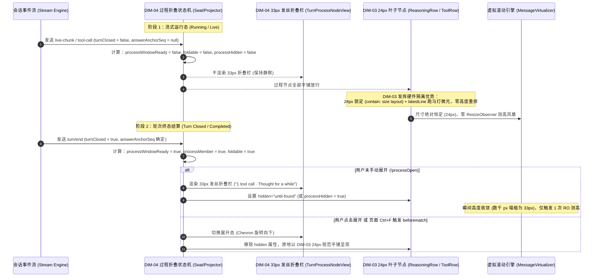
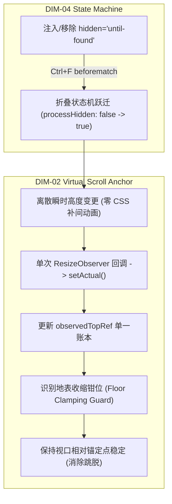

# 03 - 维度交叉验证建议：过程折叠与状态机组（DIM-03 / DIM-04）

> **战役工作区**：`docs/linear-chat-stream-convergence/`  
> **审计角色**：维度交叉验证分析员 3（过程折叠与状态机方向）  
> **审阅基准**：
> 1. `docs/linear-chat-stream-convergence/audits/00-主控代码事实与初始维度审计.md`
> 2. `apps/crish-desktop/src/components/chat-message/MessageContent.tsx`
> 3. `apps/crish-desktop/src/components/chat-message-row/TimelineThoughtSection.tsx`
> 4. `apps/crish-desktop/src/components/chat-message-row/MessageToolCallsSection.tsx`
> 5. `docs/linear-chat-stream-study/02-DeepSeek-Harness极简对话流与组件树拆解.md`
> 6. `docs/linear-chat-stream-study/analysis/04-deepseek-turn-process-folding-state-machine.md`
>
> **版本**：v1.0 (2026-09-06)

---

## 一、审计概述与核心结论

经过对当前代码库及标杆架构（DeepSeek-Harness）的交叉审阅，本分析员确认：
1. **当前对话流缺乏轮次级过程收敛机制是导致体验冗长的第一根因**：当前 `TimelineBody`（`MessageContent.tsx:63-183`）采用全平铺、无边界并联映射，连续工具调用直接演化为长达数千像素的“工具卡片瀑布”，切断了用户提问与最终回答的语义连续性；
2. **DIM-03 与 DIM-04 呈现严格的宏微正交依赖**：DIM-04（轮次过程折叠状态机）属于**宏观轮次治理与可见性调度层**，DIM-03（24px 极简单行折叠）属于**微观叶子呈现与硬件隔离层**。二者必须严格解耦，由 DIM-04 统一调度生命周期，DIM-03 专注文档流微交互；
3. **现有组件存在严重的死层、幽灵类与嵌套滚动内耗**：`TimelineThoughtSection` 内部居然自建了一套 `userScrolledUpRef` 局部滚动系统，与外层 `MessageVirtualizer` 产生双重滚动内耗；`MessageToolCallsSection` 和 `MessageContent` 散落着未在 CSS 中定义的 `styles.timelineTools`、`styles.timelineText` 等幽灵样式；
4. **状态机重构将带来明确的「负产出」净收益**：通过引入 7 布尔量折叠状态机并收归单一真理源（SSOT），可彻底剔除组件内孤立的 `useState`、CSS Grid 动画引起的重测高风暴、局部滚动条及历史分组逻辑，实现代码行与样式行的双重净收敛。

---

## 二、DIM-03 与 DIM-04 的拓扑依赖与契约解耦

### 1. 概念分层与职责正交

| 维度 | 定位与核心职责 | 作用层级 | 核心产物 | 典型生命周期 |
|---|---|---|---|---|
| **DIM-04 轮次过程折叠状态机** | **宏观状态机与可见性裁决**：计算轮次边界、聚合中间产物、判定是否收起、驱动 33px 发丝栏与全文搜索穿透 | 轮次级（Turn Level / Host Seat） | 7 布尔量状态推导、`TurnProcessNodeView`、`hidden="until-found"` 调度 | 全生命周期贯穿（生成中打开，终态自动收起，搜索按需唤醒） |
| **DIM-03 24px 极简单行折叠** | **微观呈现与物理尺寸隔离**：定义单个思考行、工具行的极致尺寸、跑马灯扫光动效、首行归纳与尾部打字跟随 | 叶子节点级（Leaf Node Level） | 24px `DisclosureRow`、`ReasoningRow`、`ToolRow`、`contain: size layout` | 节点渲染期（作为展开后或未折叠时的单元呈现） |

### 2. 双阶段协同模型



### 3. 架构依赖规则与红线

1. **单向依赖红线**：DIM-04 可以感知并包裹 DIM-03，但 **DIM-03 严禁反向感知 DIM-04 的状态机实现**。
   - `ReasoningRow`、`ToolRow` 仅接受 `content`、`isLive`、`status`、`defaultOpen` 等纯净属性，不关心自己是否位于某个“折叠窗口”中；
   - 严禁在 24px 组件内部引入轮次聚合、跨消息搜索监听或全局状态机推导代码。
2. **状态机单一宿主原则**：
   - 过程折叠状态机必须上移至 `ChatNodeSeat`（或 `MessageContent` 宿主层），统一生成一个合成的折叠控制器；
   - 彻底废除将折叠状态散落在各子组件内部的做法（如 `TimelineThoughtSection` 的内部 `useState`）。

---

## 三、当前 `TimelineBody` 工具卡片瀑布根因剖析

### 1. 代码事实证据

在 `apps/crish-desktop/src/components/chat-message/MessageContent.tsx:63-183` 中，时间线渲染逻辑如下：

```tsx
// MessageContent.tsx:76-183 现状
<>
  {items.map((item) => {
    if (item.kind === 'thought') {
      return (
        <TimelineThoughtSection
          key={item.key}
          content={item.content}
          isLive={item.isLive ?? isThinkingMsg}
          durationMs={item.durationMs}
          turnIndex={item.turnIndex}
          messageId={msgId}
          defaultExpanded={thoughtDefaultOpen}
        />
      );
    }
    if (item.kind === 'text') { ... }
    if (item.kind === 'injection') { ... }
    return toolStackProps ? (
      <MessageToolCallsSection
        key={item.key}
        items={item.items}
        msgId={msgId}
        toolStackProps={toolStackProps}
      />
    ) : null;
  })}
</>
```

在 `apps/crish-desktop/src/components/chat-message-row/MessageToolCallsSection.tsx:22-49` 中：

```tsx
// MessageToolCallsSection.tsx:32-48 现状
<div className={styles.timelineTools}>
  <ChatToolStack
    {...host}
    actions={{
      ...host.actions,
      renderLinkedAgentPanel: (agent, parentSessionId, tc) => (
        <InlineAgentPanel ... />
      ),
    }}
  />
</div>
```

### 2. 根因透视与架构断层

1. **扁平并联映射，缺失时空过程边界（Flat Mapping Without Temporal Boundary）**：
   - `TimelineBody` 对 `thought`、`tools`、`text` 采取平铺并联渲染；
   - 系统将“中间执行过程”（读文件、正则匹配、搜索、长篇草稿）与“最终回答”（Answer）视为同一层级的平级数据，缺乏 `[processStartSeq, answerAnchorSeq)` 的过程成员隔离区间；
2. **缺乏轮次终态收敛机制（No Turn-Closed Convergence）**：
   - 在一个复杂的 Agent 任务中，模型往往连续调用 5～15 次工具。由于缺乏终态状态机，在任务完成（`msg.status === 'completed'`）后，系统没有将其收拢为单行折叠栏的机制；
   - 历史消息永远保留着数十张工具卡片，单条消息纵向高度轻松突破 2000px；
3. **局部折叠状态孤岛（Fragmented Local State）**：
   - 思考段在 `TimelineThoughtSection.tsx:33` 维护私有 `useState(isOpen)`；
   - 工具段在 `ChatToolStack.tsx:50` 依赖外部传来的 `expandedTools: Record<string, boolean>`；
   - 用户无法一键展开或收起“本轮完整推理过程”，界面呈现为一部分折叠、一部分展开的马赛克断层；
4. **幽灵类名与空置容器**：
   - `MessageToolCallsSection.tsx:32` 使用了 `styles.timelineTools`，`MessageContent.tsx:115` 使用了 `styles.timelineText`；
   - 代码调查证实：`ChatMessageRow.module.css` 中**根本没有这两个类名**！这两个类名在运行时均解析为 `undefined`，完全是无效的 DOM 包装。

---

## 四、引入 7 布尔量状态机的精简收敛设计

标杆 `DeepSeek-Harness` 在 `ChatNodeSeat.tsx:62-98` 实践的 7 布尔量状态机是解决工具卡片瀑布与状态割裂的标准答案。本审计建议将其严格映射到 Conex / Crish 的消息流模型中。

### 1. 7 布尔量状态机映射规范

```typescript
/**
 * 轮次过程折叠状态机计算契约（映射自 ChatNodeSeat.tsx:62-98）
 */
export interface TurnProcessFoldingState {
  /** ① 折叠视窗就绪：Turn 已终态闭合、存在明确的最终文本回答锚点、非加载残缺 */
  processWindowReady: boolean;

  /** ② 过程成员判定：位于 [processStartSeq, answerAnchorSeq) 区间内的思考或工具节点 */
  processMember: boolean;

  /** ③ 最终回答判定：当前节点是否为本轮终判定正文 */
  processAnswer: boolean;

  /** ④ 折叠控制所有权：谁来承载折叠控制器（合成控制器节点 或 紧邻回答正文） */
  ownsDisclosure: boolean;

  /** ⑤ 可折叠资格：确实存在前置工具调用或深度思考，杜绝无内容空折叠栏 */
  foldable: boolean;

  /** ⑥ 控制器休眠：无内容可折叠时，隐藏控制器自身 */
  controllerInactive: boolean;

  /** ⑦ 紧凑回答视觉节拍：收起时正文与折叠栏间距压缩为 8px，紧密贴合 */
  compactAnswer: boolean;

  /** ⑧ 最终隐藏裁决：属于折叠中的过程成员，执行隐藏并挂载 hidden="until-found" */
  processHidden: boolean;
}
```

#### 具体推导公式（Conex 落地版）：

```typescript
// 1. processWindowReady
const processWindowReady =
  msg.status !== 'processing' &&
  msg.status !== 'queued' &&
  hasAnswerAnchor &&
  !historyIncomplete;

// 2. processMember
const processMember =
  processWindowReady &&
  (item.kind === 'thought' || item.kind === 'tools' || (item.kind === 'text' && !isFinalAnswer));

// 3. processAnswer
const processAnswer =
  processWindowReady &&
  item.kind === 'text' &&
  isFinalAnswer;

// 4. ownsDisclosure
const ownsDisclosure = item.kind === 'turn-process-control' || processAnswer;

// 5. foldable
const foldable =
  processWindowReady &&
  (processMember || (ownsDisclosure && (hasTools || hasThinking)));

// 6. controllerInactive
const controllerInactive = item.kind === 'turn-process-control' && !foldable;

// 7. compactAnswer
const compactAnswer = processAnswer && foldable && !processOpen;

// 8. processHidden
const processHidden = controllerInactive || (foldable && processMember && !processOpen);
```

### 2. 现有组件精简与收敛目标

#### (1) `TimelineThoughtSection.tsx` 的彻底清障
1. **彻底拔除内层自建滚动系统（消除事实 3 嵌套内耗）**：
   - 现存代码：`TimelineThoughtSection.tsx:34-59` 维护 `bodyRef`、`userScrolledUpRef`、`handleScroll`、`el.scrollTop = el.scrollHeight`；
   - 弊端：内层限制 `max-height: 168px` 且自建吸底循环，破坏外层 `MessageVirtualizer` 的滚动一致性，用户滚轮容易陷入局部卡死；
   - **精简决策**：删除所有内层滚动 Ref、事件监听与吸底逻辑；展开后高度完全放开，融入外层虚拟列表自然流动；
2. **废除 CSS Grid 高度补间动画**：
   - 现存代码：`TimelineThoughtSection.module.css:141-150` 使用 `grid-template-rows: 0fr -> 1fr` 过渡；
   - 弊端：补间期间每帧触发 `ResizeObserver` 回调，向虚拟滚动抛出大量中间不稳定高度，引发剧烈撕裂抖动；
   - **精简决策**：采用离散状态切换，配合 `hidden="until-found"`，消除动画阶段的无序高度重测；
3. **消除内部孤立 `useState`**：
   - 将展开/收起状态统一提升至轮次级 `processOpen` 账本管理。

#### (2) `MessageToolCallsSection.tsx` 的结构收敛
1. **清理无样式外壳**：
   - 移除 `<div className={styles.timelineTools}>` 这一幽灵 DOM 层；
2. **平铺收拢取代复杂内部重分组**：
   - 借助 DIM-04 的 33px 发丝折叠控制器，在终态自动收起所有工具行；展开后以 24px `ToolRow`（Figma 122:9479）平铺排列，彻底废除旧有的 `group` 标题堆叠机制；
3. **审批条平提**：
   - 仅在流式运行且存在未审批工具时展示审批卡片，终态历史消息中审批记录转化为纯状态标签，不再撑开大卡片。

---

## 五、过程状态机维度的「删除面」清单（强制负产出）

本着战役“收敛在逻辑顺序上先于增强、每轮必须有明确代码净删除”的铁律，列出以下具体删除面：

### 1. TSX / TS 代码删除清单

| 文件路径 | 行号范围 | 删除内容说明 | 净收益 / 收敛效果 |
|---|---|---|---|
| `apps/crish-desktop/src/components/chat-message-row/TimelineThoughtSection.tsx` | **L33** | 删除私有状态 `const [isOpen, setIsOpen] = useState(...)` | 根除局部状态孤岛，折叠状态归入状态机单一源 |
| `apps/crish-desktop/src/components/chat-message-row/TimelineThoughtSection.tsx` | **L34-59** | 彻底删除 `bodyRef`、`userScrolledUpRef`、`prevIsLiveRef`、`handleScroll` 及 `scrollTop = scrollHeight` 吸底副作用 | 消除外层虚拟滚动与内层思考滚动的双重系统嵌套内耗 |
| `apps/crish-desktop/src/components/chat-message-row/TimelineThoughtSection.tsx` | **L120-126** | 删除 `.thinkingBodyContainer` 与 `.thoughtScrollBody` 滚动容器 DOM 包裹层 | 减少 2 层无用 DOM 嵌套 |
| `apps/crish-desktop/src/components/chat-message-row/MessageToolCallsSection.tsx` | **L32, L48** | 删除 `<div className={styles.timelineTools}>` 外层无样式包裹 DOM | 消除幽灵类名 `styles.timelineTools` 造成的无效 DOM 层 |
| `apps/crish-desktop/src/components/chat-message/MessageContent.tsx` | **L115, L324, L341, L365** | 删除无样式的 `styles.timelineText` 类名引用 | 消除未在 CSS Module 中定义的未声明幽灵类名 |
| `apps/crish-desktop/src/components/chat-message-row/chatMessageRowUtils.ts` | **L46-53** | 删除过期的胶水辅助函数 `thinkingFoldAria` | 清除死代码 |

### 2. CSS 样式删除清单

| 文件路径 | 选择器 / 行号范围 | 删除内容说明 | 净收益 / 收敛效果 |
|---|---|---|---|
| `apps/crish-desktop/src/components/chat-message-row/TimelineThoughtSection.module.css` | **L141-159** (`.thoughtAccordion`, `.thoughtAccordionInner`) | 删除基于 `grid-template-rows: 0fr -> 1fr` 的 CSS Grid 展开过渡动画 | 消除折叠展开过程中对 `ResizeObserver` 的高频触发，阻断虚拟滚动抖动 |
| `apps/crish-desktop/src/components/chat-message-row/TimelineThoughtSection.module.css` | **L161-198** (`.thinkingBodyContainer`, `::before`, `::after`) | 彻底删除局部容器固定高度 `max-height: 168px` 及上下伪元素渐变遮罩 | 移除 38 行冗余 CSS，消除不必要的层叠上下文与重绘负担 |
| `apps/crish-desktop/src/components/chat-message-row/TimelineThoughtSection.module.css` | **L199-214** (`.thoughtScrollBody`) | 删除 `.thoughtScrollBody` 的 `overflow-y: auto` 与 `max-height: 168px` 滚动条样式 | 彻底根除思考块局部滚动条 |

---

## 六、与虚拟滚动测高引擎（DIM-02）的交互影响与协同契约

在虚拟列表场景中，折叠状态机的引入直接影响每一条消息卡片的渲染高度，是引发视口抖动或滚动脱底的关键诱因。必须与 DIM-02 建立严格的协同契约：



### 1. 痛点诊断：地表塌陷（Floor Clamping）与误脱底

- **物理现象**：当一个包含 10 个工具调用的 Turn 从运行态转为终态时，消息高度从例如 `1800px` 骤降为 `33px`（发丝折叠栏）。
- **浏览器行为**：如果此时视口处于页面底部附近，高度急剧塌缩会导致浏览器内核触发地表收缩钳位（Floor Clamping），自动修改容器的 `scrollTop`，并伴随原生 `scroll` 事件的触发。
- **现有系统缺陷**：当前 `useScrollAnchor.ts` 与 `MessageVirtualizer.tsx` 缺少 `observedTopRef` 单一账本，会将由 DOM 尺寸塌缩引起的被动 `scroll` 误判为“用户手动向上滚离底部”，从而关闭自动吸底，导致下一轮输入或新消息出现时视口“卡住不动”。

### 2. 协同契约与防护规范

1. **绝对禁止连续高度过渡动画（Instant Height Step 铁律）**：
   - 过程折叠状态机的展开/收起切换必须是**瞬时离散步进（Instant Step）**，严禁使用 200ms~300ms 的高度渐变动画；
   - 瞬时切换保证 `ResizeObserver` 在高度变更时**仅触发一次确定的回调**，向虚拟滚动管理器的 `setActual(msgId, newHeight)` 写入定局高度，杜绝中间过渡帧的测高风暴；
2. **与 DIM-02 共享折叠事件信号（Floor Clamping Guard）**：
   - 状态机在触发收拢时，向滚动锚定系统派发标记（或通过统一账本感知尺寸缩减）；
   - 锚定系统在处理紧随其后的原生 `scroll` 事件时，比对 `observedTopRef`，识别出本次位移纯属底部地表塌陷，**不判定为用户手动脱底**，继续维持吸底锁定；
3. **流式打字期的 24px 硬件隔离（Hardware Isolation）**：
   - 在流式进行期间（`isLive === true`），DIM-03 的 24px 规范必须配合 CSS `contain: size layout`；
   - 高频流式追加的 Token（每秒 30~80 字符）完全被锁在 24px 容器内，**向外不触发任何 ResizeObserver 回调**，将流式期间的测高开销直接清零；
4. **HTML5 `hidden="until-found"` 与 `beforematch` 测高重核**：
   - 当用户在客户端使用 `Ctrl+F` 检索代码或工具输出时，浏览器原生命中 `hidden="until-found"` 节点，派发 `beforematch` 事件；
   - 状态机监听到事件后立即同步移除隐藏状态（`processOpen = true`）；
   - 虚拟滚动容器捕获展开引起的单次高度增大，自动校正 `estimatedTotalHeight`，并配合 `scrollIntoView` 让命中词精确居中着陆，无白屏、无闪烁。

---

## 七、对主控总方案与后续分维的实施建议

1. **建议确立 DIM-04 为结构收敛的核心杠杆**：
   - 只有通过 DIM-04 确立了轮次过程折叠边界，DIM-01（死层清理）才能彻底拔除旧有的工具卡片样式与嵌套滚动代码，DIM-03 才能获得纯净的挂载槽位；
2. **合并 `TimelineBody` 的平铺渲染，重构为原子节点流水线**：
   - 废除 `MessageContent` 内部生硬的 `items.map` 分支判断，建议引入类似 `ChatNodeSeat` 的单一分发器，将 `thought`、`tools`、`injections` 统一按时空序号投影管理；
3. **严格执行删除面验收**：
   - 在进入实现阶段时，检查上述清单中的 TSX、CSS 与死类名是否被 100% 净删除，严禁以“兼容旧消息”为由保留双重滚动条或局部 `useState`。
