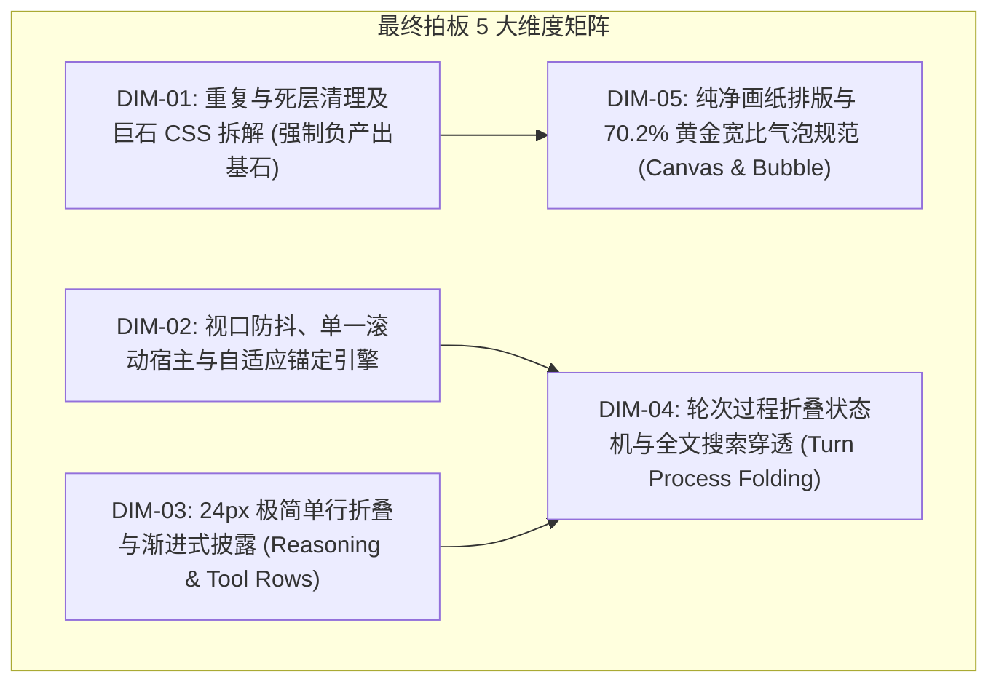

# 04 - 主控最终维度拍板与删除面定案

> **战役工作区**：`docs/linear-chat-stream-convergence/`  
> **制定者**：主控 Agent（依据主控亲查代码与三组交叉审计裁决，§一.5）  
> **核心原则**：推进单位以「领域概念」为界；所有维度必须明确「删除面」；收敛先于增强；文件域绝对解耦。  

---

## 一、交叉审计裁决与维度合并决议

在前置审计中，主控亲查代码并综合了三位交叉分析员的深入建议，做出以下两项关键架构裁决：

1. **DIM-01（死层清理）与 DIM-05（视觉画纸排版）的执行解耦**：
   - *审计发现*：两者均涉及 `ChatMessageRow.module.css` 与 `ChatAssistantMessageRow.tsx`，若并发执行必产生代码冲突；
   - *主控裁决*：**保持逻辑维度分立，但在执行与方案依赖上强制设定“先删后增”串行阻断锁**——DIM-01 专职负责“剪除死代码、拆解寄生样式、拔除多余 DOM 容器”，DIM-05 专职负责“画纸扁平化排版、70.2% 气泡规范与 Token 注入”。在执行期，DIM-01 必须率先完成收口，方可进入 DIM-05。
2. **确立「单一滚动宿主铁律（Single Scroller Contract）」**：
   - *审计发现*：`TimelineThoughtSection.tsx:34-59` 内部自建 168px 独立微型滚动视口，与外层虚拟滚动产生严重手势竞争与重排风暴；
   - *主控裁决*：在 DIM-02 与 DIM-03 中全面清除任何行内核级嵌套滚动条，全会话区严格保持单一外层滚动宿主。

---

## 二、最终 5 大维度定义与核心收敛目标

---

## 三、各维度刚性「删除面（Deletion Surface）」清单

按照 `主控-全流程调度-v3.md` §一.5 铁律，各维度不仅要规定“做什么”，更必须白纸黑字锁定**“删什么”**：

### 1. DIM-01 删除面（预计直接净删除 ≥ 470 行代码与 CSS）
- **CSS 绝对死代码（立即物理删除 93 行）**：
  - `ChatMessageRow.module.css:670-682`（`.textSpacer`，全仓 0 引用，删 13 行）；
  - `ChatMessageRow.module.css:822-846`（`.errorBanner*` 全组选择器，全仓 0 引用，删 25 行）；
  - `ChatMessageRow.module.css:881-902`（`.skeletonLine` 及脉冲动画，单测断言 null，全仓 0 引用，删 21 行）；
  - `ChatMessageRow.module.css:786-798`（`.rowPinFlash` 及关键帧，全仓 0 引用，删 13 行）；
  - `ChatMessageRow.module.css:179-188`（`.assistantBody` 透传死层，删 10 行）；
  - `ChatMessageRow.module.css:44-46`（重复的选择器覆盖，删 3 行）；
  - 无效 border 重置与乱码注释（删 8 行）。
- **寄生子组件样式物理剥离（迁出独立 module.css ≥ 381 行）**：
  - 将 `PlanMilestoneSpine`（166 行）、`ArtifactCapsuleSyncLine`（95 行）、`FollowUpSuggestions`（96 行）、`PlanApprovalRow`（24 行）等异构业务样式从 `ChatMessageRow.module.css` 中完整剥离至子组件同级目录，使巨石 CSS 体积直降 40%！
- **DOM 容器死层删除**：
  - 删除 `ChatAssistantMessageRow.tsx:116` 的 `
` 无用外壳（缩减 1 层虚拟 DOM 深度）；
  - 删除 `ChatAssistantMessageRow.tsx:107` 中的双写类名 `msg-row msg-row-assistant`（统一收敛为标准数据属性）。

### 2. DIM-02 删除面（预计直接净删除 ≥ 350 行代码）
- **死 Hook 与假滚动文件物理删除**：
  - 彻底删除 `src/components/chat-message-list/ChatScrollAnchor.ts`（绑定在 `overflow: hidden` 的假滚动容器，删 45 行）；
  - 彻底删除 `src/hooks/useChatScroll.ts`（无生产引用的陈旧滚动逻辑，删 42 行）；
  - 彻底清理 `useUndoWithScrollAnchor.ts`（`MessageVirtualizer.tsx:81` 虚空调用无消费，核心逻辑收敛并入 VSM，清理约 174 行）；
- **魔术延时定时器物理拔除**：
  - 彻底删除 `ChatMessageList.tsx:139` 的 `setTimeout(..., 40)` 魔术数字延时；
  - 彻底删除 `useScrollAnchor.ts:37, 91` 的双 rAF + 50ms 延时补丁，全面升级为基于 VSM 的虚拟化寻址协议；
- **清理死属性**：
  - 删除 `VirtualScrollManager.ts:61, 215` 中的孤岛死属性 `stickToBottomLock`。

### 3. DIM-03 删除面（预计直接净删除 ≥ 180 行嵌套逻辑与样式）
- **内层嵌套滚动子系统彻底切除**：
  - 删除 `TimelineThoughtSection.tsx:34-59` 中的内层独立滚动监听器、`userScrolledUpRef`、`handleScroll` 及 `el.scrollTop = el.scrollHeight` 副作用；
  - 删除 `TimelineThoughtSection.module.css:161-198` 中的 168px 最大高度限制与渐变遮罩层（38 行）；
  - 删除 `TimelineThoughtSection.module.css:199-214` 中的内层局部滚动条私有规则（16 行）；
- **CSS Grid 补间重排动画清理**：
  - 删除 `TimelineThoughtSection.module.css:141-159` 中的 `grid-template-rows: 0fr -> 1fr` 补间动画（19 行，消除流式生成高频触发 RO 的测高风暴）。

### 4. DIM-04 删除面（预计直接净删除 ≥ 120 行胶水逻辑与幽灵类）
- **幽灵类与冗余包裹层清理**：
  - 清理 `MessageToolCallsSection.tsx:32, 48` 中的 `styles.timelineTools` 幽灵包装层；
  - 清理 `MessageContent.tsx:115, 324, 341, 365` 中的 `styles.timelineText` 等未定义幽灵类引用；
  - 清理 `chatMessageRowUtils.ts:46-53` 中冗余的胶水工具堆叠判断函数；
- **历史消息大卡片无条件展开清理**：
  - 废除历史轮次中对多步工具调用的无条件展开平铺渲染，由 33px 发丝底线折叠栏替代。

### 5. DIM-05 删除面（预计直接净删除 ≥ 100 行重型边框与卡片容器）
- **助手卡片外框彻底拔除**：
  - 删除 `ChatMessageRow.module.css` 中 `.rowAssistant` 的背景色、外部重阴影与粗边框，彻底解放助手消息正文，实现 Canvas 扁平化投射；
- **用户气泡内嵌操作栏结构重构**：
  - 删除嵌入在用户气泡内部的旧操作按钮结构，清理 `ChatUserMessageRow.tsx:179` 中无对应 CSS 的幽灵 class `'expanded'`。

---

## 四、推进纪律结论

本定案文档即日起生效，作为后续【阶段二：多 Agent 独立方案生成】的核心输入。任何独立方案与分维详案如未覆盖上述删除面，一律视为不合格退回重写。
