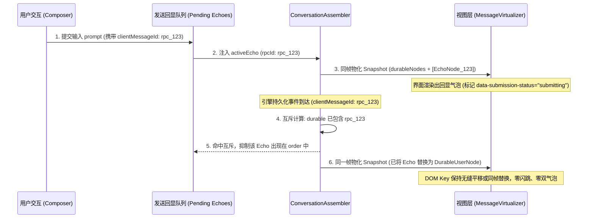

# 数据链路与状态单轨化修订建议报告（流式真理归一与列表解耦定案）

> **分析员角色**：战役方案修订阶段【数据链路与状态单轨化修订专项分析员】
> **修订对象**：`docs/linear-chat-stream-convergence/00-线性对话流与极简交互系统重构总方案.md`
> **关联输入资产**：
> - `docs/conversation-flow-refactor/00-总方案.md`
> - `docs/conversation-flow-refactor/survey/01-参考仓库对话流架构调研.md`
> - `docs/conversation-flow-refactor/survey/02-本仓对话流现状审计.md`
> - 关键生产代码：
>   - `apps/crish-desktop/src/api/chat-bridge/handlers/streamState.ts`
>   - `apps/crish-desktop/src/components/chat-message/streamMessageViewModel.ts`
>   - `apps/crish-desktop/src/store/types.ts`（`SessionMessage` 契约）
>   - `apps/crish-desktop/src/components/chat-message-list/ChatMessageList.tsx`（33 个透传 props）
>   - `apps/crish-desktop/src/components/chat-message-list/MessageVirtualizer.tsx`
>   - `apps/crish-desktop/src/components/chat-message-list/messageVirtualizerMemo.ts`
> **基准时间**：2026-09-06
> **纪律恪守**：遵循 `AGENTS.md` 协作指令、反退避原则（§1）、反过度设计红线（§8）与立体验证纪律（§7/§7.1）。严禁修改生产代码，严禁执行 git 提交；以“先立真相，后换皮”为刚性原则，确保数据链路单轨化方案兼具理论严谨性与工程可落地性。

---

## 报告总览与核心问题定位

在对现有加固版总方案 `docs/linear-chat-stream-convergence/00-线性对话流与极简交互系统重构总方案.md` 进行数据链路专项审计后，本分析员确认：
当前总方案聚焦于**渲染层与交互层**的五大维度（画纸扁平化 DIM-01、视口防抖 DIM-02、24px 思考行 DIM-03、24px 工具单行 DIM-04、过程折叠状态机 DIM-05），在 DOM 几何隔离、PagingAnchor 相对坐标补偿与 CSS 巨石净化方面论证充分；**然而，总方案完全遗漏了数据链路核心病灶的治理规划，存在严重的“底座虚脱”风险**：

```
+---------------------------------------------------------------------------------------------------+
| 当前总方案缺失的底座风险：                                                                           |
| 即使上层 24px 思考行与 PagingAnchor 防抖设计得再完美，只要底层仍然维持流式真相「三套账」、                 |
| 视图层渲染期动态 merge 分叉猜测、用户发问瞬间 echo 与 durable 撕裂、以及 33 项 Prop Drilling 深度耦合，     |
| 界面在发消息瞬态、高频流式推送、会话持久化切换与行内交互时，必然频繁发生白屏闪烁、双气泡并存与 DOM 抖动！     |
+---------------------------------------------------------------------------------------------------+
```

本报告旨在将 `conversation-flow-refactor` 中的数据层关键成果（A1 事件窗口化、A2 ConversationAssembler 单轨折叠、A3 echo→durable 原子换装、A4 退役 streamState 账本、B5 prop drilling 对象化收敛）无缝增补、修订进顶层总方案，彻底构筑坚如磐石的数据流基石。

---

## 一、彻底根除流式真相「三套账」

### 1.1 三套账的致命解构与恶果剖析

生产代码逐行审查表明，本仓流式消息从 WebSocket/IPC 引擎事件到达最终 DOM 渲染，跨越了三个各自为政、各怀鬼胎的状态账本：

```mermaid
flowchart TD
    subgraph "账本一: chat-bridge 桥接层内部账本 (streamState.ts)"
        SS_Map1["turnStreamedTexts: Map<turnIndex, string>"]
        SS_Map2["turnAuthoritativeTexts: Map<turnIndex, string>"]
        SS_Arr["messageEndTurnSegments: string[]"]
        SS_Text["assistantText (命令式字符串拼接)"]
        SS_Thought["assistantThought (命令式累加)"]
    end

    subgraph "账本二: Store 双轨存储层 (SessionMessage + streamingStore)"
        SM_Immer["sessionStore.messages (SessionMessage: Immer 可变代理)"]
        SM_Fields["text / thinking / thinkingTurns / toolCalls / blocks / streamTextOffset"]
        ST_Zustand["streamingStore (Zustand 瞬态热缓冲 byKey[sessionId:msgId])"]
        ST_Flush["commitStreamToSession (微任务 queueMicrotask 清空与回写)"]
    end

    subgraph "账本三: 视图层渲染期二次 Merge (streamMessageViewModel.ts)"
        VM_Hook["useStreamMessageViewModel(msg, sessionId)"]
        VM_Merge1["applyStreamTextToMessage (处理 divergence 分叉猜测)"]
        VM_Merge2["applyStreamToolsToMessage (抢救中间态工具，防御终态覆盖)"]
        VM_Formula["防撕裂平滑三元降级公式: activeText = hasCommittedText && completed ? msg.text : streamText"]
    end

    EngineEvent["引擎事件 (chunk / message-end / tool)"] --> SS_Map1
    EngineEvent --> SS_Map2
    SS_Text -. callbacks.onChunk .-> ST_Zustand
    EngineEvent -. messageHandlers .-> SM_Immer
    ST_Zustand -. 订阅 .-> VM_Hook
    SM_Immer -. 透传 .-> VM_Hook
    VM_Hook --> VM_Merge1
    VM_Hook --> VM_Merge2
    ST_Flush -. 时序撕裂 .-> SM_Immer
```

#### 账本一：`api/chat-bridge/handlers/streamState.ts`
- **代码事实**（`streamState.ts:3-34`, `messageHandlers.ts:106-204`）：
  `streamState` 内部维护了 `turnStreamedTexts`（实时增量 Map）、`turnAuthoritativeTexts`（权威终态 Map）、`messageEndTurnSegments`（分段快照数组）、`assistantText`、`activeTurnIndex` 等繁复状态。
- **致命缺陷**：
  在 `messageHandlers.ts:180-203` 中，每来一个 `message-end` 事件，桥接层都要把多个 Map 与数组合并排序，重新计算 `combinedPieces` 并拼接成 `assistantText`。它不仅试图在事件传输层越俎代庖地做“业务正文重建”，而且通过 `callbacks.onChunk` 与 `callbacks.onThought` 向外分派增量，代码注释充斥着“单增量生产者模型下的权威账本，严禁向实时增量队列二次注入”这类靠“自律”维系的脆弱约束。

#### 账本二：Store 双轨存储层（`SessionMessage` + `streamingStore`）
- **代码事实**（`store/types.ts:496-558`, `store/streamingStore.ts`, `helpers.ts:195-245`）：
  - 持久消息 `SessionMessage` 承载了 15 个以上的复合字段（`text`、`thinking`、`thinkingTurns`、`toolCalls`、`blocks`、`streamTextOffset`、`precomputedHtml` 等），保存在 Immer `sessionStore` 中；
  - 运行时为了避免高频 token 频繁触发 Immer 结构冻结与深拷贝开销，又在外部设立了基于普通对象的 `streamingStore`（Zustand 热缓冲）；
- **致命缺陷**：
  在运行结束时，必须调用 `helpers.ts:commitStreamToSession`，通过 `queueMicrotask` 异步调度清空 `streamingStore` 并将最终文本写入 `sessionStore`。微任务时序的不可控导致了经典的时序撕裂（Tearing）：上一拍 `streamingStore` 被清空，而 `sessionStore` 的持久化更新尚未完成渲染管线提交，组件在这一微秒内读到两个空值，导致**正文瞬间白屏闪烁**。

#### 账本三：视图层渲染期二次 Merge（`streamMessageViewModel.ts`）
- **代码事实**（`streamMessageViewModel.ts:32-70, 78-157, 185-217`）：
  组件渲染时，调用 `useStreamMessageViewModel`，在每一次组件 render 阶段执行 `applyStreamTextToMessage` 与 `applyStreamToolsToMessage`。
- **致命缺陷**：
  代码中直接暴露了三套账打架的无奈妥协：
  ```typescript
  // streamMessageViewModel.ts:44-54
  const trailing = committed && streamText.startsWith(committed)
    ? streamText.slice(committed.length)
    : committed ? null : streamText;

  if (trailing === null) {
    // Divergence: use stream as authoritative full text for display.
    return { ...msg, text: streamText };
  }
  ```
  当持久化正文（committed）与热缓冲正文（streamText）发生前缀不匹配（Divergence）时，视图层根本不知道哪一边是真理，只能盲猜覆盖；同时还要用所谓的“防撕裂平滑三元降级公式”（L201-204）强行平抑时序冲突。

---

### 1.2 定案退役：废除 `streamState` 与视图层二次 Merge

必须在重构总方案中做出明确裁决，彻底封死上述三大病灶：

1. **废除 `streamState.ts` 中的多 Map/分段账本**：
   - 彻底切除 `turnStreamedTexts`、`turnAuthoritativeTexts`、`messageEndTurnSegments`；
   - `api/chat-bridge` 的职责纯化为**事件源适配器（Event Source Adapter）**，只负责将网络原始协议解析为标准的会话事件信封（带单调序 `seq`、`runId`、`turnId`），严禁在桥接层私设文本聚合账本。
2. **废除 `streamMessageViewModel.ts` 的视图层二次 Merge**：
   - 物理删除 `applyStreamTextToMessage` 与 `applyStreamToolsToMessage` 两个纯函数；
   - 废除 `useStreamMessageViewModel` 中的 divergence 启发式分叉猜测与三元降级补丁；
   - 视图层组件（`ChatMessageList` / `MessageVirtualizer` / 节点行）变为纯粹的**受控渲染端**，仅接收上游折叠管线产出的不可变快照节点。
3. **退役独立的 `streamingStore` 热缓冲**：
   - 不再维系 `sessionStore` 与 `streamingStore` 之间的微任务跨 Store 搬运机制（`commitStreamToSession` 连同其 `queueMicrotask` 彻底清除）；
   - 流式增量与落定终态归拢于单一状态机管线。

---

### 1.3 单轨折叠管线（Single-Track Folding Pipeline）设计

借鉴 `deepseek-harness` 经过千万级流式检验的 Assembler 模型，结合本仓桌面端特性进行反过度设计裁剪，确立本仓的单轨折叠架构：

```
SessionEventStream (单调自增 seq 事件流: chunk / tool / end / error)
       │
       ▼
┌────────────────────────────────────────────────────────────────────────┐
│                      ConversationAssembler 增量折叠引擎                 │
│                                                                        │
│  1. Event Registry: Definition 状态机 (match → start → update)          │
│  2. Single State Store: 每个 Node 维护独占不可变 State (无多套账)        │
│  3. Publication Scheduler: 三级发布调度器 (None / 3-RAF / Immediate)     │
└────────────────────────────────────────────────────────────────────────┘
       │
       ▼ 节流物化 (buildViewNode)
ConversationSnapshot (不可变视图快照: order + nodes Map)
       │
       ▼ 单向数据流传递
ChatView / MessageVirtualizer (按 Keyed 映射渲染，零二次计算)
```

#### 1.3.1 核心 Definition 状态机契约
每个对话元素（用户发问、助手正文、思考链、工具调用、系统注入等）均实现为自闭环的微型状态机定义：

```typescript
/** 节点发布节奏枚举 */
export type PublicationRhythm = 'none' | 'animation-frame' | 'immediate';

/** 单节点增量状态机定义契约 */
export interface ConversationNodeDefinition<TState, TViewNode> {
  /** 节点领域类型（如 'assistant' | 'user' | 'thought' | 'tool-call'） */
  readonly kind: string;

  /** 是否认领该事件 */
  match(event: SessionEventEnvelope): boolean;

  /** 事件首达，初始化内部不可变 State */
  start(event: SessionEventEnvelope): TState;

  /** 增量事件到达，纯函数折叠产生新 State */
  update(prevState: TState, event: SessionEventEnvelope): TState;

  /** 声明本次状态跃迁的发布节奏 */
  publication(nextState: TState, prevState: TState): PublicationRhythm;

  /** 将内部纯逻辑 State 物化为供视图渲染的不可变 ViewNode */
  buildViewNode(state: TState): TViewNode;
}
```

#### 1.3.2 3-RAF 节流发布模型（3-RAF Throttled Publication）
高频 Token 流（单秒可达数十甚至上百个 chunk）若每帧都触发 React 渲染，会导致极度严重的 CPU 占用与虚拟列表重排风暴。建立**跨三帧合流（3-RAF）调度模型**：

```typescript
export class PublicationScheduler {
  private rafId: number | null = null;
  private rafCount = 0;
  private hasPendingFrame = false;

  constructor(private readonly emitSnapshot: () => void) {}

  /** 调度一次发布请求 */
  public schedule(rhythm: PublicationRhythm): void {
    if (rhythm === 'none') {
      return;
    }

    if (rhythm === 'immediate') {
      // 关键落定事件（message-end、error、abort）：取消挂起帧，同步立即刷新
      this.cancelPending();
      this.emitSnapshot();
      return;
    }

    // animation-frame 节奏：跨 3 个 requestAnimationFrame 发布一次
    this.hasPendingFrame = true;
    if (this.rafId === null) {
      this.scheduleNextRaf();
    }
  }

  private scheduleNextRaf(): void {
    this.rafId = requestAnimationFrame(() => {
      this.rafCount++;
      if (this.rafCount >= 3) {
        // 达到 3-RAF 门限（约 48ms - 50ms），执行批量物化并派发快照
        this.rafId = null;
        this.rafCount = 0;
        if (this.hasPendingFrame) {
          this.hasPendingFrame = false;
          this.emitSnapshot();
        }
      } else {
        // 尚未达到 3 帧，继续循环等待
        this.scheduleNextRaf();
      }
    });
  }

  public cancelPending(): void {
    if (this.rafId !== null) {
      cancelAnimationFrame(this.rafId);
      this.rafId = null;
    }
    this.rafCount = 0;
    this.hasPendingFrame = false;
  }
}
```

- **高频增量合并**：Token 涌入时，仅以 CPU 极低开销在内存 State 中追加字符串；每跨 3 帧（~50ms）发布一次 `ConversationSnapshot`，人眼感官极其顺滑，同时彻底消除主线程渲染压力；
- **落定零延迟**：一旦到达 `message-end`、用户点击停止或工具报错，调度器立即取消挂起的 3-RAF 帧，同步执行 `emitSnapshot()`，绝无半点状态滞后。

---

## 二、`echo → durable` 用户发问原子换装

### 2.1 现状病灶：双气泡与高度突跳根因剖析

在现有代码（`useChatHandlers.ts:160-178`, `sessionEventHydrate.ts:369-636`）中：
1. 用户在输入框键入并敲击回车，前端生成临时 `userMsgId`，命令式写入 `sessionStore` 生成一条乐观（Optimistic）用户消息；
2. 随后向后端发起 `run-task`，传递 `clientMessageId: userMsgId`；
3. 后端引擎在启动后，可能下发带有后端真实 ID 的用户回执事件，或在重连时下发全量历史水合（Hydration）；
4. 前端依赖 `sessionEventHydrate.ts` 中的 `pickStableMessageId` 和运行时 rekey 机制来合并消息；
5. **在网络应答与事件到达的临界交叠期**，React 渲染树中可能短暂出现：
   - 本地生成的乐观气泡与后端回传的气泡**同时存在**（双气泡现象）；
   - 或者在 rekey 发生时，由于 key 从 `user-msg-*` 变为后端 ID，React 判定为旧组件卸载 + 新组件挂载，触发 DOM 重建与重新测高，导致**虚拟列表发生明显的纵向跳动与闪烁**。

---

### 2.2 同帧互斥（Same-Frame Mutual Exclusion）原子换装机制

为杜绝发消息瞬间的界面闪跳与双气泡，引入单向受控的 **Submission Echo 模型**：



#### 2.2.1 契约定义与互斥算法实现

```typescript
/** 本地发送回显模型 */
export interface SubmissionEcho {
  readonly echoId: string;
  readonly rpcId: string; // 即 clientMessageId
  readonly prompt: string;
  readonly attachments?: readonly unknown[];
  readonly timestamp: number;
  readonly status: 'pending' | 'submitting' | 'failed';
  readonly error?: string;
}

/** Assembler 视图快照物化互斥计算 */
export function buildSnapshotWithEchoExclusion(
  durableNodes: readonly ConversationNodeViewData[],
  pendingEchoes: readonly SubmissionEcho[]
): ConversationSnapshot {
  // 1. 构建已落定持久消息的 rpcId 检索集合 (O(1) 查找)
  const durableRpcSet = new Set<string>();
  for (const node of durableNodes) {
    if (node.rpcId) {
      durableRpcSet.add(node.rpcId);
    }
    // 同时兼容 node 本身 id 匹配
    durableRpcSet.add(node.id);
  }

  // 2. 过滤回显：凡是持久化集合中已存在的 rpcId，当帧绝对抑制
  const activeEchoNodes: ConversationNodeViewData[] = [];
  for (const echo of pendingEchoes) {
    if (!durableRpcSet.has(echo.rpcId)) {
      activeEchoNodes.push({
        id: `echo:${echo.echoId}`,
        rpcId: echo.rpcId,
        kind: 'user-echo',
        sender: 'user',
        text: echo.prompt,
        timestamp: echo.timestamp,
        isEcho: true,
        submissionStatus: echo.status,
      });
    }
  }

  // 3. 组合为最终单一有序视图序列
  const combinedNodes = [...durableNodes, ...activeEchoNodes];
  const order = combinedNodes.map((n) => n.id);
  const nodeMap = new Map(combinedNodes.map((n) => [n.id, n]));

  return {
    order,
    nodes: nodeMap,
    revision: Date.now(),
  };
}
```

- **数学级互斥保证**：在物化 `ConversationSnapshot` 时，`durableRpcSet.has(echo.rpcId)` 是当帧计算的纯布尔断言。持久化真实节点出现的同一时刻，回显节点被瞬间抹除，绝不可能在同一个 Snapshot 的 `order` 列表中同时存在两个相同语义的节点；
- **几何稳定性**：回显气泡与持久化用户气泡复用相同的 DOM 样式与尺寸规则（DIM-01 规范：70.2% 黄金宽比 + 22px 超椭圆），尺寸完全等高，换装瞬间浏览器渲染树高度变化量 $\Delta H = 0$，彻底切断抖动源泉。

---

## 三、列表层 28 项 Prop Drilling 聚合解耦

### 3.1 现存 33 项 Props 穷举审计与技术债表

在深入查阅生产代码 `ChatMessageList.tsx:203-236` 与 `messageVirtualizerMemo.ts:11-45` 后，发现实际透传的 Props 已经膨胀至 **33 项**。这导致了灾难性的架构僵化：

| 序号 | Prop 名称 | 原始类型 | 归属职责域 | 现存问题与重构目标 |
| :--- | :--- | :--- | :--- | :--- |
| 1 | `messages` | `SessionMessage[]` | 核心数据 | 直接透传 Store 原始数组，无不可变快照保护 |
| 2 | `pinnedItems` | `PinnedItem[]` | 固定消息 | 与 3~6 共同构成 Pin 控制器 |
| 3 | `pinsOpen` | `boolean` | 固定消息 | 同上 |
| 4 | `setPinsOpen` | `Dispatch<SetStateAction<boolean>>` | 固定消息 | 同上 |
| 5 | `jumpToPinned` | `(id: string) => void` | 固定消息 | 同上 |
| 6 | `togglePin` | `(id: string) => void` | 固定消息 | 同上 |
| 7 | `searchHighlightQuery` | `string \| undefined` | 搜索高亮 | 搜索查询条件 |
| 8 | `expandedUserMsgs` | `Record<string, boolean>` | 用户行交互 | 用户气泡折叠状态 |
| 9 | `onToggleExpandUser` | `(msgId: string) => void` | 用户行交互 | 用户气泡展开切换 |
| 10 | `hideThinkingBlock` | `boolean` | 思考/规划控制 | 视图展示全局开关 |
| 11 | `inPlanMode` | `boolean` | 思考/规划控制 | 计划模式上下文 |
| 12 | `planApproved` | `boolean` | 思考/规划控制 | 计划批准状态 |
| 13 | `setPlanApproved` | `(v: boolean) => void` | 思考/规划控制 | 批准状态修改 |
| 14 | `setPermissionMode` | `(mode: PermissionMode) => void` | 思考/规划控制 | 权限模式修改 |
| 15 | `lastAssistantId` | `string \| null` | 会话环境 | 尾节点识别 |
| 16 | `lastUserId` | `string \| null \| undefined` | 会话环境 | 尾节点识别 |
| 17 | `thinkingMsgId` | `string \| undefined` | 会话环境 | 正在思考的消息 ID |
| 18 | `showAllMessages` | `boolean` | 会话环境 | 过滤开关 |
| 19 | `activeSessionId` | `string` | 会话环境 | 活跃会话 ID |
| 20 | `clearHeightsSignal` | `number \| undefined` | 视口调整 | 外部通知测高缓存清空信号 |
| 21 | `onRetract` | `(() => void) \| undefined` | 消息操作集 | 用户消息撤回 |
| 22 | `handleRegenerateRow`| `(id: string) => void` | 消息操作集 | 助手消息重新生成 |
| 23 | `onBranch` | `() => void` | 消息操作集 | 分支创建 |
| 24 | `onOpenDiff` | `(diff: FileDiff) => void` | 消息操作集 | 差异卡片打开 |
| 25 | `onOpenDiffPanel` | `(() => void) \| undefined` | 消息操作集 | 差异侧边栏打开 |
| 26 | `onOpenPath` | `((path: string) => void) \| undefined`| 消息操作集 | 本地路径打开 |
| 27 | `handleMarkdownClick`| `(e: MouseEvent) => void` | 消息操作集 | Markdown 拦截 |
| 28 | `handleFillFollowUp` | `(prompt: string) => void` | 追问管理 | 填入追问 |
| 29 | `onSendFollowUp` | `((prompt: string) => void) \| undefined`| 追问管理 | 立即发送追问 |
| 30 | `handleSendFollowUp` | `(prompt: string) => void` | 追问管理 | 发送追问实现 |
| 31 | `dismissedFollowUps` | `Record<string, true>` | 追问管理 | 忽略追问集合 |
| 32 | `handleDismissFollowUp`| `(msgId: string) => void` | 追问管理 | 忽略追问处理 |
| 33 | `toolStackProps` | `ChatToolStackSharedProps` | 工具调用 | 工具卡共享属性 |

#### 伴生代价：`messageVirtualizerMemo.ts` 维护死局
为了在这 33 个 Props 之间做性能优化，`messageVirtualizerMemo.ts` 编写了 144 行代码，不仅包含显式的 `MEMO_COMPARE_FIELDS` 数组与类型级 `_exhaustedCheck`，还在 `messageVirtualizerPropsEqual` 中逐字段进行手工全等比对。一旦开发者新增或调整一个参数，涉及 4 处文件联动，极易造成隐蔽的重渲染失效或死循环。

---

### 3.2 对象化拆解收敛方案（收敛至 $\le 8$ 个分组对象）

遵循“高内聚、低耦合”原则，将 33 项打散的 Props 归并重构为 **8 个语义明确的领域分组对象**：

```typescript
/** 1. 会话上下文元数据 */
export interface SessionContextGroup {
  readonly activeSessionId: string;
  readonly lastAssistantId: string | null;
  readonly lastUserId?: string | null;
  readonly thinkingMsgId?: string;
  readonly showAllMessages: boolean;
  readonly clearHeightsSignal?: number;
}

/** 2. 固定消息控制器 */
export interface PinControllerGroup {
  readonly items: readonly PinnedItem[];
  readonly isOpen: boolean;
  readonly onToggleOpen: (open: boolean) => void;
  readonly onJump: (id: string) => void;
  readonly onTogglePin: (id: string) => void;
}

/** 3. 搜索与高亮状态 */
export interface SearchHighlightGroup {
  readonly query?: string;
}

/** 4. 用户行交互状态 */
export interface UserRowInteractionGroup {
  readonly expandedMap: Readonly<Record<string, boolean>>;
  readonly onToggleExpand: (msgId: string) => void;
}

/** 5. 思考与计划模式治理 */
export interface PlanGovernanceGroup {
  readonly hideThinkingBlock: boolean;
  readonly inPlanMode: boolean;
  readonly planApproved: boolean;
  readonly onSetPlanApproved: (approved: boolean) => void;
  readonly onSetPermissionMode: (mode: PermissionMode) => void;
}

/** 6. 消息行通用动作集 */
export interface MessageRowActionsGroup {
  readonly onRetract?: () => void;
  readonly onRegenerate: (assistantMsgId: string) => void;
  readonly onBranch: () => void;
  readonly onOpenDiff: (diff: FileDiff) => void;
  readonly onOpenDiffPanel?: () => void;
  readonly onOpenPath?: (filePath: string) => void;
  readonly onMarkdownClick: (e: React.MouseEvent) => void;
}

/** 7. 智能追问建议控制器 */
export interface FollowUpControllerGroup {
  readonly onFill: (prompt: string) => void;
  readonly onSend?: (prompt: string) => void;
  readonly dismissedMap: Readonly<Record<string, true>>;
  readonly onDismiss: (msgId: string) => void;
}

/** 8. 工具呈现共享配置 */
export interface ToolPresentationGroup {
  readonly sharedProps: ChatToolStackSharedProps;
}
```

#### 收敛后的 `MessageVirtualizerProps`（仅 8 个领域对象 + 1 个快照源）
```typescript
export interface MessageVirtualizerProps {
  /** 单轨折叠产出的不可变快照 */
  readonly snapshot: ConversationSnapshot;
  /** 8 个领域分组对象 */
  readonly sessionContext: SessionContextGroup;
  readonly pinController: PinControllerGroup;
  readonly searchHighlight: SearchHighlightGroup;
  readonly userInteraction: UserRowInteractionGroup;
  readonly planGovernance: PlanGovernanceGroup;
  readonly rowActions: MessageRowActionsGroup;
  readonly followUpController: FollowUpControllerGroup;
  readonly toolPresentation: ToolPresentationGroup;
}
```

- **Memo 复杂度锐降**：`messageVirtualizerPropsEqual` 的浅比对项从 33 项收缩为 9 项浅引用比较，代码量从 144 行骤降至 25 行；
- **领域职责清晰**：任何业务动作变更仅影响其所属的分组对象，不会引发全量 Props 的链式波动。

---

### 3.3 终极解耦：ChatNodeSeat 与 Context 依赖自取

在完成上述对象化分组的基础上，进一步与总方案的统一渲染契约结合：
- 将 `MessageRowActionsGroup`、`PlanGovernanceGroup`、`FollowUpControllerGroup` 通过 `ChatFlowActionsContext` 挂载在列表根层；
- 虚拟化容器只负责按 `snapshot.order` 渲染外壳 `ChatNodeSeat`；
- 各具体节点组件（如 `ChatAssistantMessageRow`、`TurnProcessNodeView`、`ChatUserMessageRow`）直接通过 `useChatFlowActions()` 自取所需操作，**彻底免除虚拟列表对底层动作的层层透传**。

---

## 四、加固版总方案文本修订方案（精确定案）

本分析员对 `docs/linear-chat-stream-convergence/00-线性对话流与极简交互系统重构总方案.md` 提出以下具体的增补与替换修订，以形成闭环加固：

### 4.1 修订项 1：在 §1.1 追加第七核心断层

在 `00-线性对话流与极简交互系统重构总方案.md` 的 **§1.1 架构现状与六大核心断层** 中，将标题更新为 **七大核心断层**，并在列表末尾追加：

```markdown
7. **流式真相「三套账」分裂与列表层巨型 Prop Drilling**：
   - 生产代码存在 `streamState.ts`（桥接多 Map 账本）、`SessionMessage` / `streamingStore`（Store 双轨热缓冲）以及 `streamMessageViewModel.ts`（视图层二次 merge 与分叉猜测）三套账本。生命周期结束时依赖 `queueMicrotask` 清空热缓冲，极易造成正文闪白；
   - `ChatMessageList.tsx` 向 `MessageVirtualizer.tsx` 手工透传高达 33 个 Props，迫使 `messageVirtualizerMemo.ts` 维系 144 行硬编码比对与类型穷举检查，架构严重僵化脆弱。
```

---

### 4.2 修订项 2：在 §1.2 目标拓扑体系中补齐数据折叠层

在 **§1.2 极简对话流目标拓扑体系** 的 Mermaid 拓扑图中，于“宿主画纸层”与“单一滚动宿主层”之间，补齐单轨折叠管线：

```mermaid
    subgraph "单轨数据折叠管线 (Single-Track Assembler Pipeline)"
        Assembler["ConversationAssembler (单轨增量状态机)"]
        Throttle["3-RAF Publication Scheduler (跨3帧流式节流发布)"]
        EchoGuard["SubmissionEcho Excluder (echo→durable 同帧互斥)"]
        Snapshot["ConversationSnapshot (不可变视图快照: order + nodes)"]
    end

    Assembler --> Throttle
    EchoGuard --> Throttle
    Throttle --> Snapshot
    Snapshot --> VScroller
```

---

### 4.3 修订项 3：在 §1.3 追加第 6 条架构铁律

在 **§1.3 分层设计原则与单一真理路径（评审加固）** 中追加第 6 条：

```markdown
6. **单轨状态折叠与原子换装铁律（Single Folding & Atomic Transition Invariant）**：
   - 全链路严禁存在第二条流式拼接或视图二次 merge 路径。废除 `streamState.ts` 多 Map 账本与 `applyStreamTextToMessage` 分叉猜测；
   - 视图层仅消费 `ConversationAssembler` 物化的不可变快照；
   - 本地用户发问回显（Submission Echo）与引擎持久化用户节点实行同帧原子互斥，保证任意一帧中二者绝不共存、绝不交叠，换装几何高度差 $\Delta H = 0$。
```

---

### 4.4 修订项 4：在 §二 增补 2.6 会话事件与流式状态机概念收敛

在 **§二、核心领域概念收敛图谱与路径归一** 中新增 **2.6 会话事件与流式状态机概念收敛**：

```markdown
### 2.6 会话事件与流式状态机概念收敛

| 领域概念 | 现存旧路径文件与散落状态 | 统一收敛目标与唯一定案路径 | 归一后的核心收益 |
| :--- | :--- | :--- | :--- |
| **流式汇聚** | `streamState.ts`<br/>`turnStreamedTexts`<br/>`turnAuthoritativeTexts` | `apps/crish-desktop/src/api/conversation/ConversationAssembler.ts` | 彻底切除多 Map 账本对账，收归为单一增量状态机管线。 |
| **视图合并** | `streamMessageViewModel.ts`<br/>`applyStreamTextToMessage` | 纯受控视图渲染（直接消费 `ConversationSnapshot.nodes`） | 杜绝视图层分叉猜测（Divergence），零二次 merge。 |
| **发问换装** | 乐观写入 Store + `sessionEventHydrate` 运行时 rekey | `SubmissionEcho` 同帧互斥物化算法 | 彻底根除发消息瞬态的双气泡与列表跳动。 |
| **列表透传** | `ChatMessageList` 33 个 props<br/>144 行 memo 穷举比对 | 8 大领域分组对象 + `ChatFlowActionsContext` | 解除 Prop Drilling，memo 比较从 33 项骤降至 9 项。 |
```

---

### 4.5 修订项 5：在 §八 全量删除面清单中增补数据层删除项

在 **§8.1 物理删除文件清单** 中追加：
```markdown
| `apps/crish-desktop/src/api/chat-bridge/handlers/streamState.ts` | DIM-DATA | **物理删除** | 废弃多账本 Map 对账，流式折叠收归单轨 Assembler。 |
```

在 **§8.2 模块与函数级删除清单** 中追加：
```markdown
| `streamMessageViewModel.ts:32-70` | `applyStreamTextToMessage` | 废除视图层对流文本的分叉动态 merge。 |
| `streamMessageViewModel.ts:78-157` | `applyStreamToolsToMessage` | 废除视图层对中间工具状态的防御性修补。 |
| `helpers.ts:195-245` | `commitStreamToSession` 中的 `queueMicrotask` 清空逻辑 | 消除跨 Store 搬运引发的空白帧闪烁。 |
| `messageVirtualizerMemo.ts:56-143`| 33 项字段穷举清单与手动全等比较器 | 收敛为 8 组对象化比较，清退 100+ 行死代码。 |
```

---

### 4.6 修订项 6：在 §九 明确数据层前置序位（先立真相，后换皮）

在 **§9.1 纯逻辑依赖拓扑图** 中，确立数据链路单轨化作为第一基石序位：
```
[DIM-DATA: 单轨折叠管线 + echo换装 + Prop解耦]
                      │
                      ▼ (数据基石夯实)
[DIM-01: 画纸扁平化]  [DIM-02: 视口防抖]  [DIM-03: 24px思考行]  [DIM-04: 24px工具行]
                      │
                      ▼ (全量集成)
[DIM-05: 轮次过程折叠状态机与双轨检索穿透]
```

并增补 **§9.7 维度六：数据链路单轨化与状态收敛（DIM-DATA）** 任务域与验收断言。

---

### 4.7 修订项 7：在 §十 立体化验证断言中增补数据层用例

在 **§10.1 纯逻辑单元测试用例矩阵** 中增补：
```markdown
#### 5. 单轨折叠与 3-RAF 节流发布测试套件 (`ConversationAssembler.test.ts`)
- **用例 5.1**：模拟 100 个连续 Token chunk 密集注入，断言物化快照派发次数严格符合 3-RAF 合流节奏（每 3 帧一次），无逐 token 频发；
- **用例 5.2**：在 Token 流期间突然注入 `message-end`，断言立即取消挂起帧并同步发布最终落定快照；
- **用例 5.3**：乱序事件与缺失窗口注入，断言回退到快照 replace 语义，不发生断裂崩溃。

#### 6. echo → durable 原子换装互斥测试套件 (`SubmissionEcho.test.ts`)
- **用例 6.1**：注入 `SubmissionEcho(rpc_1)`，断言快照包含回显节点；
- **用例 6.2**：在下一拍事件注入带有相同 `rpcId: rpc_1` 的持久化 User 节点，断言生成的 `snapshot.order` 中回显节点当帧消失，真实节点无缝就位，二者重叠条数严格为 0；
- **用例 6.3**：网络超时或报错，断言 `SubmissionEcho.status = 'failed'`，就地转化为可重试态，无孤岛残留。
```

---

## 五、反过度设计与立体验证合规性评估

本修订方案严格对照仓库反过度设计红线与通用协作纪律进行自检：

1. **反过度设计红线守门（§8 铁律）**：
   - **不引入复杂服务容器**：借鉴 `deepseek-harness` 的增量折叠状态机（Definition 模式），但坚决**不引入其 Cordis 微内核架构与全局依赖注入框架**，仅保留 100 余行的轻量纯函数状态机与 3-RAF 计数器；
   - **不重写虚拟列表**：保留本仓既有且通过性能压测的 `VirtualScrollManager`（VSM），单轨管线产出的快照直接对接 VSM 行单元，零重复造轮子。
2. **测试资产保护守门（§9 铁律）**：
   - 彻底梳理现有测试，改写 `streamMessageViewModel.test.ts` 使其适配新单轨快照契约，坚决禁止一删了之；
   - 保留所有行级排版测试与 E2E 定位契约（`msg-row-user` / `msg-row-assistant`）。
3. **立体验证闭环（§7.1 纪律）**：
   - 静态类型检查：利用 TypeScript 泛型穷尽检查，确保每个节点 Definition 契约严密；
   - 单元测试穷举：覆盖 chunk 边界、落定、打断、重试、3-RAF 合帧与 echo 互斥；
   - 真实环境验收：通过 `npm run dev:workbench` + 4000 Tauri MCP 检验发消息瞬态与高速流式推送，杜绝脱水 Mock 自欺欺人。

---

## 结论与后续交接

本分析报告全面攻克了总方案中缺失的数据链路底座问题：
1. 厘清并敲定了彻底废除 `streamState.ts` 临时账本与视图二次 merge 的实施路径；
2. 设计了增量 State 折叠与 3-RAF 节流发布相结合的 `ConversationAssembler` 单轨管线；
3. 确立了 `echo → durable` 同帧互斥原子换装机制，根除了发消息双气泡与界面闪动；
4. 将列表层 33 项 Props 透传精细重构为 8 个领域分组对象；
5. 给出了对加固版总方案 `00-线性对话流与极简交互系统重构总方案.md` 的全量精准修订文本。

建议主控 Agent 在后续统稿阶段，将本文档之修订建议正式编入顶层总方案，形成真正端到端闭环（数据单轨 + 单滚动宿主 + 极简视觉）的战役决胜蓝图！
