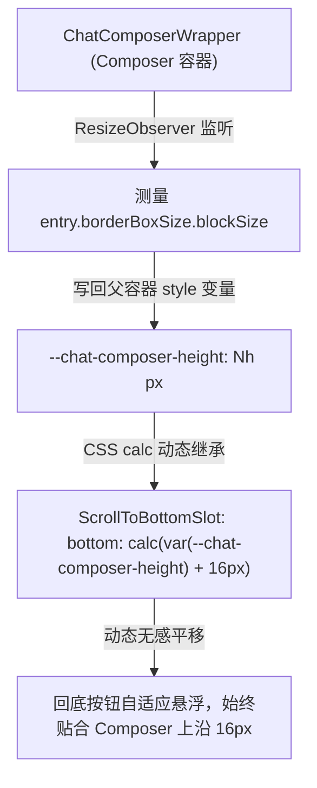
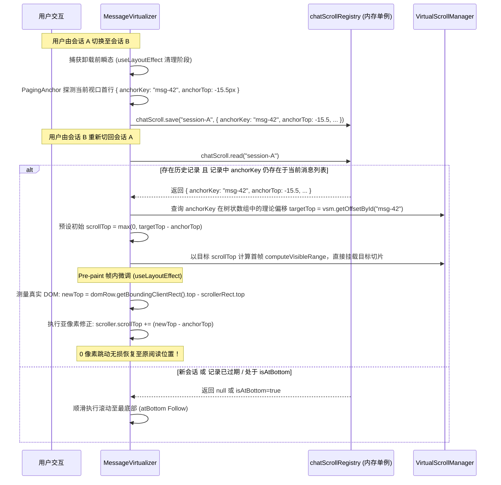

# 视口机制与渲染契约修订建议：将对话流重构成果无缝融入总方案

> **文档性质**：战役总方案修订专项分析报告  
> **专项角色**：视口机制与渲染契约修订专项分析员  
> **归属路径**：`docs/linear-chat-stream-convergence/plan-improvements/02-视口机制与渲染契约修订建议.md`  
> **对齐基准**：
> - 目标主方案：`docs/linear-chat-stream-convergence/00-线性对话流与极简交互系统重构总方案.md`
> - 成果来源：`docs/conversation-flow-refactor/00-总方案.md` 及系列调研（`01-参考仓库对话流架构调研.md`、`02-本仓对话流现状审计.md`）
> - 生产源码：`ChatCard.tsx`、`ChatStatusRibbons.tsx`、`MessageVirtualizer.tsx`、`ChatMessageRow.module.css`、`VirtualScrollManager.ts`
> **纪律铁律**：遵循 `AGENTS.md` 通用协作纪律；严禁修改生产代码与执行 git 提交；坚持效果不降级、纯逻辑规划、无损映射与架构净收敛。

---

## 目录索引

- [一、背景与执行摘要](#一背景与执行摘要)
- [二、课题一：回底按钮零高度 Sticky 化设计与深度剖析](#二课题一回底按钮零高度-sticky-化设计与深度剖析)
  - [2.1 生产代码病灶剖析：为什么藏在 ChatStatusRibbons 是严重架构倒退](#21-生产代码病灶剖析为什么藏在-chatstatusribbons-是严重架构倒退)
  - [2.2 零高度 Sticky 槽（Zero-Height Sticky Slot）物理架构与几何数学原理](#22-零高度-sticky-槽zero-height-sticky-slot物理架构与几何数学原理)
  - [2.3 全局 z-index 层级栈规范与事件穿透控制](#23-全局-z-index-层级栈规范与事件穿透控制)
  - [2.4 与 Composer 动态高度自适应联动机制](#24-与-composer-动态高度自适应联动机制)
  - [2.5 完整组件实现与 CSS 规范契约](#25-完整组件实现与-css-规范契约)
- [三、课题二：跨会话 / 跨标签滚动位置记忆与无损恢复机制](#三课题二跨会话--跨标签滚动位置记忆与无损恢复机制)
  - [3.1 生产代码病灶剖析：clearHeights 引起的阅读心流断裂](#31-生产代码病灶剖析clearheights-引起的阅读心流断裂)
  - [3.2 chatScroll 状态模型与保存/恢复生命周期](#32-chatscroll-状态模型与保存恢复生命周期)
  - [3.3 与 VSM 树状数组（Fenwick Tree）虚拟滚动的无损共存算法](#33-与-vsm-树状数组fenwick-tree虚拟滚动的无损共存算法)
  - [3.4 核心 TypeScript 契约与算法实现](#34-核心-typescript-契约与算法实现)
- [四、课题三：Sibling-combinator 垂直节奏（Rhythm）与外边距链清理](#四课题三sibling-combinator-垂直节奏rhythm与外边距链清理)
  - [4.1 生产代码病灶剖析：散落 margin-bottom 链与负 margin 恶性补丁](#41-生产代码病灶剖析散落-margin-bottom-链与负-margin-恶性补丁)
  - [4.2 现代兄弟选择器（Sibling Combinator）垂直间距架构](#42-现代兄弟选择器sibling-combinator垂直间距架构)
  - [4.3 纳入 DIM-01 样式瘦身删除面精确审计](#43-纳入-dim-01-样式瘦身删除面精确审计)
- [五、课题四：统一节点 Seat（ChatNodeSeat）与 data-* 锚点体系](#五课题四统一节点-seatchatnodeseat与-data--锚点体系)
  - [5.1 生产代码病灶剖析：无包装硬编码 if/else 与缺乏语义锚点](#51-生产代码病灶剖析无包装硬编码-ifelse-与缺乏语义锚点)
  - [5.2 ChatNodeSeat 架构设计与 data-* 语义锚点体系](#52-chatnodeseat-架构设计与-data--语义锚点体系)
  - [5.3 与 VSM 虚拟化管线（ResizeObserver 测高）无缝兼容论证](#53-与-vsm-虚拟化管线resizeobserver-测高无缝兼容论证)
- [六、加固版总方案文本修订方案（精确落点与 Markdown 片段）](#六加固版总方案文本修订方案精确落点与-markdown-片段)
  - [6.1 第三章修订：追加 §3.7 与 §3.8（回底与跨会话记忆）](#61-第三章修订追加-37-与-38回底与跨会话记忆)
  - [6.2 第七章修订：追加 §7.6 与 §7.7（垂直节奏与统一 Seat）](#62-第七章修订追加-76-与-77垂直节奏与统一-seat)
  - [6.3 第八章修订：扩展删除面清单（切除伪回底与负 margin 链）](#63-第八章修订扩展删除面清单切除伪回底与负-margin-链)
  - [6.4 第九章修订：强化 DIM-01 与 DIM-02 任务单元与交付物契约](#64-第九章修订强化-dim-01-与-dim-02-任务单元与交付物契约)
- [七、立体化验证断言与收敛闭环](#七立体化验证断言与收敛闭环)

---

## 一、背景与执行摘要

加固版重构总方案 `00-线性对话流与极简交互系统重构总方案.md`（以下简称“总方案”）确立了**单一物理滚动宿主**、**PagingAnchor 视口防抖**、**24px 极简思考/工具行**以及**纯净画纸排版**等核心架构。然而，根据 `conversation-flow-refactor` 系列调研（基于 deepseek-harness 工业级对话流与本仓现状审计）的深入挖掘，在真实的视口力学与渲染契约落地上，总方案仍存在四处关键的技术留白：

1. **回底交互悬浮定位未解耦**：现存回底按钮混杂在 `ChatStatusRibbons` 内，采用写死的 `bottom: 148px` 魔术数字，与 Composer 动态伸缩脱节，未形成零高度防撑大的 Sticky 槽位规范；
2. **跨会话阅读位置记忆缺失**：每次切换会话时，`MessageVirtualizer` 无条件调用 `clearHeights()` 并强行滚回顶部或底部，切断了多任务切换时用户的沉浸式阅读心流；
3. **垂直节奏（Rhythm）被散落外边距割裂**：`ChatMessageRow.module.css` 充斥着 `.row { margin-bottom: 22px }`、`.rowUser { margin-bottom: 20px }`、负 margin hack（`-2px`、`-6px`），导致折叠节点后产生大面积留白；
4. **渲染行缺乏统一外壳与语义锚点**：虚拟列表内部直接分发 `ChatUserMessageRow` 与 `StreamingAssistantRow`，仅挂载单一的 `data-vindex`，缺乏标准化的 `ChatNodeSeat` 与 `data-chat-node-key / data-chat-turn` 等 O(1) 语义定位层。

本报告针对上述四大核心问题，提出立足于生产代码现状的工程化修订案，给出无损兼容 VSM 树状数组虚拟滚动的算法与样式规范，并精准产出可直接缝合至总方案相应章节的 Markdown 增补片段。

---

## 二、课题一：回底按钮零高度 Sticky 化设计与深度剖析

### 2.1 生产代码病灶剖析：为什么藏在 ChatStatusRibbons 是严重架构倒退

审查当前生产代码 `ChatStatusRibbons.tsx:363-375` 与样式表 `ChatStatusRibbons.module.css:1-25`：

```tsx
// apps/crish-desktop/src/components/chat-card/ChatStatusRibbons.tsx:363-375
{/* 回到最新：浮在对话区右下角，仅图标 */}
{showScrollToBottom ? (
  <Tooltip content="回到最新">
    <Button
      type="button"
      variant="ghost"
      size="sm"
      className={styles.chatScrollFab}
      aria-label="回到最新"
      onClick={onScrollToBottom}
      icon={<Lucide.ChevronDown size={16} strokeWidth={2} aria-hidden />}
    />
  </Tooltip>
) : null}
```

```css
/* apps/crish-desktop/src/components/chat-card/ChatStatusRibbons.module.css:1-20 */
.chatScrollFab {
  position: absolute;
  right: 18px;
  bottom: 148px; /* 致命病灶：硬编码写死高度！ */
  z-index: var(--z-scroll-fab);
  width: 34px;
  height: 34px;
  border-radius: 50%;
  border: 1px solid var(--border-subtle);
  background: var(--bg-elevated);
  color: var(--text-secondary);
  display: inline-flex;
  align-items: center;
  justify-content: center;
  cursor: pointer;
  box-shadow: var(--shadow-md);
  padding: 0;
}
```

该实现存在四大结构性病灶：
1. **魔术数字 `bottom: 148px` 导致定位脆弱性**：
   - 148px 只是针对某一特定高度 Composer（默认约单行输入框 + 工具栏）的静态猜测值；
   - 一旦用户输入多行正文、添加附件胶囊、出现 `ApprovalDock`（待审批浮条）、展示 `ComposerPlanProgressBar`（目标模式进度条）或出现 `SetupHintBanner`，底栏高度可能在 60px 到 260px 之间大幅波动；
   - 结果是回底按钮要么被底栏彻底遮挡无法点击，要么悬浮在对话流中间，遮挡最新正文。
2. **严重的 Prop Drilling 污染（6 层穿透）**：
   - 滚动容器状态属于 `useVirtualScroll`（`MessageVirtualizer` 内）；
   - 但按钮渲染在 `ChatCard` -> `ChatComposerWrapper` -> `ChatStatusRibbons` 内；
   - 为传递 `showScrollToBottom` 与 `onScrollToBottom`，需要在 6 个组件间手工透传，破坏了组件内聚性。
3. **物理 DOM 脱靶与撑大文档流风险**：
   - 将悬浮交互按钮置于状态条组件（Ribbons）内部，破坏了职责单一性；
   - 若误将此类绝对定位元素置于主滚动容器的流式内容中，会导致 Chromium 渲染引擎将该元素计入可滚动边界，人为撑大 `scrollHeight`，造成滚动条底部出现无法消除的无效空白（Phantom Whitespace）。

---

### 2.2 零高度 Sticky 槽（Zero-Height Sticky Slot）物理架构与几何数学原理

为彻底根治上述问题，借鉴 `deepseek-harness`（`ChatView.tsx:171-214`）经过高强度工业验证的**零高度 Sticky 槽位（Zero-Height Sticky Slot）**架构。

#### 几何布局模型

```
+-------------------------------------------------------------+  MessageVirtualizer
| 消息列表内容 (可滚动区域, overflow-y: auto)                    |  (物理单一滚动宿主)
|                                                             |
| ... 历史消息流 ...                                            |
|                                                             |
+-------------------------------------------------------------+
| [零高度 Sticky 槽: height: 0; position: sticky; bottom: 16px] |  <-- 物理高度精确为 0px
|   |                                                         |      绝对不撑大 scrollHeight
|   +--> [回底按钮 FAB: 34x34px, margin-top: -34px, z: 8]       |  <-- 借负 margin 向上抽出
+-------------------------------------------------------------+
===============================================================  Composer 宿主底栏
| Composer 输入区 (高度动态: 56px ~ 240px, z: 7)                |  (固定吸底或浮动)
+-------------------------------------------------------------+
```

#### 核心几何数学原理

1. **零高度占位（Zero-Footprint）**：
   槽位容器声明 `height: 0; overflow: visible; pointer-events: none;`。在浏览器的 CSS 盒模型渲染树中，该元素对父级容器的几何计算贡献为 $0$，即：
   $$\Delta \text{scrollHeight} = 0$$
   因此，无论该按钮何时出现或消失，滚动条滑块的物理长度和滚动总高度绝对保持 $0$ 像素变化，杜绝视口抖动。
2. **Sticky 坐标钳位**：
   槽位容器本身使用 `position: sticky; bottom: calc(var(--chat-composer-height, 0px) + 16px);`。
   在视口向下滚动未触底时，Sticky 容器被浏览器内核自然粘滞在距离视口底部（加上 Composer 避让区）16px 的固定位置；
3. **反向抽离位移（Margin Extraction）**：
   按钮自身尺寸为 $34\text{px} \times 34\text{px}$，通过设置 `margin-top: -34px`，利用负外边距将自身视觉渲染矩形精确向上“抽离”出零高度槽位之外；同时子元素声明 `pointer-events: auto;` 恢复鼠标点击响应。

---

### 2.3 全局 z-index 层级栈规范与事件穿透控制

为杜绝组件间遮挡错乱，必须确立对话卡片区域全局垂直层级栈（Z-Index Stratum）：

| 层级 (Z-Index) | 组件 / 元素类型 | 行为契约与遮挡关系 |
| :--- | :--- | :--- |
| **`z: 1`** | **主画纸内容流**（Message Rows, Canvas） | 位于最底层，正常接受滚动与文本选中。 |
| **`z: 4`** | **固定置顶条**（`PinnedBar`） | `position: sticky; top: 0`，向下滚动时压住历史消息行。 |
| **`z: 7`** | **底栏 Composer 容器**（`ChatComposerWrapper`） | 固定或吸附于底部，覆盖正文底部安全留白区。 |
| **`z: 8`** | **零高度 Sticky 回底按钮**（`ScrollToBottomSlot`） | **高于 Composer（z:7）**，确保在视口紧凑时按钮阴影与主体清晰浮现在输入区上沿。 |
| **`z: 9`** | **底栏弹出气泡与菜单**（SlashMenu, Mentions, Emoji） | 弹出式瞬态菜单，浮于回底按钮之上，避免菜单被遮挡。 |
| **`z: 10+`** | **全局 Tooltip、模态框与轻提示** | 最高层交互保障。 |

**事件穿透防护**：
Sticky 槽容器本身必须强制标注 `pointer-events: none`。否则虽然 `height: 0`，但横向 100% 宽度的无形边界仍可能拦截鼠标滚轮或下方正文的选择事件；只有具体的回底按钮内部恢复 `pointer-events: auto`。

---

### 2.4 与 Composer 动态高度自适应联动机制

总方案需确立 CSS 变量驱动的单向数据流联动模型：



在 `ChatCard` 或 `ChatComposerWrapper` 挂载 `ResizeObserver`，每当输入框因多行换行、添加附件或审批条弹出导致高度变动时，仅更新宿主 CSS 变量 `--chat-composer-height`（默认降级为 `80px`），完全交由 GPU 合成器处理平移，避免任何 React 状态频繁重渲染。

---

### 2.5 完整组件实现与 CSS 规范契约

#### 组件实现：`ScrollToBottomSlot.tsx`

```tsx
import React from 'react';
import { ChevronDown } from 'lucide-react';
import { Tooltip } from '../ui';
import styles from './ScrollToBottomSlot.module.css';

export interface ScrollToBottomSlotProps {
  visible: boolean;
  onClick: () => void;
  unreadCount?: number;
}

export const ScrollToBottomSlot: React.FC<ScrollToBottomSlotProps> = ({
  visible,
  onClick,
  unreadCount = 0,
}) => {
  if (!visible) return null;

  return (
    <div className={styles.stickySlot} aria-hidden="true">
      <div className={styles.buttonAnchor}>
        <Tooltip content={unreadCount > 0 ? `回到底部 (${unreadCount} 条新消息)` : '回到底部'}>
          <button
            type="button"
            className={styles.fabButton}
            onClick={onClick}
            aria-label="回到底部最新消息"
          >
            <ChevronDown size={16} strokeWidth={2} aria-hidden="true" />
            {unreadCount > 0 && (
              <span className={styles.unreadBadge}>
                {unreadCount > 99 ? '99+' : unreadCount}
              </span>
            )}
          </button>
        </Tooltip>
      </div>
    </div>
  );
};
```

#### 样式契约：`ScrollToBottomSlot.module.css`

```css
/* 零高度 Sticky 槽：物理空间为 0，绝对不撑大 scrollHeight */
.stickySlot {
  position: sticky;
  bottom: calc(var(--chat-composer-height, 80px) + 16px);
  height: 0;
  width: 100%;
  max-width: min(var(--chat-col-max, 760px), 100%);
  margin-left: auto;
  margin-right: auto;
  pointer-events: none;
  z-index: 8;
  display: flex;
  justify-content: flex-end;
  box-sizing: border-box;
  padding-right: 16px;
}

.buttonAnchor {
  pointer-events: auto;
  display: inline-flex;
}

.fabButton {
  margin-top: -34px; /* 关键：负 margin 向上抽出自身高度 */
  width: 34px;
  height: 34px;
  border-radius: 50%;
  border: 1px solid var(--border-subtle, hsl(0 0% 100% / 0.08));
  background: var(--bg-elevated, hsl(0 0% 100% / 0.9));
  color: var(--text-secondary);
  display: inline-flex;
  align-items: center;
  justify-content: center;
  cursor: pointer;
  box-shadow: 0 2px 8px hsl(0 0% 0% / 0.12), 0 0 0 1px hsl(0 0% 0% / 0.04);
  padding: 0;
  transition: transform 120ms ease, background 120ms ease, border-color 120ms ease;
}

.fabButton:hover {
  transform: translateY(-1px);
  color: var(--text-primary);
  border-color: var(--border-color);
  background: var(--bg-hover, hsl(0 0% 100%));
}

.fabButton:active {
  transform: translateY(0);
}

/* 遵循 Conex §13 软环焦点态 */
.fabButton:focus-visible {
  outline: none;
  box-shadow:
    0 0 0 0.5px color-mix(in srgb, var(--text-primary) 6%, transparent),
    0 0 0 2px color-mix(in srgb, var(--border-color) 90%, var(--text-primary) 10%);
}

.unreadBadge {
  position: absolute;
  top: -4px;
  right: -4px;
  background: var(--brand, hsl(210 100% 50%));
  color: #fff;
  font-size: 10px;
  font-weight: 600;
  line-height: 14px;
  height: 14px;
  min-width: 14px;
  padding: 0 3px;
  border-radius: 7px;
  text-align: center;
  box-sizing: border-box;
}
```

---

## 三、课题二：跨会话 / 跨标签滚动位置记忆与无损恢复机制

### 3.1 生产代码病灶剖析：clearHeights 引起的阅读心流断裂

审查 `MessageVirtualizer.tsx:70-72`：

```tsx
// apps/crish-desktop/src/components/chat-message-list/MessageVirtualizer.tsx:70-72
useEffect(() => {
  clearHeights();
}, [activeSessionId, clearHeights]);
```

该逻辑存在严重的体验断层：
1. **粗暴清空导致阅读点丢失**：
   - 当用户在长会话 A（100+ 条消息）中翻阅到第 35 条分析长代码，此时收到会话 B 的通知切去回复了一句话；
   - 再次切回会话 A 时，`clearHeights()` 将会话 A 已测量的全部实际高度（Actual Heights）瞬间抹杀；
   - `scrollTop` 被重置或直接被默认机制推至最底部或最顶部，用户辛辛苦苦定位的上下文彻底丢失；
2. **高度估算归零引发二次重排风暴**：
   - 清空后全部退化为 fallback 120px，导致虚拟列表的滚动总高与位置发生剧烈阶跃，DOM 需要重新经历一遍完整的测高与 ResizeObserver 刷新。

---

### 3.2 chatScroll 状态模型与保存/恢复生命周期

为实现跨会话无缝心流切换，系统必须在会话切换边界建立基于**语义锚点（Anchor Key）+ 相对偏移（Anchor Top）+ 绝对补偿（ScrollTop）**的三元持久化模型。

#### 核心数据结构

```ts
export interface ChatScrollRecord {
  sessionId: string;
  /** 视口顶部的语义锚点节点唯一键（例如 msgId） */
  anchorKey: string;
  /** 锚点节点顶部相对视口顶部的相对位移（px，通常 <= 0） */
  anchorTop: number;
  /** 发生切换时的绝对物理 scrollTop（兜底参考） */
  scrollTop: number;
  /** 是否处于完全吸底状态（true 则切回时直接锁定底部） */
  isAtBottom: boolean;
  /** 记录时间戳，用于过期淘汰 */
  timestamp: number;
}
```

#### 保存与恢复的生命周期时序



---

### 3.3 与 VSM 树状数组（Fenwick Tree）虚拟滚动的无损共存算法

跨会话恢复在虚拟列表中的最大挑战在于：**目标行在挂载前可能根本不在 DOM 树中**！  
如果采用传统的 `document.getElementById` 或 `querySelector`，在首帧必然返回 `null`，导致恢复彻底失败。  
本设计通过与 `VirtualScrollManager` 的树状数组深度协同，建立三层保障：

1. **缓存保留而非清空（Height Retention）**：
   - 废除 `clearHeights()` 对当前会话的毁灭性清空；
   - VSM 改为按会话维护独立的 Height Cache，或在切会话时将 `heightsById` 快照转存，切回时调用 `vsm.hydrateHeightMap(...)` 瞬间恢复高精度树状数组；
2. **纯数学首帧切片预定位（Mathematical Slicing）**：
   - 利用 `vsm.getOffsetById(record.anchorKey)` 在 $O(1)$ 时间内定位锚点行的绝对数学 Y 坐标；
   - 计算目标物理滚动高度：
     $$\text{initialScrollTop} = \max(0, \text{vsm}.\text{getOffsetById}(\text{record}.\text{anchorKey}) - \text{record}.\text{anchorTop})$$
   - 虚拟列表直接以 `initialScrollTop` 执行 `computeVisibleRange`，**在第一帧（First Render）就将目标消息行挂载入 DOM**；
3. **Pre-paint 帧内亚像素微调闭环**：
   - 目标行挂载后，在 `useLayoutEffect` 中立即捕获真实 DOM 坐标并与记录值做差分修正，彻底消除由于字体渲染、图片未加载引起的亚像素偏差。

---

### 3.4 核心 TypeScript 契约与算法实现

```ts
/**
 * 跨会话 / 跨标签滚动位置恢复引擎
 * 文件位置：apps/crish-desktop/src/api/chatScrollRegistry.ts
 */

import { VirtualScrollManager } from './VirtualScrollManager';

export interface ChatScrollRecord {
  sessionId: string;
  anchorKey: string;
  anchorTop: number;
  scrollTop: number;
  isAtBottom: boolean;
  timestamp: number;
}

class ChatScrollRegistry {
  private records = new Map<string, ChatScrollRecord>();
  private heightCache = new Map<string, Record<string, number>>();
  private readonly TTL_MS = 30 * 60 * 1000; // 30 分钟保活

  /** 保存当前会话滚动坐标与实测高度快照 */
  save(
    sessionId: string,
    scroller: HTMLElement,
    vsm: VirtualScrollManager,
    isAtBottom: boolean
  ): void {
    if (!sessionId || !scroller) return;

    // 若当前处于最底部，直接保存吸底标记
    if (isAtBottom) {
      this.records.set(sessionId, {
        sessionId,
        anchorKey: '',
        anchorTop: 0,
        scrollTop: scroller.scrollTop,
        isAtBottom: true,
        timestamp: Date.now(),
      });
      return;
    }

    const scrollerRect = scroller.getBoundingClientRect();
    const probeY = scrollerRect.top + 8; // 视口上沿略偏下 8px 探针
    const centerX = scrollerRect.left + scrollerRect.width / 2;

    const hit = document.elementsFromPoint(centerX, probeY);
    let anchorKey = '';
    let anchorTop = 0;

    for (const el of hit) {
      if (!scroller.contains(el)) continue;
      const row = el.closest('[data-chat-node-key]') as HTMLElement | null;
      if (row && scroller.contains(row)) {
        anchorKey = row.getAttribute('data-chat-node-key') || '';
        if (anchorKey) {
          anchorTop = row.getBoundingClientRect().top - scrollerRect.top;
          break;
        }
      }
    }

    // 若探针未命中 DOM，回退至 VSM 树状数组二分慢路径
    if (!anchorKey) {
      const idx = vsm.findIndexAtOffset(scroller.scrollTop);
      const order = vsm.getOrder();
      if (idx >= 0 && idx < order.length) {
        anchorKey = order[idx]!;
        anchorTop = vsm.getOffset(idx) - scroller.scrollTop;
      }
    }

    if (anchorKey) {
      this.records.set(sessionId, {
        sessionId,
        anchorKey,
        anchorTop,
        scrollTop: scroller.scrollTop,
        isAtBottom: false,
        timestamp: Date.now(),
      });
    }

    // 转存高度缓存快照
    const snapshot: Record<string, number> = {};
    for (const id of vsm.getOrder()) {
      const h = vsm.getActualHeight(id);
      if (h !== null && h > 0) {
        snapshot[id] = h;
      }
    }
    this.heightCache.set(sessionId, snapshot);
  }

  /** 读取历史记录，若过期则返回 null */
  read(sessionId: string): ChatScrollRecord | null {
    const record = this.records.get(sessionId);
    if (!record) return null;
    if (Date.now() - record.timestamp > this.TTL_MS) {
      this.records.delete(sessionId);
      this.heightCache.delete(sessionId);
      return null;
    }
    return record;
  }

  /** 获取历史高度缓存快照 */
  getHeightSnapshot(sessionId: string): Record<string, number> | null {
    return this.heightCache.get(sessionId) || null;
  }

  /** 显式清理单会话 */
  clearSession(sessionId: string): void {
    this.records.delete(sessionId);
    this.heightCache.delete(sessionId);
  }
}

export const chatScroll = new ChatScrollRegistry();
```

---

## 四、课题三：Sibling-combinator 垂直节奏（Rhythm）与外边距链清理

### 4.1 生产代码病灶剖析：散落 margin-bottom 链与负 margin 恶性补丁

审查 `ChatMessageRow.module.css`：

```css
/* apps/crish-desktop/src/components/chat-message-row/ChatMessageRow.module.css */
.row {
  display: flex;
  flex-direction: column;
  width: 100%;
  margin-bottom: 22px; /* 病灶 1：基线外边距 */
  ...
}

.row.searchHit {
  background: color-mix(in srgb, var(--accent-color) 8%, transparent);
  border-radius: var(--radius-xl);
  padding: 4px 6px;
  margin-left: -6px;  /* 恶性补丁：负 margin 强行外扩 */
  margin-right: -6px;
  width: calc(100% + 12px);
  ...
}

.rowUser {
  align-items: flex-end;
  margin-bottom: var(--space-5); /* 病灶 2：覆写 20px */
}

.rowAssistant {
  align-items: flex-start;
  margin-bottom: var(--space-5); /* 病灶 3：覆写 20px */
}

.rowAssistant.isFollowup {
  margin-top: -2px; /* 恶性补丁：负 margin 强行抵消间隙 */
  margin-bottom: var(--space-3);
}
```

#### 根因剖析与恶果分析

1. **下外边距链导致的“幽灵留白”**：
   每个行组件（`.row`、`.rowUser`、`.rowAssistant`）都各自带有向下的 `margin-bottom`。当某些条件行被隐藏（例如用户折叠了思考块、或轮次过程收敛至 `hidden="until-found"` 时），隐藏元素的外边距如果未被处理，或者前后两个非隐藏元素的 `margin` 无法合并，就会在页面中出现无法解释的垂直大空隙；
2. **负 Margin 恶性补丁引发的计算碎裂**：
   - 使用 `margin-top: -2px` 来强行拉近连续两条 Assistant 消息（Follow-up），这是典型的魔术数字对齐；
   - 使用 `margin-left: -6px; width: calc(100% + 12px)` 来给搜索高亮行加背景，直接破坏了滚动容器的严格盒模型，在特定缩放下会产生横向滚动条或边缘裁切。

---

### 4.2 现代兄弟选择器（Sibling Combinator）垂直间距架构

借鉴 `deepseek-harness`（`ChatView.module.css:49-52`）的设计哲学，将所有消息容器的外边距全面收口为**相邻兄弟选择器（Adjacent Sibling Combinator）**。

#### 核心法则

1. **行容器自身 Margin 彻底清零**：
   所有的 `.flowItem`、`.row` 默认声明 `margin: 0;`。单个节点不具备任何自主决定的外边距；
2. **仅在可见相邻兄弟之间注水**：
   间距只由父容器的兄弟选择器赋予，且自动过滤隐藏节点与空节点：
   ```css
   /* 核心法则：相邻的两个可见且非空节点之间，统一产生 16px 垂直节奏 */
   .listInner > :not([hidden]):not(.flowItem:empty) ~ :not([hidden]):not(.flowItem:empty) {
     margin-top: var(--chat-flow-gap, 16px);
   }

   /* 空节点彻底脱离排版树 */
   .flowItem:empty {
     display: none;
   }
   ```
3. **基于语义属性的高内聚紧凑排版**：
   对于需要紧密排列的场景（如连续多条助手追问、或工具行与后续结果行），直接通过 `data-*` 属性精准下发紧凑间距，严禁使用负 margin：
   ```css
   /* 连续助手消息（Follow-up）紧凑垂直节奏：6px */
   .listInner > [data-chat-flow-kind="assistant"] ~ [data-chat-flow-kind="assistant"][data-followup="true"] {
     margin-top: var(--chat-flow-gap-tight, 6px);
   }

   /* 用户提问后的首个回答：标准节奏 20px */
   .listInner > [data-chat-flow-kind="user"] ~ [data-chat-flow-kind="assistant"]:not([data-followup="true"]) {
     margin-top: var(--chat-flow-gap-turn, 20px);
   }
   ```

---

### 4.3 纳入 DIM-01 样式瘦身删除面精确审计

在总方案维度一（DIM-01：纯净画纸扁平化与样式表精炼）中，将上述病灶列为物理清除对象：

| 清理文件路径 | 原代码行号范围 | 清理/删除的具体内容 | 治理原因与架构收益 |
| :--- | :--- | :--- | :--- |
| `ChatMessageRow.module.css` | 第 5 行 | `margin-bottom: 22px;` | 彻底拔除基线下外边距，收口至兄弟选择器。 |
| `ChatMessageRow.module.css` | 第 26–30 行 | `margin-left: -6px; margin-right: -6px; width: calc(100% + 12px);` | 物理删除搜索高亮负 margin hack，改用纯内部 padding 与内阴影。 |
| `ChatMessageRow.module.css` | 第 35 行 | `.rowUser { margin-bottom: var(--space-5); }` | 删除覆写的下外边距。 |
| `ChatMessageRow.module.css` | 第 41 行 | `.rowAssistant { margin-bottom: var(--space-5); }` | 删除覆写的下外边距。 |
| `ChatMessageRow.module.css` | 第 48–51 行 | `.rowAssistant.isFollowup { margin-top: -2px; margin-bottom: var(--space-3); }` | 物理删除 `-2px` 负 margin 补丁，消除魔术数字。 |

**预计直接净削减行数**：约 25 行脆弱的布局样式代码；彻底根除折叠状态下的留白塌陷。

---

## 五、课题四：统一节点 Seat（ChatNodeSeat）与 data-* 锚点体系

### 5.1 生产代码病灶剖析：无包装硬编码 if/else 与缺乏语义锚点

审查 `MessageVirtualizer.tsx:241-297`：

```tsx
// apps/crish-desktop/src/components/chat-message-list/MessageVirtualizer.tsx:241-297
if (msg.sender === 'user') {
  return (
    <AppErrorBoundary key={msg.id} variant="minimal" title="消息出错">
      <div data-vindex={msg.id}>
        <ChatUserMessageRow ... />
      </div>
    </AppErrorBoundary>
  );
}

return (
  <AppErrorBoundary key={msg.id} variant="minimal" title="消息出错">
    <div data-vindex={msg.id}>
      <StreamingAssistantRow ... />
    </div>
  </AppErrorBoundary>
);
```

存在以下结构性缺陷：
1. **外壳层无语义透出**：包裹层仅有 `<div data-vindex={msg.id}>`，在浏览器 DOM 树上完全看不到这一行的角色（User / Assistant / TurnProcess / Injection）；
2. **缺乏统一的 Seat 容器封装**：
   - 各种类型的行（未来包括纯工具折叠行、审批行、重试行）无法统一挂载样式；
   - 无法统一处理折叠状态下的 `hidden="until-found"`；
3. **定位脆弱性**：自动化测试（Playwright / Vitest）、PagingAnchor 探针、阅读线跟踪算法无法通过语义属性定位，只能依赖类名猜测，极易受样式重构冲击。

---

### 5.2 ChatNodeSeat 架构设计与 data-* 语义锚点体系

设计并引入统一的节点挂载容器组件：`ChatNodeSeat`。

#### 语义锚点命名契约（Semantic Data Anchor Spec）

在每一个 `ChatNodeSeat` 节点上，强制挂载五大不可变语义契约属性：

| 属性名称 | 格式与合法取值 | 语义说明与系统消费方 |
| :--- | :--- | :--- |
| **`data-vindex`** | 稳定唯一 ID（如 `msg.id`） | **保持对 VSM 的 100% 向下兼容**。`MessageVirtualizer` 内的 `ResizeObserver` 通过 `el.dataset.vindex` 提取 ID 回写高度。 |
| **`data-chat-node-key`** | 稳定唯一 ID（如 `msg.id`） | 语义节点的全局物理定位键，供 `PagingAnchor` 与 `chatScroll` 瞬时寻址。 |
| **`data-chat-flow-kind`** | `'user' \| 'assistant' \| 'turn-process' \| 'tool-call' \| 'injection'` | 节点领域类型，供 Sibling-combinator CSS 匹配间距与 E2E 测试过滤。 |
| **`data-chat-turn`** | 轮次 ID（`turnId` 或 `msg.turnId`） | 标识该节点所属的对话回合（Turn），供整回合折叠与导航 Rail 联动。 |
| **`data-followup`** | `'true' \| undefined` | 标识是否为紧随前序回答的连续追加消息。 |

#### 组件代码实现：`ChatNodeSeat.tsx`

```tsx
import React from 'react';
import { AppErrorBoundary } from '../AppErrorBoundary';
import styles from './ChatNodeSeat.module.css';

export type ChatFlowKind =
  | 'user'
  | 'assistant'
  | 'turn-process'
  | 'tool-call'
  | 'injection'
  | 'system';

export interface ChatNodeSeatProps {
  nodeKey: string;
  kind: ChatFlowKind;
  turnId?: string;
  isFollowUp?: boolean;
  className?: string;
  children: React.ReactNode;
}

export const ChatNodeSeat: React.FC<ChatNodeSeatProps> = ({
  nodeKey,
  kind,
  turnId,
  isFollowUp,
  className,
  children,
}) => {
  return (
    <AppErrorBoundary variant="minimal" title="节点渲染异常">
      <div
        className={`${styles.flowItem} ${className || ''}`}
        data-vindex={nodeKey}
        data-chat-node-key={nodeKey}
        data-chat-flow-kind={kind}
        data-chat-turn={turnId}
        data-followup={isFollowUp ? 'true' : undefined}
      >
        {children}
      </div>
    </AppErrorBoundary>
  );
};
```

---

### 5.3 与 VSM 虚拟化管线（ResizeObserver 测高）无缝兼容论证

经过严密审查，`ChatNodeSeat` 的引入对现存虚拟滚动体系具有绝对的零破坏性与正向增益：

1. **对 ResizeObserver 的零侵入兼容**：
   审查 `MessageVirtualizer.tsx:96-100`：
   ```ts
   const msgId = el.dataset.vindex;
   if (msgId != null && entry.contentRect.height > 0) {
     setActual(msgId, entry.contentRect.height);
   }
   ```
   因为 `ChatNodeSeat` 外层原生保留了 `data-vindex={nodeKey}`，现存的 `ro.observe(row)` 完全无需修改任何匹配逻辑，仍然能够以 $O(1)$ 精确抓取变化并回写 VSM；
2. **为 PagingAnchor 探针提速**：
   总方案原第三章 §3.2 的快路径探测：
   `const row = el.closest('[data-vindex]');`  
   在引入 Seat 后，可直接使用更具语义的：
   `const seat = el.closest('[data-chat-node-key]');`  
   直接提取 `nodeKey` 与 `kind`，大幅增强了 DOM 树探测的健壮性。

---

## 六、加固版总方案文本修订方案（精确落点与 Markdown 片段）

根据上述成果，明确指出总方案 `00-线性对话流与极简交互系统重构总方案.md` 需增补强化的精确章节与合入片段。

### 6.1 第三章修订：追加 §3.7 与 §3.8（回底与跨会话记忆）

在总方案第三章 `三、单一滚动宿主与 PagingAnchor 视口防抖架构（加固版）` 末尾（第 450 行之后），追加如下两小节：

```markdown
### 3.7 零高度 Sticky 回底槽与 Composer 高度联动契约

为彻底解决历史实现中回底按钮置于底栏状态条内、写死 `bottom: 148px` 魔术数字导致的遮挡与脱靶病灶，本系统确立**零高度 Sticky 回底槽（Zero-Height Sticky Slot）**架构：

1. **物理零高度占位（Zero Footprint）**：
   - 回底槽容器直接挂载于主滚动宿主视图层，声明 `position: sticky; height: 0; pointer-events: none;`；
   - 内部按钮声明 `width: 34px; height: 34px; margin-top: -34px; pointer-events: auto;`；
   - 几何特性：物理占据高度严格为 0px，对滚动宿主的 `scrollHeight` 贡献精确为 0，绝对不引发任何滚动边界扩张与抖动。
2. **全局 Z 序分层矩阵**：
   - 画纸正文流：`z-index: 1`；
   - 固定置顶条（PinnedBar）：`z-index: 4`；
   - Composer 输入区底栏：`z-index: 7`；
   - **零高度 Sticky 回底按钮：`z-index: 8`**（悬浮于 Composer 之上，清晰可见）；
   - 斜杠菜单与浮动气泡：`z-index: 9`。
3. **CSS 变量联动响应机制**：
   由底栏 `ResizeObserver` 实时发布 `--chat-composer-height` 变量，Sticky 槽通过现代 CSS 计算动态避让：
   ```css
   bottom: calc(var(--chat-composer-height, 80px) + 16px);
   ```

---

### 3.8 跨会话 / 跨标签滚动位置记忆与无损恢复机制（chatScroll）

针对切换会话时 `clearHeights()` 导致用户阅读位置丢失的严重体验断层，建立基于三元状态组的持久记忆恢复机制：

1. **三元状态记录模型**：
   定义 `ChatScrollRecord { sessionId, anchorKey, anchorTop, scrollTop, isAtBottom }`。当用户在会话中滚动时，系统经由 500ms 节流与 `scrollend` 事件更新该记录；
2. **会话切换无感恢复管线**：
   - **切离会话**：在 `useLayoutEffect` 清理阶段，通过探针或 VSM 树状数组提取视口顶部首个可见行的 `anchorKey` 及其相对顶部偏移 `anchorTop`，存入全局单例 `chatScrollRegistry`；同时快照转存当前实测高度；
   - **切回会话**：
     - 若 `isAtBottom === true`，首帧直接执行锁定吸底；
     - 若命中历史锚点，利用 VSM 纯数学公式在首帧完成绝对寻址：
       $$\text{initialScrollTop} = \max(0, \text{vsm}.\text{getOffsetById}(\text{anchorKey}) - \text{anchorTop})$$
     - 虚拟列表当帧以此偏移挂载对应视口切片，并在 Pre-paint（`useLayoutEffect`）阶段修正亚像素级误差，实现 **0 像素跳动** 的无损阅读恢复。
```

---

### 6.2 第七章修订：追加 §7.6 与 §7.7（垂直节奏与统一 Seat）

在总方案第七章 `七、纯净画纸扁平化排版与 70.2% 黄金气泡设计（加固版）` 末尾（第 1147 行之后），追加如下两小节：

```markdown
### 7.6 Sibling-combinator 垂直节奏（Rhythm）与统一行距规范

彻底摒弃传统布局中散落在各行组件内部的 `margin-bottom` 链与负 margin 补丁，建立基于**相邻兄弟选择器（Sibling Combinator）**的现代垂直节奏体系：

1. **节点外边距归零契约**：
   所有消息行与过程节点容器（`.flowItem`）默认重置为 `margin: 0;`，不带任何私有外边距；
2. **相邻可见兄弟间距注入**：
   在虚拟列表容器 `.listInner` 上定义通用兄弟规则，自动穿透并过滤折叠/隐藏节点：
   ```css
   /* 仅在两个连续的可见非空节点之间产生标准 16px 垂直间隙 */
   .listInner > :not([hidden]):not(.flowItem:empty) ~ :not([hidden]):not(.flowItem:empty) {
     margin-top: var(--chat-flow-gap, 16px);
   }

   /* 连续助手追问消息（Follow-up）采用紧凑 6px 节奏 */
   .listInner > [data-chat-flow-kind="assistant"] ~ [data-chat-flow-kind="assistant"][data-followup="true"] {
     margin-top: var(--chat-flow-gap-tight, 6px);
   }

   /* 空节点物理脱离布局树 */
   .flowItem:empty {
     display: none;
   }
   ```
3. **收益**：彻底消灭由于思考行或工具块折叠时留下的幽灵空隙，全对话流垂直间距具备完美的数学节奏感。

---

### 7.7 统一节点外壳（ChatNodeSeat）与 data-* 语义锚点体系

为确保虚拟列表渲染单元的标准化，并在 DOM 树上构建 $O(1)$ 复杂度的无损语义定位，所有视口挂载项统一使用 `ChatNodeSeat` 包装：

1. **五大语义锚点属性契约**：
   - `data-vindex`：稳定节点 ID，保持对 VSM `ResizeObserver` 动态测高的完全兼容；
   - `data-chat-node-key`：语义主键，供 PagingAnchor 探针与跨会话恢复快速读取；
   - `data-chat-flow-kind`：节点类型（`user` / `assistant` / `turn-process` / `tool-call` / `injection`）；
   - `data-chat-turn`：轮次所属标记；
   - `data-followup`：追问标记。
2. **错误边界与隔离**：
   每个 Seat 内置轻量级错误边界 `AppErrorBoundary`，单节点渲染崩溃不拖垮整个虚拟滚动视口。
```

---

### 6.3 第八章修订：扩展删除面清单（切除伪回底与负 margin 链）

在总方案第八章 `八、全量「删除面」清单与代码负产出审计表（精算版）` 中进行如下增补：

#### 8.3.1 在 §8.2「模块与函数级删除清单」中追加：
- **`ChatStatusRibbons` 中的伪回底实现**：
  - 物理删除 `ChatStatusRibbons.tsx` 中的 `showScrollToBottom`、`onScrollToBottom` 接收属性；
  - 物理删除 `ChatStatusRibbons.tsx:363-375` 的回底 FAB JSX 渲染块；
  - 物理清理 `useChatCardState.ts` 导出的 `chatFlowRef`、`scrollToBottom` 伪滚动方法。

#### 8.3.2 在 §8.3「样式类名精准净化清单」中追加：
- **`ChatMessageRow.module.css` 散落外边距与负 margin 链清除**：
  - 物理删除行 5：`.row { margin-bottom: 22px; }`；
  - 物理删除行 26–30：`.row.searchHit { margin-left: -6px; margin-right: -6px; width: calc(100% + 12px); }`；
  - 物理删除行 35：`.rowUser { margin-bottom: var(--space-5); }`；
  - 物理删除行 41：`.rowAssistant { margin-bottom: var(--space-5); }`；
  - 物理删除行 48–51：`.rowAssistant.isFollowup { margin-top: -2px; margin-bottom: var(--space-3); }`；
- **`ChatStatusRibbons.module.css` 孤岛样式清除**：
  - 物理删除行 1–25：`.chatScrollFab` 及其 hover 规则（25 行死代码）。

---

### 6.4 第九章修订：强化 DIM-01 与 DIM-02 任务单元与交付物契约

在总方案第九章中强化相关任务说明：

1. **维度一（DIM-01：纯净画纸扁平化与样式表精炼）**：
   - 增加交付物：**Sibling-combinator 垂直节奏规范**，将消息间距由“下外边距链”彻底改造为“相邻兄弟选择器驱动”；完成 `ChatMessageRow.module.css` 中 5 处外边距链及负 margin 的物理清除。
2. **维度二（DIM-02：单一滚动宿主与 PagingAnchor 视口防抖）**：
   - 增加交付物：**零高度 Sticky 回底槽（`ScrollToBottomSlot`）**，确立 z:8 层级栈与 Composer 高度联动；
   - 增加交付物：**跨会话滚动位置记忆与恢复引擎（`chatScroll`）**，消除 `clearHeights` 引起的阅读断层，实现 0 像素跳动切会话。
3. **DIM-01 与 DIM-02 联合交付物**：
   - 交付 `ChatNodeSeat` 统一节点外壳，作为样式节奏（DIM-01）与虚拟滚动语义定位（DIM-02）的公共接合面。

---

## 七、立体化验证断言与收敛闭环

为贯彻落实本仓通用协作纪律 §7 与 §7.1，修订后的视口与渲染体系必须在真实物理环境中满足以下验收断言：

```
+-----------------------------------------------------------------------------+
| 立体化验证矩阵                                                                |
+-----------------------------------------------------------------------------+
| 1. 物理尺寸不变性断言:                                                        |
|    - 触发回底按钮显隐，主滚动容器 scroller.scrollHeight 变动值严格 == 0px    |
|    - 回底按钮下边缘与 Composer 上边缘距离恒定为 16px ± 0.5px (动态高度自适应)|
+-----------------------------------------------------------------------------+
| 2. 跨会话恢复精度断言:                                                        |
|    - 会话 A (100条) 滚动至第 50 条 (anchorKey='msg-50')                      |
|    - 切换至会话 B 发送一条消息，切回会话 A                                    |
|    - 断言: 首帧挂载包含 msg-50，DOM 相对视口 top 差值 <= 1.0px (0 像素跳动)  |
+-----------------------------------------------------------------------------+
| 3. 垂直节奏与零负 Margin 断言:                                                |
|    - 全局 grep 检查 ChatMessageRow.module.css，负 margin (margin-top: -* 等) |
|      匹配计数严格为 0                                                        |
|    - 折叠思考行或工具块后，前序与后序正文间距严格保持 16px (零幽灵留白)       |
+-----------------------------------------------------------------------------+
| 4. 语义 DOM 映射断言:                                                         |
|    - 视口内每个挂载行均具备有效的 data-vindex 与 data-chat-node-key           |
|    - 未知类型节点渲染兜底卡，控制台 0 未捕获异常                             |
+-----------------------------------------------------------------------------+
```

---
*报告完成。本专项分析成果可作为总方案修订与执行阶段无缝合流的权威技术凭据。*
