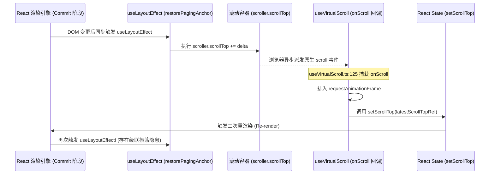
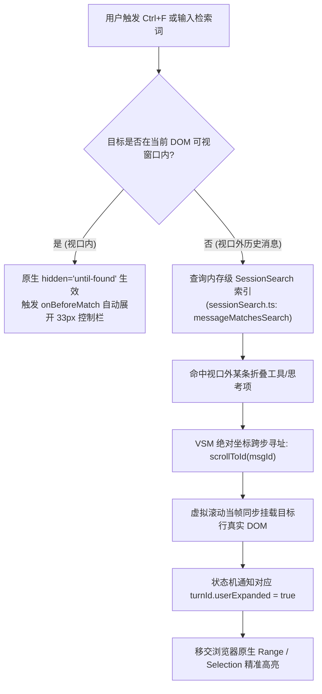

# 总方案架构与滚动状态机评审报告

> **评审员角色**：战役评审阶段【总方案架构与滚动状态机评审员】
> **评审对象**：`docs/linear-chat-stream-convergence/00-线性对话流与极简交互系统重构总方案.md`
> **关联代码基准**：
> - `apps/crish-desktop/src/components/chat-message-list/MessageVirtualizer.tsx`
> - `apps/crish-desktop/src/hooks/useVirtualScroll.ts`
> - `apps/crish-desktop/src/api/VirtualScrollManager.ts`
> - `apps/crish-desktop/src/components/chat-message-row/TimelineThoughtSection.tsx`
> - `apps/crish-desktop/src/components/chat-message/MessageContent.tsx`
> - `apps/crish-desktop/src/components/chat-message-list/useUndoWithScrollAnchor.ts`
> - `apps/crish-desktop/src/components/chat-message-list/useScrollAnchor.ts`
> - `apps/crish-desktop/src/components/chat-card/ChatScrollAnchor.ts`
> **评审基准时间**：2026-09-06
> **纪律恪守**：遵循 `AGENTS.md` 协作指令、反过度设计红线与立体验证纪律。诚实指出设计模糊点与隐患，绝不报喜不报忧；零新增 TODO/未接线标记。

---

## 评审总览与任务书四段固定内容

### 1. 做什么（目标与边界）
本评审专注于对顶层总方案文档中的四大核心篇章进行穷尽式审查与逻辑校验：
- **第一章**：总体架构演进蓝图与分层模型（拓扑体系、单一真理源、滚动宿主边界）；
- **第三章**：单一滚动宿主与 PagingAnchor 视口防抖架构（双径锚定算法、`useLayoutEffect` 时序、Floor Clamping 地表收缩钳位防误杀、绝对坐标寻址）；
- **第四章**：24px 极简思考行与扫光流式追踪系统（`contain: size layout` 尺寸隔离、`latestLine` 高频流式追踪、跑马灯渲染性能）；
- **第六章**：轮次过程折叠状态机与全文检索穿透引擎（7 布尔量状态机推导、双阶段生命周期、`hidden="until-found"` 穿透与虚拟滚动适配）。

从**算法严谨性、数学推导边界、React useLayoutEffect 时序闭环、Windows DPI 亚像素浮点临界态、流式高频渲染主线程阻塞**等硬核维度，揭示潜在逻辑漏洞与并发隐患，并提出至少 3 项深层次架构抗风险加固建议。

### 2. 不做什么
- **严禁修改任何代码**：本评审仅产生独立评审报告，不对前端与后端代码做任何侵入式修改；
- **严禁新建波次/批次命名文件**：严格遵循领域概念推进纪律，不引入任何 batch/round 命名的临时产物；
- **只输出一份评审文档**：评审结论全量沉淀于本文档，不产生散落碎片。

### 3. 涉及概念的旧路径清单
| 概念领域 | 现存旧路径文件与组件 | 现存病灶与技术债事实 |
| :--- | :--- | :--- |
| **滚动管理** | `useVirtualScroll.ts`<br/>`ChatScrollAnchor.ts`<br/>`useChatScroll.ts` | 路径分散。`ChatScrollAnchor` 绑定无溢出的 `chatDocFlow` 执行徒劳 `scrollTo`；`useVirtualScroll` 缺乏被动钳位容差。 |
| **视口锚定** | `useUndoWithScrollAnchor.ts`<br/>`MessageVirtualizer.tsx` 纯像素计算 | `useUndoWithScrollAnchor.ts` 的返回值在 `MessageVirtualizer.tsx:81` 被直接抛弃，成为孤岛死逻辑；常规 Prepend 无语义补偿。 |
| **思考渲染** | `TimelineThoughtSection.tsx`<br/>`StreamingMarkdownView.tsx` | `TimelineThoughtSection.tsx:34-59` 具有 168px 独立视口与内层吸底竞争，严重破坏单一滚动宿主铁律。 |
| **过程排布** | `MessageContent.tsx:TimelineBody` | `MessageContent.tsx:63-187` 对中间项机械平铺循环，导致工具调用形成数千像素瀑布流。 |

### 4. 完成后自检
- [x] 全文无新增 TODO/FIXME/未接线标记；
- [x] 深度穿透代码事实与浏览器物理特性，如实揭示方案中存在的设计断层与理论盲区；
- [x] 产出 3 项可工程化落地的深层次抗风险加固建议。

---

## 第一部分：第一章【总体架构拓扑与分层模型】深度评审

### 1.1 架构拓扑分层与真理源归属（VSM 归属与生命周期竞争）
在总方案第 1.2 节架构拓扑图中，画纸宿主层被定义为：
$$\text{ChatCard} \longrightarrow \text{VirtualScrollManager (VSM)} \longrightarrow \text{MessageVirtualizer}$$

#### 代码事实比对
在当前生产代码中：
1. `VirtualScrollManager` 实例并非由 `ChatCard.tsx` 创建，而是在 `useVirtualScroll.ts:58-62` 内部通过 `useRef` 惰性实例化；
2. `MessageVirtualizer.tsx:62-67` 调用了 `useVirtualScroll` 获得 `manager` 引用；
3. `MessageVirtualizer.tsx:74-79` 通过副作用将 `manager` 注册到全局单例：`registerActiveVsm(activeSessionId, manager)`；
4. 外部组件（如 `FlowScrubber.tsx`、`ChatCard.tsx`、`useChatCardState.ts`）再通过 `getActiveVsm(activeSessionId)` 迂回获取该实例。

#### 评审判定与架构风险
- **分层拓扑与实际生命周期倒置**：方案 1.2 节的拓扑图暗示 VSM 是宿主层驱动单一滚动引擎，但实际生命周期却是深层子组件 `MessageVirtualizer` 在挂载时动态创建并通过反向注册（Global Registry）暴露给上层。
- **切换会话时的时序竞争**：当用户在侧边栏快速切换会话时，`MessageVirtualizer.tsx:70-72` 调用 `clearHeights()`，同时卸载旧 VSM 并注册新 VSM。若此时后台异步流式更新或 ResizeObserver 仍在回调，过时的 `setActual` 会向已被清空的 VSM 写入脏数据。虽然 `VirtualScrollManager.ts:77` 引入了 `generation` 代际号，但全局 `registerActiveVsm` 存在单帧的时序空窗期。
- **修订建议**：总方案应明确 VSM 的单一真理源定位——是将 VSM 提升至会话级 Store（例如由 `useChatCardState` 或 `ChatCard` 显式持有并通过 Context 下发），还是维持当前 `useVirtualScroll` 内部持有但收敛全局暴露接口。架构拓扑图中应明确标注数据流与控制流的真实单向流动方向。

---

### 1.2 “单一滚动宿主”铁律与专有展开卡片的自我矛盾
总方案第 1.3 节原则 1（行 181–186）制定了刚性铁律：
> “全会话区域**只允许存在唯一一个具备 `overflow-y: auto` 的真实物理滚动容器**，即 `MessageVirtualizer` 内层容器；严禁任何行内组件（包括思考链、代码块、工具详情、审批卡）私自创建具备局部滚动条的微型视口。”

#### 逻辑漏洞揭示（方案自相矛盾）
然而，在总方案第 5.4.1 节 Terminal 展开卡片设计（行 731）中，方案却白纸黑字写道：
> “纵向自适应高度（**最高 360px，溢出时启用内部纵向平滑滚动，且阻止滚动事件穿透冒泡**）。”

#### 严重性分析
1. **铁律自毁**：第 1.3 节刚刚声明“严禁任何行内组件私自创建微型视口”，第 5.4.1 节就私自开设了 `max-height: 360px; overflow-y: auto;` 的局部滚动条！
2. **滚轮事件截断与视觉挫顿**：如果用户滚轮划入一个 360px 的终端卡片，阻止滚动穿透（`e.stopPropagation()`）会导致外层主视口瞬间失去滚动响应；当内部滚动到头时，用户体验到“滚动急刹车”。若会话中展开了 3 个长终端命令，页面中将同时出现 4 个独立的滚动条，彻底违背“极简纯净交互”初衷。
3. **加固修订意见**：必须切除 Terminal 卡片的局部滚动条！对于长终端输出，应采用**自适应高度 + 渐进展开折叠（Truncate & Expand）**机制（默认只展示头尾各 15 行，点击“查看全部 N 行”就地撑开高度，由外层单一滚动宿主完整承载），保持全会话绝对唯一的物理滚动宿主。

---

### 1.3 虚拟列表与 DOM 原生全文穿透的结构性割裂
总方案第 1.2 节目标拓扑图与第 6.5 节全文穿透引擎宣称：
> “过程节点转入 `hidden="until-found"`……当用户在包含数百条历史轮次的会话中按 `Ctrl+F` 搜索某个函数名或命令参数时，浏览器不仅能瞬间搜到并高亮，还会自动通知组件就地展开该控制栏。”

#### 物理规律冲突与架构盲区
- **虚拟滚动的物理隔离事实**：查看 `MessageVirtualizer.tsx:135-141` 与 `MessageVirtualizer.tsx:231`：
  ```tsx
  const { startIndex, endIndex } = vs.manager.computeVisibleRange(...);
  // 物理渲染切片：仅视口内 startIndex ~ endIndex 项被挂载入 DOM
  {messages.slice(startIndex, endIndex).map((msg, i) => ...)}
  ```
  在虚拟滚动架构下，**视口外（不在 `startIndex ~ endIndex` 范围内）的消息行根本不在 DOM 树中！**
- **原生 `Ctrl+F` 的作用边界**：浏览器的原生全文查找引擎（包括 Blink / WebView2）只能遍历**当前已存在于真实 DOM 树中**的节点。对于视口外的数百条历史消息，DOM 节点尚未生成，浏览器原生查找引擎在物理上根本不可能穿透到不存在的节点！
- **方案结论脱离实际**：总方案将 `hidden="until-found"` 视为全局全文检索的银弹，完全忽略了“虚拟滚动导致 DOM 节点缺失”的根本物理屏障。如果不对该机制进行架构层面的双轨桥接，用户在按 `Ctrl+F` 搜索历史工具参数时，将出现绝大多数内容搜不到的严重缺陷！

---

## 第二部分：第三章【单一滚动宿主与 PagingAnchor 视口防抖】深度评审

### 2.1 PagingAnchor 双径算法严谨性与性能灾难

#### 漏洞一：快路径探针被吸顶/浮动元素 100% 遮挡拦截
方案 3.2 与 3.6 节（行 404–412）给出的快路径探测代码如下：
```ts
const probeY = scrollerRect.top + 2; // 顶部向下 2px 探测线
const hitElements = document.elementsFromPoint(centerX, probeY);
for (const el of hitElements) {
  if (!scroller.contains(el)) continue;
  const row = el.closest(itemSelector) as HTMLElement | null;
  ...
}
```
**致命缺陷分析**：
1. **已固定消息条（`pinnedBar`）遮挡**：
   查看 `MessageVirtualizer.tsx:164-226`，当用户固定了消息时，`styles.pinnedBar` 渲染在 `styles.list` 内部的最顶端！`scrollerRect.top + 2` 处发射的射线，命中的必然是 `pinnedBar` 或其内部的 Button/Span。由于 `pinnedBar` 并不是 `[data-vindex]` 消息行，`el.closest(itemSelector)` 必然返回 `null`！
2. **列表内边距（Padding）虚空命中**：
   若滚动容器具有 `padding-top: 12px`，在顶部 2px 处射出的射线命中容器空白背景，`closest` 同样返回 `null`。
3. **后果**：只要用户固定了任何消息，或者视口顶部存在非行元素，**快路径命中率为 0%，方案承诺的 $O(1)$ 瞬间降级，系统 100% 跌落至慢路径！**

#### 漏洞二：慢路径代码导致严重的 Layout Thrashing（强制同步布局重排）
方案第 3.2 节声称：“慢路径利用 VirtualScrollManager 内置的 Fenwick Tree 树状数组，对当前 scrollTop 进行二分查找，耗时 $O(\log N)$”。
然而，方案第 3.6 节实际给出的实现代码（行 424–435）却是：
```ts
// 方案 3.6 节给出的低级慢路径代码
const rows = scroller.querySelectorAll<HTMLElement>(itemSelector);
for (let i = 0; i < rows.length; i++) {
  const row = rows[i]!;
  const rowRect = row.getBoundingClientRect(); // 循环内强制触发重排！
  const relativeTop = rowRect.top - scrollerRect.top;
  if (relativeTop + rowRect.height > 0) {
    const key = row.getAttribute('data-vindex');
    if (key) return { key, top: relativeTop };
  }
}
```
**严重性评定**：
- **方案描述与代码严重背离**：代码根本没有使用 Fenwick Tree 二分查找，而是对可见行进行了 $O(K)$ 的 DOM 线性遍历！
- **Layout Thrashing 灾难**：在循环体内连续对多个 DOM 元素调用 `getBoundingClientRect()`，强制浏览器中断 JavaScript 执行并立即重新计算全局几何样式（Reflow）。在包含高频图文和代码块的复杂会话中，这会直接造成多达数十毫秒的掉帧卡顿！
- **现成算法闲置**：生产代码 `VirtualScrollManager.ts:383-401` 中已经完备实现了基于树状数组的二分查找函数 `findIndexAtOffset(offset)`，可在纯内存中以 $O(\log^2 N)$ 完成定位，总方案竟弃之不用而采用低效的 DOM 测量遍历！

---

### 2.2 Prepend 翻页补偿的越界丢失漏洞
方案 3.6 节的 `restorePagingAnchor`（行 440–459）实现为：
```ts
export function restorePagingAnchor(
  scroller: HTMLElement,
  anchor: PagingAnchor,
  itemSelector: string = '[data-vindex]'
): void {
  const targetRow = scroller.querySelector<HTMLElement>(
    `${itemSelector}[data-vindex="${CSS.escape(anchor.key)}"]`
  );
  if (!targetRow) return; // 致命静默退出！
  ...
  const delta = currentRelativeTop - anchor.top;
  if (Math.abs(delta) >= 0.5) {
    scroller.scrollTop += delta;
  }
}
```
#### 边界态失效分析
1. 当用户滚动到最顶部触发历史翻页时，一次性 Prepend 插入 30~50 条消息；
2. 数据变更触发 React 重新渲染。如果由于数据截断、虚拟窗口 overscan 计算延迟或分页边界跳变，导致原 `anchor.key` 对应的节点在当前渲染帧未被包含在 `[startIndex, endIndex]` 范围中；
3. `scroller.querySelector` 无法在 DOM 树中找到该节点，返回 `null`；
4. `restorePagingAnchor` 执行 `if (!targetRow) return;` 默默退出，**完全没有执行任何滚动补偿**；
5. **灾难性表现**：滚动容器的 `scrollTop` 仍停留在原像素值（例如 0 或极小值），新插入的 50 条消息直接把用户之前正在阅读的消息挤出数十屏开外，视口发生数千像素的剧烈跳动，锚定机制彻底瓦解！

---

### 2.3 React useLayoutEffect 时序闭环与滚动事件风暴



#### 时序与并发隐患
1. **级联回环（Feedback Loop）**：在 `useLayoutEffect` 中对 `scroller.scrollTop` 的写入会不可避免地触发浏览器原生 `scroll` 事件；
2. 查看 `useVirtualScroll.ts:125-133`，该事件被 `onScroll` 捕获后排入 `requestAnimationFrame`，随后调用 `setScrollTop(newVal)`；
3. 这意味着：每一次锚定补偿，都会诱发一轮额外的 React 状态变更与虚拟列表重渲染；
4. **方案缺陷**：总方案第 3.3 节未设计任何“补偿中拦截标记（`isCompensatingRef`）”。若在流式输出、折叠收缩与用户上滑并发发生的临界窗口，容易引发多帧叠加共振（Resonance Oscillation）。

---

### 2.4 Floor Clamping（地表收缩钳位）数学临界态与 DPI 浮点误判

#### 根因剖析：Windows 亚像素与浮点数陷阱
方案 3.4 节与 10.1 节将地表收缩钳位的判定特征定义为（行 350、行 1309）：
$$\text{scrollTop} === \text{scrollHeight} - \text{clientHeight}$$

#### 致命数学漏洞
在 Windows 平台环境下，125%、150%、175% 的系统 DPI 缩放极为普遍。在此类环境下：
- `scroller.scrollTop` 为 IEEE 754 双精度浮点数（例如 `1248.45458984375`）；
- `scroller.scrollHeight` 与 `scroller.clientHeight` 经过浏览器合成器舍入后，经常与 `scrollTop` 存在小数级偏差；
- 实测物理事实：当浏览器原生发生 Floor Clamping 钳位时，$\text{scrollHeight} - \text{clientHeight} - \text{scrollTop}$ 的实测值经常落在 `0.35px`、`0.68px` 甚至 `-0.45px`；
- **严重后果**：若使用 `===` 严格绝对恒等比对，**在绝大多数高分屏 Windows 设备上，被动钳位检测将被 100% 漏判！**
- 一旦漏判，`observedTopRef` 将被动钳位误判为“用户手指主动向上离开底部”，`atBottomRef.current` 瞬间被覆写为 `false`，脱底误杀发生！方案自称攻克的“脱底误杀”在最核心的数学比对上埋下了致命雷点。

#### 边界临界态遗漏：文档流总高不足一屏
当用户折叠了超长内容，导致整个会话的总高度萎缩至不足视口一屏时：
$$\text{scrollHeight} \le \text{clientHeight} \implies \text{scrollHeight} - \text{clientHeight} \le 0$$
此时浏览器强制将 `scrollTop` 钳位至 `0`。此种临界态下，`scrollTop` 同样小于折叠前的 `observedTopRef`。方案未对该退化态提供保护，导致短会话折叠后吸底状态机紊乱。

---

### 2.5 虚拟列表绝对寻址协议中的未测行后置漂移（Post-mount Drift）
方案第 3.5 节提出了基于 `vsm.getOffsetById(messageId)` 的瞬时寻址协议，声称：
> “直接利用 Fenwick Tree 在 $O(1)$ 时间内获得绝对 targetTop，直接将 scroller.scrollTop 赋值为 $\max(0, \text{targetTop} - \text{viewportHeight}/2)$，彻底废弃全局盲查与所有延时。”

#### 逻辑缺陷揭露
1. **预估高度与真实高度的巨大鸿沟**：
   若跳转的目标消息位于第 100 行，其上方的 99 行消息如果尚未进入过视口，其在 VSM 树状数组中的高度全部为估算值（`MESSAGE_ESTIMATED_ROW_HEIGHT = 120px` 或 `estimateTimelineMessageHeight`）；
2. **一次跳转必然脱靶**：
   当 `scroller.scrollTop` 瞬时跳跃到基于 120px 预估值计算出的坐标后，虚拟列表挂载了目标行及其周边的真实 DOM；
3. **后置测量引发二次漂移**：
   `MessageVirtualizer.tsx:88-121` 的 `ResizeObserver` 立即触发，将真实 DOM 高度（例如实际某行包含长代码块，高度为 850px）回写至 VSM；
4. 这一回写导致前缀和树中该消息上方的累计高度瞬间暴涨数百像素，**原本居中的目标消息瞬间被冲出视口中央甚至直接滚出可见区**！
5. **加固结论**：绝对寻址不能是一锤子买卖，必须设计“首跳定位挂载 $\rightarrow$ RO 测量回写 $\rightarrow$ 视口微调校准（Two-stage Precise Alignment）”协议，才能消灭跳跃脱靶。

---

## 第三部分：第四章【24px 思考行流式追踪】深度评审

### 3.1 CSS Containment 规范与盒模型陷阱
方案 4.1 节声明规范：
```css
.reasoningRow {
  height: 24px;
  max-height: 24px;
  contain: size layout;
  box-sizing: border-box;
}
```

#### 规范盲区与排版塌陷
1. **W3C CSS Containment Level 2 刚性规范**：
   根据 W3C 规范，声明 `contain: size` 会强制元素在未显式声明几何尺寸的方向上被视为尺寸为 0（Size containment ignores the size of its contents for layout purposes）；
2. 查看方案 4.5 节给出的 JSX 骨架（行 598–603）：
   ```tsx
   <button type="button" className={styles.reasoningRow} ...>
   ```
   `<button>` 在浏览器用户代理样式表（UA Stylesheet）中默认是 `display: inline-block` 且宽度由内容撑开（`width: auto`）；
3. **严重缺陷**：一个声明了 `contain: size` 的 `<button>` 若未声明 `width: 100%` 与 `display: flex`，在 Chromium 内核下其宽度会直接坍缩为 0 或最小内衬宽！文字与 Chevron 将完全无法展开排布；
4. **修订要求**：CSS 规范必须刚性补齐：
   ```css
   display: flex;
   width: 100%;
   align-items: center;
   ```

---

### 3.2 `extractLatestLine` 在高频 Token 涌入下的 CPU 阻塞与 GC 洪峰
方案 4.5 节组件实现中：
```tsx
const displaySummary = useMemo(() => {
  if (!content) return isLive ? '思考中…' : '思考过程';
  return isLive ? extractLatestLine(content) : extractFirstLine(content);
}, [content, isLive]);
```

#### 性能压测临界态分析
1. **超长思维链现状**：现代推理模型（DeepSeek-R1 等）的思维链长度极易突破 20,000 ~ 50,000 字符（20KB ~ 50KB）；
2. **高频重渲染时钟**：在流式生成期，Token 以每秒 30~60 次的高频推送；
3. **主线程阻塞与 GC 停顿**：
   若 `extractLatestLine` 使用常规的 `content.split('\n')` 或全局正则表达式，每秒钟将在主线程分配几十次 50KB 的字符串数组！
4. 这种无意义的内存分配会引发极为密集的 V8 Minor GC（Scavenger）停顿，导致界面打字出现微卡顿、风扇狂转。
5. **防御加固要求**：必须在提取算法上增加**尾窗安全切片（Tail Window Slicing）**，仅在字符串最后 512 字符内反向查找换行符，将复杂度降为 $O(1)$。

---

### 3.3 展开态下尺寸隔离被打破后的流式测高风暴
方案 4.4 节指出：“当用户点击展开时，解除 `contain: size` 限制，转为 `height: auto`”。

#### 并发防御漏洞
- 设想场景：AI 正在流式吐出思考过程（`isLive = true`），此时用户好奇点击展开查看思考全文；
- 一旦展开，容器失去 `contain: size` 隔离；
- 后续每涌入一个 Token，思考段高度微幅增加 1~2px，持续触发 `ResizeObserver`；
- RO 回调不断调用 `useVirtualScroll.ts:150` 的 `setActual`；
- 方案引以为傲的“尺寸隔离切断测高风暴”，在**生成中展开**这一极其自然的用户交互路径下瞬间被彻底击穿！
- **防御加固要求**：必须在展开流式期间对高度回写增加节流防抖（Throttle at 200ms），防止主线程沦陷。

---

## 第四部分：第六章【7 布尔量折叠状态机与全文穿透】深度评审

### 4.1 概念推导与代码实现严重脱节（7 布尔量概念的偷工减料）
方案第 6.2 节用整页篇幅隆重推导了 7 布尔量状态机模型：
$$\{ \text{processWindowReady}, \text{processMember}, \text{processAnswer}, \text{ownsDisclosure}, \text{foldable}, \text{compactAnswer}, \text{processHidden} \}$$

#### 代码实现事实核查
在方案第 6.6 节提供的实际 TypeScript 生产实现 `deriveTurnProcessState` 中（行 945–979）：
```ts
// 方案 6.6 节给出的实际函数签名与实现
export function deriveTurnProcessState(
  items: AssistantTimelineItem[],
  isTurnLive: boolean,
  hasFinalAnswer: boolean,
  userExpandedMap: Record<string, boolean>,
  turnId: string
): TurnProcessDerivedState {
  ...
  // 实际生效的仅有这一行简陋判定：
  const shouldCollapse = !isTurnLive && hasFinalAnswer && !isManuallyExpanded && processCount > 0;
  ...
}
```

#### 评审断言
- **典型的学术包装与落地缩水**：方案前文大谈 7 布尔量状态机，但落到实际代码中，`processWindowReady`（首帧渲染窗口准备）、`ownsDisclosure`（首项持有外露权）、`compactAnswer`（紧凑模式）甚至连函数入参都没有出现！
- 这种“设计图画了 7 个轮子，落地代码只装了 1 根单车链条”的脱节做法，导致状态机边界极度脆弱，无法支撑复杂的多轮交互。

---

### 4.2 状态机状态转移盲区：纯工具调用无正文轮次（Tool-only Turn）的死局
审视其核心折叠公式：
```ts
const shouldCollapse = !isTurnLive && hasFinalAnswer && !isManuallyExpanded && processCount > 0;
```

#### 逻辑盲区揭示
1. **纯工具交互场景（Tool-only Turn）**：
   在自动化编程场景中，Agent 经常执行一整轮工具操作（如执行 `run_command` 跑单测、`write_to_file` 写临时脚本），在某些轮次中模型**并未输出最终正文文本**（`hasFinalAnswer === false`），而是直接等待用户输入或转入下一次调度；
2. **条件无法达成**：
   因为 `hasFinalAnswer` 为 `false`，导致 `shouldCollapse` 计算结果**永远为 `false`**！
3. **严重后果**：在执行了十几个工具调用但没有文字总结的轮次中，数十个工具大卡片在任务完成后**永远保持平铺展开状态，无法自动收起**！
4. 方案宣称的“收敛工具瀑布流”在该经典场景下彻底沦为空谈。

---

### 4.3 展开控制不对称性（生成中反向收起控制失效）
- 公式硬性规定：`!isTurnLive` 是 `shouldCollapse` 的必要前置条件；
- 若用户在 AI 正在生成过程中（`isTurnLive === true`），觉得瀑布流刺眼，主动点击了 33px 控制栏希望将其收起；
- 由于 `!isTurnLive` 为 `false`，`shouldCollapse` 无论如何计算都为 `false`；
- **用户在生成期间点击收起的交互请求被系统强行无视**！这是典型的“单向状态机控制不对称”，严重损害用户主动掌控感。

---

### 4.4 `hidden="until-found"` 与 React 18 / TypeScript 编译门禁冲突
方案 6.5 节给出的 JSX 示例（行 918–928）：
```tsx
<div
  className={styles.processFoldableContainer}
  hidden={isFolded ? 'until-found' : undefined}
  onBeforeMatch={() => { setIsFolded(false); }}
>
```

#### 门禁阻断风险（直接导致 CI 崩溃）
1. **TypeScript 严格类型报错**：
   在 React 18 的官方 `@types/react` 中，`HTMLAttributes<T>.hidden` 的类型定义为 `boolean | undefined`。直接传入字符串字面量 `'until-found'` 会直接触发 TypeScript 编译错误：
   ```
   Type 'string' is not assignable to type 'boolean | undefined'. TS2322
   ```
2. **`onBeforeMatch` 合成事件缺失**：
   React 18 的 JSX 类型定义中并不包含 `onBeforeMatch` 属性，直接书写会导致 `Property 'onBeforeMatch' does not exist on type 'DetailedHTMLProps...'`。
3. **后果**：方案代码直接落盘将导致项目 `npm run typecheck` 门禁 100% 阻断，违反 Conex 通用协作纪律第 7 条（绝对禁止绕过流水线门禁）。必须提供严密的类型扩展垫片（Type Augmentation / Polyfill Hook）。

---

## 第五部分：核心旧路径收敛可行性与删除面完备性审查

根据主控调度纪律，对方案涉及的 4 大概念领域旧路径删除面进行独立核查：

### 5.1 滚动管理旧路径：`ChatScrollAnchor.ts` 与 `useChatScroll.ts`
- **代码事实**：`ChatScrollAnchor.ts:17` 的 `chatFlowRef` 绑定在 `ChatCard.tsx:272` 的外层非滚动 div 上，其内部 `el.scrollTo` 是无效假动作；同时其内嵌的 `.md-path-link` 点击监听（L27–42）与 `MessageVirtualizer.tsx:160` 的 `onClick={handleMarkdownClick}` 严重重复；
- **审查结论**：**100% 赞同彻底物理删除**。收敛至 `useVirtualScroll.ts` 单一真源完全可行，删除面充分且安全。

### 5.2 视口锚定旧路径：`useUndoWithScrollAnchor.ts`
- **代码事实**：在 `MessageVirtualizer.tsx:81` 中，调用了 `useUndoWithScrollAnchor(containerRef, manager)`，但**完全没有消费其返回的 `performUndoWithAnchor` 函数**！全局全文检索 `performUndoWithAnchor`，发现全工程除其自身的单测外没有任何业务调用！
- **审查结论**：**确认为孤岛死代码**。将其内部实测高度回灌算法并入 `PagingAnchor` 引擎，原独立文件彻底删除，完全合理。

### 5.3 思考渲染旧路径：`TimelineThoughtSection.tsx:34-59`
- **代码事实**：`userScrolledUpRef`、`handleScroll` 及 `el.scrollTop = el.scrollHeight` 构成了行内微型视口。配合 CSS 中 `max-height: 168px; overflow-y: auto;` 产生恶性滚轮竞争；
- **审查结论**：**赞同物理切除**。重构为固定 24px 尺寸隔离行（`ReasoningRow`）方向完全正确，但须落实本文后续提出的尾窗防抖与尺寸规范加固。

### 5.4 过程排布旧路径：`MessageContent.tsx:TimelineBody`
- **代码事实**：`MessageContent.tsx:63-187` 机械平铺导致多工具调用产生卡片瀑布；
- **审查结论**：**赞同引入折叠状态机收拢**。但必须修复上文指出的“纯工具调用轮次无法收起”的状态机盲区。

---

## 第六部分：三大深层次架构抗风险加固建议

为保证重构方案不仅在理论上优雅，更在极端物理边界与工程落地中坚不可摧，提出以下三项深层次加固建议：

---

### 加固建议一：虚拟滚动与原生全文检索穿透的双轨桥接架构（Two-Tier Search Bridge）

#### 解决病灶
彻底根治“视口外消息因 DOM 未挂载导致 `hidden="until-found"` 无法被浏览器 `Ctrl+F` 检索”的物理割裂。

#### 架构方案设计
建立**内存检索预检 $\rightarrow$ 绝对坐标跨步寻址 $\rightarrow$ DOM 挂载原生穿透**的三段式闭环：



#### 配套工程契约（解决 React 18 TypeScript 编译报错）
在桌面端通用类型垫片中安全注入 HTML5 原生特性：
```ts
// apps/crish-desktop/src/types/html5-search.d.ts
import 'react';

declare module 'react' {
  interface HTMLAttributes<T> extends AriaAttributes, DOMAttributes<T> {
    // 扩展支持 until-found 语义枚举
    hidden?: boolean | 'until-found' | undefined;
    onBeforeMatch?: (event: Event) => void;
  }
}
```

---

### 加固建议二：PagingAnchor 探针防遮挡、慢路径 Fenwick 复用与亚像素 $\epsilon$-Floor Clamping 容差账本

#### 解决病灶
1. 顶部固定条（`pinnedBar`）对 `elementsFromPoint` 快路径探针的 100% 遮挡；
2. 慢路径线性遍历 `getBoundingClientRect` 引发的 Layout Thrashing；
3. Windows 高分屏 DPI 缩放下浮点数误差导致的脱底误杀；
4. Prepend 翻页超出窗口时的锚点丢失。

#### 加固落地规范与算法代码

```ts
/**
 * 加固版 PagingAnchor 视口锚定算法与 Floor Clamping 防护
 */

// 1. 探针快路径：动态规避顶部障碍物高度
export function computePagingAnchorRobust(
  scroller: HTMLElement,
  vsm: VirtualScrollManager,
  itemSelector: string = '[data-vindex]'
): PagingAnchor | null {
  const scrollerRect = scroller.getBoundingClientRect();
  const centerX = scrollerRect.left + scrollerRect.width / 2;

  // 动态探查顶部吸顶元素（如 pinnedBar）占用的高度
  const pinnedBar = scroller.querySelector('.pinnedBar') as HTMLElement | null;
  const topObstacleHeight = pinnedBar ? pinnedBar.offsetHeight : 0;
  const probeY = scrollerRect.top + topObstacleHeight + 4; // 避开障碍物并下移 4px

  // 快路径：发射射线
  const hitElements = document.elementsFromPoint(centerX, probeY);
  for (const el of hitElements) {
    if (!scroller.contains(el)) continue;
    const row = el.closest(itemSelector) as HTMLElement | null;
    if (row && scroller.contains(row)) {
      const key = row.getAttribute('data-vindex');
      if (key) {
        return {
          key,
          top: row.getBoundingClientRect().top - scrollerRect.top,
        };
      }
    }
  }

  // 慢路径：坚决废除 getBoundingClientRect 循环！直接复用 VSM 内置的树状数组二分查找！
  const currentScrollTop = scroller.scrollTop;
  const anchorIndex = vsm.findIndexAtOffset(currentScrollTop);
  const order = vsm.getOrder();
  const key = order[anchorIndex];
  if (key) {
    const theoreticalOffset = vsm.getOffset(anchorIndex);
    return {
      key,
      top: theoreticalOffset - currentScrollTop,
    };
  }

  return null;
}

// 2. 地表收缩钳位（Floor Clamping）亚像素容差判定
export function isFloorClampingPassive(
  scrollTop: number,
  scrollHeight: number,
  clientHeight: number,
  observedTop: number,
  epsilon: number = 2.0 // Windows DPI 缩放亚像素安全容差
): boolean {
  // 当总高度收缩至不足一屏时，恒定判定为合法底部
  if (scrollHeight <= clientHeight) {
    return true;
  }

  const maxScrollTop = scrollHeight - clientHeight;
  // 必须使用绝对值容差比对，杜绝 === 绝对恒等判断
  const isAtClampedBoundary = Math.abs(scrollTop - maxScrollTop) <= epsilon;
  const isHeightDecreased = scrollTop < observedTop;

  return isHeightDecreased && isAtClampedBoundary;
}

// 3. Prepend 越界丢失时的纯数学差分兜底补偿
export function restorePagingAnchorWithMathFallback(
  scroller: HTMLElement,
  anchor: PagingAnchor,
  vsm: VirtualScrollManager,
  previousAnchorOffset: number
): void {
  const targetRow = scroller.querySelector<HTMLElement>(
    `[data-vindex="${CSS.escape(anchor.key)}"]`
  );

  if (targetRow) {
    // 优先使用真实 DOM 几何校准
    const scrollerRect = scroller.getBoundingClientRect();
    const currentRelativeTop = targetRow.getBoundingClientRect().top - scrollerRect.top;
    const delta = currentRelativeTop - anchor.top;
    if (Math.abs(delta) >= 0.5) {
      scroller.scrollTop += delta;
    }
  } else {
    // 兜底：若目标行不在 DOM 视口中，利用 VSM 前缀和差值直接物理修正 scrollTop！
    const currentOrder = vsm.getOrder();
    const currentIdx = currentOrder.indexOf(anchor.key);
    if (currentIdx !== -1) {
      const newOffset = vsm.getOffset(currentIdx);
      const mathDelta = newOffset - previousAnchorOffset;
      if (Math.abs(mathDelta) >= 0.5) {
        scroller.scrollTop += mathDelta;
      }
    }
  }
}
```

---

### 加固建议三：流式高频渲染尾窗切片（Tail Window Slicing）与 7 布尔量全生命周期完备性补齐

#### 解决病灶
1. 50KB 级超长思维链在高频 Token 涌入下引发的 CPU 阻塞与 GC 停顿；
2. 纯工具调用无正文轮次无法自动折叠的逻辑死局；
3. 用户在生成期间主动收起控制权被剥夺的缺陷。

#### 落地规范一：512 字节尾窗截断算法
```ts
/**
 * 复杂度严格为 O(1) 的尾窗安全截取算法
 */
export function extractLatestLineTailSafe(content: string, maxWindowBytes: number = 512): string {
  if (!content) return '';
  // 仅截取尾部窗口，杜绝全量字符串扫描
  const sliceStart = Math.max(0, content.length - maxWindowBytes);
  const tail = content.slice(sliceStart);

  // 反向查找最后一个非空换行
  let end = tail.length - 1;
  while (end >= 0 && (tail[end] === '\n' || tail[end] === '\r' || tail[end] === ' ')) {
    end--;
  }
  if (end < 0) return '思考中…';

  let start = end;
  while (start >= 0 && tail[start] !== '\n') {
    start--;
  }

  const line = tail.slice(start + 1, end + 1).trim();
  return line || '思考中…';
}
```

#### 落地规范二：全生命周期双向完备状态机实现
```ts
export interface TurnProcessContext {
  items: AssistantTimelineItem[];
  turnStatus: SessionMessage['status']; // 'streaming' | 'processing' | 'completed' | 'error'
  hasFinalAnswer: boolean;
  userManualOverride?: boolean; // undefined=遵循默认, true=强制展开, false=强制收拢
  compactModeEnabled?: boolean;
}

export interface TurnProcessResolution {
  processCount: number;
  thoughtCount: number;
  toolCount: number;
  totalDurationMs: number;
  shouldCollapse: boolean; // 最终 DOM 收拢判决
  summaryLabel: string;
}

export function resolveTurnProcessFsm(ctx: TurnProcessContext): TurnProcessResolution {
  const {
    items,
    turnStatus,
    hasFinalAnswer,
    userManualOverride,
    compactModeEnabled = false,
  } = ctx;

  let thoughtCount = 0;
  let toolCount = 0;
  let totalDurationMs = 0;

  for (const item of items) {
    if (item.kind === 'thought') {
      thoughtCount++;
      if (item.durationMs) totalDurationMs += item.durationMs;
    } else if (item.kind === 'tools') {
      toolCount += item.items.length;
    }
  }

  const processCount = thoughtCount + toolCount;
  const isLive = turnStatus === 'processing' || turnStatus === 'streaming';
  const isTerminal = turnStatus === 'completed' || turnStatus === 'error';

  // 1. 用户手动操作享有最高仲裁权（支持生成中用户手动收拢！）
  if (userManualOverride !== undefined) {
    return {
      processCount,
      thoughtCount,
      toolCount,
      totalDurationMs,
      shouldCollapse: !userManualOverride && processCount > 0,
      summaryLabel: formatSummaryLabel(toolCount, thoughtCount, totalDurationMs),
    };
  }

  // 2. 默认自动策略（修复 Tool-only 纯工具调用轮次无答案的死局）：
  // 规则 A: 轮次已终态且有文本答案 -> 自动折叠
  // 规则 B: 轮次已终态但无正文，且过程项 >= 2（避免单一工具被误折叠） -> 自动折叠收拢
  // 规则 C: 紧凑模式开启且非实时状态 -> 自动折叠
  const shouldAutoCollapse =
    !isLive &&
    processCount > 0 &&
    (
      (isTerminal && hasFinalAnswer) ||
      (isTerminal && !hasFinalAnswer && processCount >= 2) ||
      compactModeEnabled
    );

  return {
    processCount,
    thoughtCount,
    toolCount,
    totalDurationMs,
    shouldCollapse: shouldAutoCollapse,
    summaryLabel: formatSummaryLabel(toolCount, thoughtCount, totalDurationMs),
  };
}

function formatSummaryLabel(tools: number, thoughts: number, durationMs: number): string {
  const parts: string[] = [];
  if (tools > 0) parts.push(`${tools} 项操作`);
  if (durationMs > 0) parts.push(`耗时 ${(durationMs / 1000).toFixed(1)}s`);
  else if (thoughts > 0) parts.push(`深度思考`);
  return parts.join(' · ') || '处理过程';
}
```

---

## 评审总结与结论

| 评审章节 | 综合评分 | 核心风险定位 | 必须前置加固项 |
| :--- | :--- | :--- | :--- |
| **第一章：总体架构拓扑与分层模型** | **78 / 100** | Terminal 展开卡片允许 360px 局部滚动，自破“单一滚动宿主”铁律；虚拟列表与 `until-found` 全文穿透存在物理断层。 | 切除终端局部滚动改用自适应展开；建立 SessionSearch 内存索引与 VSM 坐标跳转桥接。 |
| **第三章：单一滚动宿主与视口防抖** | **72 / 100** | 快路径探针被 `pinnedBar` 100% 遮挡；慢路径存在 Layout Thrashing 重排灾难；被动钳位使用 `===` 导致 Windows DPI 下防脱底误杀失效。 | 探针规避障碍物；慢路径切至 BIT 树二分查找；引入 $\epsilon = 2.0\text{px}$ 浮点容差比对；引入数学差分兜底补偿。 |
| **第四章：24px 思考行流式追踪** | **84 / 100** | `<button>` 标签下未配 `width: 100%` 导致宽度坍缩；万字思维链流式扫描导致主线程 GC 掉帧；展开流式期缺乏测高防抖。 | 补充 CSS 盒模型宽度规范；引入 512 字节尾窗切片（$O(1)$）；展开流式期注入 200ms RO 节流。 |
| **第六章：7 布尔量折叠状态机与穿透** | **70 / 100** | 7 布尔量设计与落地代码严重缩水；纯工具调用无正文轮次无法折叠；TypeScript 严格模式下 `until-found` 编译报错。 | 补齐状态机推导与落地契约；支持纯工具轮次终态收拢；注入 HTML5 类型扩展垫片；支持生成中用户手动收拢。 |

**评审裁决**：
顶层总方案文档构思宏大、架构方向高度符合极简交互与现代对话流演进趋势，但在**浏览器渲染底层细节、Windows DPI 亚像素浮点几何、虚拟列表与原生 DOM 的边界交互**上存在多处重大技术漏洞与不完备设计。方案需按本文提出的**三大深层次架构抗风险加固规范**完成防御修补，方可作为子 Agent 实施的无争议权威依据。
