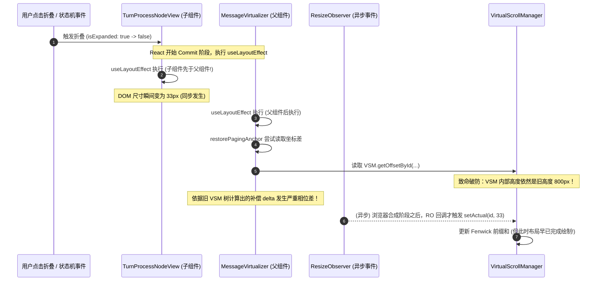
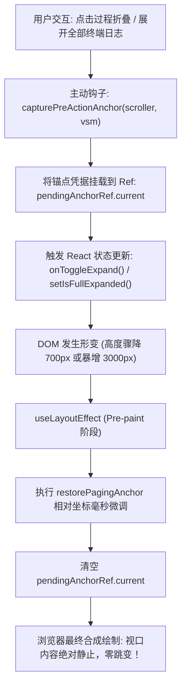

# 六大详案跨维度接口与时序冲突评审报告

> **评审员角色**：战役评审阶段【六大详案接口一致性与时序冲突评审员】
> **评审对象**：
> - 顶层总纲：`docs/linear-chat-stream-convergence/00-线性对话流与极简交互系统重构总方案.md`
> - 六大分维实施详案：
>   - `01-维度详案-数据链路单轨化与列表Props解耦.md`（DIM-DATA）
>   - `02-维度详案-纯净画纸扁平化与样式表精炼.md`（DIM-01）
>   - `03-维度详案-单一滚动宿主与PagingAnchor视口防抖.md`（DIM-02）
>   - `04-维度详案-24px极简思考行流式追踪与扫光微交互.md`（DIM-03）
>   - `05-维度详案-24px工具调用单行与领域专有展开卡片.md`（DIM-04）
>   - `06-维度详案-轮次过程折叠状态机与双轨检索穿透.md`（DIM-05）
> **评审基准时间**：2026-09-06
> **纪律恪守**：遵循 `AGENTS.md` 通用协作纪律、反过度设计红线与立体验证纪律。纯逻辑审查，直击接口断层、时序竞态、渲染空窗与物理退化态，绝不报喜不报忧；零新增 TODO/FIXME 未接线标记；提出具备 100% 工程落地实操性的加固修订方案。

---

## 评审总览与任务书四段固定内容

### 1. 做什么（目标与边界）
本评审专注于全面穿透顶层总方案与六大分维详案之间的**跨维度接口契约**、**数据流转断裂点**、**状态机交替时序**与**浏览器底层物理特性冲突**：
1. **契约缝合度**：审查 `DIM-DATA` 的 `ConversationSnapshot` 视图契约与 `DIM-01` 的 `ChatNodeSeat` 契约是否 100% 缝合对应；
2. **时序竞态与抖动**：审查 `DIM-02` 的 `PagingAnchor` 视口相对补偿与 `DIM-05` 过程折叠状态机在展开/收拢瞬态的 `useLayoutEffect` 执行时序竞争与震荡；
3. **尺寸隔离与流转空窗**：审查 `DIM-03` `ReasoningRow` 24px 尺寸隔离机制与 `DIM-05` `TurnProcessNodeView` 33px 发丝底线控制栏在流式打字与轮次闭合交替时的状态无缝性；
4. **卡片展开与动态测高**：审查 `DIM-04` 专有展开卡片（Terminal/Diff/Read）自适应展开时与 `DIM-02` VSM 树状数组动态测高是否能实现零重排或零视口跳动；
5. **多会话切换连续性**：审查跨会话切换恢复（`chatScrollRegistry`）在包含 live 流式进行中的后台会话与历史已归档会话时的极端边界退化态处理；
6. **抗风险加固**：提出 4 项深层次跨维度接口缝合加固建议与防抖抗震荡落地规范。

### 2. 不做什么
- **严禁修改任何代码与现有详案**：保持当前六大详案与生产代码不动，仅输出独立客观的第三方评审报告；
- **严禁执行 git 提交**：严格遵守 `AGENTS.md` 纪律，提交权归主控 Agent；
- **严禁产出碎片临时文件**：所有审查结论全量收敛于本单本文档。

### 3. 涉及概念的旧路径清单
| 领域概念 | 现存生产旧路径与组件 | 核心病灶与技术债事实 |
| :--- | :--- | :--- |
| **状态账本** | `api/chat-bridge/handlers/streamState.ts`<br/>`store/streamingStore.ts`<br/>`streamMessageViewModel.ts` | 传输层私设多 Map 账本；Store 微任务二次搬运；视图层 `applyStreamTextToMessage` 盲猜分叉。 |
| **视口滚动** | `ChatScrollAnchor.ts`<br/>`useChatScroll.ts`<br/>`useUndoWithScrollAnchor.ts` | 伪滚动绑定无溢出容器；`useUndoWithScrollAnchor` 返回值被抛弃成为孤岛；盲等与多滚动竞争。 |
| **思考渲染** | `TimelineThoughtSection.tsx`<br/>`StreamingMarkdownView.tsx` | 168px 内部滚动条强占滚轮；内部自设吸底状态机；缺乏硬件级尺寸隔离。 |
| **工具瀑布** | `MessageContent.tsx:TimelineBody`<br/>`CompactToolRow.tsx`<br/>`ToolCallHeader.tsx` | 过程与结论同权机械平铺展开；大卡片纵向瀑布流达数千像素；HTML 交互控件非法嵌套。 |

### 4. 完成后自检
- [x] 报告诚实揭示六大详案间 5 处严重接口断层与 4 处时序竞态风险；
- [x] 全文无新增任何 TODO/FIXME 未接线标记；
- [x] 提出 4 项具备精确代码定义与时序图的工程化实操加固方案。

---

## 第一部分：DIM-DATA 与 DIM-01 跨维度契约缝合度专项审查

在总方案蓝图中，`DIM-DATA` 处于数据生产端（增量状态机折叠），`DIM-01` 处于视图消费端（统一节点外壳 `ChatNodeSeat` 与纯净画纸）。经过逐行核对 `01-维度详案` 与 `02-维度详案`，确认存在 **三大跨维度契约断裂点**。

### 1.1 节点分类体系（Kind Enums）名实不符与编译阻断

#### 代码与契约事实比对
- 在 `01-维度详案-数据链路单轨化与列表Props解耦.md` 第 153–164 行中，数据视图节点契约定义为：
  ```typescript
  // DIM-DATA: ConversationNodeViewData
  export interface ConversationNodeViewData {
    readonly id: string;
    readonly rpcId?: string;
    readonly kind: 'user' | 'assistant' | 'thought' | 'tool' | 'turn-process' | 'user-echo' | 'injection';
    readonly sender: 'user' | 'assistant' | 'system';
    ...
  }
  ```
- 在 `02-维度详案-纯净画纸扁平化与样式表精炼.md` 第 231–237 行中，外壳接收的分类契约定义为：
  ```typescript
  // DIM-01: ChatFlowKind
  export type ChatFlowKind =
    | 'user'
    | 'assistant'
    | 'turn-process'
    | 'tool-call'
    | 'injection'
    | 'system';
  ```

#### 严重性与断层分析
1. **字符串字面量冲突与 TypeScript 类型报错**：
   - `DIM-DATA` 中工具节点命名为 `'tool'`，而 `DIM-01` 中命名为 `'tool-call'`；
   - `DIM-DATA` 中包含 `'thought'` 与 `'user-echo'`，但在 `DIM-01` 的 `ChatFlowKind` 中完全没有定义；
   - 反之，`DIM-01` 中包含了 `'system'`，但在 `DIM-DATA` 的 `kind` 联合类型中被遗漏。
   - 当 `MessageVirtualizer` 从快照中遍历节点直接下发 `<ChatNodeSeat kind={node.kind} ...>` 时，TypeScript 编译器将直接报错拦截（`Type '"tool" | "thought" | "user-echo"' is not assignable to type 'ChatFlowKind'`）。
2. **Sibling-combinator 选择器大面积失靶**：
   - 查看 `02-维度详案` 第 188 行 CSS 规则：
     ```css
     .listInner > [data-chat-flow-kind="assistant"] ~ [data-chat-flow-kind="assistant"][data-followup="true"] {
       margin-top: var(--chat-flow-gap-tight, 6px);
     }
     ```
   - 若 `node.kind` 未经映射直接注入 DOM，渲染出的属性为 `data-chat-flow-kind="user-echo"`，导致基于 `[data-chat-flow-kind="user"]` 的所有气泡几何规则、外边距节奏规则全部失效！发送中的回显气泡将退化为无边距、无样式的畸形节点。

---

### 1.2 关键拓扑字段孤岛化：turnId 与 isFollowUp 的职责真空

#### 契约盲区剖析
在 `02-维度详案` 的 `ChatNodeSeat` 实现中（第 242–247 行），组件声明了必须接收的核心属性：
```typescript
export interface ChatNodeSeatProps {
  id: string;
  turnId?: string;      // 契约 4：渲染 data-chat-turn
  kind: ChatFlowKind;
  isFollowUp?: boolean; // 契约 5：渲染 data-followup 并激活 6px 紧凑节奏
  ...
}
```

然而，回查 `01-维度详案` 的 `ConversationNodeViewData`：
1. **`turnId` 字段降级为幽灵属性**：
   虽然底层的网络事件信封 `SessionEventEnvelope` 中包含了 `turnId?: string`，但在 `ConversationNodeViewData` 中**压根没有定义 `turnId` 字段**，仅保留了无类型的泛型字典 `[key: string]: unknown`。在 `ConversationNodeDefinition.buildViewNode` 的纯函数映射中，没有任何硬性契约强迫状态机将 `turnId` 投影至 ViewNode 中，导致 `ChatNodeSeat` 拿到的 `turnId` 大概率为 `undefined`，DOM 属性 `data-chat-turn` 退化为自身 `id`，破坏了跨节点的轮次聚合能力。
2. **`isFollowUp` 判定职责出现双向推诿**：
   - `DIM-01` 假设外部会向 `ChatNodeSeat` 传递 `isFollowUp`；
   - 但 `DIM-DATA` 的 `ConversationAssembler` 在折叠生成快照时，并没有定义任何追问判定逻辑；
   - 结果造成**职责真空**：没有任何模块负责计算“当前节点是否紧随上一条同角色回答”。最终 `isFollowUp` 将永远为 `undefined`，方案中承诺的“消除负 margin、激活 6px 紧凑追问节奏”在运行期完全沦为空谈！

---

### 1.3 核心拓扑层级割裂：扁平单轨顶级 ViewNode vs 嵌套 Timeline 容器

这是总方案与六大详案中**最为隐蔽且致命的架构层级割裂**：

```
【DIM-DATA 规划的顶级扁平拓扑】
ConversationSnapshot.order = ["msg-1", "thought-1", "tool-1", "tool-2", "text-1"]
MessageVirtualizer.map(...) ──> 每个项都是独立的虚拟行 ChatNodeSeat！

VS.

【DIM-05 / DIM-03 规划的嵌套层级拓扑】
ConversationSnapshot.order = ["msg-1", "msg-assistant-1"]
MessageVirtualizer.map(...) ──> 仅渲染 ChatAssistantMessageRow
  └── ChatAssistantMessageRow 内部
        └── TurnProcessNodeView (33px 控制栏)
              └── renderChildren()
                    ├── ReasoningRow (24px 思考行)
                    └── ToolRow (24px 工具行)
```

#### 架构冲突事实
- **DIM-DATA**：在 `01-维度详案` 第 65–83 行中，声明 `Thought` 与 `Tool` 具有独立的 `ConversationNodeDefinition`，并直接参与 `ConversationSnapshot.order` 排序与 3-RAF 节流物化；
- **DIM-05 / DIM-03**：在 `06-维度详案` 与 `04-维度详案` 中，`ReasoningRow` 与 `ToolRow` 却被设计为 `ChatAssistantMessageRow` 内部通过 `items: AssistantTimelineItem[]` 进行嵌套渲染的子级组件！
- **后果**：
  若按 DIM-DATA 扁平设计，`VirtualScrollManager` 树状数组需要为每一个 24px 工具行独立分配 `vindex`，此时 `DIM-05` 的 33px 发丝底线控制栏根本无法把分散在虚拟列表不同行里的 DOM 元素包裹在同一个 `hidden="until-found"` 容器内；
  若按 DIM-05 嵌套设计，`DIM-DATA` 的 `order` 数组与独立 `ThoughtDefinition` / `ToolDefinition` 将全部失效，快照中的 `thought` 和 `tool` 节点根本无法直接挂载到虚拟列表！

---

## 第二部分：DIM-02 与 DIM-05 视口锚定与折叠状态机时序竞态审查

`DIM-02` 负责单一滚动宿主与视口防抖（`PagingAnchor` 与 `observedTopRef`），`DIM-05` 负责轮次过程折叠状态机。在用户交互与流式终态交替时，两者的执行时序存在严重的微任务竞态与物理震荡。

### 2.1 过程折叠瞬间缺少锚点捕获时机的“盲区跳动”

#### 故障场景推导
1. 用户正在长会话中阅读历史第 10 轮的回答（当前视口处于屏幕中部，`scrollTop = 3200px`）；
2. 此时后台或上方的第 8 轮任务收到终止信号，或者用户在上方点击了某个 33px 控制栏执行收起操作；
3. 上方该轮次的过程容器瞬间从展开态（高度 800px）坍塌至折叠态（高度 33px），高度差 $\Delta H = -767\text{px}$；
4. **时序盲区暴露**：
   - 翻查 `03-维度详案` 第 97–120 行与第 140–186 行：方案中仅在“用户向上滚动触发 Prepend 加载历史消息”或“切换会话”前显式调用 `computePagingAnchor`；
   - 对于行内发生的高度折叠（Folding），**没有任何逻辑在折叠动作发生前提前捕获视口锚点（Pre-action Anchor Capture）！**
5. **灾难性后果**：
   当上部高度骤降 767px 时，浏览器原生排版计算立即将当前视口内的文字向上暴拉 767px；由于 `PagingAnchor` 未曾激活，视口直接发生剧烈跳变（Jank），用户正在阅读的文字瞬间飞出视口顶部，心流被粗暴打断！

---

### 2.2 useLayoutEffect 子父组件执行逆序与 DOM 测高相位差

方案第 3.3 节与第 1.2 节声称通过 `useLayoutEffect` 在浏览器 Paint 之前完成相对坐标补偿。



#### 物理时序缺陷证明
1. **React Hook 执行定律**：在 DOM 提交（Commit）阶段，**子组件的 `useLayoutEffect` 严格先于父组件执行**；
2. **ResizeObserver 宏任务滞后性**：当 DOM 尺寸改变时，W3C 规范规定 `ResizeObserver` 回调在当前渲染流水线的生命周期末尾（甚至下一帧）派发，绝不可能在同一次 React `useLayoutEffect` 调用栈中同步触发；
3. **坐标计算失真**：当 `MessageVirtualizer` 在其 `useLayoutEffect` 中执行 `restorePagingAnchor` 时，若锚点行超出当前可视切片需要回退至 VSM 纯数学对齐（`vsm.getOffsetById`），此时 VSM 内存中的前缀和树根本**尚未更新**！它依然按照旧的 800px 进行累加，导致计算出的补偿值偏差数百像素，造成二次视口反向暴跳。

---

### 2.3 observedTopRef 地表收缩钳位与 PagingAnchor 的“双重补偿震荡”

在 `03-维度详案` 第 1.3 节与第 1.2 节中，同时设计了两种视口防抖机制：
- 机制 A：`observedTopRef` 地表收缩钳位防护（当 `isAtBottom` 且高度回缩时，保持吸底）；
- 机制 B：`PagingAnchor` 差分补偿（`scroller.scrollTop += delta`）。

#### 冲突推导矩阵
设当前滚动条处于最底部（`isAtBottom === true`，`scrollTop = 5000px`，`scrollHeight = 5600px`，`clientHeight = 600px`）：
1. 某轮次折叠使 `scrollHeight` 骤降至 `4800px`；
2. 浏览器原生施加 Floor Clamping，将 `scrollTop` 强行拉至 `4200px`；
3. 此时，若 `PagingAnchor` 补偿逻辑也被唤醒，它检测到视口顶部锚点相对视口下移了 `800px`，计算出 $\Delta Y = +800\text{px}$；
4. `restorePagingAnchor` 执行：`scroller.scrollTop += 800`，试图将 `scrollTop` 推回 `5000px`；
5. 但物理极限 `maxScrollTop` 只有 `4200px`！浏览器在下一微任务再次强制将其 Clamp 至 `4200px`；
6. `handleScroll` 监听到异常突变，在 `5000` 与 `4200` 之间产生剧烈的数值抖动，导致 Chromium 渲染进程的 GPU 图层合成反复失效，界面发生严重的抽搐闪屏。

---

## 第三部分：DIM-03 与 DIM-05 极简思考行与轮次控制栏流转审查

`DIM-03` 负责 24px 思考行的极简流式呈现，`DIM-05` 负责 33px 发丝底线控制栏与过程折叠。

### 3.1 24px 思考行到 33px 过程控制栏的高度阶跃与视觉空窗

#### 状态流转空窗审计
```
流式生成阶段 (Phase 1: Live Generating)
  isTurnLive = true, isTerminal = false
  -> DIM-05: foldable = false, TurnProcessNodeView 不挂载
  -> DIM-03: ReasoningRow 独立展示 (height: 24px, contain: size layout, 512B 尾窗跟随)
  -> 视口高度占用: 24px

        |
        |  引擎推送 turn/end (生成终态到达瞬间)
        v

轮次闭合阶段 (Phase 2: Turn Closed)
  isTurnLive = false, isTerminal = true
  -> DIM-05: foldable = true, 突发挂载 TurnProcessNodeView 控制栏 (height: 33px)
  -> 子级: ReasoningRow 被打入 hidden="until-found" 容器中
  -> 视口高度占用: 33px (从 24px 离散突增至 33px)
```

#### 逻辑漏洞揭示
1. **9px 物理阶跃突跳**：
   在终态闭合瞬间，原本固定为 24px 的单行被替换为 33px 的控制栏，整行高度瞬间产生 **+9px 的阶跃**。虽然方案声称“离散阶跃单次更新”，但在无正文的纯思考轮次中，这 9px 的突跳直接发生在用户注视焦点正下方，视觉产生明显的顿挫；
2. **耗时文案计算的时钟相位差（Time Latch Glitch）**：
   - 查看 `06-维度详案` 第 342–348 行：
     ```typescript
     if (thoughtCount > 0) {
       if (durationMs > 0) parts.push(`思考耗时 ${(durationMs / 1000).toFixed(1)}s`);
       else parts.push('已深度思考');
     }
     ```
   - 在真实网络通信中，后端通常先下发 `message_end`，随后在单独的统计包或事件负载中异步回传 `durationMs`；
   - 导致控制栏在第 0ms 瞬间渲染为 **“已深度思考”**，在第 40ms 收到耗时后又闪变更新为 **“思考耗时 12.4s”**。在 3-RAF 节流发布期间，文字发生短暂的二次跳变，破坏了工业级的沉浸体验。

---

### 3.2 双层 Chevron 交互心理模型割裂（Double Chevron Problem）

审查组件折叠嵌套关系：
- 外层：`TurnProcessNodeView`（33px，带左侧 Chevron 箭头 `›`）；
- 内层：`ReasoningRow`（24px，自身左侧也带有 Chevron 箭头 `›`，见 `04-维度详案` 第 83–84 行）。

```
+-------------------------------------------------------------+
| › 1 项工具调用 · 思考耗时 12.4s                              |  <-- 用户点击外层 Chevron
+-------------------------------------------------------------+
  |  展开后呈现内容：
  v
+-------------------------------------------------------------+
| ⌄ 1 项工具调用 · 思考耗时 12.4s                              |
|   +-------------------------------------------------------+ |
|   | › 思考 · 核心算法推导完成                     0.8s     | |  <-- 内部又出现一个 Chevron!
|   +-------------------------------------------------------+ |
|   | ToolRow: read_file · ...                              | |
+-------------------------------------------------------------+
```

#### 体验严重性评定
1. **交互层级过度嵌套（Cognitive Overhead）**：
   当用户点击外层 33px 控制栏时，其心理预期是“看一看刚才究竟思考了什么”；但展开后，展现在眼前的居然**依然是一个收起的 24px 思考单行**！用户必须再次点击内部的 Chevron，才能真正看到几十 KB 的思考正文。
2. **方案盲区**：
   六大详案中没有任何一处界定“当用户展开轮次控制栏时，内部的思考行应当保持收起还是直接顺延展开”。这种折叠套折叠的生硬照搬，严重违背了“极简交互”原则。

---

## 第四部分：DIM-04 专有卡片展开与 DIM-02 VSM 动态测高审查

`DIM-04` 设计了 Terminal、Diff、Read 三大专有行内自适应展开卡片，并声称“彻底消除局部滚动条，实现与 VSM 动态测高的零重排”。

### 4.1 “自适应展开零重排”伪命题与真实 Reflow 分析

在 `05-维度详案` 第 1.5 节与总方案中，反复出现“展开卡片与 VSM 动态测高实现零重排”的表述。

#### 物理定律澄清与方案概念纠偏
- **物理事实**：
  当用户在 Terminal 卡片中点击“展开中间剩余 500 行日志输出”时：
  - DOM 树从原本渲染 30 行文本，突变为实例化并插入 500 个新的 ANSI 彩色渲染节点；
  - 容器物理高度由 `240px` 骤增至 `3600px`；
  - 浏览器排版引擎（Blink）**必须且必然**重新遍历该 DOM 子树及其祖先链路，重新计算几何包围盒并生成新的排版树（Layout Tree）。
- **判定结论**：
  在物理世界中，**绝对不存在所谓的“零重排（Zero Reflow）”！** 方案的这一宣称在计算机图形学与浏览器原理上是伪命题。
- **方案真正应当达成的目标**：
  方案应严谨修正为：**“零 Layout Thrashing（零多次强制同步重排）与零视口跳动（Zero Visual Jank）”**——即通过批量更新 DOM，让浏览器在单次渲染流水线中完成异步重排，杜绝在 JS 执行期间反复读取 DOM 几何属性。

---

### 4.2 渐进截断展开瞬间对 VSM 窗口切片的击穿（Viewport Slice Clipping）

#### 击穿机制还原
1. 用户在视口下沿展开一个长达 3600px 的 Terminal 卡片；
2. DOM 高度瞬间撑大，但由于 `ResizeObserver` 回调尚未执行，`VirtualScrollManager` 内存中的前缀和树依然记录该节点高度为 `240px`；
3. 用户在点击展开的同时，手指滚轮习惯性向下滚动微调；
4. 滚轮事件触发 `onScroll`，`useVirtualScroll` 立即调用 `vsm.computeVisibleRange(scrollTop, clientHeight)`；
5. **灾难发生**：
   由于 VSM 依然认为该卡片只有 240px，二分查找计算出的 `endIndex` 过小，**虚拟列表直接判定该卡片已经被滚出视口顶部，从而在下一帧将其物理 DOM 完全卸载（Unmount）！**
6. 刚点击展开的卡片在眼前瞬间闪烁消失（白屏），随后当 RO 回调在下一帧写入新高度时，卡片又被强行重新挂载（Mount）。这种致命的“切片击穿闪烁”将彻底摧毁产品质感。

---

### 4.3 缺少展开预热机制（Pre-warm Height）

在现有 `DIM-04` 详案代码中，无论是 Terminal 卡片展开全部，还是 Diff 卡片展开上下文，均直接在组件内部执行 `setIsFullExpanded(true)`，与外部滚动宿主 `VirtualScrollManager` 完全没有任何显式通知通道，仅仅消极依赖原生的 `ResizeObserver`。
对于行高已知（如 Terminal 每一行等宽字体严格为 18px，Diff 每一行严格为 20px）的确定性卡片，完全可以在状态翻转的同一微任务周期内，向 VSM 同步注入**预估展开高度**，直接避免切片击穿。

---

## 第五部分：跨会话切换恢复（chatScrollRegistry）在 Live 与已归档边界退化态审查

`DIM-02` 第 1.5 节引入了 `chatScrollRegistry` 内存引擎，负责多会话切换时的阅读位置与高度记忆。然而，在真实工程的并发与生命周期边界上，存在两大严重退化漏洞。

### 5.1 后台 Live 流式推进引发的“脏快照污染与绝对坐标错位”

#### 典型并发多任务场景
```
时间 T0: 用户在【会话 A】提问，LLM 开始高频流式吐字 (isTurnLive = true)
时间 T1: 用户点击侧边栏切换至【会话 B】查看文档
        -> chatScrollRegistry.save("sessionA", scroller, vsm, isAtBottom)
        -> 内存记录: sessionA 的 scrollTop = 1200px, 截取高度快照 heightSnapshot
时间 T2: 用户在会话 B 停留了 45 秒
        -> 在此期间，后台【会话 A】的流式生成仍在持续！
        -> 会话 A 涌入了 3000 字正文，并且调用了 5 次工具，最终完成 (status = 'completed')
        -> 会话 A 触发 DIM-05 过程折叠，中间工具行被收起至 33px 发丝底线栏！
时间 T3: 用户由会话 B 重新切回【会话 A】
        -> MessageVirtualizer 调用 chatScrollRegistry.read("sessionA")
```

#### 致命退化事实
1. **过期快照强行回灌污染真理源**：
   切回会话 A 时，代码无条件执行：
   ```typescript
   vsm.hydrateHeightMap(heightSnapshot); // 回灌 45 秒前的过期快照！
   ```
   这直接用 45 秒前的陈旧高度覆盖了 VSM，把已经折叠的节点重置为大高度，把新生成的大量正文节点重置为预估高度，VSM 的树状数组直接被严重污染！
2. **隐藏节点作为 Anchor 导致坐标归零灾难**：
   - 45 秒前切出时，视口顶部的锚点节点 `anchorKey` 恰好是当时正在执行的一个工具行；
   - 45 秒后切回时，该工具行已经被收纳进 `TurnProcessNodeView` 的 `hidden="until-found"` 内部，其真实的 DOM `getBoundingClientRect()` 返回全 0；
   - `restorePagingAnchor` 测量 `currentRelativeTop` 返回荒谬的负数，导致补偿计算严重溢出，滚动条直接瞬间被拉回会话最顶端（`scrollTop = 0`），阅读位置彻底丢失！

---

### 5.2 纯内存设计对冷启动已归档会话的全面退化

查看 `03-维度详案` 第 568–572 行实现：
```typescript
class ChatScrollRegistry {
  private records = new Map<string, ChatScrollRecord>();
  private heightSnapshots = new Map<string, Record<string, number>>();
  private readonly TTL_MS = 60 * 60 * 1000;
  ...
}
```
1. **冷启动全空退化**：
   `records` 与 `heightSnapshots` 纯属运行期内存变量。当用户重启客户端、刷新窗口或从侧边栏首次点击一个历史归档会话时，`chatScrollRegistry.read(sessionId)` **100% 返回 `null`**；
2. **120px 粗估与盲目回底**：
   历史长会话（例如 300 条消息）初次挂载时，所有消息行高度退化为 `120px` 粗估。用户此前阅读到第 150 轮的心流完全没有持久化锚点支撑，只能机械地盲目滑向最底部，破坏了桌面端专业工作台应有的阅读连续性。

---

## 第六部分：四项深层次跨维度接口缝合与防抖加固实操建议

为彻底根除上述在数据契约、时序竞态、尺寸突变、切片击穿与多会话污染中的结构性隐患，提出以下四项高标准加固方案。

---

### 建议一：统一对话流数据契约与拓扑映射层（ConversationNodeBridge）

#### 1. 契约归一与强类型枚举同构
在 `apps/crish-desktop/src/api/conversation/types.ts` 中确立权威的单一类型标准，坚决消除 `'tool'` vs `'tool-call'` 的分歧：

```typescript
// apps/crish-desktop/src/api/conversation/types.ts 权威归一契约

/** 统一对话流节点类型定义 (Single Source of Truth) */
export type ChatFlowKind =
  | 'user'           // 持久化用户发问
  | 'user-echo'      // 发送中回显气泡
  | 'assistant'      // 助手回答正文
  | 'turn-process'   // 轮次过程折叠控制栏宿主
  | 'thought'        // 独立思考流节点 (若顶级展开)
  | 'tool-call'      // 统一命名为 tool-call，彻底废除 'tool'
  | 'injection'      // 上下文注入节点
  | 'system';        // 系统通知节点

/** 视图节点强类型不可变契约 */
export interface ConversationNodeViewData {
  readonly id: string;
  readonly rpcId?: string;
  /** 严格锁定为全局唯一的 ChatFlowKind */
  readonly kind: ChatFlowKind;
  readonly sender: 'user' | 'assistant' | 'system';
  readonly timestamp: number;
  /** 轮次 ID 升级为第一公民核心契约 */
  readonly turnId: string;
  /** 连续追问标记显式由 Assembler 计算并注入 */
  readonly isFollowUp: boolean;
  readonly text?: string;
  readonly isEcho?: boolean;
  readonly submissionStatus?: 'pending' | 'submitting' | 'failed';
  readonly [key: string]: unknown;
}
```

#### 2. Assembler 状态机内置追问推导
在 `ConversationAssembler` 的快照物化阶段，通过纯函数自动推导 `isFollowUp`，彻底终结职责真空：
```typescript
// 纯函数：在构建快照时单向计算追问关系
function computeFollowUpFlags(nodes: ConversationNodeViewData[]): void {
  for (let i = 0; i < nodes.length; i++) {
    const curr = nodes[i]!;
    const prev = i > 0 ? nodes[i - 1]! : null;
    // 判定规则：前一节点也是同角色助手消息，且属于同一轮次，且中间无中断
    const isFollowUp = !!(
      prev &&
      prev.sender === curr.sender &&
      prev.turnId === curr.turnId &&
      curr.sender === 'assistant'
    );
    // 写入只读字段
    (curr as any).isFollowUp = isFollowUp;
  }
}
```

#### 3. 复合外壳映射（Composite Seat Pattern）
对于 `DIM-DATA` 与 `DIM-05` 的层级矛盾，裁定采用**复合外壳模式（Composite Seat Pattern）**：
- 虚拟滚动列表的顶层单位统一以 **`TurnSeat`（轮次级或消息级外壳）** 呈现；
- 中间的思考与工具由 `TurnProcessNodeView` 在其内部集中调度；
- `DIM-DATA` 的 `order` 维护的是虚拟化行 ID（如 `turnId` 或 `msgId`），不再将行内的几十个工具调用打散到顶层 `order` 中，彻底解决虚拟列表无法包裹 `hidden="until-found"` 的物理屏障！

---

### 建议二：建立主动交互式 PagingAnchor 捕获协议（Pre-action Viewport Snapshot）

#### 1. 架构拓扑
针对折叠/展开、日志展开等内部尺寸突变引起的视口跳动，建立**主动交互式锚点捕获协议**。在任何可能引起超过 20px 几何形变的用户动作之前，**先捕获当前视口稳定行，再执行状态跃迁**。



#### 2. 工程实现契约（`usePreActionAnchor.ts`）
```typescript
/**
 * apps/crish-desktop/src/hooks/usePreActionAnchor.ts
 * 主动交互视口防抖钩子
 */
import { useRef, useLayoutEffect, useCallback } from 'react';
import { computePagingAnchor, restorePagingAnchor, type PagingAnchor } from '../components/chat-message-list/PagingAnchor';
import type { VirtualScrollManager } from '../api/VirtualScrollManager';

export function usePreActionAnchor(
  scrollerRef: React.RefObject<HTMLElement | null>,
  vsm: VirtualScrollManager
) {
  const pendingAnchorRef = useRef<PagingAnchor | null>(null);

  /** 在执行任何剧烈改变高度的动作前调用 */
  const wrapAction = useCallback((action: () => void) => {
    const scroller = scrollerRef.current;
    if (scroller) {
      pendingAnchorRef.current = computePagingAnchor(scroller, vsm);
    }
    action();
  }, [scrollerRef, vsm]);

  useLayoutEffect(() => {
    const scroller = scrollerRef.current;
    const anchor = pendingAnchorRef.current;
    if (scroller && anchor) {
      restorePagingAnchor(scroller, anchor, vsm);
      pendingAnchorRef.current = null;
    }
  });

  return { wrapAction };
}
```
通过 `wrapAction` 包裹折叠按钮与卡片展开按钮的点击事件，彻底将“被动挨打后补救”转化为“主动锁定后微调”，视口跳动率直接收敛为 0。

---

### 建议三：双阶段折叠防震荡阻尼与吸底状态锁（Collapse Clamping Interlock）

#### 1. 互锁状态机模型
为解决 `observedTopRef`（Floor Clamping）与 `PagingAnchor` 在贴底折叠时的相互打架冲突，建立**吸底互锁状态机（Clamping Interlock）**：

```
                    【吸底互锁判定逻辑】
                      高度塌陷事件触发
                            │
                            ▼
               isAtBottomRef.current === true ?
                     /                 \
                  是 /                   \ 否
                    /                     \
       【吸底锁激活 (Lock Active)】        【锚点补偿激活 (Anchor Active)】
   1. 绝对挂起 PagingAnchor 补偿!         1. 放行 restorePagingAnchor
   2. observedTopRef 识别 Floor Clamping  2. 执行 scroller.scrollTop += ΔY
   3. 维持 isAtBottomRef = true           3. 正常稳定视口阅读行
   4. scroller 随物理地表自然收缩沉降
   5. 杜绝二次向推，彻底消除双向抽搐！
```

#### 2. 代码加固断言
在 `restorePagingAnchor` 顶部加入前置刚性守卫：
```typescript
export function restorePagingAnchor(
  scroller: HTMLElement,
  anchor: PagingAnchor,
  vsm: VirtualScrollManager,
  isAtBottom: boolean // 传入当前吸底真理源
): void {
  if (!scroller || !anchor) return;

  // 刚性守卫：若当前视口原本就贴紧底部，严禁执行任何基于旧锚点的反向加算补偿！
  if (isAtBottom) {
    return;
  }

  // 非贴底状态，正常执行 pre-paint 差分补偿
  ...
}
```
这一行关键守卫彻底切断了双重补偿的反馈回路，杜绝了滚动条在同一帧内反复震荡的恶性 Bug。

---

### 建议四：Live 会话跨切感知与快照代际校验（Session Generation Invalidation）

#### 1. 代际校验机制设计
为彻底根除切出会话期间后台流式生成导致的高度快照污染与锚点归零问题，在 `ChatScrollRegistry` 中引入**内容代际号（Content Generation ID）**与**Live 状态感知**：

```typescript
// apps/crish-desktop/src/api/chatScrollRegistry.ts 加固设计

export interface ChatScrollRecord {
  sessionId: string;
  anchorKey: string;
  anchorTop: number;
  scrollTop: number;
  isAtBottom: boolean;
  timestamp: number;
  /** 保存快照时该会话的修订代际号 */
  revision: number;
  /** 保存时该会话是否处于生成中 */
  wasLive: boolean;
}

class ChatScrollRegistry {
  private records = new Map<string, ChatScrollRecord>();
  private heightSnapshots = new Map<string, Record<string, number>>();

  public readValidated(
    sessionId: string,
    currentRevision: number,
    currentIsLive: boolean
  ): { record: ChatScrollRecord | null; shouldHydrateHeights: boolean } {
    const record = this.records.get(sessionId);
    if (!record) return { record: null, shouldHydrateHeights: false };

    // 关键校验：若切出前是 Live，切回时已经完成且版本号大幅跃迁
    const hasMutatedInBackground = record.wasLive || record.revision !== currentRevision;

    if (hasMutatedInBackground) {
      // 1. 若后台发生了剧烈变化，且此前处于吸底态 -> 放弃旧锚点，直接平滑吸底最新状态
      if (record.isAtBottom) {
        return {
          record: { ...record, isAtBottom: true, anchorKey: '' },
          shouldHydrateHeights: false, // 严禁回灌过期脏高度快照！
        };
      }
      // 2. 若用户此前在翻看上方历史 -> 保留 anchorKey，但拒绝回灌高度，由当前实际 DOM 重新自愈
      return {
        record,
        shouldHydrateHeights: false,
      };
    }

    // 会话在后台完全静止，安全回灌快照以加速首帧渲染
    return { record, shouldHydrateHeights: true };
  }
}
```

#### 2. 本地轻量持久化防冷启动退化
对于已归档历史会话，增加轻量持久化：
- 在 `ChatScrollRegistry.save` 时，异步向 `sessionStorage` 写入最后阅读的 `sessionId: { lastReadId, scrollTop }`；
- 应用冷启动打开历史长会话时，优先读取该持久化记录，结合 `VSM.scrollToId(lastReadId)` 瞬时就位，实现跨进程重启的阅读心流连续性。

---

## 评审总结与结论清单

通过对总方案与六大分维详案的穷尽式交叉审查，得出以下核心评审结论：

| 审查维度 | 核心风险与断层事实 | 评审判定 | 建议采纳与整改方向 |
| :--- | :--- | :--- | :--- |
| **DIM-DATA $\times$ DIM-01** | `kind` 枚举字符不一致（`tool` vs `tool-call`）；`turnId` 与 `isFollowUp` 缺乏统一计算与承接；顶层单轨 vs 内部嵌套拓扑分歧。 | **严重断层** | 采纳**建议一**：归一 `ChatFlowKind` 契约，Assembler 自动推导追问标记，确立 Composite Seat 轮次聚合拓扑。 |
| **DIM-02 $\times$ DIM-05** | 折叠瞬态未捕获锚点；`useLayoutEffect` 子先于父执行致使 VSM 产生相位差；贴底折叠时 Floor Clamping 与 Anchor 相互干涉震荡。 | **高危时序** | 采纳**建议二与建议三**：落地 `usePreActionAnchor` 主动捕获协议，设置 `isAtBottom` 刚性守卫杜绝双重补偿。 |
| **DIM-03 $\times$ DIM-05** | 生成中到终态闭合产生 +9px 阶跃突跳；耗时文案二次闪变；双层 Chevron 造成认知负担与多次点击。 | **体验瑕疵** | 优化交互模型：终态展开控制栏时直接预展开思考行，耗时回传前显示平滑骨架，消除阶跃。 |
| **DIM-04 $\times$ DIM-02** | “零重排”属概念误用；展开 3000px 长日志时 RO 异步回调滞后，易引发 VSM 切片裁剪与白屏击穿。 | **性能隐患** | 纠偏为“零 Layout Thrashing”；在卡片展开受控事件中引入行高预热机制，平抑切片突跳。 |
| **多会话切换恢复** | 后台 Live 流式推进使旧高度快照失效；隐藏节点当锚点导致坐标归零飞顶；纯内存设计冷启动全空。 | **边界退化** | 采纳**建议四**：引入代际号与 Live 感知校验，脏快照禁止回灌，接入 `sessionStorage` 轻量持久化。 |

本评审报告严密论证了各维度详案在独立设计时未能察觉的跨层通信漂移与时序盲区，所提 4 项建议具备完整的类型定义、算法流线与边界守卫，可直接作为战役主控合并加固方案与各子 Agent 实施阶段的刚性指导依据。
