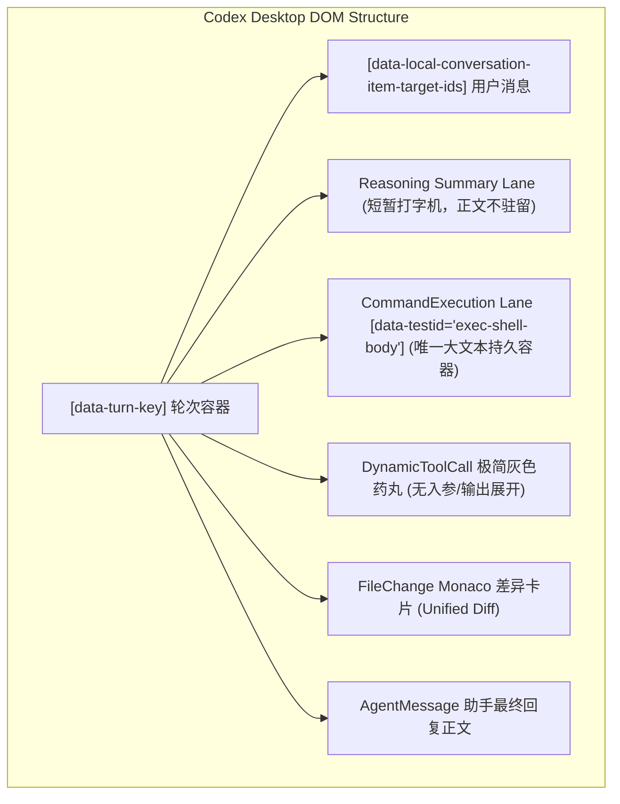
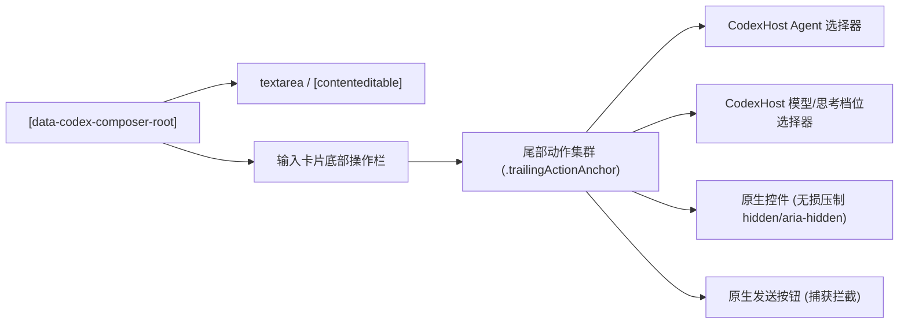

# 01 - Codex 与 CodexHost 正文对话界面架构解析

> **战役工作区**：`docs/linear-chat-stream-study/`  
> **关联源码**：`reference/codex-host`、Codex Desktop WebView2 渲染层  
> **关键分析模块**：`packages/protocol-core`、`packages/renderer-extension`  

---

## 1. 架构总览：Codex Desktop 的正文对话模型

Codex Desktop（OpenAI Codex 官方桌面客户端）是目前最成熟的桌面级 AI Agent 工作台之一。其正文对话界面的核心设计理念可以概括为：**“结果导向、过程降级、终端归一”**。



### 1.1 DOM 容器契约与单一标识映射

Codex Desktop 的前端通过数据属性暴露其内部虚拟 DOM 与底层数据项的映射契约：
- **`[data-turn-key]`**：唯一标识一轮问答上下文（Turn）。每一轮交互包含用户输入、思考过程、工具调用序列与最终回答。
- **`[data-local-conversation-item-target-ids]`**：挂载在每一个对话项（Item）卡片容器上，发布其绑定的底层 Item ID。
- **`[data-testid="exec-shell-body"]`**：终端命令执行体容器。**这是 Codex 原生 DOM 中唯一允许持久驻留多行执行大文本的容器**。

---

## 2. 核心技术剖析：Reasoning 双胞胎投影机制

### 2.1 物理矛盾：原生短暂预览 vs 历史追溯留痕

外部 Agent（如 DeepSeek-R1、Claude 3.7 Sonnet、Pi）在执行时会输出大量的思考过程（Thinking / Reasoning）。然而 Codex Desktop 的原生行为存在明确的技术断层：
- 原生 `item/reasoning/summaryTextDelta` 泳道在生成时呈现单行跑马灯微光动画；
- **一旦当前轮次生成结束，Reasoning 正文彻底从 DOM 中注销离开**，仅保留耗时或成功状态；
- 当用户切换或重开会话时，底层无法重新获取或恢复完整的思考链正文。

### 2.2 CodexHost 的双胞胎解法（Twin Projection）

为兼顾“生成时的原生打字机体验”与“完成后的持久留痕审查”，CodexHost 在 `packages/protocol-core/src/codex-ui-projector.ts` 中设计了精妙的**双胞胎投影模式**：

```typescript
// codex-ui-projector.ts 核心逻辑抽象
const summaryId = `${item.id}-summary`; // 原生预览派生 ID
const durableId = item.id;              // 原生 ID 用于 CommandExecution

// 1. 启动原生短暂预览
emit({ type: "item/started", item: { id: summaryId, type: "reasoning" } });

// 2. 启动伪装持久终端卡片（命令哨兵名为 thinking）
emit({
  type: "item/started",
  item: {
    id: durableId,
    type: "commandExecution",
    command: "thinking",
    aggregatedOutput: ""
  }
});

// 3. 流式文本同步双发
emit({ type: "item/reasoning/summaryTextDelta", itemId: summaryId, delta: text });
emit({ type: "item/commandExecution/outputDelta", itemId: durableId, delta: text });
```

### 2.3 时序优化与无抖动演进（事件驱动延迟）

早期双发会导致一个物理问题：短思考（只有一句话）也会瞬间弹出一个 `$ thinking` 的终端卡片，造成界面跳动。
CodexHost 在演进方案中提出基于事件时间戳的**延迟提升机制（Lazy Promotion）**：
- 以 `5000ms` 为界限：短思考在结束后以折叠元信息沉淀；
- 长思考在运行超过阈值时才动态创建持久终端卡片，并一次性回填（Backfill）历史文本；
- **全过程严禁引入 `setTimeout` 等前端定时器**，完全由流式消息的 `emittedAtMs` 增量驱动，杜绝了多窗口切入切出时的竞态与内存泄漏。

---

## 3. 工具调用语义提升（Tool Lifting）与 Unified Diff 聚合

### 3.1 为什么必须进行 Tool Lifting？

在 Codex 原生协议中，`dynamicToolCall` 是一个不透明的灰色药丸组件，无法展开参数、无法查看路径、无法展示返回结果。
为此，CodexHost 在 `toolCommandLine` 中实现了启发式提升：
- 将文件读取（`read_file`, `view`）提升为 `$ read <path>`；
- 将文件搜索（`glob`, `grep`）提升为 `$ grep <pattern> <path>`；
- 将 Bash/PowerShell 脚本提升为原生终端调用。
通过伪装成 `commandExecution`，使得原本黑盒的只读/探测工具能够借用 Codex 最成熟的终端卡片完整展示路径与结果。

### 3.2 文件变更的双层聚合（Unified Diff）

对于文件修改工具（`edit_file`, `write_file`）：
1. **单项级别**：动态比对旧内容与新内容，在前端动态生成标准的 Unified Diff（含 `--- a/... +++ b/... @@ -1,4 +1,4 @@`）；
2. **轮次级别（Turn Diff Aggregation）**：在单卡片发出 `item/fileChange/patchUpdated` 的同时，实时在内存中增量合并当前轮次所有文件的修改，并在轮次尾部派发 `turn/diff/updated`，驱动 Codex Desktop 右侧的全局修改抽屉与一键接受/撤销审查。

---

## 4. 输入框接管（Composer Injection）的零重流工程

CodexHost 运行在与 Codex Desktop 相同的渲染进程内，需要将 Agent 选择器、模型选择器、权限模式选择器无缝注入到原生输入框中。



### 4.1 核心注入技术亮点
1. **尾部集群锚定（Trailing Action Anchor）**：递归回溯原生发送按钮同级元素，避开语音输入麦克风图标，在最左侧插入宿主控制集群。
2. **拓扑差量比对（Zero-Reflow Mounting）**：在插入 DOM 前比对 `parentElement` 与 `nextElementSibling`，拓扑未发生变动时直接 `return`，阻断无效的 DOM 读写交替（Layout Thrashing）。
3. **原生控件无损压制**：不粗暴 `node.remove()`，而是快照保存原生的 `hidden` 与 `aria-hidden`，先触发 `blur()` 并收起弹出菜单后再隐藏。切换回原生模式时原样复原，React 虚拟 DOM 树完全不知情且不受损伤。
4. **跨生命周期状态平移（Seamless Replacement Transfer）**：利用 `MutationObserver` 捕获由于 React 重渲染导致的 Composer 节点销毁与重建，瞬间平移选中的模型、权限与输入草稿，消除了会话创建瞬间的输入框闪烁。

---

## 5. Codex 原生对话界面的极简哲学评价

### 5.1 优点
- **极度干净的视觉降噪**：中间过程只展示极其微弱的单行跑马灯，用户的注意力 100% 聚焦在最终代码与最终结论；
- **终端视听统一**：将各种奇形怪状的工具调用收拢到一致的 Shell 终端体验，对于程序员用户具备极高的直觉亲和力；
- **严格的代码审查界面**：原生嵌入 Monaco Diff，修改了哪些行清晰可辨，杜绝黑盒盲改。

### 5.2 局限与妥协
- **中间过程不可追溯**：Reasoning 阅后即焚，导致必须通过寄生在 CommandExecution 泳道上才能保留思考过程；
- **工具调用缺乏专业表达**：过度依赖 Shell 终端，对于非 Shell 工具（如网页抓取卡片、结构化问答卡片、多 Agent 协作图谱）表达力不足；
- **高度黑盒化**：UI 控件扩展受限，外部增强系统必须依靠深度的 DOM Hook 和 React Fiber 反射才能实现定制。
