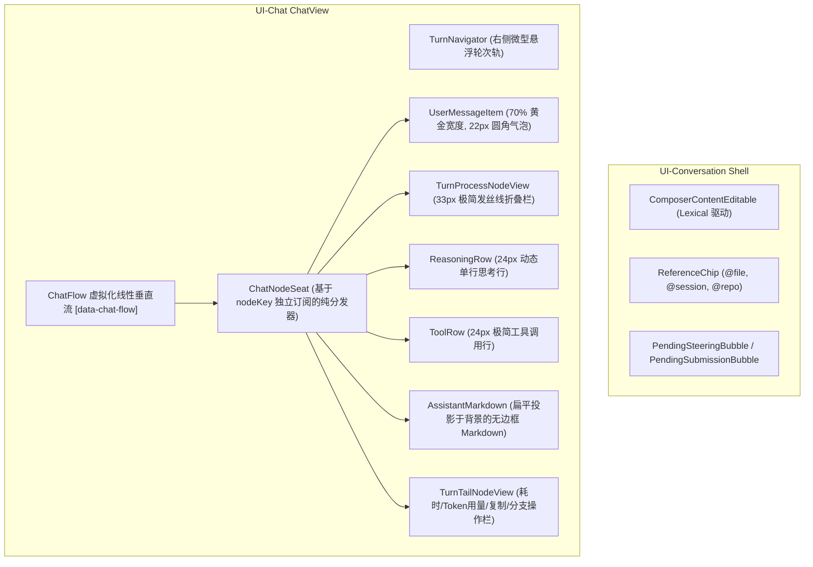

# 02 - DeepSeek-Harness 极简对话流与组件树拆解

> **战役工作区**：`docs/linear-chat-stream-study/`  
> **关联源码**：`reference/deepseek-harness`  
> **关键分析模块**：`packages/client/ui-chat`、`ui-conversation`、`ui-tool`  

---

## 1. 架构总览：DeepSeek-Harness 的组件树与分层哲学

DeepSeek-Harness（`dsh web`）呈现出目前开源 AI 工作台中最优雅、最干净的对话流体验。其正文界面彻底打破了传统“助手消息嵌套在厚重大卡片、重阴影与粗边框内”的陈旧范式，将整个对话流视为一张**纯净的代码与思考画纸**。

---

## 2. 核心组件拓扑与源码拆解

### 2.1 `ChatView.tsx`：流式视口总控宿主
`ChatView`（37KB，877行）是对话流的顶级视图宿主，负责统一管理滚动视口、历史分页加载、跳转着陆、轮次导航轨驱动与乐观输入反馈：
- **`scrollerOf(from)`**：解耦外层全屏宿主滚动与组件内层局部滚动；
- **`ChatNodeList`**：通过 `order.map(nodeKey => <ChatNodeSeat key={nodeKey} ... />)` 进行单项渲染，所有节点均通过纯不可变 key 进行细粒度订阅；
- **乐观排队气泡（Optimistic Steering/Submission Bubbles）**：用户在模型运行中途追加的 Steering（中途干预指令）与下一轮待发送消息，以半透明气泡优雅堆叠在底部，等待主模型结算。

### 2.2 `ChatNodeSeat.tsx`：原子节点调度器
`ChatNodeSeat` 是连接底层不可变状态快照与具体 UI 组件的关键中枢：
- 它通过 `useChatNode(nodeKey)` 实现**单节点级别重渲染隔离**，高频打字时历史节点与兄弟节点零重绘；
- 内部运行着一套严密的**轮次折叠状态机（Turn-Process Folding State Machine）**，精确计算 `processWindowReady`、`processMember`、`processAnswer` 与 `processHidden`，决定哪些节点应该收拢进单行折叠栏。

### 2.3 `MessageItem.tsx`：用户气泡的几何美学
用户消息采用右对齐设计，但严格恪守克制比例：
- **70.2% 宽度上限**：`max-width: min(calc(var(--dsh-chat-content-width, 748px) * 0.702), 82%)`，保留右侧留白，避免大横幅长条霸占视口；
- **22px 超椭圆平滑圆角**：搭配浅色模式下的淡冷蓝底色（`--dsw-specific-bubble: deepseek-50`）与暗色模式下的冷深灰（`neutral-bluish-850`）；
- **操作项分离下沉**：复制、重试等微操作脱离气泡内部，放置在气泡正下方 `gap: 6px` 处，气泡内部保持纯文本的干净阅读感。

### 2.4 `ReasoningRow.tsx`：零重排流式思考行
- **高度物理锁定**：`.root:not([data-expanded])` 设置 `height: 24px` 与 `contain: size layout`，从 CSS 层面切断思考流式输出对外部容器的几何回流；
- **打字追踪 vs 首行归纳**：
  - **流式中**：提取 `latestLine(text)`（模型正在吐出的最新一行），配合 `justify-content: flex-end` 让最新字符始终贴合可视区边缘；
  - **完成后**：自动切换为 `firstLine(text)` 作为思考主题摘要；
- **跑马灯扫光（Glare Shimmer）**：2.6s 跑马灯柔光带（`color-mix(in srgb, var(--dsw-alias-bg-base) 60%, transparent) 55%`），冲淡文字经过，极其优雅。

### 2.5 `TurnProcessNodeView.tsx`：33px 发丝级折叠控制栏
当一轮交互包含复杂的多步工具调用或长篇思考时，结算后自动折叠为一条极简单行：
- **无卡片、无背景**：`border: none; border-bottom: 0.5px solid var(--dsw-alias-border-l2);`；
- **动态汇总标签**：自动拼接 `"1 tool call · 2 messages · 1 subagent"`，无工具时退化为 `"Thought for a while"`；
- **旋转 Chevron**：-90deg（指向右侧）到 0deg（指向下方）平滑过渡。

### 2.6 `ToolRow.tsx`：24px 紧凑工具调用行
单行紧凑规范（Figma 122:9479）：
- `[16px 图标] gap: 6px [13px 工具名] gap: 8px [2x2px 圆点] gap: 8px [13px 参数/摘要截断] [尾部后缀]`；
- **悬停原地替换图标**：鼠标悬停在左侧图标槽位时，图标在原位 100ms 淡出并淡入 Chevron，右侧标题与参数文字纹丝不动；
- **展开卡片专有化**：
  - Bash 卡片：ANSI 彩色终端输出、CWD 路径智能折叠；
  - Diff 卡片：标准行号代码差异，自动统计 `+A -R`，行数过多时中间折叠；
  - Read/Search 卡片：文件路径下划线，点击调用宿主系统默认编辑器打开，键盘事件严格拦截冒泡防误触。

### 2.7 `TurnTailNodeView.tsx`：尾部状态与操作栏
- **常驻与悬停的渐进披露**：最新轮次标记 `data-actions-reveal="always"`，历史轮次标记 `data-actions-reveal="hover"`；
- **结构化用量与耗时**：优雅展示 Token 用量（输入/输出/缓存命中率）、执行耗时与平均吞吐（tok/s）。

---

## 3. 输入层：Lexical 驱动的 Composer 架构

在 `packages/client/ui-conversation/src/client/input` 中，DeepSeek-Harness 抛弃了简单的 `<textarea>`，采用 Facebook 开源的 **Lexical** 现代富文本框架：
1. **`ComposerContentEditable.tsx`**：单一写者模式，将宿主传递的 `editable` 状态直接映射到底层 Lexical 实例，切换会话时 DOM 节点保持常驻不变；
2. **`chip-node.tsx` & `ReferenceChip.tsx`**：将 `@file`、`@session`、`@prompt` 作为一等公民的 Lexical 自定义节点嵌入输入流。Chip 严格锁定 22px 高度，嵌入 24px 行高内零撑高，彻底消除了换行与退格时的输入框几何抖动；
3. **多轮并发队列（Multi-Turn Queueing）**：在 AI 正在生成时，允许用户在同一输入框中继续编辑，回车直接进入待处理队列（Queue），体现出极高的多任务协同工程成熟度。
