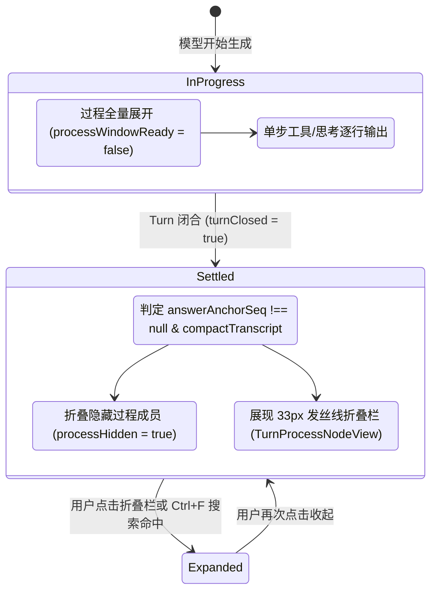

# 03 - 线性对话流机制与状态机工程设计

> **战役工作区**：`docs/linear-chat-stream-study/`
> **核心议题**：AI 线性对话流的三大物理痛点及其工程级解决方案
> **对比标杆**：`deepseek-harness` vs `codex-host`

---

## 1. AI 线性对话流的三大物理世界难题

在桌面端与 Web 端构建 AI Agent 对话界面时，开发者经常会遭遇三种破坏性的物理体验缺陷：

```text
┌─────────────────────────── AI 对话流三大物理痛点 ───────────────────────────┐
│                                                                             │
│  1. 视口抽搐与打字狂躁 (Streaming Delirium)                                │
│     高频 Token 到达引起 Markdown 持续重排折行，粗暴吸底导致用户无法正常向上阅读；  │
│                                                                             │
│  2. 过程冗长与信息泥潭 (Scaffolding Clutter)                               │
│     多步 Bash/文件读写产生数十张连续卡片，把用户发问与最终答案冲散到视口千里之外；│
│                                                                             │
│  3. 历史加载与折叠瞬移 (Prepend / Collapse Displacement)                    │
│     顶部注入历史消息或折叠大段工具时，视口发生巨大几何突变，当前正在阅读的内容瞬间跳出视口。│
│                                                                             │
└─────────────────────────────────────────────────────────────────────────────┘
```

---

## 2. 机制一：视口防抖、自适应跟随与亚像素锚点引擎

DeepSeek-Harness 在 `ChatView.tsx` 中建立了一整套兼顾“物理数学正确性”与“人类阅读心理学”的滚动锚定引擎。

### 2.1 PagingAnchor 算法：快慢双径语义定位

当历史数据被拉取（Prepend）或视口尺寸发生突变时，传统计算 `newScrollHeight - oldScrollHeight` 会因为底部同时增长或图片尺寸加载失败而产生剧烈误差。DeepSeek 采用**视口局部语义锚点（PagingAnchor）**：

```typescript
interface PagingAnchor {
  key: string;  // 稳定的节点/工具调用业务 ID
  top: number;  // 相对于滚动视口顶部的相对偏移量 (flowTop)
}

function flowTop(row: HTMLElement, scrollport: HTMLElement): number {
  return row.getBoundingClientRect().top - scrollport.getBoundingClientRect().top;
}
```

其寻找视口锚点的算法分为两条路径：
1. **快路径（Fast-Path 射线投射）**：在视口顶部前沿向下 1px（`viewport.top + 1`）的中轴线处，通过原生 `document.elementsFromPoint(x, y)` 投射射线，向上回溯最近的 `[data-chat-anchor-key]`。复杂度为 $O(1)$。
2. **慢路径（Slow-Path 容器二分查找）**：当射线未击中任何实体行（例如处于两行之间的 Gap、或元素尚处于 Pre-paint 阶段）时，在垂直排列的行节点列表中执行**二分查找（Binary Search）**，寻找第一个 `bottom > viewport.top` 的行。几何读取次数被压缩到 $O(\log N)$（16 个节点仅需 $\le 6$ 次计算），彻底消除回流导致的卡顿。

### 2.2 亚像素 Prepend 补偿闭环

在 React 的 `useLayoutEffect`（屏幕绘制前）阶段，一旦检测到顶部插入了更早历史记录（`firstSeq < firstSeqRef.current`）：
$$\text{el.scrollTop} \mathrel{+}= \text{flowTop}(row, el) - \text{anchor.top}$$
在浏览器渲染下一帧前完成瞬时坐标重置，人类眼前的文字在整个加载过程中**纹丝不动，0 像素偏移**。

### 2.3 `observedTopRef` 单一账本防地面收缩钳位（Floor Clamping）

当大段思考或工具卡片被折叠时，容器总高度剧降。浏览器内核会自动将 `scrollTop` 强行缩至新的最大值，并派发原生 `scroll` 事件。如果监听器简单认为“只要 `scrollTop` 改变就是用户在滚动”，就会错误地解除底部跟随锁定。
DeepSeek 引入了 `observedTopRef` 单一真理账本：
$$\text{movedByReader} = \left| \text{scrollTop} - \min(\text{observedTopRef}, \text{floor}) \right| > 0.5$$
- 凡是通过程序化调用的滚动，均同步写入该账本；
- 凡是等于高度收缩钳位极限的滚动，判定为系统被动收缩，**直接继承原有的跟随状态，不误判为用户意图**。

---

## 3. 机制二：轮次过程折叠状态机（Turn Process Folding）

面对复杂的工具链执行，如何做到“执行时不打断、完成后不杂乱”？DeepSeek-Harness 设计了一套 7 布尔量推导的状态机（位于 `ChatNodeSeat.tsx`）。



### 3.1 核心状态量定义与职责

```typescript
// ChatNodeSeat.tsx 核心推导逻辑
const processWindowReady =
  processSpec !== undefined &&
  processPresentation !== undefined &&
  compactTranscript &&
  processSpec.answerAnchorSeq !== null &&
  processPresentation.turn === processSpec.turn &&
  processPresentation.turnClosed &&
  !historyIncomplete;

const processMember =
  routedNode !== undefined &&
  processWindowReady &&
  !TURN_PROCESS_INDEPENDENT_KINDS.has(routedNode.kind) &&
  routedNode.anchorSeq >= processSpec.processStartSeq &&
  routedNode.anchorSeq < processSpec.answerAnchorSeq;

const processAnswer =
  routedNode !== undefined &&
  processWindowReady &&
  routedNode.kind === 'assistant-step' &&
  routedNode.data.step === processSpec.answerStep;

const processHidden = controllerInactive || (foldable && processMember && !processOpen);
```

1. **`processWindowReady`（折叠窗口就绪）**：必须在当前 Turn **彻底闭合**且最终回答已经稳定落盘时才允许为 `true`。**在流式生成中，此值为 `false`，确保用户可以清晰观察到 Agent 的每一步执行，不中途黑盒化**；
2. **`processMember`（过程成员判定）**：将序号处于 `[processStartSeq, answerAnchorSeq)` 之间的所有工具调用和中间思考全部划入过程范畴，但严格放行 `user` 消息与 `steering` 指令；
3. **`useSearchableHidden`（原生文本搜索透传）**：折叠的节点在 DOM 中使用 HTML5 原生的 `hidden="until-found"` 标记。**当用户在浏览器或 WebView 中按下 `Ctrl + F` 搜索历史命令或错误输出时，浏览器内核会自动命中并触发 `beforematch` 事件，该状态机瞬间原地展开该轮折叠**，兼顾了视觉清爽与全文可检索性。

---

## 4. 机制三：流式思考行与工具行无重排架构

### 4.1 Reasoning 行的物理隔离与信息跃迁
- **尺寸隔离**：`ReasoningRow.module.css` 中声明 `contain: size layout; height: calc(24px + ...);`，从渲染树底层将单行思考与外部滚动流物理切断，无论内部文字如何高频追加，外部容器不需要重新计算布局；
- **动态字符跃迁**：
  - 流式生成阶段：调用 `latestLine(text)` 动态裁剪最新吐出的一行，配合 `data-follow-end`（`justify-content: flex-end`）使右侧边缘始终展示最新输出；
  - 终态稳定阶段：无缝切换为 `firstLine(text)`，作为此段思考的核心标题摘要留存；
  - 跑马灯柔光（Shimmer Glare）：2.6s 周期光斑从 `-300px` 滑至 `100%`，并在末尾停留 0.26s 静态节拍，柔和提示正在推导。

### 4.2 轮次级单一加载状态（Turn-level Status Indicator）
传统聊天界面常为每个 step、每个 tool 单独放置 spinner，导致界面在几秒内疯狂闪烁。
DeepSeek-Harness 在 `ChatView.tsx` 中采用**轮次级生命周期加载指示器（`TurnStatus`）**：
- 在整个轮次运行期间（首 Token 等待、工具执行、流式打字）常驻在消息流末尾；
- 永不按步骤销毁重建，提供了极其平稳的视觉重心。
