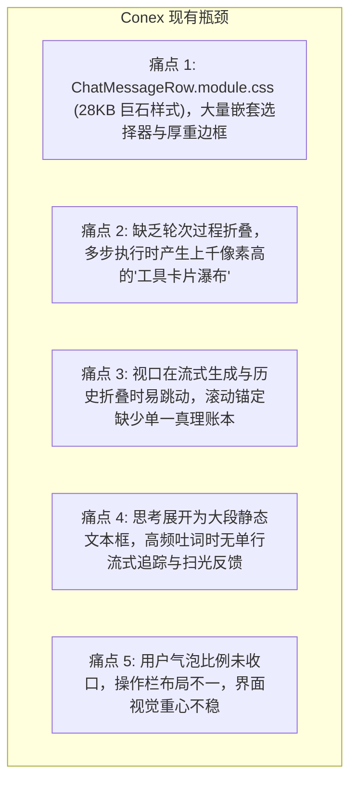
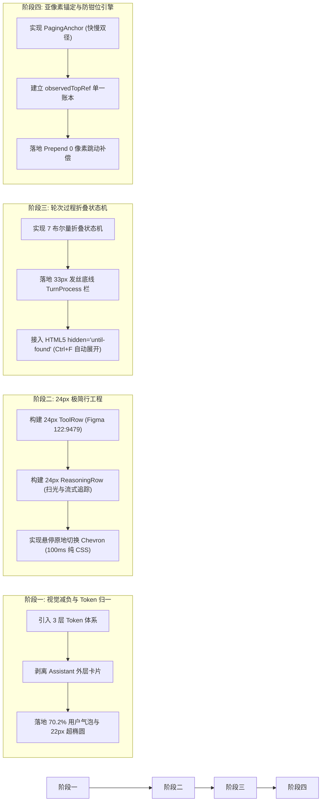

# 05 - Conex 桌面端正文对话流改进与重构建议

> **战役工作区**：`docs/linear-chat-stream-study/`  
> **落地目标模块**：`apps/crish-desktop/src/components/chat-message-list/`、`chat-message-row/`、`chat-composer/`  
> **改造路线**：从“厚重卡片堆叠”全面演进为“极致扁平、自适应跟随、发丝级微交互”的现代专业工作台  

---

## 1. Conex / Crish 当前桌面端现状与技术断层诊断

通过对 `apps/crish-desktop/src/components/` 现有源码的摸排，Conex 在对话界面上积累了较多历史补丁与视觉负债：

### 1.1 详细缺陷清单
1. **视觉噪音过载（Visual Clutter）**：
   - `ChatMessageRow.module.css` 高达 28KB，充斥着针对各种子状态的补丁级类名；
   - 助手消息外层仍带有显式容器框线，嵌套在内部的代码块、思考块、工具块再度套上带边框的 Card，导致界面“千层饼”化；
2. **缺乏过程折叠（No Scaffolding Folding）**：
   - 现有 `MessageToolCallsSection.tsx` 将工具调用逐个罗列为大卡片。一个包含 8 次 `read_file` 和 3 次 `bash` 的轮次会瞬间霸占 2000px 视口，用户需要频繁鼠标滚轮才能找到真正的执行结果；
3. **滚动锚定与高度钳位脱节**：
   - 现有 `useScrollAnchor.ts` 与 `MessageVirtualizer.tsx` 依赖于全局高度差值补偿，当大段思考或工具组突然收拢时，极易触发浏览器地表钳位，造成视口突然错位或丢失跟随状态；
4. **思考过程缺乏动态感知**：
   - 现有 `TimelineThoughtSection.tsx` 要么全展开占用大量屏幕，要么只显示冷冰冰的“思考中...”，缺少像 DeepSeek 那样“流式阶段单行紧跟最新 Token、结算后收束为首行摘要、2.6s 优雅扫光”的细腻微交互。

---

## 2. 总体架构重构演进蓝图

---

## 3. 分阶段落地实施详案

### 阶段一：视觉体系瘦身与用户气泡规范（耗时最轻、体感最强）
1. **重构 `ChatUserMessageRow.tsx` 与样式**：
   - 严格落实 Figma 黄金律：`max-width: min(calc(var(--chat-content-width) * 0.702), 82%)`；
   - 统一圆角为 `border-radius: 22px`，内边距规范为 `padding: 10px 16px`；
   - 用户操作栏（`UserMessageActionsBar`）从气泡内部剥离，放置在气泡底部 `gap: 6px` 处；
   - 浅色模式使用微冷天空蓝浅白（`deepseek-50` 色阶），暗色模式使用微冷深黑灰（`neutral-bluish-850`）；
2. **彻底解放 Assistant 消息宿主**：
   - 清空 `ChatAssistantMessageRow.tsx` 外层的 border、box-shadow 与背景色，将内容直接投射在基础画纸上；
   - 遵照 Conex 铁律 §13，全站浮层全面改用 `box-shadow: 0 0 0 0.5px var(--border-subtle)` 的阴影内嵌发丝线，杜绝粗黑线。

### 阶段二：24px 极简单行组件库研发
1. **打造统一的 `DisclosureRow` 基础骨架**：
   - 固定高度 24px，`contain: size layout` 物理阻断回流；
   - 槽位布局：`[16px 图标] gap 6px [13px 标题] gap 8px [2x2px 圆点] gap 8px [13px 摘要截断] [尾缀]`；
   - 悬停 Chevron 替换：左侧槽位绝对居中淡入淡出，右侧文本零晃动；
2. **重构 `TimelineThoughtSection.tsx` 为新版 `ReasoningRow.tsx`**：
   - 流式阶段：`latestLine(text)` + `data-follow-end`（`justify-content: flex-end`）让光标始终可见；
   - 结算阶段：切换为 `firstLine(text)` 作为静态留存摘要；
   - 扫光动效：接入 `dsh-reasoning-row-sweep 2.6s ease-out infinite` 跑马灯柔光。
3. **重写 `MessageToolCallsSection.tsx` 为新版 `ToolRow.tsx`**：
   - 默认以 24px 单行展现工具名称与参数路径；
   - 专有展开卡片：Bash 终端输出、Diff 差异视图（带 `+A -R` 统计与代码高亮）、Read 文件快速预览；
   - 文件路径 hover-underline，点击直接唤起系统默认编辑器，键盘事件严格 `stopPropagation`。

### 阶段三：引入轮次过程折叠状态机（Turn-Process Folding）
1. **在虚拟化列表层接入状态机**：
   - 计算 `processWindowReady`：仅当轮次闭合且存在稳定最终答案时激活；
   - 将 `[processStartSeq, answerAnchorSeq)` 范围内的中间工具调用与临时助手回复标记为 `processMember`；
   - 折叠时将过程成员隐藏，展示一条极简的 33px 发丝线按钮：
     `"N 个工具调用 · M 条思考过程 · 耗时 Ts"`；
2. **全文搜索原生支持**：
   - 隐藏过程节点使用 `hidden="until-found"`，当用户按下 `Ctrl+F` 搜索特定日志时，浏览器自动展开该过程，兼顾极致简洁与工程可溯源性。

### 阶段四：滚动引擎重构（引入 PagingAnchor 与防钳位账本）
1. **替换 `useScrollAnchor.ts` 为双径 `PagingAnchor` 算法**：
   - 基于 `elementsFromPoint` 进行 $O(1)$ 视口顶部行射线捕获，二分查找为保底；
   - 历史 Prepend 加载时，在 `useLayoutEffect` 中执行相对几何补偿：
     `el.scrollTop += flowTop(row, el) - anchor.top`；
2. **建立 `observedTopRef` 单一账本**：
   - 程序化滚动同步写账本；
   - 折叠收缩触发地表极限时，精确识别为浏览器内核强制钳位，保持底层跟随状态不变，彻底根除“收起卡片导致误脱离底部”的顽疾。

---

## 4. 架构收益预期

- **页面垂直滚动空间缩减 60%~80%**：原本长达数屏的多步执行，结算后全部收束为 33px 极简行，对话主脉络一目了然；
- **渲染性能与内存占用优化**：24px 行的 `contain: size layout` 将流式打字时的回流范围局限在当前单行内，彻底消除全局抖动，帧率稳定在 60FPS；
- **视觉品质实现跃迁**：摆脱陈旧沉重的工具箱感，完全对齐 DeepSeek 与 Codex 原生的呼吸感与高级感。
