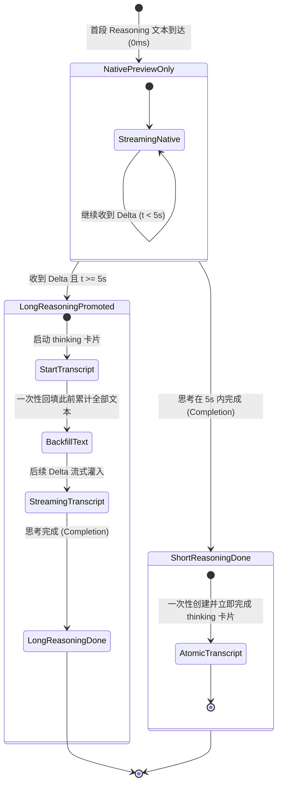

# CodexHost Transcript 架构与 Reasoning 投影技术调研报告

> **文档标识**：`docs/linear-chat-stream-study/analysis/01-codexhost-transcript-reasoning-projection.md`
> **调研对象**：`reference/codex-host` 核心协议库、渲染扩展及架构方案
> **核心源码**：
> - [`packages/protocol-core/src/codex-ui-projector.ts`](file:///c:/Software/conex/reference/codex-host/packages/protocol-core/src/codex-ui-projector.ts)
> - [`reference/codex-host/docs/Reasoning 实时预览与持久 Transcript 的后续方案.md`](file:///c:/Software/conex/reference/codex-host/docs/Reasoning%20%E5%AE%9E%E6%97%B6%E9%A2%84%E8%A7%88%E4%B8%8E%E6%8C%81%E4%B9%85%20Transcript%20%E7%9A%84%E5%90%8E%E7%BB%AD%E6%96%B9%E6%A1%88.md)
> - [`packages/renderer-extension/src/renderer-transcript-dom.ts`](file:///c:/Software/conex/reference/codex-host/packages/renderer-extension/src/renderer-transcript-dom.ts)
> - [`packages/protocol-core/src/codex-approval.ts`](file:///c:/Software/conex/reference/codex-host/packages/protocol-core/src/codex-approval.ts)
> - [`packages/protocol-core/src/codex-question.ts`](file:///c:/Software/conex/reference/codex-host/packages/protocol-core/src/codex-question.ts)
> - [`packages/shared-contracts/src/reasoning-transcript.ts`](file:///c:/Software/conex/reference/codex-host/packages/shared-contracts/src/reasoning-transcript.ts)
> - [`packages/renderer-extension/src/contract-audit.ts`](file:///c:/Software/conex/reference/codex-host/packages/renderer-extension/src/contract-audit.ts)

---

## 目录

1. [执行摘要与架构总览](#1-执行摘要与架构总览)
2. [Codex Desktop 原生正文对话流 DOM 结构与协议契约](#2-codex-desktop-原生正文对话流-dom-结构与协议契约)
   - 2.1 [DOM 层容器：Turn Key 与 Conversation Item](#21-dom-层容器turn-key-与-conversation-item)
   - 2.2 [文本保留垄断区：exec-shell-body](#22-文本保留垄断区exec-shell-body)
   - 2.3 [Turn 与 Item 的双层异步生命周期状态机](#23-turn-与-item-的双层异步生命周期状态机)
3. [Codex 原生支持的 Item 种类与渲染分流矩阵](#3-codex-原生支持的-item-种类与渲染分流矩阵)
   - 3.1 [全量 Item 种类规格与表现](#31-全量-item-种类规格与表现)
   - 3.2 [Lazy Start 机制与顺序守卫](#32-lazy-start-机制与顺序守卫)
4. [Reasoning 双胞胎投影架构：实时预览与持久留痕](#4-reasoning-双胞胎投影架构实时预览与持久留痕)
   - 4.1 [为什么外部 Harness Reasoning 必须双投影？](#41-为什么外部-harness-reasoning-必须双投影)
   - 4.2 [双胞胎机制与协议时序（Twin Projection）](#42-双胞胎机制与协议时序twin-projection)
   - 4.3 [当前原型的局限与冲突](#43-当前原型的局限与冲突)
   - 4.4 [推荐演进方向：事件驱动延迟提升（Deferred Promotion）](#44-推荐演进方向事件驱动延迟提升deferred-promotion)
   - 4.5 [为什么拒绝精确 5 秒定时器（Timer）？](#45-为什么拒绝精确-5-秒定时器timer)
5. [Tool Call 呈现策略与代码差异（Unified Diff）投影](#5-tool-call-呈现策略与代码差异unified-diff投影)
   - 5.1 [为什么将 Read/Glob/Grep 提升至 CommandExecution 泳道？](#51-为什么将-readglobgrep-提升至-commandexecution-泳道)
   - 5.2 [文件变更（Unified Diff）的合成与全局 Diff 聚合](#52-文件变更unified-diff的合成与全局-diff-聚合)
   - 5.3 [审批（Approval）与问答（Question）的交互协议桥接](#53-审批approval与问答question的交互协议桥接)
6. [Codex 原生正文界面的极简哲学、优势与架构妥协](#6-codex-原生正文界面的极简哲学优势与架构妥协)
   - 6.1 [极简设计哲学（Opinionated Minimalism）](#61-极简设计哲学opinionated-minimalism)
   - 6.2 [架构优势（Strengths）](#62-架构优势strengths)
   - 6.3 [痛点、短板与对 Host 的妥协代价（Weaknesses & Compromises）](#63-痛点短板与对-host-的妥协代价weaknesses--compromises)
7. [对现代线性对话流（Conex / Crish）的架构启示](#7-对现代线性对话流conex--crish的架构启示)

---

## 1. 执行摘要与架构总览

在多 Agent 协同与现代 AI 编程工作台中，如何呈现底层的思考过程（Chain-of-Thought / Reasoning）、工具调用（Tool Calls）、文件变更（Diffs）以及人类确认（Approvals），存在两种截然不同的流派：
1. **全面展开的终端/日志流派**：将所有模型思考、中间步骤、输出日志按时间戳一股脑倾泻于界面，信息详实但极度嘈杂；
2. **极简主义正文流派（Codex Desktop 路线）**：以 OpenAI Codex Desktop 为代表，正文仅保留人类可读的最终结论，中间过程全部收缩进高度抽象的胶囊卡片（Pill / Collapsible Card），并将思考归入短暂过渡态。

`reference/codex-host` 作为连接第三方外部 Harness（如 Pi、Claude Code、DeepSeek、Antigravity）与官方 Codex Desktop 渲染外壳的代理层，完整揭示了 **Codex Desktop 原生对话流的底层结构、渲染偏好与硬性限制**。

```mermaid
flowchart TD
    subgraph ExternalHarness["外部 Harness (Pi / Claude / Antigravity)"]
        H_Reasoning["HostReasoningItem"]
        H_Tool["HostToolExecution (Read/Glob/Grep)"]
        H_File["HostFileChange / Edit Tool"]
        H_Agent["HostAgentMessage"]
    end

    subgraph ProtocolCore["@codexhost/protocol-core (CodexTurnProjector)"]
        TP_Twin["双胞胎映射 Twin Projection"]
        TP_Lift["语义提升 Tool Lifting"]
        TP_Diff["Diff 合成 simpleUnifiedDiff"]
        TP_Order["Lazy Start & 顺序保护"]
    end

    subgraph CodexDesktop["Codex Desktop 原生渲染管线"]
        DOM_Turn["Turn 容器 [data-turn-key]"]
        DOM_Reasoning["Reasoning 预览泳道 (短暂打字机, 完成后正文离场)"]
        DOM_Shell["CommandExecution 泳道 ([data-testid='exec-shell-body'], 持久保留)"]
        DOM_Diff["FileChange 对比卡片 (Monaco/Diff)"]
        DOM_Message["AgentMessage 结论正文"]
    end

    H_Reasoning --> TP_Twin
    TP_Twin -->|${id}-summary| DOM_Reasoning
    TP_Twin -->|${id} 'thinking'| DOM_Shell

    H_Tool --> TP_Lift
    TP_Lift -->|toolCommandLine| DOM_Shell

    H_File --> TP_Diff
    TP_Diff -->|item/fileChange/patchUpdated| DOM_Diff

    H_Agent --> TP_Order
    TP_Order -->|item/agentMessage/delta| DOM_Message

    DOM_Reasoning -.->|完成离场, 仅留耗时| DOM_Turn
    DOM_Shell -->|保留完整输出| DOM_Turn
    DOM_Diff --> DOM_Turn
    DOM_Message --> DOM_Turn
```

---

## 2. Codex Desktop 原生正文对话流 DOM 结构与协议契约

Codex Desktop 的前端基于 React + Electron 构建，其正文流采用高内聚的组件树，通过特定的 DOM 特征属性发布数据绑定。

### 2.1 DOM 层容器：Turn Key 与 Conversation Item

在 [`renderer-transcript-dom.ts`](file:///c:/Software/conex/reference/codex-host/packages/renderer-extension/src/renderer-transcript-dom.ts#L1-L23) 中，定义了审查与感知桌面正文契约的核心选择器：

```typescript
// packages/renderer-extension/src/renderer-transcript-dom.ts:1-3
export const TRANSCRIPT_ITEM_SELECTOR = "[data-local-conversation-item-target-ids]";
export const TRANSCRIPT_ITEM_IDS_ATTRIBUTE = "data-local-conversation-item-target-ids";
export const TRANSCRIPT_TEXT_BODY_SELECTOR = '[data-testid="exec-shell-body"]';
```

- **`[data-turn-key]`**（[`renderer-transcript-dom.ts:41`](file:///c:/Software/conex/reference/codex-host/packages/renderer-extension/src/renderer-transcript-dom.ts#L41)）：
  - 代表每一次完整的轮次（Turn）容器节点；
  - 承载一次人类输入与模型响应的闭环上下文；
  - 在契约审计 [`inspectRendererTranscriptContract`](file:///c:/Software/conex/reference/codex-host/packages/renderer-extension/src/renderer-transcript-dom.ts#L30-L47) 中，通过计算 `root.querySelectorAll("[data-turn-key]").length` 来判断当前处于空会话（Empty Thread）还是契约丢失。
- **`[data-local-conversation-item-target-ids]`**（[`renderer-transcript-dom.ts:1-2`](file:///c:/Software/conex/reference/codex-host/packages/renderer-extension/src/renderer-transcript-dom.ts#L1-L2)）：
  - 每个在正文中渲染的独立原子卡片或消息块（Item Node），均带有此属性；
  - 其属性值为一个或多个以空格分隔的 Host Item ID（[`renderer-transcript-dom.ts:18-22`](file:///c:/Software/conex/reference/codex-host/packages/renderer-extension/src/renderer-transcript-dom.ts#L18-L22)）；
  - 允许外部感知扩展（Renderer Extension）以 $O(1)$ 复杂度直接从 DOM 节点逆向追溯到 Protocol 层的数据源 ID，无需脆弱的文本或类名遍历。

### 2.2 文本保留垄断区：exec-shell-body

这是 Codex Desktop Transcript 架构中最关键的物理现象：
> **`[data-testid="exec-shell-body"]` 是 Codex Desktop 正文 Transcript 中唯二能够容纳并持久保留大段多行文本的表面之一（另一个是 `agentMessage` 正文）。**

在 [`renderer-transcript-dom.ts:24-29`](file:///c:/Software/conex/reference/codex-host/packages/renderer-extension/src/renderer-transcript-dom.ts#L24-L29) 源码注释中确凿记录：
```typescript
/**
 * Codex renders transcript text for the Command Execution lane only, and it is
 * the lane codexhost projects external Harness Reasoning through. This records
 * bounded structural counts so a Desktop update that drops the lane, or stops
 * publishing Item ids, is detected instead of silently hiding projected text.
 */
```
所有其他类型的工具卡片（如 `dynamicToolCall`、原生 `reasoning` summary 预览）在完成后，其正文文本均不会保留在 DOM 中，或者根本不提供展开阅读完整内容的正文容器。

### 2.3 Turn 与 Item 的双层异步生命周期状态机

Codex 协议层运行在 JSON-RPC 之上，其状态机分为严格的两个层级：

```
Turn Lifecycle:
  turn/started ───► [ item/started ───► item/.../delta ───► item/completed ]* ───► turn/completed
```

1. **Turn 级生命周期**：
   - 开启：`turn/started`，携带 `threadId` 与包含当前输入快照的 `pendingTurn`（状态为 `inProgress`，[`codex-ui-projector.ts:824-839`](file:///c:/Software/conex/reference/codex-host/packages/protocol-core/src/codex-ui-projector.ts#L824-L839)）；
   - 结束：`turn/completed`，携带包含全部终态 items 列表的 `completedTurn`，状态映射为 `completed` | `interrupted`（对应 cancelled）| `failed`（[`codex-ui-projector.ts:1098-1166`](file:///c:/Software/conex/reference/codex-host/packages/protocol-core/src/codex-ui-projector.ts#L1098-L1166)）。若失败则额外触发 `error` 通知（[`codex-ui-projector.ts:1147-1158`](file:///c:/Software/conex/reference/codex-host/packages/protocol-core/src/codex-ui-projector.ts#L1147-L1158)）。
2. **Item 级生命周期**：
   - 开启：`item/started`（入参包含 `startedAtMs` 与初始 Item 对象）；
   - 演进：`item/<type>/delta`（如 `agentMessage/delta`、`commandExecution/outputDelta`、`reasoning/summaryTextDelta`）；
   - 完成：`item/completed`（必须携带 `startedAtMs`、`completedAtMs` 以及带终态的完整 Item 快照，[`codex-ui-projector.ts:1014-1024`](file:///c:/Software/conex/reference/codex-host/packages/protocol-core/src/codex-ui-projector.ts#L1014-L1024)）。

---

## 3. Codex 原生支持的 Item 种类与渲染分流矩阵

在 [`codex-ui-projector.ts:443-538`](file:///c:/Software/conex/reference/codex-host/packages/protocol-core/src/codex-ui-projector.ts#L443-L538) 中，CodexTurnProjector 穷举了桌面端原生支持的各种 Item 种类及其投影参数：

### 3.1 全量 Item 种类规格与表现

| Item 种类 (`type`) | 协议载荷核心字段 | Codex Desktop 原生渲染形式 | 文本持久性 / 历史可读性 | 源码行号证据 |
| :--- | :--- | :--- | :--- | :--- |
| **`userMessage`** | `id`, `content: [{ type: "text", text }]` | 用户消息气泡（靠右/带头像） | 永久保留在对话历史中 | [`codex-ui-projector.ts:614-618`](file:///c:/Software/conex/reference/codex-host/packages/protocol-core/src/codex-ui-projector.ts#L614-L618) |
| **`agentMessage`** | `id`, `text`, `phase`, `memoryCitation` | 助手回复 Markdown 主正文 | 永久保留在对话历史中 | [`codex-ui-projector.ts:451-458`](file:///c:/Software/conex/reference/codex-host/packages/protocol-core/src/codex-ui-projector.ts#L451-L458) |
| **`reasoning`** | `id`, `summary: string[]`, `content: []` | 顶端单行动画提示胶囊（如 "Thinking..."） | **完成后立即离开 DOM**，仅留耗时标签（如 "Worked for 8s"） | [`codex-ui-projector.ts:459-465`](file:///c:/Software/conex/reference/codex-host/packages/protocol-core/src/codex-ui-projector.ts#L459-L465) |
| **`commandExecution`** | `id`, `command`, `cwd`, `aggregatedOutput`, `exitCode`, `durationMs` | 可折叠终端卡片，包含命令标题、耗时、退出码与完整高亮终端输出 | **永久保留**；DOM 拥有 `exec-shell-body` 容器 | [`codex-ui-projector.ts:468-481`](file:///c:/Software/conex/reference/codex-host/packages/protocol-core/src/codex-ui-projector.ts#L468-L481) |
| **`dynamicToolCall`** | `id`, `namespace`, `tool`, `arguments`, `contentItems`, `status`, `success` | 紧凑型胶囊，仅显示灰色工具名称与执行状态图标 | **仅显示名称与成功与否**；无参数/输出展开区 | [`codex-ui-projector.ts:501-510`](file:///c:/Software/conex/reference/codex-host/packages/protocol-core/src/codex-ui-projector.ts#L501-L510) |
| **`fileChange`** | `id`, `changes: [{ path, kind, diff }]`, `status` | 结构化 Diff 对比卡片（红绿行内/分屏对比） | **永久保留**；点击可展开完整 Diff 查看器 | [`codex-ui-projector.ts:512-518`](file:///c:/Software/conex/reference/codex-host/packages/protocol-core/src/codex-ui-projector.ts#L512-L518) |
| **`collabAgentToolCall`** | `id`, `tool`, `senderThreadId`, `receiverThreadIds`, `agentsStates` | 多 Agent 协同泳道卡片，展示子 Agent 树状派发及各节点状态 | 终态保留子 Agent ID、简要状态及摘要 | [`codex-ui-projector.ts:520-536`](file:///c:/Software/conex/reference/codex-host/packages/protocol-core/src/codex-ui-projector.ts#L520-L536) |
| **`contextCompaction`** | `id`, `type: "contextCompaction"` | 上下文折叠/清理提示分割线 | 历史会话中作为上下文滑动窗口标记 | [`codex-ui-projector.ts:466-467`](file:///c:/Software/conex/reference/codex-host/packages/protocol-core/src/codex-ui-projector.ts#L466-L467) |
| **`turn/plan/updated`** | `explanation`, `plan: [{ step, status }]` | 顶部固定的 Todo/Plan 任务进度看板（非独立卡片） | 随 Turn 状态更新在专属 Plan 区域维持 live 状态 | [`codex-ui-projector.ts:1259-1276`](file:///c:/Software/conex/reference/codex-host/packages/protocol-core/src/codex-ui-projector.ts#L1259-L1276) |

### 3.2 Lazy Start 机制与顺序守卫

在多流混合推进时，若模型先初始化了一个空的 `agentMessage`（例如流式框架先发射了 `item.started(type="agentMessage", text="")`），随后才开始吐出思考过程（`reasoning`），会导致极其糟糕的 UI 体验：界面先闪现出一个空的回答光标，随后上方硬生生被顶出一个思考框。

`CodexTurnProjector` 实现了严格的 **Lazy Wire Start 机制**：
- 在 [`codex-ui-projector.ts:855-862`](file:///c:/Software/conex/reference/codex-host/packages/protocol-core/src/codex-ui-projector.ts#L855-L862)：
  ```typescript
  if (
    (event.item.type === "agentMessage" || event.item.type === "reasoning") &&
    event.item.text.length === 0
  ) {
    // An empty Reasoning Item would surface as a transcript card with no
    // content, so defer the wire Item until real summary text arrives.
    return { messages: [] };
  }
  ```
- 只有当第一段非空文本真正到达时（在 `#updateItem` 处理 `text.append`，[`codex-ui-projector.ts:909-911`](file:///c:/Software/conex/reference/codex-host/packages/protocol-core/src/codex-ui-projector.ts#L909-L911)），才补发 `item/started`。
- **效果**：保证在视觉呈现上，`reasoning` 必定严格排在 `agentMessage` 之前；若 Turn 提前被取消且没有任何实际文本输出，空的占位项会被彻底静默丢弃（[`codex-ui-projector.test.ts:754-780`](file:///c:/Software/conex/reference/codex-host/packages/protocol-core/test/codex-ui-projector.test.ts#L754-L780)）。

---

## 4. Reasoning 双胞胎投影架构：实时预览与持久留痕

### 4.1 为什么外部 Harness Reasoning 必须双投影？

在设计第三方 Agent 接入 Codex Desktop 时，Reasoning（思考过程 / CoT 摘要）面临着一个无可回避的物理矛盾：

```text
       ┌────────────────────────────────────────────────────────┐
       │                 Codex Desktop 物理表现                  │
       ├───────────────────────────┬────────────────────────────┤
       │ 原生 Reasoning Summary 泳道│ Command Execution 泳道     │
       ├───────────────────────────┼────────────────────────────┤
       │ 优点：原生柔和动画、微光打字机  │ 优点：完整持久化、可多行展开 │
       │ 缺点：Turn 完成后正文离场   │ 缺点：外观为 Shell 命令行卡片│
       │       历史回看完全不可见   │       容易被误解为真实执行命令 │
       └───────────────────────────┴────────────────────────────┘
```

受控桌面验证（[`Reasoning 实时预览与持久 Transcript 的后续方案.md:20-25`](file:///c:/Software/conex/reference/codex-host/docs/Reasoning%20%E5%AE%9E%E6%97%B6%E9%A2%84%E8%A7%88%E4%B8%8E%E6%8C%81%E4%B9%85%20Transcript%20%E7%9A%84%E5%90%8E%E7%BB%AD%E6%96%B9%E6%A1%88.md#L20-L25)）明确证实：
1. **原生 Reasoning 泳道正文仅用于运行态**：完成后正文离开 DOM，只保留完成状态或耗时；在历史 `thread/read` 加载时，原生 UI 压根不恢复可检查的 Reasoning 正文；
2. **用户期望的不可妥协性**：
   - **实时感知**：运行时要有轻量原生的“正在思考”反馈，而不是一开始就砸下一张沉重的黑框卡片；
   - **完成后留痕**：回答生成后，用户需要复核“模型刚才是基于什么逻辑决策的”，不能查无凭据。

为了同时满足这两个目标，`codexhost` 创造性地实施了 **“双胞胎投影”（Twin Projection）**。

### 4.2 双胞胎机制与协议时序（Twin Projection）

每一个由外部 Harness 输出的 `HostReasoningItem`（带有原生 ID `${itemId}`），在进入 Projector 后会被裂变分裂为两个平行的 Codex Wire Item：

```
                    ┌─── 派生 ID: `${itemId}-summary` (type: "reasoning")
                    │    接收 summaryPartAdded + summaryTextDelta ──► 原生短暂动画
HostReasoningItem ──┤
                    │
                    └─── 原生 ID: `${itemId}` (type: "commandExecution", command: "thinking")
                         接收 outputDelta ──► exec-shell-body 容器 (持久留痕)
```

#### 源码行号证据：
1. **ID 派生策略**（[`codex-ui-projector.ts:540-547`](file:///c:/Software/conex/reference/codex-host/packages/protocol-core/src/codex-ui-projector.ts#L540-L547)）：
   ```typescript
   export function reasoningPreviewItemId(itemId: HostItemId): string {
     return `${itemId}-summary`;
   }
   ```
   Command Execution 保持原生 `${itemId}`，而短暂的原生 Reasoning 预览采用派生的 `${itemId}-summary`。
2. **哨兵命令常量**（[`shared-contracts/src/reasoning-transcript.ts:6`](file:///c:/Software/conex/reference/codex-host/packages/shared-contracts/src/reasoning-transcript.ts#L6)）：
   ```typescript
   export const REASONING_TRANSCRIPT_COMMAND = "thinking";
   ```
3. **协议下发时序**（[`codex-ui-projector.ts:887-893`](file:///c:/Software/conex/reference/codex-host/packages/protocol-core/src/codex-ui-projector.ts#L887-L893), [`922-933`](file:///c:/Software/conex/reference/codex-host/packages/protocol-core/src/codex-ui-projector.ts#L922-L933)）：
   - 当首段文本到达：
     1. 发送 `item/started`（`${itemId}-summary`, `type: "reasoning"`）；
     2. 发送 `item/started`（`${itemId}`, `type: "commandExecution"`, `command: "thinking"`）；
     3. 发送 `item/commandExecution/outputDelta`（将文本流推入持久副本）；
     4. 发送 `item/reasoning/summaryPartAdded`（`summaryIndex: 0`）；
     5. 发送 `item/reasoning/summaryTextDelta`（`summaryIndex: 0`，将文本流推入原生预览）；
   - 完成时（[`codex-ui-projector.ts:1065-1073`](file:///c:/Software/conex/reference/codex-host/packages/protocol-core/src/codex-ui-projector.ts#L1065-L1073)）：
     1. 完成 `${itemId}-summary`（原生思考预览关闭，正文离场，留存耗时标签）；
     2. 完成 `${itemId}`（`thinking` 命令卡片完成，状态置为 completed，持久保留全部 `aggregatedOutput`）。

### 4.3 当前原型的局限与冲突

在 [`Reasoning 实时预览与持久 Transcript 的后续方案.md:85-108`](file:///c:/Software/conex/reference/codex-host/docs/Reasoning%20%E5%AE%9E%E6%97%B6%E9%A2%84%E8%A7%88%E4%B8%8E%E6%8C%81%E4%B9%85%20Transcript%20%E7%9A%84%E5%90%8E%E7%BB%AD%E6%96%B9%E6%A1%88.md#L85-L108) 中，架构团队详细记录了当前原型暴露出的用户体验硬伤：
1. **双重渲染打架（Visual Redundancy）**：生成开始的第一秒，原生打字机与下方的 `$ thinking` 终端卡片同时出现，用户会误以为模型一边思考，一边在后台执行了一个名为 `thinking` 的未知脚本；
2. **极短思考的 UI 抖动**：即使 Reasoning 只有一句话、1 秒就结束，也会立即弹出一张终端卡片，打破了 Codex 原生的沉浸感；
3. **原生截断不轮换**：原生预览只绑定了 `summaryIndex: 0`，Codex 界面倾向于只展示前几十个字符的截断，无法逐句轮播；
4. **非官方契约的兼容风险**：包装为 `commandExecution` 纯属借壳，一旦 Desktop 更新修改了对 shell 卡片的过滤，投影可能失效。

### 4.4 推荐演进方向：事件驱动延迟提升（Deferred Promotion）

方案文档明确提出了改进的 **事件驱动延迟提升（Deferred Promotion）** 状态机（[`Reasoning 实时预览与持久 Transcript 的后续方案.md:120-164`](file:///c:/Software/conex/reference/codex-host/docs/Reasoning%20%E5%AE%9E%E6%97%B6%E9%A2%84%E8%A7%88%E4%B8%8E%E6%8C%81%E4%B9%85%20Transcript%20%E7%9A%84%E5%90%8E%E7%BB%AD%E6%96%B9%E6%A1%88.md#L120-L164)）：



- **短思考（< 5s）**：运行期间完全不弹卡片，用户只看到优美原生的动态思考；完成时，一次性补录 `commandExecution("thinking")`，保证历史持久化与追溯；
- **长思考（≥ 5s）**：超过 5 秒说明是一场深度分析，在首个超时 delta 到达时，动态提升启动 `thinking` 卡片并一次性回填已生成文本，后续继续流式输出，让用户在依然生成时即可展开阅读大段逻辑。

### 4.5 为什么拒绝精确 5 秒定时器（Timer）？

方案第 7 节（[`Reasoning 实时预览与持久 Transcript 的后续方案.md:196-210`](file:///c:/Software/conex/reference/codex-host/docs/Reasoning%20%E5%AE%9E%E6%97%B6%E9%A2%84%E8%A7%88%E4%B8%8E%E6%8C%81%E4%B9%85%20Transcript%20%E7%9A%84%E5%90%8E%E7%BB%AD%E6%96%B9%E6%A1%88.md#L196-L210)）给出了深刻的架构权衡：
> **严禁为了追求“在第 5000 毫秒精确弹出卡片”而引入基于 `setTimeout` 的计时调度器！**

核心原因：
1. **打破同步事件投影边界**：现有 `CodexTurnProjector.project(event)` 是纯粹的同步纯函数式转换器，若引入 Timer，必须在没有上游事件时无中生有地产生新的下发消息；
2. **严重的并发与竞态灾难**：
   - Timer 触发与外部模型的 `item.completed` 毫秒级撞车；
   - 用户中途按取消（Cancel）、Thread 销毁、进程崩溃时，Timer 的清理与闭包泄漏；
   - 多并发 Item 时复杂的定时器队列维护；
   - 单元测试需要引入复杂的虚拟时钟（FakeTimers），脆弱度成倍上升。
3. **极佳的折中**：仅依靠后续事件（`ItemUpdatedEvent` 或 `ItemCompletedEvent`）携带的 `emittedAtMs` 判定时间流逝，既获得了 99% 的体验收益，又保持了 Projector 100% 纯粹的状态机可测性。

---

## 5. Tool Call 呈现策略与代码差异（Unified Diff）投影

### 5.1 为什么将 Read/Glob/Grep 提升至 CommandExecution 泳道？

在外部 Harness（如 Claude Code / Antigravity）中，查看文件、列目录、正则搜索均作为标准 Tool Call（`toolExecution`）下发。但在 Codex Desktop 中：
- **`dynamicToolCall` 的“极简原罪”**：Codex 桌面端对通用工具调用仅渲染一个灰色胶囊，**连入参路径、正则表达式或查询目录都完全不显示，更不提供输出展开面板**；
- **用户心智断层**：用户看到模型调了 `read`，却根本不知道它在看哪个文件，也不知道读出了什么，严重阻碍对 Agent 行为的信任与安全审计。

为此，`CodexTurnProjector` 实现了 **命令提升机制（Tool Lifting）**。在 [`codex-ui-projector.ts:130-167`](file:///c:/Software/conex/reference/codex-host/packages/protocol-core/src/codex-ui-projector.ts#L130-L167)：

```typescript
// packages/protocol-core/src/codex-ui-projector.ts:136-167
export function toolCommandLine(toolName: string, args: JsonValue): string | undefined {
  const lower = toolName.toLowerCase().replaceAll(/[_-]/g, "");
  // 1. Bash/Shell 工具 -> 原样提取命令
  const command = nestedString(args, ["command", "cmd", "script", "commandLine", "command_line"]);
  if (command && ["bash", "exec", "terminal", "run", "shell", "powershell", "command"].includes(lower)) {
    return command;
  }
  // 2. 提取路径与正则匹配
  const filePath = nestedString(args, ["path", "file_path", "filePath", "file", "filename", "target", "uri"]);
  const pattern = nestedString(args, ["pattern", "glob", "glob_pattern", "query", "regex"]);

  // 3. 语义提升：Read -> read <file>
  if (["read", "readfile", "fileread", "view"].includes(lower)) {
    return filePath ? `read ${filePath}` : undefined;
  }
  // 4. 语义提升：Glob -> glob <pattern>
  if (["glob", "find", "findfiles"].includes(lower)) {
    const target = pattern ?? filePath;
    return target ? `glob ${target}` : undefined;
  }
  // 5. 语义提升：Grep -> grep <pattern> <file>
  if (["grep", "grepsearch"].includes(lower)) {
    if (!pattern) return undefined;
    return filePath ? `grep ${pattern} ${filePath}` : `grep ${pattern}`;
  }
  return undefined;
}
```

- **投影转换**：当 `toolCommandLine` 成功解析出拟态命令行时，Projector 在底层将该 `toolExecution` 直接伪装成 `commandExecution`（[`codex-ui-projector.ts:483-498`](file:///c:/Software/conex/reference/codex-host/packages/protocol-core/src/codex-ui-projector.ts#L483-L498)）；
- **输出回填**：工具的执行结果文本（`toolOutputText`）被映射为命令的 `aggregatedOutput`，通过 `item/commandExecution/outputDelta` 流式推送；
- **用户体感**：在桌面端看来，如同 Agent 在内置终端中执行了 `read src/index.ts` 或 `grep TODO packages`，不仅显示清晰的目标路径，还拥有完整的展开/折叠与输出阅读能力！

### 5.2 文件变更（Unified Diff）的合成与全局 Diff 聚合

对于修改文件的工具（如 `edit`, `write_to_file`, `strreplace`），Codex 原生拥有极其出色的 Diff 渲染器。Projector 绝不将其作为简单工具卡片下发，而是转换为原生 `fileChange` 契约：

1. **识别与归一化**（[`codex-ui-projector.ts:173-195`](file:///c:/Software/conex/reference/codex-host/packages/protocol-core/src/codex-ui-projector.ts#L173-L195)）：
   精准识别 `edit`, `strreplace`, `applypatch`, `write`, `create` 等动词；
2. **合成无损 Unified Diff**（[`codex-ui-projector.ts:197-261`](file:///c:/Software/conex/reference/codex-host/packages/protocol-core/src/codex-ui-projector.ts#L197-L261)）：
   - 对于新建文件（Write Tool）：以 `/dev/null` 为来源头，生成全量 `+` 新增行的 Patch：
     ```diff
     --- /dev/null
     +++ b/src/new-file.ts
     @@ -0,0 +1,10 @@
     +line1
     ```
   - 对于局部修改（Edit Tool）：抽取 `old_string` 与 `new_string`，自动对齐行号区间，合成规范的带 `--- a/file` 和 `+++ b/file` 的标准 Unified Diff；
3. **两级 Diff 广播协议**（[`codex-ui-projector.ts:1278-1299`](file:///c:/Software/conex/reference/codex-host/packages/protocol-core/src/codex-ui-projector.ts#L1278-L1299)）：
   - 细粒度更新：`item/fileChange/patchUpdated`，更新当前卡片的 Diff 块；
   - 轮次级汇总：`turn/diff/updated`，通过 `#allFileChanges()` 将当前 Turn 中发生过的所有文件变更实时聚合成完整的全局 Git Diff 补丁，驱动桌面端总览面板（Diff Review Drawer）实时展示变更量。

### 5.3 审批（Approval）与问答（Question）的交互协议桥接

当模型需要高危权限或向人类提问时，Codex 原生提供了交互卡片支持：

1. **权限审批（Approval）**：
   - 载体协议：[`codex-approval.ts:130-145`](file:///c:/Software/conex/reference/codex-host/packages/protocol-core/src/codex-approval.ts#L130-L145) 使用了标准的 MCP Elicitation 格式：
     ```json
     {
       "method": "mcpServer/elicitation/request",
       "params": {
         "serverName": "Claude Code",
         "mode": "form",
         "message": "Allow bash execution?",
         "_meta": {
           "codex_approval_kind": "mcp_tool_call",
           "persist": ["session", "always"]
         }
       }
     }
     ```
   - 支持单次允许（`allowOnce`）、会话级持久允许（`allowForSession`）与全局允许（`allowAlways`）的精确双向反解（[`codex-approval.ts:157-173`](file:///c:/Software/conex/reference/codex-host/packages/protocol-core/src/codex-approval.ts#L157-L173)）。
2. **主动问答（Question / Ask Question）**：
   - 载体协议：[`codex-question.ts:78-88`](file:///c:/Software/conex/reference/codex-host/packages/protocol-core/src/codex-question.ts#L78-L88) 映射为原生的 `item/tool/requestUserInput`：
     ```json
     {
       "method": "item/tool/requestUserInput",
       "params": {
         "threadId": "...",
         "itemId": "...",
         "questions": [
           { "id": "q1", "question": "Select target DB", "options": [{"label": "PostgreSQL"}, {"label": "SQLite"}] }
         ],
         "isBlocking": true
       }
     }
     ```
   - 若上游是一个没有宿主 Tool ID 的独立提问交互，Projector 会自动注入一个合成通用工具（`syntheticItem`: `{ type: "toolExecution", namespace: "codexhost", toolName: "question" }`），以维护完整的生命周期守卫（[`codex-ui-projector.ts:804-815`](file:///c:/Software/conex/reference/codex-host/packages/protocol-core/src/codex-ui-projector.ts#L804-L815)）。

---

## 6. Codex 原生正文界面的极简哲学、优势与架构妥协

### 6.1 极简设计哲学（Opinionated Minimalism）

Codex Desktop 的设计体现了极强的产品主张（Opinionated Design）：
1. **“人类只消费结论”原则**：在传统的 IDE 插件中，屏幕常年被海量的终端编译输出、JSON 报文、模型自言自语淹没。Codex Desktop 坚信**对话流的唯一一等公民是人类意图与最终交付物**；
2. **中间态的严格降级与收拢**：
   - 思考（Reasoning）被视为“正在进行中”的过渡情绪，任务一旦达成，就该隐入幕后，仅留耗时信息表明模型没有偷懒；
   - 工具执行（Tool Execution）被封装进折叠胶囊中，只露出成功/失败指示器，不主动侵占屏幕像素；
3. **强类型与防内容污染**：不允许模型随意在主正文中用 Markdown 自创奇奇怪怪的“伪终端框”或“伪按钮”，所有交互与状态变更必须走严格定义的强类型协议。

### 6.2 架构优势（Strengths）

- **长时间编码心智负担极低**：在经历数十轮大型重构会话后，翻阅历史记录依旧像阅读一份精炼的技术备忘录，没有冗长杂乱的执行日志干扰视线；
- **Diff 与代码变更体验一流**：原生 Monaco Diff 卡片提供了行内高亮、行号对应、折叠忽略空白等专业 IDE 级别的对比体验；
- **清晰的状态确定性**：每一个 Turn 无论成功、取消还是异常中断，均有明确的 `turn/completed` 终态封口，客户端状态机极难发生死锁或悬挂。

### 6.3 痛点、短板与对 Host 的妥协代价（Weaknesses & Compromises）

然而，深入 `reference/codex-host` 的源码与架构案后，可以清晰看到这种极致极简在多 Agent 复杂协作场景下带来的**巨大妥协与架构扭曲**：

1. **“阅后即焚”重创了技术复盘能力（Reasoning Loss）**：
   - 原生 Reasoning 完成后正文离场，导致用户在事后完全无法追查：“模型刚才究竟基于什么假设做出了这个可能危险的架构抉择？”
   - **妥协代价**：迫使 CodexHost 必须发明“双胞胎投影”，不得不借用 `commandExecution("thinking")` 这种“寄生在 Shell 终端卡片”上的非自然载体来保留文本，造成视觉上的割裂感。
2. **通用工具盲盒化（Generic Tool Blindness）**：
   - 桌面端对 `dynamicToolCall` 的极端轻视（只显名字、不显参数、不显输出），剥夺了用户对自定义 Agent 工具的可见性；
   - **妥协代价**：迫使中间层写出大量的 `toolCommandLine` 启发式规则（Heuristic Sniffing），去猜测参数中的 `path` / `file` / `pattern`，把原本高阶的 RPC 调用强行降级拼接为低阶的 `read <file>`、`grep <pattern>` 命令行字符串，才能在界面上获得一张像样的卡片。
3. **缺乏多 Agent 与复杂拓扑的展示插槽（Rigid Slotting）**：
   - 虽然有 `collabAgentToolCall`，但其状态字典极其固定，难以表达复杂的主从通信、广播反思、多阶段流水线。一切超越官方原生设想的高级工作流，最终都不得不被“削足适履”地塞进文本消息或 Shell 卡片里。

---

## 7. 对现代线性对话流（Conex / Crish）的架构启示

基于对 CodexHost 源码与 Codex 原生特性的全面拆解，为自主研发的现代编码工作台（Conex / Crish）的线性对话流（Linear Chat Stream）架构提供如下关键启示与演进原则：

1. **思考过程（Reasoning）应支持“折叠持久化”，而非“离开 DOM”**：
   - 既保留运行时原生微光打字机的轻量感，又在完成后转为“可展开查看的优雅折叠块”（如 `<details>` 或专用折叠胶囊），彻底摒弃将思考包装为 `commandExecution("thinking")` 的 Hack 路线，提供一等公民的持久思维链查看体验；
2. **一等公民的多维工具呈现（Native Tool Rich Cards）**：
   - 坚决杜绝“只有 Shell 卡片能看大段文本”的架构缺陷；
   - 为读取（Read）、搜索（Grep/Glob）、网络（Fetch）、问答（Question）分别建立专属的原生精美卡片模板，原生展示路径、行号与格式化高亮内容，无需拼接模拟命令行；
3. **事件驱动的双层生命周期与 Lazy Start 秩序守卫**：
   - 严格继承 `CodexTurnProjector` 的 **Lazy Wire Start** 机制，确保在思考与工具流推进时，空回答不提前占位，杜绝光标闪烁与上下颠倒；
   - 状态转移保持同步纯函数特性，坚决不在投影层滥用异步精确 Timer，确保流式状态机在网络抖动、提前取消和高频刷新下的绝对鲁棒性；
4. **统一 Diff 聚合驱动全局审查**：
   - 保留两级 Diff 架构：卡片层展示单步编辑的局部 Patch，轮次层维持全量聚合 Diff，为用户提供一键“全局改动抽屉审查”（Global Review Drawer）的能力。
