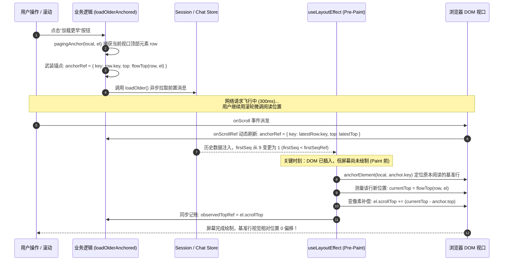

# DeepSeek-Harness ChatView 视口防抖、滚动跟随与轮次导航轨深度技术分析

> **作者**：DeepSeek-Harness ChatView 视口与滚动专项分析员 (A03)  
> **战役工作区**：`docs/linear-chat-stream-study/analysis/`  
> **分析对象**：`reference/deepseek-harness` 仓库中 `packages/client/ui-chat` 模块  
> **核心源码**：
> - `packages/client/ui-chat/src/client/chat/ChatView.tsx` (877 行)
> - `packages/client/ui-chat/src/client/chat/ChatView.module.css` (224 行)
> - `packages/client/ui-chat/src/client/chat/TurnNavigator.tsx` (223 行)
> - `packages/client/ui-chat/src/client/chat/TurnNavigator.module.css` (235 行)
> - `packages/client/ui-chat/src/client/chat/turn-rail-items.ts` (90 行)
> - 核心验证套件：`packages/client/ui-chat/tests/chat-view.client.spec.tsx` (2,735 行)

---

## 一、报告摘要与核心架构全景

在现代大模型桌面与 Web 客户端开发中，**长文本线性对话流（Linear Chat Stream）的视口稳定性与滚动跟随体验**是衡量客户端工程水准的最高试金石之一。

用户在面对动态生成的 AI 对话流时，往往会遭遇三种极其恶劣的体验“刺客”：
1. **流式吐字时的“视口疯癫”**：模型以每秒几十个 Token 的速率输出内容，视口疯狂上下抽搐；用户一旦试图向上翻看前文，视口又被强行吸附拽回底部；
2. **向上加载历史消息时的“画面瞬移”**：点击“加载更早”或向上滚动触发分页时，头部注入新消息导致视口高度瞬间撑大，正在阅读的文字瞬间被推移到数百像素之外，阅读位置彻底丢失；
3. **过程折叠/展开时的“失焦断流”**：思考过程（Reasoning）结束折叠或工具调用展开时，高度发生剧烈突变，浏览器被动触发视口钳位，导致原本正常的底部跟随状态意外中断。

DeepSeek-Harness 并没有采用业界面对疑难杂症时惯用的“延时盲猜（`setTimeout(..., 100)`）”、“魔术数字补偿”或“无脑全局虚拟化列表”，而是通过**精密的视口几何学状态机、快慢双径元素锚定算法、单一真理账本归因机制与亚像素级布局补偿**，在纯原生 Flex 布局下实现了完全零抖动、零跳动的极致丝滑体验。

```mermaid
flowchart TB
    subgraph ViewportEngine ["DeepSeek ChatView 视口与滚动控制系统"]
        direction TB
        subgraph DOMFlow ["DOM 渲染层"]
            A["ChatView 根容器 (scrollerOf)"] --> B["ChatNodeList (纯 memo 隔离)"]
            B --> C["ChatNodeSeat ([data-chat-anchor-key])"]
        end

        subgraph AnchoringSystem ["视口锚定与补偿体系"]
            D["pagingAnchor() 算法"]
            D -->|快路径| E["document.elementsFromPoint(x, top + 1)<br/>O(1) 射线命中稳定 key"]
            D -->|慢路径| F["querySelectorAll + 二分查找 (low/high)<br/>O(log N) 穿透 Gap / Pre-paint"]
            E & F --> G["PagingAnchor { key, top }"]
            G --> H["Prepend 同步补偿:<br/>el.scrollTop += flowTop(row, el) - anchor.top"]
        end

        subgraph FollowStateMachine ["滚动跟随状态机"]
            I["observedTopRef 单一真理账本"]
            I --> J{"movedByReader 判决<br/>|scrollTop - min(ledger, floor)| > 0.5"}
            J -->|读者主动物理操作| K["更新 atBottomRef (距底 <= 24px)"]
            J -->|浏览器高度收缩被动钳位| L["保持 follow 状态并主动补足 toBottom"]
            K --> M{"toBottom 触发守卫<br/>appendedUser || (tipMoved && atBottomRef)"}
            M -->|通过| N["toBottom(el) 同步写入账本"]
            M -->|阻断| O["保持当前滚动位置，绝不误吸附"]
        end

        subgraph NavigationRail ["侧边微型导航轨 (TurnNavigator)"]
            P["mergeTurnRailItems (全量 Outline + 本地 Loaded)"]
            P --> Q["TurnNavigator 零高度 Sticky 轨道"]
            Q -->|主视口滚轮| R["turnAtLine 射线命中 -> activeTurn"]
            Q -->|点击未加载轮次| S["loadThrough 分页拉取 + busy 脉冲动画"]
            Q -->|点击已加载轮次| T["landOnRowRef 精准着陆"]
        end
    end
```



---

## 二、AI 对话流视口抖动的病理学分析 (The Pathology of Chat Viewport Jitter)

在深入 DeepSeek 的技术方案前，必须穿透表象，从浏览器渲染流水线与大模型交互特征出发，系统厘清为什么 AI 对话流极易产生抖动。

### 1. 动态追加与流式打字风暴 (Streaming Delirium & Continuous Height Shifts)
- **高频微回流**：流式传输时，SSE（Server-Sent Events）以 10~50ms 为间隔推送 Markdown 文本分块。DOM 树中的文本节点频繁变更，导致浏览器频繁触发 Recalculate Style 与 Layout。
- **排版断点跳变（Line-wrap Jitter）**：行尾单个单词或字词的加入，会导致整个单词甚至整行折叠到下一行，单次变化高度突增 20~24px。
- **渲染器击穿与重绘雪崩**：若父组件对消息列表的状态设计不合理，每次分块到达都会触发全量列表中几十上百个历史消息节点的重新渲染。
- **惯性滚动与强制吸附的物理冲突**：若在每次渲染后简单调用 `scrollTo(0, scrollHeight)`，当用户试图向上滚动查看历史时，用户的滚动操作与代码的自动吸附形成对抗，造成视口在毫秒级内来回跳跃（“拉扯打架”）。

### 2. 向上滚动分页加载的“瞬移灾难” (Prepend Displacement)
- 现代聊天软件为了避免长会话内存爆炸，通常采用分页拉取（Windowing / Reverse Pagination）。
- 当用户滚到顶部点击“加载更早”或触顶自动加载时，前序批次的历史消息被直接插入到当前列表的最上方（Prepend）。
- **浏览器原生机制的缺陷**：浏览器的 `scrollTop` 是相对于整个容器内容顶部的物理位移。当在头部追加 $500\text{px}$ 的内容时，原本距离容器顶部 $100\text{px}$ 的视口，在追加后仍然是 $100\text{px}$，但用户眼前原本的内容却被硬生生推到了 $600\text{px}$ 的位置。视觉表现为：**视口内容瞬间下坠，正在阅读的文字瞬间消失**。
- 虽然部分现代浏览器提供了 CSS `overflow-anchor: auto`，但在包含复杂动态高度、嵌套 Flex 布局、动态折叠以及混合图文的代码块中，原生滚动锚定极易失效或产生计算漂移。

### 3. 过程折叠、思考块收起与地板收缩钳位 (Floor Clamping & False Unfollow)
- DeepSeek 支持大模型深度思考（Reasoning / Think）。在流式生成期间，思考过程通常是展开的；当生成完成（`turn/end`）或用户手动点击收起时，数百甚至数千像素的思考内容瞬间收起。
- **地板收缩钳位（Floor Clamping）**：容器的 `scrollHeight` 从例如 $3000\text{px}$ 骤降到 $1000\text{px}$。此时当前滚动位置若是原本的底部（$2500\text{px}$），超出容器最大可滚动范围（`scrollHeight - clientHeight`，例如 $500\text{px}$），浏览器内核（Blink/WebKit）会**同步强制将被动裁剪钳位**到 $500\text{px}$，并向主线程派发一个原生的 `scroll` 事件！
- **致命误判**：传统的滚动监听器收到这个 `scroll` 事件时，会计算出“当前 `scrollTop` 从 2500 变成了 500，且该数值与之前的记录不符”，进而误以为是“用户用滚轮向上翻滚了 2000 像素”，从而错误地将“自动跟随底部”的状态解除了！从此模型继续输出时，视口彻底停滞，不再自动跟随。

---

## 三、DeepSeek 核心架构与 DOM 布局规范

在 `packages/client/ui-chat` 中，DeepSeek 建立了一套严密的容器所有权与数据语义属性体系。

### 1. 外层宿主与内层滚动的所有权解耦：`scrollerOf()`
在不同的业务场景中，`ChatView` 可能是独立运作的，也可能是嵌入在全局外层会话滚动容器（例如全屏带有输入卡片的 `ConversationRoot`）中的。

源码证据：[`ChatView.tsx:23-25`](file:///c:/Software/conex/reference/deepseek-harness/packages/client/ui-chat/src/client/chat/ChatView.tsx#L23-L25)
```typescript
/** Active column host when present; otherwise the view-local scroller. */
function scrollerOf(from: HTMLElement): HTMLElement {
  return (from.closest('[data-conversation-scroll]')) ?? from
}
```

配合的 CSS 样式契约：[`ChatView.module.css:9-33`](file:///c:/Software/conex/reference/deepseek-harness/packages/client/ui-chat/src/client/chat/ChatView.module.css#L9-L33)
```css
.scroll {
  flex: 1 1 auto;
  min-height: 0;
  overflow-y: auto;
  padding: 16px calc(var(--dsh-composer-side-clearance) + 16px);
  container-type: inline-size;
}

:global([data-conversation-scroll]) .root {
  flex: 0 0 auto;
  min-height: auto;
  height: auto;
}

:global([data-conversation-scroll]) .scroll {
  overflow: visible;
  flex: 0 0 auto;
  min-height: auto;
}
```
- **核心逻辑**：当外层祖先带有 `[data-conversation-scroll]` 属性时，`ChatView` 主动将自身的 `.scroll` 的 `overflow` 声明为 `visible`，高度改为 `auto`，将滚动完全让渡给外部宿主；而在独立运行时则自我托管滚动。
- `scrollerOf()` 屏蔽了这一环境差异，使得后续视口计算与位移控制始终作用在真正的物理滚动宿主上。

### 2. 细粒度节点座次系统与数据语义属性契约
在 `ChatView.tsx` 中，消息列表并不直接渲染大组件，而是通过 `ChatNodeList` 和 `ChatNodeSeat` 进行精确座次分发。

源码证据：[`ChatView.tsx:203-211`](file:///c:/Software/conex/reference/deepseek-harness/packages/client/ui-chat/src/client/chat/ChatView.tsx#L203-L211) 与 [`ChatNodeSeat.tsx:126-136`](file:///c:/Software/conex/reference/deepseek-harness/packages/client/ui-chat/src/client/chat/ChatNodeSeat.tsx#L126-L136)
```tsx
// ChatView.tsx
const ChatNodeList = memo(function ChatNodeList({ order, ...seatProps }: ChatNodeListProps) {
  return order.map(nodeKey => (
    <ChatNodeSeat key={nodeKey} nodeKey={nodeKey} {...seatProps} />
  ))
})

// ChatNodeSeat.tsx
<div
  ref={wrapperRef}
  className={css.flowItem}
  data-chat-anchor-key={routedNode.key}
  data-chat-flow-key={routedNode.key}
  data-chat-flow-kind={routedNode.kind}
  data-chat-turn={turn}
  data-turn-process-member={processMember || undefined}
  data-turn-process-hidden={processHidden || undefined}
  data-turn-process-answer={compactAnswer || undefined}
>
```
- **精确隔离**：每个 `ChatNodeSeat` 拥有稳定的 `data-chat-anchor-key` 与 `data-chat-turn`。流式变更只刷新正在输出文字的单一节点，不触发其他节点的重渲染（测试中专门断言 `rowRenders` 在流式 chunks 期间为 0，见 `chat-view.client.spec.tsx:2083`）。
- **`data-chat-anchor-key` 契约**：无论节点是一个普通气泡、一个工具调用、还是深度折叠卡片，它都暴露一个全局唯一的稳定锚点键，作为滚动锚定系统的抓手。

---

## 四、视口精准锚定算法：`PagingAnchor` 与 `pagingAnchor()` 深度解密

这是 DeepSeek 最核心的高性能几何学算法之一，负责在任何时刻精确捕获视口正在阅读的“黄金基准行”。

### 1. 数据结构契约与相对视口标尺
源码证据：[`ChatView.tsx:27-32, 68-71`](file:///c:/Software/conex/reference/deepseek-harness/packages/client/ui-chat/src/client/chat/ChatView.tsx#L27-L32)
```typescript
interface PagingAnchor {
  /** Stable node/call identity, independent of boundary-spanning group keys. */
  key: string
  /** Row top relative to the scrollport after the latest user scroll. */
  top: number
}

/** Row position in scrollport coordinates (viewport-independent). */
function flowTop(row: HTMLElement, scrollport: HTMLElement): number {
  return row.getBoundingClientRect().top - scrollport.getBoundingClientRect().top
}
```
- `flowTop` 通过两者的 `getBoundingClientRect().top` 差值计算，得到了元素相对于**当前滚动视口顶部**的纯净相对位移，完全不受全局页面滚动条位置的影响。

### 2. 快慢双径算法实现：`pagingAnchor()`
源码证据：[`ChatView.tsx:73-105`](file:///c:/Software/conex/reference/deepseek-harness/packages/client/ui-chat/src/client/chat/ChatView.tsx#L73-L105)
```typescript
/** Select a visible stable node/call identity, falling back only when layout
 * has not exposed a visible box yet. */
function pagingAnchor(list: HTMLElement, scrollport: HTMLElement): HTMLElement | null {
  const viewport = scrollport.getBoundingClientRect()
  const composer = scrollport.querySelector<HTMLElement>('[data-composer-seat]')
  const visibleBottom = composer?.getBoundingClientRect().top ?? viewport.bottom

  // The leading edge preserves nested call identity when it hits a row.
  // Chrome/gap misses use logarithmic layout reads over the ordered flex rows.
  if (typeof document.elementsFromPoint === 'function' && visibleBottom > viewport.top) {
    const content = list.getBoundingClientRect()
    const left = Math.max(viewport.left, content.left)
    const right = Math.min(viewport.right, content.right)
    const x = left + Math.max(0, right - left) / 2
    for (const element of document.elementsFromPoint(x, viewport.top + 1)) {
      const row = element instanceof HTMLElement
        ? element.closest<HTMLElement>('[data-chat-anchor-key]')
        : null
      if (row !== null && list.contains(row)) return row
    }
  }

  const rows = list.querySelectorAll<HTMLElement>(
    '[data-chat-flow] > [data-chat-flow-key]:not(:empty):not([hidden])',
  )
  let low = 0
  let high = rows.length
  while (low < high) {
    const middle = (low + high) >>> 1
    if (rows.item(middle).getBoundingClientRect().bottom > viewport.top) high = middle
    else low = middle + 1
  }
  const row = rows[low]
  return row !== undefined && row.getBoundingClientRect().top < visibleBottom ? row : rows[0] ?? null
}
```

#### 细节 A：考虑 Sticky Composer 覆盖的真实可视下边界 (`visibleBottom`)
- 客户端底部往往固定了输入框（Composer），因此视口物理底部 `viewport.bottom` 并不是用户实际能看到内容的下边界。
- 算法首先查询 `[data-composer-seat]`，取其 `getBoundingClientRect().top` 作为真正的可视截止线 `visibleBottom`。如果视口顶部已经低于输入框顶部，则直接放弃探测。

#### 细节 B：Fast-Path（快路径）—— `document.elementsFromPoint` 物理射线投射
- **原理**：利用浏览器底层的渲染树命中测试（Hit-testing）能力，在视口顶部前沿向下 1 个像素的位置（`viewport.top + 1`），且处于水平中轴线 `x = left + (right - left) / 2` 处投射一条射线。
- **优势**：
  - 运算复杂度为原生 $O(1)$，不需要遍历 DOM；
  - 完美支持子组件层级穿透，如果命中了某个折叠块或嵌套工具调用的内部节点，通过 `.closest('[data-chat-anchor-key]')` 可以直接精准识别出最贴近的语义锚点；
  - 只要命中有效且属于该消息列表，立即返回。

#### 细节 C：Slow-Path（慢路径）—— 基于 Flex 有序流的二分查找 $O(\log N)$
- **为什么需要 Fallback？**
  1. 单元测试/无头环境（如 jsdom）没有布局引擎，`elementsFromPoint` 总是返回空数组；
  2. 预渲染阶段（Pre-paint）布局树尚未完全就绪；
  3. **Chrome Gap Miss**：投射点 `viewport.top + 1` 恰好落在了两条消息之间的 CSS Flex gap 或 margin 缝隙中，导致射线穿透到了父容器背景。
- **为何不是顺序遍历？**
  - 如果使用 `for (const row of rows)` 逐个读取 `getBoundingClientRect()`，当列表有 100 条消息时，会引发高达 100 次的强制同步回流（Forced Reflow），导致掉帧卡顿。
- **二分查找设计**：
  - 由于 DOM 树在垂直方向上具有天然的单调有序性（`bottom` 随着索引递增），算法在所有非空、非隐藏的节点中进行无符号右移二分：`(low + high) >>> 1`。
  - 二分判断条件：`rows.item(middle).getBoundingClientRect().bottom > viewport.top`。寻找的是**第一个其底边在视口顶部之下的元素**（即正在横跨视口上边缘或紧挨视口上方的元素）。
  - 对于 16 个节点，二分查找只需要至多 4~5 次几何读取（测试用例 `chat-view.client.spec.tsx:898` 严格断言了 `expect(rowRectCalls).toBeLessThanOrEqual(6)`）。

### 3. 跨会话切换的视口状态记忆与抗回流恢复
源码证据：[`ChatView.tsx:109-119, 473-498`](file:///c:/Software/conex/reference/deepseek-harness/packages/client/ui-chat/src/client/chat/ChatView.tsx#L109-L119)
```typescript
function scrollPosition(list: HTMLElement, scrollport: HTMLElement): ChatScrollPosition | null {
  const row = pagingAnchor(list, scrollport)
  const anchorKey = row?.dataset.chatAnchorKey
  if (row === null || anchorKey === undefined) return null
  return {
    anchorKey,
    anchorTop: flowTop(row, scrollport),
    scrollTop: scrollport.scrollTop,
  }
}
```
- 当用户切换到另一个会话再切回来时（Mount / Unmount），`ChatView` 在首次布局时不仅恢复原本的 `scrollTop`，还通过 `saved.anchorKey` 重新寻址到对应的物理 DOM 节点，执行：
  ```typescript
  el.scrollTop = saved.scrollTop
  const row = anchorElement(local, saved.anchorKey)
  if (row !== null) el.scrollTop += flowTop(row, el) - saved.anchorTop
  ```
- 即使在切换期间窗口尺寸改变、字体缩放导致了整体重排（Width Reflow），该行文字在视口中的相对像素位置依然分毫不差！

---

## 五、滚动跟随与防抖动控制中枢：`FOLLOW_THRESHOLD`、`observedTopRef` 与 `toBottom()`

这是整个 `ChatView` 状态机中最精妙的部分，它彻底解决了“用户滚动”与“程序跟随”之间的归因判决难题。

### 1. 临界阈值几何学：为什么 `FOLLOW_THRESHOLD = 24`？
源码证据：[`ChatView.tsx:19`](file:///c:/Software/conex/reference/deepseek-harness/packages/client/ui-chat/src/client/chat/ChatView.tsx#L19)
```typescript
const FOLLOW_THRESHOLD = 24
```
- **字高与行间距匹配**：在 `ChatView.module.css:51` 中，消息块之间的间距 `--dsh-chat-flow-gap` 为 16px，正文行高约为 22px。24px 略大于单行行高与间距。
- **抵御浮点数舍入误差**：在 Windows 125%、150% 等高 DPI 缩放屏幕下，`el.scrollHeight - el.scrollTop - el.clientHeight` 计算常常会出现 `0.333333` 或 `0.75` 的小数余量，甚至由于弹性滚动产生微小弹跳。如果阈值设为 0，自动吸底机制会极易假死。
- **抗吸附边界（Anti-Snap）**：当用户用滚轮缓慢向下滑动，进入距离底部 $\le 24\text{px}$ 的区域时，`atBottomRef.current` 翻转为 `true`，**但绝不执行 `el.scrollTop = el.scrollHeight`！**
  （测试 `chat-view.client.spec.tsx:2489-2500` 证实：在距底部 10px 时，滚动位置严格保持在 690px，没有发生任何瞬间拽底行为）。

### 2. 物理操作 vs 浏览器被动钳位：`observedTopRef` 单一真理账本
源码证据：[`ChatView.tsx:544-580`](file:///c:/Software/conex/reference/deepseek-harness/packages/client/ui-chat/src/client/chat/ChatView.tsx#L544-L580)
```typescript
// Only reader input may make raw scroll geometry change follow ownership:
// a delivered position that deviates from the observed-top ledger (every
// programmatic write records itself there synchronously). This covers
// wheel, touch, scrollbar, and keyboard alike without naming devices.
// Browser shrink-clamps land exactly on the floor min and delayed
// programmatic deliveries land on the ledger itself, so both preserve
// the current ownership state.
const floor = Math.max(0, el.scrollHeight - el.clientHeight)
const movedByReader = Math.abs(el.scrollTop - Math.min(observedTopRef.current, floor)) > 0.5
const isAtBottom = movedByReader
  ? floor - el.scrollTop <= FOLLOW_THRESHOLD + 1
  : atBottomRef.current
if (!movedByReader && isAtBottom) {
  toBottom(el)
  return
}
```

#### 归因数学模型
设：
- $S$ 为当前事件派发的物理滚动位置 `el.scrollTop`
- $L$ 为程序记录的单一真理账本 `observedTopRef.current`（每次程序代码调用 `el.scrollTop = ...` 时都会同步写入该值）
- $F$ 为当前容器的最大合法滚动上限（Floor）：$F = \max(0, \text{scrollHeight} - \text{clientHeight})$

判决逻辑：
$$\text{ExpectedTop} = \min(L, F)$$
$$\text{movedByReader} = \left| S - \text{ExpectedTop} \right| > 0.5$$

- **场景 1：用户手动滚动**（滚轮/触摸板/拖拽滚动条）  
  容器高度不变，$F$ 不变，$L$ 保持原值。$S$ 发生了物理位移，因此 $|S - L| > 0.5 \implies \text{movedByReader} = \text{true}$。系统根据当前位置是否在 24px 内更新 `isAtBottom`。
- **场景 2：思考过程收起导致容器高度缩水（Shrink Clamp）**  
  原本处于底部，$L = 2500$。思考过程收起后，容器高度骤降，$F = 800$。浏览器强制将 `scrollTop` 压制到 $S = 800$。此时：
  $$\text{ExpectedTop} = \min(2500, 800) = 800$$
  $$\left| S - \text{ExpectedTop} \right| = |800 - 800| = 0 \le 0.5 \implies \text{movedByReader} = \text{false}$$
  **奇迹发生了**：系统精准识别出这是浏览器的被动收缩钳位，而不是用户手动上翻！系统直接继承原有的 `atBottomRef.current`（依然是 `true`），并主动调用 `toBottom(el)` 同步新账本，跟随状态毫发无损！

### 3. 为什么只有在 `tipMoved && atBottomRef.current` 或用户新消息时才跟到底部？
源码证据：[`ChatView.tsx:340-346, 525-538`](file:///c:/Software/conex/reference/deepseek-harness/packages/client/ui-chat/src/client/chat/ChatView.tsx#L340-L346)
```typescript
const firstKey = order[0]
const firstSeq = firstKey === undefined ? null : nodeStore.get(firstKey)?.anchorSeq ?? null
const lastKey = order.at(-1) ?? null
const lastNode = lastKey === null ? undefined : nodeStore.get(lastKey)
const lastSteeringId = pendingSteering[pendingSteering.length - 1]?.id ?? null
const lastSubmissionId = visibleSubmissions[visibleSubmissions.length - 1]?.requestId ?? null
const followSig = `${openState}:${firstSeq}:${lastKey}:${order.length}:${running ? 1 : 0}:${lastSteeringId ?? ''}:${lastSubmissionId ?? ''}`

...
const appendedUser = lastKey !== lastKeyRef.current && lastNode?.kind === 'user'
const appendedSteering = lastSteeringId !== null && lastSteeringId !== lastSteeringIdRef.current
const appendedSubmission = lastSubmissionId !== null && lastSubmissionId !== lastSubmissionIdRef.current
const tipMoved = followSigRef.current !== followSig
lastKeyRef.current = lastKey
lastSteeringIdRef.current = lastSteeringId
lastSubmissionIdRef.current = lastSubmissionId
followSigRef.current = followSig

// Follow new flow content while pinned; do NOT re-pin on every render
// merely because atBottomRef is true (scroll threshold → setState → snap).
if (appendedUser || appendedSteering || appendedSubmission || (tipMoved && atBottomRef.current)) {
  toBottom(el)
  return
}
```

#### 深度原理解剖
1. **用户主观动作优先（Own Words Must Be Visible）**：
   - 只要有用户新发送的消息（`appendedUser`）、纠偏注入（`appendedSteering`）或本地瞬时回显（`appendedSubmission`），无论此时用户处于什么滚动位置，都判定用户此时具有强烈的“查看刚发内容”的心理意图，无条件强制直冲底部 `toBottom(el)`。
2. **阻断状态回环（Re-render Snap Loop Prevention）**：
   - 如果判断条件简单地写成 `if (atBottomRef.current) toBottom(el)`，会导致死循环和吸附恶疾：
     - 用户缓慢滚到离底 20px 处；
     - `atBottomRef` 变为 `true`，触发 `setAtBottom(true)`；
     - 组件重新渲染以隐藏悬浮的“回到底部”按钮；
     - 重新渲染触发 `useLayoutEffect`；
     - 若只看 `atBottomRef.current`，就会执行 `toBottom(el)`，强行把用户的视口拽到最底部（0px 距底）！
   - 引入 **`followSig` 流尾特征指纹**：由打开状态、首节点序列号、末节点 Key、节点总数、运行态、纠偏 ID、提交 ID 组合而成的指纹字符串。只有当指纹发生变化（`tipMoved === true`），即**真实的内容流末端向前推进**时，才执行跟随。由滚动事件自身引发的 UI 重新渲染，`tipMoved` 必然为 `false`，从而完美免疫了误吸附。

### 4. 滚动事件降频与抽样：500ms Timer 与 `scrollend`
源码证据：[`ChatView.tsx:584-610`](file:///c:/Software/conex/reference/deepseek-harness/packages/client/ui-chat/src/client/chat/ChatView.tsx#L584-L610)
```typescript
const SCROLL_SAMPLE_INTERVAL_MS = 500

useEffect(() => {
  const local = listRef.current
  if (local === null) return
  const el = scrollerOf(local)
  let sampleTimer: number | undefined
  const sample = (): void => {
    if (!scrollSamplePendingRef.current) return
    scrollSamplePendingRef.current = false
    if (sampleTimer !== undefined) window.clearTimeout(sampleTimer)
    sampleTimer = undefined
    onScrollRef.current()
    setScrollSampleTick(tick => tick + 1)
  }
  const onScroll = (): void => {
    scrollSamplePendingRef.current = true
    sampleTimer ??= window.setTimeout(sample, SCROLL_SAMPLE_INTERVAL_MS)
  }
  el.addEventListener('scroll', onScroll, { passive: true })
  el.addEventListener('scrollend', sample, { passive: true })
  return () => {
    el.removeEventListener('scroll', onScroll)
    el.removeEventListener('scrollend', sample)
    if (sampleTimer !== undefined) window.clearTimeout(sampleTimer)
    scrollSamplePendingRef.current = false
  }
}, [])
```
- 原生高频 `scroll` 事件绝不直接进行重量级的几何测量，而是设置 `scrollSamplePendingRef = true`，并通过 500ms 防抖定时器与现代浏览器的 `scrollend` 事件来执行最终结算。
- `passive: true` 保证完全不阻碍浏览器的合成器线程（Compositor Thread）滚动流畅度。

---

## 六、历史消息向上滚动加载（Prepend）的亚像素级零跳动补偿逻辑

历史消息加载过程中的“视口定格”，是整个方案在数学和工程实现上最为震撼的亮点。

### 1. 传统高度差补偿的死穴
业界很多框架在 Prepend 时使用：
$$\Delta = \text{newScrollHeight} - \text{oldScrollHeight}$$
$$\text{scrollTop} \mathrel{+}= \Delta$$
**致命缺陷**：这种粗暴的高度差公式假设“整个容器高度的唯一增量只来源于列表顶部新增的历史记录”。但在真实复杂的 AI 会话中：
- 底部模型可能同时还在进行流式打字；
- 底部输入框（Composer）可能因为用户输入多行文字而自动变高；
- 列表中间的图片可能刚刚异步加载完成改变了高度。
如果用容器整体的 `scrollHeight` 差值，就会把底部的所有变动全部加到头部，导致视口剧烈下窜或跳跃！

### 2. DeepSeek 的局部相对标尺补偿算法
源码证据：[`ChatView.tsx:500-521`](file:///c:/Software/conex/reference/deepseek-harness/packages/client/ui-chat/src/client/chat/ChatView.tsx#L500-L521)
```typescript
// Prepend (head seq decreased): preserve the same settled row at the
// position established by the reader's latest scroll. This excludes
// unrelated tail/composer growth while the request was in flight.
if (anchorRef.current !== null && firstSeq !== null && firstSeqRef.current !== null && firstSeq < firstSeqRef.current) {
  const anchor = anchorRef.current
  anchorRef.current = null
  const row = anchorElement(local, anchor.key)
  if (row !== null) el.scrollTop += flowTop(row, el) - anchor.top
  observedTopRef.current = el.scrollTop
  // A jump chunk lands here: scroll to the target once its rows exist;
  // until then keep holding the reader's row for the next chunk.
  if (!realizePendingJump(local, el, false) && row !== null) {
    anchorRef.current = { key: anchor.key, top: flowTop(row, el) }
  }
  firstSeqRef.current = firstSeq
  lastKeyRef.current = lastKey
  lastSteeringIdRef.current = lastSteeringId
  lastSubmissionIdRef.current = lastSubmissionId
  followSigRef.current = followSig
  return
}
```

#### 四步补偿执行闭环


1. **第 1 步：静态武装**：
   在点击“加载更早”按钮瞬间（[`ChatView.tsx:698-712`](file:///c:/Software/conex/reference/deepseek-harness/packages/client/ui-chat/src/client/chat/ChatView.tsx#L698-L712)），调用 `pagingAnchor` 捕获当前视口顶部的行，记录其 `key` 和相对于视口顶部的像素距离 `top`。
2. **第 2 步：飞行跟踪（In-flight Dynamic Tracking）**：
   在数据还在网络请求飞行的几百毫秒内，如果用户继续滚动，在滚动处理函数中持续刷新 `anchorRef.current`（[`ChatView.tsx:572`](file:///c:/Software/conex/reference/deepseek-harness/packages/client/ui-chat/src/client/chat/ChatView.tsx#L572)）。确保补偿的基准是数据返回前最后一微秒用户眼睛停留的位置，而不是发起请求时陈旧的位置。
3. **第 3 步：Pre-Paint 同步补偿**：
   在 React 的 `useLayoutEffect` 生命周期执行（此时历史 DOM 节点刚刚挂载到内存 DOM 树中，但浏览器尚未将画面渲染上屏）：
   - 检测到首节点序号减小（`firstSeq < firstSeqRef.current`）；
   - 根据稳定的 `anchor.key` 在新 DOM 中快速查询到该节点：`anchorElement(local, anchor.key)`；
   - 测量该节点此时因上方插入新节点而被推挤后的新坐标：`flowTop(row, el)`；
   - **核心补偿公式**：
     $$\Delta = \text{flowTop}(row, el) - \text{anchor.top}$$
     $$\text{el.scrollTop} \mathrel{+}= \Delta$$
     $$\text{observedTopRef.current} = \text{el.scrollTop}$$
   - 整个补偿在屏幕绘制前同步完成，用户的肉眼看到的基准文字绝对静止，感受不到哪怕 1 像素的画面抖动。
4. **第 4 步：跨轮次历史跳转持有（Chunk Holding）**：
   如果是跨越多页的长程历史跳转（`loadThrough`），目标轮次可能需要连续拉取 3~5 批数据才能出现。算法通过 `realizePendingJump(local, el, false)` 判断目标是否已就绪；若未就绪，则在每一批中间数据到达时，继续更新并持有当前阅读行的锚点，一棒接一棒平稳传递，直到目标行渲染出来后再精准降落。

---

## 七、微型轮次导航轨 (`TurnNavigator`) 架构与双向滚动同步

除了对话流正文的视口稳定，DeepSeek 还实现了一个与长文本滚动实时联动的侧边微型导航轨（`TurnNavigator`）。

### 1. 导航轨布局与视觉形态
源码证据：[`TurnNavigator.module.css:1-41`](file:///c:/Software/conex/reference/deepseek-harness/packages/client/ui-chat/src/client/chat/TurnNavigator.module.css#L1-L41)
- **零高度吸顶插槽（Zero-height Sticky Slot）**：
  ```css
  .slot {
    position: sticky;
    top: 0;
    z-index: 7;
    height: 0;
    pointer-events: none;
  }
  ```
  通过 `height: 0` 使整个导航轨漂浮在聊天内容右侧的间隙（Gutter）中，**绝对不挤占正文排版空间，也绝对不撑大容器的 `scrollHeight`**。
- **动态可视带计算（Rail Band Calculation）**：
  `--turn-rail-band` 动态扣除底部粘性输入框（Composer）的高度：
  ```css
  --turn-rail-band: calc(
    var(--dsh-conversation-viewport-height, 100dvh) - var(--dsh-composer-height, 152px)
  );
  ```
- **刻度形态与状态映射**（[`TurnNavigator.module.css:107-152`](file:///c:/Software/conex/reference/deepseek-harness/packages/client/ui-chat/src/client/chat/TurnNavigator.module.css#L107-L152)）：
  - 未加载历史轮次（`markUnloaded`）：刻度宽 8px，60% 透明度；
  - 已加载普通轮次（`mark`）：刻度宽 12px，低调灰阶；
  - 悬停预览轮次（`markPreview`）：刻度扩展至 18px，加强灰阶；
  - 正在跳转加载中（`markBusy`）：启动 1 秒循环淡入淡出脉冲动画；
  - 当前阅读轮次（`markActive`）：刻度扩展至 20px，高亮主色；
  - 键盘聚焦（`:focus-visible`）：呈现主品牌色与外发光轮廓。

### 2. 双源异构大纲智能融合：`mergeTurnRailItems`
源码证据：[`turn-rail-items.ts:54-89`](file:///c:/Software/conex/reference/deepseek-harness/packages/client/ui-chat/src/client/chat/turn-rail-items.ts#L54-L89)
```typescript
export function mergeTurnRailItems(
  loaded: readonly TurnNavigationItem[],
  outline: unknown,
): readonly TurnRailItem[] {
  const byTurn = new Map<number, TurnRailItem>()
  for (const raw of outlineEntries(outline)) {
    const entry = outlineEntry(raw)
    if (entry === undefined) continue
    byTurn.set(entry.turn, {
      turn: entry.turn,
      prompt: entry.prompt,
      response: entry.response,
      anchor: { kind: 'unloaded', seq: entry.seq },
    })
  }
  for (const item of loaded) {
    const preview = byTurn.get(item.turn)
    byTurn.set(item.turn, {
      turn: item.turn,
      prompt: item.prompt !== '' ? item.prompt : preview?.prompt ?? '',
      response: item.response !== '' ? item.response : preview?.response ?? '',
      anchor: { kind: 'loaded', key: item.anchorKey },
    })
  }
  if (byTurn.size === 0) return EMPTY_ITEMS
  return [...byTurn.values()].sort((left, right) => left.turn - right.turn)
}
```
- **源 A（全局大纲）**：服务端下发的 `turnOutline` 投影，包含全量轻量级轮次摘要（即使前 50 轮未加载到客户端本地），初始标记为 `{ kind: 'unloaded', seq }`；
- **源 B（已加载窗口）**：客户端当前内存中已渲染的轮次，携带具体的 DOM `anchorKey`，标记为 `{ kind: 'loaded', key }`；
- **融合结果**：构造出一根完整的、按轮次升序排列的统一天梯。用户一眼即可俯瞰整个长对话的所有轮次。

### 3. 正文滚动向侧边导航轨的同步（Reading Line Hit-testing）
源码证据：[`ChatView.tsx:50-66, 348-390`](file:///c:/Software/conex/reference/deepseek-harness/packages/client/ui-chat/src/client/chat/ChatView.tsx#L50-L66)
- **阅读线定义**：`readingLine = el.top + Math.min(96, el.clientHeight * 0.2)`。即视口上部 20% 或 96px 的黄金视线位置。
- **`turnAtLine()` 高性能探测**：
  ```typescript
  function turnAtLine(list: HTMLElement, line: number): number | null {
    const content = list.getBoundingClientRect()
    if (typeof document.elementsFromPoint === 'function' && content.width > 0) {
      for (const element of document.elementsFromPoint(content.left + content.width / 2, line)) {
        const row = element instanceof HTMLElement ? element.closest<HTMLElement>('[data-chat-turn]') : null
        const turn = Number(row?.dataset.chatTurn)
        if (row !== null && list.contains(row) && Number.isSafeInteger(turn)) return turn
      }
    }
    ...
  }
  ```
  在极度高频的滚动过程中，同样使用 `document.elementsFromPoint` 物理射线上穿透 `[data-chat-turn]`，获取当前阅读线覆盖的轮次编号。
- **`requestAnimationFrame` 调度节流**：通过 `scheduleActiveTurn` 将轮次高亮判定收敛到浏览器的每帧刷新循环（rAF）中，绝不占用滚动主流程计算。

### 4. 导航轨内部滚动与防抢夺锁 (`pointerInsideRef`)
源码证据：[`TurnNavigator.tsx:111-127`](file:///c:/Software/conex/reference/deepseek-harness/packages/client/ui-chat/src/client/chat/TurnNavigator.tsx#L111-L127)
- 当轮次多达几十轮时，微型导航轨自身也会出现内部滚动（`overflow-y: auto`），并通过 CSS `mask-image` 实现上下两端的渐变淡出（`fadeTop`, `fadeBottom`）。
- **指针交互防干扰锁**：
  ```typescript
  const pointerInsideRef = useRef(false)
  ...
  useEffect(() => {
    const scroller = scrollerRef.current
    const index = items.findIndex(item => item.turn === activeTurn)
    if (scroller === null || index < 0 || pointerInsideRef.current) return
    ...
    scroller.scrollTo({ top: target, behavior: reduced ? 'auto' : 'smooth' })
  }, [activeTurn, items])
  ```
  当用户的鼠标悬停在微型轨道上准备点击或预览时（`pointerInsideRef.current === true`），系统**严禁自动调整微型轨道的滚动位置**！否则用户正要点击某个刻度时，轨道突然在光标下发生位移，会导致灾难性的误触。

---

## 八、关键源码行号与核心算法对照速查表

| 功能模块 | 对应源码文件与关键行号 | 核心技术点与关键算法 |
|---|---|---|
| **滚动宿主抽象** | `ChatView.tsx:23-25` | `scrollerOf()`：`closest('[data-conversation-scroll]') ?? from` |
| **相对位移标尺** | `ChatView.tsx:68-71` | `flowTop()`：纯相对视口坐标差值，与外部滚动条解耦 |
| **视口黄金锚点捕获** | `ChatView.tsx:75-105` | `pagingAnchor()`：`elementsFromPoint` 快路径 + 二分查找慢路径 |
| **状态快照与恢复** | `ChatView.tsx:109-119` | `scrollPosition()`：导出 `{ anchorKey, anchorTop, scrollTop }` |
| **Prepend 零跳动补偿** | `ChatView.tsx:500-521` | `el.scrollTop += flowTop(row, el) - anchor.top`，抗尾部干扰 |
| **单一真理账本归因** | `ChatView.tsx:557-565` | `movedByReader`：判定物理操作 vs 浏览器被动缩水钳位 |
| **防吸附与跟随守卫** | `ChatView.tsx:535-538` | `FOLLOW_THRESHOLD = 24`，`tipMoved && atBottomRef`，`appendedUser` |
| **滚动事件降频与结算**| `ChatView.tsx:584-610` | 500ms Timer 防抖 + `scrollend` 原生惯性收敛 |
| **阅读线射线投射** | `ChatView.tsx:50-66` | `turnAtLine()`：中轴线上投射射线命中 `[data-chat-turn]` |
| **大纲与已加载项合并**| `turn-rail-items.ts:63-89` | `mergeTurnRailItems()`：按轮次升序合并全量 Outline 与本地 Loaded |
| **导航轨微型布局** | `TurnNavigator.module.css:1-41` | 零高度 Sticky 插槽、`--turn-rail-band` 扣除 Composer 高度 |
| **导航轨自滚动保护** | `TurnNavigator.tsx:111-127` | 自动居中当前激活刻度，`pointerInsideRef` 悬停防位移锁 |

---

## 九、对 Conex / Crish 桌面端正文界面的重构落地启示

当前 Conex / Crish 桌面端正文在面对高频流式输出（尤其是长 Markdown 与连续工具调用展开）时，偶现视口跳动与跟底失败问题。基于 DeepSeek-Harness 的架构，提出以下直接落地重构建议：

### 1. 建立 `observedTopRef` 单一真理账本，根除“思考折叠断流”
- **现状病因**：当前前端在监听 `scroll` 事件时，直接读取 `e.target.scrollTop` 并粗暴判断是否处于底部。当思考过程折叠导致容器高度瞬间收缩时，浏览器的被动收缩钳位（Floor Clamp）被错误当成了用户向上滚动，导致自动跟随中断。
- **改造方案**：引入 `observedTopRef`。每次代码调用 `scrollTo` 或设置 `scrollTop` 时同步记录写入值。在 `scroll` 事件中通过 `|scrollTop - min(observedTopRef, floor)| > 0.5` 进行判决。只有当用户真实物理介入时才改变跟随标志。

### 2. 引入 `PagingAnchor` 与 Prepend 局部相对标尺补偿
- **现状病因**：在会话加载更多历史消息时，偶现内容下移与阅读位置跳跃。
- **改造方案**：
  1. 为每个消息根节点赋予 `data-chat-anchor-key` 属性；
  2. 实现 `pagingAnchor()` 快慢双径探测，以视口顶部向下 1px 进行射线探测，fallback 到二分查找；
  3. 在 `useLayoutEffect` 中通过 `el.scrollTop += flowTop(row, el) - anchor.top` 进行补偿。彻底抛弃依赖全局 `scrollHeight` 差值的传统做法。

### 3. 采用 `FOLLOW_THRESHOLD = 24` 与流尾指纹守卫（`followSig`）
- **现状病因**：滚动临界区重绘导致惯性滚动被强行吸附（“刹车顿挫感”）。
- **改造方案**：
  1. 将距底阈值从原先的 0 或随意的大数字规范为 24px；
  2. 进入 24px 仅置位 `atBottomRef = true`，**绝不调用 `toBottom()`**；
  3. 引入包含末节点 ID、节点总数、状态的 `followSig`。只有在 `tipMoved && atBottomRef` 或用户主动发出新内容时才执行 `toBottom()`。

### 4. 落地 `TurnNavigator` 侧边微型导航轨
- **现状病因**：多轮深度复杂开发会话动辄 30~50 轮，用户在正文中上下滚动寻址极其费力。
- **改造方案**：
  1. 借鉴零高度 Sticky 插槽设计（`position: sticky; top: 0; height: 0; pointer-events: none`），将导航轨悬浮在右侧间隙；
  2. 结合后台提供的全量会话轮次大纲（Session Turn Outline），将已加载轮次与未加载历史轮次统一呈现在微型轨道上；
  3. 实现悬停卡片单行截断预览、阅读线射线命中与点击跳转加载状态机，大幅提升长上下文调试与代码回溯效率。
