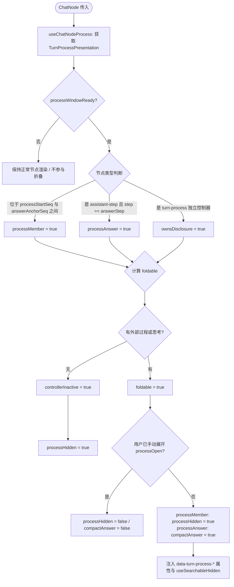

# DeepSeek-Harness 折叠状态机与节点树专项分析报告

> 报告路径：`docs/linear-chat-stream-study/analysis/04-deepseek-turn-process-folding-state-machine.md`  
> 专项角色：A04 - DeepSeek 折叠状态机与节点树分析员  
> 调研对象：`reference/deepseek-harness/packages/client/ui-chat/`  
> 对应模块：
> - `ChatNodeSeat.tsx`
> - `TurnProcessNodeView.tsx` & `TurnProcessNodeView.module.css`
> - `conversation-nodes/turn-process.ts` & `turn-process-presentation.ts` & `contract/turn-process.ts`
> - `ReasoningRow.tsx` & `ReasoningRow.module.css`
> - `TurnTailNodeView.tsx` & `TurnTailNodeView.module.css` & `MessageIconActions.module.css`

---

## 一、核心设计哲学：解决线性对话流的冗长与信息爆炸

在现代 Agent 交互中，一个用户 Turn 往往伴随着大量的中间过程：
1. **深度思考模型（如 DeepSeek-R1）的长文本 Reasoning 输出**（可达数千字）；
2. **多轮次工具调用与结果反馈**（读文件、正则搜索、Bash 命令、语法检查等）；
3. **子 Agent 派发与汇总**（分任务派发与异步回传）；
4. **运行时上下文注入**（系统提示词补充、动态策略变更）。

若将上述所有节点以等权、平铺的方式展开在时间线上，对话界面将迅速被海量技术噪音淹没，用户极难快速获取最终答案。而传统产品的折叠方案通常存在三大痛点：
- **容器嵌套套娃**：为折叠块套上厚重背景框、边框、卡片阴影，导致视觉层级过重；
- **渲染重绘抖动**：流式更新时折叠栏高度跳动，触发全局 DOM 递归回流；
- **页面搜索失效**：折叠内容被 `display: none` 或 unmount，浏览器原生的 `Ctrl+F` 无法定位其中的关键词。

DeepSeek-Harness 通过一套**“事件流时空投影 + 虚拟状态机 + 极简 CSS 硬件隔离 + HTML5 原生透传搜索”**的架构，给出了优雅的解法：
- **折叠态极简化**：将复杂思考与多步工具汇总为一条 `33px` 高、仅带 `0.5px` 底边框的单行摘要（例如 `"1 tool call · 1 message"` 或 `"Thought for a while"`），直接紧贴最终回答；
- **零额外框线容器**：杜绝卡片式外包壳，折叠控制器本身就是一个扁平按钮，展开后子节点原地按真实时空顺序平铺；
- **流式思考零抖动（24px）**：未展开思考块使用 CSS `contain: size layout` 固化高度，流式输出时动态追踪最新单行（`latestLine`），完成后回归首行标题（`firstLine`）；
- **原生透传搜索（`hidden="until-found"`）**：利用现代浏览器规范，用户在折叠状态下 `Ctrl+F` 命中内容时，浏览器自动触发 `beforematch` 并激活状态机就地展开。

---

## 二、ChatNodeSeat：过程折叠状态机的推导与调度

文件位置：[`ChatNodeSeat.tsx`](file:///c:/Software/conex/reference/deepseek-harness/packages/client/ui-chat/src/client/chat/ChatNodeSeat.tsx)

`ChatNodeSeat` 是连接底层时空事件节点（`ChatNode`）与上层渲染槽位的核心坐席。它不直接负责绘制具体的 DOM 元素，而是为每一个经过它的节点计算精确的“折叠上下文”与“可见性标记”。

### 1. 状态机推导全景流程



### 2. 七大核心布尔变量及其推导公式

在 `ChatNodeSeat.tsx` 的 62–98 行，包含了高度严密的 7 个布尔判定：

#### ① `processWindowReady`（折叠视窗就绪状态）
```typescript
// ChatNodeSeat.tsx:62-68
const processWindowReady = processSpec !== undefined
  && processPresentation !== undefined
  && compactTranscript
  && processSpec.answerAnchorSeq !== null
  && processPresentation.turn === processSpec.turn
  && processPresentation.turnClosed
  && !historyIncomplete
```
- **核心逻辑**：只有当一个 Turn **彻底完成且闭合**（`turnClosed`）、存在明确的最终回答边界（`answerAnchorSeq !== null`）、全局处于精简视图模式（`compactTranscript`，用户设为 normal 则关闭折叠）、且历史记录完整（`!historyIncomplete`，避免翻页加载残缺导致的计算误判）时，状态机才进入“可折叠就绪状态”。
- **动态生命周期意义**：在 Turn 还在流式输出（`running`）期间，`answerAnchorSeq` 为 `null`，`processWindowReady` 严格为 `false`！这保证了**生成过程中所有过程与思考全量展开可见，绝不中途突兀折叠打断阅读**。

#### ② `processMember`（过程成员节点）
```typescript
// ChatNodeSeat.tsx:69-73
const processMember = routedNode !== undefined
  && processWindowReady
  && !TURN_PROCESS_INDEPENDENT_KINDS.has(routedNode.kind)
  && routedNode.anchorSeq >= processSpec.processStartSeq
  && routedNode.anchorSeq < processSpec.answerAnchorSeq
```
- **核心逻辑**：判定当前节点是否属于最终回答之前的“过程产物”。
- **判定区间**：`[processStartSeq, answerAnchorSeq)`。
- **独立排除名单**：`TURN_PROCESS_INDEPENDENT_KINDS`（定义于 `contract/turn-process.ts:20-28`），包括：
  - `system-prompt`（系统提示词始终置顶，不可被折叠）；
  - `user`（用户输入消息独立显示）；
  - `steering`（用户在 Turn 中途插入的干预/转向提示）；
  - `turn-process`（控制器节点自身）；
  - `turn-error`、`turn-max-tokens`、`turn-tail`（异常报错与尾部操作栏）。
- **被折叠的节点类型**：工具调用（`tool-call`）、工具返回（`tool-result`）、运行时上下文（`context`）、最终回答之前的草稿/中间助手消息（`assistant-step`）。

#### ③ `processAnswer`（最终回答判定）
```typescript
// ChatNodeSeat.tsx:74-77
const processAnswer = routedNode !== undefined
  && processWindowReady
  && routedNode.kind === 'assistant-step'
  && routedNode.data.step === processSpec.answerStep
```
- **核心逻辑**：标记该 Turn 的唯一定局回答节点（`assistant-step` 且 `step === processSpec.answerStep`）。

#### ④ `ownsDisclosure`（折叠控制所有权）
```typescript
// ChatNodeSeat.tsx:78
const ownsDisclosure = routedNode?.kind === 'turn-process' || processAnswer
```
- **核心逻辑**：识别谁是折叠交互的“宿主”。包含两个角色：一是合成的 `turn-process` 控制节点，二是承载最终正文的 `processAnswer` 节点。

#### ⑤ `foldable`（可折叠资格）
```typescript
// ChatNodeSeat.tsx:79-81
const foldable = processWindowReady
  && (processMember || (ownsDisclosure
    && (processPresentation.hasExternalProcess || processSpec.inlineReasoning)))
```
- **核心逻辑**：
  - 若为 `processMember`，直接继承可折叠资格；
  - 若为宿主（`ownsDisclosure`），必须满足**“确实有东西可折叠”**的先决条件：
    - `hasExternalProcess === true`（存在前置工具调用、中间消息等外部过程）；
    - 或 `inlineReasoning === true`（回答正文内包含非空的 `<think>` 深度思考块）。
  - **边界防护**：若一个 Turn 仅仅是一句简单的直接回答（无工具、无思考），`foldable` 为 `false`，折叠控制条完全不会生成。

#### ⑥ `controllerInactive`（控制器休眠）
```typescript
// ChatNodeSeat.tsx:92-93
const controllerInactive = routedNode?.kind === 'turn-process'
  && !foldable
```
- **核心逻辑**：当当前节点是 `turn-process` 控制器，但计算出的 `foldable` 为假时，标记控制器休眠，后续通过 `processHidden` 隐藏。

#### ⑦ `compactAnswer`（紧凑回答视觉节拍）
```typescript
// ChatNodeSeat.tsx:94-97
const compactAnswer = processAnswer
  && foldable
  && processPresentation.compactAnswer
  && !processOpen
```
- **核心逻辑**：当折叠栏处于收起状态（`!processOpen`），且没有用户转向中断时（`processPresentation.compactAnswer` 为真），最终回答节点启用紧凑间距（CSS 变量 `--dsh-chat-flow-gap: 8px`，正常间距为 `16px`）。这使折叠条与回答正文在视觉上紧密贴合为一体。

#### ⑧ `processHidden`（节点最终隐藏裁决）
```typescript
// ChatNodeSeat.tsx:98
const processHidden = controllerInactive || (foldable && processMember && !processOpen)
```
- **核心逻辑**：如果是非激活的控制器，或者属于“收起状态下的过程成员节点”，该节点被标记为隐藏。

### 3. useSearchableHidden：原生与无感搜索（until-found）

文件位置：[`searchable-hidden.ts`](file:///c:/Software/conex/reference/deepseek-harness/packages/client/ui-chat/src/client/chat/searchable-hidden.ts)

许多对话框架折叠时直接 `display: none` 或 unmount 组件，导致用户在页面使用浏览器快捷键 `Ctrl + F` 时搜不到被折叠的命令输出或代码。DeepSeek-Harness 采用 HTML5 最新的 `hidden="until-found"` 规范：

```typescript
// searchable-hidden.ts:9-31
export function useSearchableHidden(
  hidden: boolean,
  reveal: () => void,
): RefObject<HTMLDivElement> {
  const ref = useRef<HTMLDivElement>(null)
  useLayoutEffect(() => {
    const element = ref.current
    if (element === null) return
    // 保护：如果隐藏元素正包含用户当前聚焦的焦点，则不执行隐藏，直接唤醒展开
    if (hidden && element.contains(element.ownerDocument.activeElement)) {
      reveal()
      return
    }
    if (hidden) element.setAttribute('hidden', 'until-found')
    else element.removeAttribute('hidden')
  }, [hidden, reveal])
  
  useEffect(() => {
    const element = ref.current
    if (element === null) return
    // 浏览器 Ctrl+F 搜索匹配到内容时原生派发 beforematch 事件
    element.addEventListener('beforematch', reveal)
    return () => { element.removeEventListener('beforematch', reveal) }
  }, [reveal])
  return ref
}
```

- **运作机制**：
  1. 当 `processHidden === true` 时，DOM 节点并不脱落，而是被设置 `element.setAttribute('hidden', 'until-found')`；
  2. 现代浏览器（Chrome 102+、WebView2 等）的原生搜索算法会穿透扫描带有 `until-found` 属性的子树；
  3. 一旦用户在搜索框输入关键词命中该节点内部的文字，浏览器在滚动并高亮之前，会同步对该节点派发 `beforematch` 原生事件；
  4. 监听器捕获事件并调用 `reveal()` -> 触发 `setOpen(true)`，状态机即刻展开，全量过程节点瞬间可见并精确对齐光标！
  5. 避免意外失焦：`element.contains(element.ownerDocument.activeElement)` 守卫确保当用户正在用键盘 Tab 浏览或在内部操作时，折叠动作不会粗暴斩断焦点。

---

## 三、过程数据切片与投影：turn-process.ts 与 turn-process-presentation.ts

### 1. TurnProcessSpec 契约模型

文件位置：[`contract/turn-process.ts`](file:///c:/Software/conex/reference/deepseek-harness/packages/client/ui-chat/src/client/contract/turn-process.ts)

```typescript
// contract/turn-process.ts:4-18
export interface TurnProcessSpec {
  readonly turn: number
  /** 稳定的控制节点锚点 Seq，即使证据尚未就绪也保持稳定 */
  readonly controlAnchorSeq: number
  readonly processStartSeq: number
  readonly answerAnchorSeq: number | null
  readonly answerStep: number | null
  readonly inlineReasoning: boolean
  /** 最终回答之前的助手消息数量 */
  readonly messageCount: number
  /** 记录在此 Turn 内的常规工具调用数量 */
  readonly toolCallCount: number
  /** 工具调用中被识别为 Subagent 派发的数量 */
  readonly subagentCount: number
}
```

Subagent 识别规则（`isSubagentDelegationTool`）：
```typescript
// contract/turn-process.ts:59-61
export function isSubagentDelegationTool(name: string): boolean {
  return name === 'subagent' || name.startsWith('subagent_')
}
```
通过分离常规工具调用与 Subagent 派发，折叠栏能提供更精确的结构化统计。

### 2. 状态投影定义：turnProcessDefinition

文件位置：[`conversation-nodes/turn-process.ts`](file:///c:/Software/conex/reference/deepseek-harness/packages/client/ui-chat/src/client/conversation-nodes/turn-process.ts)

`turnProcessDefinition` 是一个基于 Cordis 会话流引擎注册的 `ConversationNodeDefinition<TurnProcessState>`：
- **监听事件**（L220–228）：监听 `turn/start`、`assistant/live-chunk`、`assistant/message`、`tool/call`、`tool/result`、`llm/retry`、`step/start`、`step/end`、`turn/end`；
- **增量更新**（L174–210 `updateProcessState`）：
  - 遇到 `assistant/message` 时累加 `messageCount`；
  - 遇到 `tool/call` 时按名称切分累加 `toolCallCount` 或 `subagentCount`；
  - 记录最早的过程证据序号（`controlAnchorSeq`、`otherStartSeq`、`assistantStartByStep`）；
- **合成 ViewNode 的位置确定**（L299–305）：
  ```typescript
  return chatNode(
    context,
    'turn-process',
    data.controlAnchorSeq + CHAT_SYNTHETIC_SEQ_OFFSETS.processControl,
    data,
  )
  ```
  通过注入一个确定性微小偏移量 `CHAT_SYNTHETIC_SEQ_OFFSETS.processControl`，合成出的折叠控制器被精准安置在用户提问之后、任何实际过程操作之前的位置。

### 3. 跨节点展示投影：ChatTurnProcessProjector

文件位置：[`conversation-nodes/turn-process-presentation.ts`](file:///c:/Software/conex/reference/deepseek-harness/packages/client/ui-chat/src/client/conversation-nodes/turn-process-presentation.ts)

`ChatTurnProcessProjector` 在内存中维护按 Turn 分组的布局计算。核心算法在 `derivePresentation`（L24–71）：
1. 遍历该 Turn 下的所有 Node Key；
2. 扫描 `openingHumanAnchor`（最初的人类用户输入）；
3. 检查是否有中断干预：如果存在人类输入位于过程与最终回答之间，`compactAnswer` 降级为 `false`；
4. 计算 `hasExternalProcess`：只要在 `[processStartSeq, answerAnchorSeq)` 区间内发现任何非 `TURN_PROCESS_INDEPENDENT_KINDS` 的节点（且不是最终回答本身），即标记为 `true`。

---

## 四、极简 UI 呈现：TurnProcessNodeView

文件位置：
- 组件：[`TurnProcessNodeView.tsx`](file:///c:/Software/conex/reference/deepseek-harness/packages/client/ui-chat/src/client/chat/TurnProcessNodeView.tsx)
- 样式：[`TurnProcessNodeView.module.css`](file:///c:/Software/conex/reference/deepseek-harness/packages/client/ui-chat/src/client/chat/TurnProcessNodeView.module.css)

### 1. 结构与文案拼装逻辑

`TurnProcessNodeView` 的实现极其克制，仅有 61 行代码：

```typescript
// TurnProcessNodeView.tsx:13-40
const labels: string[] = []
if (node.data.toolCallCount > 0) {
  labels.push(t(
    node.data.toolCallCount === 1
      ? 'message.turnProcess.toolCalls.one'
      : 'message.turnProcess.toolCalls.other',
    { count: node.data.toolCallCount },
  ))
}
if (node.data.messageCount > 0) {
  labels.push(t(
    node.data.messageCount === 1
      ? 'message.turnProcess.messages.one'
      : 'message.turnProcess.messages.other',
    { count: node.data.messageCount },
  ))
}
if (node.data.subagentCount > 0) {
  labels.push(t(
    node.data.subagentCount === 1
      ? 'message.turnProcess.subagents.one'
      : 'message.turnProcess.subagents.other',
    { count: node.data.subagentCount },
  ))
}
const label = labels.length === 0
  ? t('message.turnProcess.thoughtForAWhile')  // "Thought for a while" / "已深度思考"
  : labels.join(t('message.turnProcess.separator')) // 默认间隔符 " · "
```

- **文案优先级与组合**：
  - 如果只有深度思考过程，没有任何工具调用和消息，退化显示为：`"Thought for a while"`（已深度思考）；
  - 如果混合了工具和消息，拼接显示为：`"1 tool call · 1 message · 1 subagent"`（1 次工具调用 · 1 条消息 · 1 个 subagent）；
  - 全过程自动感知中英文复数（`.one` / `.other`）。

### 2. 33px 高度与 0.5px 发丝底边的极简视觉体系

在 CSS 架构上，DeepSeek 坚决摒弃了传统折叠面板的“卡片圆角背景包边”，采用纯扁平的“分割线按钮”：

```css
/* TurnProcessNodeView.module.css:1-34 */
.root {
  box-sizing: border-box;
  display: flex;
  align-items: center;
  width: 100%;
  min-width: 0;
  height: 33px;                         /* 精确 33px 固定高度 */
  padding: 0 0 8px;                     /* 底部 8px 内边距 */
  border: none;
  border-bottom: 0.5px solid var(--dsw-alias-border-l2); /* 极细 0.5px hairline 底边框 */
  background: none;
  color: var(--dsw-alias-label-secondary);
  cursor: pointer;
  text-align: left;
}

.root:not([data-open]) {
  margin-bottom: 8px;                   /* 收起时距离正文 8px */
}

.chevron {
  flex: none;
  width: 16px;
  height: 16px;
  margin-left: 6px;
  color: var(--dsw-alias-label-tertiary);
  transform: rotate(-90deg);            /* 收起态向右指（向下旋转 -90deg） */
  transition: transform 100ms ease;     /* 100ms 快速无迟滞过渡 */
}

.root[data-open] .chevron {
  transform: rotate(0deg);              /* 展开态向下指 */
}

.label {
  min-width: 0;
  overflow: hidden;
  font-size: 14px;
  line-height: 24px;
  text-overflow: ellipsis;
  white-space: nowrap;
}
```

### 3. Visual Rhythm（视觉节奏）控制

在全局流程样式表 [`ChatView.module.css`](file:///c:/Software/conex/reference/deepseek-harness/packages/client/ui-chat/src/client/chat/ChatView.module.css) 中，可以看到如下协作设计：

```css
/* ChatView.module.css:50-52 */
~ :not([hidden]):not(.flowItem:empty) {
  margin-top: var(--dsh-chat-flow-gap, 16px);
}

/* ChatView.module.css:60-64 */
/* 折叠的思考/工具摘要紧邻着回答正文，间距压缩为 8px */
.flowItem[data-turn-process-answer] {
  --dsh-chat-flow-gap: 8px;
}
```

- **展开态**：当折叠栏展开时，中间的所有工具条、代码块、思考行按默认 `16px` 的呼吸感纵向排列；
- **收起态**：折叠栏的 `margin-bottom: 8px` 配合后续最终回答的 `--dsh-chat-flow-gap: 8px`，让折叠摘要行紧贴着回答正文，形成一眼即辨的“元信息-正文”归属感。

---

## 五、ReasoningRow：流式单行追踪与 24px 零重绘抖动

文件位置：
- 组件：[`ReasoningRow.tsx`](file:///c:/Software/conex/reference/deepseek-harness/packages/client/ui-chat/src/client/chat/ReasoningRow.tsx)
- 样式：[`ReasoningRow.module.css`](file:///c:/Software/conex/reference/deepseek-harness/packages/client/ui-chat/src/client/chat/ReasoningRow.module.css)

在助手正文中直接出现的 `<think>` 思考过程（或折叠展开后的思考行），由 `ReasoningRow` 专门渲染。

### 1. 双态文案裁切机制：latestLine vs firstLine

```typescript
// ReasoningRow.tsx:8-17
function firstLine(text: string): string {
  const newline = text.indexOf('\n')
  return newline === -1 ? text : text.slice(0, newline)
}

function latestLine(text: string): string {
  const visible = text.trimEnd()
  const newline = visible.lastIndexOf('\n')
  return newline === -1 ? visible : visible.slice(newline + 1)
}

// ReasoningRow.tsx:28
const summary = running ? latestLine(text) : firstLine(text)
```

- **流式输出进行中（`running === true`）**：
  - 调用 `latestLine(text)`：实时提取模型当前正在吐出字的**最新一行**；
  - 效果：用户可以像看心跳打字机一样，单行预览模型当前在想什么，而不需要被不断向下暴涨的巨幅段落推挤视口。
- **输出结算完毕（`running === false`）**：
  - 调用 `firstLine(text)`：提取思考内容的第一行作为持久折叠摘要（通常是模型的阶段概括句，如 `"Let's verify the equation..."`）；
  - 避免了思考结束后界面残留末尾无关琐碎文字的问题。

### 2. CSS Flex 端部跟随（data-follow-end）

在流式输出中，最新的一行文字长度往往随着 Token 追加迅速超出容器宽度。如果按照常规从左到右截断，用户只能看到一行的开头，而看不到**正在吐出的最新 Token**。DeepSeek 采用了一个纯 CSS 的黑科技：

```css
/* ReasoningRow.module.css:77-89 */
.summary[data-follow-end] {
  display: flex;
  justify-content: flex-end;            /* 将内容推到最右侧 */
}

.summary[data-follow-end] .summaryText {
  flex: 0 0 auto;
  width: max-content;
  min-width: 100%;
  overflow: visible;
  text-align: start;
  text-overflow: clip;                  /* 溢出时右对齐，展示最新的尾部文字 */
}
```
通过 `justify-content: flex-end` + `width: max-content`，当最新行文字变长向右延伸时，容器始终锚定在最右侧，新生成的 Token 持续暴露在用户的视线焦点中！

### 3. 24px 严格尺寸隔离（contain: size layout）

流式追加最怕由于文字尺寸微调引起浏览器整体重排抖动。DeepSeek 在 CSS 中加入了严格的物理隔离：

```css
/* ReasoningRow.module.css:6-9 */
.root:not([data-expanded]) {
  contain: size layout;
  height: calc(24px + var(--dsh-content-font-delta, 0px));
}
```
- **`contain: size layout`**：通知浏览器的渲染引擎，该节点在未展开时的尺寸在外部完全隔离。无论里面是正在快速接收 100 字/秒的高频 Token，还是行内文字由于字体测量发生微小变动，**浏览器的重排影响范围仅局限于该 24px 框内，绝不向外冒泡影响聊天视口其他元素**！
- 加上 `height: calc(24px + ...)`，绝对锁死高度，实现彻底的零跳动（Zero Jitter）。

### 4. 2.6s 跑马灯微光扫掠（Shimmer Sweep）

```css
/* ReasoningRow.module.css:16-35 */
.root[data-state='running'] .row::after {
  content: '';
  position: absolute;
  inset-block: 0;
  left: 0;
  width: 300px;
  background: linear-gradient(
    90deg,
    transparent 0%,
    color-mix(in srgb, var(--dsw-alias-bg-base) 60%, transparent) 55%,
    transparent 100%
  );
  animation: dsh-reasoning-row-sweep 2.6s ease-out infinite;
  pointer-events: none;
}

@keyframes dsh-reasoning-row-sweep {
  0% { left: -300px; }
  90%, 100% { left: 100%; }
}
```
- 利用现代 CSS `color-mix(in srgb, var(--dsw-alias-bg-base) 60%, transparent)` 构建感知柔和的半透微光；
- 宽度 `300px` 的光束以 `2.6s` 的缓慢周期由左向右扫过，极度克制地向用户传递“思考进行中”的生命力，且不会产生烦躁刺眼的频闪感；
- 遵循无障碍规范：在 `@media (prefers-reduced-motion: reduce)` 时完全关闭该动画。

---

## 六、TurnTailNodeView：尾部操作栏的常驻与悬停交互

文件位置：
- 组件：[`TurnTailNodeView.tsx`](file:///c:/Software/conex/reference/deepseek-harness/packages/client/ui-chat/src/client/chat/TurnTailNodeView.tsx)
- 样式：[`TurnTailNodeView.module.css`](file:///c:/Software/conex/reference/deepseek-harness/packages/client/ui-chat/src/client/chat/TurnTailNodeView.module.css)
- 共享操作栏样式：[`MessageIconActions.module.css`](file:///c:/Software/conex/reference/deepseek-harness/packages/client/ui-chat/src/client/chat/MessageIconActions.module.css)

在每一个对话 Turn 的结尾，通常包含复制、分支分叉（Fork）、Token 统计（Usage）、耗时与速度（Time / TPS / TTFT）等操作图标。如果每一条历史消息都常驻显示整排图标，界面会显得琐碎凌乱；如果全部必须鼠标悬停才显现，用户又无法快速了解当前刚回答完的最新结果。

DeepSeek 的设计原则是：**“最新 Turn 常驻展示，历史 Turn 悬停显隐”**。

### 1. 状态注入逻辑

在 `TurnTailNodeView.tsx` 中：
```typescript
// TurnTailNodeView.tsx:19
const isLatestTurn = useChat(snapshot => snapshot.timeline.turnOrder.at(-1) === data.turn)

// TurnTailNodeView.tsx:41
<div
  className={css.root}
  data-turn-tail={data.turn}
  data-actions-reveal={isLatestTurn ? 'always' : 'hover'}
>
```
- 通过 `snapshot.timeline.turnOrder.at(-1)` 高性能判定当前 Turn 是否是整个对话时间线的末尾；
- 最新 Turn 赋予 `data-actions-reveal="always"`；
- 历史 Turn 赋予 `data-actions-reveal="hover"`。

### 2. 纯 CSS 优雅显隐：缺省即常驻，无需 Override

查看 [`MessageIconActions.module.css`](file:///c:/Software/conex/reference/deepseek-harness/packages/client/ui-chat/src/client/chat/MessageIconActions.module.css) 的关键实现：

```css
/* MessageIconActions.module.css:36-55 */
@media (hover: hover) {
  /* 历史消息的操作栏默认完全透明 */
  [data-actions-reveal='hover'] .actions,
  :is([data-chat-flow-kind='user'], [data-chat-flow-kind='steering']):has(
    ~ :is([data-chat-flow-kind='user'], [data-chat-flow-kind='steering'])
  ) .actions {
    opacity: 0;
    transition: opacity 80ms ease;       /* 80ms 瞬时响应，避免粘滞感 */
  }

  /* 鼠标悬停或键盘焦点进入时显现 */
  [data-actions-reveal='hover']:hover .actions,
  [data-actions-reveal='hover']:focus-within .actions,
  :is([data-chat-flow-kind='user'], [data-chat-flow-kind='steering']):has(
    ~ :is([data-chat-flow-kind='user'], [data-chat-flow-kind='steering'])
  ):hover .actions,
  :is([data-chat-flow-kind='user'], [data-chat-flow-kind='steering']):has(
    ~ :is([data-chat-flow-kind='user'], [data-chat-flow-kind='steering'])
  ):focus-within .actions {
    opacity: 1;
  }
}
```

这里的架构细节非常精巧：
1. **反向规则（Absence of rule）**：CSS 中压根没有写 `[data-actions-reveal='always']` 的选择器！因为 `.actions` 默认就是 `opacity: 1`。最新 Turn 因为被打上 `always`，根本不匹配 `[data-actions-reveal='hover']`，直接享受默认可见状态。这免去了用优先级覆盖样式（Override）的繁琐；
2. **纯 CSS 兄弟选择器管理用户消息**：
   ```css
   :is([data-chat-flow-kind='user'], [data-chat-flow-kind='steering']):has(
     ~ :is([data-chat-flow-kind='user'], [data-chat-flow-kind='steering'])
   ) .actions
   ```
   借助 `:has(~ ...)` 选择器，**无需在 React 状态机中遍历每个用户消息是否是最后一条**，纯 CSS 即可自动判定“后面是否还有其他用户消息”！如果后面有，说明当前是历史提问，隐藏其图标；如果是最后一条提问，自动保持显示；
3. **零 Layout Shift（无高度塌陷）**：显隐控制严格使用 `opacity: 0 -> 1`，而不使用 `display: none` 或 `height: 0`。操作栏始终占满 `height: calc(28px + var(--dsh-content-font-delta, 0px))` 的高度，鼠标滑过绝不产生任何聊天气泡的上下弹跳抖动；
4. **移动端触控保护（`@media (hover: hover)`）**：在触控屏或移动设备上，不存在悬停（Hover）事件。所有悬停隐藏逻辑全部置于 `@media (hover: hover)` 内，触控设备上所有 Turn 的操作按钮均保持常驻，无障碍可点击。

---

## 七、架构对比与工程度量总结

| 设计维度 | 传统 Agent 对话流（典型实现） | DeepSeek-Harness 实现方案 | 优势与技术收益 |
|---|---|---|---|
| **过程折叠外壳** | 大卡片、背景填充、圆角浅灰外框、内嵌边框线 | 无外包容器、单行 `33px` 按钮、`0.5px` 极细下边框 | 彻底抹平“套娃视觉感”，回归文档流纯净阅读 |
| **折叠状态切换** | 组件级内部 `useState(open)`，跨 Turn 状态混乱 | 全局 Session Store 精确到 `(turn, answerStep)` 双键映射 | 重新提问或生成时自动对齐步骤，状态不会错乱漂移 |
| **页面文字搜索** | 折叠时使用 `display: none` 或不挂载 DOM，`Ctrl+F` 搜不到内容 | 采用 HTML5 原生 `hidden="until-found"` + 监听 `beforematch` | 搜索即展开，零侵入无缝打通浏览器原生查找能力 |
| **流式思考呈现** | 动态向下撑大文本框，频繁引发视口滚动跳跃 | `contain: size layout` + 严格 24px 高度 + `latestLine` 尾部跟随 | 零布局重绘回流，实时展示思考焦点，毫无跳动 |
| **思考结算呈现** | 停留在最后一句话或整体收起无概括 | 结算后自动切换为 `firstLine` 首行主题 | 静态保留阶段结论，视觉体验工整 |
| **尾部操作栏** | 全量平铺显示（嘈杂）或全量悬停显示（隐晦） | 最新 Turn 缺省常驻，历史 Turn 纯 CSS 动态悬停 | 视觉宁静与即时可用性的极致平衡 |
| **用户消息管理** | JS 递归计算 index 并传入 `isLatest` 属性 | CSS `:has(~ user)` 原生兄弟反向判定 | 降低 React 渲染树耦合，零运行时额外计算 |

---

## 八、对 Conex / Crish 桌面端对话流重构的直接落地建议

1. **迁移 `ChatNodeSeat` 状态机模式**：
   Conex 目前在正文流中存在工具调用、思考过程各自为政展开的混乱情况。建议引入 `TurnProcessSpec` 与 `ChatNodeSeat` 的过程成员判定模式（`[processStartSeq, answerAnchorSeq)`），将流结束后的中间工具、重试、中间消息统一收归到单一的单行控制器中。

2. **采用 `hidden="until-found"` 原生透传搜索**：
   在 Conex 桌面端（Tauri WebView2）中，全面支持 `hidden="until-found"` 与 `beforematch` 事件。将所有的折叠态统一改为该属性，彻底解决用户反馈“在长对话中搜索以前执行过的命令或代码找不到”的顽疾。

3. **重构思考行（ReasoningRow）为 24px 严格容器**：
   在 DeepSeek-R1 等长思考模型输出时，借鉴 `latestLine(text)` + `[data-follow-end]` 的单行跟踪方案，并加上 `contain: size layout; height: 24px;`。既让用户知道模型在“想什么具体问题”，又消除视口反复向上推移的晕眩感。

4. **全面落地纯 CSS 尾部操作栏显隐**：
   借鉴 `MessageIconActions.module.css` 中的 `@media (hover: hover)`、`opacity` 平滑过渡与 `:has(~ ...)` 兄弟选择器。避免在 React 组件间层层传递 `isLastUser` 或维护复杂的鼠标悬浮 state。
