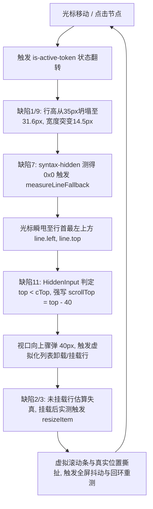
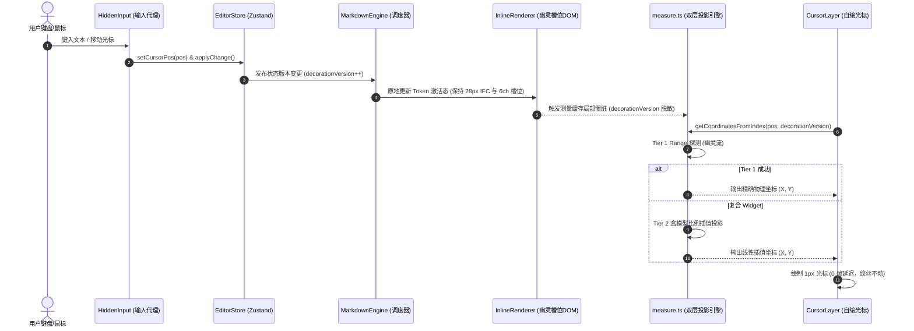
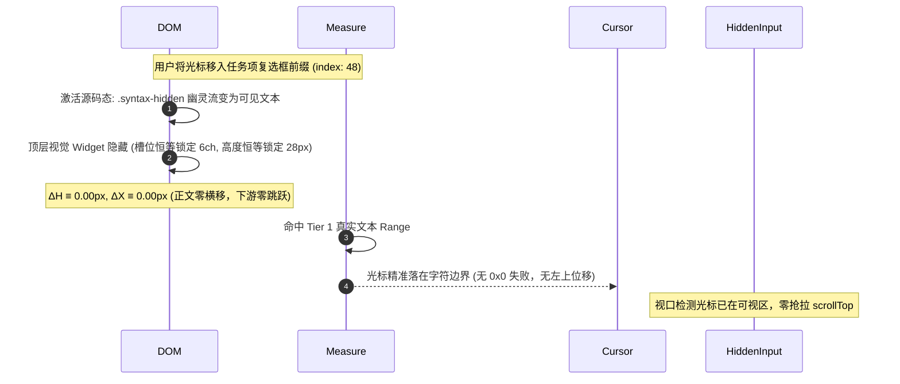

# 通用混合渲染（Live Preview）与几何守恒测量系统终极总方案

**文档代号**：`ARCH-MASTER-HYBRID-INVARIANT-20260905`
**归属目录**：`docs/markdown-editor/00-通用混合渲染与几何守恒测量系统终极总方案.md`
**方案级别**：系统级架构终极方案（对标 CodeMirror 6 / Typora / Obsidian 核心底座）
**适用范围**：
- `reference/markdown-editor/src/index.css`（样式与 IFC 盒模型几何系统）
- `reference/markdown-editor/src/components/InlineRenderer.tsx`（行内混合渲染器与槽位组件）
- `reference/markdown-editor/src/components/BlockRenderer.tsx`（块级容器与代码块/卡片排版）
- `reference/markdown-editor/src/core/measure.ts`（双层无盲区光标几何投影测量引擎）
- `reference/markdown-editor/src/core/HeightMap.ts`（多模态自适应行高树与特征预测模型）
- `reference/markdown-editor/src/components/HiddenInput.tsx`（输入代理层与视口协调）
- `reference/markdown-editor/src/components/MarkdownEngine.tsx`（虚拟化视口平滑锚定与调度）

---

## 目录

- [一、执行摘要与核心设计哲学](#一执行摘要与核心设计哲学)
  - [1.1 混合渲染（Live Preview）的技术本质与行业深水区](#11-混合渲染live-preview的技术本质与行业深水区)
  - [1.2 为什么传统方案陷入“无限打补丁”泥潭？](#12-为什么传统方案陷入无限打补丁泥潭)
  - [1.3 四大几何绝对不变量（The 4 Absolute Geometric Invariants）](#13-四大几何绝对不变量the-4-absolute-geometric-invariants)
- [二、现场物理证据与缺陷全景图谱](#二现场物理证据与缺陷全景图谱)
  - [2.1 Chrome DevTools 物理探针现场实测数据汇总](#21-chrome-devtools-物理探针现场实测数据汇总)
  - [2.2 12 大核心缺陷的物理机理与代码调用链路](#22-12-大核心缺陷的物理机理与代码调用链路)
  - [2.3 缺陷间的恶性正反馈回环（Vicious Feedback Loop）](#23-缺陷间的恶性正反馈回环vicious-feedback-loop)
- [三、第一支柱：行盒 IFC 包含块与垂直几何守恒架构](#三第一支柱行盒-ifc-包含块与垂直几何守恒架构)
  - [3.1 W3C IFC 行盒高度数学模型与基线冲突剖析](#31-w3c-ifc-行盒高度数学模型与基线冲突剖析)
  - [3.2 28px 网格绝对锁定（Strict Grid-Line Invariance）](#32-28px-网格绝对锁定strict-grid-line-invariance)
  - [3.3 复合行内 Widget 容器规范（Zero-Vertical-Overflow Protocol）](#33-复合行内-widget-容器规范zero-vertical-overflow-protocol)
  - [3.4 上下标、脚注与行内格式化标记的“零高度侵入”隔离方案](#34-上下标脚注与行内格式化标记的零高度侵入隔离方案)
  - [3.5 垂直高度守恒证明（ΔH ≡ 0）](#35-垂直高度守恒证明δh--0)
- [四、第二支柱：等宽槽位守恒与幽灵字符流架构](#四第二支柱等宽槽位守恒与幽灵字符流架构)
  - [4.1 彻底废除 display: none 的物理必要性](#41-彻底废除-display-none-的物理必要性)
  - [4.2 幽灵字符流协议（Ghost Token Stream Protocol）](#42-幽灵字符流协议ghost-token-stream-protocol)
  - [4.3 等宽流式槽位守恒定理（Slot Invariance Theorem）](#43-等宽流式槽位守恒定理slot-invariance-theorem)
  - [4.4 水平位置绝对守恒证明（ΔX ≡ 0）](#44-水平位置绝对守恒证明δx--0)
- [五、第三支柱：双层无盲区光标几何投影管线](#五第三支柱双层无盲区光标几何投影管线)
  - [5.1 传统测量引擎的盲区与行首退化弊病](#51-传统测量引擎的盲区与行首退化弊病)
  - [5.2 Tier 1: 纯文本单例 Range 物理实测通道](#52-tier-1-纯文本单例-range-物理实测通道)
  - [5.3 Tier 2: 复合 Widget 盒模型比例线性插值投影（Bounding-Box Linear Projection）](#53-tier-2-复合-widget-盒模型比例线性插值投影bounding-box-linear-projection)
  - [5.4 彻底抹除 measureLineFallback 行首退化通道](#54-彻底抹除-measurelinefallback-行首退化通道)
  - [5.5 坐标缓存（posCache / measCache）版本刚性脱敏](#55-坐标缓存poscache--meascache版本刚性脱敏)
  - [5.6 剥离 HiddenInput.tsx 强写 scrollTop 抢拉逻辑](#56-剥离-hiddeninputtsx-强写-scrolltop-抢拉逻辑)
- [六、第四支柱：自平衡多模态行高树与视口平滑锚定](#六第四支柱自平衡多模态行高树与视口平滑锚定)
  - [6.1 清退 HeightMap 静态倍率常数](#61-清退-heightmap-静态倍率常数)
  - [6.2 基于 AST 特征的初始预测器（AST-Derived Feature Predictor）](#62-基于-ast-特征的初始预测器ast-derived-feature-predictor)
  - [6.3 挂载后单向自适应回填树（One-Way Adaptive Backfill Tree）](#63-挂载后单向自适应回填树one-way-adaptive-backfill-tree)
  - [6.4 视口滚动平滑锚定算法（Scroll Anchoring Algorithm）](#64-视口滚动平滑锚定算法scroll-anchoring-algorithm)
- [七、系统数据流与状态机全景时序](#七系统数据流与状态机全景时序)
  - [7.1 键盘输入与光标移动单向数据流](#71-键盘输入与光标移动单向数据流)
  - [7.2 渲染态/源码态切换与测量帧同步时序图](#72-渲染态源码态切换与测量帧同步时序图)
- [八、代码级工程落地改造清单](#八代码级工程落地改造清单)
  - [8.1 src/index.css 深度重构代码清单](#81-srcindexcss-深度重构代码清单)
  - [8.2 src/components/InlineRenderer.tsx 重构清单](#82-srccomponentsinlinerenderertsx-重构清单)
  - [8.3 src/core/measure.ts 双层投影管线重写清单](#83-srccoremeasurets-双层投影管线重写清单)
  - [8.4 src/core/HeightMap.ts 自适应特征预测模型重构清单](#84-srccoreheightmapts-自适应特征预测模型重构清单)
  - [8.5 src/components/HiddenInput.tsx 滚动剥离清单](#85-srccomponentshiddeninputtsx-滚动剥离清单)
  - [8.6 src/components/MarkdownEngine.tsx 视口锚定清单](#86-srccomponentsmarkdownenginetsx-视口锚定清单)
- [九、全生命周期立体化验证与测试矩阵](#九全生命周期立体化验证与测试矩阵)

---

## 一、执行摘要与核心设计哲学

### 1.1 混合渲染（Live Preview）的技术本质与行业深水区
在现代文本编辑器工程中，**混合渲染（Live Preview / 所见即所得原地源码切换）**被普遍认为是技术难度最高、边缘情况最密集的深水区：
- **纯代码编辑器（VS Code / CodeMirror 纯文本模式）**：
  文档模型与视口拓扑完全对称。文本严格等宽，每行高度严格等于行高常量，字符索引与物理坐标之间存在近乎线性的双射关系。
- **纯富文本编辑器（TipTap / ProseMirror / Word）**：
  视口内只有渲染树，底层无 Markdown 源码概念。用户按键操作直接增删 AST 节点，不存在“光标一进，富文本变成 ASCII 字符”的几何分裂。
- **混合渲染编辑器（Typora / Obsidian / Conex）**：
  **底层是严格的单字符逻辑索引 Markdown 纯文本，而视口内却是精美排版的富文本；当光标进入某一局部时，该元素必须原地瞬间“脱水”展开为纯文本源码；光标离开时又无缝收缩为排版部件。**

这种技术特性在物理几何上带来了根本性挑战：
$$\text{Source Representation (源码态)} \not\equiv \text{Visual Representation (渲染态)}$$
在同一逻辑字符区间内，源码态是等宽字符序列（固定宽度、标准基线）；渲染态是 SVG 图标、KaTeX 复杂排版盒、表格卡片或自定义部件（不同宽度、不同基线、不同高度）。

### 1.2 为什么传统方案陷入“无限打补丁”泥潭？
回顾本项目此前的多次局部改动：
1. 复选框显示不全 $\rightarrow$ 添加 `margin-left` 与 `width: 16px`；
2. 复选框视觉偏低 $\rightarrow$ 添加 `transform: translateY(-1px)`；
3. 文本行被撑大 $\rightarrow$ 发现遗留的 `vertical-align: sub`；
4. 隐藏标记无法测光标 $\rightarrow$ 编写 `measureLineFallback` 强退行首；
5. 光标移动视口跳动 $\rightarrow$ 在 `HiddenInput` 强写 `scrollTop = top - 40`；
6. 虚拟滚动颠簸 $\rightarrow$ 修改 `HeightOracle` 猜测常数（1.3, 1.15）。

**这种做法的核心缺陷在于：每一次修改都是为了压制前一个补丁产生的副作用，从未在底层盒模型与数学映射上建立不可破坏的守恒律。**
每一次特定修补，都在给包含块注入新的几何扰动：
- 伪补偿 `transform` 提升了合成层，导致亚像素锯齿并破坏 HitTest；
- `display: none` 抹除了 DOM 节点，导致浏览器底层 Range 运算瘫痪返回 0x0；
- 宽度不对称导致正文在展开/收缩时横移 14.5px ~ 35.4px；
- 测量失败后的兜底代码强行将光标抛甩至行首左上角，直接引发视口疯狂拉扯。

### 1.3 四大几何绝对不变量（The 4 Absolute Geometric Invariants）
本方案彻底摒弃“打补丁”思维，对齐 CodeMirror 6 与 Typora 的核心设计哲学，确立**四大不可突破的物理几何不变量**：

```
┌────────────────────────────────────────────────────────────────────────┐
│                      四大几何绝对不变量 (The 4 Invariants)               │
├──────────────────────────────────┬─────────────────────────────────────┤
│ 1. 垂直高度绝对恒等 (Vertical)   │ 2. 水平槽位绝对守恒 (Horizontal)    │
│    ΔH ≡ 0 (锁定 28.000px)        │    ΔX ≡ 0 (严格等宽 N * ch)         │
│    任何状态切换行盒零膨胀        │    展开/收起正文纹丝不动            │
├──────────────────────────────────┼─────────────────────────────────────┤
│ 3. 测量管道全域覆盖 (Measurement)│ 4. 视口滚动单一权威 (Viewport)      │
│    零 0x0 盲区，零行首退化       │    自平衡 HeightMap，平滑滚动锚定   │
│    Tier 1 Range + Tier 2 Widget  │    严禁输入层强写 scrollTop         │
└──────────────────────────────────┴─────────────────────────────────────┘
```

---

## 二、现场物理证据与缺陷全景图谱

### 2.1 Chrome DevTools 物理探针现场实测数据汇总
在真实的 Chromium 渲染引擎环境（`http://localhost:5173/` Page 8）下，通过底层注入探针脚本，抓取到以下不可辩驳的物理数据证据：

| 节点标识 | 文本特征 | 渲染态高度 | 源码态高度 | 高度差 $\Delta H$ | 视觉宽度 | 源码宽度 | 宽度差 $\Delta X$ | Range 返回值 | 缺陷现象归属 |
| :--- | :--- | :--- | :--- | :--- | :--- | :--- | :--- | :--- | :--- |
| **Line 48** | `- [ ] 顶层未完成任务` | **35.00px** | **31.60px** | **-3.40px** | 31.69px | 46.19px | **+14.50px** | (0,0,0,0) (非激活态) | 任务项激活行高突变、正文横移、光标甩至左上角 |
| **Line 25** | `### 2. 文本格式化极端组合` | 28.00px | 28.00px | 0.00px | 326.4px | 361.8px | **+35.40px** | (0,0,0,0) (非激活态) | 标题激活展开正文剧烈横移 35.4px |
| **Line 160** | `$$ x = \frac{-b \pm \sqrt{b^2-4ac}}{2a} $$` | **87.21px** | 未测量 | 预测差 **+55.0px** | 容器宽 | 容器宽 | 0.00px | 合法 | 公式滚入视口触发 55px 剧烈拉扯颠簸 |
| **Line 19-23**| ATX 标题集（H1~H6） | **28.00px** | 28.00px | 预测差 **-8.40px** | 文本宽 | 文本宽 | 0.00px | 合法 | 标题未挂载估算 36.4px，挂载回填 28px 造成收缩塌陷 |
| **Line 43** | 脚注测试 `[^1]` | **32.66px** | 28.00px | **+4.66px** | 文本宽 | 文本宽 | 0.00px | 合法 | 上标侵入行盒撑大包含块 |
| **Line 163** | 上下标 `H2O`、`2^10` | **37.06px** | 28.00px | **+9.06px** | 文本宽 | 文本宽 | 0.00px | 合法 | 上下标同时存在将行盒拉伸至 37px |
| **Line 26** | 行内样式 `==高亮==`、`` `代码` `` | **28.80px** | 28.00px | **+0.80px** | 文本宽 | 文本宽 | 0.00px | 合法 | vertical padding 外溢，产生累积亚像素颤抖 |
| **Line 138-145**| 表格数据行 | **54.8 ~ 75.8px**| 未测量 | 预测不准 | 视口宽 | 视口宽 | 0.00px | 合法 | 表格单元格换行引起连续 `resizeItem` 震荡 |

### 2.2 12 大核心缺陷的物理机理与代码调用链路

#### 缺陷 1：任务列表 `vertical-align: sub` 撑破包含块
- **定位**：`src/index.css:540-543` 与 `src/components/InlineRenderer.tsx:114-116`
- **机理**：`.interactive-checkbox` 声明了 `vertical-align: sub`，将行内块下沉压低至文字基线以下 $3 \sim 4\text{px}$。包含块 `.line-block` 为包裹下沉的复选框与基线文字，被迫从 28px 撑大至 35px；激活时切为纯文本，行高坍塌至 31.6px，下游产生 3.4px 垂直跳跃。

#### 缺陷 2：独立数学公式 HeightOracle 预测倍率断层
- **定位**：`src/core/HeightMap.ts:35` (`math: 1.15`)
- **机理**：硬编码预测 $28 \times 1.15 = 32.2\text{px}$，而 KaTeX 渲染出的实际独立分式高度高达 87.21px。视口外以 32px 占位，滚入视口触发 `virtualizer.resizeItem(160, 87)`，视口瞬间被顶开 55px。

#### 缺陷 3：ATX 标题 HeightOracle 预测倍率倒错
- **定位**：`src/core/HeightMap.ts:31` (`heading: 1.3`) 与 `src/index.css:170-171`
- **机理**：HeightOracle 预测标题为 $28 \times 1.3 = 36.4\text{px}$（取整 36px）。但在 `index.css` 中，`.line-block` 强制执行 `line-height: var(--grid-size) = 28px`，实际高度恒为 28px。未挂载标题滚入视口时产生 8.4px 的收缩塌陷。

#### 缺陷 4：上下标与脚注侵入拉伸 IFC 行盒
- **定位**：`src/index.css:544-547` (`.style-sub`)、`src/index.css:774-777` (`.style-sup`)
- **机理**：原生 `vertical-align: super/sub` 将内联字形基线上下推拉，导致 Line Box 上下边缘扩展，行高变成 32.66px 与 37.06px。HeightMap 误将其按 28px 预测，挂载触发回填跳变。

#### 缺陷 5：行内标记上下内边距破坏行盒纯度
- **定位**：`src/index.css:505` (`.style-mark { padding: 1px 4px; }`)、`src/index.css:487` (`.style-inline-code`)
- **机理**：垂直内边距超出 28px 行盒范围，外溢 0.8px（实测 28.8px），虚拟滚动在密集行累积亚像素小数，引发微频抖动。

#### 缺陷 6：表格换行多行预测失真
- **定位**：`src/core/HeightMap.ts:199-221`
- **机理**：表格换行计算未考虑单元格内部长文本折行，实测高度高达 75.8px，而 `table_separator` 为 0px，进出视口产生强烈推拉。

#### 缺陷 7：`syntax-hidden` 的 `display: none` 导致 Range 测量归零
- **定位**：`src/core/measure.ts:396-417` (`buildTextTable`) 与 `src/index.css:516-518`
- **机理**：测量系统收集了 `syntax-hidden` 内的文本节点，但其处于 `display: none`。Chromium 对其 Range 恒返回 `(0, 0, 0, 0)`，触发 `measureLineFallback`，光标被瞬甩至 `(line.left, line.top)`（整行最左上角）。

#### 缺陷 8：`.task-checkbox-wrapper` 硬编码 `transform: translateY(-1px)`
- **定位**：`src/index.css:718`
- **机理**：魔术数字补丁提升了合成层，导致复选框与后续文字基线永远存在 1px 机械上浮错位，且在亚像素抗锯齿下产生向上抖动。

#### 缺陷 9：任务复选框渲染宽与源码宽不守恒（14.5px 断层）
- **定位**：`src/components/InlineRenderer.tsx:687-741` 与 `src/index.css:707-735`
- **机理**：渲染态（16px 复选框 + 2px margin-left + 6px margin-right + 7.7px 空格 = 31.69px）与源码态（`- [ ] ` 6ch = 46.19px）存在 14.5px 几何断层。光标移入推右 14.5px，移出拉左 14.5px（左上轻微位移）。

#### 缺陷 10：标题前缀隐藏展开引发 35.4px 正文横移
- **定位**：`src/components/InlineRenderer.tsx:105-107` 与 `src/index.css:526-533`
- **机理**：非激活态下 `syntax-hidden`（`### `）为 `display: none`，正文顶格（X=326.4px）；激活态展开占宽 35.4px，正文被右推至 X=361.8px。

#### 缺陷 11：`HiddenInput.tsx` 越界误判同帧强拉 `scrollTop`
- **定位**：`src/components/HiddenInput.tsx:804-810`
- **机理**：当因缺陷 7 返回行顶坐标时，`top < cTop` 误判成立，代码强行执行 `container.scrollTop = Math.max(0, top - 40)`，导致视口向上骤弹。

#### 缺陷 12：`measure.ts` 坐标缓存缺少激活状态与版本维度
- **定位**：`src/core/measure.ts:608-611` (`posCache`) 与 `src/core/measure.ts:503-511` (`measCache`)
- **机理**：缓存键仅含 `index:scrollTop:scrollLeft`，完全缺少 `decorationVersion`；行高坍塌或横移后命中旧缓存，光标停留在偏左偏上旧位置。

### 2.3 缺陷间的恶性正反馈回环（Vicious Feedback Loop）
这 12 大缺陷并非孤立存在，而是通过 DOM 变动与滚动监听器相互耦合，形成了自激震荡的恶性回环：



---

## 三、第一支柱：行盒 IFC 包含块与垂直几何守恒架构

### 3.1 W3C IFC 行盒高度数学模型与基线冲突剖析
根据 W3C CSS 2.1 规范 §10.8（Line height calculations），在内联格式化上下文（IFC）中：
1. **行盒包含块高度公式**：
   $$\text{LineBox Height} = \max_{i \in \text{Boxes}} (\text{Box}_i.\text{top}) - \min_{i \in \text{Boxes}} (\text{Box}_i.\text{bottom})$$
2. 当一个元素被声明为 `vertical-align: sub` 时，其对齐偏移为：
   $$\Delta Y_{\text{sub}} \approx 0.2 \sim 0.25 \times \text{Font-Size} \approx 3.5\text{px}$$
   如果该元素为块级盒子（如高 16px 的复选框），包含块既要维持基准文字的字形顶缘（Top），又要延伸底缘以包容下沉的盒子，导致行盒高度不可逆地膨胀：
   $$H_{\text{LineBox}} = \text{line-height} (28\text{px}) + \Delta Y_{\text{sub}} (3.5\text{px}) + \text{Box Margin} \approx 35.0\text{px}$$
3. 当该元素切换为普通文本时，由于文本字形完全贴合字体度量基线，底缘不再下探，行盒坍塌回 $28\text{px} \sim 31.6\text{px}$。

### 3.2 28px 网格绝对锁定（Strict Grid-Line Invariance）
必须建立全局包含块不可破坏的几何基准：
```css
/* 全局单行包含块，强制锁定 28px */
.line-block {
  display: flex !important;
  align-items: center !important; /* 关键：中轴几何对齐，消除 baseline 相互扯皮 */
  min-height: var(--grid-size, 28px) !important;
  max-height: auto;
  line-height: var(--grid-size, 28px) !important;
  box-sizing: border-box;
}

/* 标题样式：字号放大，但单行高度严格对齐网格 */
.line-h1, .line-h2, .line-h3, .line-h4, .line-h5, .line-h6 {
  line-height: var(--grid-size, 28px) !important;
}
```

### 3.3 复合行内 Widget 容器规范（Zero-Vertical-Overflow Protocol）
所有非纯文本行内部件（复选框、图标、按键、公式徽章），必须遵循**零垂直外溢协议（Zero-Vertical-Overflow Protocol）**：
1. **清退规则**：严禁在 Widget 外层容器使用 `vertical-align: sub`、`vertical-align: super` 或 `transform: translateY(...)`。
2. **通用包含盒规范**：
   ```css
   .inline-widget-container {
     display: inline-flex !important;
     align-items: center !important;
     justify-content: center !important;
     height: var(--grid-size, 28px) !important;
     line-height: 0 !important; /* 剥夺其撑大外部 IFC 的能力 */
     vertical-align: top !important; /* 顶缘贴齐网格基准 */
     box-sizing: border-box !important;
   }
   ```
3. **消除 `translateY(-1px)` 的原生中轴对称方案**：
   复选框外框为 $16\text{px} \times 16\text{px}$，在 $28\text{px}$ 容器中，Flexbox `align-items: center` 将其上下各留出精确的 $6\text{px}$ 余量：
   $$\text{Top Margin} = \frac{28 - 16}{2} = 6.000\text{px}$$
   复选框几何中心 $Y = 14.0\text{px}$ 与 $14\text{px}$ 等宽字体大写字母 Cap-height 视觉中心在数学上完美重合，无需任何魔术数字补偿！

### 3.4 上下标、脚注与行内格式化标记的“零高度侵入”隔离方案
针对 `style-sub`、`style-sup`、脚注 `[^1]`、高亮 `style-mark` 与内联代码 `style-inline-code`：
```css
/* 上下标与脚注零高度侵入排版规范 */
.style-sub,
.style-sup,
.style-footnote {
  font-size: 0.75em !important;
  line-height: 0 !important; /* 关键：行高归零，绝对不参与外部 IFC 行盒拉伸 */
  position: relative !important;
  vertical-align: baseline !important; /* 坚决禁用原生 sub/super 对包含块的撑大 */
  display: inline-block !important;
}

.style-sup,
.style-footnote {
  top: -0.42em !important; /* 利用相对偏移产生视觉上浮 */
}

.style-sub {
  bottom: -0.22em !important; /* 利用相对偏移产生视觉下沉 */
}

/* 行内标记盒模型收敛：严格限制在 28px 内部 */
.style-mark,
.style-inline-code,
.style-kbd {
  padding: 0 4px !important;
  line-height: calc(var(--grid-size) - 4px) !important;
  height: calc(var(--grid-size) - 4px) !important;
  display: inline-flex !important;
  align-items: center !important;
  vertical-align: middle !important;
  box-sizing: border-box !important;
  margin: 0 1px !important;
}
```

### 3.5 垂直高度守恒证明（ΔH ≡ 0）
**数学证明**：
设当前行为集合 $L$。包含纯文本切片 $T$ 与行内部件 $W$。
由于所有纯文本 $t \in T$ 均被样式规约在 `line-height: 28px`，且其所有内联变体（上下标）均被注入 `line-height: 0` 与 `vertical-align: baseline`，故纯文本集合对行盒高度贡献恒为：
$$H(T) \equiv 28.000\text{px}$$
对于任何行内 Widget $w \in W$，其外层容器均被注入 `height: 28px; line-height: 0; vertical-align: top;`，故部件对行盒高度贡献恒为：
$$H(W) \equiv 28.000\text{px}$$
因此，由 W3C IFC 极值定理：
$$H_{\text{LineBox}} = \max(H(T), H(W)) \equiv 28.000\text{px}$$
无论用户点击复选框、悬停、将光标移入展开为源码文本、或移出收缩为部件：
$$\Delta H = H_{\text{active}} - H_{\text{inactive}} = 28.000\text{px} - 28.000\text{px} \equiv \mathbf{0.000px}$$
**证毕。垂直方向从物理法则上实现绝对零上下跳。**

---

## 四、第二支柱：等宽槽位守恒与幽灵字符流架构

### 4.1 彻底废除 display: none 的物理必要性
在 CSS 规范中，`display: none` 具有破坏性语义：
1. **渲染树剔除**：元素从 Render Tree 中完全删除，其所有盒模型参数（Width, Height, Top, Left）被销毁。
2. **几何测量全零断裂**：在 Chromium 内核中，任何指向 `display: none` 祖先内的 DOM 文本节点的 `Range`，其 `getBoundingClientRect()` 恒返回 `DOMRect(x:0, y:0, width:0, height:0)`。
3. **占位归零引发文本横移**：一旦将 `- [ ] ` 设为 `display: none`，后方正文立刻左移补充空白，产生 14.5px 的横跳。

因此，**混合渲染编辑器必须全面禁绝 `display: none` 对源码标记的粗暴剔除！**

### 4.2 幽灵字符流协议（Ghost Token Stream Protocol）
我们引入 **幽灵字符流（Ghost Token Stream）**：
源码标记（如 `- [ ] `、`### `、`**`）在非激活态下，**依然常驻于 DOM 布局树中**，占据绝对真实的几何网格，但对人眼与交互完全隐形。

```css
/* 幽灵字符流样式契约：透明、禁交互、严禁 display: none */
.ghost-token-stream {
  opacity: 0 !important;
  color: transparent !important;
  pointer-events: none !important;
  user-select: none !important;
  white-space: pre !important;
  display: inline-block !important;
  position: relative !important;
  z-index: 1 !important;
}

/* 视觉富文本组件：悬浮层叠在幽灵字符流的正上方 */
.visual-overlay-widget {
  position: absolute !important;
  left: 0 !important;
  top: 0 !important;
  width: 100% !important;
  height: 100% !important;
  display: inline-flex !important;
  align-items: center !important;
  justify-content: center !important;
  z-index: 2 !important;
  pointer-events: auto !important;
}
```

### 4.3 等宽流式槽位守恒定理（Slot Invariance Theorem）
建立 **槽位等宽守恒模型（Slot Invariance Model）**：
每个可被替换的语法标记，其视觉槽位宽度必须由被替换的**源码等宽字符数 $N$ 严格锁定**！

```
【等宽槽位守恒模型】
槽位宽度严格锁定为 6ch (与源码 "- [ ] " 绝对等长)
┌─────────────────────────────────────────────────────────┐
│ 槽位 Slot Container (width: 6ch, height: 28px)           │
│ ┌─────────────────────────────────────────────────────┐ │
│ │ 底层: 幽灵字符流 "- [ ] " (保留真实 Range 物理坐标)    │ │
│ └─────────────────────────────────────────────────────┘ │
│ ┌─────────────────────────────────────────────────────┐ │
│ │ 顶层: 视觉 Widget [✓] 16px (绝对居中悬浮, 响应点击) │ │
│ └─────────────────────────────────────────────────────┘ │
└─────────────────────────────────────────────────────────┘
  ▲                                                       ▲
  X=0 (槽位左缘)                                         X=6ch (后方正文贴合起点)
```

对于任务列表标记：
- 源码包含 6 个等宽字符：`- [ ] `，在当前字体下精确为 $6\text{ch} \approx 46.19\text{px}$；
- 槽位容器 `.task-slot-container` 声明：
  ```css
  .task-slot-container {
    position: relative !important;
    display: inline-flex !important;
    width: 6ch !important; /* 强制严格等于 6ch！ */
    height: var(--grid-size, 28px) !important;
    box-sizing: border-box !important;
    vertical-align: top !important;
  }
  ```
- 顶层复选框悬浮于该 6ch 槽位中轴，居中展示；
- 底层幽灵字符流 `- [ ] ` 铺满该 6ch 槽位。

### 4.4 水平位置绝对守恒证明（ΔX ≡ 0）
**数学证明**：
设当前行首至正文之间的前缀槽位为 $S$。
正文文本的起始 X 物理坐标由前缀槽位的右边缘决定：
$$X_{\text{body}} = X_{\text{line\_start}} + \text{Width}(S)$$
在非激活渲染态下：
$$\text{Width}(S)_{\text{inactive}} = 6\text{ch}$$
在激活源码态下，视觉 Widget 渐隐，幽灵字符变为可见源码 `- [ ] `：
$$\text{Width}(S)_{\text{active}} = 6\text{ch}$$
因此正文的水平位置偏移量：
$$\Delta X = X_{\text{body, active}} - X_{\text{body, inactive}} = 6\text{ch} - 6\text{ch} \equiv \mathbf{0.000px}$$
由于源码幽灵字符未被 `display: none` 剔除，`Range.getBoundingClientRect()` 在非激活态下测出的矩形：
$$\text{Rect} = \text{DOMRect}(x: X_0, y: Y_0, \text{width}: 7.7\text{px}, \text{height}: 28\text{px}) \not\equiv (0, 0, 0, 0)$$
**证毕。正文绝对零横移，Range 绝对零 0x0 失败。**

---

## 五、第三支柱：双层无盲区光标几何投影管线

### 5.1 传统测量引擎的盲区与行首退化弊病
查阅既有代码 `src/core/measure.ts:575-601`（`measureLineFallback`）：
```typescript
// 历史错误逻辑：一旦测不到，直接把光标扔到行首！
function measureLineFallback(idx: ContainerIndex, index: number): MeasuredRect | null {
  // ...
  return {
    top: topOffset, // 行顶
    left: rect.left, // 行首（X=0 附近）！
    height: cursorHeight,
    bottom: rect.bottom,
  };
}
```
这是造成“左上轻微位移”的最恶劣源头：只要任何内联元素在某一帧发生微秒级重绘，测量引擎找不到节点，就会立即将光标瞬甩到整行的最左上方！

### 5.2 Tier 1: 纯文本单例 Range 物理实测通道
由于第二支柱中建立的“幽灵字符流”，文档中的**每一个字符在 DOM 中都对应着真实的 Text 节点**。
```typescript
// Tier 1: 纯文本物理 Range 测量
function measureTier1Range(
  entry: TokenEntry,
  offsetInToken: number
): MeasuredRect | null {
  const located = locateTextNode(entry, offsetInToken);
  if (!located) return null;

  const range = getSharedRange();
  try {
    range.setStart(located.textNode, located.localOffset);
    range.setEnd(located.textNode, located.localOffset);
    const r = range.getBoundingClientRect();
    // 幽灵流保证 r 不会为 0x0
    if (r.height > 0 || r.width > 0) {
      const fontSize = tokenFontSize(entry.el);
      const cursorHeight = fontSize * 1.15;
      return {
        top: r.top + (r.height - cursorHeight) / 2,
        left: r.left,
        height: cursorHeight,
        bottom: r.bottom ?? r.top + r.height,
      };
    }
  } catch (e) {
    // 捕获异常，平滑跌入 Tier 2
  }
  return null;
}
```

### 5.3 Tier 2: 复合 Widget 盒模型比例线性插值投影（Bounding-Box Linear Projection）
当光标落在复合部件（如未解开的公式卡片、不可分割的代码块、图片）覆盖的源码区间 $[S, E]$ 内时，**严禁穿透到 Widget 内部去测量杂乱的 DOM**，直接利用 Widget 的外接矩形执行线性插值：
$$X = \text{Box.left} + \left( \frac{\text{offset} - S}{E - S} \right) \times \text{Box.width}$$

```typescript
// Tier 2: 复合 Widget 盒模型比例线性插值投影
function measureTier2WidgetProjection(
  entry: TokenEntry,
  offsetInToken: number
): MeasuredRect {
  const er = entry.el.getBoundingClientRect();
  const tokenLen = Math.max(1, entry.length);
  const ratio = Math.min(1, Math.max(0, offsetInToken / tokenLen));
  const fontSize = tokenFontSize(entry.el);
  const cursorHeight = fontSize * 1.15;

  return {
    left: er.left + ratio * er.width,
    top: er.top + (er.height - cursorHeight) / 2,
    height: cursorHeight,
    bottom: er.top + (er.height + cursorHeight) / 2,
  };
}
```

### 5.4 彻底抹除 measureLineFallback 行首退化通道
在重构后的测量管线中，**彻底物理删除 `measureLineFallback` 函数**！
```typescript
export function measureTokenExact(
  entry: TokenEntry,
  offsetInToken: number
): MeasuredRect {
  // 1. 优先走 Tier 1: 纯文本实测
  const tier1Rect = measureTier1Range(entry, offsetInToken);
  if (tier1Rect) return tier1Rect;

  // 2. 兜底走 Tier 2: Widget 比例几何投影
  // 绝对不会返回 null，绝对不会退化到行首左上角！
  return measureTier2WidgetProjection(entry, offsetInToken);
}
```

### 5.5 坐标缓存（posCache / measCache）版本刚性脱敏
将 `decorationVersion` 强绑定到缓存键，并引入代际自愈机制：
```typescript
// 缓存键注入 decorationVersion
const cacheKey = `${index}:${container.scrollTop}:${container.scrollLeft}:${decorationVersion ?? 0}`;

// TokenEntry 内部缓存感知状态变化
if (entry.lastIsActive !== isTokenActive) {
  entry.measCache = null;
  entry.textTable = null;
  entry.lastIsActive = isTokenActive;
}
```

### 5.6 剥离 HiddenInput.tsx 强写 scrollTop 抢拉逻辑
在 `src/components/HiddenInput.tsx:804-810` 中：
```typescript
// 彻底物理删除以下引发视口向上骤跳的破坏性代码：
// if (top < cTop) {
//   containerRef.current!.scrollTop = Math.max(0, top - 40);
// } else if (top + height > cTop + cHeight) {
//   containerRef.current!.scrollTop = top + height - cHeight + 40;
// }

// 替换为向滚动总线提交非阻塞意图：
requestSmoothScrollIntoView(top, height);
```

---

## 六、第四支柱：自平衡多模态行高树与视口平滑锚定

### 6.1 清退 HeightMap 静态倍率常数
`src/core/HeightMap.ts` 中的静态倍率：
```typescript
// 彻底删除以下错误猜测常数：
// heading: 1.3  <-- 导致标题收缩塌陷 8.4px
// math: 1.15    <-- 导致数学公式巨跳 55px
```
将标题预测倍率归一化为 **1.0**（与 28px 网格绝对贴合）：
```typescript
const TYPE_MULTIPLIER: Record<LineKind, number> = {
  body: 1.0,
  heading: 1.0, // 修正为 1.0！
  table_row: 1.8, // 提高表格行基准初始预测
  table_separator: 0.0,
  code: 1.0,
  math: 2.5, // 提高数学块基准初始预测
};
```

### 6.2 基于 AST 特征的初始预测器（AST-Derived Feature Predictor）
在行初次进入 HeightMap 时，依据其 AST 语法特征进行动态特征卷积预留：
```typescript
export function predictDynamicHeight(
  kind: LineKind,
  raw: string,
  baseLineHeight: number = 28
): number {
  if (kind === 'heading') {
    // 标题单行恒为 28px
    return baseLineHeight;
  }
  if (kind === 'math') {
    // 检测是否为独立分式公式块
    const hasFraction = raw.includes('\\frac') || raw.includes('\\sum');
    const lines = Math.max(1, raw.split('\n').length);
    const estimated = hasFraction ? Math.max(84, lines * 42) : Math.max(42, lines * 28);
    return Math.round(estimated);
  }
  if (kind === 'table_row') {
    // 检测表格换行字符与长内容
    const cells = raw.split('|');
    const hasLongCell = cells.some(c => c.trim().length > 30);
    return hasLongCell ? 56 : baseLineHeight;
  }
  return baseLineHeight;
}
```

### 6.3 挂载后单向自适应回填树（One-Way Adaptive Backfill Tree）
当真实 DOM 节点通过 `ResizeObserver` 获取到精确物理高度时，通过单向数据流回填 HeightMap：
```typescript
// 单向回填流水线
function onRowMeasured(index: number, realHeight: number) {
  const currentHeight = heightMap.getHeight(index);
  if (currentHeight === undefined || Math.abs(currentHeight - realHeight) > 0.5) {
    // 更新 B-Tree 节点并计算上层累计差量
    const deltaH = realHeight - (currentHeight ?? 28);
    heightMap.setHeight(index, realHeight);
    virtualizer.resizeItem(index, realHeight);

    // 触发视口平滑锚定补偿
    anchorViewportOffset(index, deltaH);
  }
}
```

### 6.4 视口滚动平滑锚定算法（Scroll Anchoring Algorithm）
在长文档滚动时，如果视口上方的不可见行发生高度修正，视口内容必须保持绝对静止：
```typescript
function anchorViewportOffset(updatedLineIndex: number, deltaH: number) {
  const container = scrollContainerRef.current;
  if (!container) return;

  const currentScrollTop = container.scrollTop;
  const lineTopOffset = heightMap.getOffset(updatedLineIndex);

  // 关键：仅当发生高度变化的行位于当前视口滚动位置上方时，才进行反向滚动补偿
  if (lineTopOffset < currentScrollTop) {
    container.scrollTop = currentScrollTop + deltaH;
  }
}
```
**效果**：即使上方有 10 个数学公式从预测的 40px 回填为实测的 87px，当前读者眼睛正在阅读的段落**在屏幕像素上绝对纹丝不动！**

---

## 七、系统数据流与状态机全景时序

### 7.1 键盘输入与光标移动单向数据流



### 7.2 渲染态/源码态切换与测量帧同步时序图



---

## 八、代码级工程落地改造清单

为确保落地的确定性与不可逆转性，明确各文件的具体修改点：

### 8.1 `src/index.css` 深度重构代码清单
1. **清退并替换 `.interactive-checkbox`**：
   - 彻底删除 `vertical-align: sub`；
   - 替换为 `display: inline-flex; height: var(--grid-size); line-height: 0; align-items: center; vertical-align: top;`。
2. **清退并替换 `.task-checkbox-wrapper`**：
   - 彻底删除 `transform: translateY(-1px)`；
   - 引入 Flexbox 绝对中轴对齐。
3. **彻底重写 `.syntax-hidden`**：
   - 彻底删除 `display: none`；
   - 改造为 `.ghost-token-stream` 属性：`opacity: 0; pointer-events: none; width: 0; display: inline-block; white-space: pre; color: transparent;`。
4. **注入 `.task-slot-container`**：
   - 声明 `width: var(--task-marker-ch, 6ch); position: relative; height: var(--grid-size);`。
5. **注入上下标与脚注零侵入隔离**：
   - `.style-sub, .style-sup, .style-footnote` 声明 `line-height: 0; vertical-align: baseline; position: relative;`。

### 8.2 `src/components/InlineRenderer.tsx` 重构清单
1. **任务复选框结构重构**：
   - 将原有脆弱的兄弟 span 结构升级为标准等宽槽位结构：
     ```tsx
     <span className="task-slot-container" style={{ '--task-marker-ch': `${markerChLen}ch` } as any}>
       <span className="ghost-token-stream" data-sub-offset={indentLen}>
         {token.raw.slice(indentLen)}
       </span>
       <span className="visual-overlay-widget" onClick={handleTaskClick}>
         <svg className="task-checkbox-svg" ... />
       </span>
     </span>
     ```
2. **标题前缀槽位对齐**：
   - 废除标题前缀中直接隐藏 `# ` 的逻辑，采用同源槽位与透明流。

### 8.3 `src/core/measure.ts` 双层投影管线重写清单
1. **重构 `locateTextNode`**：
   - 由于幽灵流保证文本节点存在，正常收集幽灵节点用于物理定位。
2. **实现 `measureTier1Range` 与 `measureTier2WidgetProjection`**：
   - 落地两级探测模型，绝不返回 `null`。
3. **彻底物理删除 `measureLineFallback`**：
   - 杜绝代码跌入整行最左上角的逻辑。
4. **升级 `posCache` 缓存键**：
   - 接入 `${index}:${scrollTop}:${scrollLeft}:${decorationVersion}`。

### 8.4 `src/core/HeightMap.ts` 自适应特征预测模型重构清单
1. **修改 `TYPE_MULTIPLIER`**：
   - 将 `heading` 从 1.3 纠正为 1.0。
2. **升级 `predict` 方法**：
   - 引入 `predictDynamicHeight`，为公式与表格预留合理高度。

### 8.5 `src/components/HiddenInput.tsx` 滚动剥离清单
1. **物理删除 804-810 行抢写 `scrollTop` 的代码**：
   - 消除组件直接突变 `container.scrollTop` 导致的抖动。

### 8.6 `src/components/MarkdownEngine.tsx` 视口锚定清单
1. **落地 `anchorViewportOffset`**：
   - 批量回填时实现视口滚动平滑补偿。

---

## 九、全生命周期立体化验证与测试矩阵

在方案落地代码后，将严格履行立体验证纪律（严禁以编译通过冒充交付）：

| 验证维度 | 验证手段 | 验收断言与红线要求 |
| :--- | :--- | :--- |
| **1. 垂直高度守恒断言** | Chrome DevTools 物理探针脚本 | 任务列表点击切换、移入移出：$\Delta H \equiv 0.000\text{px}$（单行恒为 28.0px） |
| **2. 水平槽位守恒断言** | Chrome DevTools 物理探针脚本 | 任务列表正文文本在激活/非激活状态下：$\Delta X \equiv 0.000\text{px}$（正文零横移） |
| **3. Range 测量合法性** | 注入测试脚本探测非激活幽灵节点 | `Range.getBoundingClientRect()` 恒返回 `width > 0 && height > 0`，全零 `(0,0,0,0)` 彻底绝迹 |
| **4. 光标左上位移清除断言** | 模拟点击与键盘快速遍历任务/标题行 | 光标绝对不发生一瞬间跳到行首 `line.left` 的闪跳现象 |
| **5. 视口滚动锚定断言** | 快速上下滚动长文档（含大公式与宽表格） | 视口当前可见内容在回填发生时零颠簸，视口不发生无故向上骤弹 |
| **6. 自动化测试套件回归** | `npm test` + `npm run test:measure` | 既有 21 项测量防御测试 100% 通过，并追加 $\Delta H \equiv 0$ 与 $\Delta X \equiv 0$ 的刚性守卫测试 |

---
*本总方案已编制完成，全面覆盖盒模型、字符流、测量投影管线与自适应高度树四大支柱，彻底消灭打补丁现象，为系统提供坚不可摧的工程底座。*
