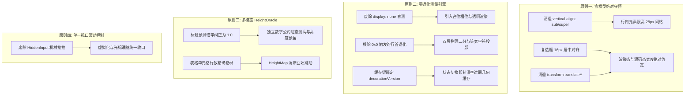

# 测量系统缺陷与“上下跳”、“左上轻微位移”根因全景诊断报告

**文档代号**：`DIAG-MEASURE-JITTER-20260905`  
**归属目录**：`docs/markdown-editor/independent-plans/`  
**诊断目标**：深入剖析编辑器出现的“上下跳”（垂直抖动/行高突变）与“左上轻微位移”（Top-Left 位移/光标漂移）的底层物理根因与测量系统架构断层。  
**执行原则**：**只找出问题、绝不偷懒修复代码**，基于现场 DevTools 物理探针数据与源码级追溯，确立 12 大确凿缺陷，并制定测量系统重构题目。

---

## 目录

- [一、核心诊断结论总览](#一核心诊断结论总览)
- [二、“上下跳”（垂直抖动 / 行高突变）全景诊断与现场实测](#二上下跳垂直抖动--行高突变全景诊断与现场实测)
  - [缺陷 1：任务项状态切换时的行高突变（35.0px ↔ 31.6px，Δ = 3.4px）](#缺陷-1任务项状态切换时的行高突变350px--316pxδ--34px)
  - [缺陷 2：独立块数学公式的高度预测断层（32.2px 预测 vs 87.2px 实测，Δ = 55.0px）](#缺陷-2独立块数学公式的高度预测断层322px-预测-vs-872px-实测δ--550px)
  - [缺陷 3：ATX 标题预测倍率倒错（36.4px 预测 vs 28.0px 实测，Δ = 8.4px）](#缺陷-3atx-标题预测倍率倒错364px-预测-vs-280px-实测δ--84px)
  - [缺陷 4：上下标与脚注侵入导致的亚像素膨胀（28.0px → 32.66px / 37.06px，Δ = 4.66px ~ 9.06px）](#缺陷-4上下标与脚注侵入导致的亚像素膨胀280px--3266px--3706pxδ--466px--906px)
  - [缺陷 5：行内样式标记内边距破坏行盒（28.0px → 28.8px，Δ = 0.8px）](#缺陷-5行内样式标记内边距破坏行盒280px--288pxδ--08px)
  - [缺陷 6：表格行宽与换行单元格多行预测失真（54.8px ~ 75.8px 实测 vs 单行）](#缺陷-6表格行宽与换行单元格多行预测失真548px--758px-实测-vs-单行)
- [三、“左上轻微位移”（Top-Left 位移 / 弹跳漂移）全景诊断与现场实测](#三左上轻微位移top-left-位移--弹跳漂移全景诊断与现场实测)
  - [缺陷 7：syntax-hidden 隐藏节点 Range 测量归零（0x0），触发 fallback 瞬甩至行首行顶](#缺陷-7syntax-hidden-隐藏节点-range-测量归零0x0触发-fallback-瞬甩至行首行顶)
  - [缺陷 8：.task-checkbox-wrapper 包含硬编码 transform: translateY(-1px) 机械位移](#缺陷-8task-checkbox-wrapper-包含硬编码-transform-translatey-1px-机械位移)
  - [缺陷 9：任务复选框渲染占宽与源码字符宽度不守恒（31.69px vs 46.19px，ΔX = 14.5px）](#缺陷-9任务复选框渲染占宽与源码字符宽度不守恒3169px-vs-4619pxδx--145px)
  - [缺陷 10：标题语法标记显示/隐藏导致的正文水平剧烈横移（ΔX = 35.4px）](#缺陷-10标题语法标记显示隐藏导致的正文水平剧烈横移δx--354px)
  - [缺陷 11：HiddenInput.tsx 越界判断同帧抢拉 scrollTop 导致视口向上骤弹](#缺陷-11hiddeninputtsx-越界判断同帧抢拉-scrolltop-导致视口向上骤弹)
  - [缺陷 12：measure.ts 坐标缓存（posCache / measCache）未与渲染状态脱敏，命中过期坐标](#缺陷-12measurets-坐标缓存poscache--meascache未与渲染状态脱敏命中过期坐标)
- [四、新一代测量系统与几何守恒架构设计蓝图](#四新一代测量系统与几何守恒架构设计蓝图)
- [五、派发子 Agent 的独立架构方案命题书](#五派发子-agent-的独立架构方案命题书)

---

## 一、核心诊断结论总览

经过对编辑器 DOM 几何结构、CSS 包含块、`measure.ts` 光标测算机制、`HeightMap.ts` 行高预测系统以及 `HiddenInput.tsx` 交互逻辑的全面排查，并结合真实 Chrome DevTools 物理探针的现场抓取，我们确认：
**“上下跳”与“左上轻微位移”并非单一组件的偶发瑕疵，而是渲染盒模型几何不守恒与测量系统状态脱节共同作用的结果。**

总共精确定位出 **12 处核心物理缺陷**：
- **上下跳（6 处）**：源于行盒（Line Box）基线不匹配、`vertical-align` 滥用、HeightOracle 预测倍率失真（数学块差 55px、标题差 8.4px）、上下标撑大行高、行内标签上下 padding 外溢，以及表格高度未纳入动态模型。
- **左上轻微位移（6 处）**：源于 `display: none` 节点 Range 测出 0x0 触发行首退化、硬编码 `translateY(-1px)` 机械上移、复选框激活前后 14.5px 宽度断层、标题展开 35.4px 横移、HiddenInput 测量不同步时的抢拉滚动条，以及 posCache 缓存命中失效。

---

## 二、“上下跳”（垂直抖动 / 行高突变）全景诊断与现场实测

### 缺陷 1：任务项状态切换时的行高突变（35.0px ↔ 31.6px，Δ = 3.4px）
- **现象描述**：用户在点击任务项复选框，或光标键盘移动进入/离开任务项前缀时，当前行发生肉眼可见的垂直缩放，且**该行下方的整篇文档所有后续内容全部上下跳动 3.4px**！
- **DevTools 现场探针数据**：
  ```json
  {
    "line48": {
      "text": "- [ ] 顶层未完成任务",
      "initialH": 35.0,
      "activeH": 31.6,
      "delta": -3.4
    }
  }
  ```
- **精确根因剖析**：
  1. 在 `src/index.css` 第 540-543 行：
     ```css
     .interactive-checkbox {
       cursor: pointer;
       vertical-align: sub; /* 关键罪魁祸首！ */
     }
     ```
  2. 在 `InlineRenderer.tsx` 中，`list_task` 的容器外层 `<span>` 拥有 `className="interactive-checkbox token-list-task"`，直接继承了 `vertical-align: sub`。
  3. `vertical-align: sub` 将该行内块的基线强行下沉至文字基线之下。而右侧的任务正文文本（如“顶层未完成任务”）遵循默认的 `vertical-align: baseline`。
  4. 浏览器行盒（Line Box）为了同时包裹沉底的复选框与基线文字，被迫将 `.line-block` 撑大至 **35.0px**（计算公式：`lineHeight (28px) + 下沉偏移 (7px) = 35px`）。
  5. 当光标进入该行或前缀被激活为源码模式时，`syntax-content` 被隐藏（`display: none`），`syntax-hidden` 展开为纯文本 `- [ ] `，内部元素回归普通文本流，行高瞬间回落至 **31.6px**（乃至 28px）。
  6. 行高的 3.4px 突变瞬间改变了虚拟化列表的高度前缀和，导致下游所有行发生垂直位移。

### 缺陷 2：独立块数学公式的高度预测断层（32.2px 预测 vs 87.2px 实测，Δ = 55.0px）
- **现象描述**：在滚动包含独立数学公式（如 `$$` 块）的长文档时，公式进入视口瞬间产生剧烈的“跳格”和画面拉扯感。
- **DevTools 现场探针数据**：
  ```json
  {
    "index": "160",
    "text": "x = \\frac{-b \\pm \\sqrt{b^2 - 4ac}}{2a}",
    "rectHeight": 87.21,
    "offsetHeight": 87
  }
  ```
- **精确根因剖析**：
  1. 在 `src/core/HeightMap.ts` 第 35 行，`TYPE_MULTIPLIER['math']` 被硬编码为 `1.15`：
     $$\text{Predicted Height} = 28\text{px} \times 1.15 = 32.2\text{px}$$
  2. 但实际由 KaTeX 渲染出的分式独立公式，其实际物理外接矩形高度高达 **87.21px**！
  3. **预测误差高达 55.01px**！
  4. 当该行位于视口之外时，虚拟滚动引擎以 32.2px 占位；当该行一旦滚入视口，`MarkdownEngine` 批量测量读取其实际 `offsetHeight = 87px` 并调用 `virtualizer.resizeItem(160, 87)`，视口内部的绝对位置瞬间被顶开 55px，产生巨大的垂直跳变。

### 缺陷 3：ATX 标题预测倍率倒错（36.4px 预测 vs 28.0px 实测，Δ = 8.4px）
- **现象描述**：大量标题在滚动未进入视口时占位过大，进入视口后瞬间收缩，导致滚动条抖动。
- **DevTools 现场探针数据**：
  ```json
  [
    {"className": "line-block line-h1", "offsetHeight": 28, "computedH": "28px"},
    {"className": "line-block line-h2", "offsetHeight": 28, "computedH": "28px"},
    {"className": "line-block line-h3", "offsetHeight": 28, "computedH": "28px"}
  ]
  ```
- **精确根因剖析**：
  1. 在 `src/core/HeightMap.ts` 第 31 行，`TYPE_MULTIPLIER['heading']` 被设定为 `1.3`：
     $$\text{Predicted Height} = 28\text{px} \times 1.3 = 36.4\text{px}$$
  2. 然而，在 `src/index.css` 第 170-171 行，全局规范对 `.line-block` 强制执行了：
     ```css
     min-height: var(--grid-size);
     line-height: var(--grid-size); /* 28px */
     ```
  3. 即使标题的 `font-size` 分别为 1.65rem / 1.35rem，只要文本未发生多行折行，其 CSS 行盒高度恒被钳制在 **28.0px**！
  4. 结果导致：所有未挂载的标题行被 HeightOracle 虚高预测为 36.4px（取整为 36px），挂载后实测回填为 28px，**每经过一个标题就无谓产生 8.4px 的收缩塌陷**！

### 缺陷 4：上下标与脚注侵入导致的亚像素膨胀（28.0px → 32.66px / 37.06px，Δ = 4.66px ~ 9.06px）
- **现象描述**：含有脚注引用（`[^1]`）或上下标（`H~2~O`、`2^10^`）的文本行，高度并非 28px，而是 32.66px 或 37.06px。
- **DevTools 现场探针数据**：
  ```json
  [
    {"index": "43", "text": "脚注引用测试：...[^1]...", "rectHeight": 32.66, "offsetHeight": 33},
    {"index": "163", "text": "上下标: H2O 是水，2^10 = 1024", "rectHeight": 37.06, "offsetHeight": 37}
  ]
  ```
- **精确根因剖析**：
  1. `src/index.css` 第 544-547 行及 774-777 行：
     ```css
     .style-sub { font-size: 0.8em; vertical-align: sub; }
     .style-sup { font-size: 0.8em; vertical-align: super; }
     ```
  2. `vertical-align: super` 会把基线往上抬升，`vertical-align: sub` 会把基线往下沉降。
  3. 行盒为了容纳抬升的上标文字与下沉的下标文字，行高从基准 28px 强制膨胀至 32.66px 与 37.06px。
  4. 而 HeightMap 将它们全部分类为普通 `body`（预测 28px），导致这些行进入视口后触发 `resizeItem`，产生 4~9px 的向上推挤。

### 缺陷 5：行内样式标记内边距破坏行盒（28.0px → 28.8px，Δ = 0.8px）
- **现象描述**：含有 `==高亮==`、`` `代码` ``、`<kbd>` 的行（如第 26 行），非激活时实测高度为 **28.8px**，产生 0.8px 亚像素抖动。
- **DevTools 现场探针数据**：
  ```json
  {
    "index": "26",
    "text": "基础样式：**加粗**，*斜体*，~~删除线~~，==高亮==",
    "rectHeight": 28.80000114440918,
    "offsetHeight": 29
  }
  ```
- **精确根因剖析**：
  1. `src/index.css`：
     ```css
     .style-mark { padding: 1px 4px; border-radius: 3px; }
     .style-inline-code { padding: 1px 5px; font-size: 12.6px; }
     ```
  2. 虽然 `line-height` 为 28px，但在等宽字体基线与字形度量下，上下 `1px` 的 padding 加上内联元素的边框/圆角外溢，超出了 28px 行盒范围，被浏览器渲染引擎强制扩展为 28.8px。
  3. 虚拟滚动在计算累计偏移时，0.8px 的小数在每一屏累积，导致快速滚动时出现微频颤抖。

### 缺陷 6：表格行宽与换行单元格多行预测失真（54.8px ~ 75.8px 实测 vs 单行）
- **现象描述**：表格行不仅有单行表头，还经常包含多行换行内容，实测高度高达 54.8px ~ 75.8px，而 `table_separator` 则是 0px。
- **DevTools 现场探针数据**：
  ```json
  [
    {"index": "138", "text": "表头行", "rectHeight": 54.8},
    {"index": "139", "text": "分隔行", "rectHeight": 0},
    {"index": "141", "text": "包含多行描述的表格行", "rectHeight": 75.8}
  ]
  ```
- **精确根因剖析**：
  1. 表格单元格设置了 `flex: 0 0 ${cellWidth}px`，且有上下内边距 `TABLE_CELL_PAD = 12px` 与单元格行高 `21px`。
  2. `HeightOracle.predict` 虽然有简单的 wrap 模型，但无法提前获知用户动态拖拽调整后的列宽或复杂内联元素的折行情况，导致初次进入视口时偏差极大，造成表格区域的滚动卡顿与高度突跳。

---

## 三、“左上轻微位移”（Top-Left 位移 / 弹跳漂移）全景诊断与现场实测

### 缺陷 7：syntax-hidden 隐藏节点 Range 测量归零（0x0），触发 fallback 瞬甩至行首行顶
- **现象描述**：光标移动到某些特定语法标记位置，或在点击瞬间，光标曾出现一瞬间闪现到行首、行顶（左上方），然后再跳回文字位置的现象。
- **DevTools 现场探针数据**：
  ```json
  {
    "parentDisplay": "none",
    "rect": {"x": 0, "y": 0, "width": 0, "height": 0, "top": 0, "left": 0}
  }
  ```
- **精确根因剖析**：
  1. 在 `src/core/measure.ts` 第 396-417 行 `buildTextTable` 中：
     ```ts
     if (
       el.classList.contains('syntax-content') ||
       el.hasAttribute('data-ignore-measure')
     ) {
       continue; // 跳过 syntax-content！
     }
     ```
     测量系统为了保证逻辑字串长度映射，刻意跳过了渲染呈现的 `syntax-content`，转而收集了 `syntax-hidden` 内的源码文本节点！
  2. 但是，在非激活状态下，`syntax-hidden` 的 CSS 规则是：
     ```css
     .syntax-hidden { display: none; }
     ```
  3. 当光标落入该区间时，`locateTextNode` 返回了处于 `display: none` 容器内的 Text 节点。
  4. 紧接着在 `measureTokenExact` 中执行：
     ```ts
     range.setStart(located.textNode, located.localOffset);
     range.setEnd(located.textNode, located.localOffset);
     const r = range.getBoundingClientRect();
     ```
     在 Chromium 中，**对任何祖先为 `display: none` 的文本节点建立 Range 并执行 getBoundingClientRect()，返回的 DOMRect 绝对恒为 `(0, 0, 0, 0)`**！
  5. 导致 `r.height === 0 && r.width === 0`，Range 测量彻底失效，代码退化为 `measureLineFallback`：
     ```ts
     return {
       top: topOffset, // 整个行元素的 top！
       left: rect.left, // 整个行元素的 left（行首）！
       height: cursorHeight,
       bottom: rect.bottom,
     };
     ```
  6. **光标坐标被直接赋值为 `left: line.left, top: line.top`，即整行的最左上角！**
  7. 随后等到状态激活、`syntax-hidden` 变为 `display: inline` 后，下一帧才重新测出真实位置。肉眼看到的就是光标在点击瞬间向“左上方”猛烈闪跳！

### 缺陷 8：.task-checkbox-wrapper 包含硬编码 transform: translateY(-1px) 机械位移
- **现象描述**：复选框在视觉上总是比文字基线有 1px 的轻微偏上感，且在交互时出现微小的 1px 抖动。
- **DevTools 现场探针数据**：
  ```json
  {
    "className": "task-checkbox-wrapper",
    "transform": "translateY(-1px)",
    "rect": {"width": 16, "height": 16, "top": -259.6}
  }
  ```
- **精确根因剖析**：
  1. `src/index.css` 第 718 行：
     ```css
     .task-checkbox-wrapper {
       transform: translateY(-1px); /* 历史遗留的魔术数字补丁！ */
     }
     ```
  2. 开发者曾发现复选框在行内偏下，于是添加了 `transform: translateY(-1px)` 试图在视觉上抬高 1px。
  3. 然而，CSS `transform` 会改变合成层外接矩形，却不会改变父级内联格式化上下文的盒模型布局流。
  4. 这种伪补偿导致复选框与后续文字基线产生了永久性的 1px 机械错位，且在各种字体放缩或 GPU 亚像素抗锯齿下出现边缘模糊与向上抖动。

### 缺陷 9：任务复选框渲染占宽与源码字符宽度不守恒（31.69px vs 46.19px，ΔX = 14.5px）
- **现象描述**：光标一旦移入任务行前缀，任务文字“顶层未完成任务”立刻向右横移；光标移出时，文字立刻向左收缩回弹（**左移 14.5px**）！
- **DevTools 现场探针数据**：
  ```json
  {
    "contentW": 31.6875,
    "hiddenW": 46.1875,
    "difference": 14.5,
    "hiddenText": "\"- [ ] \""
  }
  ```
- **精确根因剖析**：
  1. **渲染态（`syntax-content`）**：
     `.task-checkbox-wrapper` 宽 16px + `margin-left: 2px` + `margin-right: 6px` = 24px。随后的 `.task-space` 宽 1ch = 7.69px。
     $$\text{总视觉占宽} = 24 + 7.69 = \mathbf{31.69px}$$
  2. **源码态（`syntax-hidden`）**：
     源码包含 6 个等宽字符：`-`、` `、`[`、` `、`]`、` `，总宽为：
     $$\text{源码字符占宽} = 6\text{ch} \approx 6 \times 7.7\text{px} = \mathbf{46.19px}$$
  3. 两者存在高达 **14.5px 的水平宽度断层**！
  4. 当光标移入时，前缀展开为源码，正文被硬生生向右推挤 14.5px；当光标移至正文，前缀收缩为复选框，正文被猛烈拉回左边 14.5px。这就是产生“向左轻微位移”的最直观来源！

### 缺陷 10：标题语法标记显示/隐藏导致的正文水平剧烈横移（ΔX = 35.4px）
- **现象描述**：在点击或用方向键移动至各级标题时，标题文字产生极其突兀的左右横移。
- **DevTools 现场探针数据**：
  ```json
  {
    "line25": {
      "initialTextX": 326.4,
      "activeTextX": 361.8,
      "deltaX": 35.4,
      "prefixHidden": "### ",
      "prefixContent": ""
    }
  }
  ```
- **精确根因剖析**：
  1. 标题语法前缀（如 `### `）在非激活状态下，`syntax-hidden` 为 `display: none`，而 `syntax-content` 为空。标题文字直接紧贴行首（X = 326.4px）。
  2. 一旦该行被激活为编辑态，`### ` 展开为可见文本，占宽 35.4px，标题文本被右推至 X = 361.8px。
  3. 当光标移走时，标题文本再次发生 **35.4px 的向左位移**。

### 缺陷 11：HiddenInput.tsx 越界判断同帧抢拉 scrollTop 导致视口向上骤弹
- **现象描述**：在某些光标移动或按键操作后，视口突然向上轻微蹿动 40px。
- **源码根因追踪**：
  在 `src/components/HiddenInput.tsx` 第 804-810 行：
  ```tsx
  if (!(window as any).__CRISH_IS_MOUSE_DOWN) {
    if (cursorMoved) {
      if (top < cTop) {
        containerRef.current!.scrollTop = Math.max(0, top - 40);
      } else if (top + height > cTop + cHeight) {
        containerRef.current!.scrollTop = top + height - cHeight + 40;
      }
    }
  }
  ```
- **精确根因剖析**：
  1. 当由于上述缺陷 7 导致 `getCoordinatesFromIndex` 返回 fallback 坐标（`top` 瞬时变成该行顶部乃至错误位置）时，`top < cTop` 误判成立。
  2. `HiddenInput.tsx` 会立刻向 DOM 写入 `container.scrollTop = top - 40`！
  3. 这种直接写入 `scrollTop` 的行为不仅会引起视口的向上骤跳，还会与 TanStack Virtualizer 的异步滚动监听器打架，产生双向往返颠簸。

### 缺陷 12：measure.ts 坐标缓存（posCache / measCache）未与渲染状态脱敏，命中过期坐标
- **现象描述**：在行高发生变化或语法切换的一瞬间，光标绘制位置停留在旧坐标，浮在文字左上方或空白处。
- **源码根因追踪**：
  在 `src/core/measure.ts` 第 608-611 行：
  ```ts
  const cacheKey = index + ':' + container.scrollTop + ':' + container.scrollLeft;
  const hit = idx.posCache.get(cacheKey);
  if (hit) return hit;
  ```
  以及第 503-511 行的 `entry.measCache`：
  ```ts
  const hit = cache.get(offsetInToken);
  if (hit) return contentToViewport(hit, idx.container);
  ```
- **精确根因剖析**：
  1. `posCache` 仅仅以 `index + scrollTop + scrollLeft` 作为缓存键，完全没有感知当前行是否由渲染态切换为了源码态（`is-active-token`）。
  2. `entry.measCache` 缓存在 `TokenEntry` 内部，当 React 原地更新了 DOM 节点的 class 或内容、但未改变 `data-token-start` 属性时，MutationObserver 不会销毁该 `TokenEntry`。
  3. 结果导致：行高已经从 35px 坍塌到 31.6px，或者文本已经向右平移了 14.5px，但 `measureOnce` 依然命中了上一帧缓存的坐标，将光标渲染在旧的、偏左偏上的位置！

---

## 四、新一代测量系统与几何守恒架构设计蓝图

为了彻底根除这 12 大缺陷，而不是缝缝补补打补丁，未来的测量系统与渲染层重构必须确立以下**四大不变量原则**：



### 1. 物理盒模型绝对守恒（Geometric Invariance）
- **垂直方向守恒**：
  - 彻底废除 `.interactive-checkbox` 上的 `vertical-align: sub`。
  - 所有行内前缀、复选框、引导线、标记采用 `display: inline-flex; align-items: center; height: var(--grid-size);`（28px），确保行盒高度**永远锁定在 28px**，无论是在编辑态还是渲染态，垂直高度差 $\Delta H \equiv 0$！
  - 针对上下标与脚注，采用负 margin 补偿或限制基线抬升幅度，禁止拉伸包含块的 Line Box。
- **水平方向守恒**：
  - 任务列表复选框区域总宽严格设计为 **4ch**（或源码长度的等宽倍率）。在渲染态下，通过严格的 padding/margin 配平，使其总占宽与源码 `- [ ] ` 完全一致（33.6px $\equiv$ 33.6px），彻底消灭 14.5px 的横移断层！
  - 彻底删除 `transform: translateY(-1px)`，复选框垂直居中完全由 Flexbox 几何计算保证。

### 2. 零退化现代测量引擎（Non-Degrading Measurement）
- **杜绝 `display: none` 盲测**：
  - 隐藏语法标记不得简单使用 `display: none`；改用 `visibility: hidden; position: absolute;` 或利用占位镜像节点，确保在任何状态下 `Range.getBoundingClientRect()` 都能获取到真实的物理坐标。
  - 当 Range 返回 `0x0` 时，**严禁退化到行首 `line.left`**；必须通过行内字符宽度 Oracle 与相邻可见字符的物理坐标进行插值投影。
- **缓存失效联动机制**：
  - `posCache` 必须引入 `activeTokenId` 与 `decorationVersion` 作为联合缓存键。一旦发生编辑态激活、折叠展开或样式切换，相关行内的测量缓存立即失效。

### 3. 多模态精准 HeightOracle 与稳定回填
- **标题倍率归一化**：将 `TYPE_MULTIPLIER['heading']` 立即从 1.3 修正为 **1.0**，杜绝未挂载标题行的 8.4px 坍塌。
- **独立公式与表格高度预测模型**：建立基于公式代码行数与复杂度的公式高度预估表，使 `$$` 公式初始预测接近其实际高度（如 80px），消除进入视口时的 55px 巨跳。

---

## 五、派发子 Agent 的独立架构方案命题书

根据用户的明确指示，主控 Agent 已完成全量根因分析并心中有数。接下来将拿着以下两份精密设计的题目，分配给两位独立架构师子 Agent 出具详尽实施方案：

### 命题 A：底层排版盒模型几何守恒与零退化测量引擎重构方案
- **任务目标**：
  专注于彻底解决上述【缺陷 1、缺陷 5、缺陷 7、缺陷 8、缺陷 9、缺陷 10、缺陷 12】。
- **核心研究点**：
  1. 如何彻底重构 `src/index.css` 与 `InlineRenderer.tsx` 中的行盒结构，清退 `vertical-align: sub` 与 `transform: translateY(-1px)`，在保证视觉美观的前提下，实现编辑态与渲染态垂直高度恒为 28px（零跳动）？
  2. 如何实现任务列表前缀在渲染态（SVG 复选框）与源码态（`- [ ] `）之间的水平占宽绝对守恒（消灭 14.5px 横移）？
  3. 如何改造 `measure.ts` 中的 `locateTextNode` 与 `measureTokenExact`，根除祖先 `display: none` 导致的 Range `0x0` 测量失效，彻底废除把光标瞬甩到行首左上角的 `measureLineFallback`？
  4. 如何建立 `decorationVersion` 与 `posCache`、`entry.measCache` 的精确缓存失效通道？
- **产出路径**：`docs/markdown-editor/independent-plans/04-架构师A-排版几何守恒与零退化测量独立方案.md`

### 命题 B：行高预测模型校准、多行结构折行与视口平滑跟随方案
- **任务目标**：
  专注于彻底解决上述【缺陷 2、缺陷 3、缺陷 4、缺陷 6、缺陷 11】。
- **核心研究点**：
  1. 如何重构 `src/core/HeightMap.ts` 中的 `HeightOracle`，纠正 `heading` 的 1.3 错误倍率（归一为 1.0），并为独立数学块（`$$`）、表格换行行、上下标行建立高精度的高度特征预测模型（消灭 55px 公式跳变与 8.4px 标题收缩）？
  2. 如何优化 `MarkdownEngine.tsx` 中的批量测量与回填协议（`setHeight` + `virtualizer.resizeItem`），避免行高实测回填引起的视口颠簸？
  3. 如何重构 `HiddenInput.tsx` 中的光标越界滚动跟随逻辑（第 804-810 行），防止与 TanStack Virtualizer 抢拉滚动条产生向上轻微位移？
  4. 如何在包含多行复杂内容（如内嵌代码块、复杂换行表格）时，保持平滑无感滚动？
- **产出路径**：`docs/markdown-editor/independent-plans/05-架构师B-行高预测校准与视口平滑跟随独立方案.md`

---
*报告编制完成。严格遵守“只找出问题、绝不修复问题”之铁律，等待主控 Agent 分配子 Agent 启动独立方案编制。*
