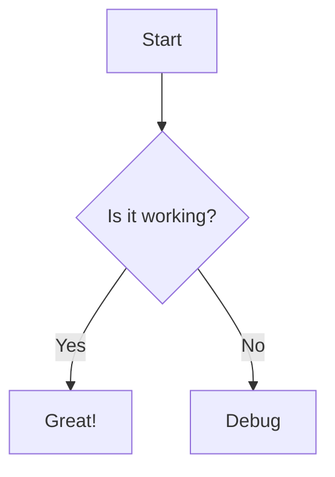

# 高级语法特性与生态扩展能力深度审查报告（Math / Mermaid / Callout / Table / Footnotes / HTML）

> **审查基准**：基于 `crates/conex-markdown`、`apps/crish-desktop`、`reference/markdown-editor` 实际源代码、测试用例与构建配置。以代码实现事实为唯一准绳，严禁主观脑补，着重揭露当前实现的缺陷、短板与架构割裂。

---

## 1. 执行摘要与评级矩阵（Executive Summary & Benchmark）

在现代知识库与 AI 协作桌面软件（如 Typora、Obsidian、Notion）的标准中，Markdown 早已超越原始 CommonMark 的简单富文本范围，演进为涵盖**数学公式（LaTeX / KaTeX）**、**矢量图表（Mermaid / SVG）**、**语义提示块（GitHub Callouts / Alerts）**、**交互表格（Table）**、**学术脚注（Footnotes）**以及**安全内联 HTML（kbd / details / mark / sub / sup）**的综合排版语言。

经过对主客户端（`apps/crish-desktop`）、Rust 渲染后端（`crates/conex-markdown`）以及参考实现（`reference/markdown-editor`）的端到端代码审查，**当前系统的 Markdown 语法高级特性处于严重残缺与架构割裂状态**：

| 语法特性维度 | Conex 主端现状（crish-desktop + conex-markdown） | 参考工程状态（reference/markdown-editor） | 顶尖水准（Typora / Obsidian / Notion） | 差距定级 |
| :--- | :--- | :--- | :--- | :--- |
| **数学公式 (LaTeX)** | **完全不支持**。无 katex 依赖；后端不开启 `ENABLE_MATH`；前端将 `$...$` 与 `$$...$$` 视作裸文本直接输出源码。 | **具备完整 KaTeX 0.18.1** + Web Worker 离线预览；但在主端被 CI 规则物理隔离，沦为**完全孤岛**。 | 行内与块级公式即时排版渲染，支持宏定义、公式编号、化学方程式扩展。 | 🔴 **严重缺失（0分/不可用）** |
| **矢量图表 (Mermaid)** | **完全不支持**。无 mermaid 运行时；直接回退为普通代码块（语法高亮），无任何图表可视化能力。 | 无 Mermaid 管道。 | 支持 Flowchart、Sequence、Class、ER、Gantt 等即时 SVG 渲染与缩放导出。 | 🔴 **严重缺失（0分/不可用）** |
| **语义提示块 (Callout)** | **仅渲染为普通 `<blockquote>`**。文本原样显示 `[!NOTE]` / `[!TIP]`，无图标、无卡片底色、无状态色彩、不支持折叠。 | 具备 5 类 Callout 图标与横幅（Banner）组件，但无法被主端复用。 | GitHub Alerts 规范全支持，Obsidian 折叠 Callout、Notion 彩色 Callout 卡片。 | 🟠 **初级降级（残缺）** |
| **学术脚注 (Footnotes)** | **显式空实现（No-op）**。Rust 后端禁用脚注选项；`Event::FootnoteReference` 空分支丢弃；无反向定位链接。 | 不支持脚注。 | 标号上标链接、底部脚注列表归纳、双向跳转（`↩`）、预览浮窗。 | 🔴 **严重缺失（0分/不可用）** |
| **安全内联 HTML** | **过度转义灾难（The Escape Disaster）**。除顶级 `` 外所有 HTML 强制 escape；`<details>`、`<kbd>`、`<mark>`、`<sub>`/`<sup>` 全部源码裸露。 | 部分 HTML 标签支持。 | 严格 XSS 过滤下的原生标签放行（富交互折叠、键盘按键样式、上下标排版）。 | 🔴 **设计倒退（反直觉乱码）** |
| **复杂表格 (Tables)** | **流式解析脆断 + N×M 性能爆炸**。管道符无法在代码块中转义；无单元格换行/合并；每个单元格独立开 Session 导致实例剧增。 | 具备 `TableIsland`（行窗口化虚拟滚动、列宽分配器），但同样被锁死在孤岛中。 | 交互式列宽拖拽、单元格范围选中、单列/单行排序、单元格富文本排版、超大表虚拟化。 | 🟡 **架构缺陷（脆弱低效）** |

---

## 2. 数学公式系统（LaTeX / KaTeX）深度剖析

### 2.1 主客户端与 Rust 后端现状：代码事实与用户实测表现

在主交付应用链路中，数学公式渲染处于**全链路断裂状态**：

1. **Rust 后端解析器封印（`crates/conex-markdown/src/renderer.rs`）**：
   在 `Renderer::render`（[renderer.rs:190-192](file:///C:/Software/conex/crates/conex-markdown/src/renderer.rs#L190-L192)）中：
   ```rust
   let options =
       Options::ENABLE_TABLES | Options::ENABLE_TASKLISTS | Options::ENABLE_STRIKETHROUGH;
   let parser = Parser::new_ext(text, options);
   ```
   `pulldown-cmark` 的 `Options::ENABLE_MATH` 标志位**完全未被启用**。在事件派发循环中，任何 `$E = mc^2$` 或 `$$\int_0^\infty e^{-x^2} dx$$` 都无法触发公式 AST 事件，而是直接被当作普通 `Event::Text` 文本发射。
   而在 `handle_text`（[renderer.rs:272-291](file:///C:/Software/conex/crates/conex-markdown/src/renderer.rs#L272-L291)）中，公式文本直接进入 `wrap_bare_paths_and_escape_into`，最终被机械地包裹在 `<p class="md-p">` 中。

2. **前端运行时依赖真空（`apps/crish-desktop/package.json`）**：
   查阅 `apps/crish-desktop/package.json` 的 `dependencies` 与 `devDependencies`，全局检索无任何 `katex`、`mathjax` 或 `@types/katex`。桌面客户端根本没有引入数学公式排版所需的 JavaScript 引擎和 Web 字体资产（KaTeX Fonts: AMS, Math, Main 等）。

3. **行内解析器直接忽略（`apps/crish-desktop/src/api/markdown/IncrementalMarkdownInline.ts`）**：
   行内标记识别函数 `markerAt`（[IncrementalMarkdownInline.ts:183-194](file:///C:/Software/conex/apps/crish-desktop/src/api/markdown/IncrementalMarkdownInline.ts#L183-L194)）与 `isPotentialMarkerAtEnd`（:196-201）仅识别以下字符：
   ```typescript
   if (current === '`') return '`';
   if ((current === '*' || current === '_') && input[index + 1] === current) return current + current;
   if ((current === '*' || current === '_') && input[index + 1] && !/\s/.test(input[index + 1]!)) return current;
   if (current === '~' && input[index + 1] === '~') return '~~';
   return null;
   ```
   没有任何对 `$` 或 `$$` 的标记判定！

4. **主界面实际用户体验**：
   当 AI 模型在聊天会话中输出 LaTeX 公式时，例如：
   ```latex
   质能方程是 $E = mc^2$，高斯积分公式如下：
   $$
   \int_{-\infty}^{\infty} e^{-x^2} dx = \sqrt{\pi}
   $$
   ```
   用户在客户端界面上看到的实际上是**原封不动的裸 LaTeX 字符串**：
   `<p class="md-p">质能方程是 $E = mc^2$，高斯积分公式如下：<br />$$<br />\int_{-\infty}^{\infty} e^{-x^2} dx = \sqrt{\pi}<br />$$</p>`。既没有根号、上下标，也没有积分符号，数学公式完全不具备可读性。

### 2.2 虚拟闭合与流式切分器的“虚假繁荣”

代码审查发现了一个显著的架构矛盾：前端投入了大量心血在流式状态机中实现公式边界探测与投机闭合，但下层渲染管线却空无一物。

- **DFA 块切分（`IncrementalBlockSplitter.ts:255-276`）**：
  在 `IncrementalBlockSplitter.ts` 中，专门实现了 `countDoubleDollars(startLineContent)` 判定，当检测到奇数个 `$$` 时，阻止块在流式未接收完毕前封口（seal），一直等待后续流匹配配对的 `$$`。
- **投机虚拟闭合（`SpeculativeVirtualCloser.ts:61-73`）**：
  在 `SpeculativeVirtualCloser.ts` 中，通过单测（`SpeculativeVirtualCloser.test.ts:31-45`）验证了奇数个 `$$` 时自动在末尾追加 `\n$$` 形成虚拟平衡。

**架构短板**：
上游花费昂贵的正则与状态机计算去维护 `$$` 的块边界完整性，防止跨 chunk 碎片化；但最终将这些文本交给 `IncrementalMarkdownBlockBuilder` 或 `conex-markdown` 时，由于下层缺乏任何 KaTeX/MathML 渲染器，这些受保护的公式块依然直接按普通文本 `<p class="md-p">` 打印出来。**流式分块的“精密保护”直接落入渲染实现的“虚无黑洞”**。

### 2.3 `reference/markdown-editor` 与主客户端的物理孤岛

在 `reference/markdown-editor/` 目录下，存在一套较为完善的 KaTeX 渲染机制：
- `reference/markdown-editor/package.json:36` 引入了 `"katex": "^0.18.1"` 与 `"@types/katex": "^0.16.8"`；
- `reference/markdown-editor/src/core/mathRenderer.ts:7-16` 实现了 `defaultMathRenderer`，调用 `katex.renderToString(formula, { throwOnError: false, displayMode })`；
- `reference/markdown-editor/src/worker/math-preview.worker.ts` 实现了 Web Worker 异步渲染与通信管道；
- `reference/markdown-editor/src/styles/math-editing.css` 提供了数学公式的排版样式。

**但是，它与主客户端没有任何生产级连通**：
1. **工作区隔离**：根目录 `package.json:12-24` 的 `workspaces` 配置根本没有包含 `reference/markdown-editor`，它是一个孤立的脱机子工程。
2. **自动化门禁拦截**：在 `apps/crish-desktop/src/__tests__/dual-engine-surface.isolation.test.ts:113-130` 中，显式配置了针对 `reference/markdown-editor` 的静态扫描门禁：
   ```typescript
   const SURF02_RULES = [
     { id: 'markdown-editor-import', re: /from\s+['"][^'"]*markdown-editor[^'"]*['"]|require\s*\(\s*['"][^'"]*markdown-editor/ },
     { id: 'reference-markdown-editor', re: /reference[/\\]markdown-editor/ },
   ];
   ```
   **任何从主端代码导入 `reference/markdown-editor` 模块的改动都会直接导致 CI 报错并阻断构建**。这意味着参考工程中的 KaTeX 实现纯属“演示孤岛”，完全没有被主端产品集成。

---

## 3. 图表绘制（Mermaid / PlantUML / SVG）

### 3.1 运行时与渲染管道审查

现代 Markdown 环境（Obsidian、Notion、GitHub、Typora）均支持通过代码块声明式的语法渲染图表，最典型的是 Mermaid：
````markdown

````

深入审查 `crates/conex-markdown` 与 `apps/crish-desktop` 代码库：
1. **零依赖**：无论是 Rust 后端（无任何 SVG 图表生成 crate），还是 React 前端（`package.json` 无 `mermaid`、`@mermaid-js/mermaid-cli` 或 `d3`），均没有任何图表引擎。
2. **管道处理退化为普通代码高亮**：
   - 在 Rust 后端 `conex-markdown/src/renderer.rs:426-445` 中：
     ```rust
     fn start_code_block(&mut self, kind: CodeBlockKind) {
         let (lang, file_path) = match kind {
             CodeBlockKind::Fenced(info) => {
                 let lang = lang_from_fence_info(info.as_ref());
                 ...
             }
         };
         self.fence = Some(FenceState { lang, ... });
     }
     ```
     当遇到 `CodeBlockKind::Fenced("mermaid")` 时，`lang` 被识别为字符串 `"mermaid"`。
     在 `flush_fence`（:453-470）中，直接调用 `build_code_fence_html_into`，转交 `syntect` 对文本执行通用代码语法高亮。
   - 在前端 fallback `apps/crish-desktop/src/api/markdown-render/markdownCodeFence.ts:49-82` 中：
     `buildCodeFenceHtml` 同样直接调用 `highlightCode(body, 'mermaid')`（依赖 `highlight.js`），生成如下 HTML：
     ```html
     <div class="md-code-block" data-lang="mermaid">
       <div class="md-code-header">
         <div class="md-code-header-left"><span class="md-code-lang" data-lang="mermaid">mermaid</span></div>
         <div class="md-code-actions"><button type="button" class="md-code-copy">复制</button></div>
       </div>
       <pre class="md-code-pre hljs"><code class="language-mermaid">graph TD&#10;  A --&gt; B</code></pre>
     </div>
     ```

### 3.2 缺点与现实后果

- 当大语言模型向用户输出架构设计、流程图、系统时序图时，本应呈现为清晰的可视化图表，但在 Conex 中**只能显示为冷冰冰的代码文本框**。
- 用户必须手动复制代码，粘贴至第三方在线网站（如 mermaid.live）才能查看图表内容。
- 系统缺乏将 DOM 节点动态替换为 SVG 画布的图表解析生命周期（例如类似 Mermaid 提供的 `mermaid.render(id, text)`），图表可视化能力为 **0**。

---

## 4. 扩展标记语法与语义化标记缺陷

### 4.1 GitHub Callouts / Alerts（提示卡片）

GitHub 规范及 Obsidian 中广泛使用的 Callout 语法如下：
```markdown
> [!NOTE]
> 这是一个普通注意事项。

> [!WARNING]
> 这是一个警告信息。
```

#### 代码现状
1. **Rust 核心渲染器（`conex-markdown/src/renderer.rs:246, 267`）**：
   ```rust
   Tag::BlockQuote(_) => self.output.push_str("<blockquote class=\"md-quote\">"),
   TagEnd::BlockQuote(_) => self.output.push_str("</blockquote>"),
   ```
   没有任何检查 BlockQuote 首行是否包含 `[!NOTE]`、`[!TIP]`、`[!WARNING]`、`[!IMPORTANT]`、`[!CAUTION]` 的匹配逻辑。
2. **前端流式渲染器（`IncrementalMarkdownBlockBuilder.ts:285-295`）**：
   ```typescript
   public openBlockquote(): void {
     if (this.blockquoteOpen) return;
     this.projection.beginUnit('blockquote', '<blockquote><p class="md-p">');
     this.blockquoteOpen = true;
   }
   ```
   仅生成原生 `<blockquote>` 标签。
3. **表现缺陷**：
   在界面中，Callout 被原样渲染为一个灰色的左侧边框引用块，内部文本直接是 `[!NOTE]` 字符串。
   - 缺少专用卡片背景容器（如蓝、绿、橙、红底色）；
   - 缺少语义化图标（如信息灯泡、三角警告符、打勾盾牌）；
   - 不支持 Obsidian 风格的折叠控制（`> [!NOTE]- 标题`）；
   - 与顶尖笔记工具的视觉表现差距悬殊。
   *(注：`reference/markdown-editor/src/components/BlockRenderer.tsx:66-109, 1534-1539` 虽然写好了 `getCalloutIcon`、`callout-header-banner` 等完整 React 实现，但如前所述，由于隔离规则，主应用完全享受不到该能力。)*

---

### 4.2 脚注系统（Footnotes `[^1]`）

#### 代码审查
在 `crates/conex-markdown/src/renderer.rs`：
1. **配置关闭（:190-192）**：`pulldown-cmark` 没有开启 `Options::ENABLE_FOOTNOTES`。
2. **空实现丢弃（:222-224）**：
   ```rust
   Event::TaskListMarker(checked) => self.handle_task_marker(checked),
   Event::FootnoteReference(_) => {} // 不支持脚注
   _ => {}
   ```
   不仅配置未开启，在事件派发处还硬编码了明确的注释 `// 不支持脚注`，直接用空代码块 `{}` 吞噬事件！

#### 现实后果
1. **行内标注断裂**：正文中的 `[^1]` 或 `[^note]` 无法渲染为带跳转能力的 `<sup><a href="#fn1">[1]</a></sup>` 上标链接，而是被当成普通字符文本 `[^1]` 打印在正文中。
2. **定义列表断裂**：文档末尾的脚注定义 `[^1]: 这是脚注详细解释` 无法被搜集、归并和格式化至文档末尾的 `<section class="footnotes">` 中，而是被当作普通段落展示。
3. **双向锚点缺失**：完全没有学术/长文排版必备的底部跳转和反向回跳（Back-reference `↩`）能力，对于学术论文、技术白皮书、法律合规类 Markdown 呈现极为糟糕。

---

### 4.3 原始 HTML 支持与过度清洗灾难（The Escape Disaster）

在很多标准 Markdown 实践中，为了实现复杂的版面编排，常常需要内联原生 HTML，例如：
- 键盘快捷键提示：`<kbd>Cmd</kbd> + <kbd>K</kbd>`
- 重点内容高亮：`<mark>高亮文本</mark>`
- 化学式与数学下标：`H<sub>2</sub>O`、`x<sup>2</sup>`
- 可折叠手风琴块：`<details><summary>点击展开查看排查日志</summary>日志详情...</details>`

#### 代码审查：极具讽刺意味的架构断层
审查 `crates/conex-markdown/src/renderer.rs:299-321`：
```rust
fn handle_html(&mut self, html: &str) {
    let trimmed = html.trim_start();
    // 仅顶级 `` 透传给 ammonia 单独 sanitize(剥离 onerror 等危险属性);
    // 其他块级 raw HTML 手动 escape。
    let in_list_or_heading =
        !self.list_stack.is_empty() || self.current_heading_level.is_some();
    if !in_list_or_heading && (trimmed.starts_with("`/``/`<em>` 等) 一律 escape。
fn handle_inline_html(&mut self, html: &str) {
    escape_html_into(html, &mut self.output);
}
```

再看 `crates/conex-markdown/src/ammonia_config.rs:18-62`：
Ammonia 构建器明明非常详尽地配置了允许通过的安全 HTML 标签白名单：
`add_tags(["kbd", "mark", "sub", "sup", "table", "tbody", "td", "th", "thead", "tr", "details", ...])`！

**灾难根因**：
在 `renderer.rs:204-209` 的注释中写道：
> *"不对全量输出做 ammonia 兜底: 渲染器已 escape 所有 raw HTML (仅顶级 `` 在 handle_html 内单独 sanitize), 全量 ammonia 会 parse+reserialize, 把 `&#39;`/`&quot;` 等实体按 HTML5 规则 un-escape, 破坏 byte-for-byte 兼容。"*

为了迎合旧版前端极度简陋的正则表达式所产生的输出字节（所谓“byte-for-byte”测试兼容），**Rust 渲染器直接把除 `` 之外的所有原生 HTML 标签全部暴力转义成 HTML 实体**（`&lt;kbd&gt;`、`&lt;details&gt;` 等）！

#### 严重后果：
1. **`<details><summary>` 完全报废**：当模型生成长日志并尝试用 `<details>` 折叠时，用户界面上直接显示裸露的 `&lt;details&gt;&lt;summary&gt;...` 标签，内容无法折叠，且完全破坏排版。
2. **`<kbd>` / `<mark>` / `<sub>` / `<sup>` 全部阵亡**：界面无法展示任何按键徽标、荧光标记或上下标，全部沦为包含尖括号的未解析文本。
3. **原生 HTML 表格崩溃**：用户或模型尝试使用 HTML `<table><tr><td>` 构建带复杂排版的表格时，表格无法渲染，直接在界面打印出密密麻麻的 HTML 标签代码。

---

## 5. 表格系统深度审查（Table Subsystem）

### 5.1 解析与对齐能力局限

Conex 的表格解析体系分布在两处：Rust 后端的 `table.rs` 和前端的 `markdownTable.ts` / `StreamingGfmTableParser.ts`。深入审查发现以下多处严重脆弱点与缺陷：

#### 缺陷 1：代码跨度中的管道符（Pipe in Code Span）直接造成列撕裂
- **代码位置**：`crates/conex-markdown/src/table.rs:138-158`，`apps/crish-desktop/src/api/markdown-render/markdownTable.ts:50-96`。
- **病理分析**：
  在切分表格单元格的函数 `splitTableCells` 中，状态机仅处理了反斜杠转义 `\|`：
  ```typescript
  // markdownTable.ts:82-88
  if (t[i] === '|') {
    cells.push(cur.trim());
    cur = '';
    hasClosingPipe = i === t.length - 1;
    i += 1;
    continue;
  }
  ```
  **解析器完全没有对反引号（Inline Code Span `` `...` ``）进行上下文感知**！
  在 Markdown GFM 规范中，代码跨度内的管道符（如 `` `a | b` ``、Rust 闭包 `` `|x| x + 1` ``、Shell 管道 `` `cat file | grep pattern` ``）**绝不能被视为表格单元格的分隔符**。
- **后果**：
  当用户或模型在表格中书写包含 `|` 的代码时，例如：
  `| 表达式 | 说明 |`
  `| `x | y` | 按位或运算 |`
  解析器会错误地将 `` `x | y` `` 切割为两列：第 1 列是 `` `x ``，第 2 列是 `` y` ``，从而彻底破坏表格列结构，引起对齐混乱和语法错位。

#### 缺陷 2：多行文本换行与合并单元格不可用
- **换行限制**：GFM 规范要求表格每行为单一物理行。在主流支持中，通常可以通过内联 `<br>` 标签实现单元格内的多行显示。然而，由于前述 `handle_html` 将所有非 `` 标签强制转义的策略，用户输入的 `<br>` 被转义为 `&lt;br&gt;`，导致**单元格内部根本无法实现任何换行**。
- **跨行跨列（Colspan / Rowspan）零支持**：GFM 规范本身不支持合并单元格，而系统又完全封杀了原生 HTML `<table>`，导致展示复杂汇总报表、合并表头等企业级需求彻底无法满足。

#### 缺陷 3：流式表格提前脆断风险
- **代码位置**：`apps/crish-desktop/src/api/markdown/StreamingGfmTableParser.ts:126-137`。
- **病理分析**：
  在流式推进过程中：
  ```typescript
  if (!line.trim()) {
    this.closed = true;
    this.trailingMarkdown = this.lineBuffer;
    this.lineBuffer = '';
    break;
  }
  if (!isTableRowLine(line)) {
    this.closed = true;
    this.trailingMarkdown = `${line}\n${this.lineBuffer}`;
    this.lineBuffer = '';
    break;
  }
  ```
  如果大模型在生成 Markdown 表格时，在表头与表体、或两行数据之间由于生成停顿或排版偶然输出了一个空行（`\n\n`），或者某一行在网络传输过程中被短暂切片破坏了 `|` 结构，解析器会**瞬间判定表格结束（`this.closed = true`）**！后续的所有表格行将全部作为普通非表格文本被排斥在 `trailingMarkdown` 中，导致一张大表被生生撕成两半。

#### 缺陷 4：列数不符时的静默截断与信息丢失
- **代码位置**：`apps/crish-desktop/src/components/chat-message-row/StreamingGfmTable.tsx:17-21`。
  ```typescript
  function normalizeCells(line: string, columnCount: number): string[] {
    const cells = splitTableCells(line).slice(0, columnCount);
    while (cells.length < columnCount) cells.push('');
    return cells;
  }
  ```
  如果数据行的列数超过表头列数（例如因为上述管道符未转义导致的误分割，或者数据行本身内容多出一列），代码直接调用 `.slice(0, columnCount)` **静默丢弃多出的单元格**！用户永远看不到被截断的数据，没有任何错误提示。

---

### 5.2 流式表格组件的性能爆炸隐患

在组件渲染层（`apps/crish-desktop/src/components/chat-message-row/StreamingGfmTable.tsx`），存在严重的 React 架构缺陷：

1. **单元格级 Session 爆炸（N × M 乘积放大）**：
   ```tsx
   // StreamingGfmTable.tsx:55-86
   const StreamingTableCell = memo(function StreamingTableCell({ markdown, align, header = false }) {
     const { html: rendered, units: snapshots } = useStreamingMarkdownUnits(markdown, true);
     ...
     return (
       <Cell ...>
         <ReconciledMarkdownHtml className="md-streaming-table-cell-content" html={rendered} incrementalUnits={cellUnits} />
       </Cell>
     );
   });
   ```
   **每一个单元格都独立调用了 `useStreamingMarkdownUnits`**，而该 Hook 内部维护了独立的 `useStreamingMarkdownHtml` 状态以及 `ReconciledMarkdownHtml` DOM 协调器。
   如果模型生成一个 50 行 × 6 列的表格：
   - 界面上将同时实例化 **300 个独立的流式 Markdown 会话**；
   - 300 个 React 组件同时监听与协调；
   - 极易引发高频渲染下的主线程卡顿（Long Task）与内存雪崩。

2. **状态更新循环克隆**：
   在 `StreamingGfmTable.tsx:117-128` 的 `useLayoutEffect` 中，每到达一批行，就在循环中调用 `setRows`，而 `updateSourceRow`（:23-30）每次都使用 `current.slice()` 对数组进行浅拷贝并扩容。在密集的流式 Token 到达时，会触发成百上千次无谓的数组分配与 React 批量更新调度。

---

### 5.3 对比顶尖表格系统（Typora / Obsidian / Notion）

| 能力维度 | Conex 主端实现 | Typora / Obsidian | Notion |
| :--- | :--- | :--- | :--- |
| **列宽交互调整** | ❌ **无**（固定样式或靠内容撑开） | ✅ 支持鼠标拖拽列边框调整列宽 | ✅ 自由拖拽列宽，并持久化到块数据 |
| **单元格编辑/选择** | ❌ **只读**，无选中交互态 | ✅ 支持类似 Excel 的矩形区域选中与批量复制 | ✅ 单元格直接可编辑，支持富文本快捷键 |
| **超长表格窗口化** | ❌ **无虚拟化**，全量挂载 DOM | ⚠️ Typora 视口渲染，Obsidian 插件增强 | ✅ 虚拟化滚动，万行数据无压力 |
| **表头吸顶（Sticky）**| ⚠️ 仅容器级简陋 sticky | ✅ 滚动时表头自然吸顶对齐 | ✅ 复杂表头固定与横向联合滑动 |
| **高级功能（排序/过滤）**| ❌ **无** | ⚠️ Obsidian 配合 Dataview/Table Generator 支持 | ✅ 数据库视图、点击表头即时排序过滤 |

*(注：`reference/markdown-editor/src/core/tableIsland.ts` 中虽然设计了基于 `grid-template-columns` 的列宽栅格系统以及行窗口化 `computeIslandWindow`，但因处于孤岛工程，主端桌面依然在裸奔原生 `<table className="md-table">`。)*

---

## 6. 与顶尖软件全维度对比矩阵（Feature Matrix）

| 评测维度 | Typora | Obsidian | Notion | Conex (当前真实代码) | 差距分析与根本缺陷 |
| :--- | :---: | :---: | :---: | :---: | :--- |
| **行内公式 `$f(x)$`** | ✅ 完美渲染 | ✅ 完美渲染 (MathJax/KaTeX) | ✅ 完美渲染 (KaTeX) | ❌ **原样显示源码** | 完全未装配 KaTeX 运行库；pulldown-cmark 未启用 Math 扩展。 |
| **块级公式 `$$...$$`** | ✅ 多行即时排版 | ✅ 完美排版 + 编号支持 | ✅ 独立公式块与交互面板 | ❌ **原样显示源码** | 流式分块有保护，但最终渲染端完全无执行器承接。 |
| **Mermaid 流程图** | ✅ 即时 SVG 渲染 | ✅ 官方内置渲染 | ✅ 官方集成 Mermaid 视图 | ❌ **仅普通代码高亮** | 代码块处理流完全缺乏图表运行时，把图表当纯代码展示。 |
| **Callout 提示卡片** | ✅ 支持扩展语法 | ✅ 丰满图标+自定义折叠 | ✅ 核心特性，丰富背景色与图标 | ❌ **降级为普通引用块** | 正则与 Rust AST 均未匹配 `[!NOTE]` 模式；参考实现未合并。 |
| **学术脚注 `[^1]`** | ✅ 规范解析+双向锚点 | ✅ 实时弹窗预览+跳转 | ✅ 页面内反向引用 | ❌ **显式 No-op 空实现** | pulldown-cmark 封印脚注，匹配分支留空 `{}`，彻底无法使用。 |
| **原生安全 HTML** | ✅ 遵循严格安全白名单放行 | ✅ 允许放行大部分内联样式 | ⚠️ 自研 Block 架构隔离 | ❌ **全量转义为乱码文本** | 为向旧版正则妥协，一刀切 escape 所有非 `` 标签。 |
| **表格中包含 `\|` 代码** | ✅ 准确解析转义 | ✅ 准确识别 Code Span 隔离 | ✅ 独立单元格无字符冲突 | ❌ **直接发生列撕裂** | `splitTableCells` 缺乏行内反引号上下文保护。 |
| **表格单元格换行** | ✅ 支持 `<br>` 换行 | ✅ 支持 `<br>` 换行 | ✅ 原生支持 Shift+Enter 换行 | ❌ **不可换行** | `<br>` 被后端强制 escape 为 `&lt;br /&gt;`。 |
| **合并单元格** | ✅ 支持部分 HTML 扩展 | ⚠️ 依赖插件扩展 | ✅ 原生支持合并与分栏 | ❌ **完全不支持** | 既无 GFM 扩展，又封杀原生 HTML `<table>`。 |

---

## 7. 架构缺陷根因剖析与改进演进路线

### 7.1 三大深层架构根因（Root Causes）

1. **“历史包袱兼容”对现代渲染能力的深度绑架**：
   在 `crates/conex-markdown/src/renderer.rs` 中，多处注释提及为了保持与历史上某版粗糙的 TypeScript 正则解析器“byte-for-byte”字节一致，主动关闭了 `pulldown-cmark` 的现代特性（如 `ENABLE_MATH`、`ENABLE_FOOTNOTES`），并在全量输出中抛弃了 `ammonia` 的 HTML 安全清洗能力，转为暴力一刀切 escape。这种“为了兼容旧缺陷而阉割新架构”的策略，直接导致了当前 Markdown 能力严重落后于行业基线。

2. **主客户端（crish-desktop）与参考工程（markdown-editor）的严重撕裂**：
   团队在 `reference/markdown-editor` 中探索并实现了 KaTeX Worker 预览、Callout 状态横幅、TableIsland 列宽计算与窗口化虚拟渲染；但在主交付物中，却通过 `dual-engine-surface.isolation.test.ts` 构建高墙将它们彻底封死。研发资源被分散在互不连通的孤岛中，主工程长期处于特性“裸奔”状态。

3. **缺乏结构化 AST 扩展中间层**：
   当前渲染要么走 Rust pulldown-cmark 扁平事件流，要么走前端正则表达式全局替换（`markdownPlugins.ts`）。两者都缺乏统一的、支持插件插拔的语法树（AST）流水线（例如类似 `remark` / `rehype` 或 pulldown-cmark 扩展事件适配器）。对于 Mermaid、KaTeX、Callout 这类需要两阶段 AST 变换的复杂语法，目前的简单替换架构无法优雅承载。

---

### 7.2 针对性改进演进路线（Remediation Roadmap）

#### 第一阶段：解除后端特性封印与安全管道自愈（Rust 侧）
1. **启用 `pulldown-cmark` 高级标志位**：
   在 `renderer.rs` 中启用 `Options::ENABLE_MATH` 与 `Options::ENABLE_FOOTNOTES`。
2. **激活 Ammonia 真实防御体系，废除粗暴 Escape**：
   废除 `handle_html` 和 `handle_inline_html` 中粗暴的 `escape_html_into`；启用 `ammonia_config.rs` 中已经就绪的白名单机制，放行安全标签（`<details>`, `<summary>`, `<kbd>`, `<mark>`, `<sub>`, `<sup>`, `<br>`），仅对 `<script>`, `<iframe>` 及包含危险 `on*` 事件属性的标签进行剥离。
3. **修复 `table.rs` 单元格切分状态机**：
   在 `split_table_cells_iter` 中增加代码跨度（Backtick Code Span）计数器，当处于反引号内部时，忽略 `|` 字符，彻底根除闭包和按位或运算导致的表格列撕裂。

#### 第二阶段：主端前端引入现代化渲染扩展（Client 侧）
1. **引入 KaTeX 官方排版引擎**：
   在 `apps/crish-desktop/package.json` 中正式安装 `katex` 与对应 CSS/字体资产。打通流式 AST 与 KaTeX HTML 转换，确保 `$E=mc^2$` 与 `$$...$$` 能直接渲染出专业学术数学排版。
2. **引入 Mermaid 动态渲染中间件**：
   针对 ` ```mermaid ` 代码块，不再直接套用代码高亮，而是挂载专用 `MermaidRenderer` 组件，在空闲或 Web Worker 中调用 Mermaid Core 异步生成安全 SVG 并注入 DOM，提供缩放与复制源文本功能。
3. **实现 GitHub Callouts 规范组件**：
   在 Markdown 行内与块级状态机中，识别 `> [!NOTE]` 等 5 种标准语法前缀，提取标题并渲染为带有专属配色、状态图标和可折叠能力的 Alert 卡片。

#### 第三阶段：表格子系统重构与去中心化性能优化
1. **重构 `StreamingGfmTable.tsx` 会话模型**：
   废除“每个单元格一个 `IncrementalMarkdownSession`”的极端做法。普通单元格直接走轻量行内格式化（Fast-path Plain/Inline Text），仅对含有复杂 Markdown 语法的特定单元格按需挂载微型解析器；合并 `addedRows` 的批量提交，消除高频 `setState` 数组浅拷贝。
2. **移植并吸收 `reference/markdown-editor` 的成熟成果**：
   解除对参考工程优秀资产的禁令，将 `tableIsland.ts` 中经过验证的行窗口化算法与列宽分配器正式引入 `apps/crish-desktop`，彻底解决长表格和大文本流式交互时的卡顿与视觉跳变。
