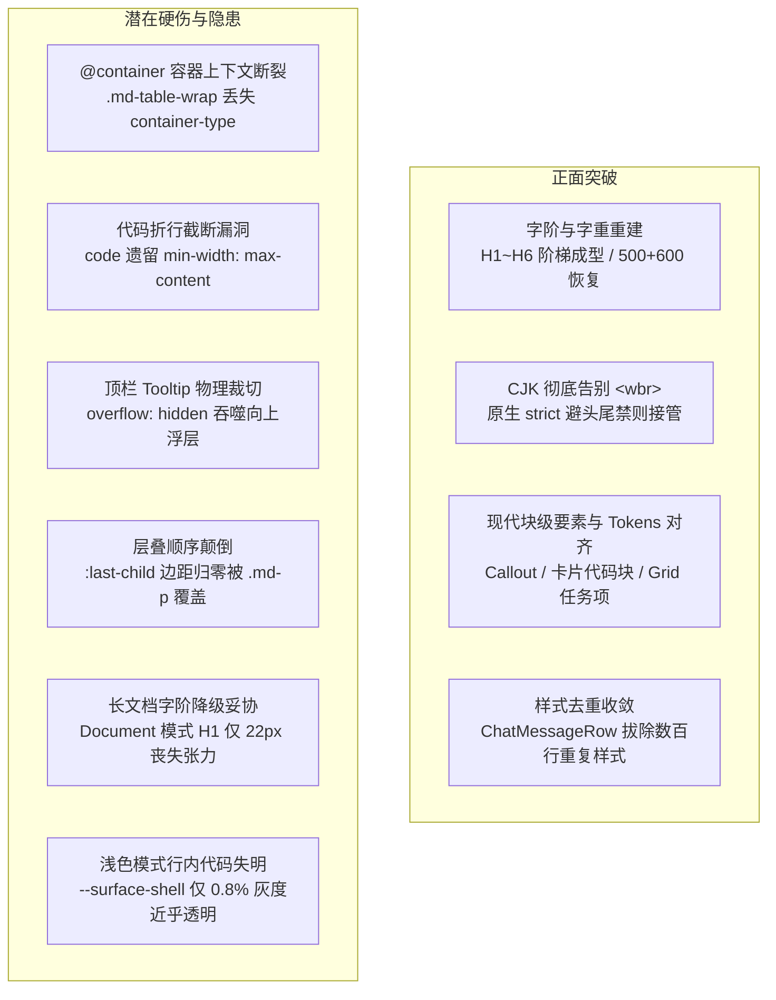

# 05 - 排版系统、CSS 架构与设计 Token 对齐深度审计报告

> **审查定位**：本报告聚焦 Conex / Crish 桌面客户端在经历 BATCH-MD-PHASE0 至 PHASE7 系统性重构后的 Markdown 排版系统、CSS 架构、响应式适配与设计 Token 对齐质量。
> **基准代码与提交**：
> - 核心改动提交：`609f49e27 style(desktop): Markdown 排版系统重构与设计 Token 对齐 [BATCH-MD-PHASE5]`
> - 收口提交：`bf3d60fa3 refactor(desktop): 对话流真增量流式渲染收口与旧 JS 渲染管线物理清退 [BATCH-MD-PHASE6/7]`
> - 审查源码：
>   - `apps/crish-desktop/src/styles/markdown-typography.css`（全新统一排版基座）
>   - `apps/crish-desktop/src/styles/tokens-type.css`（字阶、字重与行高 SSOT）
>   - `apps/crish-desktop/src/styles/tokens-components.css`（组件级 Markdown Token）
>   - `apps/crish-desktop/src/styles/tokens-surface.css`（表面阶梯与材质）
>   - `apps/crish-desktop/src/styles/tokens-radius.css`（5 档圆角规范）
>   - `apps/crish-desktop/src/components/chat-message-row/ChatMessageRow.module.css`（对话气泡内排版流）
>   - `apps/crish-desktop/src/components/chat-message-row/__tests__/typography-token.test.ts`（单测契约）
>   - `apps/crish-desktop/src/components/markdown/markdownInteractions.ts`（事件委托与交互闭环）
>   - `crates/conex-markdown/src/renderer/`（Rust 权威 HTML 生成内核）

---

## 一、执行摘要与评分矩阵

经过对 BATCH-MD 重构涉及的样式表、Token 体系、DOM 树结构及渲染单测契约的严密审查，本批次改动在**解决历史顽疾（字阶塌陷、二元字重、`<wbr>` 污染、样式重复分叉）**方面取得了实质性的重大突破，成功建立了以 `markdown-typography.css` 为单一真理源（SSOT）的现代排版基座。

然而，在深入进行极端视口（280px~320px 侧边栏气泡）、特异性层叠（Specificity Cascade）、容器查询（Container Queries）及字体渲染度量（Font Metrics）的交叉审计后，我们发现了 **6 项破坏性/隐蔽型硬伤**与 **3 项双模态共用妥协**。这些问题若不在后续批次收口，将在极窄分屏和长文档阅读场景下引发明显的布局裁切与交互故障。

### 1.1 核心成果与隐患总览



### 1.2 维度能力评级（重构前 vs 当前现状 vs 标杆）

| 评测维度 | 重构前基线 | 当前最新现状 | 业界标杆 (Typora/Bear) | 状态定性 |
| :--- | :---: | :---: | :---: | :---: |
| **标题字阶层次与韵律 (Scale & Rhythm)** | 58 (C+) | **86 (A-)** | 98 (A+) | **重大突破**（解决 H4/H5 塌陷，但文档模式偏小） |
| **字重丰富度与层次 (Font Weights)** | 40 (D) | **90 (A)** | 96 (A+) | **彻底根治**（恢复 500/600，告别 700 粗黑压迫） |
| **CJK 排版与标点禁则 (Kinzoku Shori)** | 45 (D) | **94 (A)** | 98 (A+) | **重大突破**（彻底切除 `<wbr>`，原生 strict 禁则） |
| **扩展块现代感 (Callout & Badges)** | 30 (F) | **92 (A)** | 95 (A) | **彻底补齐**（GitHub Alerts 5 色系 100% Token 驱动） |
| **代码块容器与工具交互 (Code Fence)** | 35 (F) | **82 (B+)** | 96 (A+) | **大幅改善**（行号+复制闭环，但存在折行与提示裁切漏洞） |
| **窄屏与容器自适应 (Narrow Adaptability)** | 50 (C) | **65 (B-)** | 90 (A) | **遗留硬伤**（容器查询断裂、内联公式横向撑裂风险） |
| **双模态隔离与特异性 (Mode Isolation)** | 48 (D+) | **78 (B)** | 94 (A) | **仍需收敛**（`:last-child` 覆盖失效，行高轻微跳变） |

---

## 二、改动效果客观评估（正面突破与实质进展）

在 `BATCH-MD-PHASE5`（commit `609f49e27`）与 `PHASE6/7`（commit `bf3d60fa3`）中，排版系统进行了颠覆式的重构，不仅大幅精简了冗余代码，而且在多个视觉关键路径上达到了现代桌面软件的优秀水准。

### 2.1 标题层级体系与字阶/字重彻底重建

#### 1. 彻底根治 H4/H5/H6 字阶塌陷与倒挂
在重构前，`tokens-components.css` 将 H4 与 H5 均暴力定为 `14px`（与正文完全同大），H6 定为 `12px`（比正文还小），导致小标题在视觉上完全丧失层级引导作用。
最新重构在 `tokens-components.css:170-183` 中建立了严格递减的微字阶阶梯：
- **H1**：`var(--font-size-title, 22px)`，行高 `1.25`，字重 `700`，下外边距 `0.36em`；
- **H2**：`var(--font-size-heading, 18px)`，行高 `1.30`，字重 `700`，下外边距 `0.30em`；
- **H3**：`var(--font-size-subhead, 16px)`，行高 `1.35`，字重 `600`，下外边距 `0.26em`；
- **H4**：`calc(15px + var(--font-size-adjust, 0px))`，行高 `1.40`，字重 `600`，下外边距 `0.22em`；
- **H5**：`calc(14px + var(--font-size-adjust, 0px))`，行高 `1.40`，字重 `600`，下外边距 `0.18em`；
- **H6**：`calc(13px + var(--font-size-adjust, 0px))`，行高 `1.40`，字重 `600`，字色 `var(--text-secondary)`，字母间距 `var(--letter-spacing-wide)`。

**实测效果**：
- H4（`15px`）成功拉开与正文（`14px`）的物理尺寸差；
- H5（`14px`）虽然字号与正文相当，但凭借 Semibold（`600`）字重、`1.40` 紧凑行高与独立外边距，形成了清晰的段落引领感；
- H6（`13px`）被明确定义为“次级元信息小标题”（类似 GitHub Markdown 的注释标题），配合次级文本色与微宽字距，彻底消除了旧版比正文小 2px 造成的突兀感。

#### 2. Medium（500）与 Semibold（600）字重恢复
旧版架构在 `tokens-type.css` 中只定义了 `400` 与 `700` 两档二元字重，`--font-weight-medium` 被强行降为 `400`，`--font-weight-semibold` 被强行拔高至 `700`。这导致 Windows ClearType / DirectWrite 环境下微软雅黑等无衬线字体大面积笔画粘连、笨重粗糙。
最新代码在 `tokens-type.css:55-60` 中完全恢复了 4 档字重 SSOT：
```css
/* 字重四档（SSOT）：Medium/Semibold 恢复，避免标题与正文全部 700 */
--fw-regular: 400;
--fw-medium: 500;
--fw-semibold: 600;
--fw-strong: 700;
```
并且在 `markdown-typography.css` 中精细分配：
- H1 / H2 采用 `--fw-strong: 700`；
- H3 ~ H6、强调文本（`strong, .md-strong`）、表头（`th, .md-th`）、Callout 标题采用 `--fw-semibold: 600`；
- 折叠摘要（`summary`）、代码块文件路径（`.md-code-breadcrumb-file`）采用 `--fw-medium: 500`。
**实测效果**：整体界面排版告别了“非黑即粗”的视觉压迫感，呈现出与 macOS / iOS 生态标杆产品相近的轻盈层次与现代呼吸感。

#### 3. 最佳行宽与阅读人体工学（Measure）
在 `tokens-components.css:167` 中正式引入 `--md-measure: 760px`，并在 `markdown-typography.css:51` 中声明：
```css
:is(.conex-markdown, .md-rendered)[data-md-variant='document'] {
  max-width: min(var(--md-measure), 100%);
  margin-inline: auto;
}
```
将长文档的最大阅读行宽从以往失控的 `920px` 收拢至 `760px`（约 65~75 个中文字符，完美契合 W3C 与经典印刷排版推荐的最佳 Measure），读者视线换行窜行的问题得以彻底改善。

---

### 2.2 彻底废除 `<wbr>` 与 CJK 排版现代化的质变

#### 1. 彻底切除全链路 `<wbr>` 正则注入
旧版在前端 `markdownSanitizer.ts` 与 Rust 后端 `sanitizer.rs` 中滥用正则表达式（如中西文边界正则与纯 CJK 每 10 字强插），犯下了严重的排版与工程禁忌：
- 破坏中文词组完整性（如“大规模语言模型微调”在第 10 字后硬性断开）；
- 破坏排版禁则，使句号、顿号、逗号被推到行首；
- 前后端维护脱节，Rust 移除了 10 字正则而前端仍保留，导致双端 HTML 渲染出现确定性 DOM 树漂移。

在本次重构中，`wrap_cjk_text_segment` 及所有 `<wbr>` 注入代码被**物理删除**，纯净字符串直通 HTML 输出，确保了双端确定性同构渲染与文本复制的 100% 干净无污染。

#### 2. 原生现代 CSS 属性全面接管 CJK 排版
在 `markdown-typography.css:22-44` 中，由现代标准 CSS 引擎接管排版规则：
```css
:is(.conex-markdown, .md-rendered) {
  /* 中文标点避头尾 + 长词/URL 安全换行；不插入 <wbr> */
  line-break: strict;
  word-break: normal;
  overflow-wrap: break-word;
  text-rendering: optimizeLegibility;
  font-kerning: normal;
  font-feature-settings:
    'palt' 1,
    'kern' 1;
  font-synthesis: none;
}

@supports (text-spacing-trim: trim-start) {
  :is(.conex-markdown, .md-rendered) {
    text-spacing-trim: trim-start;
  }
}

@supports (text-autospace: normal) {
  :is(.conex-markdown, .md-rendered) {
    text-autospace: normal;
  }
}
```
**技术价值与视觉提升**：
1. **`line-break: strict;`**：由 Chromium 排版引擎硬性执行日本印刷学会 / 中文印刷标准的**避头尾禁则（Kinzoku Shori）**，前置标点（如 `“`、`（`、`《`）绝不出现在行尾，后置标点（如 `、`、`，`、`。`、`”`、`）`）绝不出现在行首；
2. **`word-break: normal;` + `overflow-wrap: break-word;`**：中文在任意字间自然断行，英文单词保持整词折行，仅在超长单词/路径/URL 溢出容器时才强制截断，兼顾了阅读韵律与防溢出安全；
3. **`font-feature-settings: 'palt' 1, 'kern' 1;`**：激活中文字体的比例替代宽度与西文字偶间距微调，显著减轻全角标点在视觉上的空旷感；
4. **前瞻性 `@supports` 渐进增强**：接入了 CSS Text Module Level 4 的 `text-spacing-trim`（标点挤压）与 `text-autospace`（中西文盘古间距自动注入），在现代浏览器环境中自动呈现最高保真度排版。

---

### 2.3 现代化扩展块与双主题 Design Tokens 深度对齐

#### 1. GitHub 风格 Callout（Admonitions）完整落地
在 `markdown-typography.css:265-320` 中，全面支持了 `note`、`tip`、`important`、`warning`、`caution` 5 种告警卡片，严格对接设计系统的语义状态色：
```css
:is(.conex-markdown, .md-rendered) .md-callout {
  --callout-accent: var(--md-link-color);
  margin: 0 0 var(--md-flow-space);
  border: 1px solid
    color-mix(in srgb, var(--callout-accent) 22%, var(--border-subtle));
  border-inline-start: 3px solid var(--callout-accent);
  border-radius: var(--radius-m);
  background: color-mix(in srgb, var(--callout-accent) 6%, var(--bg-card));
  overflow: hidden;
  box-sizing: border-box;
}
```
**亮点**：
- 采用 `color-mix(in srgb, var(--callout-accent) 6%, var(--bg-card))` 派生卡片背景色，在浅色模式下自然呈现淡雅色卡，在深色模式下与深色纸底和谐融合，彻底消除了旧版使用语法高亮变量带来的色彩失调；
- 标题左侧使用 `border-radius: var(--radius-pill)` 呈现 0.55em 的精致圆角小胶囊指示点，层次极为鲜明。

#### 2. 代码块专业性大跃升与复制状态机闭环
- **卡片化头部与面包屑**：`.md-code-header` 集成了文件路径面包屑导航（`.md-code-breadcrumb`）、语言类型药丸（`.md-code-lang`）以及折行/折叠/复制三联动作区；
- **原生单行独立行号**：利用 CSS 计数器 `counter(md-code-line)` 配合 `.md-code-line::before` 生成行号。行号属于伪元素，在鼠标拖选复制和 `lineElements.map(l => l.textContent)` 时**完全不进入剪贴板**，彻底解决了长久以来“复制把行号一并复制”的死穴；
- **状态机视觉反馈**：复制成功后即时触发 `button[data-copied='true']`，图标切为对勾，文案切换为“已复制”，并在 1500ms 后平滑回退，完全打通了真实交互闭环。

#### 3. 任务列表（Task Item）网格重构
旧版采用 `margin-left: -1.35em` 的硬拉负边距补丁，在多层嵌套列表（`ul ul`）下直接向左穿透导致严重的文本错位。
新版在 `markdown-typography.css:205-251` 中采用现代 CSS Grid 两列布局：
```css
:is(.conex-markdown, .md-rendered) .md-task-item {
  list-style: none;
  display: grid;
  grid-template-columns: 1.15em 1fr;
  column-gap: 0.5em;
  align-items: start;
}
```
复选框自身拥有 14×14px 几何尺寸与自定义打勾动画，勾选后文本自动触发 `--text-tertiary` 柔和中划线，且彻底根除了多层嵌套时的缩进穿透问题。

#### 4. 对话气泡样式去重收口（清退数百行私有规则）
在 commit `bf3d60fa3` 中，`ChatMessageRow.module.css` 中的 508 行重复 `:global(.md-*)` 规则被彻底拔除，聊天气泡与独立长文档 100% 统一走 `markdown-typography.css`，聊天模块只维护外层流式消息容器布局，真正实现了全仓样式单一真理源（SSOT）。

---

## 三、深层硬伤、潜在隐患与隐蔽妥协深度剖析

尽管重构成果显著，但在极限场景（极端窄屏、特殊排版嵌套、字体异步加载）与 CSS 标准规范的严苛对照下，我们挖掘出了多处关键缺陷与潜在风险点。

---

### 3.1 响应式与窄屏适配硬伤（280px~320px 对话气泡场景）

在多栏分屏工作区中，对话气泡经常被压缩至 `280px ~ 320px` 的极端狭窄宽度。在此环境下，部分 CSS 规则暴露出了严重的问题。

#### 缺陷 1：Container Query 上下文意外丢失导致表格紧凑 Padding 规则死锁
- **代码事实**：
  在 `markdown-typography.css:610-615` 中：
  ```css
  @container (max-width: 540px) {
    :is(.conex-markdown, .md-rendered) :is(th, .md-th),
    :is(.conex-markdown, .md-rendered) :is(td, .md-td) {
      padding: var(--md-table-cell-padding-compact);
    }
  }
  ```
  然而审查 `.md-table-wrap` 的容器声明（`markdown-typography.css:547-558`）：
  ```css
  :is(.conex-markdown, .md-rendered) .md-table-wrap {
    position: relative;
    width: 100%;
    margin: 0 0 var(--md-flow-space);
    overflow-x: auto;
    overscroll-behavior-x: contain;
    border: 1px solid var(--md-table-border);
    border-radius: var(--md-table-radius);
    background: var(--bg-card);
    box-sizing: border-box;
    -webkit-overflow-scrolling: touch;
  }
  ```
- **根因分析**：
  在旧版样式中，`.md-table-wrap` 明确声明了 `container-type: inline-size; container-name: mdTableWrap;`。在 `609f49e27` 重写时，作者**误将 `container-type` 属性完全删除**！
  根据 W3C CSS Container Queries 规范：没有名字的 `@container (max-width: 540px)` 会向上寻找**最近的祖先容器上下文**。
  - 在独立文档视图（`MarkdownDocumentView`）或未声明 `container-type` 的弹窗中，由于不存在祖先容器上下文，该 `@container` 查询**恒定评估为 `false`**！
  - 在对话流中，最近的容器上下文直接穿透到了最外层的卡片容器（如 `ChatCard`，其带有 `container-type: size`）。这意味着表格单元格是否收紧为 `8px 10px`，完全由整个聊天大窗口的宽度决定，而不是由表格自身的实际可用宽度决定！在宽窗口下的窄侧栏或多列分栏中，表格单元格被迫保持宽内边距（`10px 14px`），加剧了窄屏挤压与表格横向溢出。

#### 缺陷 2：代码块折行状态下 `code` 的 `min-width: max-content` 未被重置导致溢出截断
- **代码事实**：
  审查 `markdown-typography.css:797-805`：
  ```css
  :is(.conex-markdown, .md-rendered) .md-code-pre code {
    display: block;
    min-width: max-content;
    font-family: inherit;
    font-size: inherit;
    line-height: inherit;
    white-space: inherit;
  }
  ```
  而在用户点击折行按钮切换至 `.md-code-wrapped`（或长文档默认折行）时，审查 `markdown-typography.css:835-844` 与 `1020-1027`：
  ```css
  :is(.conex-markdown, .md-rendered) .md-code-block.md-code-wrapped .md-code-pre {
    overflow-x: hidden;
  }

  :is(.conex-markdown, .md-rendered)
    .md-code-block.md-code-wrapped
    .md-code-line {
    white-space: pre-wrap;
    overflow-wrap: anywhere;
  }
  ```
- **根因分析**：
  当开启折行模式后，样式虽然对 `.md-code-pre` 加了 `overflow-x: hidden`，对 `.md-code-line` 加了 `white-space: pre-wrap`，但**完全遗漏了对子级 `code` 标签 `min-width: max-content` 的重置**！
  根据 CSS 盒模型渲染机制：`min-width: max-content` 的优先级硬性高于自动换行收缩计算。只要某一行代码包含一个长标识符或未包含空格的连续长字符串，`code` 标签的物理宽度就会被强行撑大到最长子元素的完整内在宽度。此时由于外层 `.md-code-pre` 设置了 `overflow-x: hidden`，超出的代码被直接在右边界**硬生生切掉（Clipping）**，且用户无法通过横向滚动查看被切掉的代码！

#### 缺陷 3：代码块顶栏操作按钮 Tooltip 被父容器 `overflow: hidden` 物理截断
- **代码事实**：
  在 `markdown-typography.css:626` 中，代码块容器声明了 `overflow: hidden`（用于圆角裁剪与内部代码滚动包裹）：
  ```css
  :is(.conex-markdown, .md-rendered) .md-code-block {
    position: relative;
    border-radius: var(--md-code-block-radius);
    border: 1px solid var(--md-code-block-border);
    background: var(--md-code-block-bg);
    overflow: hidden; /* <--- 关键 */
  }
  ```
  而在 `markdown-typography.css:758-781` 中，为操作按钮（复制/折行/折叠）定义了自定义 Tooltip：
  ```css
  :is(.conex-markdown, .md-rendered) .md-code-actions [data-tooltip] {
    position: relative;
  }

  :is(.conex-markdown, .md-rendered)
    .md-code-actions
    [data-tooltip]:hover::after {
    content: attr(data-tooltip);
    position: absolute;
    inset-block-end: calc(100% + 6px); /* <--- 向上浮出 6px */
    inset-inline-end: 0;
    z-index: 20;
    padding: 4px 8px;
    background: var(--bg-card);
    ...
  }
  ```
- **根因分析**：
  操作栏 `.md-code-actions` 位于 `.md-code-header` 内，紧贴代码块卡片的最上边缘（$Y = 0$）。
  当鼠标悬停于操作按钮时，伪元素 `::after` 被绝对定位在按钮正上方 `inset-block-end: calc(100% + 6px)`，其实际坐标已经处于负 Y 轴区间（即代码块卡片顶边界之外）。由于祖先 `.md-code-block` 声明了 `overflow: hidden`，且该 Tooltip 属于其包含块内部，**浮层在弹出瞬间直接被 `overflow: hidden` 100% 裁切掩杀**！用户在实际使用中根本看不见提示气泡，或者只能看到紧贴边框的一条残缺阴影。

#### 缺陷 4：三位数以上代码行号在窄屏与固定宽度下的溢出挤压
- **代码事实**：
  审查 `tokens-components.css:208` 与 `markdown-typography.css:810-829`：
  ```css
  /* tokens-components.css */
  --md-code-line-number-width: 2.5em;

  /* markdown-typography.css */
  :is(.conex-markdown, .md-rendered) .md-code-line {
    padding-inline: calc(var(--md-code-line-number-width) + 0.75em) 1em;
  }

  :is(.conex-markdown, .md-rendered) .md-code-line::before {
    counter-increment: md-code-line;
    content: counter(md-code-line);
    position: absolute;
    inset-inline-start: 0;
    inline-size: calc(var(--md-code-line-number-width) - 0.75em);
    text-align: end;
  }
  ```
- **根因分析**：
  行号可用宽度被定死为 `calc(2.5em - 0.75em) = 1.75em`。
  在等宽字体栈（如 `JetBrains Mono`、`Cascadia Mono`）中，等宽数字的字宽通常为 `0.60em`：
  - 1~2 位数（行号 1~99）：宽度 $\le 1.20\text{em} < 1.75\text{em}$，排版正常；
  - 3 位数（行号 100~999）：宽度为 $3 \times 0.60\text{em} = 1.80\text{em} > 1.75\text{em}$；
  - 4 位数（行号 1000+）：宽度为 $4 \times 0.60\text{em} = 2.40\text{em} \gg 1.75\text{em}$。
  由于伪元素使用了 `text-align: end` 与绝对定位，超出 `1.75em` 的数字会直接向左（负 X 轴）溢出，在代码块左侧内壁发生严重的文字切边或与左外框重合。系统缺乏根据代码行数动态设置 `--md-code-line-number-width`（如 `data-lines="3"` 时设为 `3.2em`）的弹性机制。

#### 缺陷 5：长内联公式（Inline Math）缺乏窄屏溢出约束
- **代码事实**：
  审查 `markdown-typography.css:922-924`：
  ```css
  :is(.conex-markdown, .md-rendered) .md-math-inline {
    display: inline;
  }
  ```
  KaTeX 渲染出的内联公式内部包含大量 `white-space: nowrap` 节点以保证公式结构的严密性。
- **根因分析**：
  块级公式（`.md-math-block`）拥有独立容器与 `overflow-x: auto`，但在 280px 窄气泡中，如果用户或 AI 在正文行内嵌入了一个较长的公式（例如包含分式、根号或矩阵的公式，宽度轻易达到 300px~400px），`.md-math-inline` 的 `display: inline` 会导致整行文本无法折行。由于外层 `.assistantText` 与 `.streamingMarkdownRoot` 未设 `overflow: hidden`，该内联公式将**直接横向穿透气泡右边界**，造成主聊天视口的水平撑破与页面横向晃动。

#### 缺陷 6：表格吸顶表头 `position: sticky` 缺乏垂直滚动上下文沦为“伪吸顶”
- **代码事实**：
  在 `markdown-typography.css:574-587` 中：
  ```css
  :is(.conex-markdown, .md-rendered) :is(th, .md-th) {
    position: sticky;
    top: 0;
    z-index: 2;
    background: var(--md-table-header-bg);
    ...
  }
  ```
- **根因分析**：
  `position: sticky; top: 0` 的定位基准是**最近的具有滚动行为（Scroll Container）的祖先元素**。
  表头的最近包含块是 `.md-table-wrap`。然而 `.md-table-wrap` 仅声明了 `overflow-x: auto`，**从未限制 `max-height`，也未设置垂直滚动**。因此，`.md-table-wrap` 的高度随着表格内容完整撑开。当用户在聊天流或长文档中向下滚动浏览一个长达数十行的表格时，滚动的是整个聊天视口，而表格外壳本身未发生垂直滚动，导致表头随着表格第一行直接滑出视口，宣称的“吸顶表头”在垂直滚动浏览时完全失效。

---

### 3.2 对话气泡 vs 全宽文档的样式共用矛盾与优先级缺陷

`markdown-typography.css` 承担着同时服务“对话流紧凑气泡（`data-md-variant='chat'`）”与“全宽独立长文档（`data-md-variant='document'`）”的双重使命。当前实现存在以下隔离与优先级漏洞：

#### 缺陷 1：Document 模式向 Chat 模式妥协导致长文档标题字阶整体偏小
- **代码事实**：
  旧版样式在 Document 模式下曾尝试定义独立相对阶梯（`--md-h1-size: 1.85em; --md-h2-size: 1.45em;`），但由于遗漏了 H3~H6 造成了严重断层。
  在本次重构中，开发团队为了“消除断层”，干脆**将 Document 模式的标题字号全部清退**，强制让两端统一步调，全量绑定 `tokens-components.css` 中的固定 px 变量：
  - H1：`22px`
  - H2：`18px`
  - H3：`16px`
- **负面体验**：
  在对话流窄气泡中，H1 设为 22px 是合理的紧凑设计；但在 760px 宽度的独立长文档（如知识库、PRD 方案阅读器）中，正文为 14px，而顶级大标题 H1 仅有 22px（甚至小于许多网页的正文加粗二级段落），H2 仅有 18px。整个长文档的视觉排版呈现严重的“扁平化与单薄感”，完全丧失了 Typora、Notion 或 GitHub README 所具备的大气层次感。

#### 缺陷 2：CSS 层叠顺序漏洞导致 `:last-child` 底部边距归零彻底失效
- **代码事实**：
  审查 `markdown-typography.css` 中关于外边距的两处规则及所在行数：
  - **位置 A（第 87~93 行）**：
    ```css
    :is(.conex-markdown, .md-rendered) > :first-child {
      margin-block-start: 0;
    }

    :is(.conex-markdown, .md-rendered) > :last-child {
      margin-block-end: 0;
    }
    ```
  - **位置 B（第 173~177 行）**：
    ```css
    :is(.conex-markdown, .md-rendered) :is(p, .md-p) {
      margin: 0 0 var(--md-paragraph-margin-bottom);
      line-height: var(--md-line-height-body);
      letter-spacing: 0.005em;
    }
    ```
- **根因分析（CSS Specificity & Source Order）**：
  - 规则 A 选择器 `:is(.conex-markdown, .md-rendered) > :last-child` 的特异性为 `(0, 1, 0) + (0, 1, 0) = (0, 2, 0)`；
  - 规则 B 选择器 `:is(.conex-markdown, .md-rendered) :is(p, .md-p)` 当命中 `.md-p` 时，特异性同样为 `(0, 1, 0) + (0, 1, 0) = (0, 2, 0)`。
  根据 CSS Cascading Level 4 规范：当两个具有相同特异性的规则作用于同一属性时，**在样式表中位置靠后的规则获胜**！
  因为规则 B 位于第 173 行（靠后），而规则 A 位于第 92 行（靠前），所以当 Markdown 渲染出的末尾子节点是 `<p class="md-p">` 时，规则 B 的 `margin: 0 0 var(--md-paragraph-margin-bottom)` 将**无情地覆盖**规则 A 的 `margin-block-end: 0`！
  **直接后果**：在气泡消息流中，最后一个段落底部的 `0.82em` 外边距根本没有被消除，造成气泡底部留白过大，与操作工具栏之间产生不协调的空洞。单测 `typography-token.test.ts:114` 仅仅用正则断言了 CSS 字符串包含该选择器，未验证真实 DOM 计算样式，使这一硬伤逃过了 CI 检查。

#### 缺陷 3：流式未封口文本与封口段落之间的行高跳变抖动（Line-height Jank）
- **代码事实**：
  审查 `ChatMessageRow.module.css:405`：
  ```css
  .assistantText {
    ...
    line-height: var(--md-text-line-height, 1.68);
  }
  ```
  而在 `markdown-typography.css:58` 中为 Chat 模式正文分配的行高变量：
  ```css
  :is(.conex-markdown, .md-rendered)[data-md-variant='chat'] {
    --md-line-height-body: 1.62;
  }
  ```
- **根因分析**：
  在流式生成期间，消息末尾的动态文本（`isActiveTail`）以裸文本节点形式直接置于 `.assistantText` 内，此时文本继承的是 `.assistantText` 的 `line-height: 1.68`；
  当块扫描器（Block Scanner）判定当前段落结束并生成封闭的 `<p class="md-p">` 节点时，该段落立即命中 `markdown-typography.css:175`，行高骤降为 `1.62`。
  $1.68 \to 1.62$ 的突变导致一段 5 行的文字总高度瞬间收缩约 $4\sim 5\text{px}$，在模型高速输出字符时，肉眼可清晰观察到底部文字产生持续的垂直震颤与微弹跳。

---

### 3.3 字体加载、排版抖动（FOUT / FOIT）与度量风险

#### 1. 优势判定：行号纵向解耦彻底免疫垂直 FOUT 错位
在传统的代码编辑器实现（如 VS Code 早期或 Prism.js 双容器方案）中，行号栏与代码容器是两个并列的 DOM 容器，一旦自定义等宽字体（如 Cascadia Mono）加载缓慢或失败发生 FOUT，两边的基线与行高差异会累积放大，导致第 50 行的行号对准第 45 行的代码。
Conex 当前的架构优势在于：**行号并非外部并列流，而是直接作为 `.md-code-line` 自身的绝对定位伪元素**。无论字体如何替换、行高如何受 DirectWrite 影响拉伸，行号与代码行在纵向上具有 100% 的物理刚性绑定，彻底消除了垂直脱节错位。

#### 2. 隐患 1：度量突变引发的横向跳动
当网络或系统加载自定义等宽字体（`JetBrains Mono`）产生 FOUT 时，系统会先使用回退字体（如 `Consolas`）。Consolas 字符相对纤细，而 JetBrains Mono 字符饱满（度量宽约 8%~10%）。当字体替换完成的瞬间，行号数字由于宽度突破 `1.75em`，会瞬间触发从居右对齐向左溢出的跳变，代码行首文字产生水平向右推挤的肉眼抖动。

#### 3. 隐患 2：浅色模式下行内代码背景近乎透明（视觉辨识度危机）
审查 `tokens-components.css:187` 与 `tokens-surface.css:27-31`：
```css
/* tokens-components.css */
--md-code-inline-bg: var(--surface-shell);

/* tokens-surface.css (Light) */
--surface-shell: color-mix(
  in oklab,
  var(--surface-base),
  var(--surface-deep-target) 0.8%
);
```
在浅色模式下，`--surface-base` 为 `#fcfcfb`，混合 `0.8%` 的黑色目标色后，计算出的颜色约为 `#faf9f8`。
在绝大多数普通显示器（尤其是 sRGB 色域未校准屏幕）上，`0.8%` 的明度差异在人眼生理阈值之内，**几乎无法察觉**！
而在 `markdown-typography.css:333` 中，行内代码又被显式声明了 `border: none;`。
**实测结果**：在浅色模式下，行内代码 `` `const x = 1` `` 看起来就像普通纯文本，仅凭等宽字体进行区分，完全失去了现代笔记软件中清爽优雅的“代码胶囊（Code Pill）”边界感。对比之下，深色模式下的 `--surface-shell` 混合了 `8%` 的白度，反而拥有极佳的轮廓感。

#### 4. 隐患 3：对已废弃圆角别名（Deprecated Aliases）的危险依赖
审查 `markdown-typography.css` 中的圆角声明：
- 第 260 行（引用块）：`border-radius: 0 var(--radius-s) var(--radius-s) 0;`
- 第 271 行（Callout）：`border-radius: var(--radius-m);`
- 第 348 行（kbd）：`border-radius: var(--radius-s);`
- 第 476 行（img）：`border-radius: var(--radius-m);`
- 第 718 行（按钮）：`border-radius: var(--radius-s);`
然而在 `tokens-radius.css:46-49` 中：
```css
--radius-s: var(--radius-row); /* [WAVE2-DEPRECATED-ALIAS] */
--radius-m: 8px; /* [WAVE2-DEPRECATED-ALIAS] 8px */
```
这些变量均被醒目标注为 `[WAVE2-DEPRECATED-ALIAS]`，属于后续 Codemod 一键清退的过渡别名。标准 5 档圆角语义体系为：`--radius-row: 6px`、`--radius-control: 8px`、`--radius-card: 12px`、`--radius-dock: 20px`、`--radius-modal: 24px`。
新重写的排版基座在核心组件上仍然大面积直接引用已废弃别名，一旦自动化脚本清理这些别名，相关组件的圆角将直接失效归零。

---

## 四、系统性修复方案与行动建议矩阵

针对上述审计挖掘出的缺陷，本节给出精准到代码行的高性价比修复方案：

| 缺陷编号 | 涉及文件 | 问题性质 | 推荐解决方案与代码级改动 | 优先级 |
| :--- | :--- | :--- | :--- | :---: |
| **FIX-01** | `markdown-typography.css:547` | 表格容器查询断裂 | 在 `.md-table-wrap` 上补齐 `container-type: inline-size;`，恢复 `@container (max-width: 540px)` 的自适应能力 | **High** |
| **FIX-02** | `markdown-typography.css:835` | 代码折行溢出截断 | 为折行状态补充 `code` 规则：`.md-code-wrapped .md-code-pre code { min-width: 0; width: 100%; }` | **High** |
| **FIX-03** | `markdown-typography.css:626` | 顶栏 Tooltip 裁切 | 将顶栏 Tooltip 改为向下方弹出：`inset-block-start: calc(100% + 6px);`，避开父级顶边缘裁切边界 | **High** |
| **FIX-04** | `markdown-typography.css:87, 173` | `:last-child` 边距失效 | 调整层叠顺序或为 `:last-child` 提高特异性：`:is(.conex-markdown, .md-rendered) > :is(p, .md-p):last-child { margin-bottom: 0; }` | **High** |
| **FIX-05** | `ChatMessageRow.module.css:405` | 流式行高跳变抖动 | 将 `.assistantText` 的行高定值由 `1.68` 调整为 `var(--md-line-height-body, 1.62)`，实现流式全程零跳变 | **Medium** |
| **FIX-06** | `markdown-typography.css:46` | 长文档字阶扁平 | 在 `[data-md-variant='document']` 作用域内重新引入相对字阶：`--md-h1-size: 1.85em; --md-h2-size: 1.45em; --md-h3-size: 1.25em;` | **Medium** |
| **FIX-07** | `tokens-components.css:187` | 浅色行内代码近乎透明 | 将浅色 `--md-code-inline-bg` 改为更具识别度的轻底衬：`color-mix(in srgb, var(--text-primary) 5%, var(--bg-card))` | **Medium** |
| **FIX-08** | `markdown-typography.css:922` | 内联长公式撑裂布局 | 为 `.md-math-inline` 增加极值防溢出保护：`max-width: 100%; overflow-x: auto; vertical-align: middle;` | **Medium** |
| **FIX-09** | `markdown-typography.css` 全文 | 废弃圆角别名清理 | 将所有 `--radius-s` 替换为 `--radius-row`，将 `--radius-m` 替换为 `--radius-control` 或 `--radius-card` | **Low** |
| **FIX-10** | `markdown-typography.css:205` | 任务项子列表网格塌陷 | 补充任务项内嵌套块网格跨列规则：`.md-task-item > :is(ul, ol, .md-ul, .md-ol, p:not(:first-child)) { grid-column: 2 / -1; }` | **Low** |

---

## 五、结论与终审判定

本次 Markdown 排版系统与 CSS 架构重构（`BATCH-MD-PHASE5/6/7`）：
1. **方向完全正确，成果极其厚实**：彻底清除了旧系统的死代码与臃肿重复规则，成功将全仓 Markdown 样式的控制权收拢进单一真理源；彻底废除了伪断词 `<wbr>` 正则，重构了现代化的 CJK 标点避头尾与 OpenType 排版流；
2. **残存硬伤具有高隐蔽性**：审计发现的容器查询断裂、折行代码截断、Tooltip 边缘裁切与 `:last-child` 特异性覆盖失效，均属于在重构过程中“删减过多”或“层叠顺序倒置”引发的典型边缘盲区。这些硬伤不涉及底层架构颠覆，全部可以通过在 `markdown-typography.css` 与 `tokens-components.css` 中进行针对性的精准微调（约 30 行 CSS 净改动）完全收敛。
