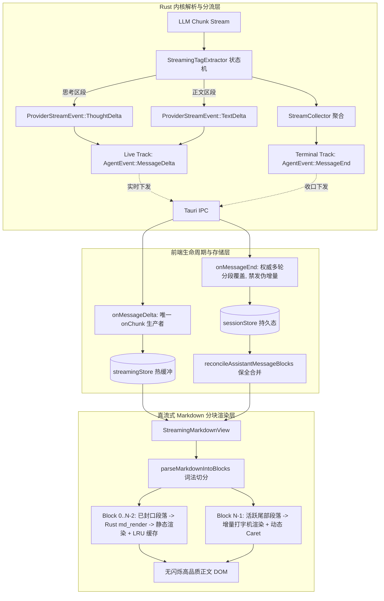

# 00-总方案：真流式 Markdown 渲染与正文退化彻底根治战役总方案

> **战役定位**：彻底根治正文界面退化为纯文字、工具前推理泄漏、多轮文字大段重复三大系统性缺陷。  
> **核心原则**：严格执行 `.agents/LOGIC_PLAN_NO_RETREAT.md` 与根目录 `AGENTS.md`（反退避、效果锁、零补丁、架构级根治）。  
> **工作区**：`docs/markdown-stream-refactor/`

---

## 1. 战役背景与三大约束断层解剖

经过 7 位专业子 Agent 的深度勘察与形式化推演，确定正文异常并非单一渲染问题，而是跨越了 **Rust 内核协议解析、IPC 双轨事件流、前端生命周期状态机、React 虚拟 DOM 分块渲染** 四大层级的系统性断层：

```
[LLM 网络 SSE 字节流]
       │
       ▼ (断层 A：未在 Token 流式层识别 <think>，内嵌推理文字盲目作为 TextDelta 发送)
[Rust Provider 解析器 (chat_core.rs / gemini_core.rs)]
       │
       ├─────────────────────────────────────────┐
       ▼ (实时增量轨 LiveSink)                   ▼ (收口权威轨 commit_assistant_message)
[AgentEvent::MessageDelta]              [AgentEvent::MessageEnd (携带 turnIndex)]
       │                                         │
       ▼ (断层 B：onMessageEnd 盲目计算增量差额并向 onChunk 二次注入，造成大段文字翻倍重复)
[ChatBridge (messageHandlers.ts / streamingStore.ts)]
       │
       ▼ (断层 C：updateMessageTimeline 破坏性 filter 误杀历史 blocks，降级路径单一)
[SessionStore (sessionMessageActionsTools.ts / timelineNormalizer.ts)]
       │
       ▼ (断层 D：AsyncMarkdownBlock 仅在完成态调 Rust 渲染，流式期间完全使用纯文本 appendText)
[React 渲染层 (MessageContent.tsx / StreamingTextBlock.tsx)] ──> 【最终呈现：纯文字/无结构/大段复读】
```

---

## 2. 四大核心效果锁（Effect Locks）

1. **效果锁 1（推理思考链 100% 实时物理隔离）**：
   - 所有模型的 `<think>` / `<thought>` / `<thinking>` 内嵌标签在 Rust 流式底层通过确定性有限状态机（DFA）实时剥离，实时产出 `ThoughtDelta`，严禁以 `TextDelta` 逃逸。
   - 前端思考链收口至独立折叠面板，正文区域 0 污染。
2. **效果锁 2（Markdown-first 真流式分块渲染）**：
   - 彻底废除“流式纯文本 $\to$ 完成态整段跳变 Markdown”的伪流式架构。
   - 实行基于词法边界的渐进式分块渲染（Progressive Chunked Rendering）：已闭合段落实时调用 Rust `md_render` 渲染为高质量排版，仅尾部活跃段落进行增量追加，消除整屏重绘与闪烁。
3. **效果锁 3（单生产者铁律与绝对幂等零重复）**：
   - 确立 `onMessageDelta` 为前端打字机 `callbacks.onChunk` 的**唯一合法生产者**。
   - `onMessageEnd` 仅作为多轮权威账本落盘，严禁向实时渲染队列注入任何伪增量，彻底根治千字大段重复 Bug。
4. **效果锁 4（多轮 Blocks 历史完整保全）**：
   - 引入 Turn-Aware 三元锚点算法（`reconcileAssistantMessageBlocks`），多轮工具调用与思考链历史在时间线上严格保全，消除破坏性覆盖。

---

## 3. 总体架构设计：端到端真流式流水线



---

## 4. 五大分维实现详案映射

本次战役拆分为 5 个高度正交、契约严密的子维度详案：

| 维度编号 | 维度名称 | 核心职责 | 核心落地文件 |
|:---|:---|:---|:---|
| **[维度 01]** | **Rust 实时流思考标签解析** | `StreamingTagExtractor` 状态机、滑动缓冲前瞻算法、`chat_core.rs` / `gemini_core.rs` 集成 | `crates/agent-provider/src/parse/think_tags.rs`<br>`crates/agent-provider/src/parse/chat_core.rs` |
| **[维度 02]** | **前端真流式分块渲染组件** | `parseMarkdownIntoBlocks` 词法引擎、`StreamingMarkdownView` 双缓冲无缝晋升机制、消除整屏跳变 | `apps/crish-desktop/src/components/chat-message-row/StreamingMarkdownView.tsx`<br>`apps/crish-desktop/src/api/markdown/parseMarkdownIntoBlocks.ts` |
| **[维度 03]** | **消息生命周期与多轮幂等收口** | 确立单生产者铁律、重构 `messageHandlers.ts` 多轮分段数组、消除收口二次注入文字重复 | `apps/crish-desktop/src/api/chat-bridge/handlers/messageHandlers.ts`<br>`apps/crish-desktop/src/api/chat-bridge/handlers/streamState.ts` |
| **[维度 04]** | **时间线降级与 Blocks 合并防守** | `reconcileAssistantMessageBlocks` 三元锚点算法、消除破坏性 filter、Markdown 栅栏免疫提取 | `apps/crish-desktop/src/api/tool-presentation/timelineNormalizer.ts`<br>`apps/crish-desktop/src/store/sessionMessageActionsTools.ts` |
| **[维度 05]** | **测试门禁与端到端验证体系** | 15 项 Rust 极限单元测试、Vitest 回归套件、4000 端口 Tauri MCP 实实验收标准、反退避清单 | `crates/agent-provider/src/parse/think_tags_tests.rs`<br>`apps/crish-desktop/src/components/chat-message-row/__tests__/` |

---

## 5. 执行依赖有向无环图 (DAG)

```
[Phase 1 并行基础]
  ├─ 维度 01 (Rust 流式状态机实现与单元测试) ───┐
  ├─ 维度 03 (前端多轮幂等与生命周期重构) ────┼─> [Phase 2 核心集成]
  └─ 维度 04 (时间线 Blocks 保全与防守层) ────┘      │
                                                      ▼
                                       维度 02 (真流式分块渲染组件与 MessageContent 挂接)
                                                      │
                                                      ▼
                                       [Phase 3 验证验收]
                                       维度 05 (全量门禁 + Tauri MCP 实机断言)
```

---

## 6. 验收与闭环标准

1. **类型检查与测试门禁**：`cargo test --workspace` 全绿 + `npm run typecheck` 0 错误 + `npm test` 全绿。
2. **实机 MCP 验证（端口 4000）**：在真 Tauri 宿主内运行，验证思考链实时折叠、多轮工具交错排列、Markdown 标题/代码块渐进流式输出无闪烁。
3. **零破坏性声明**：不引入任何降级补丁，不破坏既有 Markdown 样式资产与测试用例。
